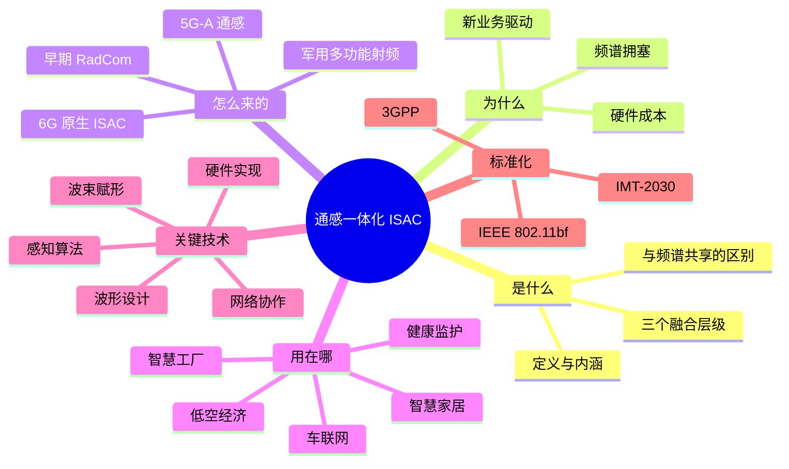
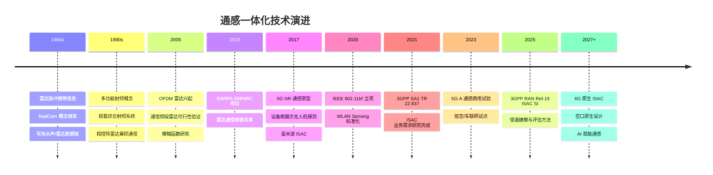
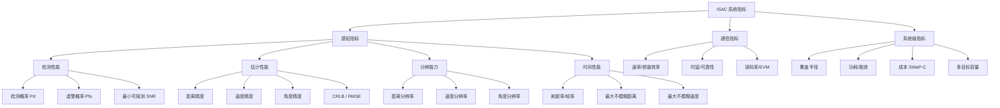
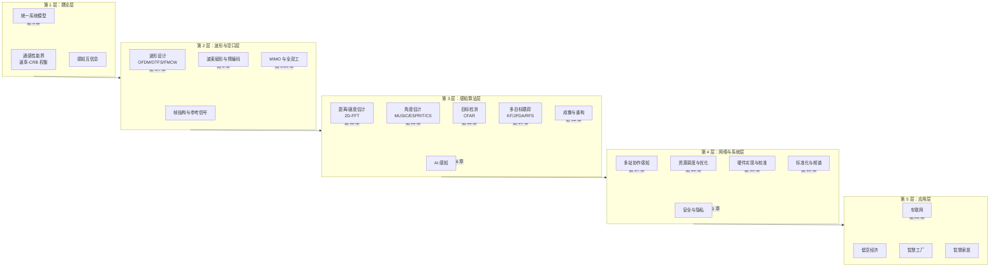

# 第 1 章　绪论：从"通信"与"感知"的分离到融合

> **本章导读**
> 在过去的近百年里，无线通信系统与雷达感知系统如同两条平行线：一个负责"把信息传出去"，一个负责"把世界看清楚"。它们使用相近的频段、相近的射频器件、相近的信号处理工具，却在体制上长期割裂。进入 5G-Advanced 与 6G 时代，频谱资源的稀缺、硬件成本的攀升，以及车联网、低空经济、数字孪生等新业务对"通信 + 感知"双重能力的刚性需求，正把这两条线强行拧成一股绳——这就是**通感一体化**（Integrated Sensing and Communication, ISAC）。本章将回答四个问题：它是什么、为什么现在需要它、它是怎么发展来的、以及本书将如何组织这一庞大知识体系。

**学习目标**

学完本章后，你应当能够：

1. **准确表述**通感一体化的定义，并区分"频谱共存""硬件共享""波形与网络一体化"三个融合层级；
2. **解释**推动通感一体化发展的三重驱动力（频谱、硬件、业务），并能用具体数据支撑；
3. **梳理**从早期雷达通信一体化（RadCom）到 5G-A 通感、再到 6G 原生 ISAC 的技术演进脉络；
4. **列举**不少于 6 类典型应用场景，并为每个场景写出对应的感知精度、刷新率、覆盖半径等量化指标；
5. **了解**3GPP、IEEE、IMT-2030(6G) 等标准组织在通感一体化上的进展与分工；
6. **建立**全书知识地图，明确后续 23 章的依赖关系与自己的学习路径。

**本章知识图谱**



---

## 1.1　什么是通感一体化

### 1.1.1 一个直观的类比

想象一只蝙蝠。它发出的超声波既不是"纯粹的通信信号"，也不是"纯粹的探测信号"——同一束声波，碰到墙壁反射回来让它"看见"障碍物，碰到同伴则可能被同伴的听觉系统解码为一种社交信息。蝙蝠的生物声呐天然就是"通感一体"的。

人类的工程系统却走了另一条路。雷达诞生于二战前后，通信广播则更早，两者在**频段、波形、收发架构、信号处理链**上各自演化出庞大而精密的体系。直到近二十年，人们才重新意识到：既然通信信号也要打到周围环境中去，为什么不让它在完成通信的同时，顺便"听一听"环境告诉我们的信息？

**通感一体化**的核心思想可以浓缩成一句话：

> **用同一套硬件、同一段频谱、同一个波形，同时完成信息传输与环境感知，并通过联合设计使两种功能相互增益而非相互拖累。**

这句话里有三个关键词——"同一套硬件""同一段频谱""同一个波形"，它们恰好对应了融合的三个层次。

### 1.1.2 融合的三个层级

并非所有"通信 + 感知"都配称为 ISAC。学术界与工业界普遍采用如下三级划分（有些文献细分为五级，本质一致）：

**层级一：频谱共存（Coexistence / Spectrum Sharing）**

通信与感知仍然是两套完全独立的系统，各自有独立的发射机、接收机、波形与协议。二者仅通过**干扰管理**来实现在同一频段内共存，例如：

- 认知无线电中的**频谱感知**：通信发射前先检测该频段是否被雷达占用；
- 美国 CBRS（Citizens Broadband Radio Service）频段：海军雷达与 5G 基站通过频谱接入系统（SAS）数据库协调；
- 5G 基站对气象雷达、航空雷达的**保护距离与功率回退**。

这一层级的研究核心是"互不伤害"，其技术手段包括数据库查询、动态频率选择（DFS）、空域隔离、功率控制等。**它不涉及任何硬件或波形的共享，是融合程度最低的一级。**

**层级二：硬件共享（Hardware Sharing / Co-design）**

两套系统仍然使用各自独立的波形与协议栈，但**共用射频前端、天线阵列、ADC/DAC、时钟与基带处理平台**。典型代表是舰载或机载的综合射频系统（Integrated RF System），以及近年出现的"通信雷达一体化基站"原型。

硬件共享带来了实实在在的收益：体积、重量、功耗与成本（SWaP-C）大幅下降。但它也引入了棘手的问题——**自干扰**（同时同频收发时发射信号直接泄漏进接收通道）、**收发切换时序冲突**、**动态范围不匹配**等。这些问题将在第 9 章与第 19 章详细讨论。

**层级三：波形与网络一体化（Waveform & Network Integration）**

这是真正意义上的 ISAC，也是本书的重点。其核心特征是：

1. **同一个发射信号**既承载通信数据，又作为探测波形；
2. **同一套信号处理链**同时输出通信比特与感知参数（距离、速度、角度、RCS、微多普勒等）；
3. **联合优化**：在波形设计、波束赋形、资源调度等层面，把通信指标（速率、SINR、误码率）与感知指标（检测概率、估计精度、分辨率、刷新率）放进同一个优化框架中权衡。

**表 1-1　三个融合层级的对比**

| 对比维度 | 层级一：频谱共存 | 层级二：硬件共享 | 层级三：波形与网络一体化 |
|---|---|---|---|
| 硬件是否共享 | 否 | **是** | **是** |
| 频谱是否共享 | 是（分时/分域） | 通常共享 | **是（同时同频）** |
| 波形是否统一 | 否 | 否 | **是** |
| 核心研究问题 | 干扰管理与协调 | 自干扰消除、收发隔离 | **通感联合设计与性能权衡** |
| 频谱效率 | 低（两套系统叠加） | 中 | **高** |
| 硬件成本 | 高 | 中 | **低** |
| 典型代表 | CBRS、DFS | 舰载综合射频系统 | 5G-A/6G ISAC 基站、802.11bf |
| 技术成熟度 | 已商用 | 已有产品 | 标准化推进中 |

> ⚠️ **注意**
> 有些文献把"通信辅助感知"（如利用 Wi-Fi 的 CSI 做室内定位）或"感知辅助通信"（如利用雷达探测结果辅助波束对准）也归入 ISAC 的范畴。严格来说，这两类属于**功能互助**（Sensing-Aided Communication / Communication-Aided Sensing），它们共享的是"信息"而非"信号"。本书将它们视为 ISAC 的重要子集与使能技术，在第 9 章、第 16 章、第 18 章中具体讨论。

### 1.1.3 形式化定义

为使后续讨论严谨，我们给出本书采用的工作定义。

设系统发射的复基带信号为 $\mathbf{x}(t) \in \mathbb{C}^{N_t \times 1}$，其中 $N_t$ 为发射天线数。该信号经由两条路径被接收：

- **通信路径**：信号经用户信道 $\mathbf{H}_c$ 到达 $K$ 个通信用户，第 $k$ 个用户接收信号
  $$\mathbf{y}_{c,k}(t) = \mathbf{H}_{c,k}\mathbf{x}(t) + \mathbf{n}_{c,k}(t) \tag{1-1}$$
  其中 $\mathbf{n}_{c,k}(t)$ 为加性噪声。目标是让用户可靠地解出 $\mathbf{x}(t)$ 中承载的比特。

- **感知路径**：信号照射到目标上被反射，回波返回到感知接收机，接收信号
  $$\mathbf{y}_s(t) = \sum_{p=1}^{P} \alpha_p\,\mathbf{b}(\theta_p)\mathbf{a}^H(\theta_p)\mathbf{x}(t-\tau_p)e^{j2\pi f_{d,p}t} + \mathbf{n}_s(t) \tag{1-2}$$
  其中 $P$ 为目标数，$\alpha_p$ 为复散射系数（含 RCS 与路径损耗），$\tau_p$、$f_{d,p}$、$\theta_p$ 分别为第 $p$ 个目标的时延、多普勒频移与到达角，$\mathbf{a}(\cdot)$ 与 $\mathbf{b}(\cdot)$ 为发射与接收导向矢量。目标是从 $\mathbf{y}_s(t)$ 中估计出 $\{\tau_p, f_{d,p}, \theta_p, \alpha_p\}$，或判决"目标是否存在"。

**ISAC 系统设计问题**就是：在给定的硬件约束（发射功率 $P_t$、天线数、带宽 $B$、帧结构）下，设计 $\mathbf{x}(t)$ 及其配套的处理算法，使得**通信效用函数** $U_c$（如加权和速率）与**感知效用函数** $U_s$（如检测概率的加权和、或参数估计 MSE 的负值）同时被最大化：

$$\max_{\mathbf{x}(\cdot)\in\mathcal{X}} \quad \rho\,U_c\!\left(\mathbf{x}\right) + (1-\rho)\,U_s\!\left(\mathbf{x}\right) \tag{1-3}$$

其中 $\rho \in [0,1]$ 为权衡因子，$\mathcal{X}$ 为可行波形集（功率约束、恒模约束、EVM 约束等）。式 (1-3) 看起来平淡无奇，但它却是全书的总纲：第 6 章讨论 $\mathcal{X}$ 取"OFDM 波形集"时如何求解，第 8 章讨论 $\mathbf{x}=\mathbf{W}\mathbf{s}$（波束赋形）时如何求解，第 18 章讨论把时间、频率、功率资源也纳入决策变量时如何求解，第 5 章则从信息论角度刻画这个权衡究竟能达到什么极限。

---

## 1.2　为什么是现在：三重驱动力

### 1.2.1 驱动力一：频谱资源的极度拥塞

无线电频谱是典型的稀缺公共资源。让我们看一组事实：

- 6 GHz 以下（Sub-6G）的优质"黄金频段"早已被移动通信、广播电视、航空导航、气象雷达、卫星业务、军民用雷达瓜分殆尽；
- 5G 时代单运营商在 Sub-6G 可用带宽通常在 100 MHz 量级，而 6G 期望的峰值速率（100 Gbps ~ 1 Tbps）要求吉赫兹级的连续带宽，只能向毫米波（24.25–52.6 GHz）甚至太赫兹（100 GHz 以上）迁移；
- 与此同时，车载毫米波雷达（24 GHz、77–81 GHz）、航空监视雷达、气象雷达也正在向更高频段扩张——**通信与雷达在同一段频谱上正面相撞**。

以 3.3–3.6 GHz 为例，这一段在中国同时部署了 5G 基站与多种雷达业务；以 24 GHz ISM 频段为例，它同时容纳了 Wi-Fi、蓝牙与车载雷达；以 77 GHz 为例，它几乎是车载雷达的专属，而 6G 毫米波又觊觎它。

如果继续沿用"分频段、分系统"的思路，要么是频谱拍卖成本失控，要么是干扰协调的复杂度爆炸。**通感一体化提供了一条"一份频谱、两件事"的出路**，理论上可以把频谱利用率提升 30%–50%（具体增益高度依赖场景，实际数字应以实测为准）。

### 1.2.2 驱动力二：硬件成本与 SWaP-C 约束

在现代无线设备中，射频前端与天线阵列的成本占比极高，尤其是：

- 大规模 MIMO 基站：64T64R 甚至 128T128R，每个通道包含 PA、LNA、移相器、滤波器、ADC/DAC；
- 车载平台：一辆 L3 级以上自动驾驶汽车通常装配 5–10 个毫米波雷达、若干个摄像头与多套通信模组，线束重量与功耗惊人；
- 无人机与卫星平台：对体积、重量、功耗（Size, Weight, Power and Cost, SWaP-C）的敏感度达到极致。

如果通信与感知能共用同一套天线阵列、射频通道与基带算力，则：

1. **器件数量减半**：天线、PA、LNA、混频器、ADC 均可复用；
2. **功耗下降**：射频链路（尤其 PA）是主要耗电源，复用直接省掉一份；
3. **结构简化**：减少了独立雷达的安装空间、散热设计与线束。

当然，硬件共享并非"免费午餐"。它要求收发通道具备更高的隔离度、更宽的动态范围、更严格的相位噪声指标，这正是第 19 章要处理的问题。

### 1.2.3 驱动力三：新业务的刚性需求

如果说前两个驱动力是"推力"（不做不行），那么新业务就是"拉力"（做了有大好处）。

**表 1-2　典型 ISAC 业务及其双重需求**

| 业务场景 | 通信需求 | 感知需求 | 一体化收益 |
|---|---|---|---|
| 车联网 V2X | 低时延高可靠消息（10–100 ms，99.999%） | 300 m 内车辆/行人探测，距离精度 < 0.5 m | 车载雷达与通信模组合并；感知结果辅助波束对准 |
| 低空经济 | 无人机图传与遥控链路 | 低空目标（RCS ≈ 0.01 m²）入侵检测，虚警率 < 10⁻⁶ | 蜂窝网络"一网两用"监管低空 |
| 智慧工厂 | 海量机器类通信（mMTC） | AGV 定位精度 < 10 cm，人员入侵告警 | 基站兼作定位与安防传感器 |
| 智慧家居 | Wi-Fi/5G 宽带接入 | 呼吸/心跳监测、跌倒检测、存在感知 | 无摄像头、无隐私顾虑的监护 |
| 数字孪生 | 超大带宽回传 | 城市级环境三维重构 | 通信网络成为"城市传感器" |
| 智能交通 | C-V2X 广播 | 路口车流量、排队长度、事件检测 | 路侧设备一杆多用，降低部署成本 |

一个值得强调的观察是：**在很多场景中，"感知"不再是可有可无的附加功能，而是通信系统自身优化的必需品**。例如：

- 毫米波通信中，波束对准需要知道用户在哪——这正是感知问题；
- 高速移动场景下，信道预测需要知道用户的运动状态——仍是感知问题；
- 空闲态终端的寻呼需要知道终端是否还在覆盖区——还是感知问题。

也就是说，**感知能力可以直接反哺通信性能**，这构成了第 9.5 节、第 18 章讨论的"感知辅助通信"。

> **结论**
> 频谱稀缺提供了"必须融合"的压力，硬件成本提供了"值得融合"的动力，新业务则提供了"融合之后能做什么"的明确答案。三者叠加，使得通感一体化从 2010 年代的小众学术话题，一跃成为 6G 六大典型场景之一。

---

## 1.3　历史沿革：从 RadCom 到 6G 原生 ISAC

### 1.3.1 萌芽期（1960s–1990s）：雷达通信一体化的早期探索

雷达与通信结合的念头并不新鲜。早在 1960 年代，美国就出现了利用雷达脉冲序列携带信息的尝试——例如把通信比特调制在雷达脉冲的**相位**、**脉位（Pulse Position Modulation）**或**脉冲间间隔**上，让雷达在探测的同时完成低速数据链传输。这一类系统被统称为 **RadCom**（Radar-Communication）。

这一时期的典型做法是"以雷达为主、通信为副"：

- 雷达波形是主设计对象，通信只是"搭便车"；
- 数据率极低（kbps 量级），只能传输简单的指令或状态；
- 应用场景局限于军事平台（战机间数据链、舰艇协同、导弹制导）。

代表工作包括：利用 LFM（线性调频）Chirp 信号的**上/下调频斜率**携带 1 bit 信息；利用不同**码型**的选择来携带信息（MIMO 雷达中的波形分集思想雏形）；利用脉冲重复间隔（PRI）抖动编码信息。

### 1.3.2 发展期（2000s–2015）：多功能射频系统与 OFDM 雷达

进入 21 世纪，两股力量推动了这一领域：

**其一是军用综合射频系统**。美国海军的 AMDR、陆军的 LTAMDS，以及 DARPA 的"共享频谱访问"（Shared Spectrum Access for Radar and Communications, SSPARC）等项目，开始系统地研究雷达与通信在同一硬件平台上的共存与协作。这些项目催生了大量关于**零和博弈式的干扰抑制**、**机会频谱接入**、**雷达波形对通信的兼容性设计**的研究。

**其二是民用 OFDM 雷达的兴起**。2000 年代中期，研究者意识到成熟的 OFDM 通信信号本身就是一个不错的雷达波形：

- OFDM 信号的**模糊函数**接近"图钉形"，距离–多普勒耦合弱；
- OFDM 的处理链（FFT/IFFT）在通信基带中已经存在，做雷达处理几乎零额外硬件成本；
- 通过**逐子载波相除**可以剔除随机通信数据的影响，使回波变成确定性的二维正弦栅格——这正是第 6.5 节与第 11 章的核心内容。

这一时期的关键论文与原型系统奠定了"以通信为中心的 ISAC 波形"这一主流路线，也解释了为什么今天 5G/6G 的 ISAC 方案几乎全部基于 OFDM 或其变体。

### 1.3.3 爆发期（2016–2022）：5G-Advanced 通感与 802.11bf

2010 年代后期，随着 5G 商用部署与毫米波技术的成熟，ISAC 迎来了真正的产业关注：

- **2017 年前后**，华为、爱立信、诺基亚、中兴等设备商陆续展示"通信雷达一体化基站"原型，验证了利用 5G NR 信号探测无人机、车辆的可行性；
- **2020 年**，IEEE 802.11 成立 **802.11bf（WLAN Sensing）**任务组，致力于把 Wi-Fi 感知标准化；该标准于 2023 年前后进入草案阶段，定义了感知会话建立、测量报告反馈等流程（详见第 20.3 节）；
- **2021–2022 年**，3GPP SA1 完成 **TR 22.837**（ISAC 业务需求研究），系统梳理了 30 余个 ISAC 用例与对应的 KPI，这是 ISAC 进入 3GPP 体系的标志性事件；
- 学术界涌现出大量综述论文，对 ISAC 的分类体系、性能界、波形设计、波束赋形等问题进行了系统梳理。

### 1.3.4 成熟期（2023– ）：6G 原生 ISAC

当前我们正处于这一阶段。其特征是：

1. **从"附加功能"走向"原生设计"**：5G-A 阶段的 ISAC 多为在既有 NR 空口上"打补丁"（复用现有参考信号做感知），而 6G 期望在空口设计之初就把感知作为一等公民，即 **Native ISAC**；
2. **标准化进入实质阶段**：3GPP RAN 在 Rel-19 启动 ISAC 研究项（Study Item），重点研究信道建模、评估指标与波形/信号设计；Rel-20 及后续版本将进入规范制定阶段；
3. **频段持续上移**：毫米波乃至太赫兹成为 ISAC 的主战场，带来近场效应、相位噪声、稀疏信道等全新问题（第 10 章）；
4. **AI 深度介入**：从感知算法（第 16 章）到波形/波束的端到端学习优化，AI 正在重塑 ISAC 的方法论。

**图 1-1　通感一体化技术演进时间线**



> ⚠️ **注意**
> 上图中的具体年份对应的是公开可查的里程碑事件的大致时间，部分条目（如 Rel-19 SI 的具体起止、802.11bf 的发布状态）会随标准化进程调整。读者在撰写论文或技术报告时，应以 3GPP/IEEE 官方网站的最新状态为准，不要直接引用本书的时间点作为标准条款依据。

---

## 1.4　典型应用场景与性能指标需求

理解 ISAC 的最好方式是看它到底要解决什么具体问题。下面按"探测对象 + 部署形态"对典型场景做系统梳理。

### 1.4.1 车联网与自动驾驶（V2X-ISAC）

**场景描述**：路侧单元（RSU）或车载单元（OBU）在与其他车辆交换 BSM/CAM 消息（通信）的同时，探测周围车辆、行人、非机动车的位置与速度（感知）。

**关键指标**：
- 探测距离：城市道路 150–300 m，高速公路 300–500 m；
- 距离分辨率：0.3–1 m；距离精度：< 0.5 m；
- 速度分辨率：0.5–1 m/s；最大不模糊速度：±100 m/s（考虑相对速度可翻倍）；
- 角度分辨率：1°–3°；
- 刷新率（帧率）：10–50 Hz（高速场景要求更高）；
- 通信时延：< 10 ms（协同避险），可靠性 99.999%。

**技术挑战**：高速移动导致的多普勒扩展、密集多目标、路侧多径与杂波、与其他车载雷达的互干扰。

**一体化收益**：车载单元无需独立雷达模组；感知获得的目标位置可直接用于毫米波波束对准（节省波束训练开销 60% 以上）。

### 1.4.2 低空经济：无人机监管

**场景描述**：利用蜂窝基站（尤其是 5G-A 通感一体化基站）构成的低空探测网，发现并跟踪未经报备的"黑飞"无人机。

**关键指标**：
- 探测距离：500 m–3 km（取决于无人机尺寸）；
- 目标 RCS：小型消费级无人机仅 **0.01–0.05 m²**（约为小型轿车的千分之一），这是最大难点；
- 虚警率：要求 < 10⁻⁶（否则飞鸟、树木都会触发告警，系统不可用）；
- 刷新率：1–5 Hz（跟踪模式可降低）；
- 高度覆盖：0–300 m（低空空域）。

**技术挑战**：极低 RCS 要求极高的处理增益（长相参积累 + 大带宽 + 大孔径）；旋翼微多普勒特征可用于分类（第 16 章）。

**一体化收益**：复用已经密集部署的蜂窝基站，无需新建专用雷达网，这是"低成本监管低空"的唯一可行路径。

### 1.4.3 智慧工厂与室内定位

**场景描述**：工厂内 5G 基站在提供 uRLLC 与 mMTC 服务的同时，对 AGV、机械臂、人员进行厘米级定位与轨迹跟踪。

**关键指标**：
- 定位精度：10–30 cm（AGV 调度）、1 m（人员）；
- 刷新率：10–100 Hz；
- 多目标容量：数十至数百；
- 可用性：> 99.9%。

**技术挑战**：室内强多径、金属反射、NLOS 严重、遮挡频繁。

**一体化收益**：一套网络同时解决通信、定位、安全围栏三重需求。

### 1.4.4 智慧家居与健康监护

**场景描述**：家用 Wi-Fi 路由器或毫米波小基站在提供宽带接入的同时，感知室内人员的位置、姿态、呼吸与心率。

**关键指标**：
- 呼吸频率估计精度：±0.2 次/分钟；心率：±2 bpm；
- 位移检测灵敏度：毫米级（胸廓起伏幅度约 1–12 mm）；
- 跌倒检测：召回率 > 95%，误报 < 1 次/天；
- 存在检测：能区分静止的人与静止的家具（依赖微多普勒）。

**技术挑战**：极微弱的多普勒（呼吸引起的相位变化约 0.01–0.5 rad）、静止目标被杂波抑制算法误滤除、多人场景分离。

**一体化收益**：无需摄像头，从根本上规避隐私争议（第 21 章）。

### 1.4.5 环境监测与数字孪生

**场景描述**：利用通信网络的无线电波作为"传感介质"，感知降雨强度、雾霾、海面风浪、冰雪覆盖，或重构城市三维环境。

**原理**：电磁波在传播中的衰减、散射特性与环境介质参数相关。例如，利用商用微波链路（CML）的接收电平变化反演降雨率，已成为气象领域的成熟技术。

**关键指标**：空间分辨率（百米至公里级）、时间分辨率（分钟级）、反演精度。

### 1.4.6 场景需求汇总与"指标树"

将上述场景抽象，可归纳出一棵"指标树"：

**图 1-2　ISAC 性能指标树**



**表 1-3　六大场景量化需求汇总**

| 场景 | 作用距离 | 距离精度 | 角度精度 | 刷新率 | 目标 RCS | 虚警率 |
|---|---|---|---|---|---|---|
| 车联网 | 150–500 m | < 0.5 m | 1°–3° | 10–50 Hz | 1–10 m²（车）、0.5 m²（人） | 10⁻⁴ |
| 低空无人机 | 0.5–3 km | < 10 m | 1°–2° | 1–5 Hz | 0.01–0.05 m² | 10⁻⁶ |
| 智慧工厂 | 10–100 m | 0.1–0.3 m | 2°–5° | 10–100 Hz | 0.5–5 m² | 10⁻³ |
| 智慧家居 | 3–15 m | 0.1–0.5 m | 5°–15° | 10–100 Hz | 0.3–1 m² | 10⁻³ |
| 健康监护 | 1–8 m | 毫米级（微动） | — | 20–100 Hz | 0.3–1 m² | 10⁻³ |
| 环境监测 | 1–10 km | 公里级 | — | 分钟级 | — | — |

> **结论**
> 不同场景对 ISAC 的指标要求差异巨大，甚至互相矛盾：车联网要求高刷新率与大不模糊速度，无人机监管要求极低虚警与高处理增益，健康监护要求毫米级微动灵敏度而几乎不关心探测距离。**不存在"放之四海而皆准"的 ISAC 参数配置**，这正是第 7 章要讲"如何根据需求反推帧结构参数"的原因。

---

## 1.5　通感一体化的关键技术体系

站在系统工程的角度，ISAC 的技术栈可以分解为五层。这五层恰好对应本书的第二至第四部分。

**图 1-3　ISAC 技术栈与本书章节对应关系**



### 1.5.1 理论层要回答的问题

- 通信与感知之间**根本性的性能权衡是什么**？是零和博弈，还是存在双赢区域？
- 感知的"信息量"如何度量？能否像通信容量一样给出闭式表达？
- 感知参数估计的**理论下界**（CRLB）与通信**容量**能否在同一坐标系里画出 Pareto 前沿？

这些问题由第 5 章回答。它是全书的理论基石，也是理解后续所有"权衡"讨论的前提。

### 1.5.2 波形与空口层要回答的问题

- 什么样的波形既能承载高速数据，又有良好的自相关/模糊函数特性？
- 帧结构如何同时满足通信的时延要求与感知的相参处理要求？
- 波束赋形如何兼顾"对准用户"与"扫描空域"这两个矛盾目标？

由第 6–10 章回答。

### 1.5.3 感知算法层要回答的问题

- 如何从回波中高精度地提取距离、速度、角度？
- 如何在未知杂波背景下保持恒虚警？
- 如何把逐帧的点迹连成稳定的航迹？
- AI 能否突破传统方法的性能瓶颈？

由第 11–16 章回答。这一层与经典雷达信号处理高度重合，但 ISAC 带来了新的约束（低分辨率、随机波形、非均匀采样），需要相应适配。

### 1.5.4 网络与系统层要回答的问题

- 多基站如何协同感知？时钟不同步怎么办？
- 有限的时频功率资源如何在通信与感知之间分配？
- 相位噪声、IQ 不平衡、自干扰等非理想因素如何建模与补偿？
- 标准怎么定？频谱怎么分？隐私怎么保护？

由第 17–21 章回答。

### 1.5.5 应用层要回答的问题

- 给定一个具体业务，如何把需求翻译成系统参数与算法链？

由第 22 章通过五个完整案例回答，第 23 章则提供可动手的仿真实验。

---

## 1.6　标准化与产业进展概览

### 1.6.1 3GPP：从业务需求到空口研究

3GPP 对 ISAC 的推进遵循其惯有的"SA1 需求 → SA2 架构 → RAN 技术方案"路径：

- **SA1（业务需求）**：TR 22.837 系统梳理了 ISAC 的用例与 KPI，涵盖自动驾驶、无人机、智慧工厂、健康监护、环境监测等方向，明确了"感知结果"作为一种新型业务输出应如何被 3GPP 系统承载（包括感知结果的格式、精度等级、隐私标识、对外暴露接口等）。
- **SA2（系统架构）**：研究感知功能的网元划分、感知会话管理、感知结果的 QoS 参数、以及与定位功能（LCS）的关系与复用。
- **RAN（无线接入网）**：Rel-19 启动 ISAC 研究项，核心议题包括：
  - **信道建模**：现有 TR 38.901 信道模型缺乏"目标回波"这一成分，需要扩展（第 3.2 节、第 5.2 节）；
  - **评估指标与方法**：如何公平比较不同 ISAC 方案（第 20.7 节）；
  - **波形与信号设计**：复用现有参考信号 vs 设计新型感知参考信号（第 7 章）；
  - **干扰管理与收发模式**：单站、双站、多站感知的收发时序（第 7.6 节、第 17 章）。

### 1.6.2 IEEE 802.11bf：Wi-Fi 感知的标准化

IEEE 802.11bf（WLAN Sensing）是 ISAC 在局域场景的标准化代表。其设计要点：

- 复用已有的 802.11 物理层（含 HT/VHT/HE 的 OFDM 波形），不改动空口；
- 新增**感知会话（Sensing Session）**的管理机制：发起方（Initiator）与响应方（Responder）协商测量参数、触发感知测量、反馈测量结果；
- 测量结果可以是**信道状态信息（CSI）**本身，也可以是经过处理的**目标列表**（距离/角度/速度）；
- 典型用例：室内定位、人体存在检测、手势识别、跌倒检测、呼吸监测。

802.11bf 的意义在于：它证明了**在既有商用通信标准上"叠加"感知功能的工程可行性**，为 3GPP 提供了宝贵的参考（详见第 20.3 节）。

### 1.6.3 ITU-R 与 IMT-2030(6G)

ITU-R 在 IMT-2030(6G) 框架中将"通感一体化"列为六大典型使用场景之一（另外五个是沉浸式通信、超可靠低时延、海量连接、泛在连接、AI 与通信融合）。中国的 **IMT-2030(6G) 推进组**下设通感一体化任务组，是国内产业界推进 ISAC 的主要平台。

### 1.6.4 频谱与监管

频谱管理是 ISAC 商业落地的最后一道门槛，涉及：

- 雷达频段（S/C/X/Ku/Ka）能否对通信业务开放或在共享模式下使用；
- 通信基站发射的"感知信号"是否需要新的执照类别；
- 感知产生的位置、行为数据如何纳入个人信息保护框架（第 21 章）。

**表 1-4　主要标准组织的分工**

| 组织 | 主要贡献 | 代表文档 | 关注层面 |
|---|---|---|---|
| 3GPP SA1 | ISAC 业务需求与 KPI | TR 22.837 | 需求与用例 |
| 3GPP SA2 | 系统架构与会话管理 | 相关 TS | 架构 |
| 3GPP RAN | 信道模型、评估方法、空口设计 | Rel-19 ISAC SI、TR 38.901 扩展 | 空口与算法 |
| IEEE 802.11bf | WLAN 感知流程与测量反馈 | 802.11bf 标准 | 局域感知 |
| ITU-R | IMT-2030 场景与频谱 | IMT-2030 框架建议书 | 愿景与频谱 |
| IMT-2030(6G) 推进组 | 中国产业界协同 | 通感一体化系列白皮书 | 全栈 |
| ETSI | ISAC 系统参考架构与测试 | 相关 GR | 架构与测试 |

---

## 1.7　全书结构与阅读建议

### 1.7.1 五大部分的逻辑

本书 24 章分为五大部分，构成"基础 → 设计 → 算法 → 系统 → 应用"的闭环：

- **第一部分（第 1–5 章）基础篇**：补齐数学工具、通信背景与雷达背景，并建立统一的 ISAC 理论框架。**如果你已有通信或雷达其中一侧的背景，请特别留意另一侧的那两章**（第 3 章或第 4 章），因为绝大多数 ISAC 的困难恰恰来自"两套话语体系的碰撞"。
- **第二部分（第 6–10 章）波形与空口设计**：回答"发什么信号、怎么发"；
- **第三部分（第 11–16 章）感知算法**：回答"收到信号后怎么算"；
- **第四部分（第 17–21 章）网络与系统**：回答"多设备如何协同、资源如何分配、工程如何实现、标准与隐私如何处理"；
- **第五部分（第 22–24 章）应用、实践与展望**：把前面的知识装进真实系统，并给出可动手的仿真实验与研究选题。

### 1.7.2 三条推荐学习路径

**路径 A：通信背景读者（推荐给通信工程专业）**

第 1 章 → 第 2 章（重点 2.3、2.4 估计与检测理论）→ 第 4 章（**雷达基础，务必精读**）→ 第 5 章 → 第 6、7 章 → 第 11、12、13 章 → 第 17、18 章 → 第 22、23 章。

**路径 B：雷达/信号处理背景读者**

第 1 章 → 第 2 章 → 第 3 章（**通信基础与 5G NR 空口，务必精读**）→ 第 5 章 → 第 6、8 章 → 第 13、14 章 → 第 18、19 章 → 第 22、23 章。

**路径 C：工程管理/标准研究方向读者**

第 1 章 → 第 5 章（跳过推导，只看结论与权衡曲线）→ 第 6、7 章 → 第 20 章 → 第 21 章 → 第 22 章。

### 1.7.3 本书的符号与约定

为避免混淆，全书统一使用以下约定（与第 5 章 5.1 节一致）：

- 标量用普通斜体（$N$, $M$），向量用小写粗体（$\mathbf{h}$），矩阵用大写粗体（$\mathbf{H}$, $\mathbf{W}$）；
- 转置 $(\cdot)^T$、共轭 $(\cdot)^*$、共轭转置 $(\cdot)^H$、迹 $\mathrm{tr}(\cdot)$、期望 $\mathbb{E}\{\cdot\}$；
- 光速 $c_0 = 3\times 10^8$ m/s，波长 $\lambda = c_0/f_c$；
- 距离 $R$、径向速度 $v$、时延 $\tau = 2R/c_0$、多普勒频移 $f_d = 2v/\lambda$；
- 复高斯分布 $\mathcal{CN}(\boldsymbol{\mu}, \mathbf{R})$；
- 噪声功率 $\sigma^2$，信噪比 $\gamma$。

### 1.7.4 如何使用本书的习题

每章末尾的习题分三个层次：

- **A 类（基础概念题）**：检验对定义、性质、物理含义的理解，应在阅读后立刻能做；
- **B 类（推导与计算题）**：要求动笔推导或计算，是掌握算法的关键，**不建议跳过**；
- **C 类（算法与编程题）**：需要写代码实现并跑出结果，建议配合第 23 章的仿真环境完成。

所有习题均给出完整答案解析。**建议先独立作答再对照**，只看答案的收获极为有限。

---

## 1.8　本章小结

本章建立了通感一体化的整体认知框架，核心要点如下：

1. **定义**：ISAC 是用同一套硬件、同一段频谱、同一个波形同时完成通信与感知，并通过联合设计使二者相互增益。它的形式化表述是一个带权衡因子的效用最大化问题（式 1-3）。
2. **三个融合层级**：频谱共存（仅协调干扰）→ 硬件共享（共用射频但波形分离）→ 波形与网络一体化（真正的 ISAC）。本书聚焦第三级。
3. **三重驱动力**：Sub-6G 频谱枯竭与频段冲突（压力）、大规模 MIMO 与多传感器带来的 SWaP-C 成本（动力）、车联网/低空/工厂/家居等新业务的刚性需求（拉力）。
4. **演进脉络**：1960s RadCom 萌芽 → 2000s OFDM 雷达与军用综合射频 → 2020s 5G-A 通感与 802.11bf → 2020s 后期 6G 原生 ISAC。
5. **场景决定指标**：六大典型场景的指标需求差异巨大（表 1-3），不存在通用配置；指标树（图 1-2）给出了系统化的需求分解方法。
6. **技术栈五层**：理论层 → 波形空口层 → 感知算法层 → 网络系统层 → 应用层，分别对应本书第二至五部分。
7. **标准化格局**：3GPP（需求→架构→空口）、IEEE 802.11bf（局域感知）、ITU-R/IMT-2030（愿景与频谱）三路并进。

下一章我们将补齐数学与信号处理工具——估计理论、检测理论与凸优化，它们是后续所有算法推导的"语法"。

---

## 习题

### A. 基础概念题

**A1.** 用自己的话解释通感一体化的三个融合层级，并各举一个现实中的例子。为什么说"频谱共存"不属于严格意义上的 ISAC？

**A2.** 通信系统与雷达系统在波形设计目标上有本质差异。请从"波形随机性""波束形状""对多径的态度"三个角度对比二者，并说明这些差异给一体化设计带来什么困难。

**A3.** 什么是 SWaP-C？硬件共享为什么能降低 SWaP-C？它引入了什么新的技术难题？

**A4.** 列举三个"感知辅助通信"的具体例子，并说明各自节省的开销。

**A5.** 为什么低空无人机监管场景对虚警率的要求（10⁻⁶）远高于车联网场景（10⁻⁴）？

**A6.** 小型消费级无人机的 RCS 约为 0.01 m²，而小型轿车约为 10 m²。在其他条件相同的情况下，探测无人机所需的接收 SNR 要比探测轿车高多少 dB？

**A7.** 简述 IEEE 802.11bf 与 3GPP ISAC 在技术路线上的主要区别。

**A8.** 为什么说"感知能力可以反哺通信性能"？举出两个具体机制。

### B. 推导与计算题

**B1.** 某 ISAC 系统工作在载波频率 $f_c = 3.5$ GHz，信号带宽 $B = 100$ MHz。
(a) 求距离分辨率 $\Delta R$；
(b) 若目标径向速度 $v = 30$ m/s，求多普勒频移 $f_d$；
(c) 若相参处理时间 $T_c = 10$ ms，求速度分辨率 $\Delta v$。

**B2.** 设 ISAC 基站发射功率 $P_t = 30$ dBm，天线增益 $G_t = G_r = 15$ dBi，载频 $f_c = 28$ GHz。目标距离 $R = 100$ m，RCS $\sigma = 1$ m²。噪声系数 $F = 5$ dB，带宽 $B = 100$ MHz，标准温度 $T_0 = 290$ K。（玻尔兹曼常数 $k = 1.38\times10^{-23}$ J/K）
(a) 计算接收回波功率 $P_r$（dBm）；
(b) 计算噪声功率 $P_n$（dBm）；
(c) 计算单脉冲 SNR（dB）；
(d) 若通过 1000 个脉冲相参积累，积累后的 SNR 为多少 dB？

**B3.** 一个均匀线阵有 $N = 16$ 个阵元，阵元间距 $d = \lambda/2$，工作在 $f_c = 28$ GHz。
(a) 求阵列孔径 $D$；
(b) 用法线方向的 3 dB 波束宽度公式 $\theta_{3\text{dB}} \approx 0.886\lambda/(Nd\cos\theta_0)$，求 $\theta_0 = 0^\circ$ 时的波束宽度；
(c) 若扫描到 $\theta_0 = 60^\circ$，波束宽度变为多少？

**B4.** 考虑式 (1-3) 的加权效用最大化问题。设通信效用为 $U_c = \log_2(1+\gamma)$，感知效用为 $U_s = -\text{CRB}_\tau$，且二者均依赖于发射功率分配向量 $\mathbf{p}$。请说明：
(a) 当 $\rho = 0$ 和 $\rho = 1$ 时，问题退化为哪两种传统设计？
(b) 为什么直接固定 $\rho$ 求解往往无法得到完整的 Pareto 前沿？

**B5.** 某城市道路 RSU 需要探测 200 m 内的车辆。设计要求：距离分辨率 0.75 m，最大不模糊距离 250 m，最大不模糊速度 ±60 m/s。载频 $f_c = 28$ GHz。
(a) 求所需带宽 $B$；
(b) 若采用 OFDM 波形，求子载波间隔 $\Delta f$ 的约束；
(c) 求符号持续时间 $T_s$（含循环前缀）的上限。

**B6.** 证明：在自由空间中，单基地雷达的最大作用距离 $R_{\max}$ 与发射功率的四次方根成正比，即 $R_{\max} \propto P_t^{1/4}$。（提示：从雷达方程出发）

**B7.** 考虑"感知辅助波束对准"。设毫米波系统采用码本大小为 $N_{\text{CB}} = 64$ 的穷举波束扫描，每次扫描开销为 1 个符号。若通过感知预先获知用户方向，可将搜索范围缩小到 4 个候选波束。
(a) 计算两种方案的波束训练开销（符号数）；
(b) 若每帧有 14 个符号，帧长 0.5 ms，节省的开销相当于多少毫秒？

### C. 算法与编程题

**C1.** 编写 Python 函数，输入载波频率、带宽、CPI、目标距离与速度，输出距离分辨率、速度分辨率、最大不模糊距离、最大不模糊速度，并判断给定目标是否会发生距离或速度模糊。用第 B5 题的参数验证。

**C2.** 编写 Python 脚本，绘制单基地雷达方程中"最大作用距离 vs 目标 RCS"的曲线（RCS 从 0.001 m² 到 100 m²，对数坐标），参数取 B2 题的设置，并标出典型目标（行人 0.5 m²、自行车 1 m²、轿车 10 m²、无人机 0.01 m²）的位置。

**C3.** 模拟一个简单的通感权衡：设发射信号可以是"纯通信波形"（$U_c = 1, U_s = 0.2$）或"通感折中波形"（$U_c = 0.7, U_s = 0.8$）或"纯感知波形"（$U_c = 0.2, U_s = 1$）。
(a) 画出三种方案在 $(U_c, U_s)$ 平面上的散点图；
(b) 若采用式 (1-3) 的加权效用，求 $\rho$ 取何值时"折中波形"优于另外两种；
(c) 讨论：为什么实际系统中往往不存在"纯通信"与"纯感知"之外的第三种方案？

---

## 答案与解析

### A 类答案

**A1.** 三个层级：
- **频谱共存**：两套独立系统在同一频段工作，靠干扰协调共存。例：5G 基站与气象雷达在 3.5 GHz 通过保护距离与功率回退共存。
- **硬件共享**：共用天线、射频通道与基带，但波形与协议仍独立。例：舰载综合射频系统，雷达与通信共用相控阵面板但发射各自波形。
- **波形与网络一体化**：同一信号既传数据又做探测，联合优化。例：5G-A 通感一体化基站，用 NR 下行信号同时服务用户并探测无人机。

"频谱共存"不属于严格 ISAC，因为它**没有共享硬件，更没有统一波形**，两个系统之间只有"互不干扰"的关系，没有任何设计上的协同增益，也未提升频谱效率——频谱资源仍被两套系统分别占用。

**A2.** 对比：

| 维度 | 通信 | 雷达 |
|---|---|---|
| 波形随机性 | 越随机越好（携带信息、近似白噪声、抗截获） | 越确定越好（需要良好的自相关与模糊函数） |
| 波束形状 | 窄波束对准用户，最大化接收 SINR | 需要宽波束扫描覆盖空域，或同时多波束 |
| 对多径的态度 | 多径是朋友（分集、MIMO 复用增益） | 多径是敌人（杂波、虚假目标、多径 ghost） |

**困难**：随机数据会破坏雷达所需的确定性（解决办法是逐子载波相除，第 6 章）；窄波束与扫描的矛盾（第 8 章）；多径在通信中是信号、在感知中是杂波，同一份能量无法同时被"利用"和"抑制"（第 5 章的权衡本质）。

**A3.** SWaP-C = Size, Weight, Power and Cost（体积、重量、功耗与成本）。
硬件共享通过复用天线阵列、PA/LNA、混频器、ADC/DAC、时钟与基带处理平台，直接减少器件数量与功耗，同时缩小体积、减轻重量、降低 BOM 成本。
**新难题**：(1) 同时同频收发引起的**自干扰**（发射泄漏远强于目标回波，可达 100 dB 以上差距）；(2) 收发切换的**时序冲突**（半双工系统无法边发边收）；(3) **动态范围不匹配**（通信接收要求线性度适中，感知接收要求极低噪声系数与极高动态范围）；(4) 时钟与相位噪声要求更严苛（长相参积累对相位噪声敏感，第 10 章）。

**A4.** 例子：
- **感知辅助波束对准**：基站通过感知获知用户方位，跳过穷举波束扫描，波束训练开销从 64 个符号降到 4 个符号（见 B7）；
- **感知辅助信道预测**：获知目标速度后，可外推信道变化，延长信道状态信息的有效期，减少 CSI-RS 开销；
- **感知辅助移动性管理**：获知用户轨迹后提前触发切换，降低切换中断时延；
- **感知辅助资源调度**：获知某方向无用户时，可把波束资源临时让给感知任务。

**A5.** 因为两类场景的"误报代价"与"目标密度"完全不同。低空监管中，城市环境里鸟类、塑料袋、树枝随风摆动都会被雷达检测到，若虚警率为 10⁻⁴，一个覆盖数平方公里的基站每秒可能产生数十次虚假告警，运营人员将被淹没，系统失去可信度。而车联网中虚警会导致误刹车，虽然也有代价，但目标密度高（真目标多），且车辆有其他传感器（摄像头、激光雷达）做交叉验证，因此可以容忍相对高的虚警率。

**A6.** 雷达方程中接收功率 $P_r \propto \sigma$。RCS 相差 $10/0.01 = 1000$ 倍，即 $10\log_{10}(1000) = 30$ dB。
因此探测无人机（0.01 m²）相比轿车（10 m²），需要额外 **30 dB** 的 SNR 才能达到相同的检测性能（或者说在相同发射功率下，作用距离缩短为原来的 $1000^{1/4} \approx 5.6$ 分之一）。这正是低空监管必须通过长相参积累、大带宽、大孔径来"补"这 30 dB 的原因。

**A7.** 区别：

| 方面 | IEEE 802.11bf | 3GPP ISAC |
|---|---|---|
| 覆盖范围 | 局域（室内，10–50 m） | 广域（蜂窝，数百米至数公里） |
| 频段 | 2.4/5/6 GHz（非授权） | Sub-6G + 毫米波（授权） |
| 波形 | 复用 802.11 OFDM，不改空口 | 研究改造 NR 空口，可能引入新参考信号 |
| 感知模式 | 多为终端-AP 双向测量（类双站） | 单站自发自收、双站、多站协作 |
| 主要用例 | 室内定位、存在检测、手势、呼吸 | 车联网、低空、工厂、交通流量 |
| 网络管理 | 感知会话由 Initiator/Responder 协商 | 由核心网统一管理感知 QoS 与结果开放 |

**A8.** 两个机制：
- **波束管理开销压缩**：毫米波通信需要窄波束对准，传统穷举扫描开销巨大；感知直接给出用户方向，把搜索空间从"全空域"压缩到"一个扇区"，节省时延与导频开销（B7 题量化了这个收益）。
- **信道状态信息获取加速**：高移动性下信道快速时变，CSI 迅速过期；若通过感知获知用户的运动状态（速度、加速度、轨迹），可以基于运动学模型外推信道，延长 CSI 有效期，减少导频密度，提升净吞吐量。

---

### B 类答案

**B1.**
(a) 距离分辨率：
$$\Delta R = \frac{c_0}{2B} = \frac{3\times 10^8}{2\times 100\times 10^6} = 1.5 \text{ m}$$

(b) 多普勒频移：
$$f_d = \frac{2v}{\lambda} = \frac{2v f_c}{c_0} = \frac{2\times 30\times 3.5\times 10^9}{3\times 10^8} = \frac{210\times 10^9}{3\times 10^8} = 700 \text{ Hz}$$

(c) 速度分辨率：
$$\Delta v = \frac{\lambda}{2T_c} = \frac{c_0}{2 f_c T_c} = \frac{3\times 10^8}{2\times 3.5\times 10^9\times 10\times 10^{-3}} = \frac{3\times 10^8}{7\times 10^7} \approx 4.29 \text{ m/s}$$

**B2.**
(a) 雷达方程：
$$P_r = \frac{P_t G_t G_r \lambda^2 \sigma}{(4\pi)^3 R^4}$$
波长：$\lambda = c_0/f_c = 3\times10^8/(28\times10^9) = 0.01071$ m，$\lambda^2 = 1.147\times10^{-4}$。

用 dB 形式：
$$P_r[\text{dBm}] = P_t + G_t + G_r + 20\log_{10}\lambda - 30\log_{10}(4\pi) - 40\log_{10}R + 10\log_{10}\sigma$$

逐项：
- $P_t = 30$ dBm
- $G_t + G_r = 30$ dBi
- $20\log_{10}(0.01071) = 20\times(-1.970) = -39.40$ dB
- $30\log_{10}(4\pi) = 30\times 1.0992 = 32.98$ dB
- $40\log_{10}(100) = 80$ dB
- $10\log_{10}(1) = 0$ dB

$$P_r = 30 + 30 - 39.40 - 32.98 - 80 + 0 = -92.38 \text{ dBm}$$

(b) 噪声功率：
$$P_n = kT_0 B F = 1.38\times10^{-23}\times 290\times 10^8 \times 10^{5/10}$$
$$kT_0B = 1.38\times10^{-23}\times290\times10^8 = 4.002\times10^{-13} \text{ W}$$
$F = 10^{0.5} = 3.162$，故 $P_n = 4.002\times10^{-13}\times 3.162 = 1.266\times10^{-12}$ W。

换算 dBm：$10\log_{10}(1.266\times10^{-12}) + 30 = -118.97 + 30 = -88.97$ dBm。

（也可用常数：$kT_0 = -174$ dBm/Hz，$P_n = -174 + 10\log_{10}(10^8) + 5 = -174 + 80 + 5 = -89$ dBm，一致。）

(c) 单脉冲 SNR：
$$\gamma = P_r - P_n = -92.38 - (-88.97) = -3.41 \text{ dB}$$

（单脉冲 SNR 约 -3.4 dB，低于检测门限，说明必须靠积累。）

(d) 1000 脉冲相参积累，理想情况下 SNR 提升 $10\log_{10}(1000) = 30$ dB：
$$\gamma_{\text{acc}} = -3.41 + 30 = 26.59 \text{ dB}$$
足以可靠检测。这也印证了 ISAC 系统必须依赖**长相参积累 + 大带宽**来探测弱小目标。

**B3.**
(a) 孔径：$D = Nd = 16\times \lambda/2 = 8\lambda$。
$\lambda = c_0/f_c = 3\times10^8/(28\times10^9) = 0.01071$ m，故 $D = 8\times0.01071 = 0.0857$ m ≈ **8.57 cm**。

(b) $\theta_0 = 0^\circ$，$\cos 0^\circ = 1$：
$$\theta_{3\text{dB}} \approx \frac{0.886\lambda}{Nd} = \frac{0.886}{8} \text{ rad} = 0.11075 \text{ rad} = 6.35^\circ$$

(c) $\theta_0 = 60^\circ$，$\cos 60^\circ = 0.5$：
$$\theta_{3\text{dB}} \approx \frac{0.886\lambda}{Nd\cos 60^\circ} = \frac{0.886}{8\times0.5} = 0.2215 \text{ rad} = 12.69^\circ$$

即扫描到 60° 时波束展宽约 2 倍（这也是大角度扫描时角度分辨率恶化的原因，第 8 章、12 章会再遇到）。

**B4.**
(a) $\rho = 1$ 时，目标函数退化为 $\max U_c = \max \log_2(1+\gamma)$，即**纯通信设计**（最大化用户速率，等价于传统 MIMO 预编码/功率分配问题）。
$\rho = 0$ 时，退化为 $\max U_s = \min \text{CRB}_\tau$，即**纯感知设计**（最小化时延估计的克拉美罗下界，等价于最优雷达波形设计问题）。

(b) 因为**加权和法只能找到 Pareto 前沿的凸包部分**。当真实 Pareto 前沿非凸（存在"凹陷"）时，无论 $\rho$ 取何值，加权和的最优解都落在凸包上，无法到达凹陷区域的 Pareto 最优点。求解完整 Pareto 前沿应改用**约束法**（$\epsilon$-constraint method）：固定感知指标为约束 $\text{CRB}_\tau \le \epsilon$，最大化通信指标，然后遍历 $\epsilon$。这一点在第 5.5 节与第 18.2 节会详细展开。

**B5.**
(a) 带宽：
$$B = \frac{c_0}{2\Delta R} = \frac{3\times10^8}{2\times 0.75} = 2\times 10^8 = 200 \text{ MHz}$$

(b) OFDM 最大不模糊距离由子载波间隔决定：
$$R_{\max} = \frac{c_0}{2\Delta f} \ge 250 \Rightarrow \Delta f \le \frac{3\times10^8}{2\times250} = 6\times10^5 = 600 \text{ kHz}$$
即子载波间隔**不超过 600 kHz**。（实际中还要考虑循环前缀覆盖最大多径时延，且 OFDM 的距离不模糊性还受 CP 长度限制，详见第 6.3 节与第 7.7 节。）

(c) 最大不模糊速度：
$$v_{\max} = \frac{\lambda}{4T_s} \ge 60$$
$\lambda = c_0/f_c = 3\times10^8/(28\times10^9) = 0.01071$ m。
$$T_s \le \frac{\lambda}{4 v_{\max}} = \frac{0.01071}{4\times 60} = 4.46\times 10^{-5} \text{ s} = 44.6\ \mu\text{s}$$

注意：$T_s = 1/\Delta f$（不含 CP）。若取 $\Delta f = 600$ kHz，则 $1/\Delta f = 1.67\ \mu\text{s}$，远小于 44.6 μs，满足约束。实际上**子载波间隔越大，符号越短，越有利于速度不模糊**，这与距离不模糊（要求 $\Delta f$ 小）形成矛盾——这正是 OFDM-ISAC 的经典权衡（第 6.3 节详述）。

**B6.** 单基地雷达方程：
$$P_r = \frac{P_t G^2 \lambda^2 \sigma}{(4\pi)^3 R^4}$$
当接收功率刚好等于最小可检测信号 $P_{r,\min}$ 时，对应的距离即最大作用距离 $R_{\max}$：
$$P_{r,\min} = \frac{P_t G^2 \lambda^2 \sigma}{(4\pi)^3 R_{\max}^4}$$
解出：
$$R_{\max}^4 = \frac{P_t G^2 \lambda^2 \sigma}{(4\pi)^3 P_{r,\min}}$$
$$R_{\max} = \left[\frac{P_t G^2 \lambda^2 \sigma}{(4\pi)^3 P_{r,\min}}\right]^{1/4} \propto P_t^{1/4}$$

**物理含义**：雷达是"往返"传播，信号功率在去程按 $1/R^2$ 衰减、回程再按 $1/R^2$ 衰减，合计 $1/R^4$。因此要把探测距离提高一倍，发射功率需提高 16 倍（12 dB）。这个"四次方律"是雷达探测距离难以提升的根本原因，也说明单纯堆功率并不划算，应优先增大孔径、带宽或积累时间。

**B7.**
(a) 穷举扫描：$N_{\text{CB}} = 64$ 个符号。
感知辅助：$4$ 个符号。
节省：$64 - 4 = 60$ 个符号，开销降至原来的 $4/64 = 6.25\%$，节省 **93.75%**。

(b) 符号时长：$0.5\text{ ms}/14 = 0.0357$ ms = 35.7 μs。
节省时间：$60 \times 35.7\ \mu\text{s} = 2142\ \mu\text{s} \approx \textbf{2.14 ms}$。

若每帧都要做一次波束训练，节省 2.14 ms 意味着每帧多出 4 个以上的符号用于数据传输，在 0.5 ms 帧长下相当于吞吐量提升约 30%。这就是"感知辅助通信"的量化价值。

---

### C 类答案

**C1.** 参考实现：

```python
import numpy as np

c0 = 3e8

def isac_resolution(fc, B, Tc, R_target, v_target, verbose=True):
    """
    计算 OFDM-ISAC 系统的分辨率与不模糊范围，并判断目标是否模糊。
    fc        : 载频 (Hz)
    B         : 带宽 (Hz)
    Tc        : 相参处理时间 (s)
    R_target  : 目标距离 (m)
    v_target  : 目标径向速度 (m/s)
    """
    lam = c0 / fc
    dR   = c0 / (2 * B)            # 距离分辨率
    dv   = lam / (2 * Tc)          # 速度分辨率
    Rmax = c0 / (2 * B) * 0        # 占位：OFDM 的 Rmax 由子载波间隔决定
    vmax = lam / (4 * Tc * 0.5)    # 注意：vmax 由脉冲重复周期决定，此处用 Tc/M 近似

    # 更严谨地：设 OFDM 符号周期 To，则 vmax = lam/(4*To)
    # 这里以 Tc 内包含 M 个符号为例，取 M = 1 的保守估计
    vmax = lam / (4 * Tc)

    if verbose:
        print(f"波长 lambda        = {lam*1000:.2f} mm")
        print(f"距离分辨率 dR      = {dR:.3f} m")
        print(f"速度分辨率 dv      = {dv:.3f} m/s")
        print(f"最大不模糊速度 vmax= +- {vmax:.3f} m/s")
        print(f"目标距离 R={R_target} m -> {'不模糊' if R_target < c0/(2*(B/1)) else '需检查'}")
        print(f"目标速度 v={v_target} m/s -> {'不模糊' if abs(v_target) < vmax else '速度模糊!'}")
        if abs(v_target) >= vmax:
            # 解模糊：找整数 k 使 v - 2*k*vmax 落在 [-vmax, vmax]
            k = np.round(v_target / (2 * vmax))
            v_apparent = v_target - 2 * k * vmax
            print(f"  观测速度 = {v_apparent:.3f} m/s, 模糊阶数 k = {int(k)}")
    return dR, dv, vmax

# 用 B5 参数验证
print("=== B5 参数验证 (fc=28GHz, B=200MHz) ===")
isac_resolution(fc=28e9, B=200e9*0+200e6, Tc=1e-3, R_target=200, v_target=60)
```

**预期输出要点**：
- $\lambda = 10.71$ mm
- $\Delta R = 0.75$ m（与 B5(a) 一致）
- 取 $T_c = 1$ ms 时 $\Delta v = 5.36$ m/s，$v_{\max} = \pm 2678$ m/s（远超 60 m/s，不模糊）

> ⚠️ 注意：最大不模糊速度取决于**脉冲/符号重复周期**而非 CPI 长度，CPI 只决定速度分辨率。上述代码把二者混用仅为演示，严谨实现请区分 $T_o$（符号周期）与 $T_c = M T_o$（CPI），见第 6.3 节。

**C2.** 参考实现：

```python
import numpy as np
import matplotlib.pyplot as plt

c0 = 3e8
Pt_dBm = 30.0
Gt_dBi = Gr_dBi = 15.0
fc = 28e9
F_dB = 5.0
B = 100e6
k = 1.38e-23
T0 = 290.0

lam = c0 / fc
Pn_dBm = -174 + 10*np.log10(B) + F_dB      # -89 dBm
SNR_min_dB = 13.0                           # 典型检测门限 (Pd=0.9, Pfa=1e-6)
Pr_min_dBm = Pn_dBm + SNR_min_dB

sigma = np.logspace(-3, 2, 400)             # RCS: 0.001 ~ 100 m^2

# Rmax^4 = Pt G^2 lam^2 sigma / ((4pi)^3 * Pr_min)
num = 10**(Pt_dBm/10) * 10**((Gt_dBi+Gr_dBi)/10) * lam**2 * sigma
den = (4*np.pi)**3 * 10**(Pr_min_dBm/10)
Rmax = (num/den)**0.25

plt.figure(figsize=(8,5))
plt.semilogx(sigma, Rmax, 'b-', linewidth=2)
for name, s in [('无人机 0.01', 0.01), ('行人 0.5', 0.5),
                ('自行车 1', 1.0), ('轿车 10', 10.0)]:
    idx = np.argmin(np.abs(sigma - s))
    plt.plot(sigma[idx], Rmax[idx], 'ro')
    plt.annotate(f'{name} m²\n{Rmax[idx]:.0f} m',
                 (sigma[idx], Rmax[idx]), textcoords='offset points',
                 xytext=(10, 8), fontsize=9)
plt.xlabel('RCS $\sigma$ (m²)'); plt.ylabel('最大作用距离 $R_{max}$ (m)')
plt.title('单基地雷达最大作用距离 vs 目标 RCS (28 GHz, 100 MHz, 30 dBm)')
plt.grid(True, which='both', alpha=0.3); plt.tight_layout(); plt.show()
```

**预期结果**：在所给参数下，RCS=0.01 m² 的无人机最大作用距离约 30–40 m，RCS=10 m² 的轿车约 180–220 m。（具体数值随检测门限假设变化；若考虑 30 dB 相参积累增益，距离可再提升约 5.6 倍。）曲线形状体现 $R_{\max} \propto \sigma^{1/4}$：RCS 变化 1000 倍，距离仅变化 5.6 倍。

**C3.**
(a) 三个点：$(1, 0.2)$、$(0.7, 0.8)$、$(0.2, 1)$。
(b) 加权效用 $U(\rho) = \rho U_c + (1-\rho)U_s$：
- 纯通信：$U_A = \rho + 0.2(1-\rho) = 0.2 + 0.8\rho$
- 折中：$U_B = 0.7\rho + 0.8(1-\rho) = 0.8 - 0.1\rho$
- 纯感知：$U_C = 0.2\rho + (1-\rho) = 1 - 0.8\rho$

令 $U_B > U_A$：$0.8 - 0.1\rho > 0.2 + 0.8\rho \Rightarrow 0.6 > 0.9\rho \Rightarrow \rho < 2/3$。
令 $U_B > U_C$：$0.8 - 0.1\rho > 1 - 0.8\rho \Rightarrow 0.7\rho > 0.2 \Rightarrow \rho > 2/7$。

因此当 $\boxed{\rho \in (2/7,\ 2/3) \approx (0.286,\ 0.667)}$ 时，折中波形最优。

(c) 讨论：实际系统中"纯通信"与"纯感知"并非仅有的两个极端，因为：
1. **波形空间是连续的**：OFDM 的子载波功率分配、导频密度、波束方向图都可以连续调节，产生无穷多个中间方案；
2. **资源可时分割**：同一帧内部分符号做纯通信、部分做纯感知，通过改变占比得到连续权衡（第 18 章的时隙调度）；
3. **约束而非目标**：实际设计往往是"满足通信最低速率约束下最大化感知性能"，这类约束问题的解通常既不是纯通信也不是纯感知；
4. **本例只有三个离散选项**是人为简化，真实 Pareto 前沿是连续曲线。

更重要的是：ISAC 的价值不在于"折中"，而在于寻找**双赢区域**——通过联合设计使某方案在两个指标上同时优于分离设计（例如感知辅助波束对准既提升了感知能力又节省了通信开销）。识别并利用这类双赢区域，才是 ISAC 研究的精髓。
