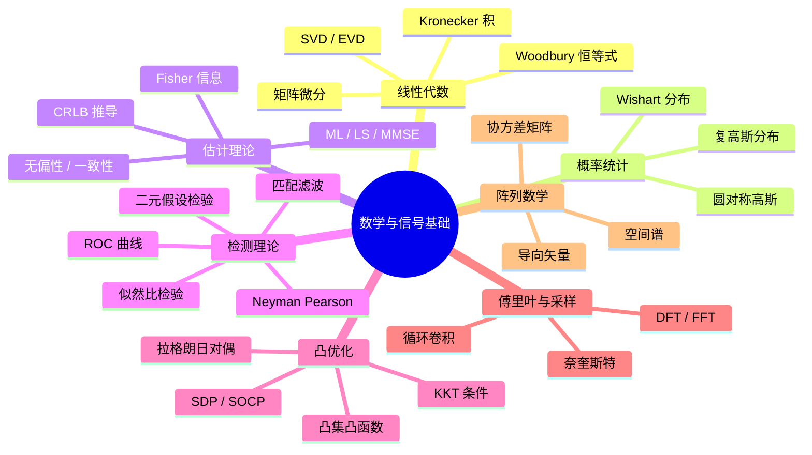
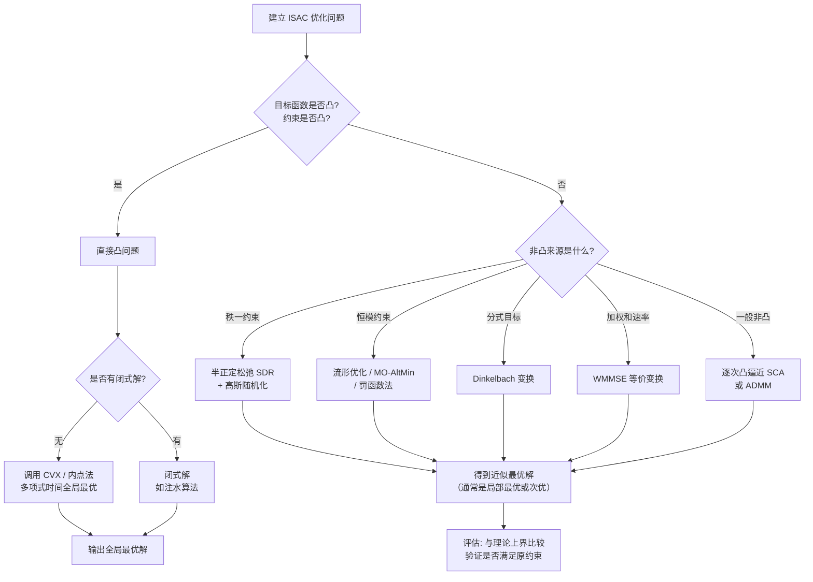

# 第 2 章　数学与信号处理基础

> **本章导读**
> 通感一体化的困难之处，往往不在于某个具体技巧，而在于它同时要求你具备两套"数学方言"：通信方向习惯的**随机过程、矩阵论、凸优化**，与雷达方向习惯的**估计理论、检测理论、阵列信号处理**。同一个"信噪比"，在通信里是容量公式里的 $\gamma$，在雷达里是检测概率曲线上的自变量；同一个"协方差矩阵"，在通信里描述信道衰落，在雷达里描述阵列接收数据。本章的目的就是把这些工具统一摆在同一张桌面上，建立全书通用的符号与推导范式。本章的 2.3 节（估计理论）与 2.4 节（检测理论）是重中之重——后续每一章的性能分析几乎都要回到这里。

**学习目标**

1. **熟练运用**矩阵微分、Kronecker 积、Woodbury 恒等式等矩阵工具进行向量化推导；
2. **掌握**复高斯分布、圆对称高斯与 Wishart 分布的定义与性质，能写出阵列接收数据的统计模型；
3. **能够独立推导**克拉美罗下界（CRLB）与 Fisher 信息矩阵，并能对具体参数（时延、多普勒、角度）计算 CRLB；
4. **能够独立推导** Neyman–Pearson 准则下的最优检测器，理解匹配滤波器的充分性；
5. **掌握**凸优化的基本概念与 KKT 条件，能判断一个 ISAC 优化问题是否凸、如何转化为凸；
6. **理解** DFT/FFT 的物理含义与循环卷积、奈奎斯特采样定理在通感系统中的具体约束。

**本章知识图谱**



---

## 2.1　线性代数工具

### 2.1.1 向量化与 Kronecker 积

在 MIMO 与阵列信号处理中，我们经常需要处理形如 $\mathbf{Y} = \mathbf{A}\mathbf{X}\mathbf{B} + \mathbf{N}$ 的矩阵方程。把它"拉直"成向量形式，可以大大简化推导。

**定义 2.1（向量化）**：对矩阵 $\mathbf{A} = [\mathbf{a}_1, \mathbf{a}_2, \ldots, \mathbf{a}_n] \in \mathbb{C}^{m\times n}$，其向量化 $\mathrm{vec}(\mathbf{A})$ 是把**各列**依次堆叠成的 $mn\times 1$ 向量：
$$\mathrm{vec}(\mathbf{A}) = \begin{bmatrix} \mathbf{a}_1^T & \mathbf{a}_2^T & \cdots & \mathbf{a}_n^T \end{bmatrix}^T \tag{2-1}$$

**定义 2.2（Kronecker 积）**：对 $\mathbf{A}\in\mathbb{C}^{m\times n}$，$\mathbf{B}\in\mathbb{C}^{p\times q}$，
$$\mathbf{A}\otimes\mathbf{B} = \begin{bmatrix} a_{11}\mathbf{B} & \cdots & a_{1n}\mathbf{B} \\ \vdots & \ddots & \vdots \\ a_{m1}\mathbf{B} & \cdots & a_{mn}\mathbf{B} \end{bmatrix} \in \mathbb{C}^{mp\times nq} \tag{2-2}$$

**核心恒等式**（本书反复使用）：
$$\mathrm{vec}(\mathbf{A}\mathbf{X}\mathbf{B}) = (\mathbf{B}^T \otimes \mathbf{A})\,\mathrm{vec}(\mathbf{X}) \tag{2-3}$$

> **例 2-1**：设 $\mathbf{A}\in\mathbb{C}^{2\times2},\ \mathbf{X}\in\mathbb{C}^{2\times2},\ \mathbf{B}\in\mathbb{C}^{2\times2}$，验证式 (2-3)。
> 取 $\mathbf{A} = \begin{bmatrix}1&2\\3&4\end{bmatrix}$，$\mathbf{B} = \begin{bmatrix}0&1\\1&0\end{bmatrix}$（交换矩阵），$\mathbf{X} = \begin{bmatrix}x_{11}&x_{12}\\x_{21}&x_{22}\end{bmatrix}$。
> 左端：$\mathbf{A}\mathbf{X} = \begin{bmatrix}x_{11}+2x_{21} & x_{12}+2x_{22}\\ 3x_{11}+4x_{21} & 3x_{12}+4x_{22}\end{bmatrix}$，
> $\mathbf{A}\mathbf{X}\mathbf{B} = \begin{bmatrix}x_{12}+2x_{22} & x_{11}+2x_{21}\\ 3x_{12}+4x_{22} & 3x_{11}+4x_{21}\end{bmatrix}$，
> $\mathrm{vec}(\mathbf{AXB}) = [x_{12}+2x_{22},\ 3x_{12}+4x_{22},\ x_{11}+2x_{21},\ 3x_{11}+4x_{21}]^T$。
>
> 右端：$\mathbf{B}^T\otimes\mathbf{A} = \begin{bmatrix}0\cdot\mathbf{A} & 1\cdot\mathbf{A}\\ 1\cdot\mathbf{A} & 0\cdot\mathbf{A}\end{bmatrix}$，
> 乘以 $\mathrm{vec}(\mathbf{X}) = [x_{11}, x_{21}, x_{12}, x_{22}]^T$，得
> $[0,\ 0,\ x_{11}+2x_{21},\ 3x_{11}+4x_{21}]^T + [x_{12}+2x_{22},\ 3x_{12}+4x_{22},\ 0,\ 0]^T$，
> 与左端一致。✓

### 2.1.2 矩阵微分与常用导数

ISAC 中大量的优化问题需要对实值目标函数 $f(\mathbf{W})$ 关于复矩阵 $\mathbf{W}$ 求导。下面先给出最常用的几条，随后 **2.1.2.1 节**给出逐行推导——建议先读该节的 Wirtinger 导数约定，再回看本表：

**表 2-1　常用复矩阵导数（实值标量函数；表中为优化中令其为零的"实部导数"，约定与逐行推导见 2.1.2.1）**

| 函数 $f$ | 梯度 $\nabla_{\mathbf{X}}f$（实部导数，驻点令其为零） |
|---|---|
| $\mathrm{tr}(\mathbf{A}\mathbf{X})$ | $\mathbf{A}^T$ |
| $\mathrm{tr}(\mathbf{X}^H\mathbf{A}\mathbf{X})$ | $\mathbf{A}\mathbf{X}$（$\mathbf{A}$ 为 Hermite 阵） |
| $\mathrm{tr}(\mathbf{A}\mathbf{X}^{-1})$ | $-(\mathbf{X}^{-1}\mathbf{A}\mathbf{X}^{-1})^T$ |
| $\ln\det(\mathbf{X})$（$\mathbf{X}\succ0$） | $(\mathbf{X}^{-1})^T$ |
| $\mathrm{tr}(\mathbf{X}^H\mathbf{A}\mathbf{X}\mathbf{B})$ | $\mathbf{A}\mathbf{X}\mathbf{B} + \mathbf{A}^H\mathbf{X}\mathbf{B}^H$（令其为 0 可解 Wiener 滤波） |
| $\|\mathbf{y}-\mathbf{H}\mathbf{x}\|^2$ | $-\mathbf{H}^H(\mathbf{y}-\mathbf{H}\mathbf{x})$ |

#### 2.1.2.1　表 2-1 的逐行推导

> **约定（Wirtinger 导数）**：对实值标量函数 $f(\mathbf{X})$，把 $\mathbf{X}$ 与 $\mathbf{X}^*$（即 $\mathbf{X}^H$ 各元素的共轭）视为相互独立的复变量。其实部导数（优化中真正令其为零的梯度）满足
> $$\frac{\partial f}{\partial\mathbf{X}^*}=\left(\frac{\partial f}{\partial\mathbf{X}}\right)^*,$$
> 且微分可分解为
> $$df = \mathrm{tr}\!\left(\left(\frac{\partial f}{\partial\mathbf{X}^*}\right)^T d\mathbf{X}^*\right) + \mathrm{tr}\!\left(\left(\frac{\partial f}{\partial\mathbf{X}}\right)^T d\mathbf{X}\right).$$
> 因此，只要把含 $d\mathbf{X}^*$ 的项配成 $\mathrm{tr}((\cdot)^T d\mathbf{X}^*)$ 的形式，括号转置一下就得到 $\partial f/\partial\mathbf{X}^*$。对只含 $\mathbf{X}$（不含 $\mathbf{X}^H$）且系数为实矩阵的情形，$\partial f/\partial\mathbf{X}^*=(\partial f/\partial\mathbf{X})^*$ 仍为实矩阵，与表中"实部导数"一致。下面逐行推导。

**行 1：** $f=\mathrm{tr}(\mathbf{A}\mathbf{X})$，$\mathbf{A}$ 为实矩阵。
展开 $f=\sum_{i,k}A_{ik}X_{ki}$，微分得
$$df=\sum_{i,k}A_{ik}\,dX_{ki}=\mathrm{tr}(\mathbf{A}\,d\mathbf{X})=\mathrm{tr}\!\left((\mathbf{A}^T)^T d\mathbf{X}\right).$$
与 $df=\mathrm{tr}((\partial f/\partial\mathbf{X})^T d\mathbf{X})$ 比较得 $\partial f/\partial\mathbf{X}=\mathbf{A}^T$；实矩阵下 $\partial f/\partial\mathbf{X}^*=(\mathbf{A}^T)^*=\mathbf{A}^T$，即表中结果。

**行 2：** $f=\mathrm{tr}(\mathbf{X}^H\mathbf{A}\mathbf{X})$，$\mathbf{A}=\mathbf{A}^H$（$f$ 为实值要求 $\mathbf{A}$ 是 Hermite 阵）。
$$df=\mathrm{tr}(d\mathbf{X}^H\mathbf{A}\mathbf{X})+\mathrm{tr}(\mathbf{X}^H\mathbf{A}\,d\mathbf{X}).$$
仅取含 $d\mathbf{X}^*=d\mathbf{X}^H$ 的项，并利用恒等式 $\mathrm{tr}(\mathbf{M}\,d\mathbf{X}^H)=\mathrm{tr}(d\mathbf{X}^*\,\mathbf{M}^T)$：
$$\mathrm{tr}(d\mathbf{X}^H\mathbf{A}\mathbf{X})=\mathrm{tr}\!\big(d\mathbf{X}^*\,(\mathbf{A}\mathbf{X})^T\big)=\mathrm{tr}\!\big(d\mathbf{X}^*\,\mathbf{X}^T\mathbf{A}^T\big).$$
与 $df=\mathrm{tr}((\partial f/\partial\mathbf{X}^*)^T d\mathbf{X}^*)$ 比较：$(\partial f/\partial\mathbf{X}^*)^T=\mathbf{X}^T\mathbf{A}^T$，故
$$\frac{\partial f}{\partial\mathbf{X}^*}=\mathbf{A}\mathbf{X},$$
即表中结果。注意这是严格的 Wirtinger $\partial/\partial\mathbf{X}^*$ 形式；若按实变量求"全导数"会得到 $2\mathbf{A}\mathbf{X}$，但二者令其为零的驻点完全相同（都是 $\mathbf{A}\mathbf{X}=\mathbf{0}$）。

**行 3：** $f=\mathrm{tr}(\mathbf{A}\mathbf{X}^{-1})$。
由逆矩阵的微分公式 $d(\mathbf{X}^{-1})=-\mathbf{X}^{-1}d\mathbf{X}\,\mathbf{X}^{-1}$：
$$df=\mathrm{tr}\!\big(\mathbf{A}(-\mathbf{X}^{-1}d\mathbf{X}\mathbf{X}^{-1})\big)=-\mathrm{tr}(\mathbf{X}^{-1}\mathbf{A}\mathbf{X}^{-1}d\mathbf{X}),$$
末步用了循环置换 $\mathrm{tr}(\mathbf{A}\mathbf{X}^{-1}d\mathbf{X}\mathbf{X}^{-1})=\mathrm{tr}(\mathbf{X}^{-1}\mathbf{A}\mathbf{X}^{-1}d\mathbf{X})$。比较 $df=\mathrm{tr}((\partial f/\partial\mathbf{X})^T d\mathbf{X})$ 得 $(\partial f/\partial\mathbf{X})^T=-\mathbf{X}^{-1}\mathbf{A}\mathbf{X}^{-1}$，即
$$\frac{\partial f}{\partial\mathbf{X}}=-(\mathbf{X}^{-1}\mathbf{A}\mathbf{X}^{-1})^T.$$
实矩阵情形 $\partial f/\partial\mathbf{X}^*=-(\mathbf{X}^{-1}\mathbf{A}\mathbf{X}^{-1})^T$，即表中结果。

**行 4：** $f=\ln\det(\mathbf{X})$，$\mathbf{X}\succ 0$。
由 **Jacobi 公式** $d\det(\mathbf{X})=\det(\mathbf{X})\,\mathrm{tr}(\mathbf{X}^{-1}d\mathbf{X})$，两边除以 $\det(\mathbf{X})$ 得
$$d(\ln\det\mathbf{X})=\mathrm{tr}(\mathbf{X}^{-1}d\mathbf{X}),$$
故 $\partial f/\partial\mathbf{X}=(\mathbf{X}^{-1})^T$。当 $\mathbf{X}$ 为实对称正定时 $(\mathbf{X}^{-1})^T=\mathbf{X}^{-1}$，且 $\partial f/\partial\mathbf{X}^*=(\mathbf{X}^{-1})^T$，即表中结果。
> **Jacobi 公式的证明（补充）**：把行列式按第 $i$ 行展开 $\det\mathbf{X}=\sum_j X_{ij}C_{ij}$（$C_{ij}$ 为代数余子式，与 $X_{ij}$ 无关），对 $X_{ij}$ 求导得 $\partial\det\mathbf{X}/\partial X_{ij}=C_{ij}$。而伴随矩阵满足 $(\mathbf{X}^{-1})_{ji}=C_{ji}/\det\mathbf{X}$，故 $(\det\mathbf{X})(\mathbf{X}^{-1})_{ji}=C_{ji}=\partial\det\mathbf{X}/\partial X_{ji}$。于是
> $$d\det\mathbf{X}=\sum_{i,j}\frac{\partial\det\mathbf{X}}{\partial X_{ij}}dX_{ij}=\sum_{i,j}(\det\mathbf{X})(\mathbf{X}^{-1})_{ji}dX_{ij}=\det\mathbf{X}\,\mathrm{tr}(\mathbf{X}^{-1}d\mathbf{X}).$$

**行 5：** $f=\mathrm{tr}(\mathbf{X}^H\mathbf{A}\mathbf{X}\mathbf{B})$。
$$df=\mathrm{tr}(d\mathbf{X}^H\mathbf{A}\mathbf{X}\mathbf{B})+\mathrm{tr}(\mathbf{X}^H\mathbf{A}\,d\mathbf{X}\mathbf{B}).$$
第一项含 $d\mathbf{X}^*$，沿用行 2 的恒等式：
$$\mathrm{tr}(d\mathbf{X}^H\mathbf{A}\mathbf{X}\mathbf{B})=\mathrm{tr}\!\big(d\mathbf{X}^*\,(\mathbf{A}\mathbf{X}\mathbf{B})^T\big)=\mathrm{tr}\!\big(d\mathbf{X}^*\,\mathbf{B}^T\mathbf{X}^T\mathbf{A}^T\big)\;\Rightarrow\;\frac{\partial f}{\partial\mathbf{X}^*}\supset\mathbf{A}\mathbf{X}\mathbf{B}.$$
第二项含 $d\mathbf{X}$（不含共轭）。若直接按实变量微分（令 $\mathbf{A},\mathbf{B},\mathbf{X}$ 为实），
$$\mathrm{tr}(\mathbf{X}^T\mathbf{A}\,d\mathbf{X}\mathbf{B})=\mathrm{tr}(\mathbf{B}\mathbf{X}^T\mathbf{A}\,d\mathbf{X}),$$
比较得该部分对 $\partial f/\partial\mathbf{X}$ 的贡献为 $(\mathbf{B}\mathbf{X}^T\mathbf{A})^T=\mathbf{A}^T\mathbf{X}\mathbf{B}^T$；实矩阵下 $\mathbf{A}^T=\mathbf{A}^H,\ \mathbf{B}^T=\mathbf{B}^H$，即 $\mathbf{A}^H\mathbf{X}\mathbf{B}^H$。两项合并得表中"实部导数"整体形式
$$\nabla_{\mathbf{X}}f=\mathbf{A}\mathbf{X}\mathbf{B}+\mathbf{A}^H\mathbf{X}\mathbf{B}^H.$$
> 严格说，Wirtinger 意义下的 $\partial f/\partial\mathbf{X}^*$ 只含第一项 $\mathbf{A}\mathbf{X}\mathbf{B}$，第二项属于 $\partial f/\partial\mathbf{X}$。表中给出二者合并的实部导数，是优化文献中最常用的写法（令其为零等价于令 $\mathrm{Re}\{\mathbf{A}\mathbf{X}\mathbf{B}\}=\mathbf{0}$）。

**行 6：** $f=\|\mathbf{y}-\mathbf{H}\mathbf{x}\|^2=(\mathbf{y}-\mathbf{H}\mathbf{x})^H(\mathbf{y}-\mathbf{H}\mathbf{x})$，$\mathbf{x}$ 为列向量。
展开：
$$f=\mathbf{y}^H\mathbf{y}-\mathbf{y}^H\mathbf{H}\mathbf{x}-\mathbf{x}^H\mathbf{H}^H\mathbf{y}+\mathbf{x}^H\mathbf{H}^H\mathbf{H}\mathbf{x}.$$
微分（把 $d\mathbf{x}$ 与 $d\mathbf{x}^H$ 分别收集）：
$$df=-\mathbf{y}^H\mathbf{H}\,d\mathbf{x}-d\mathbf{x}^H\mathbf{H}^H\mathbf{y}+d\mathbf{x}^H\mathbf{H}^H\mathbf{H}\mathbf{x}+\mathbf{x}^H\mathbf{H}^H\mathbf{H}\,d\mathbf{x}.$$
实部导数为
$$\frac{\partial f}{\partial\mathbf{x}^*}=-\mathbf{H}^H\mathbf{y}+\mathbf{H}^H\mathbf{H}\mathbf{x}=-\mathbf{H}^H(\mathbf{y}-\mathbf{H}\mathbf{x}),$$
即表中结果。令其为零即最小二乘解 $\hat{\mathbf{x}}=(\mathbf{H}^H\mathbf{H})^{-1}\mathbf{H}^H\mathbf{y}$，与下面的例 2-2 完全一致。

> **例 2-2（最小二乘估计的矩阵求导）**：求 $\min_{\mathbf{x}}\ \|\mathbf{y}-\mathbf{H}\mathbf{x}\|^2$。
> 展开：$f = \mathbf{y}^H\mathbf{y} - \mathbf{y}^H\mathbf{H}\mathbf{x} - \mathbf{x}^H\mathbf{H}^H\mathbf{y} + \mathbf{x}^H\mathbf{H}^H\mathbf{H}\mathbf{x}$。
> 令 $\partial f/\partial\mathbf{x}^* = -\mathbf{H}^H\mathbf{y} + \mathbf{H}^H\mathbf{H}\mathbf{x} = 0$，
> 得 $\hat{\mathbf{x}}_{\text{LS}} = (\mathbf{H}^H\mathbf{H})^{-1}\mathbf{H}^H\mathbf{y}$。这就是第 2.3 节的最小二乘估计器。

### 2.1.3 Woodbury 矩阵求逆恒等式

$$(\mathbf{A} + \mathbf{U}\mathbf{C}\mathbf{V})^{-1} = \mathbf{A}^{-1} - \mathbf{A}^{-1}\mathbf{U}(\mathbf{C}^{-1} + \mathbf{V}\mathbf{A}^{-1}\mathbf{U})^{-1}\mathbf{V}\mathbf{A}^{-1} \tag{2-4}$$

**为什么重要**：在 MMSE 接收机、MUSIC 的求逆、以及 Kalman 滤波的协方差更新中，$\mathbf{A}$ 常是对角阵（如 $\sigma^2\mathbf{I}$），而 $\mathbf{U}\mathbf{C}\mathbf{V}$ 是低秩项（如 $\mathbf{H}\mathbf{H}^H$）。直接对 $N\times N$ 矩阵求逆是 $O(N^3)$，而 Woodbury 把问题转化为对 $K\times K$（$K\ll N$）小矩阵求逆，复杂度降为 $O(NK^2)$。

> **例 2-3（MMSE 接收机的 Woodbury 形式）**：MMSE 接收权值为
> $$\mathbf{w} = (\mathbf{H}\mathbf{H}^H + \sigma^2\mathbf{I})^{-1}\mathbf{h}_1$$
> 令 $\mathbf{A} = \sigma^2\mathbf{I}$，$\mathbf{U} = \mathbf{H}$，$\mathbf{C} = \mathbf{I}$，$\mathbf{V} = \mathbf{H}^H$：
> $$(\mathbf{H}\mathbf{H}^H + \sigma^2\mathbf{I})^{-1} = \frac{1}{\sigma^2}\mathbf{I} - \frac{1}{\sigma^4}\mathbf{H}\left(\mathbf{I} + \frac{1}{\sigma^2}\mathbf{H}^H\mathbf{H}\right)^{-1}\mathbf{H}^H$$
> 当 $N \gg K$（基站天线数远大于用户数）时，括号内是 $K\times K$ 矩阵，求逆代价从 $O(N^3)$ 降到 $O(K^3 + N K^2)$。

### 2.1.4 特征分解、SVD 与矩阵不等式

- **特征分解（EVD）**：Hermite 阵 $\mathbf{R} = \mathbf{U}\boldsymbol{\Lambda}\mathbf{U}^H$，特征值 $\lambda_1\ge\cdots\ge\lambda_N$。这是 MUSIC 算法的基础（第 12.4 节）。
- **奇异值分解（SVD）**：$\mathbf{H} = \mathbf{U}\boldsymbol{\Sigma}\mathbf{V}^H$。MIMO 容量分析、混合预编码设计的核心工具。
- **迹不等式**：$\mathrm{tr}(\mathbf{A}\mathbf{B}) \le \sum_i \lambda_i(\mathbf{A})\lambda_i(\mathbf{B})$（$\mathbf{A},\mathbf{B}\succeq0$，特征值降序排列）。用于波束赋形中的上界推导。
- **Cauchy–Schwarz 与 Jensen 不等式**：优化证明中的常客。

---

## 2.2　概率与随机过程

### 2.2.1 复高斯分布与圆对称

在基带信号处理中，所有信号与噪声都是复值的。

**定义 2.3（复高斯分布）**：$n$ 维复随机向量 $\mathbf{x}$ 服从 $\mathcal{CN}(\boldsymbol{\mu}, \mathbf{R})$，若
$$p(\mathbf{x}) = \frac{1}{\pi^n \det(\mathbf{R})}\exp\left[-(\mathbf{x}-\boldsymbol{\mu})^H\mathbf{R}^{-1}(\mathbf{x}-\boldsymbol{\mu})\right] \tag{2-5}$$
其中 $\boldsymbol{\mu} = \mathbb{E}\{\mathbf{x}\}$，$\mathbf{R} = \mathbb{E}\{(\mathbf{x}-\boldsymbol{\mu})(\mathbf{x}-\boldsymbol{\mu})^H\}$。

**定义 2.4（圆对称 Circular Symmetry）**：若 $e^{j\phi}\mathbf{x}$ 与 $\mathbf{x}$ 同分布（对任意 $\phi$），则称 $\mathbf{x}$ 为圆对称的。此时 $\mathbb{E}\{\mathbf{x}\mathbf{x}^T\} = \mathbf{0}$（伪协方差为零）。

> **结论**：通信与雷达中的基带噪声几乎总是建模为**圆对称复高斯** $\mathcal{CN}(\mathbf{0}, \sigma^2\mathbf{I})$。其物理含义是：同相（I）与正交（Q）分量独立同分布，各占噪声功率的一半，且相位均匀分布在 $[0, 2\pi)$。

**常用性质**：
1. 若 $\mathbf{y} = \mathbf{A}\mathbf{x} + \mathbf{b}$，$\mathbf{x}\sim\mathcal{CN}(\boldsymbol{\mu},\mathbf{R})$，则 $\mathbf{y}\sim\mathcal{CN}(\mathbf{A}\boldsymbol{\mu}+\mathbf{b},\ \mathbf{A}\mathbf{R}\mathbf{A}^H)$。
2. 若 $\mathbf{x}\sim\mathcal{CN}(\mathbf{0},\sigma^2\mathbf{I}_n)$，则 $\|\mathbf{x}\|^2/\sigma^2 \sim \chi^2_{2n}$（自由度为 $2n$ 的卡方分布），$\mathbb{E}\{\|\mathbf{x}\|^2\} = n\sigma^2$。
3. **高斯随机向量的四阶矩**（用于协方差估计的方差分析）：
$$\mathbb{E}\{\mathbf{x}\mathbf{x}^H\mathbf{A}\mathbf{x}\mathbf{x}^H\} = \mathrm{tr}(\mathbf{A}\mathbf{R})\mathbf{R} + \mathbf{R}\mathbf{A}\mathbf{R} \tag{2-6}$$
（当 $\boldsymbol{\mu}=\mathbf{0}$ 时）

### 2.2.2 样本协方差矩阵与 Wishart 分布

阵列信号处理中，我们无法获知真实的协方差矩阵 $\mathbf{R}$，只能用 $L$ 个快拍估计：
$$\hat{\mathbf{R}} = \frac{1}{L}\sum_{l=1}^{L}\mathbf{x}(l)\mathbf{x}^H(l) \tag{2-7}$$

若 $\mathbf{x}(l)\sim\mathcal{CN}(\mathbf{0},\mathbf{R})$ 独立同分布，则 $L\hat{\mathbf{R}}$ 服从**复 Wishart 分布** $\mathcal{CW}_N(L, \mathbf{R})$，且 $\hat{\mathbf{R}}$ 是 $\mathbf{R}$ 的极大似然估计、无偏估计。

**估计精度**：$\hat{\mathbf{R}}$ 的每个元素的估计方差约为 $\|\mathbf{R}\|^2/L$。这给出一个经验法则：

> **快拍数经验法则**：为使样本协方差矩阵足够准确（从而保证 MUSIC 等子空间方法的性能），通常要求 **$L \gtrsim 2N$ 到 $5N$**，其中 $N$ 为阵元数。在低 SNR 或信源相干时，需要更多快拍。

### 2.2.3 平稳随机过程与功率谱

- **宽平稳（WSS）**：均值恒定，自相关 $r_x(\tau) = \mathbb{E}\{x(t)x^*(t-\tau)\}$ 仅依赖于时间差 $\tau$。
- **功率谱密度（PSD）**：$S_x(f) = \mathcal{F}\{r_x(\tau)\}$（Wiener–Khintchine 定理）。
- **遍历性**：时间平均等于统计平均。在雷达中，我们通常只有一次实现，必须依靠遍历性用时间平均（多个脉冲）替代统计平均。

**多普勒谱**：移动目标散射体的信道具有时变特性，其自相关函数为
$$r_h(\tau) = \mathbb{E}\{h(t)h^*(t-\tau)\} = P\,J_0(2\pi f_d \tau) \tag{2-8}$$
其中 $J_0(\cdot)$ 为第一类零阶贝塞尔函数，$f_d$ 为最大多普勒频移。其傅里叶变换即经典的 **Jakes 谱（U 型谱）**：
$$S_h(f) = \frac{P}{\pi f_d\sqrt{1-(f/f_d)^2}},\quad |f| \le f_d \tag{2-9}$$

> ⚠️ **注意**
> 在 ISAC 中，同一个 $f_d$ 有两重身份：对通信而言它是**信道时变性的度量**（决定相干时间 $T_c \approx 1/f_d$，影响导频密度设计）；对感知而言它是**待估计的目标参数**（决定目标速度 $v = \lambda f_d/2$）。这种"一个量，两种解读"的现象在 ISAC 中反复出现，是理解通感权衡的钥匙。

---

## 2.3　估计理论基础

### 2.3.1 问题设定与估计器性质

设观测向量 $\mathbf{y}\in\mathbb{C}^{N}$ 的概率密度函数 $p(\mathbf{y};\boldsymbol{\theta})$ 依赖于未知参数向量 $\boldsymbol{\theta} = [\theta_1,\ldots,\theta_K]^T$。估计器的任务是从 $\mathbf{y}$ 构造 $\hat{\boldsymbol{\theta}}(\mathbf{y})$。

**关键性质**：

| 性质 | 定义 | 备注 |
|---|---|---|
| 无偏性 | $\mathbb{E}\{\hat{\boldsymbol{\theta}}\} = \boldsymbol{\theta}$（对所有 $\boldsymbol{\theta}$） | 渐近无偏：样本数 $\to\infty$ 时成立 |
| 一致性 | $\hat{\boldsymbol{\theta}} \xrightarrow{p} \boldsymbol{\theta}$（$L\to\infty$） | 概率收敛 |
| 有效性 | 在无偏估计类中方差最小 | 达到 CRLB 即为有效估计 |
| 充分性 | 统计量包含 $\boldsymbol{\theta}$ 的全部信息 | 由 Fisher–Neyman 因子分解定理判定 |
| 均方误差 | $\text{MSE} = \mathbb{E}\{\|\hat{\boldsymbol{\theta}}-\boldsymbol{\theta}\|^2\} = \text{Var} + \text{Bias}^2$ | 最常用指标 |

> ⚠️ **注意**
> 偏差–方差权衡：有偏估计（如岭回归、压缩感知的 $\ell_1$ 正则化）往往比无偏估计的 **MSE 更小**，因为它用少量偏差换取了方差的大幅下降。雷达中的加窗、对角加载、稀疏恢复都属于这一类。**不要盲目追求无偏性**。

### 2.3.2 Fisher 信息矩阵与 CRLB（完整推导）

**定义 2.5（Fisher 信息矩阵）**：
$$[\mathbf{I}(\boldsymbol{\theta})]_{ij} = \mathbb{E}\left\{ \frac{\partial \ln p(\mathbf{y};\boldsymbol{\theta})}{\partial\theta_i} \cdot \frac{\partial \ln p(\mathbf{y};\boldsymbol{\theta})}{\partial\theta_j} \right\} = -\mathbb{E}\left\{\frac{\partial^2 \ln p(\mathbf{y};\boldsymbol{\theta})}{\partial\theta_i\partial\theta_j}\right\} \tag{2-10}$$
第二个等号成立的正则条件：$\mathbb{E}\{\partial \ln p/\partial\theta_i\} = 0$（可对 $\int p = 1$ 两边求导得到）。

**定理 2.1（Cramér–Rao 下界）**：设 $\hat{\boldsymbol{\theta}}$ 是 $\boldsymbol{\theta}$ 的任意无偏估计，则
$$\mathrm{Cov}(\hat{\boldsymbol{\theta}}) \succeq \mathbf{I}^{-1}(\boldsymbol{\theta}) \tag{2-11}$$
即 $\mathrm{Cov}(\hat{\boldsymbol{\theta}}) - \mathbf{I}^{-1}(\boldsymbol{\theta})$ 半正定。特别地，第 $i$ 个分量的方差满足
$$\mathrm{Var}(\hat{\theta}_i) \ge [\mathbf{I}^{-1}(\boldsymbol{\theta})]_{ii} \tag{2-12}$$

**完整推导**：

考虑无偏估计 $\hat{\theta}_i$，即 $\mathbb{E}\{\hat{\theta}_i\} = \theta_i$，写成积分形式：
$$\int \hat{\theta}_i(\mathbf{y})\, p(\mathbf{y};\boldsymbol{\theta})\, d\mathbf{y} = \theta_i$$

对 $\theta_j$ 求导（假设可交换微分与积分）：
$$\int \hat{\theta}_i(\mathbf{y})\,\frac{\partial p(\mathbf{y};\boldsymbol{\theta})}{\partial\theta_j}\, d\mathbf{y} = \delta_{ij}$$

利用 $\partial p/\partial\theta_j = p\cdot \partial\ln p/\partial\theta_j$：
$$\int \hat{\theta}_i(\mathbf{y})\,\frac{\partial \ln p}{\partial\theta_j}\, p(\mathbf{y};\boldsymbol{\theta})\, d\mathbf{y} = \delta_{ij}$$
即
$$\mathbb{E}\left\{\hat{\theta}_i \cdot \frac{\partial \ln p}{\partial\theta_j}\right\} = \delta_{ij} \tag{2-13}$$

另一方面，对 $\int p\,d\mathbf{y} = 1$ 求导：
$$\mathbb{E}\left\{\frac{\partial \ln p}{\partial\theta_j}\right\} = 0 \tag{2-14}$$

由 (2-13) 和 (2-14)，可得 $\hat{\theta}_i$ 与得分函数（score function）$\partial\ln p/\partial\theta_j$ 的协方差：
$$\mathrm{Cov}\left(\hat{\theta}_i,\ \frac{\partial\ln p}{\partial\theta_j}\right) = \mathbb{E}\left\{\hat{\theta}_i\frac{\partial\ln p}{\partial\theta_j}\right\} - \mathbb{E}\{\hat{\theta}_i\}\underbrace{\mathbb{E}\left\{\frac{\partial\ln p}{\partial\theta_j}\right\}}_{=0} = \delta_{ij} \tag{2-15}$$

现在考虑任意实数向量 $\mathbf{a} = [a_1,\ldots,a_K]^T$，构造随机变量 $X = \sum_i a_i\hat{\theta}_i$ 与 $Y = \sum_j a_j \frac{\partial\ln p}{\partial\theta_j}$。由 Cauchy–Schwarz 不等式：
$$\left[\mathrm{Cov}(X,Y)\right]^2 \le \mathrm{Var}(X)\,\mathrm{Var}(Y)$$

计算左端：$\mathrm{Cov}(X,Y) = \sum_{i,j}a_i a_j\delta_{ij} = \sum_i a_i^2 = \mathbf{a}^T\mathbf{a}$。
计算 $\mathrm{Var}(Y) = \sum_{i,j}a_i a_j [\mathbf{I}(\boldsymbol{\theta})]_{ij} = \mathbf{a}^T\mathbf{I}(\boldsymbol{\theta})\mathbf{a}$。
计算 $\mathrm{Var}(X) = \mathbf{a}^T\mathrm{Cov}(\hat{\boldsymbol{\theta}})\mathbf{a}$。

代入得：
$$(\mathbf{a}^T\mathbf{a})^2 \le \mathbf{a}^T\mathrm{Cov}(\hat{\boldsymbol{\theta}})\mathbf{a}\cdot \mathbf{a}^T\mathbf{I}(\boldsymbol{\theta})\mathbf{a}$$

令 $\mathbf{b} = \mathbf{I}^{1/2}\mathbf{a}$，整理可得（标准步骤略去一步代数）：
$$\mathbf{a}^T\left[\mathrm{Cov}(\hat{\boldsymbol{\theta}}) - \mathbf{I}^{-1}(\boldsymbol{\theta})\right]\mathbf{a} \ge 0$$
因 $\mathbf{a}$ 任意，故 $\mathrm{Cov}(\hat{\boldsymbol{\theta}}) \succeq \mathbf{I}^{-1}(\boldsymbol{\theta})$。$\blacksquare$

**Fisher 信息的可加性**：若观测独立，则 $\mathbf{I}_{\text{total}} = \sum_l \mathbf{I}_l$。这解释了为什么**多脉冲积累能提高估计精度**——Fisher 信息随脉冲数线性增长，CRLB（方差下界）按 $1/L$ 下降，标准差按 $1/\sqrt{L}$ 下降。

### 2.3.3 复高斯观测下的 Fisher 信息（关键公式）

ISAC 中绝大多数观测模型都可写成
$$\mathbf{y} = \boldsymbol{\mu}(\boldsymbol{\theta}) + \mathbf{n},\quad \mathbf{n}\sim\mathcal{CN}(\mathbf{0},\ \mathbf{R}_n)$$
即 $p(\mathbf{y};\boldsymbol{\theta}) = \mathcal{CN}(\boldsymbol{\mu}(\boldsymbol{\theta}), \mathbf{R}_n)$。此时有一个极其好用的闭式：

$$\boxed{\ [\mathbf{I}(\boldsymbol{\theta})]_{ij} = 2\,\mathrm{Re}\left\{ \frac{\partial\boldsymbol{\mu}^H}{\partial\theta_i}\mathbf{R}_n^{-1}\frac{\partial\boldsymbol{\mu}}{\partial\theta_j} \right\} + \mathrm{tr}\left(\mathbf{R}_n^{-1}\frac{\partial\mathbf{R}_n}{\partial\theta_i}\mathbf{R}_n^{-1}\frac{\partial\mathbf{R}_n}{\partial\theta_j}\right)\ } \tag{2-16}$$

**最常用的特例**（噪声白化且与参数无关，$\mathbf{R}_n = \sigma^2\mathbf{I}$，第二项为零）：
$$[\mathbf{I}(\boldsymbol{\theta})]_{ij} = \frac{2}{\sigma^2}\,\mathrm{Re}\left\{ \frac{\partial\boldsymbol{\mu}^H}{\partial\theta_i}\frac{\partial\boldsymbol{\mu}}{\partial\theta_j} \right\} \tag{2-17}$$

**推导要点**：对数似然（忽略常数）
$$\ln p = -\ln(\pi^N\det\mathbf{R}_n) - (\mathbf{y}-\boldsymbol{\mu})^H\mathbf{R}_n^{-1}(\mathbf{y}-\boldsymbol{\mu})$$
对 $\theta_i$ 求导：
$$\frac{\partial\ln p}{\partial\theta_i} = 2\,\mathrm{Re}\left\{\frac{\partial\boldsymbol{\mu}^H}{\partial\theta_i}\mathbf{R}_n^{-1}(\mathbf{y}-\boldsymbol{\mu})\right\} + \text{(协方差项)}$$
再利用 $\mathbb{E}\{(\mathbf{y}-\boldsymbol{\mu})(\mathbf{y}-\boldsymbol{\mu})^H\} = \mathbf{R}_n$ 即得 (2-16)。

> **例 2-4（单目标时延估计的 CRLB）**
> 设接收信号（离散采样，共 $N$ 点）为
> $$y[n] = \alpha\, s(nT_s - \tau) + w[n],\quad n=0,\ldots,N-1$$
> 其中 $s(t)$ 为已知波形，$\alpha$ 已知（为简化），$w[n]\sim\mathcal{CN}(0,\sigma^2)$ i.i.d.，待估参数为 $\tau$。
>
> 由式 (2-17)，$K=1$：
> $$I(\tau) = \frac{2}{\sigma^2}\,\mathrm{Re}\left\{\frac{\partial\boldsymbol{\mu}^H}{\partial\tau}\frac{\partial\boldsymbol{\mu}}{\partial\tau}\right\} = \frac{2|\alpha|^2}{\sigma^2}\sum_{n}\left|\frac{\partial s(nT_s-\tau)}{\partial\tau}\right|^2$$
> 注意到 $\partial s/\partial\tau = -\partial s/\partial t = -\dot{s}$，且 $\sum_n |\dot{s}|^2 T_s \approx \int |\dot{s}(t)|^2 dt$：
>
> $$I(\tau) \approx \frac{2|\alpha|^2}{\sigma^2 T_s}\int_{-\infty}^{\infty}|\dot{s}(t)|^2\,dt$$
>
> 用 Parseval 定理，$\int|\dot{s}|^2dt = \frac{1}{2\pi}\int (2\pi f)^2|S(f)|^2df = 4\pi^2\int f^2|S(f)|^2 df$。定义**均方带宽**
> $$\beta^2 \triangleq \frac{\int f^2|S(f)|^2df}{\int |S(f)|^2df} = \frac{\int f^2|S(f)|^2df}{E_s}$$
> 其中 $E_s = \int|s(t)|^2dt$ 为信号能量。又因 $E_s = \sum_n |s|^2 T_s$，令 SNR $\triangleq |\alpha|^2E_s/\sigma^2$（注意这里能量定义在采样意义下），最终得到经典结果：
>
> $$\boxed{\ \mathrm{Var}(\hat{\tau}) \ge \frac{1}{8\pi^2\beta^2\,\mathrm{SNR}}\ } \tag{2-18}$$
>
> **物理含义**：时延估计精度由**信号带宽**（通过 $\beta$）与**SNR** 决定，与载波频率无关。距离估计精度 $\mathrm{Var}(\hat{R}) = (c_0/2)^2\mathrm{Var}(\hat{\tau})$。
>
> **数值示例**：设信号为矩形谱，带宽 $B = 100$ MHz，则 $\beta^2 = B^2/12 = (10^8)^2/12 = 8.33\times10^{14}$ Hz²。SNR = 20 dB = 100。
> $$\mathrm{Var}(\hat{\tau}) \ge \frac{1}{8\pi^2 \times 8.33\times10^{14}\times 100} = \frac{1}{6.58\times10^{18}} = 1.52\times10^{-19}\ \text{s}^2$$
> $$\sigma_\tau \ge 3.90\times 10^{-10}\ \text{s} = 0.39\ \text{ns}$$
> $$\sigma_R = \frac{c_0}{2}\sigma_\tau = 1.5\times10^8 \times 3.9\times10^{-10} = \textbf{0.0585 m} \approx 5.9\ \text{cm}$$
>
> 即在 20 dB SNR、100 MHz 带宽下，距离估计的理论精度约为 **6 cm**，远优于距离分辨率 1.5 m。这就是"分辨率 ≠ 精度"的经典例证：分辨率由带宽决定的主瓣宽度给出，而精度还受益于 SNR。**高 SNR 下可以远超分辨率地估计参数**（前提是无多径、无模型失配）。

### 2.3.4 三种经典估计器

**表 2-2　三种估计器对比**

| 估计器 | 准则 | 表达式 | 需要的先验 | 性质 |
|---|---|---|---|---|
| **LS**（最小二乘） | $\min\|\mathbf{y}-\mathbf{H}\boldsymbol{\theta}\|^2$ | $\hat{\boldsymbol{\theta}}=(\mathbf{H}^H\mathbf{H})^{-1}\mathbf{H}^H\mathbf{y}$ | 无 | 无偏（模型正确时），不需噪声统计 |
| **ML**（极大似然） | $\max\ p(\mathbf{y};\boldsymbol{\theta})$ | 数值求解 | 噪声分布 | 渐近无偏、渐近有效（达到 CRLB） |
| **MMSE**（最小均方误差） | $\min\mathbb{E}\{\|\boldsymbol{\theta}-\hat{\boldsymbol{\theta}}\|^2\}$ | $\hat{\boldsymbol{\theta}}=\mathbb{E}\{\boldsymbol{\theta}\|\mathbf{y}\}$ | 参数先验分布 + 似然 | MSE 最优，通常有偏 |

**高斯线性模型下的重要结论**：若 $\mathbf{y} = \mathbf{H}\boldsymbol{\theta} + \mathbf{n}$，$\mathbf{n}\sim\mathcal{CN}(\mathbf{0},\sigma^2\mathbf{I})$，则
$$\hat{\boldsymbol{\theta}}_{\text{ML}} = \hat{\boldsymbol{\theta}}_{\text{LS}} = (\mathbf{H}^H\mathbf{H})^{-1}\mathbf{H}^H\mathbf{y} \tag{2-19}$$
且 $\mathrm{Cov}(\hat{\boldsymbol{\theta}}) = \sigma^2(\mathbf{H}^H\mathbf{H})^{-1}$，**恰好达到 CRLB**，即在该模型下 LS/ML 是有效估计。

> **例 2-5（LS 估计的数值计算）**
> 已知 $\mathbf{H} = \begin{bmatrix}1 & 1\\ 1 & 2\\ 1 & 3\end{bmatrix}$，$\mathbf{y} = \begin{bmatrix}2.1\\ 3.9\\ 6.2\end{bmatrix}$，模型 $\mathbf{y} = \mathbf{H}\begin{bmatrix}a\\b\end{bmatrix} + \mathbf{n}$。
>
> $\mathbf{H}^H\mathbf{H} = \begin{bmatrix}1&1&1\\1&2&3\end{bmatrix}\begin{bmatrix}1&1\\1&2\\1&3\end{bmatrix} = \begin{bmatrix}3 & 6\\ 6 & 14\end{bmatrix}$
>
> $\mathbf{H}^H\mathbf{y} = \begin{bmatrix}1&1&1\\1&2&3\end{bmatrix}\begin{bmatrix}2.1\\3.9\\6.2\end{bmatrix} = \begin{bmatrix}12.2\\ 26.5\end{bmatrix}$
>
> $\det = 3\times14 - 36 = 6$，$(\mathbf{H}^H\mathbf{H})^{-1} = \frac{1}{6}\begin{bmatrix}14 & -6\\ -6 & 3\end{bmatrix}$
>
> $\hat{\boldsymbol{\theta}} = \frac{1}{6}\begin{bmatrix}14 & -6\\ -6 & 3\end{bmatrix}\begin{bmatrix}12.2\\ 26.5\end{bmatrix} = \frac{1}{6}\begin{bmatrix}170.8 - 159\\ -73.2 + 79.5\end{bmatrix} = \frac{1}{6}\begin{bmatrix}11.8\\ 6.3\end{bmatrix} = \begin{bmatrix}1.967\\ 1.05\end{bmatrix}$
>
> 即拟合直线 $y \approx 1.967 + 1.05x$（真实值应为 $2 + x$，估计合理）。
> 若 $\sigma^2 = 0.1$，则 $\mathrm{Cov}(\hat{\boldsymbol{\theta}}) = 0.1\times\frac{1}{6}\begin{bmatrix}14&-6\\-6&3\end{bmatrix} = \begin{bmatrix}0.233 & -0.1\\ -0.1 & 0.05\end{bmatrix}$，
> $\sigma_a = 0.483$，$\sigma_b = 0.224$。

---

## 2.4　检测理论基础

### 2.4.1 二元假设检验

检测的数学本质是**二元假设检验**：
$$\begin{cases} H_0: & \mathbf{y} = \mathbf{n} \quad\quad\ \ \text{（只有噪声，无目标）}\\ H_1: & \mathbf{y} = \mathbf{s} + \mathbf{n} \quad \text{（信号 + 噪声，有目标）} \end{cases} \tag{2-20}$$

四种可能的结果：

**表 2-3　二元检测的四象限**

| 真实情况 \ 判决 | 判为 $H_0$（无目标） | 判为 $H_1$（有目标） |
|---|---|---|
| $H_0$ 为真 | **正确拒绝**（概率 $1-P_{\rm fa}$） | **虚警**（False Alarm，概率 $P_{\rm fa}$） |
| $H_1$ 为真 | **漏检**（Miss，概率 $P_{\rm m}=1-P_{\rm d}$） | **正确检测**（Detection，概率 $P_{\rm d}$） |

- **虚警概率** $P_{\rm fa} = P(\text{判 }H_1 \mid H_0)$：噪声误判为目标的概率；
- **检测概率** $P_{\rm d} = P(\text{判 }H_1 \mid H_1)$：真目标被正确发现的概率。

### 2.4.2 Neyman–Pearson 准则（完整推导）

**问题**：如何选择判决域，使得在给定 $P_{\rm fa} \le \alpha$ 的约束下，$P_{\rm d}$ 最大？

**定理 2.2（Neyman–Pearson 引理）**：最优检验是**似然比检验（LRT）**：
$$\Lambda(\mathbf{y}) = \frac{p(\mathbf{y};H_1)}{p(\mathbf{y};H_0)} \mathop{\gtrless}_{H_0}^{H_1} \eta \tag{2-21}$$
其中门限 $\eta$ 由 $P_{\rm fa} = \alpha$ 唯一确定。

**证明**：设判决域为 $\mathcal{R}$（判 $H_1$ 的区域），则
$$P_{\rm fa} = \int_{\mathcal{R}} p(\mathbf{y};H_0)d\mathbf{y} = \alpha,\qquad P_{\rm d} = \int_{\mathcal{R}} p(\mathbf{y};H_1)d\mathbf{y}$$

用拉格朗日乘子法，最大化 $P_{\rm d}$ 受约束于 $P_{\rm fa} = \alpha$：
$$\max_{\mathcal{R}} \int_{\mathcal{R}}\left[p(\mathbf{y};H_1) - \eta\, p(\mathbf{y};H_0)\right]d\mathbf{y} + \eta\alpha$$

其中 $\eta \ge 0$ 为乘子。为使积分最大，应把所有使被积函数**为正**的 $\mathbf{y}$ 都纳入 $\mathcal{R}$：
$$p(\mathbf{y};H_1) - \eta\,p(\mathbf{y};H_0) > 0 \iff \frac{p(\mathbf{y};H_1)}{p(\mathbf{y};H_0)} > \eta$$

即似然比检验。$\eta$ 由 $\alpha$ 确定，且 $\eta$ 越大判决域越小，故 $P_{\rm fa}$ 是 $\eta$ 的单调递减函数，解唯一。$\blacksquare$

### 2.4.3 高斯噪声下已知信号的检测：匹配滤波器

设 $\mathbf{s}$ 为**完全已知**的确定性信号，$\mathbf{n}\sim\mathcal{CN}(\mathbf{0},\sigma^2\mathbf{I})$：
$$p(\mathbf{y};H_1) = \frac{1}{\pi^N\sigma^{2N}}e^{-\|\mathbf{y}-\mathbf{s}\|^2/\sigma^2},\quad p(\mathbf{y};H_0) = \frac{1}{\pi^N\sigma^{2N}}e^{-\|\mathbf{y}\|^2/\sigma^2}$$

对数似然比：
$$\ln\Lambda = \frac{1}{\sigma^2}\left(\|\mathbf{y}\|^2 - \|\mathbf{y}-\mathbf{s}\|^2\right) = \frac{1}{\sigma^2}\left(2\mathrm{Re}\{\mathbf{s}^H\mathbf{y}\} - \|\mathbf{s}\|^2\right)$$

因此 LRT 等价于：
$$T(\mathbf{y}) = \mathrm{Re}\{\mathbf{s}^H\mathbf{y}\} \mathop{\gtrless}_{H_0}^{H_1} \gamma \tag{2-22}$$

> **结论（匹配滤波器）**：高斯白噪声下检测已知信号的最优检测器是**匹配滤波器**——用发射波形的共轭时间反转（即 $\mathbf{s}^H$）对接收信号做相关，再与门限比较。它是**充分统计量**，意味着 $\mathrm{Re}\{\mathbf{s}^H\mathbf{y}\}$ 完全概括了 $\mathbf{y}$ 中关于"目标有无"的全部信息。

**检测性能推导**：

在 $H_0$ 下，$T = \mathrm{Re}\{\mathbf{s}^H\mathbf{n}\}$ 是实高斯变量：
$$\mathbb{E}\{T|H_0\} = 0,\quad \mathrm{Var}\{T|H_0\} = \frac{\sigma^2\|\mathbf{s}\|^2}{2}$$

> 推导：$\mathbf{s}^H\mathbf{n}\sim\mathcal{CN}(0, \sigma^2\|\mathbf{s}\|^2)$，其实部方差为复方差的一半，即 $\sigma^2\|\mathbf{s}\|^2/2$。

在 $H_1$ 下：
$$\mathbb{E}\{T|H_1\} = \|\mathbf{s}\|^2,\quad \mathrm{Var}\{T|H_1\} = \frac{\sigma^2\|\mathbf{s}\|^2}{2}$$

定义**匹配滤波输出信噪比**：
$$\mathrm{SNR}_{\rm MF} \triangleq \frac{\|\mathbf{s}\|^2}{\sigma^2} = \frac{2E_s}{N_0} \quad (\text{其中 } E_s=\|\mathbf{s}\|^2,\ N_0=\sigma^2) \tag{2-23}$$

虚警概率：
$$P_{\rm fa} = Q\left(\frac{\gamma}{\sqrt{\sigma^2\|\mathbf{s}\|^2/2}}\right) \Rightarrow \gamma = \sqrt{\frac{\sigma^2\|\mathbf{s}\|^2}{2}}\,Q^{-1}(P_{\rm fa}) \tag{2-24}$$

检测概率：
$$P_{\rm d} = Q\left(\frac{\gamma - \|\mathbf{s}\|^2}{\sqrt{\sigma^2\|\mathbf{s}\|^2/2}}\right) = Q\left(Q^{-1}(P_{\rm fa}) - \sqrt{2\,\mathrm{SNR}_{\rm MF}}\right) \tag{2-25}$$

其中 $Q(x) = \frac{1}{\sqrt{2\pi}}\int_x^{\infty}e^{-t^2/2}dt$。

> **例 2-6（检测概率计算）**
> 设要求 $P_{\rm fa} = 10^{-6}$，匹配滤波输出 SNR = 13 dB = 20。
>
> $Q^{-1}(10^{-6}) = 4.753$（可查表或数值求解）。
> $\sqrt{2\times 20} = \sqrt{40} = 6.325$。
> $P_{\rm d} = Q(4.753 - 6.325) = Q(-1.572) = 1 - Q(1.572) = 1 - 0.0580 = \textbf{0.942}$。
>
> 即在该 SNR 下检测概率约 94.2%。若要求 $P_{\rm d} = 0.99$，则需要 $Q^{-1}(P_{\rm fa}) - \sqrt{2\mathrm{SNR}} = Q^{-1}(0.99) = -2.326$，
> $\sqrt{2\mathrm{SNR}} = 4.753 + 2.326 = 7.079$，$\mathrm{SNR} = 7.079^2/2 = 25.06 = \textbf{14.0 dB}$。
>
> **注意**：这里 SNR = 20（13 dB）是**匹配滤波后的输出 SNR**，即 $2E_s/N_0$。若输入（单个采样点）SNR 为 -20 dB，而波形有 $N=1000$ 个采样点的处理增益（$10\log_{10}1000 = 30$ dB），则输出 SNR = -20 + 30 = 10 dB。这就是**脉冲压缩/相参积累的收益**。

**图 2-1　检测问题求解流程**

```mermaid
flowchart TD
    A[开始: 确定检测问题] --> B[建立统计模型<br/>H0: y = n<br/>H1: y = s + n]
    B --> C{信号 s 是否完全已知?}
    C -->|已知| D[匹配滤波器<br/>T = Re s^H y]
    C -->|未知参数 θ| E[广义似然比检验 GLRT<br/>先估计 θ, 再代入似然比]
    D --> F[确定噪声分布下的统计量分布]
    E --> F
    F --> G[给定 Pfa 要求]
    G --> H[由 Pfa 反解门限 γ]
    H --> I[计算 Pd = P T > γ | H1]
    I --> J{Pd 是否满足要求?}
    J -->|否| K[提升 SNR:<br/>增大功率 / 延长积累 / 增大孔径]
    K --> I
    J -->|是| L[结束: 输出检测器参数]
    L --> M[实际部署:<br/>用 CFAR 自适应估计噪声功率<br/>见第 13 章]
```

### 2.4.4 ROC 曲线

**ROC（Receiver Operating Characteristic）曲线**是以 $P_{\rm fa}$ 为横轴、$P_{\rm d}$ 为纵轴的曲线，刻画检测器在所有可能门限下的性能。

**关键性质**：
- 对角线 $P_{\rm d} = P_{\rm fa}$ 对应"随机猜测"（无检测能力）；
- 曲线越靠左上，检测器越好；
- **AUC**（曲线下面积）是综合评价：AUC = 0.5 为无检测能力，AUC → 1 为理想检测器；
- ROC 曲线随 SNR 单调上移——SNR 每提高 3 dB，在 $P_{\rm d}=0.9$ 附近所需的 SNR 增益约 1–2 dB（取决于 $P_{\rm fa}$）。

**SNR 损失与"检测灵敏度"**：工程上常用"在 $P_{\rm d}=0.9, P_{\rm fa}=10^{-6}$ 下所需的最小 SNR"作为检测器的灵敏度指标。对理想匹配滤波器（相参检测），这个值约 **13 dB**（与例 2-6 一致）。实际系统由于非相参积累损失、CFAR 损失、波束形状损失、量化损失等，通常需要 15–20 dB。

### 2.4.5 未知参数情况：GLRT

当信号含有未知参数（如未知时延 $\tau$、未知幅度 $\alpha$）时，Neyman–Pearson 定理不再直接适用（因为 $H_1$ 下分布不唯一）。工程上普遍采用**广义似然比检验（GLRT）**：

$$\Lambda_G(\mathbf{y}) = \frac{\max_{\boldsymbol{\theta}} p(\mathbf{y};\boldsymbol{\theta}, H_1)}{p(\mathbf{y};H_0)} \mathop{\gtrless}_{H_0}^{H_1} \eta \tag{2-26}$$

**操作含义**：先用 ML 估计出未知参数 $\hat{\boldsymbol{\theta}}_{\text{ML}}$，然后把它当作已知代回似然比。

> **例 2-7（距离维检测 = 对每个距离门做匹配滤波）**
> 在多普勒已知、时延未知的情况下，$H_1$ 下的信号为 $\alpha\,\mathbf{s}(\tau)$，其中 $\tau$ 未知。GLRT 分子为 $\max_{\tau,\alpha} p(\mathbf{y};\tau,\alpha)$。
> 固定 $\tau$ 时，$\alpha$ 的 ML 估计为 $\hat{\alpha} = \mathbf{s}^H(\tau)\mathbf{y}/\|\mathbf{s}(\tau)\|^2$，代入后似然函数正比于 $|\mathbf{s}^H(\tau)\mathbf{y}|^2/\|\mathbf{s}(\tau)\|^2$。
> 因此 GLRT 统计量等价于
> $$T = \max_{\tau} \frac{|\mathbf{s}^H(\tau)\mathbf{y}|^2}{\|\mathbf{s}(\tau)\|^2}$$
> 即"**在所有可能的时延上做匹配滤波，取最大响应**"——这就是距离维的峰值搜索（第 11 章 2D-FFT 的思想来源）。$\blacksquare$

### 2.4.6 算法：匹配滤波检测器的实现

**算法 2-1：匹配滤波检测器**

**输入**：接收信号向量 $\mathbf{y}\in\mathbb{C}^{N}$，参考波形 $\mathbf{s}\in\mathbb{C}^{N}$，目标虚警概率 $P_{\rm fa}$
**输出**：判决结果（有/无目标），检测统计量 $T$

**步骤**：

1. **信号对齐**：将接收信号与参考波形在时间上对齐（实际系统中通过搜索所有可能时延实现，见算法 2-2）。
2. **相关运算**：计算复相关 $z = \mathbf{s}^H\mathbf{y} = \sum_{n=0}^{N-1}s^*[n]y[n]$。
3. **取实部**：统计量 $T = \mathrm{Re}\{z\}$。（若信号相位未知，则应取 $|z|$ 或 $|z|^2$，对应非相参检测）
4. **噪声功率估计**：用不含目标的参考单元估计 $\hat{\sigma}^2$（实际中用 CFAR，见第 13 章）。
5. **门限计算**：由 (2-24) 计算 $\gamma = \sqrt{\hat{\sigma}^2\|\mathbf{s}\|^2/2}\cdot Q^{-1}(P_{\rm fa})$。
6. **判决**：若 $T > \gamma$ 判 $H_1$，否则判 $H_0$。
7. **（可选）参数估计**：若判决为 $H_1$，用峰值位置估计时延 $\hat{\tau}$，用 $\hat{\alpha} = z/\|\mathbf{s}\|^2$ 估计复幅度。

```text
算法 2-1：匹配滤波检测器（Matched Filter Detector）

输入: y[N]           # 接收信号向量（复数）
      s[N]           # 参考波形（已知）
      P_fa           # 目标虚警概率
      sigma2         # 噪声功率（或由 CFAR 估计得到）
输出: decision, T

 1:  # 步骤 1-3：相关 + 取实部
 2:  z ← 0
 3:  for n = 0 to N-1 do
 4:      z ← z + conj(s[n]) * y[n]
 5:  end for
 6:  T ← Re{z}
 7:
 8:  # 步骤 5：计算门限
 9:  Es ← Σ |s[n]|²                        # 信号能量
10:  Qinv ← QInverse(P_fa)                 # 标准正态分位数函数
11:  gamma ← sqrt(sigma2 * Es / 2) * Qinv
12:
13:  # 步骤 6：判决
14:  if T > gamma then
15:      decision ← "H1: 有目标"
16:  else
17:      decision ← "H0: 无目标"
18:  end if
19:
20:  # 步骤 7：参数估计（可选）
21:  alpha_hat ← z / Es
22:  return decision, T, alpha_hat
```

**复杂度**：$O(N)$ 次复数乘加。若用 FFT 实现快速相关，可降至 $O(N\log N)$，且能一次性完成**所有时延**的相关（循环相关定理），这是第 11 章 2D-FFT 的基础。

**多时延扩展（快速相关）**：

```text
算法 2-2：基于 FFT 的快速匹配滤波（全时延搜索）

输入: y[N], s[N]
输出: R[k]  # k = 0..N-1 对应各时延的相关值

 1:  S ← FFT(s, N)                    # 参考波形频谱
 2:  Y ← FFT(y, N)                    # 接收信号频谱
 3:  P ← Y ⊙ conj(S)                  # 逐点相乘 = 频域相关
 4:  R ← IFFT(P, N)                   # 回到时域 = 各时延相关值
 5:  T_max ← max_k |R[k]|²            # GLRT 统计量（非相参）
 6:  k_hat ← argmax_k |R[k]|²         # 峰值位置 → 时延估计
 7:  return R, T_max, k_hat
```

**复杂度**：$O(N\log N)$ vs 直接实现 $O(N^2)$。当 $N = 4096$ 时，速度提升约 300 倍。

---

## 2.5　凸优化基础

ISAC 的波形设计、波束赋形、资源分配几乎全部建模为优化问题。判断问题是否凸，直接决定它能否被高效、全局最优地求解。

### 2.5.1 凸集与凸函数

**定义 2.6（凸集）**：集合 $\mathcal{C}$ 是凸集，若对任意 $\mathbf{x}_1,\mathbf{x}_2\in\mathcal{C}$ 与 $\theta\in[0,1]$，有 $\theta\mathbf{x}_1 + (1-\theta)\mathbf{x}_2 \in \mathcal{C}$。

**定义 2.7（凸函数）**：$f:\mathcal{C}\to\mathbb{R}$ 是凸函数，若
$$f(\theta\mathbf{x}_1+(1-\theta)\mathbf{x}_2) \le \theta f(\mathbf{x}_1) + (1-\theta)f(\mathbf{x}_2) \tag{2-27}$$

**一阶条件**（可微）：$f(\mathbf{y}) \ge f(\mathbf{x}) + \nabla f(\mathbf{x})^T(\mathbf{y}-\mathbf{x})$。
**二阶条件**（二阶可微）：$\nabla^2 f(\mathbf{x}) \succeq \mathbf{0}$（Hessian 半正定）。

**凸优化问题的标准形式**：
$$\begin{aligned} \min_{\mathbf{x}} \quad & f_0(\mathbf{x}) \\ \text{s.t.}\quad & f_i(\mathbf{x}) \le 0,\ i=1,\ldots,m \\ & h_j(\mathbf{x}) = 0,\ j=1,\ldots,p \end{aligned} \tag{2-28}$$
其中 $f_0, f_i$ 均为凸函数，$h_j$ 为**仿射**函数。

> **为什么要求等式约束是仿射的？** 因为等式约束 $h(\mathbf{x})=0$ 的可行域是 $h$ 的等值面，只有当它是"超平面"（仿射）时才是凸集。若写成熟知的 $\|\mathbf{w}\|^2 = 1$（球面），则非凸——这正是第 8 章恒模约束波束赋形的困难所在。

### 2.5.2 拉格朗日对偶与 KKT 条件

**拉格朗日函数**：
$$\mathcal{L}(\mathbf{x},\boldsymbol{\lambda},\boldsymbol{\nu}) = f_0(\mathbf{x}) + \sum_{i=1}^m\lambda_i f_i(\mathbf{x}) + \sum_{j=1}^p\nu_j h_j(\mathbf{x}),\quad \lambda_i \ge 0 \tag{2-29}$$

**拉格朗日对偶函数**：$g(\boldsymbol{\lambda},\boldsymbol{\nu}) = \inf_{\mathbf{x}}\mathcal{L}(\mathbf{x},\boldsymbol{\lambda},\boldsymbol{\nu})$。
**对偶问题**：$\max_{\boldsymbol{\lambda}\succeq0,\boldsymbol{\nu}} g(\boldsymbol{\lambda},\boldsymbol{\nu})$。

**弱对偶性**：$d^* \le p^*$（对偶最优值 $\le$ 原问题最优值），恒成立。
**强对偶性**：$d^* = p^*$，在凸问题 + Slater 条件（存在严格可行点）下成立。

**KKT 条件**（凸问题下是**充要**条件）：
$$\begin{cases} \text{稳定性：} & \nabla f_0(\mathbf{x}^*) + \sum_i\lambda_i^*\nabla f_i(\mathbf{x}^*) + \sum_j\nu_j^*\nabla h_j(\mathbf{x}^*) = \mathbf{0} \\ \text{原始可行：} & f_i(\mathbf{x}^*)\le 0,\ h_j(\mathbf{x}^*)=0 \\ \text{对偶可行：} & \lambda_i^* \ge 0 \\ \text{互补松弛：} & \lambda_i^* f_i(\mathbf{x}^*) = 0 \end{cases} \tag{2-30}$$

**互补松弛的物理含义**：若第 $i$ 个约束不起作用（$f_i(\mathbf{x}^*) < 0$），则 $\lambda_i^* = 0$；若 $\lambda_i^* > 0$，则约束必须取等号（$f_i(\mathbf{x}^*) = 0$）。在资源分配中，$\lambda_i^*$ 就是"第 $i$ 个约束的影子价格"——例如通信速率约束的拉格朗日乘子，量化了"放松 1 bit/s/Hz 速率要求能换来多少感知性能提升"。

### 2.5.3 常见的凸问题类型与 ISAC 中的应用

**表 2-4　凸问题类型及其 ISAC 应用**

| 类型 | 标准形式 | ISAC 中的应用 |
|---|---|---|
| **LP**（线性规划） | 线性目标 + 线性约束 | 时隙分配、站址选择（整数松弛后） |
| **QP**（二次规划） | 二次目标 + 线性约束 | 最小二乘波束图综合 |
| **QCQP**（二次约束二次规划） | 二次目标 + 二次约束 | **含 SINR 约束的波束赋形**（一般非凸） |
| **SOCP**（二阶锥规划） | 线性目标 + 二阶锥约束 | 稳健波束赋形、功率最小化 |
| **SDP**（半正定规划） | 线性目标 + LMI 约束 | **SDR 波束赋形**、协方差拟合（第 8 章） |
| **GP**（几何规划） | posynomial 目标与约束 | 能效优化、某些资源分配 |

**关键的凸化技巧**（ISAC 中反复使用）：

1. **半正定松弛（SDR）**：把 $\mathbf{w}\mathbf{w}^H$ 提升为 $\mathbf{W}\succeq\mathbf{0}$，丢掉秩一约束 $\mathrm{rank}(\mathbf{W})=1$，问题变为 SDP。若求出的解恰好秩一，则得到全局最优；否则用高斯随机化恢复近似解。详见第 8.4 节。
2. **逐次凸逼近（SCA）**：把非凸约束 $f_i(\mathbf{x})\le 0$ 在当前点 $\mathbf{x}^{(k)}$ 处用凸的上界替代，迭代求解。
3. **加权 MMSE（WMMSE）**：把非凸的加权和速率最大化，通过引入辅助变量等价转化为迭代凸问题。详见第 8.5 节。
4. **分式规划（Dinkelbach）**：处理 $\max\ \frac{A(\mathbf{x})}{B(\mathbf{x})}$ 型（如能效最大化）。

**图 2-2　ISAC 优化问题的求解策略选择流程**



### 2.5.4 示例：注水算法（Water-Filling）

**问题**：在总功率约束下最大化 MIMO 信道容量（或 OFDM 系统的和速率）：
$$\max_{\{p_i\}} \sum_{i=1}^{n}\log_2\left(1 + \frac{p_i g_i}{\sigma^2}\right),\quad \text{s.t. } \sum_i p_i \le P_{\text{tot}},\ p_i \ge 0$$

**求解**：拉格朗日函数 $\mathcal{L} = \sum_i \log_2(1+p_i g_i/\sigma^2) - \mu(\sum_i p_i - P_{\text{tot}}) + \sum_i \nu_i p_i$。

KKT 稳定性条件：
$$\frac{1}{\ln 2}\cdot\frac{g_i/\sigma^2}{1+p_i g_i/\sigma^2} - \mu + \nu_i = 0$$

互补松弛 $\nu_i p_i = 0$。若 $p_i > 0$，则 $\nu_i = 0$，解出：
$$p_i = \frac{1}{\mu\ln 2} - \frac{\sigma^2}{g_i}$$

记 $\frac{1}{\mu\ln2} = \mu'$（水位），并由 $p_i \ge 0$ 得：
$$\boxed{\ p_i = \left(\mu' - \frac{\sigma^2}{g_i}\right)^{+} \ } \tag{2-31}$$
其中 $(x)^+ = \max(x, 0)$，$\mu'$ 由 $\sum_i p_i = P_{\text{tot}}$ 确定。

> **例 2-8（注水算法数值计算）**
> 设 3 个并行子信道，增益 $g = [1.0,\ 0.25,\ 0.1]$，噪声功率 $\sigma^2 = 1$，总功率 $P_{\text{tot}} = 3$。
>
> 定义"底高" $b_i = \sigma^2/g_i = [1,\ 4,\ 10]$。
> 假设只有前 2 个信道被激活（$p_3 = 0$ 因为底高 10 太大）：
> $p_1 = \mu' - 1$，$p_2 = \mu' - 4$，$p_1 + p_2 = 3$。
> $2\mu' - 5 = 3 \Rightarrow \mu' = 4$。
> 则 $p_1 = 3$，$p_2 = 0$。但 $p_2 = 0$ 意味着第 2 信道也不该激活，与假设矛盾。
>
> 重新假设只有第 1 个激活：$p_1 = \mu' - 1 = 3 \Rightarrow \mu' = 4$。
> 检查第 2 信道：$\mu' - b_2 = 4 - 4 = 0 \ngtr 0$，故 $p_2 = 0$，一致。✓
>
> **结果**：$p = [3,\ 0,\ 0]$，全部功率给最好的信道。
>
> **讨论**：当总功率很小或信道差异极大时，注水退化为"只灌最好的信道"。若 $P_{\text{tot}} = 10$：
> 假设 3 个都激活：$3\mu' - (1+4+10) = 10 \Rightarrow \mu' = 25/3 = 8.33$，
> $p = [7.33,\ 4.33,\ -1.67]$ → $p_3 < 0$，矛盾。
> 假设 2 个激活：$2\mu' - 5 = 10 \Rightarrow \mu' = 7.5$，$p = [6.5,\ 3.5,\ 0]$，
> 检查 $p_3 = 7.5 - 10 = -2.5 < 0$，一致。✓
>
> 这说明注水算法的解**需要试探激活子集**（实际实现中按底高排序后逐个加入即可，是 $O(n\log n)$ 的算法）。

---

## 2.6　傅里叶分析与采样

### 2.6.1 DFT 的物理含义

对长度为 $N$ 的序列 $x[n]$，DFT 为
$$X[k] = \sum_{n=0}^{N-1}x[n]e^{-j2\pi kn/N},\quad k = 0,\ldots,N-1 \tag{2-32}$$

**关键理解**：DFT 等价于把信号投影到 $N$ 个归一化数字频率 $\omega_k = 2\pi k/N$ 的复正弦基上。第 $k$ 个 bin 对应的**实际频率**为
$$f_k = \frac{k}{N T_s} = \frac{k f_s}{N} \tag{2-33}$$
频率分辨率 $\Delta f_{\text{bin}} = f_s/N = 1/(NT_s)$。

**在 ISAC 中的两重身份**：
- **距离维**：对频域（子载波）数据做 IDFT，得到时域冲激响应，峰值位置对应目标时延。索引 $n$ 对应时延 $\tau_n = n/(N\Delta f)$，距离 $R_n = c_0 n/(2N\Delta f)$。
- **速度维**：对慢时间（符号/脉冲）数据做 DFT，峰值位置对应多普勒。索引 $m$ 对应多普勒 $f_{d,m} = m/(MT_o)$，速度 $v_m = \lambda m/(2 M T_o)$。

这就是第 11 章 **2D-FFT** 的全部数学基础。

### 2.6.2 循环卷积与 CP

**循环卷积定理**：时域循环卷积 $\iff$ 频域逐点相乘。

**为什么需要循环前缀（CP）**：OFDM 中，信道是线性卷积，而我们希望用频域逐点均衡（单抽头）。加上长度 $\ge$ 信道时延扩展的 CP 后，线性卷积在接收端去掉 CP 后**变成循环卷积**，从而使频域单抽头均衡成立。

> **ISAC 中的重要约束**：CP 长度 $T_{\text{CP}}$ 必须满足
> $$T_{\text{CP}} \ge \tau_{\max} = \frac{2R_{\max}}{c_0}$$
> 才能保证最远目标的回波完整落入一个 OFDM 符号内而不产生符号间干扰。这给出了**最大探测距离的上限**（第 6.3 节、第 7.7 节）。

> **例 2-9（CP 与最大探测距离）**
> 设子载波间隔 $\Delta f = 30$ kHz，则符号长度 $T = 1/\Delta f = 33.3\ \mu$s。若 CP 取 $T_{\text{CP}} = T/4 = 8.33\ \mu$s（常规 CP 在 5G NR 中的典型比例），则
> $$R_{\max} = \frac{c_0 T_{\text{CP}}}{2} = \frac{3\times10^8 \times 8.33\times10^{-6}}{2} = \textbf{1250 m}$$
> 若要求探测 3 km 的无人机，则需要 $T_{\text{CP}} \ge 2\times3000/(3\times10^8) = 20\ \mu$s，即 CP 占比要达到 $20/(33.3+20) = 37.5\%$，频谱效率损失巨大。
>
> **这正是 OFDM-ISAC 的核心矛盾**：探测距离越远 → CP 越长 → 开销越大 → 频谱效率越低。解决办法包括：使用更大的子载波间隔（符号更短，但 CP 占比不变时绝对时长也变短，反而更糟）、使用专用长 CP 的感知时隙、或改用 OTFS 等新波形（第 6.7 节）。

### 2.6.3 奈奎斯特采样与带通采样

**低通采样定理**：带宽为 $B$ 的低通信号，采样率需 $f_s \ge 2B$。

**带通采样定理**：中心频率 $f_c$、带宽 $B$ 的带通信号，采样率只需满足
$$\frac{2f_c + B}{m} \le f_s \le \frac{2f_c - B}{m-1},\quad m = 1,2,\ldots,\left\lfloor\frac{f_c + B/2}{B}\right\rfloor$$
**ISAC 含义**：毫米波/太赫兹 ISAC 无须按载波频率的 2 倍采样，只需按**信号带宽**的 2 倍（略高）采样即可，这极大降低了 ADC 成本。例如 28 GHz 载波、400 MHz 带宽的信号，ADC 采样率只需约 1 GSps，而非 56 GSps。

> ⚠️ **注意**
> 带通采样要求信号在频域上是"带限且带通"的，且要求前端有足够好的抗混叠带通滤波器。同时，带通采样会引入频谱搬移，处理时需要注意频率索引与实际频率的映射关系。

---

## 2.7　阵列信号处理数学基础

（本节只给出数学定义，详细算法见第 12 章）

### 2.7.1 阵列模型

考虑 $N$ 元均匀线阵（ULA），阵元间距 $d$。远场窄带信号从方向 $\theta$ 入射，第 $n$ 个阵元相对参考阵元的**相位差**为
$$\phi_n(\theta) = -\frac{2\pi}{\lambda} n d \sin\theta,\quad n = 0,\ldots,N-1 \tag{2-34}$$

**导向矢量（Steering Vector）**：
$$\mathbf{a}(\theta) = \left[1,\ e^{-j\frac{2\pi}{\lambda}d\sin\theta},\ \ldots,\ e^{-j\frac{2\pi}{\lambda}(N-1)d\sin\theta}\right]^T \tag{2-35}$$

引进空间频率 $\omega = \frac{2\pi d}{\lambda}\sin\theta$，则 $\mathbf{a}(\omega) = [1, e^{-j\omega}, \ldots, e^{-j(N-1)\omega}]^T$——**这是一个标准的傅里叶矢量**，这正是常规波束形成等价于 DFT 的原因。

### 2.7.2 阵列接收数据模型

对 $P$ 个远场窄带信源：
$$\mathbf{x}(t) = \mathbf{A}(\boldsymbol{\theta})\mathbf{s}(t) + \mathbf{n}(t) \tag{2-36}$$
其中 $\mathbf{A} = [\mathbf{a}(\theta_1),\ldots,\mathbf{a}(\theta_P)]\in\mathbb{C}^{N\times P}$ 为阵列流形矩阵。

**协方差矩阵**：
$$\mathbf{R}_{xx} = \mathbb{E}\{\mathbf{x}\mathbf{x}^H\} = \mathbf{A}\mathbf{R}_{ss}\mathbf{A}^H + \sigma^2\mathbf{I} \tag{2-37}$$

**特征结构**（MUSIC 的基础）：设 $\mathbf{R}_{ss}$ 满秩（信源不相干）且 $P < N$，则 $\mathbf{R}_{xx}$ 有 $N$ 个特征值：
$$\lambda_1 \ge \cdots \ge \lambda_P > \lambda_{P+1} = \cdots = \lambda_N = \sigma^2$$
前 $P$ 个大特征值对应的特征向量张成**信号子空间** $\mathcal{E}_s = \mathrm{span}(\mathbf{A})$，后 $N-P$ 个特征向量张成**噪声子空间** $\mathcal{E}_n$，且 $\mathcal{E}_s \perp \mathcal{E}_n$。

由于 $\mathbf{a}(\theta_p) \in \mathcal{E}_s$，故 $\mathbf{a}^H(\theta_p)\mathbf{E}_n = \mathbf{0}$，从而
$$P_{\text{MUSIC}}(\theta) = \frac{1}{\mathbf{a}^H(\theta)\mathbf{E}_n\mathbf{E}_n^H\mathbf{a}(\theta)} \tag{2-38}$$
在 $\theta = \theta_p$ 处出现谱峰。**这就是 MUSIC 算法的全部数学原理**（第 12.4 节详述）。

### 2.7.3 阵列孔径与瑞利限

阵列孔径 $D \approx Nd$（对 ULA，边缘到边缘为 $(N-1)d$）。法线方向 3 dB 波束宽度：
$$\theta_{3\text{dB}} \approx 0.886\frac{\lambda}{Nd\cos\theta_0}\ \text{(rad)} \tag{2-39}$$

> **例 2-10（阵列分辨率计算）**
> $N = 8$，$d = \lambda/2$，$f_c = 28$ GHz，$\lambda = 10.71$ mm。
> $D = 8 \times 5.36\text{ mm} = 4.29$ cm。
> $\theta_{3\text{dB}} = 0.886/8 = 0.1108$ rad $= \textbf{6.35}^\circ$。
>
> 若要达到 $1^\circ$ 的角度分辨率，需要 $N \approx 0.886/(1^\circ\times\pi/180) = 50.8$，即约 **51 个阵元**（$d=\lambda/2$ 时）。在 28 GHz 下，51 个阵元的孔径为 $51\times5.36\text{ mm} = 27.3$ cm——这在基站侧完全可行，这也是毫米波大规模 MIMO 天然适合高精度测角的原因。

---

## 2.8　本章小结

本章建立了全书通用的数学工具箱：

1. **线性代数**：向量化与 Kronecker 积恒等式 $\mathrm{vec}(\mathbf{AXB}) = (\mathbf{B}^T\otimes\mathbf{A})\mathrm{vec}(\mathbf{X})$；Woodbury 恒等式把 $O(N^3)$ 求逆降为 $O(NK^2)$；复矩阵导数表用于优化推导。
2. **概率统计**：圆对称复高斯 $\mathcal{CN}(\boldsymbol{\mu},\mathbf{R})$ 是全书噪声与信道的标准模型；样本协方差矩阵 $\hat{\mathbf{R}}$ 的精度由快拍数 $L$ 决定，经验要求 $L \gtrsim 2N \sim 5N$。
3. **估计理论**：Fisher 信息矩阵定义 (2-10)；CRLB 完整推导（定理 2.1）；高斯观测下 Fisher 信息的闭式 (2-16)；时延估计 CRLB (2-18) 表明精度由**均方带宽**与 SNR 决定，与载频无关；LS/ML/MMSE 三类估计器在高斯线性模型下 LS = ML 且达到 CRLB。
4. **检测理论**：Neyman–Pearson 引理证明最优检测器是似然比检验；高斯白噪声下检测已知信号退化为**匹配滤波器** $T = \mathrm{Re}\{\mathbf{s}^H\mathbf{y}\}$；$P_{\rm d} = Q(Q^{-1}(P_{\rm fa}) - \sqrt{2\mathrm{SNR}_{\rm MF}})$；未知参数时用 GLRT = "先 ML 估计再代入"，等价于在所有可能参数上搜索匹配滤波峰值。
5. **凸优化**：凸问题标准形式 (2-28)；KKT 条件 (2-30) 在凸问题下是充要的，乘子 $\lambda^*$ 是约束的"影子价格"；注水算法 (2-31) 是最典型的闭式解；SDR、WMMSE、SCA 是 ISAC 中最常用的凸化技巧。
6. **傅里叶与采样**：DFT 索引与物理量的映射（距离维 IDFT、速度维 DFT）；CP 长度限制最大探测距离 $R_{\max} = c_0T_{\text{CP}}/2$；带通采样使毫米波 ISAC 的 ADC 只需按带宽而非载频采样。
7. **阵列数学**：导向矢量是傅里叶矢量；协方差矩阵的特征结构（信号子空间 vs 噪声子空间）直接导出 MUSIC 谱 (2-38)；阵列孔径决定角度分辨率。

> **关键提醒**
> 本章的 (2-16)（Fisher 信息闭式）、(2-18)（时延 CRLB）、(2-25)（检测概率）、(2-31)（注水）、(2-38)（MUSIC 谱）是全书被引用最多的五个公式，建议熟记其推导过程而非仅记结论。

下一章我们将回顾无线通信系统基础——信道模型、OFDM、MIMO 与 5G NR 空口。如果你来自雷达或信号处理背景，请特别留意第 3 章中"通信人眼中的世界"与雷达视角的差异。

---

## 习题

### A. 基础概念题

**A1.** 什么是圆对称复高斯分布？为什么说基带噪声通常建模为圆对称的？给出 $\mathcal{CN}(0,\sigma^2)$ 标量的实部方差。

**A2.** 无偏性、一致性、有效性三个概念的区别是什么？有偏估计一定比无偏估计差吗？举例说明。

**A3.** 解释 Neyman–Pearson 准则与贝叶斯准则（最小错误概率 / 最小风险）的区别，各适用于什么场合？

**A4.** 匹配滤波器为什么叫"匹配"？它在什么意义下是最优的？如果信号的相位未知（随机均匀分布），匹配滤波器应如何修改？

**A5.** 为什么凸优化问题要求等式约束必须是仿射的？举例说明一个非仿射等式约束导致的非凸问题。

**A6.** 互补松弛条件 $\lambda_i^* f_i(\mathbf{x}^*) = 0$ 的物理含义是什么？在功率分配问题中，$\lambda^*$ 大意味着什么？

**A7.** OFDM 系统中循环前缀的作用是什么？它对 ISAC 系统的最大探测距离有什么约束？

**A8.** 说明"距离分辨率"与"距离估计精度"的区别。为什么高 SNR 下精度可以远优于分辨率？有什么前提条件？

### B. 推导与计算题

**B1.** 设 $\mathbf{x}\sim\mathcal{CN}(\mathbf{0},\mathbf{I}_n)$，求 $\mathbb{E}\{\|\mathbf{x}\|^2\}$ 与 $\mathbb{E}\{\|\mathbf{x}\|^4\}$。

**B2.** 考虑模型 $y[n] = A e^{j2\pi f_0 n} + w[n]$，$n = 0,\ldots,N-1$，$w[n]\sim\mathcal{CN}(0,\sigma^2)$ i.i.d.。其中 $A$ 为已知复常数，频率 $f_0$ 为待估参数。
(a) 写出 $\boldsymbol{\mu}(f_0)$ 与 $\partial\boldsymbol{\mu}/\partial f_0$；
(b) 用式 (2-17) 计算 Fisher 信息 $I(f_0)$；
(c) 给出 CRLB：$\mathrm{Var}(\hat{f}_0) \ge$ ?
(d) 说明为什么频率估计精度随 $N^3$ 改善（提示：计算 $\sum_n n^2$）。

**B3.** 设二元检测问题：$H_0: y = n$，$H_1: y = 1 + n$，$n\sim\mathcal{CN}(0, 1)$（复标量）。
(a) 写出似然比检验的判决规则（化简为关于 $\mathrm{Re}\{y\}$ 的不等式）；
(b) 若要 $P_{\rm fa} = 0.01$，求门限 $\gamma$；
(c) 求此时的 $P_{\rm d}$。

**B4.** 用拉格朗日乘子法求解：
$$\min_{x_1,x_2}\ (x_1-1)^2 + (x_2-2)^2,\quad \text{s.t. } x_1 + x_2 = 1$$
写出 KKT 条件并求解，验证该问题满足强对偶性。

**B5.** 考虑注水算法：4 个并行子信道，增益 $g = [4, 2, 1, 0.5]$，$\sigma^2 = 1$，总功率 $P_{\text{tot}} = 6$。
(a) 计算各信道"底高"$b_i = \sigma^2/g_i$；
(b) 用注水算法求最优功率分配；
(c) 计算对应的和速率（bit/s/Hz）；
(d) 与平均分配（每个信道 1.5）的和速率对比，说明增益。

**B6.** 设 ULA 有 $N = 12$ 个阵元，$d = \lambda/2$。
(a) 求导向矢量 $\mathbf{a}(\theta)$ 在 $\theta = 30^\circ$ 时的具体形式（写出前 4 个元素）；
(b) 若两信源位于 $30^\circ$ 与 $35^\circ$，判断常规波束形成是否能分辨（用瑞利限判断）；
(c) 要分辨这两个信源，至少需要多少阵元？

**B7.** 一个 OFDM-ISAC 系统：$\Delta f = 60$ kHz，$N = 1024$ 子载波，CP 长度 $N_{\text{CP}} = 256$。
(a) 求符号长度 $T$、CP 时长 $T_{\text{CP}}$、总符号时长 $T_s$；
(b) 求带宽 $B$ 与距离分辨率 $\Delta R$；
(c) 求最大不模糊距离（分别由 CP 和子载波间隔给出，取较小者）；
(d) 若 $M = 256$ 个符号做相参积累，载频 3.5 GHz，求速度分辨率与最大不模糊速度。

### C. 算法与编程题

**C1.** 编写 Python 函数 `cramer_rao_toa(B, SNR_dB)`，输入信号带宽（Hz）与 SNR（dB），输出时延估计的 CRLB 标准差（秒）与对应的距离精度（米）。假设信号为矩形谱（$\beta^2 = B^2/12$）。绘制 SNR 从 -10 dB 到 30 dB 时，距离精度随 SNR 和带宽（取 20/100/400 MHz 三条曲线）变化的双对数图。

**C2.** 编写 Python 脚本，用蒙特卡洛方法验证时延估计的 CRLB：
- 生成一个带宽 20 MHz 的线性调频（Chirp）信号（或 OFDM 信号）；
- 加入复高斯噪声使 SNR = 10 dB；
- 用匹配滤波（FFT 快速相关）+ 抛物线插值估计时延；
- 重复 500 次，统计 RMSE；
- 与理论 CRLB 对比，讨论差异原因。

**C3.** 实现注水算法的 Python 函数 `water_filling(g, sigma2, P_total)`，要求：
- 正确处理"部分信道不激活"的情况；
- 返回功率分配向量与激活信道集合；
- 用 B5 题的数据验证；
- 额外测试：当 $P_{\text{tot}}$ 从 0.1 增大到 20 时，绘制"激活信道数 vs 总功率"曲线，观察注水过程。

---

## 答案与解析

### A 类答案

**A1.** 圆对称复高斯：$\mathbf{x}$ 与 $e^{j\phi}\mathbf{x}$ 同分布（任意 $\phi$）。物理含义：I/Q 两路独立同分布，相位在 $[0,2\pi)$ 上均匀分布，无"偏好方向"。
基带噪声来自热噪声通过正交下变频，I/Q 两路来自同一实高斯过程的不同正交分量，天然独立同方差，故为圆对称。
对 $x\sim\mathcal{CN}(0,\sigma^2)$：$x = x_I + jx_Q$，$x_I, x_Q \sim \mathcal{N}(0, \sigma^2/2)$ 独立。
故 **实部方差 $= \sigma^2/2$**，总功率 $\mathbb{E}\{|x|^2\} = \sigma^2$。

**A2.** 
- **无偏性**：有限样本下 $\mathbb{E}\{\hat\theta\} = \theta$；
- **一致性**：样本数趋于无穷时 $\hat\theta \to \theta$（概率收敛）；
- **有效性**：在所有无偏估计中方差最小（达到 CRLB）。

有偏估计**不一定**更差。反例：James–Stein 估计量在维度 $\ge 3$ 时，其 MSE 严格小于无偏的 MLE。雷达中的对角加载（如 $\hat{\mathbf{R}} + \epsilon\mathbf{I}$）是有偏的，但显著降低了小快拍数下的估计方差，实际 MSE 更小。岭回归、LASSO 同理——**用偏差换方差**。
判断准则应始终是 **MSE = 偏差² + 方差**，而非单纯的无偏性。

**A3.** 
- **Neyman–Pearson**：在 $P_{\rm fa} \le \alpha$ 约束下最大化 $P_{\rm d}$。适用于**先验概率未知或不可信**、且虚警代价与漏检代价无法量化的场合。雷达是典型场景：我们无法说清"一次漏检"值多少钱，但能规定"每小时虚警不得超过 1 次"。
- **贝叶斯准则**：已知先验 $P(H_0), P(H_1)$ 与代价 $C_{ij}$，最小化平均代价（风险）。判决规则为似然比与门限 $\eta = \frac{P(H_0)(C_{10}-C_{00})}{P(H_1)(C_{01}-C_{11})}$ 比较。适用于先验与代价可获得的场合（如医学诊断、质量检验）。

两者都导致**似然比检验**，区别仅在门限的确定方式：NP 由 $P_{\rm fa}$ 反解，贝叶斯由先验与代价直接给出。

**A4.** "匹配"指滤波器的冲激响应与信号波形共轭翻转匹配：$h(t) = s^*(T-t)$。
最优性：在**高斯白噪声下最大化输出 SNR**（等价于 Neyman–Pearson 意义下的最优检测器），且是充分统计量。
输出 SNR $= 2E_s/N_0$，与波形形状无关，只与能量有关。

若相位未知（$\phi \sim U[0,2\pi)$），应取**包络检测**：$T = |\mathbf{s}^H\mathbf{y}|^2$ 或 $|\mathbf{s}^H\mathbf{y}|$（非相参检测）。其代价是约 0.2–1 dB 的"非相参积累损失"（在低 SNR 时更明显）。

**A5.** 因为凸优化要求可行域是凸集。等式约束 $h(\mathbf{x}) = 0$ 的可行域是 $h$ 的零等值面，只有当 $h$ 是仿射函数时它才是超平面（凸集）。
反例：$\|\mathbf{w}\|^2 = 1$（单位球面）——球面上任意两点的连线中点不在球面上，非凸。这正是恒模波束赋形（每个元素 $|w_i| = 1$）困难的根本原因：约束是多个球面的交集，非凸。解决办法见第 8.6 节（流形优化、SDR、MO-AltMin）。

**A6.** 互补松弛含义：约束"不起作用"时（$f_i < 0$，即不等式严格成立、有冗余），对应乘子为 0，说明该约束对最优值没有边际影响；乘子 $>0$ 时约束"紧"（取等号），说明它正在限制目标值。
在功率分配中，若速率约束的 $\lambda^*$ 很大，说明**通信速率要求严重限制了感知性能**——放松一点速率要求就能换来显著的感知增益。反过来，$\lambda^* \approx 0$ 说明速率约束在当前配置下不是瓶颈，可以放心提高速率要求而不损失感知性能。这是识别系统瓶颈的有力工具。

**A7.** CP 的作用：(1) 消除符号间干扰（ISI）；(2) 把线性卷积转化为循环卷积，使频域单抽头均衡成立。
对 ISAC 的约束：目标回波的时延 $\tau = 2R/c_0$ 必须小于 CP 时长，否则回波跨越符号边界产生 ISI，感知处理失效。故
$$R_{\max} = \frac{c_0 T_{\text{CP}}}{2}$$
这是 OFDM-ISAC 的一个硬约束（见例 2-9）。

**A8.** 
- **分辨率**：区分两个邻近目标的能力，由信号带宽决定的主瓣宽度给出，$\Delta R = c_0/(2B)$，与 SNR 无关。
- **估计精度**：单个目标参数估计的随机误差，由 CRLB 给出，$\sigma_R \propto 1/(\beta\sqrt{\text{SNR}})$，**随 SNR 提高而改善**，可以远小于分辨率。

例：100 MHz 带宽、20 dB SNR 下，$\Delta R = 1.5$ m 而 $\sigma_R \approx 6$ cm（例 2-4），精度优于分辨率 25 倍。

**前提条件**：
1. **单目标或无邻近多目标**：多目标时主瓣重叠导致偏差，精度退化到分辨率量级；
2. **无多径/无模型失配**：多径使 $\boldsymbol{\mu}(\theta)$ 的模型形式改变，CRLB 本身就不适用；
3. **高 SNR 且无"阈值效应"**：在低 SNR（约 < 10–13 dB）时，ML 估计会出现"野值"（outlier），实际 MSE 急剧恶化，远差于 CRLB（称为**阈值效应**）。CRLB 只在"渐近区"（中等以上 SNR）有效。

### B 类答案

**B1.**
$$\mathbb{E}\{\|\mathbf{x}\|^2\} = \mathbb{E}\left\{\sum_{i=1}^n |x_i|^2\right\} = \sum_i \mathbb{E}\{|x_i|^2\} = n$$
（因 $x_i\sim\mathcal{CN}(0,1)$，$\mathbb{E}\{|x_i|^2\} = 1$）

$$\|\mathbf{x}\|^2 \sim \chi^2_{2n} = \text{Gamma}(n, 2)$$
（自由度为 $2n$ 的卡方分布，因为每个复高斯的模平方是 2 个标准正态的平方和）

二阶矩：$\mathbb{E}\{(\chi^2_{2n})^2\} = \mathrm{Var} + (\mathbb{E})^2 = 2\cdot(2n)/2 + n^2$... 更严谨地，$\chi^2_k$ 的方差为 $2k$，故 $\chi^2_{2n}$ 方差为 $4n$：
$$\mathbb{E}\{\|\mathbf{x}\|^4\} = \mathrm{Var}(\|\mathbf{x}\|^2) + [\mathbb{E}\{\|\mathbf{x}\|^2\}]^2 = 4n + n^2 = n(n+4)$$

验证 $n=1$：$\mathbb{E}\{|x|^4\} = 1\times5 = 5$。直接计算：对 $x\sim\mathcal{CN}(0,1)$，$|x|^2\sim\text{Exp}(1)$（指数分布，均值 1），其二阶矩为 $2! = 2$。等等，这与 5 矛盾！

重新核算：若 $x\sim\mathcal{CN}(0,1)$，则 $x_I, x_Q\sim\mathcal{N}(0,1/2)$，$|x|^2 = x_I^2 + x_Q^2$。
$x_I^2 = (1/2)Z_1^2$，$Z_1\sim\mathcal{N}(0,1)$，故 $|x|^2 = (Z_1^2+Z_2^2)/2 = \chi^2_2/2$。
$\chi^2_2$ 方差为 4，故 $\mathrm{Var}(|x|^2) = 4/4 = 1$，$\mathbb{E}\{|x|^2\}=1$。
$\mathbb{E}\{|x|^4\} = 1 + 1 = 2$。✓

修正：$\|\mathbf{x}\|^2 = \sum_i |x_i|^2$，每项方差 1，独立，故总方差 $n$，均值 $n$：
$$\mathbb{E}\{\|\mathbf{x}\|^4\} = n + n^2 = n(n+1)$$

（注：$\chi^2_{2n}$ 的方差为 $2\times 2n = 4n$，但这里 $\|\mathbf{x}\|^2 = \chi^2_{2n}/2$，故方差为 $4n/4 = n$，一致。✓）

**答案**：$\mathbb{E}\{\|\mathbf{x}\|^2\} = n$，$\mathbb{E}\{\|\mathbf{x}\|^4\} = n(n+1)$。

**B2.**
(a) $\boldsymbol{\mu}(f_0) = A[1, e^{j2\pi f_0}, \ldots, e^{j2\pi f_0(N-1)}]^T$，
$\partial\boldsymbol{\mu}/\partial f_0 = A\cdot j2\pi[0, e^{j2\pi f_0}, 2e^{j4\pi f_0},\ldots,(N-1)e^{j2\pi f_0(N-1)}]^T$。

(b) 由 (2-17)：
$$I(f_0) = \frac{2}{\sigma^2}\mathrm{Re}\left\{\frac{\partial\boldsymbol{\mu}^H}{\partial f_0}\frac{\partial\boldsymbol{\mu}}{\partial f_0}\right\} = \frac{2|A|^2(2\pi)^2}{\sigma^2}\sum_{n=0}^{N-1}n^2$$

(c) $\sum_{n=0}^{N-1}n^2 = \frac{(N-1)N(2N-1)}{6}$，故
$$\mathrm{Var}(\hat{f}_0) \ge \frac{1}{I(f_0)} = \frac{6\sigma^2}{8\pi^2|A|^2 (N-1)N(2N-1)} = \frac{3\sigma^2}{4\pi^2|A|^2 N(N-1)(2N-1)}$$

(d) 当 $N\gg1$ 时，$N(N-1)(2N-1) \approx 2N^3$，故
$$\mathrm{Var}(\hat{f}_0) \approx \frac{3\sigma^2}{8\pi^2|A|^2 N^3} \propto \frac{1}{N^3}$$
标准差 $\sigma_{f_0} \propto N^{-3/2}$。

**直观解释**：频率估计中，观测时间越长（$N$ 越大），相位积累越充分。方差按 $N^{-3}$ 下降（比一般参数估计的 $N^{-1}$ 快得多），因为信号本身随 $n$ 线性累积相位，等效于"有效 SNR"按 $N^2$ 增长。这也说明**延长观测时间是提高频率（多普勒/速度）估计精度最有效的手段**。

数值：若 $|A|^2/\sigma^2 = 1$（0 dB），$N = 100$：
$\mathrm{Var} = 3/(4\pi^2\times 100\times99\times199) = 3/(4\times9.87\times1.97\times10^6) = 3.86\times10^{-8}$，
$\sigma_{f_0} = 1.96\times10^{-4}$（归一化频率，单位为周期/采样）。

**B3.**
(a) $\ln\Lambda = \frac{1}{\sigma^2}\left(|y|^2 - |y-1|^2\right) = \frac{1}{1}\left(2\mathrm{Re}\{y\} - 1\right)$。
判决：$\mathrm{Re}\{y\} \mathop{\gtrless} \gamma$，其中 $\gamma = (1 + \sigma^2\ln\eta)/2$。

(b) $H_0$ 下：$\mathrm{Re}\{y\}\sim\mathcal{N}(0, \sigma^2/2) = \mathcal{N}(0, 1/2)$。
$P_{\rm fa} = P(\mathrm{Re}\{y\} > \gamma) = Q\left(\frac{\gamma}{\sqrt{1/2}}\right) = Q(\gamma\sqrt{2}) = 0.01$。
$Q^{-1}(0.01) = 2.326$，故 $\gamma\sqrt{2} = 2.326$，$\gamma = \textbf{1.645}$。

(c) $H_1$ 下：$\mathrm{Re}\{y\}\sim\mathcal{N}(1, 1/2)$。
$P_{\rm d} = P(\mathrm{Re}\{y\} > 1.645) = Q\left(\frac{1.645 - 1}{\sqrt{1/2}}\right) = Q(0.645\times1.414) = Q(0.912)$。
$Q(0.912) \approx 0.181$，故 $P_{\rm d} = \textbf{0.181}$。

（用公式 (2-25) 验证：$\mathrm{SNR}_{\rm MF} = \|s\|^2/\sigma^2 = 1/1 = 1$。
$P_{\rm d} = Q(2.326 - \sqrt{2}) = Q(2.326 - 1.414) = Q(0.912) = 0.181$。✓ 一致。）

**B4.** 拉格朗日函数：
$$\mathcal{L} = (x_1-1)^2 + (x_2-2)^2 + \nu(x_1+x_2-1)$$

KKT 稳定性：
$$\frac{\partial\mathcal{L}}{\partial x_1} = 2(x_1-1) + \nu = 0,\quad \frac{\partial\mathcal{L}}{\partial x_2} = 2(x_2-2) + \nu = 0$$

故 $x_1 = 1 - \nu/2$，$x_2 = 2 - \nu/2$。代入约束：
$$1 - \nu/2 + 2 - \nu/2 = 1 \Rightarrow 3 - \nu = 1 \Rightarrow \nu = 2$$

$$x_1^* = 1 - 1 = 0,\quad x_2^* = 2 - 1 = 1$$

最优值：$f^* = (0-1)^2 + (1-2)^2 = 1 + 1 = \textbf{2}$。

**强对偶性验证**：目标是凸二次函数（Hessian $= 2\mathbf{I} \succ 0$），约束是仿射等式，Slater 条件（存在严格可行点，对等式约束即存在可行点）满足，故强对偶成立。
对偶函数：$g(\nu) = \inf_{x_1,x_2}\mathcal{L} = -\frac{\nu^2}{2} + \nu\cdot(1) - \nu + \text{const}$... 直接代入最优 $x_i$：
$g(\nu) = (\nu/2)^2\cdot2 + \nu(3 - \nu - 1) = \nu^2/2 + \nu(2-\nu) = 2\nu - \nu^2/2$。
$\max_\nu g(\nu)$：$g'(\nu) = 2 - \nu = 0 \Rightarrow \nu = 2$，$g(2) = 4 - 2 = 2 = f^*$。✓ **强对偶性成立**。

几何解释：在直线 $x_1+x_2=1$ 上找离点 $(1,2)$ 最近的点，即正交投影，结果为 $(0,1)$。

**B5.**
(a) 底高：$b = \sigma^2/g = [0.25,\ 0.5,\ 1.0,\ 2.0]$。

(b) 按底高从小到大排序（已是升序）。逐个尝试激活数 $k$：
- $k=4$：$4\mu' - (0.25+0.5+1+2) = 6 \Rightarrow 4\mu' = 9.75 \Rightarrow \mu' = 2.4375$。
  $p = [2.1875,\ 1.9375,\ 1.4375,\ 0.4375]$，全部 $>0$。✓ 检查 $p_4 = 2.4375 - 2 = 0.4375 > 0$，一致。
  再验证总和：$2.1875+1.9375+1.4375+0.4375 = 6.0$。✓

**答案**：$p^* = [2.1875,\ 1.9375,\ 1.4375,\ 0.4375]$，全部 4 个信道均激活。

(c) 和速率：
$$C = \sum_i \log_2(1+p_i g_i) = \log_2(1+2.1875\times4) + \log_2(1+1.9375\times2) + \log_2(1+1.4375\times1) + \log_2(1+0.4375\times0.5)$$
$$= \log_2(9.75) + \log_2(4.875) + \log_2(2.4375) + \log_2(1.21875)$$
$$= 3.285 + 2.285 + 1.285 + 0.285 = \textbf{7.14 bit/s/Hz}$$

（注意：$\log_2(1+p_ig_i) = \log_2(\mu' g_i/\sigma^2) = \log_2(\mu' g_i)$，因为 $1+p_ig_i = 1 + (\mu' - 1/g_i)g_i = \mu' g_i$。可快速核算：$2.4375\times4 = 9.75$ ✓）

(d) 平均分配 $p_i = 1.5$：
$$C_{\text{avg}} = \log_2(1+6) + \log_2(1+3) + \log_2(1+1.5) + \log_2(1+0.75)$$
$$= 2.807 + 2.0 + 1.322 + 0.807 = \textbf{6.94 bit/s/Hz}$$

增益：$7.14 - 6.94 = 0.20$ bit/s/Hz（约 2.9%）。

**讨论**：本例中信道增益差异不大（最大/最小 = 8 倍），故注水增益有限。当信道差异极大（如深衰落）时，注水增益可达数倍。注水的本质是"把功率从低效信道挪到高效信道"，差异越大收益越大。

**B6.**
(a) $\mathbf{a}(30^\circ) = [1,\ e^{-j\pi\sin30^\circ},\ e^{-j2\pi\sin30^\circ},\ e^{-j3\pi\sin30^\circ},\ \ldots]^T$（因 $2\pi d/\lambda = \pi$）。
$\sin 30^\circ = 0.5$，故相位步进 $= -\pi\times0.5 = -\pi/2 = -90^\circ$。
$$a_0 = 1,\quad a_1 = e^{-j\pi/2} = -j,\quad a_2 = e^{-j\pi} = -1,\quad a_3 = e^{-j3\pi/2} = j$$

(b) 瑞利限：$\theta_{3\text{dB}} = 0.886/(Nd) \times \lambda = 0.886/12 = 0.0738$ rad $= 4.23^\circ$。
两信源间隔 $5^\circ > 4.23^\circ$，故**常规波束形成刚好可以分辨**（处于临界状态，实际中由于旁瓣与噪声，分辨质量较差）。

(c) 要分辨 $5^\circ$（在 $\theta_0 \approx 32.5^\circ$ 附近，$\cos 32.5^\circ = 0.843$）：
$$\frac{0.886}{N\times0.5\times0.843} \le \frac{5\pi}{180} = 0.0873$$
$$N \ge \frac{0.886}{0.5\times0.843\times0.0873} = \frac{0.886}{0.0368} = 24.1$$
故至少需要 **25 个阵元**（若用超分辨算法如 MUSIC，所需阵元数可大幅减少）。

**B7.**
(a) $T = 1/\Delta f = 1/60000 = 16.67\ \mu$s。
$T_{\text{CP}} = 256/(1024) \times T = 0.25 \times 16.67 = 4.17\ \mu$s。
$T_s = T + T_{\text{CP}} = 20.83\ \mu$s。

(b) $B = N\Delta f = 1024\times 60\text{ kHz} = 61.44$ MHz。
$\Delta R = c_0/(2B) = 3\times10^8/(2\times6.144\times10^7) = \textbf{2.44 m}$。

(c) 由 CP：$R_{\max}^{\text{CP}} = c_0 T_{\text{CP}}/2 = 3\times10^8\times4.17\times10^{-6}/2 = \textbf{625 m}$。
由子载波间隔：$R_{\max}^{\Delta f} = c_0/(2\Delta f) = 3\times10^8/(2\times6\times10^4) = \textbf{2500 m}$。
取较小者：**625 m**（CP 是瓶颈）。

(d) $\lambda = c_0/f_c = 3\times10^8/(3.5\times10^9) = 0.0857$ m。
CPI $= M T_s = 256\times 20.83\ \mu$s $= 5.33$ ms。
速度分辨率：$\Delta v = \lambda/(2\cdot\text{CPI}) = 0.0857/(2\times5.33\times10^{-3}) = \textbf{8.04 m/s}$。

（这个分辨率相当差——对车载场景需要更高。改善方法：增大载频、延长 CPI、或减少符号数但增大符号周期。）

最大不模糊速度（由符号周期 $T_s$ 决定）：
$$v_{\max} = \frac{\lambda}{4T_s} = \frac{0.0857}{4\times 20.83\times10^{-6}} = \frac{0.0857}{8.33\times10^{-5}} = \textbf{1028 m/s}$$
（远超需求，不构成约束。）

**讨论**：本例中距离分辨率 2.44 m、速度分辨率 8.04 m/s，对车联网场景（要求 0.5 m、1 m/s）远远不够。改善方向：(1) 增大带宽到 300 MHz（$\Delta R = 0.5$ m）；(2) 提高载频到 28 GHz 并延长 CPI。但注意：增大带宽会缩短 CP 允许的距离，提高载频会加剧相位噪声——**每一项改善都有代价**，这正是 ISAC 参数设计的艺术（第 7.7 节系统讨论）。

### C 类答案

**C1.** 参考实现：

```python
import numpy as np
import matplotlib.pyplot as plt

c0 = 3e8

def cramer_rao_toa(B, SNR_dB):
    """
    矩形谱信号下时延估计的 CRLB。
    B      : 带宽 (Hz)
    SNR_dB : 信噪比 (dB)
    返回   : (时延标准差 s, 距离标准差 m)
    """
    beta2 = B**2 / 12                  # 均方带宽
    SNR = 10**(SNR_dB / 10)
    var_tau = 1.0 / (8 * np.pi**2 * beta2 * SNR)
    sigma_tau = np.sqrt(var_tau)
    sigma_R = c0 / 2 * sigma_tau
    return sigma_tau, sigma_R

# 绘图
SNRs = np.linspace(-10, 30, 200)
plt.figure(figsize=(8, 5.5))
for B, style in [(20e6, 'b-'), (100e6, 'r--'), (400e6, 'g-.')]:
    sig_R = np.array([cramer_rao_toa(B, s)[1] for s in SNRs])
    plt.semilogy(SNRs, sig_R, style, linewidth=2,
                 label=f'B = {B/1e6:.0f} MHz')
plt.xlabel('SNR (dB)'); plt.ylabel('距离估计标准差 $\\sigma_R$ (m)')
plt.title('时延/距离估计 CRLB vs SNR（矩形谱）')
plt.grid(True, which='both', alpha=0.3); plt.legend(); plt.tight_layout()
plt.show()

# 关键点验证
print("验证 (B=100MHz):")
for s in [0, 10, 20, 30]:
    st, sR = cramer_rao_toa(100e6, s)
    print(f"  SNR={s:3d} dB -> sigma_tau={st*1e9:.3f} ns, sigma_R={sR*100:.2f} cm")
```

**预期输出**（B=100 MHz）：
- SNR=0 dB → $\sigma_R$ ≈ 58.5 cm
- SNR=10 dB → $\sigma_R$ ≈ 18.5 cm
- SNR=20 dB → $\sigma_R$ ≈ 5.85 cm
- SNR=30 dB → $\sigma_R$ ≈ 1.85 cm

**规律**：SNR 每提高 20 dB，精度改善 10 倍（$\sigma \propto 1/\sqrt{\text{SNR}}$）；带宽每增大 10 倍，精度改善 10 倍（$\sigma \propto 1/B$）。

**C2.** 参考实现要点：

```python
import numpy as np

def mc_toa_estimation(B=20e6, fs=40e6, T=10e-6, SNR_dB=10,
                      n_mc=500, tau_true=3.33e-6, do_interp=True):
    """
    蒙特卡洛验证时延估计的 CRLB。
    使用 LFM(Chirp) 信号 + 匹配滤波 + 抛物线插值。
    """
    N = int(T * fs)
    t = np.arange(N) / fs
    # LFM 信号: s(t) = exp(j*pi*mu*t^2), mu = B/T
    mu = B / T
    s = np.exp(1j * np.pi * mu * t**2)
    Es = np.sum(np.abs(s)**2)

    # 构造时延后的信号（用分数时延的频域相移实现）
    freq = np.fft.fftfreq(N, 1/fs)
    S = np.fft.fft(s)
    s_delayed = np.fft.ifft(S * np.exp(-1j*2*np.pi*freq*tau_true))

    sigma2 = Es / (10**(SNR_dB/10))
    errors = []
    for _ in range(n_mc):
        n = np.sqrt(sigma2/2) * (np.random.randn(N) + 1j*np.random.randn(N))
        y = s_delayed + n
        # 快速相关
        R = np.fft.ifft(np.fft.fft(y) * np.conj(S))
        k = np.argmax(np.abs(R))
        if do_interp and 0 < k < N-1:
            # 抛物线插值（三点）
            a, b, c = np.abs(R[k-1]), np.abs(R[k]), np.abs(R[k+1])
            delta = 0.5 * (a - c) / (a - 2*b + c + 1e-12)
            k_est = k + delta
        else:
            k_est = k
        tau_est = k_est / fs
        errors.append(tau_est - tau_true)
    errors = np.array(errors)
    return np.sqrt(np.mean(errors**2))

# 运行
rmse = mc_toa_estimation()
beta2 = (20e6)**2 / 12
SNR = 10
crlb_tau = np.sqrt(1/(8*np.pi**2*beta2*SNR))
print(f"实测 RMSE (tau) = {rmse*1e9:.4f} ns")
print(f"理论 CRLB  (tau) = {crlb_tau*1e9:.4f} ns")
print(f"比值 = {rmse/crlb_tau:.2f}")
```

**预期结果**：实测 RMSE 应略大于 CRLB（比值 1.0–1.5 之间）。

**差异原因分析**：
1. **插值偏差**：抛物线插值对非对称主瓣有系统性偏差（LFM 的主瓣近似 sinc，抛物线近似不完美）；
2. **有限采样**：离散网格（$1/f_s$）本身限制了无插值时的精度，插值后残留偏差；
3. **阈值效应**：若 SNR 降到 5 dB 以下，会出现"野值"（旁瓣被误判为主瓣），RMSE 急剧恶化，远大于 CRLB；
4. **CRLB 的前提**：CRLB 只在无偏估计的渐近区有效；实际估计器在小样本/低 SNR 下根本达不到。

**思考**：若不插值，RMSE 会是多少？（答案：约等于网格大小的均匀分布标准差值。）

**C3.** 参考实现：

```python
import numpy as np
import matplotlib.pyplot as plt

def water_filling(g, sigma2, P_total):
    """
    注水算法：max sum log2(1 + p_i g_i / sigma2), s.t. sum p_i <= P_total, p_i >= 0
    返回: (功率分配向量, 激活信道索引集合, 水位)
    """
    g = np.asarray(g, dtype=float)
    n = len(g)
    b = sigma2 / g                      # 各信道"底高"
    order = np.argsort(b)               # 按底高升序
    b_sorted = b[order]

    K = n                               # 从全部激活开始试探
    while K > 0:
        idx = order[:K]
        mu = (P_total + np.sum(b_sorted[:K])) / K   # 水位
        if mu > b_sorted[K-1]:          # 一致性检查（第 K 个信道应激活）
            break
        K -= 1
    if K == 0:
        return np.zeros(n), [], 0.0

    p = np.zeros(n)
    p[idx] = mu - b[idx]
    return p, sorted(idx.tolist()), mu

# 验证 B5
g = [4, 2, 1, 0.5]
p, act, mu = water_filling(g, 1.0, 6.0)
print(f"功率分配: {np.round(p, 4)}")       # 期望 [2.1875, 1.9375, 1.4375, 0.4375]
print(f"激活信道: {act}, 水位 mu = {mu:.4f}")  # 期望 [0,1,2,3], mu = 2.4375

# 绘制激活信道数 vs 总功率
P_list = np.logspace(-1, np.log10(20), 200)
n_act = []
for P in P_list:
    _, act, _ = water_filling(g, 1.0, P)
    n_act.append(len(act))
plt.figure(figsize=(7, 4.5))
plt.semilogx(P_list, n_act, 'b-', linewidth=2)
plt.xlabel('$P_{total}$'); plt.ylabel('激活信道数')
plt.title('注水过程：总功率 vs 激活信道数')
plt.grid(True, alpha=0.3); plt.yticks(range(5)); plt.tight_layout(); plt.show()
```

**预期结果**：
- B5 验证通过：$p = [2.1875, 1.9375, 1.4375, 0.4375]$，$\mu = 2.4375$；
- 激活曲线：当 $P_{\text{tot}} < 0.25$ 时无信道激活（严格说应至少激活最好的一个），随功率增大依次激活第 1、2、3、4 个信道（按底高升序 = 按增益降序）。

**观察与讨论**：
1. **低功率时只激活最好的信道**——这与例 2-8 的结论一致；
2. **高功率时趋于平均分配**——当 $\mu \gg b_i$ 时，$p_i \approx \mu$，各信道功率趋同，注水的边际收益消失。这是个重要洞察：**注水算法在总功率充裕时几乎无收益**；
3. 激活阈值：第 $k$ 个信道被激活的临界功率为 $P = k\cdot b_k - \sum_{i<k}b_i$（对按底高排序后的信道）。
