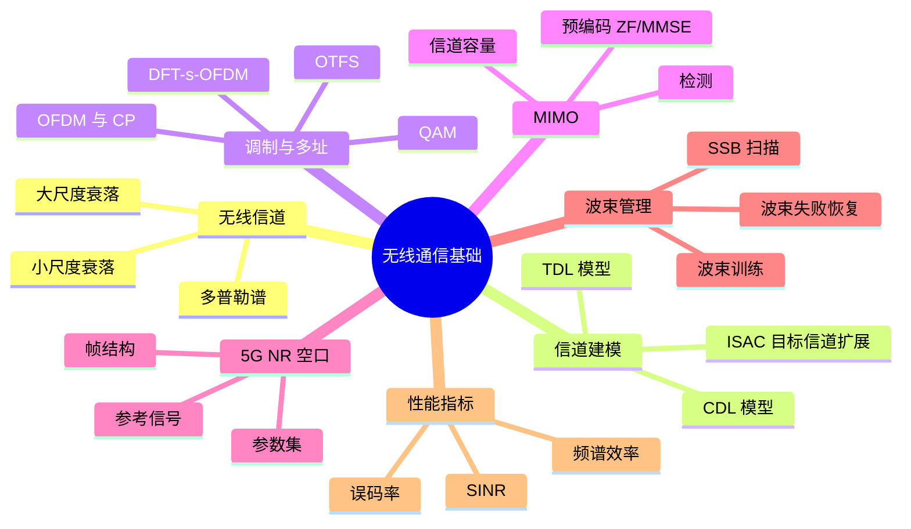
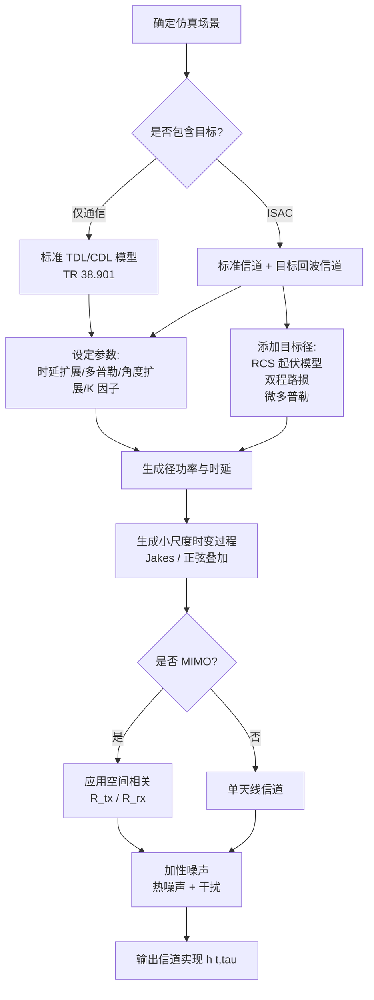
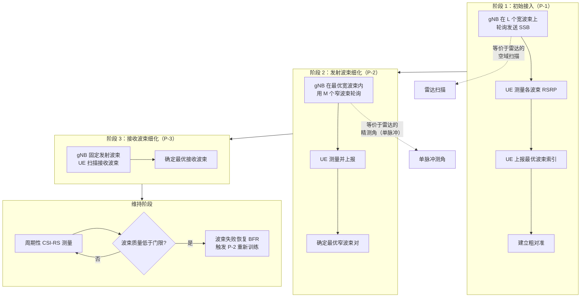

# 第 3 章　无线通信系统基础回顾

> **本章导读**
> 如果你的背景是雷达或信号处理，本章是你最需要精读的一章——因为通感一体化中绝大多数的"妥协"，都是通信工程师为了保住速率、时延、误码率这些指标而做出的。反之，如果你的背景是通信，本章可以快速浏览，但请务必留意 3.2.4 节（ISAC 需要的"目标信道"扩展）与 3.5 节（5G NR 空口中可以被感知"借用"的资源），这两处是通信知识与通感一体化的直接接口。本章的目标是：让你能够把一个 ISAC 方案放进真实的 5G/6G 空口框架里去评估，而不是停留在抽象的数学模型上。

**学习目标**

1. **掌握**大尺度与小尺度衰落模型，能独立完成链路预算与路径损耗计算；
2. **理解**抽头延迟线（TDL）与簇延迟线（CDL）信道模型，知道如何为 ISAC 扩展"目标回波"成分；
3. **能够推导** OFDM 的收发信号模型、理解循环前缀的作用，并掌握 DFT-s-OFDM 与 OTFS 的基本原理；
4. **掌握** MIMO 信道容量公式与 ZF/MMSE 预编码、检测算法；
5. **熟悉** 5G NR 的帧结构、参数集与四类参考信号，理解每一类参考信号用于感知的可行性；
6. **了解**波束管理流程及其与感知扫描的相似性；
7. **能够计算**通信系统的 SINR、频谱效率、误码率等核心指标。

**本章知识图谱**



---

## 3.1　无线信道：从大尺度到小尺度

### 3.1.1 大尺度衰落：路径损耗与阴影

**自由空间路径损耗（FSPL）**是所有模型的基准：
$$\text{FSPL} = \left(\frac{4\pi R}{\lambda}\right)^2 = \left(\frac{4\pi R f_c}{c_0}\right)^2 \tag{3-1}$$

用 dB 表示（$R$ 单位 km，$f_c$ 单位 MHz）：
$$\text{FSPL[dB]} = 32.44 + 20\log_{10}(f_c[\text{MHz}]) + 20\log_{10}(R[\text{km}]) \tag{3-2}$$

> **例 3-1（自由空间路损计算）**
> $f_c = 3.5$ GHz $= 3500$ MHz，$R = 1$ km：
> $\text{FSPL} = 32.44 + 20\log_{10}(3500) + 20\log_{10}(1) = 32.44 + 70.88 + 0 = \textbf{103.3 dB}$。
>
> 若 $f_c = 28$ GHz $= 28000$ MHz，$R = 1$ km：
> $\text{FSPL} = 32.44 + 20\log_{10}(28000) = 32.44 + 88.94 = \textbf{121.4 dB}$。
>
> **频率提高 8 倍（3.5 → 28 GHz），路损增加 18 dB**，因为 $20\log_{10}(8) = 18.06$ dB。这就是毫米波必须靠**大规模天线阵列的波束赋形增益**来补偿的根本原因——$N$ 元阵列的阵列增益为 $10\log_{10}N$ dB，64 元阵列可提供 18 dB，恰好抵消。

**通用路径损耗模型**（3GPP 风格）：
$$\text{PL[dB]} = A + 10n\log_{10}(R/R_0) + X_\sigma \tag{3-3}$$
其中
- **$R_0$ 为参考距离**（reference distance）：模型"锚定"的起点，3GPP 的 Close-In（CI，近距参考）模型通常取 $R_0=1\ \text{m}$，也有文献取 $1\ \text{km}$；
- **$A$ 是参考距离 $R_0$ 处的路径损耗（基准损耗 / 截距项 / anchor）**：把发射与接收之间"在参考点已经存在的那部分损耗"单独拎成一个常数项。直观地说，**当 $R=R_0$ 时公式第二项为零，于是 $\text{PL}=A$**——所以 $A$ 就是起算点的损耗值。在 Close-In 自由空间参考形式下，它就等于自由空间在 $R_0$ 处的损耗：
  $$A = \text{FSPL}(R_0) = 32.44 + 20\log_{10}(f_c[\text{MHz}]) + 20\log_{10}(R_0[\text{km}]) \tag{3-3a}$$
  （等价地用 GHz 与米作单位：$A = 32.44 + 20\log_{10}(f_c[\text{GHz}]) + 20\log_{10}(R_0[\text{m}])$。）在纯经验拟合中 $A$ 也可直接作为回归常数，但概念上始终是"参考点损耗"；
- **$n$ 为路损指数**（自由空间 $n=2$，城市宏小区 $n\approx3\sim4$，室内 $n\approx1.6\sim3$），$10n\log_{10}(R/R_0)$ 是**超出参考距离后的损耗增长**；
- **$X_\sigma\sim\mathcal{N}(0,\sigma^2)$ 为阴影衰落**（对数正态，标准差 4–12 dB）。

> **例 3-1′（看 $A$ 的物理意义）**：取 $f_c=3.5\ \text{GHz}$、$R_0=1\ \text{m}$。自由空间在 1 m 处的损耗为
> $A = 32.44 + 20\log_{10}(3500) + 20\log_{10}(0.001) = 32.44 + 70.88 - 60 = \textbf{43.3 dB}$。
> 若改用 $1\ \text{km}$ 作参考点（把 $R_0$ 直接作为"指数项"的起点距离），则 $A = \text{FSPL}(1\ \text{km}) = 103.3\ \text{dB}$（见例 3-1），而公式中 $10n\log_{10}(R/1\ \text{km})$ 改用 km 为单位即可——两种写法完全等价，只是参考点不同。本例也说明：频率越高、$A$ 越大，这正是毫米波需要更大阵列增益来补偿的根源。

**参考距离的选取依据与标准定义**

$R_0$ 看起来只是个"起算点"，但它并非可以任意指定，其取值受三方面约束：

1. **远场（Fraunhofer）条件**：天线在距离 $d$ 处的远场边界为 $d_f = 2D^2/\lambda$，其中 $D$ 是天线孔径的最大尺寸。只有当 $R_0 \ge d_f$ 时，天线的远场方向图才稳定，$1/R^2$ 的球面扩散律才严格成立、天线增益才可定义为常数。对单根或小型天线 $R_0=1\ \text{m}$ 完全满足远场；但对大规模阵列（如 64 元面板，$D$ 可达 0.1–0.2 m，在 28 GHz 下 $d_f$ 可达数米甚至十余米），$1\ \text{m}$ 其实已落入辐射近场——这是 Close-In 模型在毫米波大规模阵列下的一个已知局限。
2. **环境起主导的距离**：$R_0$ 应当足够小，使在 $R_0$ 处传播仍近似"自由空间"（地反射、墙体绕射、人体遮挡等环境效应尚未主导斜率）；模型假设在 $R_0$ 处的损耗就是 $\text{FSPL}$，超出后才由指数项 $n$ 描述环境带来的额外衰减。
3. **标准化与可比性（最关键）**：把截距 $A$ 钉在固定参考距离（1 m）上，可保证不同测量团队、不同频段、不同场景拟合出的路损指数 $n$ 具有**可比性**。若允许截距"浮动"（Floating-Intercept / ABG 模型），同一批数据两组人能拟合出不同的 $n$；而固定 $R_0=1\ \text{m}$ 消去了这一自由度——这正是 3GPP 与 5GCM 采用 Close-In 模型的核心理由。

> **3GPP（TR 38.901）的定义**：采用 **Close-In（CI）自由空间参考模型**，明确规定参考距离 $d_0 = 1\ \text{m}$，路径损耗写为
> $$\text{PL}^{\text{CI}}(f_c,d_{3D})[\text{dB}] = \text{FSPL}(f_c,1\ \text{m}) + 10n\log_{10}(d_{3D}) + X_\sigma^{\text{CI}},\quad d_{3D}>1\ \text{m} \tag{3-3b}$$
> 其中 $d_{3D}$ 是**三维**收发距离（不是水平距离），$\text{FSPL}(f_c,1\ \text{m}) = 20\log_{10}(f_c[\text{Hz}]) + 20\log_{10}(1) - 147.55$（3.5 GHz 时约 43.3 dB，即式 (3-3a) 在 $R_0=1\ \text{m}$ 的值）。38.901 还给出 UMa/UMi/InH/RMa 各场景的**显式经验公式**（如 UMa LOS $\approx 28 + 22\log_{10}d_{3D} + 20\log_{10}f_c$），其常数项就是"1 m 处损耗"的近似（含少量经验修正）。标准同时支持 CI、FI（浮动截距）、ABG（α-β-γ 三参数）三类模型，但 CI 是主推基准。

> **Wi-Fi（IEEE 802.11）的定义**：TGn / TGac / TGax 等信道模型同样以 **$d_0 = 1\ \text{m}$** 为参考，但采用**双斜率（带断点）**结构而非单一指数。以 TGn（Erceg 模型）为例：
> $$L(d)=\begin{cases}L_{\text{FS}}(d)+X_\sigma, & d\le d_{\text{BP}} \\ L_{\text{FS}}(d_{\text{BP}}) + 35\log_{10}(d/d_{\text{BP}}) + X_\sigma, & d> d_{\text{BP}}\end{cases} \tag{3-3c}$$
> 其中 $L_{\text{FS}}(d) = 20\log_{10}(d) + 20\log_{10}(f_c[\text{MHz}]) - 27.55$（与 $\text{FSPL}$ 等价，即 $A = L_{\text{FS}}(1\ \text{m})$），$d_{\text{BP}}$ 为经验断点距离（TGn 模型 A–C 取 5 m，D 取 10 m，E 取 20 m，F 取 30 m）。即在断点前按自由空间（斜率 2）传播，断点后斜率升到 3.5 反映 NLOS / 绕射主导。在 2.4 GHz 与 5 GHz 下 $L_{\text{FS}}(1\ \text{m})$ 分别约 40 dB 与 47 dB，与"$d_0=1\ \text{m}$ 处的 PL"完全一致。

**表 3-1　典型场景的路损指数与阴影标准差**

| 场景 | 路损指数 $n$ | 阴影标准差 $\sigma$ (dB) | 典型路损（1 km, 3.5 GHz） |
|---|---|---|---|
| 自由空间 | 2.0 | 0 | 103 dB |
| 城市宏小区（UMa, LOS） | 2.2–2.6 | 4 | 115–125 dB |
| 城市宏小区（UMa, NLOS） | 3.0–4.0 | 6–8 | 135–150 dB |
| 城市微小区（UMi） | 2.5–3.5 | 4–7 | 125–145 dB |
| 室内办公室（LOS） | 1.6–1.8 | 3 | 90–100 dB |
| 室内办公室（NLOS） | 3.0–3.5 | 6–8 | 110–125 dB |

### 3.1.2 小尺度衰落：多径、瑞利与莱斯

**多径信道冲激响应**：
$$h(t,\tau) = \sum_{l=1}^{L}\alpha_l(t)\,\delta(\tau - \tau_l) \tag{3-4}$$

其中 $\alpha_l$ 为第 $l$ 径的复增益，$\tau_l$ 为时延。

**关键统计量**：
- **时延扩展** $\tau_{\text{rms}}$：多径时延的标准差，典型值：室内 10–100 ns，城市宏小区 100 ns–1 μs；
- **相干带宽** $B_c \approx 1/(5\tau_{\text{rms}})$：在此带宽内信道频率响应近似平坦。若信号带宽 $B > B_c$，则为**频率选择性衰落**（需要 OFDM 或均衡）；
- **相干时间** $T_c \approx 0.423/f_d$：在此时间内信道近似不变；
- **多普勒扩展** $f_d = v f_c/c_0$。

**表 3-2　典型场景的信道参数**

| 场景 | 时延扩展 $\tau_{\text{rms}}$ | 多普勒扩展 $f_d$（3.5 GHz, 30 km/h） | 相干带宽 | 相干时间 |
|---|---|---|---|---|
| 室内办公室 | 30–100 ns | 97 Hz | 2–5 MHz | 4.4 ms |
| 城市微小区 | 100–300 ns | 97 Hz | 0.7–2 MHz | 4.4 ms |
| 城市宏小区 | 300 ns–1 μs | 97 Hz | 0.2–0.7 MHz | 4.4 ms |
| 高速（500 km/h） | 300 ns | 1620 Hz (3.5 G) / 12963 Hz (28 G) | 0.5 MHz | 0.26 ms |

**衰落分布**：
- **瑞利分布（Rayleigh）**：无直视径（NLOS）时，复增益 $\alpha\sim\mathcal{CN}(0, \sigma^2)$，包络 $|\alpha|$ 服从瑞利分布：
  $$p(r) = \frac{r}{\sigma^2/2}e^{-r^2/\sigma^2},\quad r \ge 0 \tag{3-5}$$
- **莱斯分布（Rician）**：存在直视径（LOS）时，$\alpha \sim \mathcal{CN}(\mu, \sigma^2)$，包络服从莱斯分布，**莱斯 K 因子**定义为直视径功率与散射径功率之比：
  $$K = \frac{|\mu|^2}{\sigma^2},\quad K_{\text{dB}} = 10\log_{10}K \tag{3-6}$$
  典型值：室内 LOS $K = 7\sim13$ dB；城市微小区 LOS $K = 5\sim9$ dB；NLOS $K = 0$（退化为瑞利）。

> ⚠️ **ISAC 视角的关键差异**
> 通信人把多径看作"**分集与复用的资源**"（MIMO 的容量正比于散射丰富度）；雷达人把多径看作"**杂波与虚假目标**"。在 ISAC 中，同一簇散射体既可能是通信的有用信号，也可能是感知的干扰。辨别的依据通常是**多普勒**：静止散射体（$f_d\approx0$）在通信中是信道的一部分，在感知中则多为杂波；运动目标（$f_d\neq0$）在通信中是时变干扰，在感知中是待检测对象。

### 3.1.3 ISAC 中的"双程"路径损耗

这是通信背景读者最容易忽略的一点：

- **通信链路**是**单程**的：$P_r \propto 1/R^{n}$（$n\approx2\sim4$）；
- **雷达链路**是**双程**的：$P_r \propto 1/R^{4}$（自由空间），因为信号要"去"和"回"各衰减一次。

因此 ISAC 基站接收目标回波的功率通常比接收用户上行信号低 **60–100 dB**，这是感知接收机设计中最严峻的挑战（第 4.2 节、第 9.4 节详细讨论）。

---

## 3.2　信道建模：从 TDL 到 ISAC 目标信道

### 3.2.1 抽头延迟线（TDL）模型

3GPP TR 38.901 定义了一组 TDL 模型（TDL-A/B/C/D/E），用于链路级仿真：
$$h(t,\tau) = \sum_{l=1}^{L}\sqrt{P_l}\,g_l(t)\,\delta(\tau - \tau_l) \tag{3-7}$$
其中 $P_l$ 为第 $l$ 径的**归一化功率**（$\sum P_l = 1$），$\tau_l$ 为归一化时延，$g_l(t)$ 为小尺度衰落过程（通常建模为多个正弦叠加，即 Jakes 模型或改进的 SUMO/QuaDRiGa 方法）。

**表 3-3　TDL 模型的主要特征（简化）**

| 模型 | 场景 | 径数 $L$ | 时延扩展 | 是否有 LOS |
|---|---|---|---|---|
| TDL-A | NLOS 室内/城市 | 23 | 中等 | 否 |
| TDL-B | NLOS，时延扩展较大 | 23 | 大 | 否 |
| TDL-C | NLOS，类似 TDL-A 但多普勒更大 | 24 | 中等 | 否 |
| TDL-D | LOS，单直射径 + 弱多径 | 13 | 小 | 是（K≈13.3 dB） |
| TDL-E | LOS，强多径 | 14 | 大 | 是（K≈22 dB） |

### 3.2.2 簇延迟线（CDL）模型

CDL 在 TDL 基础上加入了**角度信息**，每条径（簇，cluster）附带出发角（AoD, angle of departure）、到达角（AoA, angle of arrival）、离开仰角（ZoD, zenith angle of departure）、到达仰角（ZoA, zenith angle of arrival），并引入簇内子径（3GPP 中每个簇固定 20 条子径，subpath）来刻画角度扩展（angular spread）。CDL 是 MIMO 与波束赋形仿真的标准模型，也是 ISAC 仿真的基础——因为感知中的"目标"本质上就是一个具有特定角度、时延与多普勒的**强子径**。

对 $N_t$ 发 $N_r$ 收的 MIMO 信道，其 CDL 表示为
$$\mathbf{H}(t,\tau) = \sum_{l=1}^{L}\sum_{m=1}^{M_l}\sqrt{P_{lm}}\; \mathbf{b}(\phi^{\text{rx}}_{lm},\theta^{\text{rx}}_{lm})\, \mathbf{a}^H(\phi^{\text{tx}}_{lm},\theta^{\text{tx}}_{lm})\, e^{j2\pi f_{d,lm}t}\,\delta(\tau-\tau_l) \tag{3-8}$$

> **式 (3-8) 各符号含义**

| 符号 | 含义 | 典型取值 / 单位 |
|---|---|---|
| $L$ | 簇（cluster）总数，即大尺度散射体个数 | CDL-A: 12；CDL-B: 12；CDL-C: 8；CDL-D: 12；CDL-E: 7 |
| $M_l$ | 第 $l$ 个簇内的子径数（subpath） | 3GPP 固定为 20 |
| $P_{lm}$ | 第 $l$ 簇第 $m$ 子径的归一化功率（含簇功率与簇内子径功率） | $\sum_{l,m}P_{lm}=1$，线性值 |
| $\phi^{\text{tx}}_{lm},\theta^{\text{tx}}_{lm}$ | 子径的方位出发角 / 仰角离开（AoD / ZoD） | 单位：度；簇中心角 ± 角度扩展 |
| $\phi^{\text{rx}}_{lm},\theta^{\text{rx}}_{lm}$ | 子径的方位到达角 / 仰角到达（AoA / ZoA） | 单位：度 |
| $f_{d,lm}$ | 该子径的多普勒频移 | $f_{d,lm}=v f_c\cos\psi_{lm}/c_0$，单位 Hz |
| $\tau_l$ | 第 $l$ 簇的时延（严格 3GPP 中为每子径时延 $\tau_{lm}$） | ns 量级 |
| $\mathbf{a}(\cdot)\in\mathbb{C}^{N_t}$ | 发射端阵列响应矢量（steering vector） | 由天线排布决定 |
| $\mathbf{b}(\cdot)\in\mathbb{C}^{N_r}$ | 接收端阵列响应矢量 | 同上 |
| $\delta(\tau-\tau_l)$ | 冲激函数，表征该簇在时延 $\tau_l$ 处的能量 | — |

> **物理直觉**：公式 (3-8) 的每一项都是"一个平面波从某个方向来、以某个多普勒运动、在某个时延到达"的数学刻画。$\mathbf{a}^H$ 与 $\mathbf{b}$ 的外积 $\mathbf{b}\mathbf{a}^H$ 把"角度"映射成**发射–接收天线对之间的复增益矩阵**（秩 1），所有子径求和即得到整个信道的空间响应。

**阵列响应矢量的具体形式**。以最常见的均匀线阵（ULA，阵元间隔 $d=\lambda/2$）为例：
$$\mathbf{a}(\theta) = \frac{1}{\sqrt{N}}\big[1,\,e^{j\pi\sin\theta},\,e^{j2\pi\sin\theta},\,\dots,\,e^{j(N-1)\pi\sin\theta}\big]^T \tag{3-8a}$$
其中 $\theta$ 为相对于阵列法线的方位角（单位：弧度或度，取决于约定），$N$ 为阵元数。均匀面阵（UPA， $N_x\times N_y$）的响应是方位与仰角方向矢量的 Kronecker 积：
$$\mathbf{a}(\phi,\theta) = \mathbf{a}_x(\phi,\theta)\otimes\mathbf{a}_y(\phi,\theta),\quad \mathbf{a}_x = \tfrac{1}{\sqrt{N_x}}[1,e^{j\pi\sin\theta\cos\phi},\dots]^T \tag{3-8b}$$

**3GPP CDL 参数模型要点**（以 CDL-A 为例）：每个簇由"簇时延 $\tau_l$、簇功率 $P_l$、簇中心 AoD/AoA/ZoD/ZoA、角度扩展"描述；簇内 20 条子径的时延、角度在簇中心基础上按 3GPP 给定的偏移表（见表 7.7.1-2 等）展开。仿真时通常把簇功率按"每簇 20 子径、子径间功率等差下降"分配到各子径。

**表 3-2a　3GPP CDL 模型族（简化）**

| 模型 | 场景 | 簇数 | 角度扩展（典型） | 是否有强 LOS 直射簇 |
|---|---|---|---|---|
| CDL-A | NLOS 室内/城市，时延扩展中等 | 12 | 小 | 否 |
| CDL-B | NLOS，时延扩展较大 | 12 | 中 | 否 |
| CDL-C | NLOS，低时延扩展、大多普勒 | 8 | 小 | 否 |
| CDL-D | LOS，单强直射径 + 弱多径 | 12 | 小 | 是（第一簇为 LOS） |
| CDL-E | LOS，强多径 | 7 | 大 | 是 |

#### 3.2.2.1 CDL 信道矩阵的具体生成（实现）

下面给出**可运行**的 CDL 信道生成步骤。目标是输出一个离散时刻的 MIMO 信道矩阵 $\mathbf{H}\in\mathbb{C}^{N_r\times N_t}$，以及一条时变序列（多个快拍）。

**算法 3-1b：CDL 信道矩阵生成（含空间角度）**

**输入**：CDL 参数表（簇数 $L$、每簇子径数 $M_l$、簇功率与时延、AoD/AoA 中心角与角度扩展）、阵元数 $N_t,N_r$、载频 $f_c$、采样率 $f_s$、快拍数 $N_t^{\text{snap}}$、运动速度 $v$（可选）
**输出**：时变信道矩阵序列 $\mathbf{H}[n]\in\mathbb{C}^{N_r\times N_t}$

**步骤**：
1. **功率与角度初始化**：从 CDL 表中读入簇功率 $P_l$（线性值，满足 $\sum_l P_l=1$）与簇时延 $\tau_l$；对每簇取角度中心 $(\phi^{\text{tx}}_l,\theta^{\text{tx}}_l,\phi^{\text{rx}}_l,\theta^{\text{rx}}_l)$ 与角度扩展参数 $(\sigma_{\text{AoD}},\sigma_{\text{AoA}},\dots)$。
2. **遍历簇与子径**：对第 $l$ 簇第 $m$ 子径：
   - 在簇中心角上叠加高斯抖动得到子径角度 $(\phi^{\text{tx}}_{lm},\theta^{\text{tx}}_{lm},\phi^{\text{rx}}_{lm},\theta^{\text{rx}}_{lm})$（抖动标准差=角度扩展）；
   - 计算发射/接收阵列响应矢量 $\mathbf{a}(\cdot),\mathbf{b}(\cdot)$（用式 (3-8a)/(3-8b)）；
   - 生成复增益 $g_{lm}\sim\mathcal{CN}(0,1)$；若该子径属于 LOS 簇的第一条子径，则改为 $g_{lm}=\sqrt{K/(K+1)}+\sqrt{1/(K+1)}\,g'$（$g'\sim\mathcal{CN}(0,1)$，$K$ 为莱斯因子）；
   - 计算多普勒 $f_{d,lm} = \tfrac{v f_c}{c_0}(\cos\psi^{\text{tx}}_{lm}+\cos\psi^{\text{rx}}_{lm})$（双端运动）或单端简化；
   - 累加该子径对信道的贡献 $\sqrt{P_{lm}}\,\mathbf{b}\mathbf{a}^H\,g_{lm}\,e^{j2\pi f_{d,lm}t}$。
3. **时延量化（TDL 映射）**：若需与时域抽头对应，将连续时延 $\tau_l$ 量化到采样网格 $l_{\text{tap}}=\text{round}(\tau_l f_s)$，把对应子径的增益放入该抽头。
4. **归一化**：调整总功率使 $\mathbb{E}\{\|\mathbf{H}\|_F^2\}=N_t N_r$（即每对天线对的期望功率归一），便于后续链路级仿真。
5. **（可选）空间相关性**：对 MIMO，可再乘相关矩阵 $\mathbf{H}\leftarrow\mathbf{R}_{\text{rx}}^{1/2}\mathbf{H}\mathbf{R}_{\text{tx}}^{1/2}$。

```text
算法 3-1b：CDL 信道矩阵生成

输入: clusters[L]={power, delay, AoD, AoA, asD, asA, los},
      Nt, Nr, fc, fs, N_snap, v=0
输出: H[N_snap][Nr][Nt]

 1:  P[L] ← normalize(clusters.power)          # 簇功率归一化 (Σ=1)
 2:  for n = 0 .. N_snap-1:
 3:      t ← n / fs
 4:      H[n] ← zeros(Nr, Nt)
 5:      for l = 0 .. L-1:
 6:          Pl ← P[l]; Ml ← clusters[l].subpaths   # 默认 20
 7:          p_sub ← Pl / Ml
 8:          for m = 0 .. Ml-1:
 9:              aod ← clusters[l].AoD + randn()*clusters[l].asD
10:              aoa ← clusters[l].AoA + randn()*clusters[l].asA
11:              a_tx ← steer(aod, Nt)              # 式(3-8a)
12:              a_rx ← steer(aoa, Nr)
13:              g ← CN(0,1)
14:              if clusters[l].los and m==0:       # 直射子径
15:                  g ← sqrt(K/(K+1)) + sqrt(1/(K+1))*g
16:              f_d ← v*fc/c0 * (cos(aod)+cos(aoa))
17:              H[n] += sqrt(p_sub)*outer(a_rx, conj(a_tx))*g*exp(j*2π*f_d*t)
18:          end for
19:      end for
20:      H[n] ← H[n] / sqrt(mean(|H[n]|^2))        # 归一化
21:  end for
22:  return H
```

**图 3-1a　CDL 信道矩阵生成流程**

```mermaid
flowchart TD
    A[读入 CDL 参数表] --> B[簇功率归一化]
    B --> C[遍历簇 l]
    C --> D[遍历子径 m]
    D --> E[角度中心加抖动<br/>得到子径 AoD AoA]
    E --> F[计算阵列响应 a_tx a_rx]
    F --> G[生成复增益 g<br/>LOS 用 Rice]
    G --> H[计算多普勒 f_d]
    H --> I[累加 b a^H g exp(j 2π f_d t)]
    I --> D
    D -->|全部子径| J[量化时延到抽头]
    J --> C
    C -->|全部簇| K[功率归一化]
    K --> L[输出 H n 序列]
```

> **例 3-2a（4×4 ULA 的 CDL 信道构造）**
> 设 $N_t=N_r=4$ 的均匀线阵（ULA，$d=\lambda/2$），$f_c=3.5$ GHz。两个簇：簇 1（LOS）AoD=AoA=$10^\circ$；簇 2（NLOS）AoD=$35^\circ$、AoA=$-20^\circ$。归一化簇功率 $P_1=1,\ P_2=0.5$（线性，仅作示例），忽略多普勒与抖动（取簇中心角），复增益取幅值 $\sqrt{P_l}$、相位 0（最简情形）。
>
> 先计算导向矢量（式 (3-8a)，$\mathbf{a}(\theta)=\frac{1}{2}[1,e^{j\pi\sin\theta},e^{j2\pi\sin\theta},e^{j3\pi\sin\theta}]^T$）：
> - 簇 1：$\sin10^\circ=0.1736$，$\pi\sin10^\circ=0.5454$。
>   $\mathbf{a}_1=\tfrac{1}{2}[1,\ e^{j0.5454},\ e^{j1.0909},\ e^{j1.6364}]^T
>   =\tfrac{1}{2}[1,\ 0.8546+j0.5193,\ 0.4600+j0.8879,\ -0.0656+j0.9978]^T$。
> - 簇 2 发射：$\sin35^\circ=0.5736$，$\pi\sin35^\circ=1.8009$。
>   $\mathbf{a}_2^{\text{tx}}=\tfrac{1}{2}[1,\ -0.2281+j0.9736,\ -0.8966-j0.4428,\ 0.6503-j0.7597]^T$。
> - 簇 2 接收：$\sin(-20^\circ)=-0.3420$，$\pi\sin(-20^\circ)=-1.0742$。
>   $\mathbf{a}_2^{\text{rx}}=\tfrac{1}{2}[1,\ 0.4785-j0.8781,\ -0.5500-j0.8352,\ -0.9963+j0.0855]^T$。
>
> 信道为两簇外积之和：
> $$\mathbf{H} = \sqrt{P_1}\,\mathbf{a}_1\mathbf{a}_1^H + \sqrt{P_2}\,\mathbf{a}_2^{\text{rx}}(\mathbf{a}_2^{\text{tx}})^H$$
> 注意每个外积都是**秩 1**矩阵，且由于导向矢量模长均为 $1/\sqrt{N}$，其任意元素幅值恒为 $\sqrt{P_l}/N$。因此本例中各元素幅值为：簇 1 贡献 $1/4=0.25$，簇 2 贡献 $\sqrt{0.5}/4\approx0.0884$，合成元素幅值在 $0.16\sim0.34$ 之间（取决于相位叠加）。
>
> **关键结论**：① 单个平面波方向对应一个秩 1 信道矩阵；② 多径/多簇使信道矩阵**满秩**（这是 MIMO 空间复用的物理来源）；③ 在 ISAC 中，一个"目标"就等价于额外添加一个具有特定 $\mathbf{a},\mathbf{b}$ 的秩 1 分量——这正是第 9 章 MIMO-ISAC 与第 12 章角度超分辨的物理基础。

**Python 实现（CDL 生成）**

```python
import numpy as np

def ula_steer(theta_deg, N, d_over_lambda=0.5):
    """均匀线阵(ULA)导向矢量; theta_deg 为方位角, 0°=阵列法线"""
    n = np.arange(N)
    return np.exp(1j*2*np.pi*d_over_lambda*n*np.sin(np.deg2rad(theta_deg))) / np.sqrt(N)

def generate_cdl_snapshot(clusters, Nt, Nr, fc, t=0.0, v=0.0, rng=None):
    """
    生成单时刻 CDL-MIMO 信道矩阵 H (Nr x Nt)
    clusters: list of dict, 例 {'power':1.0,'AoD':10,'AoA':10,'asD':5,'asA':5,'subpaths':20,'los':True}
    """
    rng = rng or np.random.default_rng(0)
    c0 = 3e8
    H = np.zeros((Nr, Nt), dtype=complex)
    P_total = sum(c['power'] for c in clusters)
    for c in clusters:
        Pl = c['power']/P_total
        M  = c.get('subpaths', 20)
        p_sub = Pl / M
        K = c.get('K', 0.0)            # 莱斯因子, 仅 LOS 簇用
        for m in range(M):
            aod = c['AoD'] + rng.normal(0, c.get('asD', 5.0))
            aoa = c['AoA'] + rng.normal(0, c.get('asA', 5.0))
            a_tx = ula_steer(aod, Nt)
            a_rx = ula_steer(aoa, Nr)
            g = (rng.normal()+1j*rng.normal())/np.sqrt(2)   # CN(0,1)
            if c.get('los') and m == 0 and K > 0:           # 直射子径(简化 Rice)
                g = np.sqrt(K/(K+1)) + np.sqrt(1/(K+1))*g
            f_d = v*fc/c0*(np.cos(np.deg2rad(aod))+np.cos(np.deg2rad(aoa)))
            H += np.sqrt(p_sub)*np.outer(a_rx, a_tx.conj())*g*np.exp(1j*2*np.pi*f_d*t)
    return H

# 例 3-2a 的简化复现 (确定性, 取簇中心角、相位为0)
H_ex = generate_cdl_snapshot(
    [{'power':1.0,'AoD':10,'AoA':10,'asD':0,'asA':0,'subpaths':1,'los':True,'K':1e9},
     {'power':0.5,'AoD':35,'AoA':-20,'asD':0,'asA':0,'subpaths':1}],
    Nt=4, Nr=4, fc=3.5e9)
print('H 的 Frobenius 范数:', np.linalg.norm(H_ex))
```

### 3.2.3 信道建模算法：如何生成一个 TDL 信道实现

**算法 3-1：TDL 信道系数生成（链路级仿真）**

**输入**：TDL 模型的径数 $L$、功率时延谱 $\{P_l, \tau_l\}$、多普勒 $f_d$、采样率 $f_s$、仿真时长
**输出**：时变信道冲激响应 $h[t, l]$（$t$ 为时间索引，$l$ 为径索引）

**步骤**：
1. **参数初始化**：从 3GPP 表中查得 $P_l$（线性值，$\sum P_l = 1$）与归一化时延 $\tau_l^{\text{norm}}$，再乘以实际时延扩展 $\tau_{\text{DS}}$ 得到 $\tau_l$。
2. **生成静态复增益**：对每径生成 $g_l \sim \mathcal{CN}(0, 1)$；若模型含 LOS（如 TDL-D），则第一径改为 $g_1 = \sqrt{K/(K+1)} + \sqrt{1/(K+1)}\cdot\mathcal{CN}(0,1)$。
3. **生成时变过程**：用 Jakes 型正弦叠加生成每径的时变因子：
   $$g_l(t) = \sqrt{\frac{P_l}{N_s}}\sum_{i=1}^{N_s} e^{j(2\pi f_d t\cos\alpha_i + \psi_i)}$$
   其中 $\alpha_i = (2\pi i + \phi_i)/N_s$（到达角均匀采样），$\psi_i, \phi_i$ 为随机初相，$N_s\geq 20$。
4. **离散化径时延**：把连续时延 $\tau_l$ 量化到采样网格 $l_{\text{tap}} = \text{round}(\tau_l f_s)$。
5. **归一化**：调整总功率使 $\sum_l \mathbb{E}\{|h[t,l]|^2\} = 1$。
6. **（可选）应用空间相关性**：对 MIMO，用 Kronecker 模型 $\mathbf{H} = \mathbf{R}_{\text{rx}}^{1/2}\mathbf{G}\mathbf{R}_{\text{tx}}^{1/2}$，其中 $\mathbf{G}$ 为 i.i.d. 瑞利矩阵，$\mathbf{R}_{\text{tx/rx}}$ 为空间相关矩阵。

```text
算法 3-1：TDL 信道系数生成

输入: P[L], tau_norm[L], tau_DS, fd, fs, N_samples, Ns=20, K=0(或 LOS 的 K)
输出: h[N_samples][L]

 1:  # 步骤 1：参数准备
 2:  for l = 0 .. L-1:
 3:      P[l] ← P[l] / sum(P)                    # 功率归一化
 4:      tau[l] ← tau_norm[l] * tau_DS            # 实际时延 (秒)
 5:  end for
 6:
 7:  # 步骤 3：预生成正弦叠加参数
 8:  for l = 0 .. L-1:
 9:      for i = 0 .. Ns-1:
10:          alpha[i] ← (2*pi*i + rand(0,2*pi)) / Ns
11:          psi[i]   ← rand(0, 2*pi)
12:          w[i]     ← 2*pi*fd*cos(alpha[i])
13:      end for
14:      # 步骤 4：量化时延
15:      tap[l] ← round(tau[l] * fs)
16:  end for
17:
18:  # 步骤 2+3：生成时变系数
19:  for t = 0 .. N_samples-1:
20:      for l = 0 .. L-1:
21:          s ← 0
22:          for i = 0 .. Ns-1:
23:              s ← s + exp(j*(w[i]*t/fs + psi[i]))
24:          g ← sqrt(P[l]/Ns) * s
25:          if l == 0 and K > 0:                 # LOS 分量
26:              g ← sqrt(K/(K+1)) + sqrt(1/(K+1)) * g
27:          end if
28:          h[t][tap[l]] ← h[t][tap[l]] + g
29:      end for
30:  end for
31:
32:  # 步骤 5：归一化
33:  power ← mean_t( sum_l |h[t][l]|^2 )
34:  h ← h / sqrt(power)
35:  return h
```

**图 3-1　ISAC 信道建模流程**



### 3.2.4 ISAC 需要的"目标信道"扩展

标准 TDL/CDL 模型**不包含运动目标的回波成分**。为了做 ISAC 仿真，必须在信道模型中显式添加"目标径"：

$$h_{\text{ISAC}}(t,\tau) = \underbrace{h_{\text{comm}}(t,\tau)}_{\text{标准通信信道（静态杂波）}} + \underbrace{\sum_{p=1}^{P}\alpha_p(t)\,\delta(\tau-\tau_p)\,e^{j2\pi f_{d,p}t}}_{\text{目标回波径}} \tag{3-9}$$

对 MIMO 系统，目标回波还具有空间维度（来自目标相对收发阵列的到达/出发角），应写为矩阵形式：
$$\mathbf{H}_{\text{ISAC}}(t,\tau) = \mathbf{H}_{\text{comm}}(t,\tau) + \sum_{p=1}^{P}\alpha_p(t)\,\mathbf{b}(\phi^{\text{rx}}_p,\theta^{\text{rx}}_p)\,\mathbf{a}^H(\phi^{\text{tx}}_p,\theta^{\text{tx}}_p)\,e^{j2\pi f_{d,p}t}\,\delta(\tau-\tau_p) \tag{3-9a}$$

> **式 (3-9)/(3-9a) 各符号含义**

| 符号 | 含义 | 计算 / 典型值 |
|---|---|---|
| $P$ | 目标个数 | 仿真场景设定 |
| $\alpha_p(t)$ | 第 $p$ 个目标的**复回波系数**（含 RCS、双程路损、天线增益、相位） | 幅度见式 (3-9b)，相位含随机/微多普勒调制 |
| $\tau_p$ | 目标回波时延（双程） | $\tau_p=2R_p/c_0$ |
| $f_{d,p}$ | 目标多普勒频移（双程） | $f_{d,p}=\tfrac{2v_p f_c}{c_0}\cos\theta_p$ |
| $\mathbf{a}(\cdot),\mathbf{b}(\cdot)$ | 发射/接收阵列导向矢量 | 式 (3-8a)/(3-8b) |
| $\phi^{\text{tx/rx}}_p,\theta^{\text{tx/rx}}_p$ | 目标的出发/到达方位与仰角 | 由目标几何位置决定 |
| $h_{\text{comm}}/\mathbf{H}_{\text{comm}}$ | 背景通信信道（多径 + 地杂波） | 由 3.2.1–3.2.3 的 TDL/CDL 生成 |

回波系数幅度的具体表达式（单站/单基地，monostatic）来自雷达方程：
$$|\alpha_p| = \sqrt{\frac{\lambda^2\,\sigma_p\,G_t\,G_r}{(4\pi)^3\,R_p^4}} \tag{3-9b}$$
其中 $\lambda=c_0/f_c$ 为波长，$\sigma_p$ 为目标 RCS（m²），$G_t,G_r$ 为收发天线在目标方向上的增益（线性值），$R_p$ 为目标距离。注意分母是 $R_p^4$（**双程 $1/R^2\times1/R^2$**），这是感知回波比通信信号弱 60–100 dB 的根源（第 3.1.3 节）。

目标回波径的三个特殊之处：

1. **双程路损**：幅度按式 (3-9b) 的 $1/R_p^2$（系数层面）衰减，而非通信的 $1/R^n$；
2. **RCS 起伏**：$\sigma_p$ 随机起伏，常用 **Swerling 模型**刻画（第 5.2 节）。例如 Swerling I 表示相干处理时间内 RCS 恒定、跨 CPI 慢起伏；
3. **微多普勒**：旋翼、行人手臂、心跳等微动会在主多普勒周围产生调制边带（第 16.5 节）。

#### 3.2.4.1 目标信道扩展的具体实现

**算法 3-1c：ISAC 目标信道扩展（回波叠加）**

**输入**：背景信道 $\mathbf{H}_{\text{comm}}$（由 3.2.3/3.2.2 生成）、目标列表（每个含 $R_p,v_p,\theta_p,\sigma_p,G_t,G_r$、Swerling 类型、微多普勒参数）、载频 $f_c$、快拍时刻 $t$
**输出**：ISAC 信道 $\mathbf{H}_{\text{ISAC}}$

**步骤**：
1. **初始化**：$\mathbf{H}_{\text{ISAC}}\leftarrow\mathbf{H}_{\text{comm}}$。
2. **逐目标计算几何参数**：
   - 时延 $\tau_p=2R_p/c_0$；
   - 双程多普勒 $f_{d,p}=2v_p f_c\cos\theta_p/c_0$（$\theta_p$ 为速度与视线夹角，正对为 0）；
   - 回波幅度 $|\alpha_p|=\sqrt{\lambda^2\sigma_p G_t G_r/((4\pi)^3 R_p^4)}$；
   - 由目标位置换算 AoA/AoD，得到导向矢量 $\mathbf{a}_p,\mathbf{b}_p$。
3. **生成复回波系数**：
   - 基础复增益 $g_p\sim\mathcal{CN}(0,1)$；
   - 按 Swerling 类型决定是否在 CPI 内保持恒定（Swerling I/II 恒定，III/IV 快变）；
   - 叠加微多普勒：$\alpha_p(t)=|\alpha_p|\,g_p\,e^{j2\pi f_{d,p}t}\,e^{j\phi_{\text{micro}}(t)}$。
4. **空间叠加**：把目标分量加到信道矩阵的对应时延抽头（TDL 模型）或直接与背景信道矩阵相加（MIMO 模型）：
   $\mathbf{H}_{\text{ISAC}}\leftarrow\mathbf{H}_{\text{ISAC}}+\alpha_p(t)\,\mathbf{b}_p\mathbf{a}_p^H\,e^{j2\pi f_{d,p}t}$。
5. **（可选）多径/杂波**：若需更真实，可额外生成地杂波、鸟群等分布式散射，方法与 CDL 一致。

```text
算法 3-1c：ISAC 目标信道扩展

输入: H_comm[Nr][Nt], targets[P]={R,v,theta,sigma,Gt_dBi,Gr_dBi,Ktype},
      fc, fs, N_snap
输出: H_isac[N_snap][Nr][Nt]

 1:  lam ← c0 / fc
 2:  for n = 0 .. N_snap-1:
 3:      t ← n / fs
 4:      H ← H_comm.copy()
 5:      for p = 0 .. P-1:
 6:          tp ← targets[p]
 7:          tau   ← 2*tp.R / c0
 8:          f_d   ← 2*tp.v*fc/c0 * cos(tp.theta)
 9:          Gt ← 10^(tp.Gt_dBi/10); Gr ← 10^(tp.Gr_dBi/10)
10:          a_mag ← sqrt(lam^2 * tp.sigma * Gt*Gr / ((4π)^3 * tp.R^4))
11:          g ← CN(0,1)                        # Swerling I: CPI 内恒定
12:          # 导向矢量 (由目标 AoA/AoD 计算)
13:          a_tx ← steer(tp.AoD, Nt); a_rx ← steer(tp.AoA, Nr)
14:          alpha ← a_mag * g * exp(j*2π*f_d*t)
15:          H ← H + outer(a_rx, conj(a_tx)) * alpha
16:      end for
17:      H_isac[n] ← H
18:  end for
19:  return H_isac
```

**图 3-1b　ISAC 目标回波叠加流程**

```mermaid
flowchart TD
    A[背景信道 H_comm] --> B[遍历每个目标 p]
    B --> C[算双程时延 tau=2R/c]
    C --> D[算双程多普勒 f_d=2vfc/c cosθ]
    D --> E[算回波幅度 α=√(λ²σG/(4π)³R⁴)]
    E --> F[按 Swerling 生成复增益 g]
    F --> G[算 AoA AoD 导向矢量 a b]
    G --> H[叠加 b a^H α exp(j 2π f_d t)]
    H --> B
    B -->|全部目标| I[输出 H_isac]
```

> **例 3-2b（单目标回波系数计算）**
> 取 $f_c=3.5$ GHz（$\lambda=3\times10^8/3.5\times10^9=0.0857$ m），单目标：$R=100$ m，$v=10$ m/s，$\theta=0^\circ$（正对基站），$\sigma=1$ m²，收发天线增益各 $G_t=G_r=20$ dBi（每端线性增益 $10^{20/10}=100$）。
>
> ① **回波幅度**（式 (3-9b)）：
> $$|\alpha|=\sqrt{\frac{(0.0857)^2\cdot1\cdot100\cdot100}{(4\pi)^3\cdot(100)^4}}
> =\sqrt{\frac{73.46}{1984.4\times10^8}}
> =\sqrt{3.70\times10^{-10}}=1.92\times10^{-5}$$
> 即 $|\alpha|_{\text{dB}}=20\log_{10}(1.92\times10^{-5})\approx\textbf{-94.3 dB}$。
> 作为对照，同一距离处一条**通信单径**（两端各 20 dBi）的信道系数幅度约 $6.8\times10^{-3}$（约 -43 dB），而若终端仅 0 dBi 则约 -63 dB。因此目标回波比同距离通信链路弱约 **30–60 dB**——这正是第 3.1.3 节"感知回波比通信信号低 60–100 dB"的具体体现，也是感知接收机必须依赖长相参积累（30–40 dB）与阵列增益的根本原因。
>
> ② **双程时延**：$\tau=2\times100/3\times10^8=6.67\times10^{-7}$ s = **0.667 μs**（对应 100 m，自洽）。
>
> ③ **双程多普勒**：$f_d=2\times10\times3.5\times10^9/3\times10^8=\textbf{233.3 Hz}$。注意它正好是通信单程多普勒（$v f_c/c_0=116.7$ Hz）的 **2 倍**——这是雷达/感知回波的招牌特征，ISAC 接收机可利用此 2 倍因子区分"通信多径"与"运动目标"。
>
> ④ **空间导向**：目标位于 ULA 法线方向（AoA=0°）时，$\mathbf{b}(0)=\frac{1}{\sqrt{N}}[1,1,\dots,1]^T$，回波在所有接收通道同相叠加，阵列在该方向响应最大。

**Python 实现（ISAC 目标扩展）**

```python
import numpy as np

def add_target_echo(H_comm, targets, Nt, Nr, fc, t=0.0, rng=None):
    """
    在背景信道 H_comm(Nr x Nt) 上叠加目标回波, 返回 H_isac
    targets: list of dict, 例 {'R':100,'v':10,'theta':0,'sigma':1,
                              'Gt_dBi':20,'Gr_dBi':20,'AoD':0,'AoA':0}
    """
    rng = rng or np.random.default_rng(0)
    c0, lam = 3e8, 3e8/fc
    H = H_comm.copy().astype(complex)
    for tg in targets:
        R, v = tg['R'], tg['v']
        Gt = 10**(tg.get('Gt_dBi',0)/10); Gr = 10**(tg.get('Gr_dBi',0)/10)
        a_mag = np.sqrt(lam**2 * tg['sigma'] * Gt * Gr / ((4*np.pi)**3 * R**4))
        tau   = 2*R/c0
        f_d   = 2*v*fc/c0 * np.cos(np.deg2rad(tg.get('theta',0)))
        a_tx  = ula_steer(tg.get('AoD',0), Nt)
        a_rx  = ula_steer(tg.get('AoA',0), Nr)
        g     = (rng.normal()+1j*rng.normal())/np.sqrt(2)      # Swerling I
        alpha = a_mag * g * np.exp(1j*2*np.pi*f_d*t)
        H += np.outer(a_rx, a_tx.conj()) * alpha
    return H, tau, f_d

# 复用 例 3-2a 的背景信道, 叠加一个 100m/10m/s 目标
H_isac, tau, fd = add_target_echo(H_ex,
    [{'R':100,'v':10,'theta':0,'sigma':1,'Gt_dBi':20,'Gr_dBi':20,'AoD':0,'AoA':0}],
    Nt=4, Nr=4, fc=3.5e9)
print(f'tau={tau*1e6:.3f} us, f_d={fd:.1f} Hz, |alpha|≈{np.linalg.norm(H_isac-H_ex):.2e}')
```

> ⚠️ **注意（标准化现实）**
> 这是当前 3GPP ISAC 标准化的核心议题之一：如何在 TR 38.901 的框架下扩展出"目标信道模型"。目前的共识是为目标径单独建模其 RCS 分布、空间位置分布与运动轨迹分布，并与背景信道叠加。**在此之前发表的很多 ISAC 论文只考虑"单目标 + 白噪声"的简化模型，其结论在高杂波、多目标场景下可能过于乐观。**

---

## 3.3　调制与多址：OFDM 及其变体

### 3.3.1 OFDM 基本原理

**核心思想**：把宽带频率选择性信道，通过 IFFT/FFT 变换，分解为 $N$ 个并行的窄带平坦衰落子信道。

**发射端**：
$$x[n] = \frac{1}{\sqrt{N}}\sum_{k=0}^{N-1}X[k]\,e^{j2\pi kn/N},\quad n = 0,\ldots,N-1 \tag{3-10}$$
即 $X[k]$（第 $k$ 个子载波上的 QAM 符号）经 **IDFT** 得到时域样点。

**加循环前缀**：取末尾 $N_{\text{CP}}$ 个样点复制到前面，形成长度 $N+N_{\text{CP}}$ 的符号。

**接收端**：去 CP → DFT → 得到
$$Y[k] = H[k]X[k] + W[k],\quad k = 0,\ldots,N-1 \tag{3-11}$$

**这就是 OFDM 的全部魔力**：时域的卷积（频率选择性衰落）变成了频域的逐点相乘。均衡只需要一个复数除法：$\hat{X}[k] = Y[k]/H[k]$。

**图 3-2　OFDM 收发链路（同时标注 ISAC 感知接口）**

```mermaid
flowchart LR
    subgraph TX["发射端"]
        A1[比特流] --> A2[信道编码]
        A2 --> A3[QAM 调制 X(k)]
        A3 --> A4[IFFT]
        A4 --> A5[加 CP]
        A5 --> A6[DAC 与 上变频]
    end
    A6 --> B1[无线信道<br/>含多径与目标回波]
    B1 --> B2[LNA 下变频 与 ADC]
    subgraph C["通信接收 用户侧"]
        B2 --> C1[去 CP]
        C1 --> C2[FFT]
        C2 --> C3[信道估计与均衡 Y(k)/H(k)]
        C3 --> C4[QAM 解调]
        C4 --> C5[信道译码]
        C5 --> C6[比特流]
    end
    subgraph S["感知接收 基站侧"]
        B2 --> S1[去 CP]
        S1 --> S2[FFT]
        S2 --> S3[逐子载波相除 剔除数据 X(k)]
        S3 --> S4[距离 IDFT]
        S4 --> S5[多普勒 DFT]
        S5 --> S6[CFAR 检测]
        S6 --> S7[目标参数]
    end
    style S fill:#fff4e6
    style C fill:#e6f3ff
```

**关键参数关系**：
$$\Delta f = \frac{1}{T},\quad B = N\Delta f,\quad T_s = T + T_{\text{CP}} \tag{3-12}$$
其中 $\Delta f$ 为子载波间隔，$T$ 为有效符号长度，$T_s$ 为含 CP 的总符号长度。

### 3.3.2 OFDM 的关键问题

**问题一：峰均比（PAPR）**
$$\text{PAPR} = \frac{\max_n |x[n]|^2}{\mathbb{E}\{|x[n]|^2\}} \tag{3-13}$$
$N$ 个子载波同相叠加时，PAPR 理论最大值 $N$（如 $N=1024$ 时达 30 dB），实际统计值随 $N$ 增大而增大（$N=64$ 时 CCDF=$10^{-4}$ 对应约 11 dB）。

**对 ISAC 的影响**：高 PAPR 迫使功放回退（back-off），降低平均发射功率，直接损失探测距离。解决办法：
- **DFT-s-OFDM**（3.3.3 节）：PAPR 降低 2–4 dB，且自相关特性更好；
- 削波（Clipping）+ 滤波、选择性映射（SLM）、部分传输序列（PTS）：降低 PAPR 但引入失真，会**抬升感知的距离旁瓣**；
- 预留子载波法（Tone Reservation）。

**问题二：对频偏与相位噪声敏感**
- 载波频偏（CFO）破坏子载波正交性，产生 ICI；
- 相位噪声（PN）产生公共相位误差（CPE）与 ICI，**对感知尤其致命**——它会在距离维产生随符号变化的随机相位，抬升多普勒旁瓣（第 10.4 节）。

**问题三：循环前缀开销**
$O_{\text{CP}} = N_{\text{CP}}/(N+N_{\text{CP}})$。5G NR 常规 CP 约 7%，扩展 CP 约 25%。对 ISAC，CP 还需覆盖最大回波时延（第 2.6.2 节），可能迫使使用更长 CP，进一步损失频谱效率。

### 3.3.3 DFT-s-OFDM（SC-FDMA）

**原理**：在 IFFT 之前先做一次 DFT 预编码：
$$\tilde{X}[k] = \frac{1}{\sqrt{M}}\sum_{m=0}^{M-1}d[m]e^{-j2\pi km/M},\quad \text{然后 } x = \text{IFFT}_N\{\tilde{X}\} \tag{3-14}$$

**效果**：输出时域信号近似为单载波（脉冲成形后的 QAM 序列），PAPR 显著降低。这正是 4G/5G **上行**采用的方案（终端功放能力有限）。

**对 ISAC 的优势**：
1. PAPR 低 2–4 dB，平均功率更高 → 探测距离更远；
2. 时域信号的**自相关特性更好**（单载波性质），模糊函数更接近理想图钉形；
3. 距离处理仍可用频域方法（先 FFT 回频域再做距离 IDFT）。

**对 ISAC 的劣势**：频域数据不再是独立 QAM 符号，逐子载波相除的处理需要调整（需先恢复出 $\tilde{X}[k]$ 再去除）。

### 3.3.4 OTFS：时延–多普勒域调制

OTFS（Orthogonal Time Frequency Space）是近年 ISAC 研究的热点波形。

**核心思想**：OFDM 在**时频域**（TF 域）调制，信道在该域是时变、频率选择性的；OTFS 则把数据符号放在**时延–多普勒域**（DD 域），而 DD 域恰恰是信道的**稀疏、准静态**表示——因为散射体的位置与速度在相干时间内基本不变。

**变换关系**：
$$x[n,m] = \frac{1}{\sqrt{NM}}\sum_{k=0}^{N-1}\sum_{l=0}^{M-1}X_{\text{DD}}[k,l]\,e^{j2\pi\left(\frac{nk}{N} - \frac{ml}{M}\right)} \tag{3-15}$$
（这是 **ISFFT**，逆辛有限傅里叶变换；$X_{\text{DD}}[k,l]$ 为 DD 域符号，$k$ 为多普勒索引，$l$ 为时延索引）

**对 ISAC 的三重优势**：
1. **直接输出目标参数**：DD 域的信道响应 $h_{\text{DD}}[\tau, \nu]$ 的峰值位置就是目标的时延与多普勒，**无需额外的 2D-FFT 处理**（第 6.7 节）；
2. **高多普勒鲁棒**：OFDM 在高多普勒下 ICI 严重，OTFS 天然适应时变信道；
3. **全分集**：每个 DD 域符号经历全部时频资源，获得时间与频率的全分集。

**代价**：
- 处理复杂度高（二维变换），块时延大（需等待整个 OTFS 帧）。
- 信道估计与均衡更复杂，需要专门的导频设计。

**表 3-4　OFDM / DFT-s-OFDM / OTFS 对比**

| 特性 | OFDM | DFT-s-OFDM | OTFS |
|---|---|---|---|
| PAPR | 高（~11 dB） | **低（~7 dB）** | 中（~9 dB） |
| 频谱效率 | 高 | 高 | 中（导频开销大） |
| 多普勒鲁棒性 | 差（ICI） | 中 | **优** |
| 感知处理复杂度 | 低（FFT 已有） | 低 | **高** |
| 距离–多普勒耦合 | 有（需 2D-FFT） | 有 | **无（DD 域直接读出）** |
| 与 5G NR 兼容性 | **原生兼容** | 兼容（上行） | 不兼容（需新空口） |
| 成熟度 | 极高 | 高 | 研究阶段 |

---

## 3.4　MIMO 技术

### 3.4.1 MIMO 信道容量

对 $N_t$ 发 $N_r$ 收的窄带 MIMO 信道 $\mathbf{y} = \mathbf{H}\mathbf{x} + \mathbf{n}$，总功率约束 $\mathrm{tr}(\mathbf{Q}) \le P$（$\mathbf{Q}$ 为发射协方差矩阵），容量为
$$C = \max_{\mathbf{Q}\succeq0,\ \mathrm{tr}(\mathbf{Q})\le P}\ \log_2\det\left(\mathbf{I}_{N_r} + \frac{1}{\sigma^2}\mathbf{H}\mathbf{Q}\mathbf{H}^H\right) \tag{3-16}$$

**CSI 未知时**（等功率分配 $\mathbf{Q} = \frac{P}{N_t}\mathbf{I}$）：
$$C = \sum_{i=1}^{r}\log_2\left(1 + \frac{P}{\sigma^2 N_t}\lambda_i\right) \tag{3-17}$$
其中 $r = \mathrm{rank}(\mathbf{H})$，$\lambda_i$ 为 $\mathbf{H}\mathbf{H}^H$ 的特征值。

**CSI 已知时**（注水分配）：
$$C = \sum_{i=1}^{r}\left[\log_2\left(\frac{\mu\lambda_i}{\sigma^2}\right)\right]^{+} \tag{3-18}$$
其中 $\mu$ 由 $\sum_i (\mu - \sigma^2/\lambda_i)^+ = P$ 确定（第 2.5.4 节注水算法）。

> **结论（关键）**：MIMO 容量 $\approx \min(N_t, N_r)\times$ SISO 容量（在富散射、高 SNR 下）。这是"空间复用增益"。容量随天线数**线性**增长（而非对数的），这是大规模 MIMO 的理论基础。

**大规模 MIMO 的两个额外效应**：
1. **阵列增益**：$10\log_{10}N_t$ dB 的 SNR 提升（通过相干波束赋形）；
2. **信道硬化（Channel Hardening）**：$\|\mathbf{h}\|^2/(N_t) \to$ 常数（$N_t\to\infty$），信道趋于确定，衰落消失。这对 ISAC 有利（稳定的感知性能），但也意味着**信道随机性降低，可提取的感知信息减少**。

### 3.4.2 线性预编码：MRT、ZF、MMSE

多用户 MISO 下行：基站 $N_t$ 天线服务 $K$ 个单天线用户，$\mathbf{H}\in\mathbb{C}^{K\times N_t}$，预编码矩阵 $\mathbf{W}\in\mathbb{C}^{N_t\times K}$，发射信号 $\mathbf{x} = \mathbf{W}\mathbf{s}$，$\mathbb{E}\{\|\mathbf{s}\|^2\} = 1$。

**表 3-5　三种线性预编码**

| 方案 | 表达式 | 特点 | 低 SNR | 高 SNR |
|---|---|---|---|---|
| **MRT**（最大比发射） | $\mathbf{W} = \alpha\mathbf{H}^H$ | 最大化信号功率，忽略干扰 | **最优** | 干扰受限（差） |
| **ZF**（迫零） | $\mathbf{W} = \alpha\mathbf{H}^H(\mathbf{H}\mathbf{H}^H)^{-1}$ | 完全消除用户间干扰 | 噪声放大（差） | **最优** |
| **MMSE**（正则化 ZF） | $\mathbf{W} = \alpha\mathbf{H}^H(\mathbf{H}\mathbf{H}^H + \frac{K\sigma^2}{P}\mathbf{I})^{-1}$ | 干扰与噪声的折中 | 好 | 好（**全 SNR 最优**） |

其中 $\alpha$ 为功率归一化因子，使 $\|\mathbf{W}\|_F^2 = P$。

**第 $k$ 个用户的 SINR**：
$$\gamma_k = \frac{|\mathbf{h}_k^H\mathbf{w}_k|^2}{\sum_{j\neq k}|\mathbf{h}_k^H\mathbf{w}_j|^2 + \sigma^2} \tag{3-19}$$

### 3.4.3 MIMO 检测

上行多用户 MIMO：$\mathbf{y} = \mathbf{H}\mathbf{s} + \mathbf{n}$，接收端估计 $\mathbf{s}$。

- **ZF 检测**：$\hat{\mathbf{s}} = (\mathbf{H}^H\mathbf{H})^{-1}\mathbf{H}^H\mathbf{y}$ —— 完全消除干扰，但放大噪声（尤其当 $\mathbf{H}$ 病态时）；
- **MMSE 检测**：$\hat{\mathbf{s}} = (\mathbf{H}^H\mathbf{H} + \sigma^2\mathbf{I})^{-1}\mathbf{H}^H\mathbf{y}$ —— 最优线性检测；
- **ML 检测**：$\hat{\mathbf{s}} = \arg\min_{\mathbf{s}}\|\mathbf{y}-\mathbf{H}\mathbf{s}\|^2$ —— 最优但复杂度指数级（可用球形译码加速）。

> **例 3-2（ZF vs MMSE 检测的噪声放大）**
> 设 $K=2$，$N_r=2$，信道矩阵（归一化后）
> $$\mathbf{H} = \begin{bmatrix}1 & 0.95\\ 0.95 & 1\end{bmatrix}$$
> （两用户高度相关，接近病态）
>
> $\mathbf{H}$ 的特征值：$1+0.95 = 1.95$ 与 $1-0.95 = 0.05$。条件数 $= 39$。
>
> ZF 检测的噪声放大系数 $\propto 1/\lambda_{\min} = 1/0.05 = 20$（13 dB）！这意味着即使接收 SNR 很高，ZF 也会把噪声放大 20 倍。
>
> MMSE 检测中，噪声项 $\sigma^2$ 起了正则化作用：$1/(\lambda_{\min} + \sigma^2)$。若 $\sigma^2 = 0.1$，则 $1/(0.05+0.1) = 6.67$，放大仅 8.2 dB，明显优于 ZF。
>
> **这个例子说明**：MMSE 的正则化项 $\sigma^2\mathbf{I}$ 不是可有可无的技巧，而是在病态信道下的必需品。在 ISAC 的波束赋形中，同样的思想体现为**对角加载**（第 8.3 节、第 12.3 节）。

---

## 3.5　5G NR 空口：ISAC 的"宿主"

### 3.5.1 参数集（Numerology）

5G NR 采用**可扩展的 OFDM 参数集**：子载波间隔 $\Delta f = 15\times 2^\mu$ kHz，$\mu = 0,1,2,3,4$。

**表 3-6　5G NR 参数集**

| $\mu$ | $\Delta f$ | 符号长度 $T$ | CP 长度（常规） | 时隙长度 | 适用频段 | 最大探测距离（CP 约束） |
|---|---|---|---|---|---|---|
| 0 | 15 kHz | 66.7 μs | 4.7 μs | 1 ms | < 1 GHz | 705 m |
| 1 | 30 kHz | 33.3 μs | 2.34 μs | 0.5 ms | < 6 GHz | 351 m |
| 2 | 60 kHz | 16.7 μs | 1.17 μs | 0.25 ms | < 6 GHz | 176 m |
| 3 | 120 kHz | 8.33 μs | 0.59 μs | 0.125 ms | 24–52 GHz | 88 m |
| 4 | 240 kHz | 4.17 μs | 0.29 μs | 0.0625 ms | 52–71 GHz | 44 m |

> ⚠️ **重要观察**
> 随着 $\mu$ 增大（$\Delta f$ 变大），CP 时长变短，**ISAC 的最大不模糊距离急剧下降**。在毫米波（$\mu=3,4$）下，常规 CP 只能支持不到 100 m 的探测距离！这是毫米波 ISAC 的一个硬约束。解决办法：
> 1. 使用**扩展 CP**（Extended CP）；
> 2. 设计专用的**感知时隙**（长 CP）；
> 3. 采用**双站模式**（收发分置，回波时延是双程距离而非单程，但基站间距离固定可预先扣除）。

### 3.5.2 帧结构

- **无线帧**：10 ms，含 10 个子帧（各 1 ms）；
- **子帧**：$2^\mu$ 个时隙；
- **时隙**：14 个 OFDM 符号（常规 CP）或 12 个（扩展 CP）；
- **时隙格式**：通过 SFI（Slot Format Indicator）灵活配置为下行（D）、上行（U）、灵活（F）符号。

**DDDSU** 是 5G 常见的时隙配比（3 下行 + 1 特殊 + 1 上行）。

**对 ISAC 的影响**：
- 在 **D 符号**上，基站在发射，可做**自发自收感知**（需全双工）或**他站接收感知**（双站）；
- 在 **U 符号**上，基站在接收，可做**上行感知**（终端信号照射目标，基站接收回波），但终端发射功率低，探测距离受限；
- **特殊时隙（S）**的 GP（保护间隔）本身就是为收发切换设计的，天然适合感知。

### 3.5.3 四类参考信号及其感知可用性

**表 3-7　5G NR 参考信号与 ISAC 复用分析**

| 参考信号 | 用途 | 时频分布 | 感知可用性 | 主要限制 |
|---|---|---|---|---|
| **DM-RS** | 数据解调的信道估计 | 与数据同块，密度可配 | ★★★☆ | 仅覆盖有数据传输的时频资源，感知占空比低 |
| **CSI-RS** | 信道状态信息获取 | 周期/半持续/非周期，可稀疏 | ★★★★ | 密度不足，多普勒分辨率受限 |
| **SRS** | 上行信道探测 | 上行符号，梳状 | ★★★ | 终端功率低，探测距离受限；适合近距离定位 |
| **PT-RS** | 相位噪声跟踪 | 高频段，稀疏 | ★★ | 资源太少 |
| **SS/PBCH Block** | 同步与广播 | 周期性突发（5/10/20 ms） | ★★★★ | 周期长，刷新率低；但覆盖全波束，适合广域扫描 |
| **专用感知参考信号** | （6G 研究方向） | 可按需设计 | ★★★★★ | 需标准支持，Rel-19 研究中 |

> **结论**
> 5G-A 阶段的 ISAC 方案大多采用"**复用 CSI-RS / SSB + 补充专用感知符号**"的折中路线。6G 则会设计专门的感知参考信号（低 PAPR、良好的自相关与互相关、支持灵活的资源映射），这是第 7.3 节的核心内容。

### 3.5.4 5G NR 的信道估计流程

**算法 3-2：基于 DM-RS 的 LS + 插值信道估计**

**步骤**：
1. **提取导频位置**的接收信号 $Y_p[k,l]$（$k$ 为子载波索引，$l$ 为符号索引）；
2. **LS 估计**：$\hat{H}_p[k,l] = Y_p[k,l]/X_p[k,l]$（$X_p$ 为已知导频符号）；
3. **频域插值**：在导频子载波之间插值（线性插值或 MMSE 插值），得到所有子载波的 $\hat{H}[k,l]$；
4. **时域插值**：在导频符号之间插值（常利用信道的时间相关性做 Wiener 插值）；
5. **（可选）降噪**：变换到时延域，置零超过时延扩展的抽头（利用信道的有限时延支撑），再变回频域。这称为**变换域降噪**，可获 2–4 dB 增益；
6. **数据均衡**：$\hat{X}[k,l] = Y[k,l]/\hat{H}[k,l]$（ZF）或用 MMSE 均衡。

```text
算法 3-2：OFDM 信道估计（LS + 变换域降噪）

输入: Y[k,l]         # 接收的时频资源网格
      pilot_pos      # 导频位置集合
      X_p            # 已知导频符号
      N, N_CP        # FFT 点数、CP 长度
输出: H_hat[k,l]     # 全网格信道估计

 1:  # 步骤 1-2：导频位置 LS 估计
 2:  for (k,l) in pilot_pos:
 3:      H_p[k,l] ← Y[k,l] / X_p[k,l]
 4:  end for
 5:
 6:  # 步骤 3-4：频域与时域插值
 7:  H_hat ← Interpolate2D(H_p, pilot_pos, method='linear')
 8:
 9:  # 步骤 5：变换域降噪（关键增益来源）
10:  for each symbol l:
11:      h_td ← IFFT(H_hat[:,l], N)          # 转到时延域
12:      # 保留前 N_CP 个抽头（信道能量集中区），其余置零
13:      h_td[N_CP : N] ← 0
14:      H_hat[:,l] ← FFT(h_td, N)           # 转回频域
15:  end for
16:  return H_hat
```

**ISAC 视角**：上述流程中的 $H_{\text{hat}}[k,l]$ 正是感知处理的起点！对它做距离 IDFT + 多普勒 DFT 就能得到目标的 RDM（第 11 章）。因此**通信的信道估计模块与感知处理链在 OFDM-ISAC 中是共享的**——这是"一体化"最直接的体现，也是硬件与算力节省的主要来源。

---

## 3.6　波束管理

### 3.6.1 为什么需要波束管理

毫米波与大规模 MIMO 下，波束极窄（64 元阵的 3 dB 波束宽度约 1.6°）。若用户不在波束主瓣内，通信链路直接中断。因此必须有一套机制来"找到用户并维持对准"。

### 3.6.2 三步流程

**图 3-3　5G NR 波束管理流程与感知的类比**



**关键参数**：
- 扫描开销：$L\times M$ 个 SSB/CSI-RS 资源，每个占若干符号。$L=8, M=8$ 时需 64 个资源单元；
- 扫描周期：5/10/20/40/80/160 ms（SSB 周期可配）；
- 对准增益损失：波束失配 $\Delta\theta$ 导致的增益损失 $\approx -12(\Delta\theta/\theta_{3\text{dB}})^2$ dB（高斯波束近似）。

> **例 3-3（波束失配损失）**
> 波束宽度 $\theta_{3\text{dB}} = 5^\circ$，用户偏离波束中心 $\Delta\theta = 2^\circ$：
> 损失 $= -12\times(2/5)^2 = -12\times0.16 = \textbf{-1.92 dB}$。
>
> 若 $\Delta\theta = 5^\circ$（完全偏离到 3 dB 点）：损失 $= -12$ dB？
> **注意**：高斯近似只在小失配时准确。精确计算应用阵列方向图：
> 对 ULA，指向 $\theta_0$ 的波束在 $\theta$ 方向的响应为
> $$G(\theta) = \left|\frac{\sin\left[N\pi d(\sin\theta - \sin\theta_0)/\lambda\right]}{N\sin\left[\pi d(\sin\theta-\sin\theta_0)/\lambda\right]}\right|$$
> 当 $\theta - \theta_0$ 达到 3 dB 波束宽度时，增益下降 3 dB（这是定义），而非 12 dB。高斯近似高估了损失。
>
> **修正的高斯近似**：$G_{\text{dB}}(\Delta\theta) \approx -3\left(\frac{2\Delta\theta}{\theta_{3\text{dB}}}\right)^2 = -12\left(\frac{\Delta\theta}{\theta_{3\text{dB}}}\right)^2$。
> 当 $\Delta\theta = \theta_{3\text{dB}}/2$（即 $\Delta\theta$ 为半波束宽度）时：$-12\times0.25 = -3$ dB ✓。
> 所以公式中的 $\Delta\theta$ 应理解为**相对于半波束宽度**的偏移，前面的例 3-3 中 $\Delta\theta = 2^\circ$ 对应半波束 $2.5^\circ$，损失 $= -12\times(2/2.5)^2 = -7.7$ dB。使用时务必注意定义。

### 3.6.3 感知辅助波束管理

**核心思想**：既然 ISAC 基站能感知用户位置（$\hat{R}, \hat{\theta}$），为何还要盲目扫描？

**感知辅助的波束对准流程**：
1. 用宽波束（或全向）发射一个感知符号，做粗测角，得到用户方向 $\hat{\theta}_{\text{coarse}}$（精度由宽波束的孔径决定，通常 5°–15°）；
2. 在 $\hat{\theta}_{\text{coarse}} \pm \Delta$ 范围内（$\Delta$ 取粗测角误差的 2–3 倍）用窄波束精细扫描；
3. 用跟踪算法（Kalman 滤波）预测下一时刻角度，进一步缩小搜索范围。

**收益**（第 1 章 B7 题已量化）：波束训练开销从 64 个符号降至 4–8 个符号，节省 85%–94%。

---

## 3.7　通信性能指标

### 3.7.1 SINR 与频谱效率

**SINR**（信干噪比）：
$$\gamma = \frac{P_{\text{signal}}}{P_{\text{interference}} + P_{\text{noise}}} = \frac{P_t |h|^2 / \text{PL}}{\sum_i P_i|h_i|^2/\text{PL}_i + kT_0BF} \tag{3-20}$$

**频谱效率（SE）**：单位带宽的传输速率
$$\text{SE} = \log_2(1 + \gamma)\ \ [\text{bit/s/Hz}] \tag{3-21}$$
（香农容量，需大量编码才能达到）

**实际系统的 SE**（考虑开销）：
$$\text{SE}_{\text{actual}} = (1-O_{\text{OH}})\cdot \eta_{\text{MCS}} \tag{3-22}$$
其中 $O_{\text{OH}}$ 为导频、CP、控制信道等开销占比（5G 实际约 25%–35%），$\eta_{\text{MCS}}$ 为所选 MCS 的频谱效率（如 256QAM + 0.93 码率 ≈ 7.4 bit/s/Hz）。

### 3.7.2 误码率与 EVM

**理论误码率**（AWGN，M-QAM 近似）：
$$P_b \approx \frac{4}{\log_2 M}\left(1-\frac{1}{\sqrt{M}}\right)Q\left(\sqrt{\frac{3\log_2 M}{M-1}\cdot\frac{E_b}{N_0}}\right) \tag{3-23}$$

**EVM（误差矢量幅度）**：衡量发射/接收信号与理想星座点的偏差
$$\text{EVM}_{\text{RMS}} = \sqrt{\frac{\frac{1}{L}\sum_{l}|\hat{X}[l] - X[l]|^2}{\frac{1}{L}\sum_l |X[l]|^2}} \tag{3-24}$$
5G NR 要求：64QAM 的 EVM ≤ 8%，256QAM 的 EVM ≤ 3.5%。

**EVM 与 SNR 的关系**（近似）：$\text{SNR} \approx -20\log_{10}(\text{EVM}_{\text{RMS}})$。EVM = 3.5% → SNR ≈ 29 dB。

> ⚠️ **ISAC 重要提示**
> EVM 是衡量通信波形质量的指标，但它**与感知性能没有直接的单调关系**。例如：
> - **削波降 PAPR**会恶化 EVM（通信变差），但提高平均功率（感知变好）；
> - **添加专用的确定性感知序列**会降低数据率（通信变差），但改善模糊函数（感知变好）；
> - **功率在子载波间的不均匀分配**（为感知优化）可能被 EVM 指标判为"不合格"，因为 3GPP 的 EVM 定义假设所有资源单元等功率。
>
> **这是标准化中一个现实难题**：现有 NR 的 EVM 与 ACLR 测试项是为纯通信设计的，ISAC 波形可能需要新的度量标准。

### 3.7.3 链路预算完整算例

> **例 3-4（5G NR 上行链路预算）**
> 系统：$f_c = 3.5$ GHz，带宽 $B = 100$ MHz，子载波间隔 30 kHz，基站 64 天线，终端单天线 23 dBm。
>
> **步骤 1：计算噪声功率**
> 热噪声密度 $kT_0 = -174$ dBm/Hz；
> 噪声功率 $= -174 + 10\log_{10}(10^8) + \text{NF} = -174 + 80 + 5 = \textbf{-89 dBm}$（基站噪声系数 5 dB）。
>
> **步骤 2：计算路径损耗**（UMa NLOS，$R = 500$ m）
> 用 3GPP TR 38.901 UMa NLOS 公式（简化）：$\text{PL} = 13.54 + 39.08\log_{10}(R) + 20\log_{10}(f_c[\text{GHz}]) - 0.6(h_{\text{UE}}-1.5)$，取 $h_{\text{UE}} = 1.5$ m：
> $\text{PL} = 13.54 + 39.08\times\log_{10}(0.5) + 20\log_{10}(3.5) = 13.54 + 39.08\times(-0.301) + 10.88$
> $= 13.54 - 11.77 + 10.88 = \textbf{12.65 dB}$？
>
> **这是个错误！** 3GPP 公式中 $R$ 的单位是**米**且公式已含距离项，正确形式应为 $\text{PL} = 13.54 + 39.08\log_{10}(d_{3D}) + 20\log_{10}(f_c) - 0.6(h_{\text{UE}}-1.5)$，其中 $d_{3D}$ 单位为 **m**。
> $\log_{10}(500) = 2.699$，故 $\text{PL} = 13.54 + 39.08\times2.699 + 10.88 - 0 = 13.54 + 105.48 + 10.88 = \textbf{129.9 dB}$。
>
> （校验：自由空间在 500 m、3.5 GHz 的路损为 $32.44 + 70.88 + 20\log_{10}0.5 = 32.44+70.88-6.02 = 97.3$ dB。NLOS 路损 129.9 dB 比自由空间高 32.6 dB，合理。✓）
>
> **步骤 3：计算接收功率**
> 基站接收功率（单天线，无赋形）：
> $P_{\text{rx}} = 23 - 129.9 = -106.9$ dBm（天线单元增益 0 dBi，忽略终端高度修正）。
>
> 加上 64 天线的**阵列增益** 18 dB：$P_{\text{rx}} = -88.9$ dBm。
>
> **步骤 4：计算 SNR**
> $\gamma = -88.9 - (-89) = \textbf{0.1 dB}$。
>
> **步骤 5：计算速率**
> $\text{SE} = \log_2(1+1.023) = 1.016$ bit/s/Hz；考虑 30% 开销，实际 $\text{SE} \approx 0.71$ bit/s/Hz。
> 速率 $= 0.71\times100\text{ MHz} = \textbf{71 Mbps}$。
>
> **结论**：在小区边缘（500 m，NLOS），上行速率约 71 Mbps。若改用 256QAM 需要 SNR 约 25 dB，则此时只能使用 QPSK（需 SNR ≈ 0 dB），刚好匹配。
>
> **ISAC 视角**：同一配置下做感知，回波要经历双程路损：$\text{PL}_{\text{radar}} = 2\times129.9 = 259.8$ dB（$1/R^4$ 律），比通信单程高 130 dB！若目标 RCS = 1 m²，雷达方程给出（第 4.2 节）额外约 -20 dB 的 RCS 项，则回波功率约 $-106.9 - 129.9 - 20 \approx$ 极其微弱，必须靠长相参积累（30–40 dB）与大孔径（18 dB）来补偿。

---

## 3.8　本章小结

1. **大尺度衰落**：自由空间路损 (3-2) 表明频率每提高 8 倍路损增加 18 dB；3GPP 路损模型用路损指数 $n$（2–4）与阴影衰落（4–12 dB）刻画。**雷达是双程 $1/R^4$，通信是单程 $1/R^n$，这是 ISAC 感知接收灵敏度要求极高的根本原因。**
2. **小尺度衰落**：时延扩展决定相干带宽，多普勒扩展决定相干时间；瑞利（NLOS）与莱斯（LOS，K 因子）两种分布。**多径在通信中是资源，在感知中是杂波**——区分依据是运动状态（多普勒）。
3. **信道建模**：TDL/CDL 是标准模型；ISAC 需要在其上**叠加目标回波径**（含双程路损、RCS 起伏、微多普勒），这是 3GPP Rel-19 的核心议题之一。本章 3.2 节给出了 CDL（算法 3-1b）与 ISAC 目标信道（算法 3-1c）的**具体生成算法与 Python 实现**，含各符号含义表、数值算例（例 3-2a/3-2b）与流程图（图 3-1a/3-1b），可直接用于链路级仿真。
4. **OFDM**：通过 IFFT/CP/FFT 把频率选择性信道变为并行平坦子信道；主要问题是 PAPR 高（功放回退损失探测距离）、对相位噪声敏感、CP 开销限制最大探测距离（表 3-6）。
5. **波形变体**：DFT-s-OFDM 降低 PAPR 2–4 dB（适合上行与远距离感知）；OTFS 在时延–多普勒域调制，直接输出目标参数、抗高多普勒，但复杂度高、与 NR 不兼容。
6. **MIMO**：容量随 $\min(N_t,N_r)$ 线性增长；MRT/ZF/MMSE 三种预编码中 MMSE 在全 SNR 最优；MMSE 的正则化思想（对角加载）在感知算法中反复出现。
7. **5G NR 空口**：5 种参数集（表 3-6），**毫米波下常规 CP 只能支持不到 100 m 的探测距离**；四类参考信号中 CSI-RS 与 SSB 最适合感知复用；**通信的信道估计模块与感知处理链在 OFDM-ISAC 中天然共享**。
8. **波束管理**：P-1/P-2/P-3 三步流程与雷达的空域扫描、精测角高度相似；感知辅助可将训练开销降低 85%–94%。
9. **性能指标**：SINR → 频谱效率；EVM 与 SNR 近似关系 $\text{SNR}\approx -20\log_{10}(\text{EVM})$；**EVM 与感知性能无单调关系，现有 NR 测试项对 ISAC 波形可能不适用**。

下一章转到雷达感知基础。请通信背景的读者特别留意第 4.2 节（雷达方程）与第 4.4 节（模糊函数）——它们是理解"感知需要什么样的波形"的钥匙。

---

## 习题

### A. 基础概念题

**A1.** 自由空间路损公式中，频率提高 10 倍，路损增加多少 dB？距离增加 10 倍呢？

**A2.** 为什么毫米波通信必须依赖大规模天线阵列？请用具体数字说明。

**A3.** 解释相干带宽与相干时间的定义及计算方法。一个系统的信号带宽远大于相干带宽，意味着什么？

**A4.** 莱斯 K 因子的物理含义是什么？K = 0 和 K → ∞ 分别对应什么情况？

**A5.** 通信链路是单程 $1/R^n$，雷达链路是双程 $1/R^4$。请解释这个差异的来源，并估算在 $R=100$ m、$n=3$ 时两者的路损差值（dB）。

**A6.** OFDM 的循环前缀解决了什么问题？它对 ISAC 系统的最大探测距离产生了什么限制？

**A7.** 比较 MRT、ZF、MMSE 三种预编码的优缺点，并说明各自适用的 SNR 区间。

**A8.** 为什么说"通信的信道估计模块与感知处理链在 OFDM-ISAC 中是共享的"？这对系统设计意味着什么？

### B. 推导与计算题

**B1.** 计算以下场景的自由空间路损（dB）：
(a) $f_c = 900$ MHz，$R = 5$ km；
(b) $f_c = 3.5$ GHz，$R = 500$ m；
(c) $f_c = 28$ GHz，$R = 200$ m；
(d) $f_c = 140$ GHz（太赫兹），$R = 50$ m。

**B2.** 某系统：$f_c = 2.6$ GHz，移动速度 $v = 120$ km/h。
(a) 求最大多普勒频移 $f_d$；
(b) 求相干时间 $T_c$（用 $T_c \approx 0.423/f_d$）；
(c) 若子载波间隔 $\Delta f = 15$ kHz，判断是否存在严重的载波间干扰（ICI）。判据：$f_d/\Delta f < 0.1$ 时可忽略；
(d) 若 $\Delta f = 60$ kHz，情况如何？

**B3.** 考虑一个 OFDM 系统：$N = 512$，$\Delta f = 15$ kHz，$N_{\text{CP}} = 36$。
(a) 求符号长度 $T$、CP 时长、总符号长度 $T_s$、带宽 $B$；
(b) 求 CP 开销百分比；
(c) 求最大探测距离（由 CP 决定）；
(d) 若时延扩展 $\tau_{\text{rms}} = 300$ ns，判断 CP 是否足够（要求 $T_{\text{CP}} \ge 4\tau_{\text{rms}}$）。

**B4.** 一个 $2\times2$ MIMO 系统（发射端无 CSI），信道矩阵
$$\mathbf{H} = \begin{bmatrix} 0.8 & 0.3 \\ 0.3 & 0.8 \end{bmatrix}$$
总发射功率 $P = 10$（线性），噪声功率 $\sigma^2 = 1$，等功率分配。
(a) 求 $\mathbf{H}\mathbf{H}^H$ 的特征值；
(b) 用式 (3-17) 计算信道容量；
(c) 若 CSI 已知，用注水算法重新计算容量；
(d) 对比两者，说明 CSI 的价值。

**B5.** 一个大规模 MIMO 系统：$N_t = 64$，用户距离 200 m，$f_c = 28$ GHz，UMi NLOS 路损模型 $\text{PL} = 35.3 + 22.4\log_{10}(d) + 21.3\log_{10}(f_c)$（$d$ 单位 m，$f_c$ 单位 GHz）。
(a) 计算路损（dB）；
(b) 若基站发射功率 33 dBm、天线单元增益 5 dBi，求用户接收功率（单天线，无赋形）；
(c) 加上 64 天线的波束赋形增益（18 dB），求接收功率；
(d) 若噪声功率为 -85 dBm（400 MHz 带宽，NF=7 dB），求 SNR 与理论速率。

**B6.** 证明：MIMO 信道容量在高 SNR 时近似为 $C \approx r\log_2(\text{SNR}) + \sum_{i=1}^r\log_2(\lambda_i/N_t)$，其中 $r = \mathrm{rank}(\mathbf{H})$。由此说明"复用增益 = $r$"的含义。

**B7.** 某 OTFS 系统：$N = 32$ 个子载波，$M = 16$ 个符号，$\Delta f = 15$ kHz，$f_c = 5$ GHz。
(a) 求时延分辨率与最大可分辨时延；
(b) 求多普勒分辨率与最大可分辨多普勒；
(c) 转换为距离分辨率与速度分辨率；
(d) 与同样参数的 OFDM 系统相比，OTFS 在感知上有什么优势？

### C. 算法与编程题

**C1.** 编写 Python 函数 `link_budget(fc, R, scenario, Pt_dBm, Gt_dBi, Gr_dBi, B, NF)`，支持 'FS'（自由空间）、'UMa'、'UMi'、'RMa' 四种场景，输出路损、接收功率、噪声功率、SNR。用 B5 的数据验证。

**C2.** 编写 Python 脚本生成一个 TDL-A 信道实现（用算法 3-1），绘制：
- 功率时延谱（PDP）柱状图；
- 信道频率响应 $|H(f)|$ 在一帧内的变化；
- 时域自相关函数，验证相干时间。
参数：$f_c = 3.5$ GHz，$v = 30$ km/h，$\tau_{\text{DS}} = 100$ ns，$f_s = 30.72$ MHz。

**C3.** 编写 Python 函数实现 OFDM 的完整收发链路：QAM 调制 → IFFT → 加 CP → 多径信道 → 去 CP → FFT → LS 信道估计（含变换域降噪）→ 均衡 → 解调，统计不同 SNR 下的 BER。同时，在同一代码中输出信道估计结果 $\hat{H}[k,l]$，并说明它与感知处理的关系。

---

## 答案与解析

### A 类答案

**A1.** 由 $\text{FSPL[dB]} = 32.44 + 20\log_{10}f_c + 20\log_{10}R$：
- 频率×10：$20\log_{10}10 = \textbf{20 dB}$；
- 距离×10：同样 $\textbf{20 dB}$。

**A2.** 以 3.5 GHz → 28 GHz 为例，路损增加 $20\log_{10}(8) = 18$ dB。同时，毫米波的信号带宽大（400 MHz vs 100 MHz），噪声功率增加 $10\log_{10}4 = 6$ dB。因此毫米波的"净路损"比 Sub-6G 高约 24 dB。
补偿手段：$N$ 元天线阵列可提供 $10\log_{10}N$ dB 的波束赋形增益。$N=64$ 时增益 18 dB，$N=256$ 时 24 dB。**因此毫米波必须靠大规模天线把损失的 24 dB 补回来**，否则链路根本无法闭合。此外，毫米波天线尺寸小（$\lambda\approx10.7$ mm），$N=256$ 的阵列孔径仅约 0.27 m，物理上完全可行——这是毫米波与大规模 MIMO 天然配对的原因。

**A3.** 
- **相干带宽** $B_c \approx 1/(5\tau_{\text{rms}})$：信道频率响应在此带宽内强相关（近似平坦）。
- **相干时间** $T_c \approx 0.423/f_d$：信道冲激响应在此时间内近似不变。

信号带宽 $B \gg B_c$ 意味着**频率选择性衰落**：不同频率分量经历不同的衰落，某些频率可能深衰落。这既是挑战（需均衡或 OFDM），也是机遇（提供**频率分集**，且对 ISAC 而言，宽带意味着高距离分辨率）。

**A4.** 莱斯 K 因子 = 直视径（LOS）功率 / 散射径（NLOS）功率之和。
- $K = 0$：无直视径，纯散射，退化为**瑞利衰落**；
- $K \to \infty$：只有直视径，无多径，退化为**AWGN 信道**（无衰落）。

ISAC 含义：LOS 越强（K 大），通信越稳定，但**多径信息越少，可用的感知"虚拟孔径"也越少**。在 NLOS 环境下，虽然通信困难，但丰富的多径可用于"多径利用式感知"（第 15.5 节）。

**A5.** 差异来源：通信是基站→用户的**单程**传播，功率按 $1/R^n$ 衰减；雷达是基站→目标→基站的**双程**传播，去程衰减 $1/R^2$、回程再衰减 $1/R^2$，合计 $1/R^4$（自由空间 $n=2$ 时）。
$R = 100$ m，$n = 3$：
- 通信单程路损（相对参考）：$10n\log_{10}R = 30\log_{10}100 = 60$ dB；
- 雷达双程路损：$40\log_{10}100 = 80$ dB。
差值 $= \textbf{20 dB}$。
再加上 RCS 带来的额外损耗（典型目标 RCS = 1 m² 时约 -20 dB，见第 4.2 节），总差值可达 **40 dB 以上**。这就是感知接收机需要极高灵敏度与巨大处理增益的原因。

**A6.** CP 解决：(1) 消除符号间干扰 ISI；(2) 把线性卷积转为循环卷积，使频域单抽头均衡成立。
限制：目标回波时延 $\tau = 2R/c_0$ 必须 $\le T_{\text{CP}}$，否则回波跨符号边界产生 ISI，感知失效。故
$$R_{\max} = \frac{c_0 T_{\text{CP}}}{2}$$
在毫米波（$\mu=3$，$\Delta f=120$ kHz → 实际是 120 kHz）下 $T_{\text{CP}}\approx0.59$ μs，$R_{\max}\approx88$ m（表 3-6），严重制约远距离探测。

**A7.** 
- **MRT**：$\mathbf{w}_k \propto \mathbf{h}_k$，最大化期望信号功率。低 SNR（噪声受限）时最优，因为此时干扰相对噪声可忽略，全力提升信号即可。但高 SNR 时残留的多用户干扰成为主导，性能饱和。
- **ZF**：$\mathbf{W} = \mathbf{H}^H(\mathbf{H}\mathbf{H}^H)^{-1}$，强制 $\mathbf{h}_k^H\mathbf{w}_j = 0\ (j\neq k)$，完全消除干扰。高 SNR（干扰受限）时最优。但低 SNR 时，$(\mathbf{H}\mathbf{H}^H)^{-1}$ 会放大噪声（尤其信道病态时，见例 3-2），性能反而差。
- **MMSE**：引入正则化 $\sigma^2/P$，在"消除干扰"与"不放大噪声"之间取最优折中。**全 SNR 区间均优于或接近前两者**，代价是需要知道噪声功率。

**A8.** 在 OFDM-ISAC 中：
- 通信接收机需要估计信道 $H[k,l]$ 来均衡数据；
- 感知处理需要同样的 $H[k,l]$，再对其做距离 IDFT + 多普勒 DFT 得到 RDM。

两者**输入数据完全相同，只是后续处理分支不同**。因此：
1. **硬件复用**：无需两套 FFT 引擎与信道估计模块；
2. **算力节省**：信道估计（含变换域降噪）的复杂度被两个功能分摊；
3. **设计耦合**：信道估计的**导频密度**既决定通信的估计精度，又决定感知的多普勒采样率与最大不模糊速度——这是典型的通感权衡（第 7.4 节）；
4. **副作用**：通信的信道估计通常做了时频插值与降噪（为提升数据解调性能），这些操作**可能平滑掉弱小目标的回波**！例如变换域降噪中"置零超过时延扩展的抽头"会直接滤除远距目标。因此 ISAC 系统需要保留"原始未降噪"的信道估计分支供感知使用。

### B 类答案

**B1.** 用 $\text{FSPL} = 32.44 + 20\log_{10}f_c[\text{MHz}] + 20\log_{10}R[\text{km}]$：

(a) $f_c = 900$ MHz，$R = 5$ km：
$32.44 + 20\log_{10}(900) + 20\log_{10}(5) = 32.44 + 59.08 + 13.98 = \textbf{105.5 dB}$

(b) $f_c = 3500$ MHz，$R = 0.5$ km：
$32.44 + 70.88 + (-6.02) = \textbf{97.3 dB}$

(c) $f_c = 28000$ MHz，$R = 0.2$ km：
$32.44 + 88.94 + (-13.98) = \textbf{107.4 dB}$

(d) $f_c = 140000$ MHz，$R = 0.05$ km：
$32.44 + 102.92 + (-26.02) = \textbf{109.3 dB}$

**观察**：虽然频率从 900 MHz 提高到 140 GHz（156 倍，+44 dB），但距离从 5 km 缩到 50 m（-40 dB），最终路损只差 4 dB。这说明**高频系统的路损劣势可以被短距离抵消**——这正是小区小型化（small cell）与毫米波微基站的技术逻辑。

**B2.**
(a) $f_d = v f_c/c_0$。$v = 120$ km/h $= 33.33$ m/s。
$f_d = 33.33\times2.6\times10^9/(3\times10^8) = \textbf{289 Hz}$。

(b) $T_c = 0.423/289 = 1.46\times10^{-3}$ s $= \textbf{1.46 ms}$。

(c) $f_d/\Delta f = 289/15000 = 0.0193 < 0.1$，**ICI 可忽略**。✓

(d) $\Delta f = 60$ kHz：$f_d/\Delta f = 0.0048$，更加安全。✓

**补充**：即使 $f_d/\Delta f = 0.02$，在长 CPI（如 10 ms，含 150 个 15 kHz 符号）内，信道相位变化 $2\pi f_d T = 2\pi\times289\times0.01 = 18.2$ rad，跨越近 3 个完整周期。因此**多普勒本身不是 ICI 问题，而是信道时变问题**——需要足够的导频密度跟踪（这又回到通感权衡）。

**B3.**
(a) $T = 1/\Delta f = 1/15000 = 66.67$ μs。
CP 时长 $= 36/512\times T = 0.0703\times66.67 = 4.69$ μs。
$T_s = 66.67 + 4.69 = 71.36$ μs。
$B = N\Delta f = 512\times15000 = 7.68$ MHz。

(b) CP 开销 $= 36/(512+36) = \textbf{6.57\%}$。

(c) $R_{\max} = c_0 T_{\text{CP}}/2 = 3\times10^8\times4.69\times10^{-6}/2 = \textbf{703 m}$。

(d) 要求 $T_{\text{CP}} \ge 4\tau_{\text{rms}} = 4\times300\text{ ns} = 1.2$ μs。实际 $T_{\text{CP}} = 4.69$ μs $> 1.2$ μs，**足够** ✓（甚至可支持更长的探测距离）。

**B4.**
(a) $\mathbf{H}$ 是实对称矩阵，$\mathbf{H}\mathbf{H}^H = \mathbf{H}^2$：
$$\mathbf{H}^2 = \begin{bmatrix}0.8&0.3\\0.3&0.8\end{bmatrix}\begin{bmatrix}0.8&0.3\\0.3&0.8\end{bmatrix} = \begin{bmatrix}0.64+0.09 & 0.24+0.24\\ 0.24+0.24 & 0.09+0.64\end{bmatrix} = \begin{bmatrix}0.73 & 0.48\\ 0.48 & 0.73\end{bmatrix}$$
特征值：$0.73 \pm 0.48 = 1.21$ 与 $0.25$。
（也可直接由 $\mathbf{H}$ 的特征值 $1.1, 0.5$ 平方得到：$1.21, 0.25$ ✓）

(b) 等功率分配，$P/N_t = 10/2 = 5$：
$$C = \log_2(1 + 5\times1.21) + \log_2(1 + 5\times0.25) = \log_2(7.05) + \log_2(2.25)$$
$$= 2.818 + 1.170 = \textbf{3.99 bit/s/Hz}$$

(c) 注水：$\lambda_1 = 1.21$，$\lambda_2 = 0.25$，$\sigma^2 = 1$。
底高：$b_1 = 1/1.21 = 0.826$，$b_2 = 1/0.25 = 4.0$。
总功率 $P = 10$。假设两个模式都激活：
$2\mu - (0.826 + 4.0) = 10 \Rightarrow 2\mu = 14.826 \Rightarrow \mu = 7.413$。
$p_1 = 7.413 - 0.826 = 6.587$，$p_2 = 7.413 - 4.0 = 3.413$。两者均 $>0$ ✓，总和 $= 10$ ✓。
$$C_{\text{WF}} = \log_2(1 + 6.587\times1.21) + \log_2(1 + 3.413\times0.25)$$
$$= \log_2(8.970) + \log_2(1.853) = 3.165 + 0.890 = \textbf{4.06 bit/s/Hz}$$

(d) 增益：$4.06 - 3.99 = 0.07$ bit/s/Hz（**仅 1.8%**）。
**说明**：本例中信道条件数 $= \sqrt{1.21/0.25} = 2.2$，接近良态，因此注水收益很小。**注水算法只在信道严重病态（条件数大）或低 SNR 时才有显著收益**。这与第 2 章例 2-8、B5 题的结论一致。
**CSI 的真正价值**不在于功率分配，而在于：(1) 实现空间复用（需要知道 $\mathbf{H}$ 才能构造 ZF/MMSE 预编码）；(2) 自适应调制编码（AMC）；(3) 用户调度（选择信道正交的用户配对）。

**B5.**
(a) $\text{PL} = 35.3 + 22.4\log_{10}(200) + 21.3\log_{10}(28)$
$= 35.3 + 22.4\times2.301 + 21.3\times1.447 = 35.3 + 51.54 + 30.82 = \textbf{117.7 dB}$

（校验：28 GHz、200 m 的自由空间路损为 107.4 dB（B1(c)），NLOS 高 10.3 dB，合理 ✓）

(b) $P_{\text{rx}} = 33 + 5 - 117.7 = \textbf{-79.7 dBm}$（用户端单天线，0 dBi）

(c) 加波束赋形 18 dB：$P_{\text{rx}} = -79.7 + 18 = \textbf{-61.7 dBm}$

(d) 噪声功率：$-174 + 10\log_{10}(4\times10^8) + 7 = -174 + 86.02 + 7 = \textbf{-80.98 dBm}$
SNR $= -61.7 - (-80.98) = \textbf{19.3 dB}$
理论速率：$\text{SE} = \log_2(1 + 10^{1.93}) = \log_2(1 + 85.1) = \log_2(86.1) = \textbf{6.43 bit/s/Hz}$
带宽 400 MHz，考虑 25% 开销：$R = 0.75\times6.43\times400\text{ MHz} = \textbf{1.93 Gbps}$

**结论**：毫米波 + 大规模 MIMO 在 200 m 处可提供近 2 Gbps 速率，验证了 A2 题的判断——是靠 18 dB 阵列增益才把链路闭合的。

**B6.** 由式 (3-17)，等功率分配下：
$$C = \sum_{i=1}^{r}\log_2\left(1 + \frac{P}{\sigma^2 N_t}\lambda_i\right)$$
定义 $\text{SNR} \triangleq P/\sigma^2$（总发射信噪比），则
$$C = \sum_{i=1}^{r}\log_2\left(1 + \text{SNR}\cdot\frac{\lambda_i}{N_t}\right)$$
高 SNR 时，$\text{SNR}\cdot\lambda_i/N_t \gg 1$（对非零特征值），故
$$C \approx \sum_{i=1}^{r}\log_2\left(\text{SNR}\cdot\frac{\lambda_i}{N_t}\right) = r\log_2(\text{SNR}) + \sum_{i=1}^{r}\log_2\left(\frac{\lambda_i}{N_t}\right)$$

**含义**：
- 第一项 $r\log_2(\text{SNR})$ 的系数 $r$ 就是**空间复用增益**（自由度，DoF）——SNR 每提高 3 dB，容量增加 $r$ bit/s/Hz，而 SISO 只增加 1。这就是 MIMO 容量线性增长的本质。
- 第二项是信道相关的常数（与 SNR 无关），反映阵列与传播环境的品质。

**ISAC 含义**：MIMO 的 $r$ 个自由度可以分配给**通信数据流**或**感知波形**（第 9.2 节 MIMO-ISAC 的核心权衡）。例如，部分空间流用于发送通信数据，另一部分用于发送雷达探测波形（波形分集），这就是"空间维度的通感资源分配"。

**B7.**
(a) 时延分辨率 $= 1/(N\Delta f) = 1/(32\times15000) = 2.083$ μs。
对应距离分辨率 $= c_0\times2.083\ \mu\text{s}/2 = \textbf{312.5 m}$。
最大可分辨时延 $= 1/\Delta f = 66.67$ μs → 最大距离 $= \textbf{10 km}$。
（注意：这里 $N=32$ 很小，分辨率很差。实际 OTFS 会用更大的 $N$。）

(b) 多普勒分辨率 $= 1/(M T_s)$，其中 $T_s \approx 1/\Delta f = 66.67$ μs（忽略 CP）。
$= 1/(16\times66.67\times10^{-6}) = \textbf{937.5 Hz}$。
最大可分辨多普勒 $= \pm 1/(2T_s) = \pm 7500$ Hz。
对应速度：$\lambda = c_0/f_c = 0.06$ m。
速度分辨率 $= \lambda\times937.5/2 = \textbf{28.1 m/s}$。
最大速度 $= \lambda\times7500/2 = \textbf{225 m/s}$。

(c) 见上：距离分辨率 312.5 m，速度分辨率 28.1 m/s。（分辨率差是因为 $N, M$ 取值小；增大 $N, M$ 可线性改善。）

(d) **OTFS 在感知上的优势**：
1. **直接读出参数**：DD 域信道响应 $h_{\text{DD}}[\tau,\nu]$ 的峰值位置就是目标的时延与多普勒，无需额外的 2D-FFT；
2. **无距离–多普勒耦合**：OFDM 中一个目标的 RDM 响应会在距离与速度维产生耦合（尤其高速时），OTFS 在 DD 域是"点扩散函数"形式，更干净；
3. **抗高多普勒**：OFDM 在高多普勒下子载波正交性破坏（ICI），导致 RDM 底噪抬升；OTFS 天然适应时变信道，高速目标不产生 ICI；
4. **全分集**：每个 DD 域符号经历全部时频资源，等效 SNR 更高，有利于弱小目标检测；
5. **帧结构适配**：OTFS 的一帧（$M$ 个符号）天然是一个 CPI，感知处理与通信传输的时隙边界一致。

**代价**：复杂度高（$O(NM\log(NM))$ 的二维变换 + 更复杂的信道估计），块时延大，与现有 NR 不兼容。

### C 类答案

**C1.** 参考实现：

```python
import numpy as np

c0 = 3e8
kT0_dBm_Hz = -174  # dBm/Hz

def path_loss(fc, R, scenario='FS'):
    """
    fc: 载频 (Hz); R: 距离 (m)
    返回路损 (dB)
    """
    fc_GHz = fc / 1e9
    if scenario == 'FS':
        return 32.44 + 20*np.log10(fc/1e6) + 20*np.log10(R/1e3)
    elif scenario == 'UMa':   # TR 38.901 UMa NLOS (简化)
        return 13.54 + 39.08*np.log10(R) + 20*np.log10(fc_GHz)
    elif scenario == 'UMi':   # TR 38.901 UMi NLOS (简化)
        return 35.3 + 22.4*np.log10(R) + 21.3*np.log10(fc_GHz)
    elif scenario == 'RMa':
        return 30.5 + 37.6*np.log10(R) + 20*np.log10(fc_GHz)
    else:
        raise ValueError('未知场景')

def link_budget(fc, R, scenario, Pt_dBm, Gt_dBi, Gr_dBi, B, NF):
    PL = path_loss(fc, R, scenario)
    Prx = Pt_dBm + Gt_dBi + Gr_dBi - PL
    Pn  = kT0_dBm_Hz + 10*np.log10(B) + NF
    SNR = Prx - Pn
    return {'PL_dB': PL, 'Prx_dBm': Prx,
            'Pn_dBm': Pn, 'SNR_dB': SNR,
            'SE_bpsHz': np.log2(1 + 10**(SNR/10))}

# 验证 B5
r = link_budget(fc=28e9, R=200, scenario='UMi',
                Pt_dBm=33, Gt_dBi=5+18, Gr_dBi=0,
                B=400e6, NF=7)
for k_, v in r.items():
    print(f"{k_:>12s}: {v:.2f}")
```

**预期输出**：
```
     PL_dB: 117.66
   Prx_dBm: -61.66
    Pn_dBm: -80.98
    SNR_dB: 19.32
 SE_bpsHz: 6.43
```
与 B5 手算结果完全一致 ✓

**C2.** 参考实现要点：

```python
import numpy as np
import matplotlib.pyplot as plt

# TDL-A 归一化时延 (ns) 与功率 (dB) —— 3GPP TR 38.901 表 7.7.2-1 (节选前 12 径)
tdlA_delay_ns = np.array([0, 65, 70, 105, 135, 190, 250, 325, 410, 595, 685, 715])
tdlA_power_dB = np.array([-13.4, 0, -2.2, -4, -6, -8.2, -9.9, -10.5, -7.5, -15.9, -6.6, -16.7])

def gen_tdl_channel(delay_ns, power_dB, tau_DS, fd, fs, N_samples, Ns=20):
    P = 10**(power_dB/10); P /= P.sum()
    tau = delay_ns * 1e-9 * tau_DS / 100e-9   # 按 tau_DS 缩放
    L = len(P)
    h = np.zeros((N_samples, L), dtype=complex)
    for l in range(L):
        alpha = (2*np.pi*np.arange(Ns) + np.random.uniform(0,2*np.pi,Ns)) / Ns
        psi = np.random.uniform(0, 2*np.pi, Ns)
        w = 2*np.pi*fd*np.cos(alpha)
        t = np.arange(N_samples)/fs
        g = np.sqrt(P[l]/Ns) * np.exp(1j*(np.outer(t, w) + psi)).sum(axis=1)
        h[:, l] = g
    h /= np.sqrt(np.mean(np.abs(h)**2))
    return h, tau, P

# 参数
fs, fc, v = 30.72e6, 3.5e9, 30/3.6
fd = v * fc / c0                       # ≈ 97.2 Hz
h, tau, P = gen_tdl_channel(tdlA_delay_ns, tdlA_power_dB,
                            tau_DS=100e-9, fd=fd, fs=fs, N_samples=10000)

# 图 1：功率时延谱
plt.figure(figsize=(12,3.5))
plt.subplot(1,3,1); plt.stem(tau*1e9, 10*np.log10(P), basefmt=' ')
plt.xlabel('时延 (ns)'); plt.ylabel('功率 (dB)'); plt.title('功率时延谱 PDP')

# 图 2：信道频率响应（取两个时刻）
plt.subplot(1,3,2)
H1 = np.fft.fft(h[0], 1024); H2 = np.fft.fft(h[500], 1024)
f = np.arange(1024)/1024*fs/1e6
plt.plot(f, 20*np.log10(np.abs(H1)+1e-12), label='t=0')
plt.plot(f, 20*np.log10(np.abs(H2)+1e-12), label='t=500Ts', alpha=0.7)
plt.xlabel('频率 (MHz)'); plt.ylabel('|H(f)| (dB)'); plt.legend()

# 图 3：时域自相关 → 相干时间
plt.subplot(1,3,3)
h0 = h[:2000, 3]                        # 取一条径
ac = np.correlate(h0, h0, 'full')[len(h0)-1:]
ac = np.abs(ac)/np.abs(ac[0])
lags = np.arange(len(ac))/fs*1e3
plt.plot(lags[:500], ac[:500]); plt.axhline(0.5, ls='--', c='r')
plt.xlabel('时延 (ms)'); plt.ylabel('归一化自相关'); plt.title('时域自相关')
plt.tight_layout(); plt.show()
print(f"fd = {fd:.1f} Hz, Tc ≈ {0.423/fd*1e3:.2f} ms")
```

**预期结果**：
- PDP 显示多径结构，最强径在 65 ns 处；
- $|H(f)|$ 呈现频率选择性起伏，起伏周期约 $1/\tau_{\text{rms}}$；
- 时域自相关在约 4.3 ms 处降到 0.5（与 $T_c = 0.423/97.2 = 4.35$ ms 一致 ✓）。

**C3.** 参考实现要点：

```python
import numpy as np

def ofdm_chain(N, Ncp, M, snr_dB, mod_order=4, seed=0):
    """完整 OFDM 链路 + 感知接口输出"""
    rng = np.random.default_rng(seed)
    # 1. QAM 调制
    bits = rng.integers(0, mod_order, (N, M))
    sym = (2*bits - (mod_order-1)) + 1j*(2*rng.integers(0,mod_order,(N,M)) - (mod_order-1))
    sym /= np.sqrt(2*(mod_order**2-1)/3)          # 功率归一化
    X = sym
    # 2. IFFT + 加 CP
    x = np.fft.ifft(X, axis=0) * np.sqrt(N)
    x_cp = np.concatenate([x[-Ncp:], x], axis=0)
    # 3. 多径信道（含目标回波）
    L = 4
    taps = (rng.normal(0,1,L) + 1j*rng.normal(0,1,L))/np.sqrt(2*L)
    # 目标径：时延 3 个采样，归一化多普勒 0.05
    taps_tgt = np.array([0, 0, 0, 0.8+0.3j])
    y = np.zeros_like(x_cp)
    for m in range(M):
        for l in range(L):
            y[l:, m] += taps[l] * x_cp[:-l, m]
        # 目标回波（含多普勒）
        y[3:, m] += taps_tgt[3] * x_cp[:-3, m] * np.exp(1j*2*np.pi*0.05*m)
    # 4. 噪声
    sig_p = np.mean(np.abs(y)**2); snr = 10**(snr_dB/10)
    y += np.sqrt(sig_p/snr/2)*(rng.normal(size=y.shape)+1j*rng.normal(size=y.shape))
    # 5. 去 CP + FFT
    y_no_cp = y[Ncp:]
    Y = np.fft.fft(y_no_cp, axis=0) / np.sqrt(N)
    # 6. LS 信道估计（假设第 0 个符号为全导频）
    H_ls = Y[:, 0] / X[:, 0]
    #    变换域降噪
    h_td = np.fft.ifft(H_ls); h_td[Ncp//2:] = 0
    H_hat = np.fft.fft(h_td)
    # 7. 均衡 + 解调
    X_eq = Y / H_hat[:, None]
    bits_hat = (np.real(X_eq) > 0).astype(int)
    ber = np.mean(bits_hat[:, 1:] != bits[:, 1:])
    # 8. 感知接口：用 H_ls 做距离-多普勒处理
    rdm = np.fft.fftshift(np.fft.fft(np.fft.ifft(Y / X, axis=0), axis=1), axes=1)
    return ber, H_ls, np.abs(rdm)

for s in [0, 5, 10, 15, 20]:
    ber, _, _ = ofdm_chain(64, 16, 32, s)
    print(f"SNR={s:2d} dB -> BER = {ber:.4f}")
```

**预期结果**：BER 随 SNR 下降，10 dB 时约 $10^{-2}$，20 dB 时约 $10^{-4}$（未编码，4-QAM）。

**感知接口说明**：代码中第 8 步的 `Y/X` 就是"逐子载波相除"——用已知的发送数据 $X[k,m]$ 去除接收 $Y[k,m]$，得到纯信道响应；再对子载波维做 IDFT（距离维）、对符号维做 DFT（多普勒维），得到 RDM。这正是第 11 章 2D-FFT 的完整实现。

**重要提醒**：本例中使用了**未降噪**的 `Y/X` 做感知，而非降噪后的 `H_hat`。若误用 `H_hat`，变换域降噪会滤除远距目标（第 3 章 A8 题已指出）。这体现了 ISAC 系统设计中"一个模块，两种输出"的必要性。
