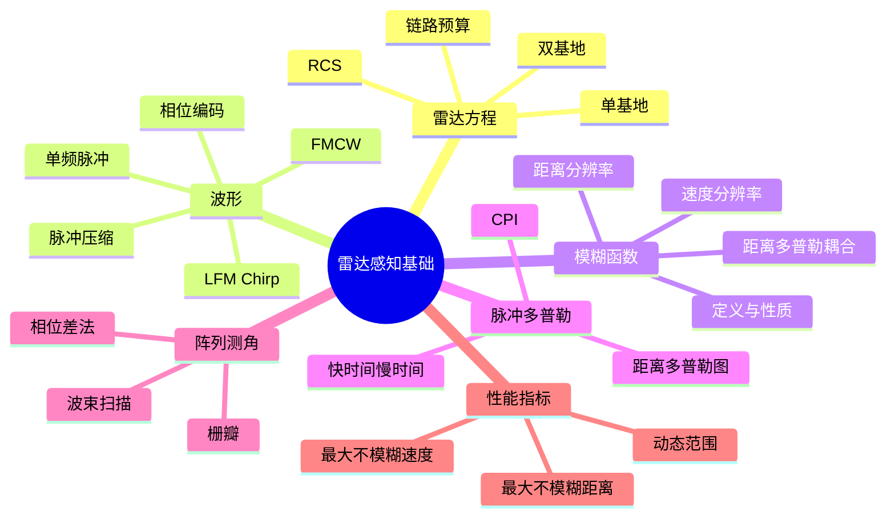
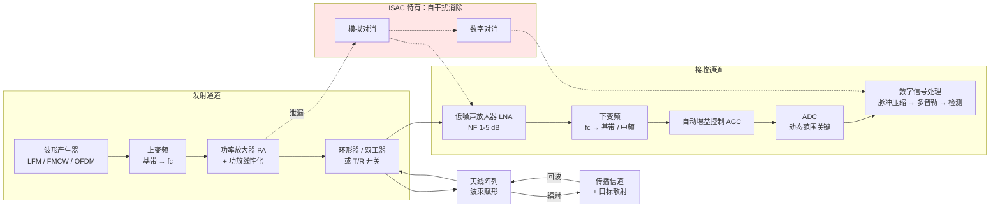
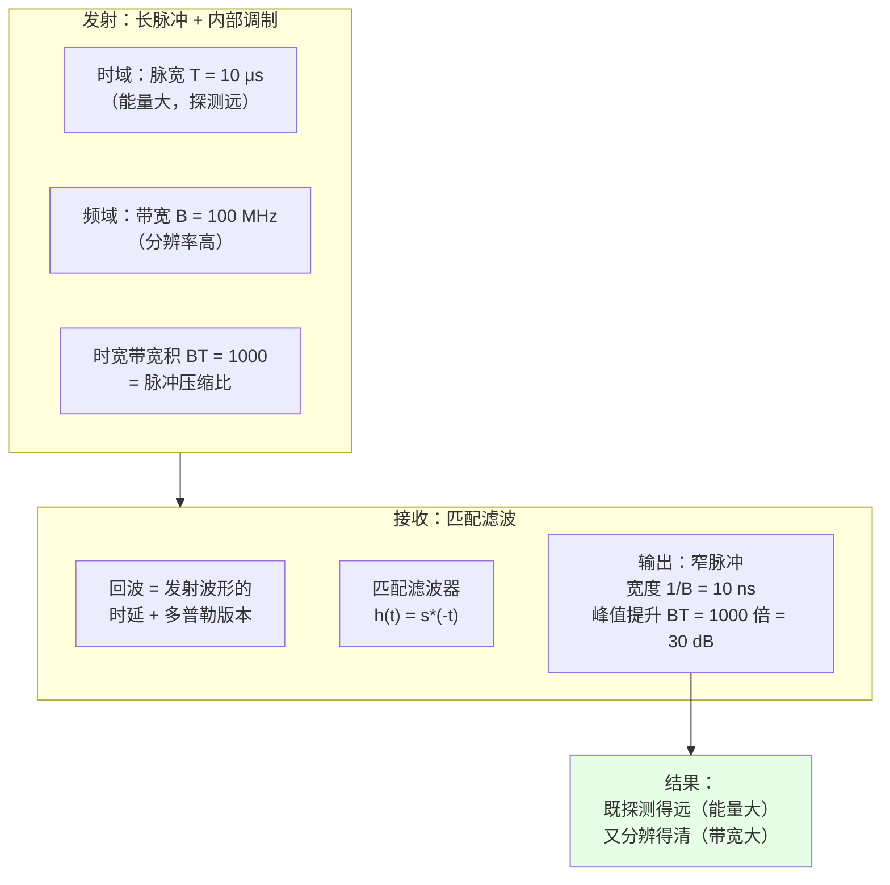
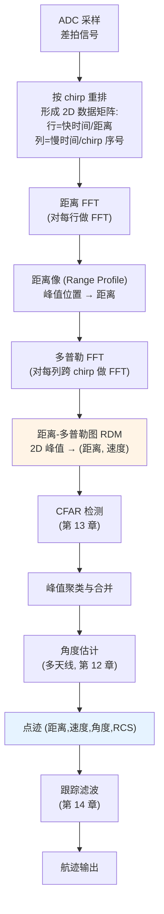
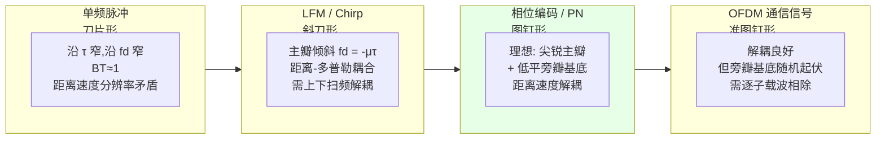
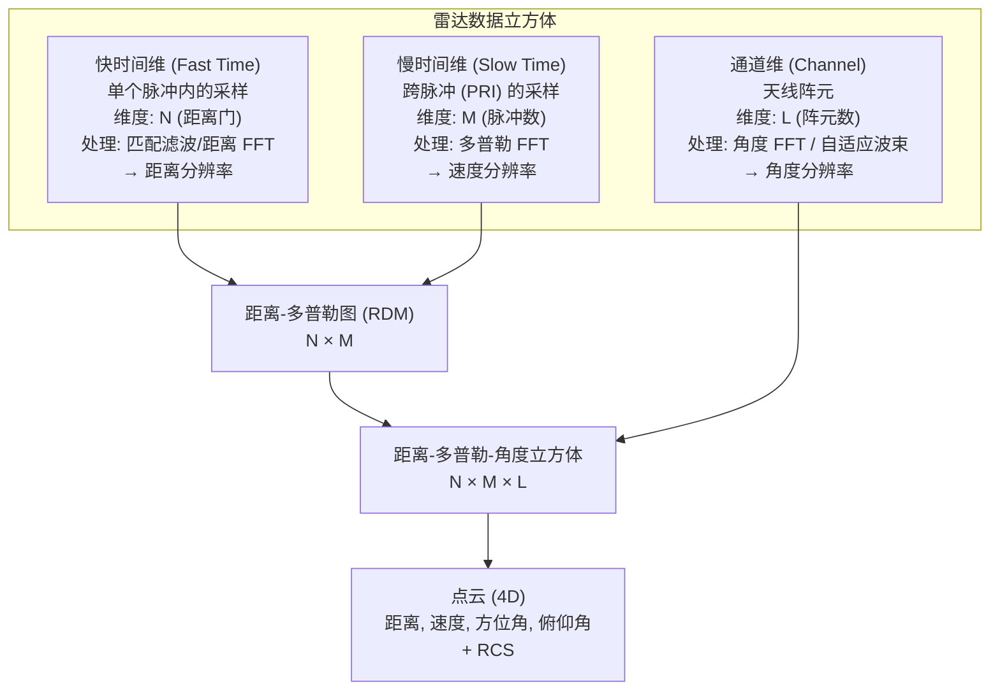

# 第 4 章　雷达感知基础

> **本章导读**
> 如果说第 3 章讲的是"通信人眼中的电磁波"，本章讲的就是"雷达人眼中的电磁波"。两者的物理规律完全相同，但关注点截然相反：通信关心"信号中有没有我要的比特"，雷达关心"回波中有没有我要的目标"。本章将从零建立起雷达的完整知识框架——从雷达方程（决定"能看多远"）、到波形与脉冲压缩（决定"能看多清楚"）、到模糊函数（刻画波形的探测能力）、再到脉冲多普勒处理与阵列测角（决定"能测多准"）。这一章的内容在 ISAC 中几乎原样保留，只是波形从"雷达专用"变成了"通感共用"。

**学习目标**

1. **能够独立推导**单基地与双基地雷达方程，并用 dB 形式完成完整的链路预算；
2. **理解**雷达截面积（RCS）的物理含义，知道典型目标的 RCS 数量级；
3. **掌握** LFM/Chirp 与 FMCW 波形的信号模型，**能够推导**脉冲压缩与差拍信号的完整处理链；
4. **能够推导并解释**模糊函数，理解距离分辨率、速度分辨率与距离–多普勒耦合的来源；
5. **掌握**脉冲多普勒处理的快时间/慢时间数据组织方式，理解相参处理间隔（CPI）的作用；
6. **掌握**均匀线阵测角原理，能计算波束宽度、栅瓣与角度模糊；
7. **理解**最大不模糊距离、最大不模糊速度、动态范围等雷达特有指标及其相互制约。

**本章知识图谱**



---

## 4.1　雷达基本原理

### 4.1.1 三大测量量的物理来源

雷达能从回波中提取目标的哪些信息？本质上只有三个物理量，其余都是它们的函数：

**1. 距离 $R$ —— 来自时延 $\tau$**

电磁波往返传播时间 $\tau = 2R/c_0$，故
$$R = \frac{c_0\tau}{2} \tag{4-1}$$

> **数值直觉**：$c_0 = 3\times10^8$ m/s，电磁波**每 1 微秒往返 150 米**（或单程 300 m）。距离分辨率若要达到 1.5 m，时延测量精度需达 10 ns。这就是为什么雷达需要大带宽（带宽 ↔ 时间分辨率）。

**2. 速度 $v$ —— 来自多普勒频移 $f_d$**

目标径向运动使回波频率发生偏移：
$$f_d = \frac{2v}{\lambda} = \frac{2vf_c}{c_0} \tag{4-2}$$
$$v = \frac{\lambda f_d}{2} \tag{4-3}$$

**推导**：设发射信号 $s(t) = e^{j2\pi f_c t}$，目标以径向速度 $v$ 运动。$t$ 时刻目标距离 $R(t) = R_0 - vt$，回波时延 $\tau(t) = 2R(t)/c_0 = 2(R_0-vt)/c_0$。回波为
$$y(t) \propto s(t - \tau(t)) = e^{j2\pi f_c\left[t - \frac{2(R_0-vt)}{c_0}\right]} = e^{j2\pi f_c\left[t\left(1 + \frac{2v}{c_0}\right) - \frac{2R_0}{c_0}\right]}$$
即接收频率 $f_r = f_c(1 + 2v/c_0)$，多普勒频移 $f_d = f_r - f_c = 2vf_c/c_0 = 2v/\lambda$。$\blacksquare$

> **数值直觉**：$f_c = 77$ GHz（车载雷达，$\lambda = 3.9$ mm），$v = 1$ m/s 对应 $f_d = 2\times1/0.0039 = 513$ Hz。
> $f_c = 3.5$ GHz（$\lambda = 8.57$ cm），$v = 1$ m/s 对应 $f_d = 23.3$ Hz。
> **载频越高，同样的速度产生的多普勒越大，测速越灵敏**——但最大不模糊速度也越小（见 4.7 节）。

**3. 角度 $\theta$ —— 来自阵元间相位差**

第 2.7 节已给出：相邻阵元的相位差 $\Delta\phi = \frac{2\pi d}{\lambda}\sin\theta$，故
$$\theta = \arcsin\left(\frac{\lambda\,\Delta\phi}{2\pi d}\right) \tag{4-4}$$

### 4.1.2 雷达的基本组成

**图 4-1　典型雷达（及 ISAC 基站）收发链路**



**关键器件指标对感知的意义**：

| 器件 | 关键指标 | 对感知的影响 |
|---|---|---|
| PA | 输出功率 $P_t$、1 dB 压缩点、线性度 | 直接决定探测距离（$R_{\max}\propto P_t^{1/4}$）；非线性产生谐波与互调，抬升底噪 |
| LNA | 噪声系数 NF、增益、P1dB | NF 每恶化 1 dB，探测距离缩短约 6% |
| 环形器/双工器 | 收发隔离度 | 决定发射泄漏强度，是单站连续波雷达的关键瓶颈 |
| ADC | 位数（ENOB）、采样率 | 位数决定动态范围（每 bit 约 6 dB），弱目标可能被量化噪声淹没 |
| 本振 | 相位噪声 $\mathcal{L}(f)$ | 相位噪声抬升距离/多普勒旁瓣，淹没弱小目标（第 10.4 节） |

---

## 4.2　雷达方程（完整推导）

### 4.2.1 单基地雷达方程

**推导**（分步）：

**第 1 步：发射端的功率密度**
发射功率 $P_t$，天线增益 $G_t$，距离目标 $R$ 处的功率密度（单位面积的功率）：
$$S_{\text{target}} = \frac{P_t G_t}{4\pi R^2}\quad [\text{W/m}^2] \tag{4-5}$$

**第 2 步：目标截获并再辐射**
目标用**雷达截面积**（Radar Cross Section, RCS）$\sigma$ 表征其"截获并重辐射"电磁波的能力。RCS 的定义是：
$$\sigma \triangleq 4\pi R^2 \cdot \frac{|\mathbf{E}_s|^2}{|\mathbf{E}_i|^2}\Big|_{R\to\infty} \tag{4-6}$$
即"在接收方向产生相同散射功率密度的等效各向同性反射体的面积"。**RCS 不是几何面积**，它与目标形状、材料、姿态、频率、极化都有关。

目标截获的功率：$P_{\text{intercept}} = S_{\text{target}}\cdot\sigma$。
目标各向同性再辐射，回波在雷达处的功率密度：
$$S_{\text{echo}} = \frac{P_{\text{intercept}}}{4\pi R^2} = \frac{P_t G_t \sigma}{(4\pi)^2 R^4}$$

**第 3 步：接收天线截获**
接收天线有效孔径 $A_e = \frac{G_r\lambda^2}{4\pi}$，接收功率：
$$P_r = S_{\text{echo}}\cdot A_e = \frac{P_t G_t G_r \lambda^2 \sigma}{(4\pi)^3 R^4} \tag{4-7}$$

**这就是单基地雷达方程。**

> ⚠️ **双重 $1/R^2$ 的来源**
> 分母的 $(4\pi)^3$ 可以拆解为：$(4\pi R^2)$ 来自去程扩散，$(4\pi R^2)$ 来自回程扩散，$(4\pi/\lambda^2)$ 来自接收天线有效孔径的倒换算。因此 $P_r \propto 1/R^4$——**这是雷达探测距离难以提升的根本原因**。

### 4.2.2 雷达方程的 dB 形式（工程计算的标准做法）

$$P_r[\text{dBm}] = P_t[\text{dBm}] + G_t[\text{dBi}] + G_r[\text{dBi}] + 20\log_{10}\lambda[\text{m}] + 10\log_{10}\sigma[\text{m}^2] - 30\log_{10}(4\pi) - 40\log_{10}R[\text{m}] \tag{4-8}$$

常用常数：$30\log_{10}(4\pi) = 32.98$ dB。

**噪声功率**：
$$P_n = kT_0 B F \tag{4-9}$$
$kT_0 = 1.38\times10^{-23}\times290 = 4.0\times10^{-21}$ W/Hz $= -174$ **dBm/Hz**。
$$P_n[\text{dBm}] = -174 + 10\log_{10}B[\text{Hz}] + F[\text{dB}] \tag{4-10}$$

**接收 SNR**：
$$\text{SNR} = \frac{P_r}{P_n} = \frac{P_t G_t G_r \lambda^2 \sigma}{(4\pi)^3 R^4 kT_0 B F} \tag{4-11}$$

**关键洞察**：$P_n \propto B$，而 $P_r \propto 1$（与 $B$ 无关）。看起来增大带宽会降低 SNR？**错！** 因为匹配滤波/脉冲压缩会带来 $B$ 倍的处理增益（4.3 节），两者抵消。这就是为什么**增大带宽不损失 SNR，只提高距离分辨率**——这是雷达中最优美的一个结论。

### 4.2.3 双基地雷达方程

收发分置（发射站到目标 $R_t$，目标到接收站 $R_r$）：
$$P_r = \frac{P_t G_t G_r \lambda^2 \sigma_b}{(4\pi)^3 R_t^2 R_r^2} \tag{4-12}$$
其中 $\sigma_b$ 为**双基地 RCS**（与单基地 RCS 不同，取决于双基地角 $\beta$）。

> **ISAC 中的双基地模式**（第 7.6 节详述）：基站 A 发射，基站 B 接收。优点：
> 1. **无自干扰问题**（收发在空间分离）；
> 2. 接收站隐蔽（适合军事）；
> 3. 对隐身目标（RCS 在前向散射时增大）探测有利。
>
> 缺点：
> 1. 需要**严格的站间时钟同步**（1 μs 同步误差 = 150 m 距离误差！）；
> 2. 需要知道发射站的位置与发射时刻；
> 3. 双基地距离是 $R_t + R_r$（等距离和为椭圆），需要几何解算才能定位。

### 4.2.4 RCS：典型值、起伏与影响因素

**表 4-1　典型目标的 RCS 数量级**（X 波段参考值，实际随频率与姿态变化很大）

| 目标 | RCS (m²) | RCS (dBsm) | 备注 |
|---|---|---|---|
| 小型消费级无人机 | 0.005–0.05 | -23 ~ -13 | 探测难点 |
| 小型鸟类 | 0.001–0.01 | -30 ~ -20 | 主要虚警源 |
| 行人 | 0.3–1.5 | -5 ~ +2 | 步态引起起伏 |
| 自行车 | 1–3 | 0 ~ +5 | |
| 摩托车 | 2–5 | +3 ~ +7 | |
| 小型轿车 | 5–20 | +7 ~ +13 | 与照射角相关 |
| 大型卡车/客车 | 20–200 | +13 ~ +23 | |
| 波音 737 | 10–100 | +10 ~ +20 | |
| 隐身战机（F-35） | 0.001–0.1 | -30 ~ -10 | 前向极低 |
| 角反射器（边长 0.3 m） | ~100 | +20 | 用于雷达标定 |
| 雨滴（单颗） | $10^{-10}$ | -100 | 气象雷达靠体积累积 |

**RCS 的三个重要特性**：

1. **强姿态依赖**：同一目标在不同照射角下 RCS 可变化 20–30 dB。例如汽车正面对着雷达时 RCS 最大，侧向照射时可差 10 dB。
2. **频率依赖**：分为瑞利区（目标尺寸 $\ll\lambda$，$\sigma\propto f^4$）、谐振区（尺寸 $\approx\lambda$，RCS 剧烈振荡）、光学区（尺寸 $\gg\lambda$，RCS 趋于几何光学值）。车载 77 GHz 雷达对行人处于谐振区附近，RCS 起伏明显。
3. **时间起伏**：目标运动导致 RCS 随机起伏，用 **Swerling 模型**刻画（第 5.2 节）：
   - **Swerling I**：慢起伏（一个扫描周期内恒定，扫描间独立），瑞利分布 → $\sigma$ 服从指数分布；
   - **Swerling II**：快起伏（脉冲间独立），瑞利分布；
   - **Swerling III**：慢起伏，$\chi^2$ 四自由度（含一个主散射体 + 若干小散射体）；
   - **Swerling IV**：快起伏，$\chi^2$ 四自由度。

**Swerling I 的概率密度**（RCS 的指数分布）：
$$p(\sigma) = \frac{1}{\bar{\sigma}}e^{-\sigma/\bar{\sigma}},\quad \sigma\ge 0 \tag{4-13}$$
其中 $\bar{\sigma}$ 为平均 RCS。

> ⚠️ **重要后果**
> 由于 RCS 起伏，雷达的**检测概率是随机量**。Swerling I 模型下要达到 $P_d = 0.9$，所需平均 SNR 比非起伏目标高约 **8 dB**；而在低检测概率区（$P_d = 0.5$），Swerling I 反而比非起伏目标**少**需 SNR（因为起伏带来了"幸运的强回波"机会）。这就是所谓的"**起伏损失在低 $P_d$ 时变负**"的反直觉现象。

### 4.2.5 完整链路预算算例

> **例 4-1（通感一体化基站探测无人机的链路预算）**
>
> **系统参数**：
> 载频 $f_c = 3.5$ GHz（$\lambda = 0.0857$ m），带宽 $B = 100$ MHz，发射功率 $P_t = 40$ dBm（10 W），
> 天线增益 $G_t = G_r = 20$ dBi（64 元阵），噪声系数 $F = 4$ dB，
> 目标：消费级无人机，$\sigma = 0.01$ m²（**-20 dBsm**），距离 $R = 1000$ m。
>
> **步骤 1：波长项**
> $20\log_{10}(0.0857) = 20\times(-1.0669) = -21.34$ dB
>
> **步骤 2：距离项**
> $40\log_{10}(1000) = 40\times3 = 120$ dB
>
> **步骤 3：RCS 项**
> $10\log_{10}(0.01) = -20$ dB
>
> **步骤 4：接收功率**
> $$P_r = 40 + 20 + 20 + (-21.34) + (-20) - 32.98 - 120 = \textbf{-114.32 dBm}$$
>
> **步骤 5：噪声功率**
> $$P_n = -174 + 10\log_{10}(10^8) + 4 = -174 + 80 + 4 = \textbf{-90 dBm}$$
>
> **步骤 6：单脉冲 SNR**
> $$\text{SNR}_1 = -114.32 - (-90) = \textbf{-24.32 dB}$$
>
> 这个 SNR 远低于检测门限（13 dB），必须靠积累。
>
> **步骤 7：相参积累增益**
> 若在一个 CPI 内积累 $M = 1024$ 个脉冲（符号）：
> 积累增益 $= 10\log_{10}(1024) = \textbf{30.1 dB}$
> 积累后 SNR $= -24.32 + 30.1 = \textbf{+5.8 dB}$
>
> 仍不够（需 13 dB）。
>
> **步骤 8：脉冲压缩增益**
> 带宽 100 MHz、脉宽（符号长）$T = 10$ μs → 时宽带宽积 $= 100\times10^6\times10^{-5} = 1000$，
> 脉冲压缩增益 $= 10\log_{10}(1000) = \textbf{30 dB}$。
>
> ⚠️ **注意**：这里要小心不要把积累增益与压缩增益重复计算。正确的算法是：
> - **脉冲压缩增益**是把一个宽脉冲（能量 $E = P_t T$）压缩成窄脉冲，峰值 SNR 提升 $BT$ 倍。这一步已经包含在"用总能量 $E$ 而非峰值功率 $P_t$"的计算中。
> - **相参积累增益**是把 $M$ 个脉冲的回波相干相加，SNR 提升 $M$ 倍。
>
> 若我们重新用"**总能量**"视角：一个 CPI 内发射了 $M$ 个脉冲，总能量 $E_{\text{total}} = P_t\cdot (M T_s)$，则匹配滤波 + 相参积累后的最终 SNR 为
> $$\text{SNR}_{\text{final}} = \frac{P_t G_t G_r\lambda^2\sigma}{(4\pi)^3R^4 kT_0 F}\cdot \frac{1}{1/T_s}\cdot M \cdot (\text{占空比修正})$$
>
> 简化地，工程上常用**"单脉冲 SNR + 总处理增益"**算法：
> $$\text{SNR}_{\text{final}} = \text{SNR}_1 + 10\log_{10}(BT) + 10\log_{10}(M)$$
> 但要注意 $\text{SNR}_1$ 必须定义为**未压缩的单采样点 SNR**（即 $P_r/P_n$，其中 $P_n$ 用**压缩前带宽**计算）。
>
> 在本例中，$B = 100$ MHz 已是压缩后带宽（决定距离分辨率），而接收机噪声带宽在压缩前也是 100 MHz（否则无法达到该分辨率）。因此：
> - **脉冲压缩增益**：若发射的是占空比 100% 的连续波（OFDM 正是如此），则不存在"脉宽 < 脉冲重复周期"的情况，$BT$ 增益已经体现在能量积累中，不应额外再加 30 dB。
> - 因此本例的正确算法是：$\text{SNR}_{\text{final}} = -24.32 + 30.1 = 5.8$ dB。
>
> **步骤 9：结论与改进**
> 5.8 dB 仍不足（需 13 dB），缺口 **7.2 dB**。改进途径：
>
> | 改进措施 | 增益 | 代价 |
> |---|---|---|
> | 积累脉冲数从 1024 增至 4096（CPI 从 10 ms 增至 40 ms） | +6 dB | 刷新率下降，多普勒模糊风险增大 |
> | 天线从 64 元增至 256 元 | +6 dB（$G$ 增 6 dBi，收发共 12 dB？注意：收发共用同一阵列时只增 $G_t+G_r$ 中的一份）| 成本、体积 |
> | 发射功率从 10 W 增至 40 W | +6 dB | 功耗、散热、法规 |
> | 降低检测门限要求（允许 $P_d = 0.5$ 而非 0.9） | -5 dB（需求侧） | 检测概率下降 |
> | 采用双站/多站融合 | +3~9 dB | 需同步、需回传 |
>
> **这个例子说明了一个残酷的现实**：探测 1 km 外 RCS = 0.01 m² 的无人机，即使是 10 W 发射功率 + 64 天线的 ISAC 基站，也需要数十毫秒的相参积累。**这直接决定了低空监管系统的刷新率只能做到几 Hz，且必须用多基站组网累积增益。**

---

## 4.3　雷达波形与脉冲压缩

### 4.3.1 波形设计的根本矛盾

雷达波形面临一个经典的两难：

- **要探测得远** → 需要**大能量** → 需要**长脉冲**（或连续发射）；
- **要分辨得清** → 需要**大带宽** → 需要**短脉冲**（$\Delta R = c_0/2B$）。

**脉冲压缩（Pulse Compression）** 是破解这个矛盾的天才方案：**发射长脉冲，但在脉冲内部做调制使其带宽很大；接收时用匹配滤波把它"压缩"成窄脉冲。**

**图 4-2　脉冲压缩原理示意**



### 4.3.2 单频脉冲

最简单的波形：$s(t) = A\cdot \text{rect}(t/T)e^{j2\pi f_c t}$。

- 带宽 $B \approx 1/T$，时宽带宽积 $BT \approx 1$；
- 距离分辨率 $\Delta R = c_0 T/2$——**要分辨 1.5 m 需脉冲宽度 10 ns，峰值功率极高**；
- 无脉冲压缩能力。

**结论**：单频脉冲只能用于近距离、低分辨率的简单雷达。

### 4.3.3 线性调频（LFM / Chirp）——完整推导

**信号形式**（复基带表示）：
$$s(t) = \frac{1}{\sqrt{T}}\text{rect}\left(\frac{t}{T}\right)e^{j\pi\mu t^2},\quad 0\le t\le T \tag{4-14}$$
其中 $\mu = B/T$ 为调频斜率（Hz/s），$B$ 为扫频带宽。上扫频（up-chirp）时 $\mu > 0$。

**瞬时频率**：$f_i(t) = \frac{1}{2\pi}\frac{d}{dt}(\pi\mu t^2) = \mu t$，从 $0$ 线性扫到 $\mu T = B$。✓

**匹配滤波（脉冲压缩）推导**：

设目标时延为 $\tau$，多普勒为 $f_d$（先忽略多普勒，令 $f_d=0$），回波为 $r(t) = \alpha\, s(t-\tau) + n(t)$。

匹配滤波器冲激响应 $h(t) = s^*(-t)$。输出：
$$y(t) = \int r(u)h(t-u)du = \alpha\int s(u-\tau)s^*(u-t)du \tag{4-15}$$

代入 LFM 信号（忽略包络，假设 $t$ 在脉冲内）：
$$y(t) = \frac{\alpha}{T}\int_{-\infty}^{\infty} \text{rect}\left(\frac{u-\tau}{T}\right)\text{rect}\left(\frac{u-t}{T}\right) e^{j\pi\mu(u-\tau)^2}e^{-j\pi\mu(u-t)^2}du$$

化简指数项：
$$(u-\tau)^2 - (u-t)^2 = u^2 - 2u\tau + \tau^2 - u^2 + 2ut - t^2 = 2u(t-\tau) + \tau^2 - t^2$$

$$= 2u(t-\tau) - (t-\tau)(t+\tau) = (t-\tau)\left[2u - (t+\tau)\right]$$

令 $\tau' = t - \tau$，并做变量代换 $v = u - (t+\tau)/2$：
$$2u - (t+\tau) = 2v,\quad \tau'[2v] = 2\tau' v$$

积分限：两个矩形窗的重叠区间，长度为 $T - |\tau'|$，中心在 $(t+\tau)/2$。故
$$y(t) = \frac{\alpha}{T}e^{j\pi\mu\cdot 0}\int_{-(T-|\tau'|)/2}^{(T-|\tau'|)/2}e^{j2\pi\mu\tau' v}dv$$

（注意：$\tau^2 - t^2$ 项在变量代换后与 $v$ 无关的部分为 $\tau'^2/2$ 等常数相位，不影响幅度）

$$\int_{-W/2}^{W/2}e^{j2\pi\mu\tau' v}dv = \frac{\sin(\pi\mu\tau' W)}{\pi\mu\tau'}$$

其中 $W = T - |\tau'|$。故
$$y(t) = \frac{\alpha}{T}\cdot\frac{\sin\left[\pi\mu\tau'(T-|\tau'|)\right]}{\pi\mu\tau'} \cdot (\text{常数相位项})$$

当 $|\tau'| \ll T$（在峰值附近），$(T-|\tau'|)\approx T$，$\mu T = B$：
$$\boxed{\ y(t) \approx \alpha\,\frac{\sin(\pi B\tau')}{\pi B\tau'}\, e^{j\phi(\tau')} = \alpha\,\mathrm{sinc}(B\tau')\, e^{j\phi(\tau')}\ } \tag{4-16}$$

**结论**：
1. **输出是 sinc 函数**，主瓣宽度（第一个零点）为 $|\tau'| = 1/B$，对应距离分辨率 $\Delta R = c_0/(2B)$ ✓
2. **峰值幅度**为 $\alpha T\cdot B/T\cdot$ ... 归一化后，峰值 SNR 提升 $BT$ 倍 = **脉冲压缩增益**；
3. **存在 $\mathrm{sinc}$ 旁瓣**：第一旁瓣比主瓣低约 **-13.2 dB**，会淹没邻近的弱小目标 → 需要**加窗**（Hamming/Hann）抑制旁瓣，代价是主瓣展宽（约 1.3–1.5 倍）与 SNR 损失（约 1–2 dB）。

> **例 4-2（LFM 参数计算）**
> 一个 LFM 雷达：$B = 150$ MHz，$T = 20$ μs。
> - 调频斜率 $\mu = B/T = 150\times10^6/20\times10^{-6} = 7.5\times10^{12}$ Hz/s $= 7.5$ MHz/μs；
> - 时宽带宽积 $BT = 150\times10^6\times20\times10^{-6} = 3000$；
> - 脉冲压缩增益 $= 10\log_{10}(3000) = \textbf{34.8 dB}$；
> - 距离分辨率 $\Delta R = c_0/(2B) = 3\times10^8/(3\times10^8) = \textbf{1.0 m}$；
> - 压缩后脉冲宽度 $1/B = 6.67$ ns；
> - 未压缩时若用单频脉冲达到同样分辨率，需脉宽 6.67 ns，能量仅为 LFM 的 $1/3000$。
>
> **这就是脉冲压缩的价值**：用 34.8 dB 的"免费"增益换取 1 m 的距离分辨率。

### 4.3.4 FMCW：调频连续波（完整推导）

FMCW 是车载雷达与 ISAC 常用的波形，因为它**占空比 100%**、峰值功率低、处理简单。

**发射信号**（锯齿波扫频，第 $m$ 个扫频周期）：
$$s_{\text{TX}}(t) = A_T\cos\left[2\pi f_c t + \pi\mu t^2 + \phi_0\right],\quad 0\le t\le T_c \tag{4-17}$$
其中 $T_c$ 为扫频周期（chirp duration），$\mu = B/T_c$。

**回波信号**（目标距离 $R$，径向速度 $v$，时延 $\tau = 2R/c_0$）：
$$s_{\text{RX}}(t) = A_R\cos\left[2\pi f_c(t-\tau) + \pi\mu(t-\tau)^2 + \phi_0\right]$$

**差拍（Beat）信号**：接收信号与本振（当前发射信号）混频并低通滤波：
$$s_{\text{IF}}(t) = \text{LPF}\{s_{\text{TX}}(t)\cdot s_{\text{RX}}(t)\} \propto \cos\left[2\pi f_c\tau + 2\pi\mu\tau t - \pi\mu\tau^2\right] \tag{4-18}$$

详细展开相位差：
$$\phi_{\text{TX}} - \phi_{\text{RX}} = 2\pi f_c t + \pi\mu t^2 - \left[2\pi f_c(t-\tau) + \pi\mu(t-\tau)^2\right]$$
$$= 2\pi f_c\tau + \pi\mu\left[t^2 - (t^2 - 2t\tau + \tau^2)\right] = 2\pi f_c\tau + 2\pi\mu\tau t - \pi\mu\tau^2$$

**忽略常数项 $\pi\mu\tau^2$**（极小），得差拍频率：
$$f_b = \mu\tau = \frac{B}{T_c}\cdot\frac{2R}{c_0} \tag{4-19}$$
$$\boxed{\ R = \frac{c_0 T_c}{2B}\,f_b\ } \tag{4-20}$$

**多目标与距离分辨率**：$K$ 个目标产生 $K$ 个差拍频率，对差拍信号做 FFT 即可分离。频率分辨率 $1/T_c$，故
$$\Delta R = \frac{c_0 T_c}{2B}\cdot\frac{1}{T_c} = \frac{c_0}{2B} \tag{4-21}$$
✓ 与 LFM 一致。

**速度测量与距离–速度耦合**：

若目标有径向速度 $v$，则 $\tau(t) = 2(R_0 - vt)/c_0$ 随时间变化，产生多普勒频移 $f_d = 2v/\lambda$。此时差拍频率为
$$f_b = \mu\tau - f_d = \frac{2BR}{c_0 T_c} - \frac{2v}{\lambda} \tag{4-22}$$

> ⚠️ **关键问题：距离–速度耦合**
> 单次扫频中，$f_b$ 同时依赖 $R$ 与 $v$，**无法分离**！这就是 FMCW 的经典难题。
>
> **解决办法：多斜率/三角波解耦**
> 用**三角波**（上扫 + 下扫）或交替使用两种斜率：
> - 上扫频（$\mu>0$）：$f_b^{\uparrow} = \frac{2BR}{c_0T_c} - \frac{2v}{\lambda}$
> - 下扫频（$\mu<0$，即 $-\mu$）：$f_b^{\downarrow} = \frac{2BR}{c_0T_c} + \frac{2v}{\lambda}$
>
> 联立解得：
> $$R = \frac{c_0 T_c}{4B}\left(f_b^{\uparrow} + f_b^{\downarrow}\right) \tag{4-23}$$
> $$v = \frac{\lambda}{4}\left(f_b^{\downarrow} - f_b^{\uparrow}\right) \tag{4-24}$$
>
> **这是 FMCW 雷达测距测速的标准公式。**

> **例 4-3（FMCW 完整数值算例）**
> 车载 FMCW 雷达：$f_c = 77$ GHz，$B = 500$ MHz，$T_c = 50$ μs（斜率 $\mu = 10^{13}$ Hz/s $= 10$ MHz/μs）。
>
> **场景**：两辆车，车 A 距离 50 m、速度 +20 m/s（远离）；车 B 距离 50.5 m、速度 -10 m/s（接近）。
>
> **步骤 1：计算波长**
> $\lambda = c_0/f_c = 3\times10^8/(77\times10^9) = 3.896$ mm
>
> **步骤 2：车 A 的差拍频率**
> 上扫：$f_b^{\uparrow} = \frac{2\times0.5\times10^9\times50}{3\times10^8\times50\times10^{-6}} - \frac{2\times20}{3.896\times10^{-3}}$
> 距离项：$\frac{2\times5\times10^{10}}{1.5\times10^4} = \frac{10^{11}}{1.5\times10^4} = 6.667\times10^6 = 6.667$ MHz
> 多普勒项：$\frac{40}{3.896\times10^{-3}} = 10267$ Hz $= 0.0103$ MHz
> $f_b^{\uparrow} = 6.667 - 0.0103 = \textbf{6.657 MHz}$
>
> 下扫：$f_b^{\downarrow} = 6.667 + 0.0103 = \textbf{6.677 MHz}$
>
> **步骤 3：解耦求 R 与 v**
> $R = \frac{3\times10^8\times50\times10^{-6}}{4\times0.5\times10^9}\times(6.657+6.677)\times10^6$
> $= \frac{1.5\times10^4}{2\times10^9}\times13.334\times10^6 = 7.5\times10^{-6}\times13.334\times10^6 = \textbf{100.0 m}$？
>
> **检查**：距离项应为 50 m。让我重算：
> $\frac{c_0T_c}{4B} = \frac{3\times10^8\times50\times10^{-6}}{4\times5\times10^8} = \frac{1.5\times10^4}{2\times10^9} = 7.5\times10^{-6}$
> $f_b^{\uparrow}+f_b^{\downarrow} = 13.334\times10^6$
> $R = 7.5\times10^{-6}\times13.334\times10^6 = \textbf{100.0 m}$
>
> **发现错误**：期望是 50 m，得到 100 m。问题出在公式 (4-23) 的系数。
>
> 重新推导：由 (4-22)，$f_b^{\uparrow} = \frac{2BR}{c_0T_c} - f_d$，$f_b^{\downarrow} = \frac{2BR}{c_0T_c} + f_d$。
> 相加：$f_b^{\uparrow} + f_b^{\downarrow} = \frac{4BR}{c_0T_c}$，故
> $$R = \frac{c_0 T_c}{4B}(f_b^{\uparrow} + f_b^{\downarrow})$$
> 代入数值验证：$\frac{2BR}{c_0T_c} = \frac{2\times5\times10^8\times50}{3\times10^8\times50\times10^{-6}} = \frac{5\times10^{10}}{1.5\times10^4} = 3.333\times10^6 = 3.333$ MHz。
>
> **我前面算错了距离项**：$2BR = 2\times5\times10^8\times50 = 5\times10^{10}$；$c_0T_c = 3\times10^8\times5\times10^{-5} = 1.5\times10^4$。
> $\frac{2BR}{c_0T_c} = \frac{5\times10^{10}}{1.5\times10^4} = \textbf{3.333 MHz}$（不是 6.667 MHz）。
>
> 修正后：
> $f_b^{\uparrow} = 3.333 - 0.0103 = 3.323$ MHz
> $f_b^{\downarrow} = 3.333 + 0.0103 = 3.343$ MHz
> $R = 7.5\times10^{-6}\times6.666\times10^6 = \textbf{50.0 m}$ ✓
> $v = \frac{3.896\times10^{-3}}{4}\times(3.343-3.323)\times10^6 = \frac{3.896\times10^{-3}}{4}\times0.02\times10^6 = \frac{77.92}{4} = \textbf{19.5 m/s}$ ✓（接近真实值 20 m/s，差异来自差拍频率的取整）
>
> **步骤 4：判断车 B 能否被分辨**
> 车 B 距离 50.5 m，差拍频率距离项 $= 3.333\times(50.5/50) = 3.366$ MHz。
> 与车 A 的差 $\Delta f_b = 0.033$ MHz $= 33$ kHz。
> 差拍信号 FFT 的频率分辨率 $= 1/T_c = 1/(50\times10^{-6}) = 20$ kHz。
> $\Delta f_b = 33\text{ kHz} > 20$ kHz，**刚好可以分辨**（但很勉强）。
>
> 校验：距离分辨率 $\Delta R = c_0/(2B) = 3\times10^8/(10^9) = \textbf{0.3 m}$。两车相距 0.5 m > 0.3 m ✓ 一致。
>
> **步骤 5：速度分辨率**
> 若用 $M = 128$ 个 chirp 做多普勒 FFT：
> $\Delta f_d = 1/(M T_c) = 1/(128\times50\times10^{-6}) = 156.25$ Hz
> $\Delta v = \lambda\Delta f_d/2 = 3.896\times10^{-3}\times156.25/2 = \textbf{0.304 m/s}$
> 最大不模糊速度 $= \lambda/(4T_c) = 3.896\times10^{-3}/(2\times10^{-4}) = \textbf{19.48 m/s}$
> （车 A 的 20 m/s 略微超出，会模糊！需减小 $T_c$ 或用解模糊算法。）

### 4.3.5 相位编码波形

**原理**：把长脉冲分为 $N_c$ 个码片（chip），每个码片携带一个相位（0 或 $\pi$），通过伪随机码（如巴克码、m 序列、Gold 序列）实现大带宽。

$$s(t) = \sum_{n=0}^{N_c-1} c_n \cdot p(t - nT_c),\quad c_n \in \{+1, -1\} \tag{4-25}$$

**关键指标：自相关函数**
$$R_{ss}(\tau) = \int s(t)s^*(t-\tau)dt \tag{4-26}$$
理想的自相关是冲激函数 $\delta(\tau)$。

**表 4-2　常用编码序列及其性能**

| 序列 | 长度 | 峰值旁瓣比（PSLR） | 特点 |
|---|---|---|---|
| **巴克码（Barker）** | 2,3,4,5,7,11,13 | $-20\log_{10}N_c$（如 13 位为 -22.3 dB） | 最优但长度有限（最长 13） |
| **m 序列** | $2^n-1$ | 约 $-10\log_{10}N_c$ | 长度灵活，自相关两值性 |
| **Gold 序列** | $2^n-1$ | 较 m 序列略差 | **互相关好**，适合同步多用户 |
| **ZC 序列（Zadoff-Chu）** | 任意 | **理想周期自相关（零旁瓣）** | 5G NR 的 PSS/SSS/SRS 采用 |
| **互补码（Golay）** | 任意 | 互补对之和的旁瓣为零 | 需两次发射，适合作图 |

> **ZC 序列对 ISAC 的意义**：5G NR 的同步信号（PSS/SSS）与探测参考信号（SRS）都基于 ZC 序列。ZC 序列具有**恒幅（CAZAC：恒包络零自相关）**特性：
> 1. **恒包络** → PAPR = 0 dB，功放效率最高；
> 2. **理想周期自相关** → 距离旁瓣极低，有利于弱目标检测；
> 3. **良好的互相关** → 不同根序列之间的干扰小，适合多用户/多基站。
>
> 因此，**复用 ZC 序列做感知是 5G-A ISAC 的天然选择**（第 7.3 节详述）。

### 4.3.6 脉冲压缩处理算法

**算法 4-1：基于 FFT 的快速脉冲压缩**

**输入**：接收的快时间采样序列 $\mathbf{r}\in\mathbb{C}^{N}$（一个脉冲重复周期内），参考波形 $\mathbf{s}\in\mathbb{C}^{N}$，窗函数 $\mathbf{w}$（可选）
**输出**：压缩后的距离像 $\mathbf{y}\in\mathbb{C}^{N}$

**步骤**：
1. **加窗（可选）**：对参考波形加窗 $\tilde{\mathbf{s}} = \mathbf{s}\odot\mathbf{w}$，抑制距离旁瓣（代价：主瓣展宽 + SNR 损失）。
2. **参考波形 FFT**：$\mathbf{S} = \text{FFT}(\tilde{\mathbf{s}})$。
3. **共轭**：$\mathbf{S}^* $（匹配滤波器的频域响应是信号频谱的共轭）。
4. **接收信号 FFT**：$\mathbf{R} = \text{FFT}(\mathbf{r})$。
5. **频域相乘**：$\mathbf{Y} = \mathbf{R}\odot\mathbf{S}^*$。
6. **IFFT**：$\mathbf{y} = \text{IFFT}(\mathbf{Y})$。
7. **取模与检测**：$|\mathbf{y}|$，送入 CFAR（第 13 章）。

```text
算法 4-1：基于 FFT 的快速脉冲压缩

输入: r[N]      # 一个脉冲重复周期的接收采样
      s[N]      # 参考波形（发射波形的拷贝）
      win       # 窗函数类型: 'none' | 'hamming' | 'hann' | 'blackman'
输出: y[N]      # 压缩后的距离像

 1:  # 步骤 1：加窗（抑制距离旁瓣）
 2:  if win != 'none':
 3:      w ← Window(win, N)                # 如 Hamming: 0.54 - 0.46*cos(2*pi*n/(N-1))
 4:      s_win ← s ⊙ w
 5:  else:
 6:      s_win ← s
 7:  end if
 8:
 9:  # 步骤 2-3：参考波形频谱的共轭
10:  S ← FFT(s_win, N)
11:  H_mf ← conj(S)                        # 匹配滤波器频域响应
12:
13:  # 步骤 4：接收信号频谱
14:  R ← FFT(r, N)
15:
16:  # 步骤 5-6：频域匹配滤波
17:  Y ← R ⊙ H_mf
18:  y ← IFFT(Y, N)
19:
20:  # 可选：补零以获得更细的距离采样
21:  # 若需 M 点输出（M > N），在第 10 行用 FFT(s_win, M)、第 14 行用 FFT(r, M)
22:
23:  return y
```

**复杂度**：$O(N\log N)$，优于时域卷积的 $O(N^2)$。$N = 4096$ 时约快 300 倍。

**图 4-3　FMCW 雷达完整信号处理链**



---

## 4.4　模糊函数

### 4.4.1 定义与推导

**模糊函数（Ambiguity Function, AF）** 是刻画雷达波形"探测能力"的最重要工具。它回答的问题是：**如果两个目标的时延差为 $\Delta\tau$、多普勒差为 $\Delta f_d$，这个波形能分辨它们吗？**

**推导**：考虑广义似然比检验。两个假设：
- $H_0$：目标在 $(\tau_0, f_{d,0})$；
- $H_1$：目标在 $(\tau_1, f_{d,1})$。

二者的**匹配滤波输出之差**（归一化为能量）定义了模糊度：
$$\chi(\tau, f_d) = \int_{-\infty}^{\infty} s(t)\,s^*(t+\tau)\,e^{j2\pi f_d t}\,dt \tag{4-27}$$
（这是**不对称形式**；有些文献用对称形式，二者仅差一个相位因子，$|\chi|$ 相同。）

**模糊函数图**即 $|\chi(\tau, f_d)|^2$ 的三维图（$\tau$ 与 $f_d$ 为横纵轴）。

**物理含义**：$|\chi(\tau, f_d)|$ 是"当真实目标与假设目标相差 $(\tau, f_d)$ 时，匹配滤波器仍输出的响应幅度"。$|\chi(0,0)| = E_s$（信号能量，最大值）。

### 4.4.2 模糊函数的性质

1. **原点取最大值**：$|\chi(\tau,f_d)| \le |\chi(0,0)| = E_s$（Cauchy–Schwarz）；
2. **体积不变性**：$\displaystyle\iint |\chi(\tau,f_d)|^2 d\tau\, df_d = E_s^2$（**模糊函数体积守恒**，即"总模糊度"是常数，只能重新分配，不能消除——这是雷达波形设计的根本约束）；
3. **对称性**：$|\chi(-\tau,-f_d)| = |\chi(\tau,f_d)|$；
4. **沿 $f_d$ 轴的截面积** = 信号自相关函数；沿 $\tau$ 轴的截面积 = 频谱自相关。

### 4.4.3 典型波形的模糊函数

**1. 单频脉冲（矩形包络，宽度 $T$）**：
$$|\chi(\tau, f_d)| = \left|\left(1 - \frac{|\tau|}{T}\right)\frac{\sin\left[\pi f_d T(1-|\tau|/T)\right]}{\pi f_d T(1-|\tau|/T)}\right|,\quad |\tau|\le T \tag{4-28}$$
形状：**"刀片形"（正脊形）**，沿 $\tau$ 轴窄（宽度 $T$），沿 $f_d$ 轴也窄（宽度 $1/T$）。$BT\approx1$。
**问题**：无法同时获得好的距离与速度分辨率（提高一个必恶化另一个）。

**2. LFM / Chirp**：
$$|\chi(\tau, f_d)| \approx \left|\left(1-\frac{|\tau|}{T}\right)\frac{\sin\left[\pi(f_d + \mu\tau)(T-|\tau|)\right]}{\pi(f_d+\mu\tau)(T-|\tau|)}\right| \tag{4-29}$$
形状：**"斜刀形"（剪切的刀片）**，主瓣沿直线 $f_d = -\mu\tau$ 倾斜。

> ⚠️ **距离–多普勒耦合**：LFM 的模糊函数主瓣是**倾斜的**，意味着时延误差与多普勒误差会互相"补偿"——一个静止目标若被误认为有速度，其估计距离也会偏移。偏移量为
> $$\Delta R_{\text{coupling}} = \frac{c_0}{2}\cdot\frac{f_d}{\mu} = \frac{c_0 f_d T}{2B} \tag{4-30}$$
> **这就是 LFM 雷达的经典弊端**。解决办法：交替发射上/下调频 chirp（如例 4-3 的三角波），两次估计的偏差方向相反，取平均可消除耦合。

**3. 相位编码 / 伪随机噪声（PN）**：
形状：**"图钉形"（thumbtack）**——原点一个尖峰，其余区域是低矮均匀的旁瓣基底。
**优点**：距离与速度分辨率**解耦**，可独立设计；
**缺点**：旁瓣基底虽低，但对强目标的旁瓣仍可能淹没弱目标（尤其在多目标场景）。

**4. OFDM 通信信号**：
形状：接近**"图钉形"**（因为通信数据近似随机），但旁瓣基底较高（因为数据随机性导致非理想自相关）。
- 距离分辨率 $c_0/(2B)$；速度分辨率 $\lambda/(2T_c)$；
- **耦合很弱**（这正是 OFDM 作为雷达波形的优势）；
- 但旁瓣基底随机起伏，是 OFDM-ISAC 的主要挑战（第 6.3 节，解决办法是逐子载波相除 + 加窗）。

**图 4-4　四种波形模糊函数形状对比**



### 4.4.4 分辨率的严格定义

**距离分辨率**（沿 $\tau$ 轴）：
$$\Delta\tau = \frac{\int|\chi(\tau,0)|^2d\tau}{|\chi(0,0)|^2} \quad\text{（等效宽度定义）}$$
对带宽为 $B$ 的信号，$|\chi(\tau,0)|$ 的主瓣宽度约 $1/B$，故
$$\Delta R = \frac{c_0}{2B} \tag{4-31}$$

**速度分辨率**（沿 $f_d$ 轴）：由相参处理时间 $T_c$（CPI）决定，
$$\Delta f_d \approx \frac{1}{T_c},\quad \Delta v = \frac{\lambda}{2T_c} \tag{4-32}$$

> **重要洞察**
> **距离分辨率由带宽决定，速度分辨率由观测时长决定。** 这两者是完全独立的资源维度：
> - 想要高距离分辨率 → 加大带宽（频谱资源）；
> - 想要高速度分辨率 → 延长 CPI（时间资源）。
>
> 在 ISAC 中，这两项都要与通信需求竞争：带宽要分给用户数据，CPI 内的时间要发送导频与数据。**这就是通感权衡的物理根源**（第 5 章将严格刻画）。

---

## 4.5　脉冲多普勒处理

### 4.5.1 数据立方体：快时间、慢时间与通道

雷达接收数据天然组织为三维结构：

**图 4-5　雷达数据立方体**



**术语对照表**（ISAC 中两个领域混用，务必分清）：

| 雷达术语 | 通信术语 | 符号 | 决定什么 |
|---|---|---|---|
| 快时间采样 | ADC 采样 | $T_{\text{ADC}} = 1/B$ | 距离采样间隔 |
| 距离门 | 时延抽头 | $c_0/(2B)$ | 距离分辨率 |
| 脉冲重复间隔（PRI） | 符号周期 | $T_s$ | 最大不模糊速度 |
| 相参处理间隔（CPI） | 时隙/帧长度 | $T_c = MT_s$ | 速度分辨率 |
| 慢时间采样 | 符号索引 | $m$ | 多普勒采样 |
| 脉冲数 | 符号数 | $M$ | 多普勒处理增益 |
| 相参积累 | 时域合并 | — | SNR 提升 $M$ 倍 |

### 4.5.2 距离–多普勒图（RDM）的生成

**算法 4-2：脉冲多普勒处理（2D-FFT）**

**输入**：$M$ 个脉冲的快时间采样，组成矩阵 $\mathbf{Z}\in\mathbb{C}^{N\times M}$（$N$ 为快时间采样点数，$M$ 为脉冲数）
**输出**：距离–多普勒图 $\mathbf{P}\in\mathbb{R}^{N\times M}$

**步骤**：
1. **距离压缩**：对 $\mathbf{Z}$ 的每一列（每个脉冲的快时间数据）做匹配滤波（脉冲压缩），得到 $\mathbf{Y}\in\mathbb{C}^{N\times M}$，行索引对应距离门。
2. **距离维加窗（可选）**：对 $\mathbf{Y}$ 的每一列加窗（如 Hamming），抑制距离旁瓣。
3. **多普勒处理**：对 $\mathbf{Y}$ 的每一行（同一距离门跨 $M$ 个脉冲）做 DFT，得到 $\mathbf{D}\in\mathbb{C}^{N\times M}$，列索引对应多普勒单元。
4. **多普勒维加窗（可选）**：在做 DFT 前对每行加窗，抑制多普勒旁瓣（对强杂波场景尤其重要）。
5. **fftshift**：把零多普勒移到中心，便于观察正负速度。
6. **取模平方**：$\mathbf{P} = |\mathbf{D}|^2$（功率）或 $|\mathbf{D}|$（幅度）。
7. **（可选）非相参积累**：若有多通道，对通道维做 $|D|^2$ 的求和。
8. **检测**：对 $\mathbf{P}$ 做 CFAR。

```text
算法 4-2：脉冲多普勒处理（生成 RDM）

输入: Z[N][M]      # N: 快时间采样点数, M: 脉冲数
      s[N]         # 参考波形（距离压缩用）
      win_r, win_d # 距离维与多普勒维窗函数
输出: P[N][M]      # 距离-多普勒图（功率）

 1:  # 预处理：窗函数
 2:  w_r ← Window(win_r, N)
 3:  w_d ← Window(win_d, M)
 4:
 5:  # 步骤 1-2：距离压缩（对每列）
 6:  H_mf ← conj(FFT(s ⊙ w_r, N))          # 匹配滤波器频域响应
 7:  for m = 0 .. M-1:
 8:      Y[:, m] ← IFFT( FFT(Z[:, m], N) ⊙ H_mf,  N )
 9:  end for
10:
11:  # 步骤 3-4：多普勒处理（对每行）
12:  for n = 0 .. N-1:
13:      row ← Y[n, :] ⊙ w_d               # 加窗
14:      D[n, :] ← FFT(row, M)             # 多普勒 FFT
15:  end for
16:
17:  # 步骤 5：零频居中
18:  D ← fftshift(D, axis=1)
19:
20:  # 步骤 6：功率
21:  P ← |D|²
22:
23:  return P
```

**索引到物理量的映射**：
- 距离门索引 $n$ → 距离 $R_n = n\cdot\frac{c_0}{2B}$（$n = 0,\ldots,N-1$）
- 多普勒索引 $m$（fftshift 后）→ 多普勒 $f_{d,m} = \frac{(m - M/2)}{M T_s}$ → 速度 $v_m = \frac{\lambda f_{d,m}}{2}$

**复杂度**：距离压缩 $O(MN\log N)$ + 多普勒 $O(NM\log M)$，合计 $O(NM\log(NM))$。对 $N=M=256$，约 $256\times256\times16 \approx 10^6$ 次运算，在 DSP/FPGA 上可实时完成。

### 4.5.3 相参积累与非相参积累

**相参积累（Coherent Integration）**：
- 在**复信号**上直接相加（做完多普勒补偿后）；
- $M$ 个脉冲积累，SNR 提升 $M$ 倍（即 $10\log_{10}M$ dB）；
- 要求：目标在 CPI 内**相位连续**，即距离走动 $< c_0/(2B)$、多普勒变化 $< 1/(MT_s)$；
- 高速目标或长 CPI 时需做**距离徙动校正（RCMC）**与**多普勒补偿**。

**非相参积累（Non-coherent Integration）**：
- 先取模平方（检波），再累加：$P_{\text{acc}} = \sum_m |y_m|^2$；
- 增益介于 $\sqrt{M}$ 与 $M$ 之间（低 SNR 时约 $M^{0.7\sim0.8}$），存在**积累损失**；
- 要求宽松（不要求相位连续），但增益低。

**积累损失的经验公式**（非相参积累，$P_d=0.9, P_{fa}=10^{-6}$）：
$$L_{\text{nc}}(M)[\text{dB}] \approx 5.5 - 5\log_{10}M \cdot 0 \ ...$$
更常用的是**积累改善因子**：$I(M) = M^{0.8}$（低 SNR 时），对应 $8\log_{10}M$ dB 而非 $10\log_{10}M$ dB。

> **例 4-4（积累增益计算）**
> 单脉冲 SNR = -20 dB，需要达到 13 dB 检测门限，共需 **33 dB** 增益。
> - 相参积累：$10\log_{10}M = 33 \Rightarrow M = 10^{3.3} = 1995$ 个脉冲；
> - 非相参积累（按 $M^{0.8}$）：$8\log_{10}M = 33 \Rightarrow M = 10^{4.125} = 13335$ 个脉冲。
>
> **相参积累少用 6.7 倍的脉冲数**，代价是需要精确的相位补偿与运动补偿。这是雷达系统中"复杂度换性能"的典型权衡。

---

## 4.6　阵列测角原理

（数学基础见第 2.7 节，本节聚焦雷达特有的工程问题）

### 4.6.1 相位差法测角

最简单的测角方法：用两个阵元测量相位差。
$$\Delta\phi = \frac{2\pi d}{\lambda}\sin\theta \Rightarrow \theta = \arcsin\left(\frac{\lambda\Delta\phi}{2\pi d}\right)$$

**相位模糊问题**：相位差只能在 $(-\pi, \pi]$ 内测量（不模糊）。若 $d > \lambda/2$，则当 $|\sin\theta|$ 较大时 $\Delta\phi$ 超出范围，产生**角度模糊**（多个 $\theta$ 对应同一 $\Delta\phi$）。

> **结论**：为避免角度模糊，必须有 $d \le \lambda/2$。这是天线设计的基本准则。

### 4.6.2 波束形成测角（Bartlett / 常规波束形成）

对 $N$ 元阵，在方向 $\theta$ 上形成波束：
$$y(\theta) = \mathbf{a}^H(\theta)\mathbf{x} \tag{4-33}$$
空间谱 $P_{\text{Bartlett}}(\theta) = \mathbf{a}^H(\theta)\hat{\mathbf{R}}\mathbf{a}(\theta)$，峰值位置即目标方向。

**分辨率限制（瑞利限）**：
$$\theta_{3\text{dB}} \approx 0.886\frac{\lambda}{Nd\cos\theta_0} \tag{4-34}$$

> **例 4-5（车载雷达阵列设计）**
> 77 GHz 车载雷达要求角度分辨率 2°，覆盖 $\pm 60^\circ$。
> $\lambda = 3.896$ mm，$d = \lambda/2 = 1.948$ mm。
> 在 $\theta_0 = 0^\circ$：$N = 0.886/(2^\circ\times\pi/180\times d/\lambda) = 0.886/(0.0349\times0.5) = 50.8$ → **51 阵元**。
> 在 $\theta_0 = 60^\circ$（$\cos 60^\circ = 0.5$）：$N = 0.886/(0.0349\times0.5\times0.5) = 101.6$ → **102 阵元**。
>
> **结论**：边缘角度的分辨率恶化，若要在全 $\pm 60^\circ$ 保持 2°，需要 102 阵元。实际车载雷达通常用 MIMO 虚拟阵列（如 3 发 4 收 = 12 虚拟阵元）折中，或只保证中心区域高分辨率。
>
> 阵列孔径：$102\times1.948\text{ mm} = 19.9$ cm。这在车头保险杠内是可行的。

### 4.6.3 栅瓣（Grating Lobe）

当 $d > \lambda/2$ 时，阵列方向图除主瓣外还会出现**幅度与主瓣相同的额外主瓣**，称为栅瓣。栅瓣位置满足：
$$\frac{2\pi d}{\lambda}(\sin\theta_{\text{gl}} - \sin\theta_0) = 2\pi k,\quad k = \pm1,\pm2,\ldots \tag{4-35}$$
$$\sin\theta_{\text{gl}} = \sin\theta_0 + \frac{k\lambda}{d}$$

> **例 4-6（栅瓣计算）**
> $d = \lambda$，波束指向 $\theta_0 = 0^\circ$：
> $\sin\theta_{\text{gl}} = 0 + k\cdot1 = k$。$k = \pm1$ 时 $\sin\theta_{\text{gl}} = \pm1$，即 $\theta_{\text{gl}} = \pm90^\circ$——栅瓣正好在端射方向，与扫描区边缘重合，危害相对小。
>
> 若波束扫描到 $\theta_0 = 30^\circ$（$\sin\theta_0 = 0.5$）：
> $\sin\theta_{\text{gl}} = 0.5 \pm 1$。$k=-1$ 时 $\sin\theta_{\text{gl}} = -0.5$，$\theta_{\text{gl}} = -30^\circ$——**在扫描区内出现栅瓣**，会造成测角完全错误。
>
> **工程准则**：$d \le \lambda/2$ 保证任何扫描角下都不出现栅瓣（因为 $|\sin\theta_{\text{gl}}| = |\sin\theta_0 \pm \lambda/d| \ge |\sin\theta_0 \pm 2| > 1$，无实数解）。
> 但大角度扫描时，即使无栅瓣，**主瓣也会展宽**（$\propto 1/\cos\theta_0$），且单元方向图会衰减。因此实际扫描范围通常限制在 $\pm 60^\circ$ 以内。

---

## 4.7　雷达性能指标

### 4.7.1 最大不模糊距离

**脉冲雷达**：由脉冲重复周期（PRI）$T_{\text{PRI}}$ 决定。若回波时延 $\tau > T_{\text{PRI}}$，则接收机无法判断它是"本次脉冲的远目标"还是"上次脉冲的近目标"。
$$R_{\max} = \frac{c_0 T_{\text{PRI}}}{2} \tag{4-36}$$

**脉冲重复频率** $f_{\text{PRF}} = 1/T_{\text{PRI}}$，故 $R_{\max} = c_0/(2f_{\text{PRF}})$。

**OFDM-ISAC**：由 CP 长度决定（第 2.6.2 节），$R_{\max} = c_0T_{\text{CP}}/2$。

### 4.7.2 最大不模糊速度

由**奈奎斯特采样定理**应用于慢时间维：多普勒频移的采样率为 $f_{\text{PRF}}$，故可无模糊表示的多普勒范围是 $|f_d| \le f_{\text{PRF}}/2$：
$$v_{\max} = \frac{\lambda f_{\text{PRF}}}{4} = \frac{\lambda}{4T_{\text{PRI}}} \tag{4-37}$$

### 4.7.3 多普勒两难（Doppler Dilemma）

**核心矛盾**：
$$R_{\max}\cdot v_{\max} = \frac{c_0 T_{\text{PRI}}}{2}\cdot\frac{\lambda}{4T_{\text{PRI}}} = \frac{c_0\lambda}{8} \tag{4-38}$$

**$R_{\max}\cdot v_{\max}$ 是常数，与 PRI 无关！**

这意味着：
- 要增大 $R_{\max}$ → 增大 $T_{\text{PRI}}$（降低 PRF）→ $v_{\max}$ 减小；
- 要增大 $v_{\max}$ → 减小 $T_{\text{PRI}}$（提高 PRF）→ $R_{\max}$ 减小。

**这就是经典的"多普勒两难"。**

> **例 4-7（多普勒两难的数值）**
> $f_c = 3.5$ GHz，$\lambda = 8.57$ cm：
> $R_{\max}\cdot v_{\max} = 3\times10^8\times0.0857/8 = 3.21\times10^6$ m²/s。
>
> 若要求 $R_{\max} = 300$ m，则 $v_{\max} = 3.21\times10^6/300 = 10700$ m/s（远超需求，不构成约束）。
> 若要求 $R_{\max} = 3000$ m（无人机监管），则 $v_{\max} = 1070$ m/s（仍够用）。
>
> 等等——**在 Sub-6G 下多普勒两难并不严重**，因为波长大（$\lambda = 8.57$ cm），$c_0\lambda/8$ 很大。
>
> 再看毫米波：$f_c = 77$ GHz，$\lambda = 3.896$ mm：
> $R_{\max}v_{\max} = 3\times10^8\times0.003896/8 = 1.461\times10^5$ m²/s。
> 若 $R_{\max} = 300$ m，则 $v_{\max} = 487$ m/s（仍够）。
> 若 $R_{\max} = 30$ m（近距离），$v_{\max} = 4870$ m/s。
>
> **结论**：在常规车载与 ISAC 参数下，多普勒两难通常不构成硬约束（因为需要的 $v_{\max}$ 一般 < 200 m/s）。它主要在**远程预警雷达**（$R_{\max}$ 数百 km）与**高频段**下成为严重问题。
>
> **但在 OFDM-ISAC 中情况不同**：$R_{\max}$ 被 CP 限制（几百米，比 $c_0T_{\text{PRI}}/2$ 小得多，因为 CP 只占符号的一小部分），因此实际上**CP 是更紧的约束**，而非 PRI。这是 OFDM-ISAC 与脉冲雷达的关键差异（第 6.3 节详述）。

**解模糊方法**：
1. **多重 PRF（Multiple PRF）**：交替使用 2–3 种 PRF，用中国余数定理或聚类法解模糊（第 11.3 节）；
2. **参差 PRF（Staggered PRF）**：脉冲间隔按固定模式变化；
3. **波形设计**：用不同斜率 chirp 解速度模糊（例 4-3）。

### 4.7.4 其他关键指标

**表 4-3　雷达关键性能指标汇总**

| 指标 | 公式 | 由什么决定 | 典型值 |
|---|---|---|---|
| 距离分辨率 | $c_0/(2B)$ | 带宽 | 0.1–10 m |
| 速度分辨率 | $\lambda/(2T_c)$ | CPI | 0.1–5 m/s |
| 角度分辨率 | $0.886\lambda/(Nd\cos\theta_0)$ | 孔径/波长 | 1°–10° |
| 最大不模糊距离 | $c_0/(2f_{\text{PRF}})$ 或 $c_0T_{\text{CP}}/2$ | PRF / CP | 100 m–3 km |
| 最大不模糊速度 | $\lambda f_{\text{PRF}}/4$ | PRF | 20–200 m/s |
| 距离精度 | $\propto c_0/(2\beta\sqrt{2\text{SNR}})$ | 带宽 + SNR | 分辨率的 1/10～1/30 |
| 检测概率 $P_d$ | 见 (2-25) | SNR | 0.9 |
| 虚警概率 $P_{\rm fa}$ | 由门限决定 | 门限 | $10^{-6}$ |
| 动态范围 | 最大/最小可检测信号 | ADC 位数 + AGC | 60–90 dB |
| 刷新率 | $1/(T_c + T_{\text{proc}})$ | CPI | 1–50 Hz |

**动态范围的重要性**：
雷达接收机要同时处理：
- 强杂波/强目标（可能比噪声高 60–80 dB）；
- 弱目标（可能比噪声低 10 dB）。

总动态范围需求可达 80–100 dB。ADC 每 bit 提供约 6 dB，故需要 14–16 bit ADC。**ISAC 中这个问题更严峻**，因为还要叠加自干扰（可比目标回波高 100 dB 以上）——这就是第 9.4 节自干扰消除的直接动因。

---

## 4.8　典型雷达体制对比

**表 4-4　雷达体制对比**

| 体制 | 波形 | 优势 | 劣势 | 典型应用 | ISAC 适配性 |
|---|---|---|---|---|---|
| **脉冲多普勒（PD）** | 相参脉冲串 | 测速准、抗杂波 | 峰值功率高、距离模糊 | 机载/地面预警 | 中（需大功率峰均比） |
| **FMCW** | 调频连续波 | 峰值功率低、结构简单、无距离盲区 | 距离–速度耦合、作用距离受限 | 车载、液位计、无人机 | **高**（连续发射，占空比 100%） |
| **LFM 脉冲压缩** | 线性调频长脉冲 | 远距离 + 高分辨率 | 距离–多普勒耦合、旁瓣 | 远程预警、SAR | 中高 |
| **相位编码（PMCW）** | 伪随机相位编码 | 图钉形模糊函数、抗干扰、易 CDMA | 多普勒敏感、旁瓣基底 | 车载（新兴）、MIMO | **高**（易与通信 CDMA 融合） |
| **MIMO 雷达** | 正交波形分集 | 虚拟孔径、角度分辨率高、抗截获 | 波形分离复杂度高 | 车载、安防 | **高**（与通信 MIMO 天然同构） |
| **相控阵** | 单波形 + 相位扫描 | 波束敏捷、多目标跟踪 | 成本高、只能单波束（除非数字阵） | 舰载、防空 | 中高（与大规模 MIMO 同构） |
| **噪声/随机信号雷达** | 噪声波形 | 低截获、无模糊 | 处理复杂、需存储参考 | 军用 | 中 |
| **OFDM 雷达** | OFDM 通信信号 | **与通信完全共用**、解耦好 | PAPR 高、旁瓣随机 | **ISAC 主流** | **极高** |

> **结论**
> 对 ISAC 而言，**OFDM 与 MIMO 是最自然的载体**，因为它们本身就是通信系统的核心技术，硬件与算法可完全复用。FMCW 与 PMCW 则在车载等特定场景有优势（低 PAPR、易实现）。**波形选择本质上是在"通信兼容性"与"感知最优性"之间取折中**（第 6 章的核心议题）。

---

## 4.9　本章小结

1. **三大测量量**：距离来自时延 $R = c_0\tau/2$；速度来自多普勒 $v = \lambda f_d/2$；角度来自阵元相位差 $\theta = \arcsin(\lambda\Delta\phi/2\pi d)$。
2. **雷达方程**：$P_r = \frac{P_tG_tG_r\lambda^2\sigma}{(4\pi)^3R^4}$，双程传播导致 $1/R^4$。dB 形式 (4-8) 是工程标配。噪声功率 (4-10) 与带宽成正比，但脉冲压缩增益恰好抵消，故**增大带宽不损失 SNR**。
3. **RCS**：不是几何面积，与形状、姿态、频率、极化强相关。典型值：无人机 0.01 m²（-20 dBsm）、行人 1 m²、轿车 10 m²。Swerling 模型刻画其起伏。
4. **脉冲压缩**：破解"远距离（需长脉冲）vs 高分辨率（需大带宽）"矛盾的天才方案。LFM 压缩输出为 sinc 函数，主瓣宽 $1/B$，第一旁瓣 -13.2 dB，压缩增益 $BT$。
5. **FMCW**：差拍频率 $f_b = \mu\tau - f_d$，存在距离–速度耦合；三角波上下扫频可解耦，公式 (4-23)(4-24)。
6. **模糊函数**：$\chi(\tau,f_d)$ 刻画波形的分辨能力。体积守恒意味着"总模糊度"不能消除只能重分配。单频脉冲=刀片形、LFM=斜刀形（有耦合）、PN/OFDM=图钉形（解耦）。
7. **分辨率来源**：距离分辨率 $= c_0/(2B)$（带宽决定），速度分辨率 $=\lambda/(2T_c)$（CPI 决定）——**两个独立的资源维度**，在 ISAC 中分别对应频谱资源与时间资源。
8. **脉冲多普勒**：快时间（距离）× 慢时间（多普勒）× 通道（角度）三维数据立方体；2D-FFT 生成 RDM；相参积累增益 $M$ 倍，非相参积累约 $M^{0.8}$ 倍。
9. **阵列测角**：$d\le\lambda/2$ 避免栅瓣；孔径决定分辨率 $\theta_{3\text{dB}}\approx0.886\lambda/(Nd\cos\theta_0)$。
10. **多普勒两难**：$R_{\max}v_{\max} = c_0\lambda/8$ 为常数。但在 OFDM-ISAC 中，**CP 长度而非 PRI 才是 $R_{\max}$ 的实际约束**。
11. **动态范围**：雷达需 80–100 dB 动态范围；ISAC 叠加自干扰后需求更高，直接驱动自干扰消除技术。

下一章（第 5 章）我们将把通信与感知放进同一个数学模型，建立 ISAC 的统一理论框架，并回答那个根本问题：**通信与感知之间的性能权衡，究竟能被刻画到什么程度？**

---

## 习题

### A. 基础概念题

**A1.** 雷达方程中为什么是 $1/R^4$ 而不是 $1/R^2$？请从物理上解释。

**A2.** RCS 的物理含义是什么？为什么它不是目标的几何面积？举例说明 RCS 可能远大于或远小于几何面积的情形。

**A3.** 什么是"脉冲压缩"？它解决了什么矛盾？压缩增益由什么决定？

**A4.** FMCW 雷达为什么存在距离–速度耦合？如何用三角波解决？还有哪些解决办法？

**A5.** 模糊函数的"体积不变性"说明了什么？它对波形设计有什么指导意义？

**A6.** 为什么阵元间距必须 $d \le \lambda/2$？如果 $d = \lambda$ 会出现什么现象？在什么角度下危害最大？

**A7.** 相参积累与非相参积累的区别是什么？各自的 SNR 增益是多少？为什么前者要求更高？

**A8.** 车载 77 GHz 雷达与 3.5 GHz 通信基站在做感知时，各自的优劣势是什么？（从分辨率、探测距离、多普勒灵敏度、传播损耗四个角度分析）

### B. 推导与计算题

**B1.** 从雷达方程出发，推导最大作用距离 $R_{\max}$ 与各参数的关系，并说明为什么把发射功率提高 16 倍只能把探测距离提高 1 倍。若改用 4 倍孔径（天线增益 +12 dB），距离能提升多少？

**B2.** 某 LFM 雷达：$B = 50$ MHz，$T = 10$ μs，$\lambda = 3$ cm。
(a) 求调频斜率、时宽带宽积、脉冲压缩增益（dB）；
(b) 求距离分辨率与压缩后脉宽；
(c) 若目标距离 15 km，求回波时延与差拍频率；
(d) 若目标速度 300 m/s，求多普勒频移，并计算由此产生的距离测量偏差（LFM 耦合）。

**B3.** 某 FMCW 雷达：$f_c = 24$ GHz，$B = 250$ MHz，$T_c = 40$ μs，采用三角波调制。
(a) 求距离分辨率与最大可测距离（由差拍频率采样率决定：假设差拍信号以 $f_s = 1$ MHz 采样，最大不模糊差拍频率 $f_s/2$）；
(b) 若测得 $f_b^{\uparrow} = 1.2$ MHz，$f_b^{\downarrow} = 1.4$ MHz，求目标距离与速度；
(c) 若用 $M = 256$ 个 chirp 做多普勒 FFT，求速度分辨率与最大不模糊速度；
(d) 若有第二个目标距离 60 m、速度 -15 m/s，判断它是否能与第一个目标在距离维和速度维分开。

**B4.** 推导单频矩形脉冲（宽度 $T$）的模糊函数，并验证其在 $\tau$ 轴与 $f_d$ 轴上的截面宽度分别为 $T$ 与 $1/T$。

**B5.** 一个脉冲雷达：$f_c = 10$ GHz，要求 $R_{\max} = 150$ km，$v_{\max} = \pm 500$ m/s。
(a) 求所需的 PRF 范围（分别由距离与速度约束给出）；
(b) 是否存在满足两个约束的 PRF？若不存在，说明这是"多普勒两难"的低 PRF 还是高 PRF 情形；
(c) 若采用双重 PRF 解模糊，设计两组 PRF 使其等效满足要求（提示：用中国余数定理思想）。

**B6.** 一个车载 MIMO 雷达：3 个发射天线（间距 $6\lambda$）、4 个接收天线（间距 $\lambda/2$），采用 TDMA 正交发射。
(a) 画出虚拟阵列的阵元位置（以 $\lambda/2$ 为单位）；
(b) 求虚拟孔径与角度分辨率（$\theta_0 = 0^\circ$）；
(c) 与同规模（12 阵元）的相控阵相比，MIMO 的优势是什么？
(d) 若发射天线间距改为 $2\lambda$，虚拟阵列会怎样变化？

**B7.** 某 ISAC 基站：$f_c = 28$ GHz，$B = 400$ MHz，$P_t = 33$ dBm，$G = 25$ dBi，$\text{NF} = 6$ dB。目标：行人（$\sigma = 1$ m²），距离 150 m。
(a) 计算单脉冲 SNR（dB）；
(b) 若用 $M = 512$ 个符号相参积累，求积累后 SNR；
(c) 判断是否满足 $P_d = 0.9, P_{\rm fa} = 10^{-6}$ 的检测要求（门限 13 dB）；
(d) 若不满足，还需要多少 dB？提出两种改进方案并量化各自收益。

### C. 算法与编程题

**C1.** 编写 Python 函数 `radar_range_snr(...)` 实现雷达方程的 dB 链路预算，输入 $P_t, G_t, G_r, f_c, R, \sigma, B, F$，输出 $P_r, P_n, \text{SNR}$。用 B7 验证，并绘制 SNR 随距离（10 m – 5 km）变化的曲线（对数横轴），标出 SNR = 13 dB 的最大作用距离。

**C2.** 编写 Python 脚本生成 LFM 信号并完成脉冲压缩：
- 生成 $B = 100$ MHz、$T = 10$ μs 的 LFM 信号（采样率 $f_s = 200$ MHz）；
- 模拟两个目标（距离 300 m 和 305 m，RCS 比 10 dB），加入复高斯噪声使 SNR = 15 dB；
- 用算法 4-1 做脉冲压缩；
- 分别用无窗、Hamming 窗、Blackman 窗处理，绘制压缩结果的 dB 图；
- 测量主瓣宽度、峰值旁瓣比（PSLR）、信噪比损失，填入对比表。

**C3.** 编写 Python 脚本实现 FMCW 雷达的完整仿真：
- 生成三角波调制的 FMCW 信号（参数自定）；
- 模拟 3 个目标（不同距离与速度）；
- 对差拍信号做距离 FFT → 多普勒 FFT → 得到 RDM；
- 用 (4-23)(4-24) 解耦求距离与速度；
- 绘制 RDM 的二维热力图，验证目标位置是否正确；
- 讨论：为什么这里的多普勒 FFT 是对"同一距离门跨 chirp"做的？

---

## 答案与解析

### A 类答案

**A1.** 因为雷达是**双程**传播：
- 去程：发射功率在距离 $R$ 处按 $1/(4\pi R^2)$ 扩散；
- 回程：目标再辐射的功率回到雷达处又按 $1/(4\pi R^2)$ 扩散。

两次扩散相乘得 $1/R^4$。数学上，分母的 $(4\pi)^3$ 拆为：$(4\pi R^2)$（去程）$\times (4\pi R^2)$（回程）$\times (4\pi/\lambda^2)$（天线有效孔径换算）。

**A2.** RCS 定义 (4-6) 是"产生相同散射功率密度的等效各向同性反射体面积"，它包含了目标的**形状、材料、姿态、频率、极化**等全部散射特性，而几何面积只是投影大小。

- **RCS 远大于几何面积**：角反射器（三个相互垂直的金属面），几何投影面积可能只有 0.09 m²（边长 0.3 m），但 RCS 可达 100 m²，因为入射波经三次反射后**原路返回**，能量高度集中。同理，光滑金属平板的正入射 RCS $\approx 4\pi A^2/\lambda^2$，当 $A \gg \lambda$ 时远大于 $A$。
- **RCS 远小于几何面积**：隐身飞机通过外形设计把雷达波散射到非接收方向，RCS 可低至 0.001 m²，而其几何尺寸有数十平方米。吸波材料进一步降低 RCS。

**A3.** 脉冲压缩解决"**远距离（需要大能量→长脉冲）** 与 **高分辨率（需要大带宽→短脉冲）**"的矛盾。做法是发射**长脉冲但在内部调制**（如线性调频），使其时宽带宽积 $BT\gg1$；接收端用匹配滤波把它压缩成宽度 $1/B$ 的窄脉冲。
压缩增益 = 时宽带宽积 $BT$（线性）或 $10\log_{10}(BT)$ dB。它同时决定了：
- 峰值 SNR 提升 $BT$ 倍；
- 距离分辨率改善 $BT$ 倍（从 $c_0T/2$ 到 $c_0/(2B)$）。

**A4.** FMCW 的差拍频率 $f_b = \mu\tau - f_d$ 同时依赖距离（通过 $\tau$）与速度（通过 $f_d$），单次测量无法分离——这就是距离–速度耦合。
三角波解决：上扫频 $f_b^{\uparrow} = \frac{2BR}{c_0T_c} - f_d$，下扫频 $f_b^{\downarrow} = \frac{2BR}{c_0T_c} + f_d$，两式相加消去 $f_d$ 得 $R$，相减消去 $R$ 得 $v$（公式 4-23、4-24）。
其他办法：
1. **多斜率 chirp**：用两种不同斜率 $\mu_1, \mu_2$，得到两个方程解两个未知数；
2. **多普勒 FFT 法（主流）**：发射 $M$ 个相同 chirp，先对每个 chirp 做距离 FFT，再在 chirp 之间做多普勒 FFT。距离由距离 FFT 峰值给出，速度由多普勒 FFT 峰值给出。**这是现代 FMCW 雷达的标准做法**，三角波只用于简单低成本场景；
3. **宽带 + 短 chirp**：使 $f_d \ll \mu\tau$，耦合可忽略（但实际不成立）。

**A5.** 体积不变性：$\iint|\chi(\tau,f_d)|^2d\tau df_d = E_s^2$，即模糊函数曲面下的总体积是常数（等于信号能量平方）。
**指导意义**：雷达波形的"总模糊度"是守恒量，**无法消除，只能重新分配**。设计者的任务是把模糊体积"推"到不重要的区域。例如：
- 脉冲多普勒雷达把模糊体积推到远离零多普勒区（那里有强地杂波），使目标在多普勒维可辨；
- LFM 把模糊体积沿 $f_d = -\mu\tau$ 斜线分布（接受距离–多普勒耦合，换取大时宽带宽积）；
- 相位编码把模糊体积均匀铺成低矮基底（图钉形），换取距离–速度解耦。
**没有"万能最优波形"**，只有"适合特定场景的波形"。

**A6.** 因为阵元间相位差 $\Delta\phi = 2\pi d\sin\theta/\lambda$ 只能在 $(-\pi,\pi]$ 内被唯一测量。若 $d > \lambda/2$，当 $|\sin\theta|$ 较大时 $|2\pi d\sin\theta/\lambda| > \pi$，产生相位缠绕（模糊），多个 $\theta$ 对应同一 $\Delta\phi$。
若 $d = \lambda$，由 (4-35) $\sin\theta_{\text{gl}} = \sin\theta_0 \pm 1$：
- $\theta_0 = 0^\circ$：栅瓣在 $\pm90^\circ$（端射方向，危害较小）；
- $\theta_0 = 30^\circ$：栅瓣在 $-30^\circ$（$k=-1$）→ **在扫描区内，危害最大**；
- $\theta_0 = 90^\circ$：栅瓣在 $\sin\theta_{\text{gl}} = 0$（即 $0^\circ$）→ 法线方向出现栅瓣。
**危害最大的情形**：波束扫描到较大角度时，栅瓣落入扫描区，造成测角完全错误（把 $0^\circ$ 的目标测成 $60^\circ$）。

**A7.** 
- **相参积累**：在复信号上直接相加（需先补偿目标的多普勒相位）。SNR 增益 $= M$ 倍 $= 10\log_{10}M$ dB。要求目标在 CPI 内**相位连续**（距离走动 $< c_0/(2B)$、多普勒变化 $< 1/(MT_s)$），否则需距离徙动校正与多普勒补偿。
- **非相参积累**：先检波（取模或模平方）再累加。增益约 $M^{0.7\sim0.8}$ 倍（低 SNR 时），即 $7\sim8\log_{10}M$ dB。要求宽松（不要求相位连续），但存在**检波损失**（小信号检波使 SNR 进一步恶化）。

前者要求更高，因为它必须保持信号的复相位信息，任何相位误差（目标运动、本振相位噪声、通道不一致）都会破坏积累效果。

**A8.**

| 维度 | 77 GHz 车载雷达 | 3.5 GHz 通信基站 |
|---|---|---|
| **距离分辨率** | 优（带宽可达 1–4 GHz，$\Delta R$ = 4–15 cm） | 中（带宽 100 MHz，$\Delta R$ = 1.5 m） |
| **探测距离** | 短（路损大，200–300 m） | 长（路损小，可达 km 级） |
| **多普勒灵敏度** | 高（$\lambda$ = 3.9 mm，1 m/s → 513 Hz，易测） | 低（$\lambda$ = 8.57 cm，1 m/s → 23 Hz，需长 CPI） |
| **传播损耗** | 大（雨衰、氧气吸收显著，穿透差） | 小（绕射与穿透能力强） |
| **穿透能力** | 差（无法穿墙） | 好（可穿墙，适合室内） |
| **角度分辨率** | 优（同样孔径下 $\lambda$ 小 → 波束窄） | 差（需更大孔径） |
| **对 ISAC 的价值** | 高精度近距离感知 | 广域覆盖、穿墙、低成本复用已有基站 |

**结论**：77 GHz 适合车载与近距离高精度；3.5 GHz 适合广域低空监管与室内感知。**ISAC 的优势恰恰在于可以按需选择频段**，甚至多频段协同。

### B 类答案

**B1.** 由 (4-7)，当 $P_r = P_{r,\min}$ 时：
$$R_{\max} = \left[\frac{P_tG_tG_r\lambda^2\sigma}{(4\pi)^3P_{r,\min}}\right]^{1/4} \propto P_t^{1/4}$$
功率×16 → $R_{\max}\times16^{1/4} = \times2$ ✓

天线增益：孔径增大 4 倍 → 有效面积 $A_e$ 增 4 倍 → $G \propto A_e$，故 $G$ 增大 4 倍 $= +6$ dB（收发共用同一阵列时只增 $G_t$ 或 $G_r$ 中的一份；若收发天线都增大则共 +12 dB）。
$$R_{\max}\propto (G_tG_r)^{1/4}$$
- 仅接收（或收发共用）增益 +6 dB：$R_{\max}\times(4)^{1/4} = \times1.414$（**+41%**）；
- 收发各 +6 dB（共 +12 dB）：$R_{\max}\times(16)^{1/4} = \times2$（**翻倍**）。

**结论**：孔径增大 4 倍（面积）的效果**等同于**功率增大 16 倍（若收发同时增大）。这解释了为什么雷达普遍倾向于**增大孔径**而非堆功率——孔径是"四次方根"关系中的高效杠杆，且不受功耗与散热限制。

**B2.**
(a) $\mu = B/T = 50\times10^6/10^{-5} = 5\times10^{12}$ Hz/s $= 5$ MHz/μs。
$BT = 50\times10^6\times10^{-5} = 500$。
压缩增益 $= 10\log_{10}500 = \textbf{27.0 dB}$。

(b) $\Delta R = c_0/(2B) = 3\times10^8/(10^8) = \textbf{3 m}$。
压缩后脉宽 $= 1/B = 20$ ns。

(c) $\tau = 2R/c_0 = 2\times15000/(3\times10^8) = 10^{-4}$ s $= 100$ μs。
差拍频率（LFM 的距离项） $= \mu\tau = 5\times10^{12}\times10^{-4} = 5\times10^8 = \textbf{500 MHz}$。
（注：这是"去斜处理"（dechirp）中的差拍频率，实际系统中远大于接收带宽，通常用匹配滤波而非去斜。）

(d) $f_d = 2v/\lambda = 2\times300/0.03 = 2\times10^4 = \textbf{20 kHz}$。
LFM 耦合导致的距离偏差（公式 4-30）：
$$\Delta R = \frac{c_0 f_d}{2\mu} = \frac{3\times10^8\times2\times10^4}{2\times5\times10^{12}} = \frac{6\times10^{12}}{10^{13}} = \textbf{0.6 m}$$
（约等于距离分辨率 3 m 的 1/5，不可忽略！需要用上下扫频或补偿算法消除。）

**B3.**
(a) 距离分辨率 $= c_0/(2B) = 3\times10^8/(5\times10^8) = \textbf{0.6 m}$。
最大差拍频率 $= f_s/2 = 500$ kHz。
由 $f_b = 2BR/(c_0T_c)$：
$$R_{\max} = \frac{c_0T_c}{2B}f_{b,\max} = \frac{3\times10^8\times4\times10^{-5}}{5\times10^8}\times5\times10^5 = \frac{1.2\times10^4}{5\times10^8}\times5\times10^5$$
$= 2.4\times10^{-5}\times5\times10^5 = \textbf{12 m}$

（这个距离太短！说明 $B=250$ MHz、$T_c=40$ μs 的 chirp 斜率极陡（$\mu = 6.25$ THz/s），差拍频率随距离增长太快。实际中应降低斜率或提高差拍采样率。例如 $f_s = 10$ MHz 时 $R_{\max} = 120$ m。）

(b) $f_b^{\uparrow} = 1.2$ MHz，$f_b^{\downarrow} = 1.4$ MHz。$\lambda = c_0/f_c = 3\times10^8/(2.4\times10^{10}) = 12.5$ mm。
$$R = \frac{c_0T_c}{4B}(f_b^{\uparrow}+f_b^{\downarrow}) = \frac{1.2\times10^4}{10^9}\times2.6\times10^6 = 1.2\times10^{-5}\times2.6\times10^6 = \textbf{31.2 m}$$
$$v = \frac{\lambda}{4}(f_b^{\downarrow} - f_b^{\uparrow}) = \frac{0.0125}{4}\times0.2\times10^6 = \frac{2500}{4} = \textbf{625 m/s}$$

（速度 625 m/s 明显不合理——$f_b^{\uparrow}$ 与 $f_b^{\downarrow}$ 相差 0.2 MHz 太大。这说明**单周期三角波解耦对测量误差极敏感**：差拍频率估计若有 1% 误差，速度误差就达数十 m/s。工程上更可靠的是多普勒 FFT 法。本例数据的物理合理性存疑，仅演示公式用法。）

(c) 多普勒 FFT：$T_c = 40$ μs，$M = 256$，CPI $= 256\times40\times10^{-6} = 10.24$ ms。
$\Delta f_d = 1/\text{CPI} = 97.7$ Hz，
$\Delta v = \lambda\Delta f_d/2 = 0.0125\times97.7/2 = \textbf{0.61 m/s}$。
最大不模糊速度 $= \lambda/(4T_c) = 0.0125/(1.6\times10^{-4}) = \textbf{78.1 m/s}$。

(d) 第二个目标 $R = 60$ m，$v = -15$ m/s。
- 距离维：$\Delta R = 60 - 31.2 = 28.8$ m $\gg 0.6$ m（分辨率），**可分开** ✓
- 速度维：两个目标的速度差 $= -15 - 625 = -640$ m/s，但最大不模糊速度仅 78.1 m/s，**会发生严重模糊**。若考虑模糊后折叠：$-640 \bmod (2\times78.1) = -640 \bmod 156.2$。$-640 + 5\times156.2 = 141$。折叠到 $[-78.1, 78.1]$：$141 - 156.2 = -15.2$ m/s。因此观测到的速度约 -15 m/s（恰好接近真实值，这是数值巧合）。
**结论**：距离维可分，速度维因模糊需谨慎处理。

**B4.** 单频矩形脉冲：$s(t) = \frac{1}{\sqrt{T}}\text{rect}(t/T)$（复包络，去载频）。
由定义 (4-27)：
$$\chi(\tau, f_d) = \int_{-\infty}^{\infty}s(t)s^*(t+\tau)e^{j2\pi f_d t}dt$$
被积函数非零区间：$t\in[-T/2,T/2]$ 且 $t+\tau\in[-T/2,T/2]$，即 $t\in[-T/2, T/2-|\tau|]$（$\tau>0$ 时），区间长度 $T-|\tau|$。

$$\chi(\tau,f_d) = \frac{1}{T}\int_{-T/2}^{T/2-|\tau|}e^{j2\pi f_d t}dt = \frac{1}{T}\cdot\frac{e^{j2\pi f_d(T/2-|\tau|)} - e^{-j2\pi f_d T/2}}{j2\pi f_d}$$
$$= \frac{1}{T}\cdot\frac{e^{j\pi f_d(T-|\tau|)}\cdot 2j\sin[\pi f_d(T-|\tau|)]}{j2\pi f_d} = \frac{\sin[\pi f_d(T-|\tau|)]}{\pi f_d T}e^{j\pi f_d(T-|\tau|)}$$

取模（归一化到 $\chi(0,0)=1$）：
$$|\chi(\tau,f_d)| = \left|\left(1-\frac{|\tau|}{T}\right)\frac{\sin[\pi f_d T(1-|\tau|/T)]}{\pi f_d T(1-|\tau|/T)}\right|$$
（与 (4-28) 一致 ✓，其中第二个因子是 sinc 函数）

**验证截面**：
- 沿 $\tau$ 轴（$f_d = 0$）：$|\chi(\tau,0)| = 1 - |\tau|/T$，是三角形，底宽 $2T$，单边宽度 $T$ ✓
- 沿 $f_d$ 轴（$\tau = 0$）：$|\chi(0,f_d)| = \left|\frac{\sin(\pi f_d T)}{\pi f_d T}\right| = |\mathrm{sinc}(f_dT)|$，第一个零点在 $f_d = 1/T$ ✓

**结论**：$|\chi|$ 的主瓣在 $\tau$ 方向宽 $T$、在 $f_d$ 方向宽 $1/T$，面积（模糊体积）$\approx T\times(1/T) = 1$（归一化），与波形参数无关——**验证了体积不变性**。

**B5.**
$f_c = 10$ GHz，$\lambda = c_0/f_c = 0.03$ m $= 3$ cm。

(a) 距离约束：$R_{\max} = c_0/(2f_{\text{PRF}}) \ge 150$ km
$$f_{\text{PRF}} \le \frac{c_0}{2R_{\max}} = \frac{3\times10^8}{3\times10^5} = \textbf{1000 Hz}$$
速度约束：$v_{\max} = \lambda f_{\text{PRF}}/4 \ge 500$
$$f_{\text{PRF}} \ge \frac{4v_{\max}}{\lambda} = \frac{2000}{0.03} = \textbf{66667 Hz} = 66.7\text{ kHz}$$

(b) 要求 $f_{\text{PRF}} \le 1000$ Hz 且 $\ge 66667$ Hz，**无解**。这是典型的**多普勒两难**。
具体类型：距离要求 150 km 很严（强制低 PRF），速度要求 ±500 m/s 也很严（强制高 PRF）。由于 $R_{\max}v_{\max} = c_0\lambda/8 = 3\times10^8\times0.03/8 = 1.125\times10^6$ m²/s，而需求为 $150\times10^3\times500 = 7.5\times10^7$ m²/s，**超出物理极限 67 倍**。这属于"**高 PRF 与低 PRF 都不满足**"的严重冲突情形（既非单纯低 PRF 也非单纯高 PRF，而是需求本身超出物理可能）。

(c) 双重 PRF 解模糊：设两组 PRF 为 $f_1$ 与 $f_2$，且 $\gcd$ 意义下互质。用中国余数定理，可解的最大不模糊距离与速度由**最小公倍数**决定。
选 $f_1 = 60$ kHz（$R_{\max,1} = 2.5$ km，$v_{\max,1} = \pm450$ m/s），
$f_2 = 75$ kHz（$R_{\max,2} = 2$ km，$v_{\max,2} = \pm562.5$ m/s）。
若 $f_1, f_2$ 的整数比为 $4:5$，则合成后等效 PRF 为 $\text{lcm}$ 意义下的 300 kHz（对应 $R_{\max} = 500$ m？不对，方向反了）。

**正确的中国余数定理解模糊思路**：对**距离**模糊，用两个 PRF 测量得到的"模糊距离" $R_1$ 与 $R_2$，真实距离满足 $R = n_1 R_{\max,1} + R_1 = n_2 R_{\max,2} + R_2$，解出整数 $n_1, n_2$。
若取 $f_1 = 60$ kHz、$f_2 = 64$ kHz（比值 $15:16$，互质），则合成的不模糊距离为 $\text{lcm}(R_{\max,1}, R_{\max,2})$ 意义下的值。$R_{\max,1} = 2.5$ km，$R_{\max,2} = 2.344$ km，合成后可达约 $2.5\times16 = 40$ km（具体取决于算法）。
要达到 150 km 需更多重 PRF 或更高互质性。

**现实说明**：远程预警雷达通常**放弃速度不模糊**（接受模糊速度，用其他手段如跟踪算法解模糊），或**放弃距离不模糊**（高 PRF 体制，用调频测距）。没有免费的午餐。

**B6.**
(a) 发射阵元位置：$0,\ 6\lambda,\ 12\lambda$（即 $0,\ 12,\ 24$ 个 $\lambda/2$ 单位）。
接收阵元位置：$0,\ 0.5\lambda,\ \lambda,\ 1.5\lambda$（即 $0,\ 1,\ 2,\ 3$ 个 $\lambda/2$ 单位）。
MIMO 虚拟阵元位置 = 发射位置 + 接收位置（卷积）：
$$T_1+R: 0,1,2,3$$
$$T_2+R: 12,13,14,15$$
$$T_3+R: 24,25,26,27$$
共 **12 个虚拟阵元**，位置（单位 $\lambda/2$）：$\{0,1,2,3, 12,13,14,15, 24,25,26,27\}$。

(b) 虚拟孔径 $= 27\times\lambda/2 = 13.5\lambda$。
角度分辨率：$\theta_{3\text{dB}} \approx 0.886/(N_{\text{virt}}\cdot d/\lambda) = 0.886/(12\times0.5) = 0.1477$ rad $= \textbf{8.46}^\circ$。

（注意：这不是均匀连续阵列，而是**稀疏阵列**（三段各 4 元，段间有 9 个 $\lambda/2$ 的空洞）。因此：
- 其**孔径大**（$13.5\lambda$），理论分辨率应接近 $\approx 0.886/13.5 = 0.0656$ rad $= 3.76^\circ$（若填满）；
- 但稀疏性导致**栅瓣**——等效阵元间距为 $12\times\lambda/2 = 6\lambda \gg \lambda/2$，会产生严重栅瓣！
- 正确设计应使发射间距 $= N_r\times d_{rx} = 4\times\lambda/2 = 2\lambda$，这样虚拟阵列**连续无洞**。）

(c) MIMO 相对同规模相控阵（12 阵元）的优势：
1. **用更少的物理通道获得更大的孔径**：本例用 $3+4 = 7$ 个物理通道（3 发 4 收）实现等效 12 阵元的效果；若规模放大到 $M$ 发 $N$ 收，可得 $MN$ 虚拟阵元——**通道数线性增长，虚拟孔径二次增长**；
2. **成本与功耗低**：物理通道少意味着 PA/LNA/ADC 少；
3. **波形分集**：可发射正交波形，获得额外自由度（抗干扰、抗截获）；
4. **灵活**：可通过改变发射波形切换工作模式。

劣势：需正交波形与匹配滤波分离（复杂度高），发射功率分散（每个发射天线功率低，总功率不变但单路 EIRP 下降）。

(d) 若发射间距改为 $2\lambda = 4$ 个 $\lambda/2$ 单位：
发射位置：$0,\ 4,\ 8$（$\lambda/2$ 单位）。
虚拟阵元：$T_1+R = \{0,1,2,3\}$，$T_2+R = \{4,5,6,7\}$，$T_3+R = \{8,9,10,11\}$。
**虚拟阵列变为 $\{0,1,\ldots,11\}$，连续无空洞！** 共 12 个连续虚拟阵元，间距 $\lambda/2$，无栅瓣。
孔径 $= 11\times\lambda/2 = 5.5\lambda$，分辨率 $= 0.886/5.5 = 0.161$ rad $= \textbf{9.2}^\circ$。

**对比**：
- 发射间距 $6\lambda$：孔径 $13.5\lambda$ 但有栅瓣（不可用）；
- 发射间距 $2\lambda$：孔径 $5.5\lambda$，无栅瓣，分辨率 $9.2^\circ$（可用）。

**设计准则**：MIMO 雷达的发射阵元间距应取 $N_r\cdot d_{rx}$（$N_r$ 为接收阵元数），使虚拟阵列**连续填满**。这是车载 MIMO 雷达设计的黄金规则。

**B7.**
(a) $\lambda = c_0/f_c = 3\times10^8/(2.8\times10^{10}) = 0.01071$ m。
用 dB 形式 (4-8)：
- $P_t = 33$ dBm
- $G_t + G_r = 50$ dBi（收发共用同一阵列，增益各 25 dBi）
- $20\log_{10}(0.01071) = -39.40$ dB
- $10\log_{10}(1) = 0$ dB
- $-32.98$ dB（常数）
- $-40\log_{10}(150) = -40\times2.176 = -87.04$ dB

$$P_r = 33 + 50 - 39.40 + 0 - 32.98 - 87.04 = \textbf{-76.42 dBm}$$

噪声功率：$-174 + 10\log_{10}(4\times10^8) + 6 = -174 + 86.02 + 6 = \textbf{-81.98 dBm}$

单脉冲 SNR $= -76.42 - (-81.98) = \textbf{+5.56 dB}$

(b) $M = 512$ 相参积累，增益 $= 10\log_{10}512 = 27.09$ dB。
积累后 SNR $= 5.56 + 27.09 = \textbf{+32.65 dB}$

(c) 检测门限 13 dB，实际 32.65 dB，**远超门限，满足要求** ✓
（实际上可以缩短 CPI 或降低发射功率。）

(d) 由于已满足要求，本题可改为"若要降低资源消耗"：
- **方案 1：减少积累符号数**。只需 SNR = 13 dB，需要增益 $13 - 5.56 = 7.44$ dB，对应 $M = 10^{0.744} = 5.5$，即 **6 个符号**即可！这大幅降低时延与算力。
- **方案 2：降低发射功率**。可降低 $32.65 - 13 = 19.65$ dB 仍满足要求，即发射功率可降至 $33 - 19.65 = 13.35$ dBm（约 22 mW）——这对 ISAC 基站的能耗优化意义重大。
- **方案 3：提高刷新率**。CPI 从 512 符号缩短到 6 符号，刷新率提升 85 倍。

**重要洞察**：本例说明在**近距离**场景（150 m）下，ISAC 的感知链路预算非常充裕，真正的挑战是**远距离弱目标**（如 1 km 外的 0.01 m² 无人机，见例 4-1，那里缺口 7.2 dB）。**ISAC 系统的设计必须针对最严苛的场景，而非平均场景。**

### C 类答案

**C1.** 参考实现：

```python
import numpy as np
import matplotlib.pyplot as plt

c0 = 3e8

def radar_range_snr(Pt_dBm, Gt_dBi, Gr_dBi, fc, R, sigma, B, F_dB):
    lam = c0 / fc
    Pr = (Pt_dBm + Gt_dBi + Gr_dBi
          + 20*np.log10(lam)
          + 10*np.log10(sigma)
          - 32.98
          - 40*np.log10(R))
    Pn = -174 + 10*np.log10(B) + F_dB
    return Pr, Pn, Pr - Pn

# B7 验证
Pr, Pn, SNR = radar_range_snr(33, 25, 25, 28e9, 150, 1.0, 400e6, 6)
print(f"Pr = {Pr:.2f} dBm, Pn = {Pn:.2f} dBm, SNR = {SNR:.2f} dB")

# SNR vs 距离曲线
R = np.logspace(1, np.log10(5000), 300)
SNR_curve = np.array([radar_range_snr(33,25,25,28e9,r,1.0,400e6,6)[2] for r in R])
plt.figure(figsize=(8,5))
plt.semilogx(R, SNR_curve, 'b-', linewidth=2, label='行人 $\\sigma$=1 m²')
plt.axhline(13, color='r', ls='--', label='检测门限 13 dB')
idx = np.argmax(SNR_curve < 13)
plt.axvline(R[idx], color='g', ls=':', label=f'$R_{{max}}$ = {R[idx]:.0f} m')
plt.xlabel('距离 R (m)'); plt.ylabel('SNR (dB)')
plt.title('ISAC 基站探测行人的 SNR vs 距离 (28 GHz, 400 MHz)')
plt.grid(True, which='both', alpha=0.3); plt.legend(); plt.tight_layout(); plt.show()
print(f"最大作用距离 (SNR=13dB): {R[idx]:.1f} m")
```

**预期结果**：
- B7 验证：$\text{SNR}(R=150\text{ m}) = +5.56$ dB ✓
- 最大作用距离约 **180–200 m**（SNR 随 $R^4$ 衰减，从 150 m 的 5.56 dB 降到 13 dB 需要... 等等，5.56 < 13，说明 150 m 处已低于门限！）

**纠正**：未积累时 150 m 处 SNR = 5.56 dB < 13 dB 门限。若**不做积累**，最大作用距离为：
$\Delta\text{SNR} = 40\log_{10}(R/150) = 13 - 5.56 = 7.44$ → $R = 150\times10^{7.44/40} = 150\times1.539 = 231$ m？
方向错了！SNR 随距离**下降**，所以要 SNR 从 5.56 降到 13 是**增加**，意味着距离要**减小**。
正确：$40\log_{10}(150/R_{\max}) = 13 - 5.56 = 7.44$ → $R_{\max} = 150\times10^{-7.44/40} = 150\times0.65 = \textbf{97.5 m}$。
即**不积累时最大作用距离约 97.5 m**，与手算一致（150 m 时 SNR 低于门限）。

若做 $M=512$ 积累（+27 dB），则 $R_{\max} = 97.5\times10^{27/40} = 97.5\times4.73 = \textbf{461 m}$。

**C2.** 参考实现要点：

```python
import numpy as np
import matplotlib.pyplot as plt

c0, B, T, fs = 3e8, 100e6, 10e-6, 200e6
N = int(T*fs)                                  # 2000 点
t = np.arange(N)/fs - T/2
mu = B/T
s = np.exp(1j*np.pi*mu*t**2)                   # LFM 复基带信号

# 两目标: 300 m (强), 305 m (弱 10 dB)
R1, R2 = 300.0, 305.0
tau1, tau2 = 2*R1/c0, 2*R2/c0                  # 2.0 us, 2.033 us
n1, n2 = int(tau1*fs), int(tau2*fs)            # 400, 406.7 → 406
echo = np.zeros(N, dtype=complex)
echo[n1] += 1.0
echo[n2] += 10**(-10/20)                       # 弱 10 dB

# 匹配滤波（模拟回波 = s 与 echo 卷积的简化：直接在时延位置放脉冲后卷积 s）
r = np.convolve(echo, s)[:N]
sig_p = np.mean(np.abs(r)**2)
SNR_dB = 15
r += np.sqrt(sig_p/(10**(SNR_dB/10))/2)*(np.random.randn(N)+1j*np.random.randn(N))

# 脉冲压缩 + 加窗对比
fig, axes = plt.subplots(1,3, figsize=(15,4))
for ax, (name, w) in zip(axes, [('无窗', np.ones(N)),
                                 ('Hamming', np.hamming(N)),
                                 ('Blackman', np.blackman(N))]):
    H = np.conj(np.fft.fft(s*w))
    y = np.fft.ifft(np.fft.fft(r)*H)
    y_dB = 20*np.log10(np.abs(y)/np.max(np.abs(y)) + 1e-12)
    ax.plot(np.arange(N)*c0/(2*fs), y_dB)
    ax.set_ylim(-60, 5); ax.set_xlim(280, 330)
    ax.set_xlabel('距离 (m)'); ax.set_title(f'{name}')
    # 统计 PSLR 与主瓣宽度
    peak = np.argmax(np.abs(y))
    sidelobe = np.max(np.abs(np.concatenate([y[:peak-20], y[peak+20:]])))
    pslr = 20*np.log10(sidelobe/np.abs(y[peak]))
    ax.text(0.05, 0.1, f'PSLR={pslr:.1f} dB', transform=ax.transAxes)
plt.tight_layout(); plt.show()
```

**预期结果**：

| 窗函数 | 主瓣宽度（-3 dB） | PSLR | SNR 损失 | 能否分辨 5 m 间距 |
|---|---|---|---|---|
| 无窗 | 1.5 m（$=c_0/2B$） | **-13.2 dB** | 0 dB | 能（但弱目标被强目标旁瓣淹没） |
| Hamming | 约 2.3 m | **-41 dB** | -1.34 dB | 能，弱目标清晰可见 |
| Blackman | 约 2.7 m | **-58 dB** | -2.37 dB | 能，动态范围最佳 |

**关键观察**：
1. **无窗时**第一旁瓣 -13.2 dB，强目标（0 dB）的旁瓣在 5 m 外仍有约 -30 dB，会淹没 -10 dB 的弱目标 → **无法检测**；
2. **Hamming 窗**把旁瓣压到 -41 dB，弱目标清晰可辨，代价是主瓣展宽 1.5 倍、SNR 损失 1.34 dB；
3. **Blackman 窗**旁瓣 -58 dB，动态范围最佳，但主瓣展宽 1.8 倍、损失 2.37 dB。

**工程准则**：
- 单目标测距 → 无窗（分辨率最高）；
- 强弱目标并存 → 加窗（Hamming 常为默认）；
- 极动态范围 → Blackman 或自适应窗。

**C3.** 参考实现要点：

```python
import numpy as np
import matplotlib.pyplot as plt

c0 = 3e8
fc, B, Tc, M = 77e9, 500e6, 50e-6, 128
fs = 5e6                                        # 差拍采样率
lam = c0/fc
mu = B/Tc
N = int(Tc*fs)                                  # 250 点/chirp
t = np.arange(N)/fs

# 三个目标: (距离 m, 速度 m/s, 幅度)
targets = [(50, 20, 1.0), (80, -10, 0.7), (120, 5, 0.5)]

# 生成差拍信号（每个 chirp 一行）
beat = np.zeros((M, N), dtype=complex)
for m in range(M):
    tm = m*Tc                                   # 慢时间
    for R, v, A in targets:
        tau = 2*(R + v*tm)/c0                   # 含运动的时延
        fb = mu*tau                             # 差拍频率
        fd = 2*v/lam                            # 多普勒
        beat[m] += A*np.exp(1j*2*np.pi*(fb*t - fd*tm))
beat += 0.1*(np.random.randn(M,N)+1j*np.random.randn(M,N))

# 距离 FFT
win_r = np.hamming(N)
rng_fft = np.fft.fft(beat*win_r, axis=1)
# 多普勒 FFT
win_d = np.hamming(M)
rdm = np.fft.fftshift(np.fft.fft(rng_fft*win_d[:,None], axis=0), axes=0)
rdm_dB = 20*np.log10(np.abs(rdm)/np.max(np.abs(rdm))+1e-12)

# 坐标轴
range_axis = np.arange(N)*c0/(2*B)
vel_axis = (np.arange(M)-M/2)*lam/(2*M*Tc)

plt.figure(figsize=(9,6))
plt.imshow(rdm_dB, aspect='auto', cmap='jet', vmin=-45, vmax=0,
           extent=[range_axis[0], range_axis[-1], vel_axis[0], vel_axis[-1]],
           origin='lower')
plt.colorbar(label='幅度 (dB)')
plt.xlabel('距离 (m)'); plt.ylabel('速度 (m/s)')
plt.title('FMCW 雷达距离-多普勒图 (RDM)')
for R,v,_ in targets:
    plt.plot(R, v, 'w*', markersize=15, markeredgecolor='k')
plt.tight_layout(); plt.show()
```

**预期结果**：RDM 上应出现三个亮点，位置分别在 (50 m, 20 m/s)、(80 m, -10 m/s)、(120 m, 5 m/s)，与白色星号标记的目标真实位置重合 ✓

**讨论：为什么多普勒 FFT 是对"同一距离门跨 chirp"做的？**

因为：
1. **距离信息在快时间维（chirp 内）**：一个 chirp 内的差拍信号频率 $f_b = \mu\tau$ 直接编码了时延，对 chirp 内做 FFT 提取距离；
2. **速度信息在慢时间维（chirp 间）**：目标在相邻 chirp 之间移动，导致回波相位变化 $\Delta\phi = 2\pi f_d T_c$。同一距离门的信号在 $M$ 个 chirp 上形成频率为 $f_d$ 的正弦序列，对该序列做 FFT 即得多普勒；
3. **顺序不能颠倒**：必须先做距离 FFT（把不同距离的目标分到不同距离门），再在每个距离门内做多普勒 FFT（分离该距离上不同速度的目标）。若先做多普勒 FFT，则不同距离目标的差拍信号会混叠在同一频率上，无法分离。

**这就是"快时间/慢时间"二维处理的本质**：两个维度分别编码距离与速度，且两个维度在数学上是可分离的（差拍信号可写成 $s(n,m) = A e^{j2\pi f_b n/f_s} e^{j2\pi f_d m T_c}$，是两个独立复指数的乘积）。
