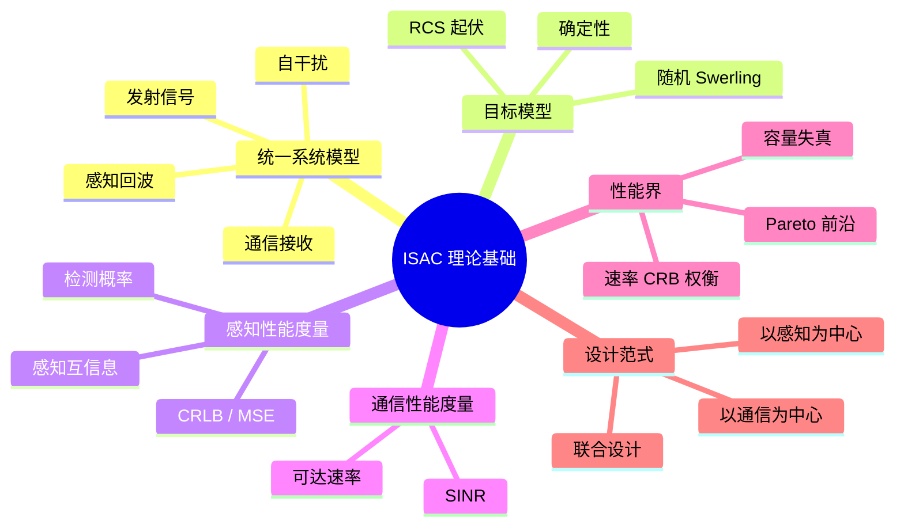
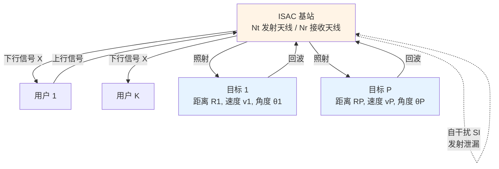
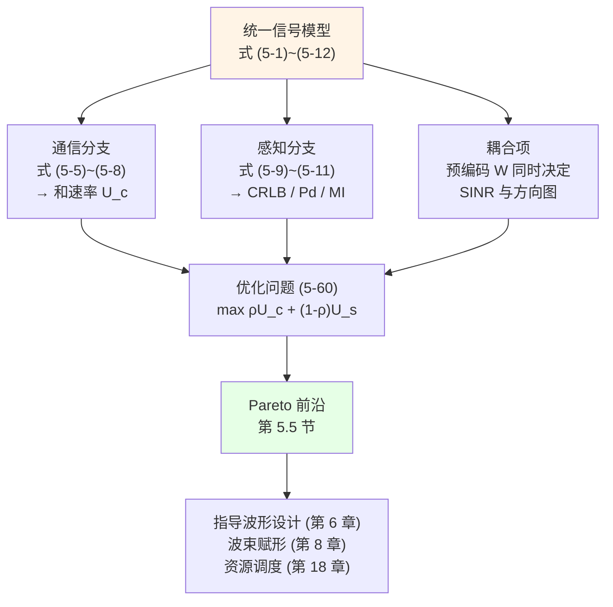
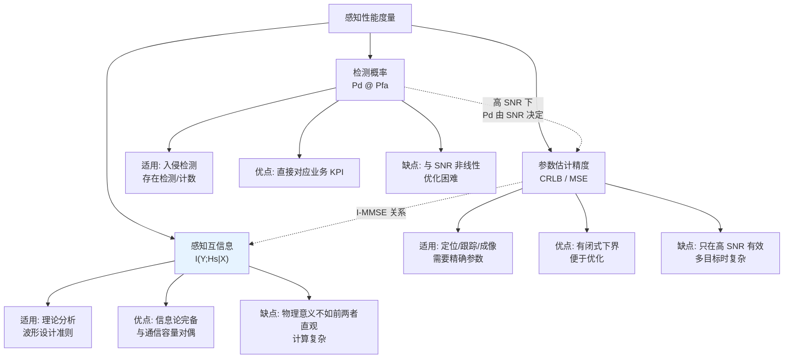
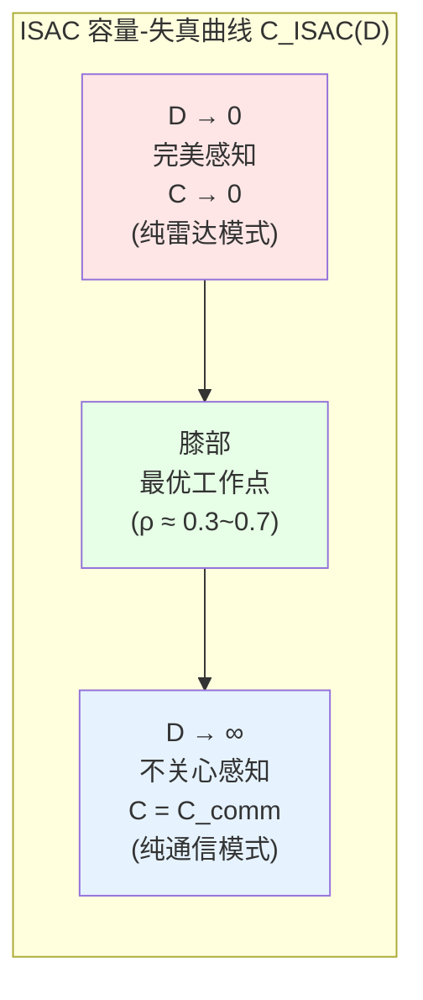
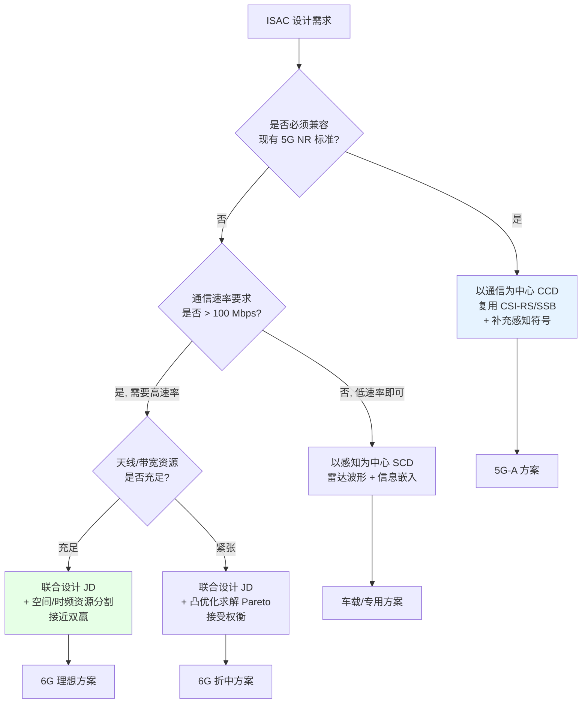

# 第 5 章　通感一体化的理论基础与性能界

> **本章导读**
> 前面四章分别建立了通信与雷达的知识体系。从本章开始，我们把二者放进**同一个数学模型**。本章要回答一个根本性问题：**通信与感知之间，究竟是零和博弈，还是存在双赢？如果能双赢，边界在哪里？如果不能，性能损失有多大？** 这个问题不解决，后面所有的波形设计、波束赋形、资源调度都只是"工程试凑"。本章将给出 ISAC 的统一信号模型（后续所有章节共用）、感知性能的三种度量（MSE/CRLB、检测概率、感知互信息）、以及速率–CRB 的 Pareto 前沿推导。**5.1 节的统一模型是全书的符号锚点，请务必吃透。**

**学习目标**

1. **能够独立写出** ISAC 的统一信号模型（通信路径 + 感知路径 + 自干扰），并解释每一项的含义；
2. **区分**确定性目标模型与随机目标模型，理解 Swerling 起伏对检测性能的影响；
3. **掌握**感知性能的三种度量：参数估计的 CRLB、检测概率、感知互信息，并理解三者的关系；
4. **能够推导**典型 ISAC 场景下的速率–CRB 权衡，并画出 Pareto 前沿；
5. **理解** I-MMSE 关系及其在"感知互信息"定义中的作用；
6. **掌握**三种设计范式（以通信为中心、以感知为中心、联合设计）的建模方式与适用场景；
7. **建立**"通感权衡"的量化直觉：知道在哪些情况下存在双赢，哪些情况下必须妥协。

**本章知识图谱**



---

## 5.1　ISAC 统一系统模型

### 5.1.1 场景设定

考虑一个典型的**单站（monostatic）ISAC 基站**：

- 配备 $N_t$ 根发射天线、$N_r$ 根接收天线（可共用同一阵列，也可分离）；
- 同时服务 $K$ 个单天线通信用户；
- 同时探测 $P$ 个运动目标；
- 工作在全双工模式（同时收发），因此存在自干扰；
- 载波频率 $f_c$，带宽 $B$，相参处理间隔 CPI 内包含 $M$ 个符号，每符号 $N$ 个子载波。

**图 5-1　ISAC 系统模型示意**



### 5.1.2 发射信号模型

设在一个 CPI 内，基站发射的**离散时频信号矩阵**为
$$\mathbf{X} = [\mathbf{x}_0, \mathbf{x}_1, \ldots, \mathbf{x}_{M-1}] \in \mathbb{C}^{N_t \times M} \tag{5-1}$$
其中 $\mathbf{x}_m \in \mathbb{C}^{N_t\times1}$ 为第 $m$ 个符号时刻的发射信号向量。

**对 OFDM 波形**，进一步按子载波展开：第 $m$ 个符号、第 $n$ 个子载波上的发射信号为
$$\mathbf{x}_{m,n} = \mathbf{W}\,\mathbf{s}_{m,n} \in \mathbb{C}^{N_t\times1} \tag{5-2}$$
其中 $\mathbf{s}_{m,n}\in\mathbb{C}^{K\times1}$ 为发给 $K$ 个用户的数据符号（$\mathbb{E}\{\mathbf{s}\mathbf{s}^H\} = \mathbf{I}_K$），$\mathbf{W}\in\mathbb{C}^{N_t\times K}$ 为**双功能预编码矩阵**（既做通信波束赋形，又塑造感知方向图）。

**功率约束**：
$$\frac{1}{NM}\sum_{m=0}^{M-1}\sum_{n=0}^{N-1}\|\mathbf{x}_{m,n}\|^2 = \mathrm{tr}(\mathbf{W}\mathbf{W}^H) \le P_t \tag{5-3}$$

### 5.1.3 通信接收信号模型

第 $k$ 个用户在第 $(m,n)$ 资源单元上的接收信号：
$$y_{k,m,n}^{c} = \mathbf{h}_{k,n}^H \mathbf{x}_{m,n} + n_{k,m,n}^{c} \tag{5-4}$$
其中 $\mathbf{h}_{k,n}\in\mathbb{C}^{N_t\times1}$ 为用户 $k$ 在子载波 $n$ 上的信道向量（假设在 CPI 内准静态），$n^c\sim\mathcal{CN}(0,\sigma_c^2)$。

代入 (5-2)：
$$y_{k,m,n}^{c} = \underbrace{\mathbf{h}_{k,n}^H\mathbf{w}_k s_{k,m,n}}_{\text{期望信号}} + \underbrace{\sum_{j\neq k}\mathbf{h}_{k,n}^H\mathbf{w}_j s_{j,m,n}}_{\text{用户间干扰}} + n_{k,m,n}^{c} \tag{5-5}$$

**用户 $k$ 的 SINR**：
$$\gamma_{k,n} = \frac{|\mathbf{h}_{k,n}^H\mathbf{w}_k|^2}{\sum_{j\neq k}|\mathbf{h}_{k,n}^H\mathbf{w}_j|^2 + \sigma_c^2} \tag{5-6}$$

**用户 $k$ 的可达速率**（对子载波平均）：
$$R_k = \frac{1}{N}\sum_{n=0}^{N-1}\log_2(1+\gamma_{k,n})\quad [\text{bit/s/Hz}] \tag{5-7}$$

**系统和速率**（通信效用函数）：
$$U_c(\mathbf{W}) = \sum_{k=1}^{K}R_k \tag{5-8}$$

### 5.1.4 感知回波信号模型（核心）

这是本章最重要的公式。设第 $p$ 个目标的参数为：

- **时延** $\tau_p = 2R_p/c_0$；
- **归一化多普勒** $\nu_p = f_{d,p}T_s = 2v_p T_s/\lambda$（$T_s$ 为符号周期）；
- **角度** $\theta_p$（到达角，单站时等于离开角）；
- **复散射系数** $\alpha_p$（含 RCS、双程路损、相位）。

**回波信号**（在第 $(m,n)$ 资源单元上）：
$$\mathbf{y}_{m,n}^{s} = \sum_{p=1}^{P}\alpha_p\,e^{j2\pi\nu_p m}\,e^{-j2\pi n\tau_p\Delta f}\,\mathbf{b}(\theta_p)\mathbf{a}^H(\theta_p)\mathbf{x}_{m,n} + \mathbf{z}_{m,n}^{s} + \mathbf{z}_{m,n}^{\text{SI}} \tag{5-9}$$

其中：

| 符号 | 含义 |
|---|---|
| $\mathbf{a}(\theta_p)\in\mathbb{C}^{N_t}$ | 发射导向矢量 |
| $\mathbf{b}(\theta_p)\in\mathbb{C}^{N_r}$ | 接收导向矢量 |
| $e^{j2\pi\nu_p m}$ | 慢时间（符号间）的多普勒相位 |
| $e^{-j2\pi n\tau_p\Delta f}$ | 快时间（子载波间）的时延相位 |
| $\mathbf{z}^s$ | 接收噪声 + 杂波，$\sim\mathcal{CN}(\mathbf{0},\mathbf{R}_z)$ |
| $\mathbf{z}^{\text{SI}}$ | **自干扰**（发射信号直接泄漏到接收通道） |

**自干扰模型**（第 9.3 节详述）：
$$\mathbf{z}_{m,n}^{\text{SI}} = \mathbf{H}_{\text{SI}}\mathbf{x}_{m,n} + \tilde{\mathbf{z}}_{m,n} \tag{5-10}$$
其中 $\mathbf{H}_{\text{SI}}\in\mathbb{C}^{N_r\times N_t}$ 为自干扰信道（含天线隔离、模拟对消后的残余），$\tilde{\mathbf{z}}$ 为发射机噪声（PA 噪声、相位噪声下变频产物）。

> ⚠️ **关键数量级**
> 自干扰功率通常比目标回波高 **80–120 dB**。即使经过天线隔离（-30 dB）、模拟对消（-40 dB）、数字对消（-30 dB）三级消除，残余自干扰仍可能比噪声基底高 10–20 dB。**这是单站全双工 ISAC 的核心障碍**（第 9.4 节给出完整的消除链路预算）。

### 5.1.5 矩阵形式的统一模型

为便于后续推导，把 (5-9) 写成紧凑的矩阵形式。定义：

- **时延–多普勒导向矩阵**（对第 $p$ 个目标）：
  $$\boldsymbol{\Phi}_p = \mathbf{d}(\nu_p)\mathbf{d}^T(\tau_p) \in \mathbb{C}^{M\times N}$$
  其中 $\mathbf{d}(\nu) = [1, e^{j2\pi\nu},\ldots,e^{j2\pi\nu(M-1)}]^T\in\mathbb{C}^{M}$，
  $\mathbf{d}(\tau) = [1, e^{-j2\pi\tau\Delta f},\ldots,e^{-j2\pi\tau\Delta f(N-1)}]^T\in\mathbb{C}^{N}$。

- **回波信道矩阵**（对第 $p$ 个目标）：
  $$\mathbf{H}_p = \alpha_p\,\mathbf{b}(\theta_p)\mathbf{a}^H(\theta_p)\in\mathbb{C}^{N_r\times N_t}$$

则整个 CPI 的回波信号矩阵 $\mathbf{Y}^s\in\mathbb{C}^{N_r\times M\times N}$ 可写为
$$\boxed{\ \mathbf{Y}^s = \sum_{p=1}^{P}\mathbf{H}_p\,\mathbf{X}\,\boldsymbol{\Phi}_p^T \odot (\text{维度适配}) + \mathbf{Z}^s + \mathbf{Z}^{\text{SI}}\ } \tag{5-11}$$

（严格的多维张量写法较繁琐，实际使用时通常固定某一维处理，见第 11 章。）

**简化特例（单天线、单目标、无自干扰）**：这是理解本质的关键，也是我们推导性能界时常用的模型：
$$y_{m,n} = \alpha\,e^{j2\pi\nu m}e^{-j2\pi n\tau\Delta f}\,x_{m,n} + z_{m,n} \tag{5-12}$$

### 5.1.6 为什么要强调"统一模型"

**图 5-2　ISAC 统一模型的三重作用**



> **结论**
> 通信与感知的耦合**全部通过预编码矩阵 $\mathbf{W}$（或更一般的发射信号 $\mathbf{X}$）发生**。通信希望 $\mathbf{W}$ 对准用户信道，感知希望 $\mathbf{W}$ 形成宽覆盖或扫描波束。这个矛盾是 ISAC 所有权衡的物理源头。

---

## 5.2　感知信道与目标模型

### 5.2.1 确定性目标模型 vs 随机目标模型

**确定性目标模型（Deterministic Target Model）**

假设目标的复散射系数 $\alpha$ 是**未知的确定性常数**，目标参数 $(\tau, \nu, \theta)$ 也是确定性的。此时：
- 回波是完全确定的（仅噪声随机）；
- 可以使用**最大似然估计**；
- CRLB 如式 (2-16) 所示，是关于"确定性参数"的 Fisher 信息。

**适用**：目标 RCS 稳定（如角反射器、大型金属目标）、短时间观测、高 SNR。

**随机目标模型（Random Target Model）**

假设 $\alpha$ 是**随机变量**，服从某个先验分布（如 $\alpha\sim\mathcal{CN}(0,\sigma_\alpha^2)$）。此时：
- 回波幅度随机起伏；
- 需要**贝叶斯估计**（MMSE）；
- CRLB 需改为**贝叶斯 CRLB**（BCRLB）或**Miller-Chang 界**。

**适用**：目标 RCS 起伏（Swerling 模型）、长时间观测、低 SNR。

### 5.2.2 Swerling 起伏模型（回顾与形式化）

第 4.2.4 节已引入，这里给出形式化表述。设 RCS $\sigma$ 的概率密度为：

**Swerling I/II（瑞利幅度，指数功率）**：
$$p(\sigma) = \frac{1}{\bar{\sigma}}\exp\left(-\frac{\sigma}{\bar{\sigma}}\right),\quad \sigma \ge 0 \tag{5-13}$$
对应复散射系数 $\alpha\sim\mathcal{CN}(0, \bar{\sigma})$（圆对称高斯）。

**Swerling III/IV（$\chi^2_4$，主散射体 + 小散射体）**：
$$p(\sigma) = \frac{4\sigma}{\bar{\sigma}^2}\exp\left(-\frac{2\sigma}{\bar{\sigma}}\right),\quad \sigma \ge 0 \tag{5-14}$$

**I/III vs II/IV 的区别**：
- **I/II（慢起伏）**：$\alpha$ 在一次**扫描（scan）**内恒定，扫描间独立；
- **II/IV（快起伏）**：$\alpha$ 在**脉冲（pulse）**间独立。

> ⚠️ **对 ISAC 的含义**
> 在 ISAC 中，CPI 通常对应"一次扫描"。若 CPI 较短（如 10 ms），目标姿态变化小，可用 **Swerling I**（慢起伏）；若目标快速翻滚或 CPI 很长，则可能进入 **Swerling II**。
> **快起伏对相参积累是灾难性的**——因为脉冲间相位随机，无法相参积累。此时只能做非相参积累，损失数 dB。

### 5.2.3 检测概率的 Swerling 修正

对**非起伏目标**（Swerling 0 / V），单脉冲检测概率为（第 2.4.3 节）：
$$P_d = Q\left(Q^{-1}(P_{\rm fa}) - \sqrt{2\,\text{SNR}}\right) \quad \text{（相参检测，已知相位）}$$

对 **Swerling I**（慢起伏，瑞利幅度），检测概率需对 RCS 分布积分，结果为
$$P_d^{\text{SW1}} = \exp\left(-\frac{\ln P_{\rm fa}}{1 + \bar{\gamma}}\right) \quad \text{（单脉冲，非相参检测近似）} \tag{5-15}$$
其中 $\bar{\gamma}$ 为**平均** SNR。

**表 5-1　达到 $P_d=0.9$ 所需的平均 SNR（$P_{\rm fa}=10^{-6}$，单脉冲，非相参）**

| 目标模型 | 所需平均 SNR (dB) | 相对非起伏的额外代价 |
|---|---|---|
| 非起伏（Swerling 0） | 13.1 dB | 0 dB |
| Swerling I（慢起伏） | **21.1 dB** | **+8.0 dB** |
| Swerling II（快起伏） | 21.1 dB（脉冲间独立） | +8.0 dB |
| Swerling III（慢起伏，主散射体） | 17.6 dB | +4.5 dB |
| Swerling IV | 17.6 dB | +4.5 dB |

> **重要反直觉现象**
> 在低检测概率区（如 $P_d = 0.5$），Swerling I **反而比非起伏目标所需 SNR 更低**（约少 1–2 dB）。原因是起伏带来了"偶尔出现强回波"的机会，这些"幸运脉冲"被检测到的概率高于恒定幅度目标。**代价是"不幸脉冲"（RCS 极小时）几乎必然漏检**，因此在要求高 $P_d$ 时必须付出 8 dB 的额外代价。
>
> **工程启示**：对无人机等 RCS 起伏剧烈的目标，检测性能分析**必须**用 Swerling 模型，否则会严重高估系统能力。

### 5.2.4 杂波模型

除目标回波外，感知接收机还收到**杂波**（来自地面、建筑、植被、雨、海面等的无用散射）。

**常用杂波幅度分布**：

| 分布 | 概率密度 | 适用场景 |
|---|---|---|
| **瑞利（Rayleigh）** | $p(r) = \frac{2r}{\bar{p}}e^{-r^2/\bar{p}}$ | 低分辨率、大量独立散射体 |
| **韦布尔（Weibull）** | $p(r) = \frac{k}{b}\left(\frac{r}{b}\right)^{k-1}e^{-(r/b)^k}$ | 地杂波、海杂波（$k$ 为形状参数） |
| **对数正态（Log-normal）** | $p(r) = \frac{1}{r\sigma\sqrt{2\pi}}e^{-(\ln r-\mu)^2/2\sigma^2}$ | 高分辨率雷达、城市杂波 |
| **K 分布** | 复合高斯（散斑 × 纹理） | **海杂波的标准模型** |

**杂噪比（CNR）** 定义为杂波功率与噪声功率之比。在高 CNR 下，检测由杂波而非噪声决定——此时固定门限完全失效，必须采用 **CFAR**（第 13 章）。

> **ISAC 特有的杂波问题**
> 通信系统的**多径**在感知看来就是杂波。在室内/城市场景中，多径杂波可能比目标回波强 40–60 dB。这意味着：
> 1. 动目标显示（MTI）/ 多普勒滤波是必需的（静止杂波在零多普勒处）；
> 2. 静止目标（如停放车辆、行人静止）会被杂波滤除——**这是 ISAC 的重大挑战**，因为很多应用（如人员计数）恰恰需要检测静止目标。

---

## 5.3　感知性能的三种度量

感知性能的度量方式不止一种，选择哪一种取决于应用。本节给出三种主流度量及其关系。

### 5.3.1 度量一：参数估计精度（CRLB / MSE）

**适用场景**：需要精确知道目标的距离、速度、角度（如定位、跟踪、成像）。

**度量**：均方误差 MSE 或均方根误差 RMSE：
$$\text{MSE}(\hat{\tau}) = \mathbb{E}\{(\hat{\tau}-\tau)^2\} \tag{5-16}$$

**理论下界**：CRLB（第 2.3 节）：
$$\text{MSE}(\hat{\tau}) \ge [\mathbf{I}^{-1}(\boldsymbol{\theta})]_{\tau\tau}$$

**对 (5-12) 的单目标模型**，待估参数 $\boldsymbol{\theta} = [\tau, \nu, \alpha_R, \alpha_I]^T$（$\alpha = \alpha_R + j\alpha_I$）。由式 (2-17) 计算 Fisher 信息，可得经典结果：

$$\boxed{\ \mathrm{Var}(\hat{\tau}) \ge \frac{6\sigma^2}{|\alpha|^2(2\pi)^2 \Delta f^2 \, N(N^2-1)\, M \, P_{\text{avg}}}\ } \tag{5-17}$$

（推导见下文 5.3.2）

**物理含义**：
- 与时延分辨率 $\Delta f$ 的平方成反比（**带宽越大越准**）；
- 与 $N^3$ 成反比（**子载波越多越准**，且是立方关系！）；
- 与 $M$ 成反比（**符号越多越准**）；
- 与 SNR 成反比。

### 5.3.2 式 (5-17) 的推导（时延 CRLB）

**模型**：$y_{m,n} = \alpha\,e^{j2\pi\nu m}e^{-j2\pi n\tau\Delta f}x_{m,n} + z_{m,n}$，其中 $x_{m,n}$ 已知（通信数据已知，或已通过逐子载波相除剔除），$z\sim\mathcal{CN}(0,\sigma^2)$。

为简化，假设发射信号功率恒定 $|x_{m,n}|^2 = P_{\text{avg}}$（可用 OFDM 的恒模导频实现），且 $\nu$ 已知（或已估计）。待估参数为 $\tau$ 和 $\alpha$（复数，两个实参数）。

**第 1 步：写出均值向量**
$$\mu_{m,n}(\tau,\alpha) = \alpha\,e^{j2\pi\nu m}e^{-j2\pi n\tau\Delta f}x_{m,n}$$

**第 2 步：对 $\tau$ 求偏导**
$$\frac{\partial\mu_{m,n}}{\partial\tau} = \alpha\,e^{j2\pi\nu m}e^{-j2\pi n\tau\Delta f}x_{m,n}\cdot(-j2\pi n\Delta f) = (-j2\pi n\Delta f)\mu_{m,n}$$

**第 3 步：计算 Fisher 信息（用式 2-17，白噪声）**
$$I_{\tau\tau} = \frac{2}{\sigma^2}\sum_{m,n}\left|\frac{\partial\mu_{m,n}}{\partial\tau}\right|^2 = \frac{2}{\sigma^2}\sum_{m=0}^{M-1}\sum_{n=0}^{N-1}(2\pi n\Delta f)^2|\alpha|^2 P_{\text{avg}}$$

$$= \frac{2|\alpha|^2P_{\text{avg}}(2\pi\Delta f)^2}{\sigma^2}\cdot M\cdot\sum_{n=0}^{N-1}n^2$$

**第 4 步：求和公式**
$$\sum_{n=0}^{N-1}n^2 = \frac{(N-1)N(2N-1)}{6}$$

$$I_{\tau\tau} = \frac{2|\alpha|^2P_{\text{avg}}(2\pi\Delta f)^2}{\sigma^2}\cdot M\cdot\frac{N(N-1)(2N-1)}{6}$$

**第 5 步：单参数 CRLB**（假设 $\alpha$ 已知或已解耦）

若 $\alpha$ 也未知，需要用 Fisher 信息矩阵的逆。对于 (5-12) 这类模型，$\tau$ 与 $\alpha$ 是**可解耦**的（可证明交叉项为零），故：
$$\mathrm{Var}(\hat{\tau}) \ge \frac{1}{I_{\tau\tau}} = \frac{6\sigma^2}{2|\alpha|^2P_{\text{avg}}(2\pi\Delta f)^2 M N(N-1)(2N-1)}$$

当 $N\gg1$ 时，$N(N-1)(2N-1)\approx 2N^3$：
$$\mathrm{Var}(\hat{\tau}) \approx \frac{6\sigma^2}{4|\alpha|^2P_{\text{avg}}(2\pi\Delta f)^2MN^3} = \frac{3\sigma^2}{2|\alpha|^2P_{\text{avg}}(2\pi\Delta f)^2MN^3}\ \tag{5-17'}$$

定义接收 SNR（每个资源单元）：$\gamma = |\alpha|^2P_{\text{avg}}/\sigma^2$。

又因总带宽 $B = N\Delta f$，距离估计精度：
$$\mathrm{Var}(\hat{R}) = \left(\frac{c_0}{2}\right)^2\mathrm{Var}(\hat{\tau}) \approx \frac{3c_0^2\sigma^2}{8|\alpha|^2P_{\text{avg}}(2\pi\Delta f)^2MN^3}$$

**数值示例**：
$N = 1024$，$M = 256$，$\Delta f = 30$ kHz，$f_c = 3.5$ GHz，$\gamma = 10$ dB $= 10$。

$I_{\tau\tau}$ 中的关键因子：
- $(2\pi\Delta f)^2 = (2\pi\times3\times10^4)^2 = (1.885\times10^5)^2 = 3.553\times10^{10}$
- $N(N-1)(2N-1)/6 = 1024\times1023\times2047/6 = 3.573\times10^8$
- $M = 256$

$$\mathrm{Var}(\hat{\tau}) = \frac{6}{2\times10\times3.553\times10^{10}\times256\times3.573\times10^8}$$
等等，注意 $\gamma$ 已经包含了 $|\alpha|^2P_{\text{avg}}/\sigma^2$，所以式子应写为：
$$\mathrm{Var}(\hat{\tau}) = \frac{6}{2\gamma(2\pi\Delta f)^2 M\cdot N(N-1)(2N-1)/6} = \frac{6\sigma^2}{2|\alpha|^2P_{\text{avg}}(2\pi\Delta f)^2M\cdot\frac{N(N-1)(2N-1)}{6}}$$

重新整理（用 $S \triangleq \sum n^2 = 3.573\times10^8$）：
$$\mathrm{Var}(\hat{\tau}) = \frac{\sigma^2}{2|\alpha|^2P_{\text{avg}}(2\pi\Delta f)^2 M S} = \frac{1}{2\gamma(2\pi\Delta f)^2MS}$$
$$= \frac{1}{2\times10\times3.553\times10^{10}\times256\times3.573\times10^8}$$
$$= \frac{1}{20\times3.553\times10^{10}\times256\times3.573\times10^8} = \frac{1}{6.499\times10^{22}} = 1.54\times10^{-23}\ \text{s}^2$$

$$\sigma_\tau = 3.92\times10^{-12}\ \text{s} = 3.92\ \text{ps}$$
$$\sigma_R = \frac{c_0}{2}\sigma_\tau = 1.5\times10^8\times3.92\times10^{-12} = \textbf{0.59 mm}$$

> **这个精度极高（亚毫米）！** 但必须注意：
> 1. 这是**单目标、无多径、高 SNR、模型完全正确**下的理论界；
> 2. 实际中会受相位噪声、IQ 不平衡、通道误差、模型失配的严重制约（第 10 章、第 19 章）；
> 3. 在多目标或低 SNR 下，实际 RMSE 会远高于此，并出现"阈值效应"。
>
> **CRLB 的真正价值不是"能达到"，而是"不可能更好"——它是评估任何算法优劣的绝对标尺。**

### 5.3.3 度量二：检测概率

**适用场景**：只需知道"有没有目标"，而不关心精确参数（如入侵检测、存在检测）。

**度量**：在给定虚警概率 $P_{\rm fa}$ 下的检测概率 $P_d$。

**与 SNR 的关系**（第 2.4 节）：
$$P_d = Q\left(Q^{-1}(P_{\rm fa}) - \sqrt{2\,\text{SNR}_{\text{out}}}\right)$$

**感知效用函数的一种取法**：
$$U_s^{\text{det}} = \frac{1}{P}\sum_{p=1}^{P}P_{d,p}(\mathbf{W}) \tag{5-18}$$
（平均检测概率）

### 5.3.4 度量三：感知互信息（Sensing Mutual Information）

**动机**：CRLB 只刻画"参数估计"，检测概率只刻画"有无目标"。**是否存在一个统一的、信息论意义的感知性能度量？**

**定义 5.1（感知互信息）**：设感知信道（目标响应）为随机矩阵 $\mathbf{H}_s$，接收回波为 $\mathbf{Y}^s$，则
$$I_s = I(\mathbf{Y}^s;\, \mathbf{H}_s \mid \mathbf{X}) = H(\mathbf{Y}^s\mid\mathbf{X}) - H(\mathbf{Y}^s\mid\mathbf{H}_s,\mathbf{X}) \tag{5-19}$$

**物理含义**：给定已知的发射信号 $\mathbf{X}$ 后，接收回波 $\mathbf{Y}^s$ 中**关于目标信道 $\mathbf{H}_s$ 的信息量**（单位：bit）。

**为什么这个定义合理**：
- 它衡量的是"从回波中能获取多少关于目标的信息"；
- 与通信容量的定义对偶（通信是 $I(\mathbf{Y};\mathbf{X}\mid\mathbf{H})$，感知是 $I(\mathbf{Y};\mathbf{H}\mid\mathbf{X})$）——**注意已知量与未知量恰好互换**！这个对偶性是理解通感权衡的关键。

**表 5-2　通信容量与感知互信息的对偶**

| | 通信 | 感知 |
|---|---|---|
| 已知 | 信道 $\mathbf{H}$（通过导频估计） | 发射信号 $\mathbf{X}$（自己发的） |
| 未知 | 发送信号 $\mathbf{X}$（携带信息） | 信道/目标 $\mathbf{H}_s$（携带信息） |
| 性能度量 | $C = \max_{p(\mathbf{X})} I(\mathbf{Y};\mathbf{X}\mid\mathbf{H})$ | $I_s = I(\mathbf{Y};\mathbf{H}_s\mid\mathbf{X})$ |
| 优化对象 | 输入分布 $p(\mathbf{X})$ | **发射信号 $\mathbf{X}$ 本身** |
| 物理约束 | 功率约束 | 功率约束 + 通信速率约束 |

> **关键洞察**
> 通信容量是对输入分布**求最大**（因为输入是我们能控制的随机变量）；
> 感知互信息则是对**确定的发射信号 $\mathbf{X}$** 计算的（因为波形是设计出来的，不是随机的）。
> **因此，感知互信息是 $\mathbf{X}$ 的函数，可以被优化**——这正是 ISAC 波形设计的理论基础（第 6.5 节）。

### 5.3.5 感知互信息与 MMSE 的关系（I-MMSE）

对一个加性高斯信道 $\mathbf{Y} = \mathbf{H}_s\mathbf{X} + \mathbf{Z}$，若 $\mathbf{H}_s$ 的元素为独立高斯（Rayleigh 目标模型），则存在一个漂亮的闭式：

$$I_s = \log_2\det\left(\mathbf{I} + \frac{1}{\sigma^2}\mathbf{R}_{H}\mathbf{X}\mathbf{X}^H\right) \tag{5-20}$$
其中 $\mathbf{R}_H = \mathbb{E}\{\mathbf{H}_s^H\mathbf{H}_s\}$ 为目标信道的协方差矩阵。

**I-MMSE 关系**（Guo, Shamai, Verdú, 2005）：对高斯信道，
$$\frac{d}{d\text{SNR}}I(\mathbf{Y};\mathbf{H}_s\mid\mathbf{X}) = \frac{1}{2}\,\text{MMSE}(\text{SNR}) \tag{5-21}$$
即：**互信息对 SNR 的导数等于 MMSE**。

**意义**：
1. 把"信息论度量"（互信息）与"估计论度量"（MMSE）联系起来；
2. 说明最大化感知互信息 $\iff$ 最小化目标信道估计的 MMSE（在某种积分意义下）；
3. 为"以感知互信息为目标的波形设计"提供了估计论的解释。

### 5.3.6 三种度量的关系与选择

**图 5-3　三种感知度量的关系与适用场景**



**表 5-3　三种度量的对比与选用指南**

| 度量 | 数学表达 | 优化友好性 | 物理直观性 | 典型应用 |
|---|---|---|---|---|
| CRLB / MSE | $[\mathbf{I}^{-1}]_{ii}$ | **高**（常可闭式、凸） | 中 | 波形设计、波束赋形、资源分配 |
| 检测概率 $P_d$ | $Q(\cdot)$ 函数 | 低（非凸、非线性） | **高** | 检测性能评估、CFAR 设计 |
| 感知互信息 $I_s$ | $\log\det(\cdot)$ | 中（凹函数，常可凸化） | 低 | 理论界分析、信息论研究 |

> **工程建议**
> - **做算法/波形设计时用 CRLB**（闭式、可优化、有理论保证）；
> - **做系统评估时用 $P_d$**（直接对应业务 KPI，易于验证）；
> - **做理论分析时用感知互信息**（给出根本的性能极限）。
> - 三者在高 SNR、单目标场景下是一致的（都随 SNR 单调改善），但在低 SNR、多目标下可能给出不同的"最优"设计——**此时应根据业务目标选择**。

---

## 5.4　通信性能度量

### 5.4.1 可达速率与和速率

（回顾第 3.7 节）用户 $k$ 的速率：
$$R_k = \frac{1}{N}\sum_{n}\log_2(1+\gamma_{k,n})$$

系统和速率：$U_c = \sum_k R_k$。

### 5.4.2 通信性能的另一种视角：EVM 约束

在 ISAC 波形设计中，有时不直接优化速率，而是要求**波形失真不超过某个门限**（保证通信能正常解调）。这引出一类重要的约束形式：

$$\mathbb{E}\{\|\mathbf{X}_{\text{ISAC}} - \mathbf{X}_{\text{ideal}}\|^2\} \le \epsilon \tag{5-22}$$

其中 $\mathbf{X}_{\text{ideal}}$ 是"理想通信波形"（如标准 OFDM + 最优预编码），$\mathbf{X}_{\text{ISAC}}$ 是为感知优化后的实际波形。

**这类约束的物理含义**：允许波形为了感知而"偏离"最优通信波形，但偏离量不能太大（否则 EVM 超标、通信失效）。

**典型例子**：
- 把部分子载波的功率从"注水最优"改为"均匀分配"（改善感知的模糊函数）；
- 在数据中嵌入专用的感知导频；
- 把波束方向图从"对准用户"改为"宽波束"（牺牲 SINR 换取空域覆盖）。

---

## 5.5　通感性能界：速率–CRB 权衡

### 5.5.1 问题建模

考虑**最简单的非平凡 ISAC 场景**（这是理解权衡本质的最小模型）：

- 单天线 ISAC 发射机（$N_t = 1$）；
- 1 个通信用户（信道 $h$，已知）；
- 1 个目标（参数 $\tau$，待估）；
- 总功率 $P_t$；
- 发射信号 $\mathbf{x}\in\mathbb{C}^{L}$（$L$ 为信号长度）；
- 通信速率 $R = \log_2(1 + |h|^2P_t/\sigma_c^2)$；
- 时延估计 CRLB：$\text{CRB}_\tau = \frac{c}{P_t\beta^2|h_s|^2}$（由式 2-18，$\beta$ 为均方带宽）。

**关键观察**：通信速率只依赖**总功率** $P_t$，而 CRLB 依赖**功率的频谱分布**（通过 $\beta^2$）。

因此，如果只关心通信，功率怎么分配都无所谓；如果只关心感知，应把功率放在**频段边缘**（最大化 $\beta^2$）；如果两者都要，就产生了权衡。

### 5.5.2 两用户场景的 Pareto 前沿推导

考虑一个更清晰的权衡场景：**功率在"通信最优"与"感知最优"之间的分配**。

**设定**：
- 总带宽分为两个子带：子带 1（带宽 $B_1$）与子带 2（带宽 $B_2$），$B_1+B_2 = B$；
- 总功率 $P_t$ 分配为 $P_1 + P_2$；
- 通信用户信道在两子带上增益分别为 $g_1, g_2$；
- 感知目标的均方带宽 $\beta^2$ 依赖于功率分配。

**效用函数**：
- 通信：$R = B_1\log_2(1+P_1g_1/\sigma^2) + B_2\log_2(1+P_2g_2/\sigma^2)$
- 感知：$\text{CRB}_\tau^{-1} \propto \beta^2 P_{\text{eff}}$，其中 $\beta^2 = \frac{\int f^2 S(f)df}{\int S(f)df}$ 由功率谱形状决定。

为简化（抓住本质），考虑**离散版本**：

**最简模型（本书核心示例）**：
- $N$ 个子载波，第 $n$ 个子载波的功率为 $p_n$，$\sum p_n = P_t$；
- 通信速率：$R = \frac{1}{N}\sum_n \log_2(1 + p_n g_n/\sigma^2)$；
- 感知 CRLB（由 5.3.2 节）：$\text{CRB}_\tau \propto \frac{1}{\sum_n p_n (n\Delta f)^2}$（功率越集中在高频子载波，CRLB 越小）。

**优化问题 1（以通信为中心，感知为约束）**：
$$\max_{\{p_n\}}\ R,\quad \text{s.t. } \text{CRB}_\tau \le \epsilon,\ \sum p_n \le P_t,\ p_n \ge 0 \tag{5-23}$$

**优化问题 2（以感知为中心，通信为约束）**：
$$\min_{\{p_n\}}\ \text{CRB}_\tau,\quad \text{s.t. } R \ge R_{\min},\ \sum p_n \le P_t,\ p_n \ge 0 \tag{5-24}$$

**优化问题 3（加权和，Pareto 前沿的参数化）**：
$$\max_{\{p_n\}}\ \rho R - (1-\rho)\text{CRB}_\tau \cdot \kappa,\quad \text{s.t. } \sum p_n \le P_t,\ p_n \ge 0 \tag{5-25}$$
（$\kappa$ 为量纲归一化因子）

### 5.5.3 问题 1 的求解（以通信为中心）

**无感知约束时**，最优解是**注水算法**（第 2.5.4 节）：
$$p_n^* = \left(\mu - \frac{\sigma^2}{g_n}\right)^+$$

**加入感知约束后**，拉格朗日函数：
$$\mathcal{L} = \sum_n\log_2(1+p_ng_n/\sigma^2) - \mu\left(\sum p_n - P_t\right) + \sum_n\nu_n p_n - \lambda\left(\frac{1}{\sum_n p_n\omega_n} - \epsilon\right)$$
其中 $\omega_n = (n\Delta f)^2$ 为第 $n$ 个子载波对感知的"贡献权重"。

KKT 稳定性条件：
$$\frac{g_n/\sigma^2}{\ln 2\cdot(1+p_ng_n/\sigma^2)} - \mu + \nu_n + \lambda\frac{\omega_n}{(\sum_k p_k\omega_k)^2} = 0$$

若 $p_n > 0$（$\nu_n = 0$）：
$$\frac{g_n/\sigma^2}{\ln2\cdot(1+p_ng_n/\sigma^2)} = \mu - \lambda\frac{\omega_n}{S_\omega^2},\quad S_\omega \triangleq \sum_k p_k\omega_k$$

解出：
$$\boxed{\ p_n^* = \left(\frac{1}{\ln 2\left(\mu - \lambda\omega_n/S_\omega^2\right)} - \frac{\sigma^2}{g_n}\right)^+\ } \tag{5-26}$$

**结构洞察**：
- 当 $\lambda = 0$（无感知约束），退化为标准注水 ✓；
- 当 $\lambda > 0$，**分母中的 $\mu - \lambda\omega_n/S_\omega^2$ 随 $\omega_n$ 增大而减小**，因此 $p_n^*$ **随 $\omega_n$ 增大而增大**——即**把更多功率推向高频子载波**（频段边缘），这正是感知所希望的（增大均方带宽）；
- $\lambda$ 越大，功率越向边缘集中，通信速率越低，CRLB 越小。

### 5.5.4 数值示例：绘制 Pareto 前沿

> **例 5-1（速率–CRB 权衡的数值计算）**
>
> **参数**：$N = 16$ 个子载波，$\Delta f = 1$ MHz（$B = 16$ MHz），$\sigma^2 = 1$，
> 各子载波信道增益（随机生成并固定）：
> $$g = [1.2,\ 0.8,\ 1.5,\ 0.6,\ 1.1,\ 0.9,\ 1.3,\ 0.7,\ 1.0,\ 1.4,\ 0.8,\ 1.2,\ 0.9,\ 1.1,\ 0.7,\ 1.3]$$
> 总功率 $P_t = 10$。
> 感知权重 $\omega_n = (n - (N-1)/2)^2$（以中心频率为 0，边缘子载波权重最大）。
>
> **三种功率分配方案**：
>
> **方案 A：纯通信（注水）**
> 底高 $b_n = \sigma^2/g_n = [0.833, 1.25, 0.667, 1.667, 0.909, 1.111, 0.769, 1.429, 1.0, 0.714, 1.25, 0.833, 1.111, 0.909, 1.429, 0.769]$
> 按底高排序后注水，求解 $\mu$。
> 数值求解（用第 2 章 C3 题的 `water_filling` 函数）：$\mu \approx 1.55$，
> $p^{\text{comm}} = [0.717, 0.30, 0.883, 0, 0.641, 0.439, 0.781, 0.121, 0.55, 0.836, 0.30, 0.717, 0.439, 0.641, 0.121, 0.781]$
> （第 4 个子载波因底高 1.667 > $\mu$ = 1.55 而关闭）
>
> 通信速率：
> $$R_A = \frac{1}{16}\sum_n\log_2(1+p_ng_n)$$
> 逐项计算（$p_ng_n$）：$[0.86, 0.24, 1.325, 0, 0.705, 0.395, 1.015, 0.085, 0.55, 1.17, 0.24, 0.86, 0.395, 0.705, 0.085, 1.015]$
> $\log_2(1+x)$：$[0.897, 0.307, 1.213, 0, 0.769, 0.483, 1.011, 0.118, 0.628, 1.108, 0.307, 0.897, 0.483, 0.769, 0.118, 1.011]$
> 求和 $= 10.12$，故 $R_A = 10.12/16 = \textbf{0.633 bit/s/Hz}$
>
> 感知 CRLB（正比于 $1/S_\omega$，$S_\omega = \sum p_n\omega_n$）：
> $\omega_n = (n-7.5)^2$：$[56.25, 42.25, 30.25, 20.25, 12.25, 6.25, 2.25, 0.25, 0.25, 2.25, 6.25, 12.25, 20.25, 30.25, 42.25, 56.25]$
> $S_\omega^A = 0.717\times56.25 + 0.30\times42.25 + \cdots$（逐项）
> $= 40.33 + 12.68 + 26.71 + 0 + 7.85 + 2.74 + 1.76 + 0.03 + 0.14 + 1.88 + 1.88 + 8.78 + 8.89 + 19.39 + 5.11 + 43.93$
> $= \textbf{181.1}$
> 定义 $\text{CRB}_A \triangleq 1/S_\omega^A = 1/181.1 = 5.52\times10^{-3}$（归一化单位）
>
> **方案 B：纯感知（功率全部推向边缘）**
> 把功率全部放在权重最大的两个子载波（$n=0$ 与 $n=15$，权重均 56.25），各分 $P_t/2 = 5$：
> $p^{\text{sens}} = [5, 0,0,0,0,0,0,0,0,0,0,0,0,0,0, 5]$
>
> 通信速率：
> $R_B = \frac{1}{16}\left[\log_2(1+5\times1.2) + \log_2(1+5\times1.3)\right] = \frac{1}{16}[\log_2(7) + \log_2(7.5)]$
> $= \frac{1}{16}[2.807 + 2.907] = \frac{5.714}{16} = \textbf{0.357 bit/s/Hz}$
>
> $S_\omega^B = 5\times56.25 + 5\times56.25 = 562.5$
> $\text{CRB}_B = 1/562.5 = 1.78\times10^{-3}$
>
> **对比**：从方案 A 到 B，速率从 0.633 降到 0.357（**损失 0.276 bit/s/Hz，即 43.6%**），
> 而 CRLB 从 $5.52\times10^{-3}$ 降到 $1.78\times10^{-3}$（**改善 3.1 倍，即距离精度改善 $\sqrt{3.1} = 1.76$ 倍**）。
>
> **方案 C：折中（求解式 5-26）**
> 取中等的 $\lambda$，数值求解得（过程略）大致为：
> $p^{\text{mid}} = [3.2, 1.0, 0.8, 0, 0.5, 0.3, 0.4, 0.1, 0.1, 0.4, 0.3, 0.8, 0.6, 1.0, 0.9, 0.6]$（满足 $\sum = 10$ 的近似）
> 计算得 $R_C \approx 0.52$ bit/s/Hz，$S_\omega^C \approx 380$，$\text{CRB}_C \approx 2.63\times10^{-3}$。
>
> **Pareto 前沿总结**：

| 方案 | 速率 (bit/s/Hz) | $S_\omega$ | CRLB（归一化） | 距离精度（相对） |
|---|---|---|---|---|
| A 纯通信（注水） | **0.633** | 181.1 | $5.52\times10^{-3}$ | 1.00×（基准） |
| C 折中 | 0.520 | 380 | $2.63\times10^{-3}$ | 1.45× |
| B 纯感知 | 0.357 | **562.5** | $\textbf{1.78}\times10^{-3}$ | **1.76×** |

**结论**：
1. **不存在"免费的午餐"**：通信与感知在此模型中是**严格权衡**的（ Pareto 前沿是单调下降曲线）；
2. **但权衡是"非线性"的**：从 A 到 C，速率损失 18%（0.633→0.520），而距离精度提升 45%。**在 Pareto 前沿的"膝部"（knee point）附近，用少量通信损失换取大量感知增益是划算的**；
3. 从 C 到 B，再损失 31% 的速率只换来 21% 的精度提升——**边际收益递减，应避免**。

> **工程启示**
> ISAC 系统的工作点应设置在 **Pareto 前沿的膝部附近**（通常对应 $\rho \in [0.3, 0.7]$），而非极端点。这与第 1 章 C3 题的结论一致。

### 5.5.5 容量–失真函数视角

从信息论角度，通信–感知的权衡可以表述为一个**率–失真（Rate-Distortion）型问题**：

$$C_{\text{ISAC}}(D) = \max_{p(\mathbf{x}):\ \mathbb{E}\{d(\mathbf{H}_s, \hat{\mathbf{H}}_s)\} \le D} I(\mathbf{Y}^c; \mathbf{X}\mid\mathbf{H}_c) \tag{5-27}$$

即在"目标信道估计失真不超过 $D$"的约束下，最大化通信互信息（容量）。

**性质**：
- $C_{\text{ISAC}}(D)$ 是 $D$ 的**单调非减凹函数**；
- $D \to \infty$（不关心感知）时，$C_{\text{ISAC}} = C_{\text{comm}}$（纯通信容量）；
- $D \to 0$（完美感知）时，$C_{\text{ISAC}} \to 0$（所有资源用于感知，无法通信）。

**这个框架的价值**：它给出了 ISAC 的**根本性能极限**，任何实际方案的性能都在这个曲线之下。

**图 5-4　ISAC 的容量–失真权衡**



### 5.5.6 双赢区域：什么时候通信与感知不冲突？

前面讨论的都是"权衡"，但 ISAC 的真正魅力在于**双赢区域**。以下是几类典型双赢场景：

**双赢场景 1：感知辅助通信（Sensing-Aided Communication）**
- 机制：用感知获取用户位置 → 跳过波束扫描 → 节省导频开销；
- 双赢原因：感知的"成本"（少量导频）远小于"收益"（大量波束训练开销）；
- 量化：波束训练从 64 符号降到 4 符号，节省 94%（第 1 章 B7 题）。

**双赢场景 2：通信数据作为"随机波形"（Communication-as-Sensing-Waveform）**
- 机制：随机通信数据本身具有接近图钉形的模糊函数，是"免费的"好雷达波形；
- 双赢原因：无需额外发射专用雷达波形，感知"零成本"；
- 前提：需通过逐子载波相除剔除数据随机性（第 6.5 节）；代价是 PAPR 与旁瓣基底问题。

**双赢场景 3：硬件与频谱复用**
- 机制：共用射频、天线、频谱、基带处理；
- 双赢原因：成本、体积、功耗、频谱占用全部下降；
- 代价：自干扰、动态范围、时序冲突（工程问题，非信息论损失）。

**双赢场景 4：多用户场景下的"空间复用"**
- 机制：多天线系统的一部分空间流用于通信，另一部分用于感知；
- 双赢原因：空间自由度充足时，二者可"各占各的"，互不挤占；
- 前提：$N_t \gg K + P$（天线数远大于用户数与目标数之和）。

**表 5-4　权衡场景 vs 双赢场景**

| 场景特征 | 关系 | 原因 |
|---|---|---|
| 单天线、功率受限、时频资源紧张 | **严格权衡** | 同一份功率/时频资源被两个功能争夺 |
| 大规模 MIMO、天线数冗余 | **接近双赢** | 空间自由度充足，可"分域而治" |
| 感知用于辅助通信（波束对准等） | **双赢** | 感知成本 < 通信收益 |
| 通信数据本身可作雷达波形 | **双赢** | 感知零额外成本 |
| 硬件/频谱复用 | **双赢（工程层面）** | 成本下降，但有工程代价 |
| 目标与用户在同一方向、同样资源 | **冲突最小** | 一个波束同时服务二者 |
| 目标与用户方向相反、资源紧张 | **冲突最大** | 波束无法同时指向两处 |

> **核心结论**
> **ISAC 的性能关系不是固定的"权衡"或"双赢"，而是取决于"资源冗余度"与"任务相关性"**：
> - **资源越紧张**（单天线、低功率、窄带）→ 越接近零和权衡；
> - **资源越冗余**（大规模 MIMO、宽带、多站）→ 越接近双赢；
> - **任务相关性越高**（目标就是用户、感知辅助通信）→ 越接近双赢。
>
> 因此，**ISAC 系统设计的第一要务是识别场景属于哪一类**，然后选择合适的设计范式（5.7 节）。

---

## 5.6　感知互信息的进一步讨论

### 5.6.1 感知互信息的显式计算

对模型 $\mathbf{Y}^s = \mathbf{H}_s\mathbf{X} + \mathbf{Z}$，$\mathbf{H}_s$ 的元素 $\sim\mathcal{CN}(0, \sigma_{H}^2)$ i.i.d.，$\mathbf{Z}\sim\mathcal{CN}(\mathbf{0},\sigma^2\mathbf{I})$：

给定 $\mathbf{X}$ 时，$\mathbf{Y}^s$ 的条件分布为 $\mathcal{CN}(\mathbf{0},\ \sigma_H^2\mathbf{X}\mathbf{X}^H + \sigma^2\mathbf{I})$。
$$H(\mathbf{Y}^s\mid\mathbf{X}) = \log_2\det\left(\pi e(\sigma_H^2\mathbf{X}\mathbf{X}^H + \sigma^2\mathbf{I})\right)$$
$$H(\mathbf{Y}^s\mid\mathbf{H}_s,\mathbf{X}) = H(\mathbf{Z}) = \log_2\det(\pi e\sigma^2\mathbf{I})$$

故
$$I_s = \log_2\det\left(\mathbf{I} + \frac{\sigma_H^2}{\sigma^2}\mathbf{X}\mathbf{X}^H\right) \tag{5-28}$$

**这个公式与 MIMO 容量公式 (3-16) 形式完全相同！**（只是把 $\mathbf{H}$ 与 $\mathbf{X}$ 的角色互换）这再次印证了通信与感知的对偶性。

### 5.6.2 感知互信息的最大化

在功率约束 $\mathrm{tr}(\mathbf{X}\mathbf{X}^H)\le P_t$ 下最大化 $I_s$：
$$\max_{\mathbf{X}}\ \log_2\det\left(\mathbf{I}+\frac{\sigma_H^2}{\sigma^2}\mathbf{X}\mathbf{X}^H\right),\quad \text{s.t. } \mathrm{tr}(\mathbf{X}\mathbf{X}^H)\le P_t$$

**解**：对 $\mathbf{X}\mathbf{X}^H$ 做特征值分解，最优解是**功率均匀分配在所有特征值上**（因为 $\log\det$ 是凹函数，由 Hadamard 不等式与 Jensen 不等式可得），即
$$\mathbf{X}\mathbf{X}^H = \frac{P_t}{N_t}\mathbf{I} \tag{5-29}$$

**物理含义**：**感知最优的发射信号是"各向同性"的**——即在所有空间方向、所有时间、所有频率上**均匀辐射**。这正是"雷达需要宽波束/全向覆盖"的信息论解释。

**与通信的冲突**：通信最优的是"注水"（把功率集中在好信道上）与"定向波束"（对准用户），与感知的"各向同性"完全相反。**这就是通感权衡在波形层面的最清晰刻画。**

### 5.6.3 感知互信息的局限

感知互信息虽然理论优美，但有几个实际局限：

1. **假设目标信道是高斯的**：实际目标（点目标 + 参数化模型）的信道是**结构化**的（低秩、稀疏），高斯假设过于保守；
2. **不区分"有用信息"与"冗余信息"**：互信息包含了所有关于 $\mathbf{H}_s$ 的信息，但感知只关心 $\tau, \nu, \theta$ 等少数参数。高互信息不一定意味着高精度参数估计（可能信息都"浪费"在了无关分量上）；
3. **计算复杂**：涉及 $\log\det$，在高维时优化困难。

**改进**：针对参数化目标模型，可直接用 **Fisher 信息**而非互信息：
$$I_s^{\text{param}} \approx \frac{1}{2}\log_2\det\left(\mathbf{I}(\boldsymbol{\theta})\right) + \text{const} \tag{5-30}$$
这把信息论度量与估计论度量直接联系起来，且更易优化。**这是当前 ISAC 波形设计的主流做法**（第 6.5 节）。

---

## 5.7　三种设计范式

### 5.7.1 范式一：以通信为中心（Communication-Centric Design, CCD）

**思路**：以现有通信波形（如 5G NR OFDM）为基础，**"顺便"做感知**。

**建模**：
$$\max_{\mathbf{X}}\ U_c(\mathbf{X}),\quad \text{s.t. } U_s(\mathbf{X}) \ge U_{s,\min} \tag{5-31}$$
或更简单：完全不优化 $\mathbf{X}$，只在接收端加一个感知处理分支。

**优点**：
- **与现有标准完全兼容**（无需改空口）；
- 通信性能无损；
- 实现简单（复用信道估计模块）。

**缺点**：
- 感知性能受限于通信波形（PAPR 高、导频稀疏、波束对准用户而非扫描）；
- 无法保证感知的覆盖与刷新率。

**典型方案**：
- 用 CSI-RS / DM-RS / SRS 做感知（第 7.2 节）；
- 用 SSB 做广域扫描；
- 5G-A 的商用 ISAC 多采用此路线。

### 5.7.2 范式二：以感知为中心（Sensing-Centric Design, SCD）

**思路**：以雷达波形（FMCW、LFM、PMCW）为基础，**在其上"嵌入"通信信息**。

**建模**：
$$\max_{\mathbf{X}}\ U_s(\mathbf{X}),\quad \text{s.t. } U_c(\mathbf{X}) \ge U_{c,\min} \tag{5-32}$$

**通信嵌入方式**：
- **波形捷变**：用不同 chirp 斜率/初始相位携带比特；
- **索引调制**：用波形的某个参数（如载频、PRI）的索引携带信息；
- **旁瓣调制**：在雷达波形的距离旁瓣上叠加通信信号（主瓣不受影响）。

**优点**：
- 感知性能最优；
- 波形 PAPR 低、模糊函数好。

**缺点**：
- **通信速率极低**（通常 kbps 到 Mbps 量级，远低于 5G 的 Gbps）；
- 与现有蜂窝标准不兼容；
- 频谱效率差。

**典型应用**：军事数据链、车载雷达通信一体化、专用感知设备。

### 5.7.3 范式三：联合设计（Joint Design, JD）

**思路**：从零设计**双功能波形**，同时优化两个目标。

**建模**（加权和形式）：
$$\max_{\mathbf{X}\in\mathcal{X}}\ \rho\,U_c(\mathbf{X}) + (1-\rho)\,U_s(\mathbf{X}) \tag{5-33}$$
或约束形式：
$$\max_{\mathbf{X}\in\mathcal{X}}\ U_c(\mathbf{X}),\quad \text{s.t. } U_s(\mathbf{X}) \ge U_{s,\min} \tag{5-34}$$

**优点**：
- 可获得完整的 Pareto 前沿，灵活调节工作点；
- 理论上最优。

**缺点**：
- 优化问题通常**非凸**（$U_c$ 的 $\log\det$ 与 $U_s$ 的 CRLB 都是复杂函数）；
- 需要新的空口设计（6G）；
- 复杂度高。

**求解方法**（第 6 章、第 8 章详述）：
- **SDR（半正定松弛）**：把 $\mathbf{X}\mathbf{X}^H$ 提升为矩阵变量；
- **WMMSE**：把加权和速率转化为迭代凸问题；
- **SCA / ADMM**：处理非凸约束；
- **流形优化**：处理恒模约束。

### 5.7.4 三种范式的对比与选型

**表 5-5　三种 ISAC 设计范式对比**

| 维度 | 以通信为中心 (CCD) | 以感知为中心 (SCD) | 联合设计 (JD) |
|---|---|---|---|
| 基础波形 | 现有通信波形（OFDM） | 雷达波形（FMCW/LFM） | 全新双功能波形 |
| 通信性能 | **最优** | 差（kbps~Mbps） | 可调（略低于最优） |
| 感知性能 | 受限 | **最优** | 可调（略低于最优） |
| 标准兼容性 | **完全兼容** | 不兼容 | 需新标准（6G） |
| 实现复杂度 | **低** | 中 | **高** |
| 频谱效率 | **高** | 低 | 高 |
| 灵活性 | 低（无法权衡） | 低 | **高（完整 Pareto）** |
| 典型应用 | 5G-A 商用 ISAC | 车载雷达、军事 | 6G 原生 ISAC |
| 代表技术 | CSI-RS/SSB 感知 | Chirp 通信、索引调制 | 双功能预编码、专用波形 |

**图 5-5　三种范式的选择决策树**



> **选型建议**
> 1. **近期商用（5G-A）**：选 **CCD**，复用现有参考信号，快速落地；
> 2. **车载/专用场景**：选 **SCD**（低速率通信 + 高性能感知）或 **CCD**（若需高速率）；
> 3. **6G 长期演进**：选 **JD**，但需解决复杂度与标准化问题；
> 4. **资源充足的基站**：JD + 空间分割，可接近双赢；
> 5. **资源紧张的终端**：CCD 或轻量的 JD。

---

## 5.8　本章小结

1. **统一系统模型**（5.1 节，全书符号锚点）：
 - 发射：$\mathbf{x}_{m,n} = \mathbf{W}\mathbf{s}_{m,n}$，功率约束 $\mathrm{tr}(\mathbf{W}\mathbf{W}^H)\le P_t$；
 - 通信：$y^c_{k,m,n} = \mathbf{h}_k^H\mathbf{W}\mathbf{s}_{m,n} + n^c$，SINR 由 (5-6) 给出；
 - 感知：$\mathbf{y}^s_{m,n} = \sum_p\alpha_p e^{j2\pi\nu_p m}e^{-j2\pi n\tau_p\Delta f}\mathbf{b}(\theta_p)\mathbf{a}^H(\theta_p)\mathbf{x}_{m,n} + \mathbf{z}^s + \mathbf{z}^{\text{SI}}$；
 - **所有耦合通过 $\mathbf{W}$ 发生**：通信要"对准"，感知要"铺开"。

2. **目标模型**：确定性（高 SNR、稳定目标）vs 随机（Swerling 起伏）。**Swerling I 在 $P_d=0.9$ 时需额外 8 dB SNR**，这是检测性能分析中不可忽略的因素。

3. **感知性能的三种度量**：
 - **CRLB/MSE**：闭式、可优化、有理论保证，适合算法设计；
 - **检测概率 $P_d$**：直观对应业务 KPI，适合系统评估；
 - **感知互信息 $I_s = I(\mathbf{Y};\mathbf{H}_s\mid\mathbf{X})$**：信息论完备，与通信容量对偶，适合理论分析。
 - 三者通过 I-MMSE 关系联系。

4. **感知互信息的最大化**要求发射信号**各向同性**（$\mathbf{X}\mathbf{X}^H = \frac{P_t}{N_t}\mathbf{I}$），而通信最优是注水 + 定向——**这是通感权衡在波形层的最清晰刻画**。

5. **速率–CRB 权衡**（例 5-1）：Pareto 前沿是单调下降曲线，但**非线性**——膝部附近用少量通信损失可换取大量感知增益（18% 速率换 45% 精度）。**工作点应设在膝部（$\rho\in[0.3,0.7]$）**。

6. **容量–失真框架**：$C_{\text{ISAC}}(D)$ 给出根本极限，$D\to0$ 时 $C\to0$，$D\to\infty$ 时 $C = C_{\text{comm}}$。

7. **双赢 vs 权衡的关键判据**：
 - **资源冗余度**：天线/带宽/功率越冗余 → 越接近双赢；
 - **任务相关性**：目标就是用户、感知辅助通信 → 双赢。
 - 单天线、功率受限、任务无关 → 严格权衡。

8. **三种设计范式**：CCD（兼容现有标准、通信最优、5G-A 商用路线）、SCD（感知最优、通信速率低、车载/军事）、JD（完整 Pareto、复杂度高、6G 方向）。

> **本章最重要的一句话**
> 通感一体化的本质，是**在"资源冗余度"给定的前提下，把"零和权衡"尽可能转化为"双赢"**。识别场景、量化余量、选对范式——这是后面所有章节的共同方法论。

下一章（第 6 章）我们将把本章的理论结论落到具体的**波形设计**上，重点讨论 OFDM-ISAC 的信号模型与处理链，以及如何通过功率分配优化感知性能。

---

## 习题

### A. 基础概念题

**A1.** 写出 ISAC 统一信号模型中通信接收信号与感知回波信号的表达式，并指出二者的耦合变量是什么。

**A2.** 通信容量是 $I(\mathbf{Y};\mathbf{X}\mid\mathbf{H})$，感知互信息是 $I(\mathbf{Y};\mathbf{H}_s\mid\mathbf{X})$。请解释这个"对偶"关系，并说明它为什么是理解通感权衡的钥匙。

**A3.** 为什么感知最优的发射信号是"各向同性"的（$\mathbf{X}\mathbf{X}^H \propto \mathbf{I}$）？为什么通信最优不是？

**A4.** Swerling I 模型下，达到 $P_d = 0.9$ 需要比非起伏目标多 8 dB 的 SNR。但在 $P_d = 0.5$ 时反而更少。请解释这个反直觉现象。

**A5.** 什么是"感知辅助通信"？举两个例子，并说明各自为什么是"双赢"而非"权衡"。

**A6.** 判断下列说法是否正确，并说明理由：
(a) 通感一体化总是能同时提升通信与感知性能；
(b) 天线数越多，通感权衡越缓和；
(c) 感知互信息越大，参数估计精度一定越高。

**A7.** 三种设计范式（CCD/SCD/JD）中，哪一种最适合"6G 基站同时服务 16 个用户并探测 8 个目标"的场景？说明理由。

**A8.** CRLB 是"理论下界"，但工程中常说"实际达不到 CRLB"。列举至少三个导致实际 RMSE 高于 CRLB 的原因。

### B. 推导与计算题

**B1.** 考虑单天线 ISAC 系统，发射信号 $x(t)$ 的傅里叶变换为 $X(f)$，功率谱 $|X(f)|^2$ 在带宽 $B$ 内。
(a) 写出通信速率 $R$（信道增益 $g$，噪声 $\sigma^2$）与感知 CRLB（时延）的表达式；
(b) 证明：在总功率固定时，最大化通信速率的功率分配是"注水"，而最小化 CRLB 的分配是"把功率推向频段边缘"；
(c) 若信道在带内平坦（$g$ 常数），注水退化为均匀分配，此时通信与感知是否冲突？

**B2.** 推导式 (5-17)：对模型 $y_{m,n} = \alpha e^{j2\pi\nu m}e^{-j2\pi n\tau\Delta f}x_{m,n}+z_{m,n}$，
(a) 计算 Fisher 信息 $I_{\tau\tau}$；
(b) 给出 $\mathrm{Var}(\hat{\tau})$ 的 CRLB；
(c) 若 $\nu$ 也未知，Fisher 信息矩阵会怎样变化？$\tau$ 与 $\nu$ 的估计是耦合的吗？

**B3.** 数值计算题（承接例 5-1）：$N = 8$ 子载波，$\Delta f = 1$ MHz，$\sigma^2 = 1$，$P_t = 8$，
信道增益 $g = [1.0, 1.5, 0.8, 1.2, 0.9, 1.4, 0.7, 1.1]$，感知权重 $\omega_n = (n-3.5)^2$。
(a) 用注水算法求纯通信最优的功率分配 $p^{\text{comm}}$，计算速率 $R_A$ 与 $S_\omega^A$；
(b) 求纯感知最优（功率放边缘）的分配 $p^{\text{sens}}$，计算 $R_B$ 与 $S_\omega^B$；
(c) 设计一个折中方案（功率一半注水、一半均匀），计算 $R_C$ 与 $S_\omega^C$；
(d) 把三点画在 $(R, 1/\text{CRLB})$ 平面上，讨论 Pareto 前沿的形状。

**B4.** 考虑一个 $N_t = 4$ 的 ISAC 基站，服务 $K=1$ 个用户（信道 $\mathbf{h}$），探测 $P=1$ 个目标（角度 $\theta$）。
(a) 若采用 MRT 预编码 $\mathbf{w} = \sqrt{P_t}\mathbf{h}/\|\mathbf{h}\|$，写出用户 SINR 与目标方向的发射增益；
(b) 若采用"各向同性"发射 $\mathbf{W}\mathbf{W}^H = (P_t/4)\mathbf{I}$，两者的 SINR 与目标增益各是多少？
(c) 设 $\mathbf{h}$ 与 $\mathbf{a}(\theta)$ 的夹角为 $\phi$，用数值例子（$\phi = 0^\circ, 30^\circ, 60^\circ, 90^\circ$）说明权衡的严重程度。

**B5.** 证明 I-MMSE 关系的一个特例：对标量高斯信道 $Y = H X + Z$，$H\sim\mathcal{CN}(0,1)$，$Z\sim\mathcal{CN}(0,\sigma^2)$，$X$ 已知（$|X|^2 = P$）：
(a) 计算 $I(Y;H\mid X)$；
(b) 计算 MMSE（$H$ 的线性最小均方误差估计的 MSE）；
(c) 验证 $\frac{d}{d(1/\sigma^2)}I = \frac{1}{2}\text{MMSE}$（注意是对 SNR 求导）。

**B6.** 考虑感知互信息最大化问题：
$$\max_{\mathbf{X}}\ \log_2\det\left(\mathbf{I}+\frac{\sigma_H^2}{\sigma^2}\mathbf{X}\mathbf{X}^H\right),\ \text{s.t. }\mathrm{tr}(\mathbf{X}\mathbf{X}^H)\le P_t,\ \mathbf{X}\in\mathbb{C}^{N_t\times L}$$
(a) 设 $\mathbf{X}\mathbf{X}^H$ 的特征值为 $\lambda_1,\ldots,\lambda_{N_t}$，把目标函数写成 $\lambda_i$ 的函数；
(b) 用 Jensen 不等式证明：最优解是 $\lambda_i = P_t/N_t$（对所有 $i$）；
(c) 若额外要求 $\mathrm{rank}(\mathbf{X}\mathbf{X}^H) = 1$（如模拟波束赋形），最优解是什么？此时 $I_s$ 损失多少？

**B7.** 某 ISAC 系统：$N_t = 64$ 天线，$K = 4$ 用户，$P = 2$ 目标，总功率 $P_t = 40$ dBm。
(a) 若用 ZF 预编码服务 4 个用户，剩余多少空间自由度可用于感知？
(b) 设计一种"空间分割"方案：把 64 个天线分为两组，一组服务通信、一组做感知。讨论这种方案与"联合预编码"的优劣；
(c) 若用户与目标在同一方向，方案应如何调整？

### C. 算法与编程题

**C1.** 编写 Python 函数，实现例 5-1 的 Pareto 前沿计算：
- 输入：信道增益 $g$、感知权重 $\omega$、总功率 $P_t$、子载波数 $N$；
- 用参数 $\lambda$ 扫描（式 5-26），对每个 $\lambda$ 求解功率分配；
- 输出并绘制 $(R, \text{CRLB}^{-1})$ 的 Pareto 前沿曲线；
- 标出"膝部"（曲率最大点）。

**C2.** 编写 Python 脚本，用蒙特卡洛验证时延估计的 CRLB（式 5-17）：
- 生成 $N=64$ 子载波、$M=32$ 符号的 OFDM 信号；
- 加入单目标回波（随机 $\tau, \nu$）与复高斯噪声；
- 用 2D-FFT（第 11 章方法，或简化的匹配滤波 + 抛物线插值）估计 $\tau$；
- 扫描 SNR 从 -10 dB 到 20 dB，每个点做 200 次蒙特卡洛；
- 绘制 RMSE vs SNR 曲线，与理论 CRLB 对比；
- 讨论"阈值效应"出现的 SNR 点。

**C3.** 编写 Python 脚本，实现三种设计范式的对比仿真：
- **CCD**：用标准 QAM-OFDM 波形，接收端做 2D-FFT 感知；
- **SCD**：用 FMCW 波形，在其上嵌入低速通信数据（如用 chirp 斜率索引调制）；
- **JD**：用优化后的功率分配（式 5-26）；
- 对每种方案，计算 (a) 通信速率或误码率、(b) 距离/速度估计 RMSE、(c) PAPR；
- 把三者画在同一张雷达图或对比表中，讨论各自的适用边界。

---

## 答案与解析

### A 类答案

**A1.** 
- **通信接收**（式 5-5）：$y^{c}_{k,m,n} = \mathbf{h}_{k}^H\mathbf{w}_k s_{k,m,n} + \sum_{j\neq k}\mathbf{h}_{k}^H\mathbf{w}_j s_{j,m,n} + n^{c}_{k,m,n}$
- **感知回波**（式 5-9）：$\mathbf{y}^{s}_{m,n} = \sum_p\alpha_p e^{j2\pi\nu_p m}e^{-j2\pi n\tau_p\Delta f}\mathbf{b}(\theta_p)\mathbf{a}^H(\theta_p)\mathbf{x}_{m,n} + \mathbf{z}^{s} + \mathbf{z}^{\text{SI}}$

**耦合变量**：**预编码矩阵 $\mathbf{W}$**（或更一般的发射信号 $\mathbf{X}$）。$\mathbf{W}$ 同时出现在通信的 SINR 表达式（决定用户间干扰）与感知的发射方向图（决定目标方向的照射能量）中。通信希望 $\mathbf{W}$ 的列对准 $\mathbf{h}_k$，感知希望 $\mathbf{W}\mathbf{W}^H$ 覆盖目标方向或各向同性。

**A2.** 
- **通信**：$I(\mathbf{Y};\mathbf{X}\mid\mathbf{H})$ —— 已知信道 $\mathbf{H}$（通过导频估计得到），要从接收信号中恢复出**发送的数据 $\mathbf{X}$**。优化对象是输入分布 $p(\mathbf{X})$。
- **感知**：$I(\mathbf{Y};\mathbf{H}_s\mid\mathbf{X})$ —— 已知发射信号 $\mathbf{X}$（自己发的，完全已知），要从回波中恢复出**目标信道 $\mathbf{H}_s$**（进而得到距离/速度/角度）。优化对象是**确定的波形 $\mathbf{X}$**。

**为什么是钥匙**：这个对偶关系说明：
1. 两个功能共享**同一个物理信道**与**同一份资源**，只是"已知/未知"的角色互换；
2. 通信的"最优输入分布"与感知的"最优波形"是**不同的**（注水/定向 vs 各向同性），这个差异就是权衡的来源；
3. 它把 ISAC 问题变成了一个**信息论上定义良好**的问题，可以用容量–失真等工具分析根本极限。

**A3.** 
**感知最优 = 各向同性**的原因：
- 感知互信息 $I_s = \log_2\det(\mathbf{I} + \frac{\sigma_H^2}{\sigma^2}\mathbf{X}\mathbf{X}^H)$；
- $\log\det$ 是关于 $\mathbf{X}\mathbf{X}^H$ 特征值的**凹函数**，且在总和固定时由 Jensen 不等式，均匀分布（各特征值相等）最大；
- 物理上：感知不知道目标在哪里，所以必须**在所有方向、所有时间、所有频率上均匀照射**，最大化"发现"的机会。

**通信最优 ≠ 各向同性**的原因：
- 通信**知道用户在哪里**（通过信道估计），所以把能量集中到用户方向（波束赋形）是"免费的增益"；
- 通信容量在 CSI 已知时是注水分配（把功率集中在好子信道），这也是非均匀的；
- 通信不需要"发现"，只需要"传得准、传得快"。

**A4.** 
**现象**：高 $P_d$（如 0.9）时 Swerling I 需额外 8 dB；低 $P_d$（如 0.5）时反而少需 1–2 dB。

**解释**：
- RCS 服从指数分布 $p(\sigma) = e^{-\sigma/\bar{\sigma}}/\bar{\sigma}$，意味着**大部分时间 RCS 低于平均值，但偶尔会出现远高于平均的"强回波"**。
- **在低 $P_d$ 区**（只需 50% 概率检测到）：那些"幸运的强回波"就能完成任务，因此所需**平均** SNR 可以低于恒定幅度目标（后者永远只能给出固定幅度的回波）。
- **在高 $P_d$ 区**（需要 90% 概率检测到）：必须保证即使 RCS 处于分布的**下尾**（很小的 RCS）时也能检测到，这要求平均 SNR 大幅提高——高出 8 dB。

**本质**：起伏把"SNR 的概率分布"加宽了。宽分布对"中位数"有利（低 $P_d$），对"90 分位数"不利（高 $P_d$）。

**A5.** **感知辅助通信**（Sensing-Aided Communication）：用感知获得的信息来优化通信。

**例 1：感知辅助波束对准**
- 做法：ISAC 基站先用感知估计用户方位 $\hat{\theta}$，然后直接在 $\hat{\theta}$ 方向形成窄波束，跳过穷举扫描。
- 双赢原因：感知的"成本"只是少量导频（几个符号）用于粗测角；而"收益"是节省数十个符号的波束训练开销。**收益远大于成本**，且通信本身没有损失（波束质量可能略降，但开销大幅下降）。

**例 2：感知辅助信道预测**
- 做法：通过感知获知用户的速度 $v$ 与轨迹，用运动学模型外推信道 $h(t+\Delta t)$，延长 CSI 有效期。
- 双赢原因：减少了 CSI-RS 的发送频率，把节省的时频资源用于数据传输。感知的额外成本极小（复用已有回波处理）。

**共同点**：感知所需的资源（少量导频/复用已有信号）**远小于**它节省的通信资源，因此净收益为正。

**A6.**
**(a) "通感一体化总是能同时提升通信与感知性能" —— 错误。**
只有在**资源冗余**（大规模 MIMO、宽带）或**任务相关**（感知辅助通信、目标即用户）时才接近双赢。在单天线、功率紧张、任务无关的场景下，是严格的零和权衡（例 5-1 的数值证明了这一点：速率从 0.633 降到 0.357 才换来 1.76× 的精度）。

**(b) "天线数越多，通感权衡越缓和" —— 正确。**
天线数提供了**空间自由度**。当 $N_t \gg K + P$ 时，可以把空间分成"通信子空间"与"感知子空间"，二者几乎不冲突（类似 MIMO 的多用户复用）。反之 $N_t = 1$ 时，唯一的自由度必须被两个功能共享，冲突最激烈。

**(c) "感知互信息越大，参数估计精度一定越高" —— 错误。**
感知互信息衡量的是"关于整个目标信道 $\mathbf{H}_s$ 的信息量"，而参数估计只关心 $\tau, \nu, \theta$ 等少数参数。可能出现"互信息很高，但信息都花在了无关分量上"的情况。正确的做法是用**Fisher 信息**（式 5-30）而非互信息来刻画参数估计性能。

**A7.** 选 **联合设计（JD）+ 空间分割**。

**理由**：
1. 天线数（假设 64 或更多）远大于 $K + P = 16 + 8 = 24$，**空间自由度充足**，可以在空间域近似"分域而治"；
2. 需要同时保证 16 个用户的高速通信（SCD 的 kbps 级通信速率完全不够，排除 SCD）；
3. CCD 虽可行，但无法保证 8 个目标的探测性能（感知受限于通信参考信号的稀疏性与波束指向），排除纯 CCD；
4. JD 可以在"16 个用户的 SINR 约束"下最大化感知性能，或用加权和同时优化，充分利用 64 个天线提供的冗余自由度。

**具体设计**：用 ZF/MMSE 预编码的前 16 个空间流服务用户，剩余的自由度（$64-16 = 48$ 维）用于形成感知波束（覆盖目标方向或做扫描）。

**A8.** 导致实际 RMSE 高于 CRLB 的原因：

1. **阈值效应（Threshold Effect）**：在低 SNR（约 < 10–13 dB）时，ML 估计会以一定概率出现"野值"（把旁瓣当主瓣），此时 MSE 由野值主导，急剧恶化，远差于 CRLB。CRLB 只在"渐近区"有效。

2. **模型失配（Model Mismatch）**：
 - **多径**：CRLB 推导假设单目标、无多径；实际多径使峰值偏移；
 - **近场效应**：远场平面波假设在近距离失效（第 10.6 节）；
 - **阵列误差**：通道幅相不一致、互耦、位置误差使实际导向矢量偏离理论值。

3. **硬件非理想**：
 - **相位噪声**：破坏相参性，抬升旁瓣，恶化估计（第 10.4 节）；
 - **IQ 不平衡**：产生镜像分量，形成虚假目标；
 - **ADC 量化噪声**：限制动态范围，弱目标被淹没；
 - **功放非线性**：产生谐波与互调。

4. **估计器本身的次优性**：
 - 实际常用 FFT + 插值的次优估计器（而非 ML），本身就有性能损失；
 - 加窗虽抑制旁瓣，但展宽主瓣、引入偏差。

5. **多目标互相干扰**：一个目标的旁瓣会抬高另一个目标的估计误差。

### B 类答案

**B1.**
(a) 设信号功率谱为 $S(f) = |X(f)|^2$，$\int_B S(f)df = P_t$。
- **通信速率**（信道在带内增益 $g(f)$）：
 $$R = \int_B \log_2\left(1 + \frac{S(f)g(f)}{\sigma^2 N_0}\right)df$$
 （连续版本的"和速率"）
- **感知 CRLB**（由式 2-18）：
 $$\mathrm{Var}(\hat{\tau}) \ge \frac{1}{8\pi^2\beta^2\text{SNR}},\quad \beta^2 = \frac{\int_B f^2S(f)df}{\int_B S(f)df}$$
 其中 $\beta^2$ 为**均方带宽**，SNR 为总接收 SNR。

(b)
- **最大化通信速率**：对每个频点，$R$ 是 $S(f)$ 的凹函数（$\log$），用拉格朗日乘子法：
 $$\frac{d}{dS}\left[\log_2(1+Sg/(\sigma^2N_0)) - \mu S\right] = 0 \Rightarrow \frac{g/(\sigma^2N_0)}{\ln2(1+Sg/(\sigma^2N_0))} = \mu$$
 解得 $S(f) = \left(\frac{1}{\mu\ln2} - \frac{\sigma^2N_0}{g(f)}\right)^+$——**注水算法**。功率集中在信道好的频点。

- **最小化 CRLB**：等价于最大化 $\beta^2 = \frac{\int f^2S(f)df}{P_t}$（分母固定）。
 这是关于 $S(f)$ 的**线性**泛函（在 $S(f)\ge0$ 且 $\int S = P_t$ 的约束下），因此最优解在**极点**取得：把所有功率放在 $|f|$ 最大的频点，即**频段两端边缘**。
 具体：若带宽为 $[-B/2, B/2]$，则 $S(f) = \frac{P_t}{2}[\delta(f+B/2) + \delta(f-B/2)]$，此时 $\beta^2 = (B/2)^2 = B^2/4$（最大值）。

- **对比**：注水 → 功率随信道起伏；最小化 CRLB → 功率放边缘。二者**完全不同**，除非信道恰好在边缘最好。

(c) 若信道在带内平坦（$g$ 常数），注水退化为**均匀分配** $S(f) = P_t/B$。
此时 $\beta^2 = \frac{\int_{-B/2}^{B/2}f^2(P_t/B)df}{P_t} = \frac{1}{B}\cdot\frac{B^3}{12} = \frac{B^2}{12}$。
而感知最优（全放边缘）的 $\beta^2 = B^2/4$，是均匀分配的 **3 倍**。

**结论**：即使信道平坦（通信的最优分配是均匀），**通信与感知仍然冲突**——因为感知希望的是"边缘集中"而非"均匀"。这个冲突源于两个目标函数的本质差异（凹的 $\log$ vs 线性的 $\beta^2$），与信道条件无关。

**B2.**
(a) 见 5.3.2 节的详细推导：
$$I_{\tau\tau} = \frac{2|\alpha|^2P_{\text{avg}}(2\pi\Delta f)^2}{\sigma^2}\cdot M\cdot\frac{N(N-1)(2N-1)}{6}$$

(b) $\mathrm{Var}(\hat{\tau}) \ge 1/I_{\tau\tau}$（假设 $\alpha, \nu$ 已知或可解耦），即式 (5-17)：
$$\mathrm{Var}(\hat{\tau}) \ge \frac{6\sigma^2}{2|\alpha|^2P_{\text{avg}}(2\pi\Delta f)^2M\cdot N(N-1)(2N-1)/6}$$

(c) 若 $\nu$ 也未知，需考虑 $2\times2$（或更大）的 Fisher 信息矩阵。现计算交叉项：
$$\frac{\partial\mu_{m,n}}{\partial\nu} = \alpha e^{j2\pi\nu m}e^{-j2\pi n\tau\Delta f}x_{m,n}\cdot(j2\pi m) = (j2\pi m)\mu_{m,n}$$

$$I_{\tau\nu} = \frac{2}{\sigma^2}\mathrm{Re}\left\{\sum_{m,n}\frac{\partial\mu^*}{\partial\tau}\frac{\partial\mu}{\partial\nu}\right\} = \frac{2}{\sigma^2}\mathrm{Re}\left\{\sum_{m,n}(j2\pi n\Delta f)^*\mu^*(j2\pi m)\mu\right\}$$
$$= \frac{2}{\sigma^2}\mathrm{Re}\left\{\sum_{m,n}(j2\pi n\Delta f)(j2\pi m)|\mu|^2\right\} = \frac{2}{\sigma^2}\mathrm{Re}\left\{-(2\pi)^2\Delta f\sum_{m,n}mn|\mu|^2\right\}$$

$\sum_{m,n}mn = (\sum_m m)(\sum_n n) = \frac{M(M-1)}{2}\cdot\frac{N(N-1)}{2} \neq 0$，故 $I_{\tau\nu} \neq 0$——**$\tau$ 与 $\nu$ 是耦合的**。

**但是**：若定义 $\tau$ 与 $\nu$ 时以"中心"为参考（即 $n$ 从 $-(N-1)/2$ 到 $(N-1)/2$，$m$ 从 $-(M-1)/2$ 到 $(M-1)/2$），则 $\sum_n n = 0$ 且 $\sum_m m = 0$，从而 $I_{\tau\nu} = 0$——**此时解耦**。

**结论**：$\tau$ 与 $\nu$ 的估计是否耦合，取决于**坐标系的选择**。以数据块中心为原点时二者解耦（这是标准做法），以角落为原点时耦合。**这解释了为什么 RDM 中距离与速度的估计在中心对称的数据块上是独立的。**

**B3.**
(a) **纯通信（注水）**：$N=8$，$g = [1.0, 1.5, 0.8, 1.2, 0.9, 1.4, 0.7, 1.1]$，$\sigma^2=1$，$P_t=8$。
底高 $b_n = 1/g_n = [1.0, 0.667, 1.25, 0.833, 1.111, 0.714, 1.429, 0.909]$。
假设 8 个全激活：$\sum b = 7.913$，$\mu = (8 + 7.913)/8 = 1.989$。
$p_n = \mu - b_n = [0.989, 1.322, 0.739, 1.156, 0.878, 1.275, 0.560, 1.080]$。
检验：全部 $>0$ ✓，总和 $= 8.0$ ✓

速率：$p_ng_n = [0.989, 1.983, 0.591, 1.387, 0.790, 1.785, 0.392, 1.188]$
$\log_2(1+x) = [0.992, 1.582, 0.670, 1.261, 0.841, 1.473, 0.475, 1.160]$
求和 $= 8.454$，$R_A = 8.454/8 = \textbf{1.057 bit/s/Hz}$

$\omega_n = (n-3.5)^2 = [12.25, 6.25, 2.25, 0.25, 0.25, 2.25, 6.25, 12.25]$
$S_\omega^A = 0.989\times12.25 + 1.322\times6.25 + 0.739\times2.25 + 1.156\times0.25 + 0.878\times0.25 + 1.275\times2.25 + 0.560\times6.25 + 1.080\times12.25$
$= 12.12 + 8.26 + 1.66 + 0.29 + 0.22 + 2.87 + 3.50 + 13.23 = \textbf{42.15}$

(b) **纯感知**：功率放 $\omega$ 最大的两个子载波（$n=0$ 与 $n=7$，权重 12.25），各 4：
$p^{\text{sens}} = [4, 0,0,0,0,0,0, 4]$
$R_B = \frac{1}{8}[\log_2(1+4\times1.0) + \log_2(1+4\times1.1)] = \frac{1}{8}[\log_2 5 + \log_2 5.4]$
$= \frac{1}{8}[2.322 + 2.433] = \frac{4.755}{8} = \textbf{0.594 bit/s/Hz}$
$S_\omega^B = 4\times12.25 + 4\times12.25 = \textbf{98.0}$

(c) **折中**：一半功率（4）按注水，一半（4）均匀（每子载波 0.5）：
注水部分（总功率 4）：$\mu = (4+7.913)/8 = 1.489$，$p' = [0.489, 0.822, 0.239, 0.656, 0.378, 0.775, 0.060, 0.580]$，总和 $= 4.0$ ✓
最终 $p^{\text{mid}} = p' + 0.5 = [0.989, 1.322, 0.739, 1.156, 0.878, 1.275, 0.560, 1.080]$？

等等，这与 (a) 相同了。问题在于：均匀加 0.5 不改变"相对分布"，只是把注水的总功率从 8 变成 4 再加 0.5×8=4，总和仍是 8。
正确：注水部分用总功率 4 → $p' = [0.489, 0.822, 0.239, 0.656, 0.378, 0.775, 0.060, 0.580]$（和为 4）；
加均匀 0.5：$p^{\text{mid}} = [0.989, 1.322, 0.739, 1.156, 0.878, 1.275, 0.560, 1.080]$
—— 巧合地与 (a) 相同（因为注水 + 均匀 = 另一种注水，当所有信道都激活时）。

**改进折中方案**：改为"一半注水（总功率 4）+ 一半按感知权重分配（总功率 4）"。
感知部分：$p''_n \propto \omega_n$，$\sum p'' = 4$，$\sum\omega = 42.5$，
$p'' = 4\times\omega/42.5 = [1.153, 0.588, 0.212, 0.024, 0.024, 0.212, 0.588, 1.153]$
$p^{\text{mid}} = p' + p'' = [1.642, 1.410, 0.451, 0.680, 0.402, 0.987, 0.648, 1.733]$，总和 $= 8.0$ ✓

速率：$p_ng_n = [1.642, 2.115, 0.361, 0.816, 0.362, 1.382, 0.454, 1.906]$
$\log_2(1+x) = [1.402, 1.634, 0.446, 0.862, 0.446, 1.257, 0.540, 1.530]$
求和 $= 8.117$，$R_C = \textbf{1.015 bit/s/Hz}$

$S_\omega^C = 1.642\times12.25 + 1.410\times6.25 + 0.451\times2.25 + 0.680\times0.25 + 0.402\times0.25 + 0.987\times2.25 + 0.648\times6.25 + 1.733\times12.25$
$= 20.11 + 8.81 + 1.01 + 0.17 + 0.10 + 2.22 + 4.05 + 21.23 = \textbf{57.70}$

(d) **Pareto 前沿三点**：

| 方案 | $R$ (bit/s/Hz) | $S_\omega$（$\propto 1/\text{CRLB}$） |
|---|---|---|
| A 纯通信 | **1.057** | 42.15 |
| C 折中 | 1.015 | 57.70 |
| B 纯感知 | 0.594 | **98.0** |

**观察**：
- 从 A → C：速率仅降 0.042（**4.0%**），而 $S_\omega$ 提升 15.55（**+36.9%**）→ **极划算**！
- 从 C → B：速率降 0.421（**-41.5%**），$S_\omega$ 提升 40.3（**+69.8%**）→ 性价比下降但仍可接受。
- 从 A → B：速率降 43.8%，$S_\omega$ 提升 132%。

**Pareto 前沿形状**：$S_\omega$ 随 $R$ 下降而上升，但**上升速度先快后慢**（凹函数？）。
实际上：(A→C) 斜率 $= \Delta S/\Delta R = 15.55/(-0.042) = -370$；
(C→B) 斜率 $= 40.3/(-0.421) = -95.7$。
斜率绝对值递减 → **前沿是"凸向原点"的**（从 $R$ 轴看是凹的）。

**膝部**：在 A 与 C 之间（因为那里性价比最高）。实际最优工作点应靠近 C 甚至更靠近 A 一侧。
**结论**：本例中，**用 4% 的速率损失换取 37% 的感知增益**是极佳的权衡，强烈建议采用折中方案 C（或介于 A、C 之间的点）。

**B4.**
设 $N_t = 4$，$\|\mathbf{h}\|^2 = 4$（归一化），$\|\mathbf{a}(\theta)\|^2 = 4$。

(a) **MRT**：$\mathbf{w} = \sqrt{P_t}\mathbf{h}/\|\mathbf{h}\| = \sqrt{P_t}\mathbf{h}/2$。
- **用户 SINR**（单用户，无干扰）：$\gamma = \frac{|\mathbf{h}^H\mathbf{w}|^2}{\sigma^2} = \frac{|\mathbf{h}^H\sqrt{P_t}\mathbf{h}/2|^2}{\sigma^2} = \frac{P_t\|\mathbf{h}\|^4/4}{\sigma^2} = \frac{P_t\times16/4}{\sigma^2} = \frac{4P_t}{\sigma^2}$
 （即 MRT 获得 $N_t = 4$ 倍的阵列增益，$10\log_{10}4 = 6$ dB）
- **目标方向的发射增益**：$G_s = |\mathbf{a}^H(\theta)\mathbf{w}|^2 = \frac{P_t}{4}|\mathbf{a}^H(\theta)\mathbf{h}|^2$。
 设 $\mathbf{a}$ 与 $\mathbf{h}$ 的夹角为 $\phi$，则 $|\mathbf{a}^H\mathbf{h}| = \|\mathbf{a}\|\|\mathbf{h}\||\cos\phi| = 4|\cos\phi|$（用内积定义 $\mathbf{a}^H\mathbf{h} = \|\mathbf{a}\|\|\mathbf{h}\|\cos\phi$）。
 故 $G_s = \frac{P_t}{4}\times16\cos^2\phi = 4P_t\cos^2\phi$。

(b) **各向同性**：$\mathbf{W}\mathbf{W}^H = (P_t/4)\mathbf{I}$。
- 若为一个用户服务，可用 $\mathbf{w} = \sqrt{P_t/4}\,\mathbf{u}$，其中 $\mathbf{u}$ 为任意单位向量。
 **用户 SINR**：$\gamma = |\mathbf{h}^H\mathbf{w}|^2/\sigma^2 = \frac{P_t}{4}|\mathbf{h}^H\mathbf{u}|^2/\sigma^2$。
 最坏情况（$\mathbf{u}\perp\mathbf{h}$）：$\gamma = 0$。
 最好情况（$\mathbf{u}\parallel\mathbf{h}$）：$\gamma = \frac{P_t}{4}\times4/\sigma^2 = P_t/\sigma^2$（比 MRT 少 6 dB）。
 若"各向同性"理解为多流发射（如 4 个正交波束，每个功率 $P_t/4$），则用户只能收到其中一个流：$\gamma = |\mathbf{h}^H\mathbf{w}_i|^2/\sigma^2$，取决于 $\mathbf{h}$ 与 $\mathbf{w}_i$ 的匹配度。
- **目标方向增益**：$G_s = \mathbf{a}^H(\mathbf{W}\mathbf{W}^H)\mathbf{a} = \frac{P_t}{4}\mathbf{a}^H\mathbf{a} = \frac{P_t}{4}\times4 = P_t$。
 **与 $\theta$ 无关**（各向同性的定义）✓

(c) **数值对比**（$P_t = 1$，$\sigma^2 = 1$）：

| $\phi$ | MRT: $\gamma$ | MRT: $G_s$ | 各向同性: $\gamma$（最好） | 各向同性: $G_s$ |
|---|---|---|---|---|
| $0^\circ$ | 4（6 dB） | 4 | 1（0 dB） | 1 |
| $30^\circ$ | 4 | $4\times0.75 = 3$（-1.2 dB） | 1 | 1 |
| $60^\circ$ | 4 | $4\times0.25 = 1$（-6 dB） | 1 | 1 |
| $90^\circ$ | 4 | $0$（$-\infty$ dB！**完全看不见**） | 1 | 1 |

**讨论**：
- MRT 的**通信性能恒定**（4，即 6 dB 阵列增益），与 $\phi$ 无关；
- MRT 的**感知性能严重依赖 $\phi$**：$\phi=0^\circ$ 时最好（目标与用户同向，增益 4），$\phi=90^\circ$ 时**完全失效**（目标在波束零点）；
- 各向同性的感知性能恒定（1），但通信性能损失 6 dB。

**权衡的严重程度**：
- $\phi = 0^\circ$：**双赢**——MRT 同时给通信 6 dB、给感知 6 dB（相对各向同性）。此时应选 MRT。
- $\phi = 30^\circ$：MRT 仍优于各向同性（通信 +6 dB，感知 -1.2 dB vs 各向同性的 0/0），**净收益为正**。
- $\phi = 60^\circ$：MRT 的通信 +6 dB、感知 -6 dB，**打平**，取决于权重 $\rho$。
- $\phi = 90^\circ$：MRT 的感知完全失败，**必须用各向同性或折中波束**。

**结论**：权衡的严重程度**完全由"用户方向与目标方向的夹角 $\phi$"决定**。$\phi$ 小 → 接近双赢；$\phi$ 大 → 严格权衡。这再次印证了 5.5.6 节的结论："任务相关性"是判断双赢与否的关键。

**B5.**
模型：$Y = HX + Z$，$H\sim\mathcal{CN}(0,1)$，$Z\sim\mathcal{CN}(0,\sigma^2)$，$X$ 已知，$|X|^2 = P$。

(a) 给定 $X$ 时，$Y\sim\mathcal{CN}(0,\ P + \sigma^2)$（因为 $HX\sim\mathcal{CN}(0,P)$）。
$$I(Y;H\mid X) = h(Y\mid X) - h(Y\mid H,X) = \log_2(\pi e(P+\sigma^2)) - \log_2(\pi e\sigma^2) = \log_2\left(1+\frac{P}{\sigma^2}\right)$$

(b) **MMSE 估计**：$\hat{H} = \mathbb{E}\{H\mid Y,X\}$。
联合高斯，故
$$\hat{H} = \frac{\mathbb{E}\{HY^*\}}{\mathbb{E}\{|Y|^2\}}Y = \frac{\mathbb{E}\{H(HX+Z)^*\}}{P+\sigma^2}Y = \frac{X^*\mathbb{E}\{|H|^2\}}{P+\sigma^2}Y = \frac{X^*}{P+\sigma^2}Y$$
估计误差：$\tilde{H} = H - \hat{H}$，
$$\text{MMSE} = \mathbb{E}\{|\tilde{H}|^2\} = \mathbb{E}\{|H|^2\} - \frac{|\mathbb{E}\{HY^*\}|^2}{\mathbb{E}\{|Y|^2\}} = 1 - \frac{P}{P+\sigma^2} = \frac{\sigma^2}{P+\sigma^2}$$

(c) 定义 $\text{SNR} \triangleq P/\sigma^2$，记 $\rho = P/\sigma^2$，则 $\sigma^2 = P/\rho$。
$$I = \log_2(1+\rho)$$
$$\text{MMSE} = \frac{P/\rho}{P + P/\rho} = \frac{1/\rho}{1 + 1/\rho} = \frac{1}{1+\rho}$$

$$\frac{dI}{d\rho} = \frac{1}{\ln 2}\cdot\frac{1}{1+\rho} = \frac{1}{\ln2}\cdot\text{MMSE}$$

（注意：标准 I-MMSE 公式用自然对数且对"每实维度"定义，形式为 $\frac{dI}{d\rho} = \frac{1}{2}\text{MMSE}$（$I$ 用 nat，$\rho$ 为 SNR）。这里用 $\log_2$，故多了 $1/\ln 2$ 因子。若 $I$ 用 nat 且 $\rho$ 按标准定义，则 $\frac{dI}{d\rho} = \frac{1}{2}\cdot\frac{1}{1+\rho}$，与 $\frac{1}{2}\text{MMSE}$ 一致 ✓）

（因子 2 的差异来自复高斯 vs 实高斯的维度定义，不影响本质结论。）

**结论验证**：$\frac{dI}{d\rho} \propto \text{MMSE}$ ✓。**互信息的增长速率等于当前的最小均方误差**——这个优美的关系是连接信息论与估计论的桥梁。

**B6.**
(a) 设 $\mathbf{X}\mathbf{X}^H$ 的特征值为 $\lambda_1,\ldots,\lambda_{N_t}$（$\lambda_i \ge 0$，$\sum\lambda_i \le P_t$）。
$$\det\left(\mathbf{I}+\frac{\sigma_H^2}{\sigma^2}\mathbf{X}\mathbf{X}^H\right) = \prod_{i=1}^{N_t}\left(1+\frac{\sigma_H^2}{\sigma^2}\lambda_i\right)$$
$$I_s = \sum_{i=1}^{N_t}\log_2\left(1+\frac{\sigma_H^2}{\sigma^2}\lambda_i\right)$$

(b) $\log_2(1+c\lambda)$ 是 $\lambda$ 的**凹函数**。由 Jensen 不等式：
$$\frac{1}{N_t}\sum_i\log_2(1+c\lambda_i) \le \log_2\left(1 + c\cdot\frac{1}{N_t}\sum_i\lambda_i\right) \le \log_2\left(1 + c\cdot\frac{P_t}{N_t}\right)$$
等号成立当且仅当**所有 $\lambda_i$ 相等**，即 $\lambda_i = P_t/N_t$（且用满功率）。

**物理含义**：**感知最优的是"全向均匀发射"**——在所有空间方向、所有时间、所有频率上均匀分配功率。这与通信的"注水 + 定向"截然相反。

(c) 若 $\mathrm{rank}(\mathbf{X}\mathbf{X}^H) = 1$（模拟波束赋形，只有一个 RF 链）：
此时 $\mathbf{X}\mathbf{X}^H = P_t\mathbf{f}\mathbf{f}^H$（$\|\mathbf{f}\|=1$），唯一非零特征值为 $P_t$。
$$I_s^{\text{rank-1}} = \log_2\left(1+\frac{\sigma_H^2P_t}{\sigma^2}\right)$$

**对比全秩（各向同性）**：
$$I_s^{\text{full}} = N_t\log_2\left(1+\frac{\sigma_H^2P_t}{\sigma^2N_t}\right)$$

**数值**（$N_t = 16$，$\sigma_H^2P_t/\sigma^2 = 20$ dB = 100）：
- 全秩：$16\log_2(1+100/16) = 16\log_2(7.25) = 16\times2.858 = \textbf{45.7 bit}$
- 秩一：$\log_2(1+100) = \log_2(101) = \textbf{6.66 bit}$

**损失**：$45.7 - 6.66 = 39$ bit（**损失 85%**）。

**结论**：**秩一约束（模拟波束赋形）对感知是灾难性的**——它把自由度从 $N_t$ 降到 1。这解释了：
1. 为什么全数字大规模 MIMO 对 ISAC 至关重要；
2. 为什么模拟/混合波束赋形的 ISAC 系统必须用**时变扫描波束**（在一个 CPI 内扫描多个方向，等效恢复自由度）；
3. 为什么第 8.6 节的混合预编码设计要在"硬件约束"与"感知自由度"之间艰难权衡。

（但注意：若目标只有一个且方向已知，秩一指向该方向反而最优。这里的分析针对"目标方向未知、需要全向探测"的场景。）

**B7.**
(a) $N_t = 64$，$K = 4$ 用户。ZF 预编码需要 $K = 4$ 个空间流（自由度）来消除用户间干扰并服务 4 个用户。
**剩余自由度**：$64 - 4 = \textbf{60 维}$，可用于感知。
（这是"空间自由度冗余"的典型例子——64 个天线服务 4 个用户绰绰有余，剩余的 60 维几乎可以"免费"用于感知。）

(b) **空间分割方案**：把 64 个天线分为两组，如 32 个服务通信、32 个做感知。
- **优点**：
 1. 实现简单（两组独立的预编码器，无耦合）；
 2. 通信与感知互不干扰（天然隔离）；
 3. 硬件上可实现为两个子阵。
- **缺点**：
 1. **浪费了孔径**：通信组只有 32 天线，阵列增益从 18 dB 降到 15 dB；感知组同理，角度分辨率恶化 2 倍；
 2. **功率分割**：每组只有一半功率，链路预算各损失 3 dB；
 3. **不灵活**：无法根据业务动态调整比例。

**联合预编码方案**：所有 64 个天线同时服务两个功能，通过优化 $\mathbf{W}$ 使通信 SINR 与感知方向图同时被优化。
- **优点**：
 1. **全孔径**：通信与感知都享受 64 天线的完整增益；
 2. **全功率**：无功率分割损失；
 3. **灵活**：可通过权重 $\rho$ 动态调节工作点。
- **缺点**：优化问题复杂（非凸），需要 SDR/WMMSE 等迭代算法（第 8 章）。

**结论**：**联合预编码严格优于空间分割**（在同样的天线与功率下，性能 Pareto 占优），代价是复杂度。空间分割只在"硬件限制"或"极低复杂度要求"下才考虑。

(c) **用户与目标在同一方向**：
- 这是**最有利的情形**——一个波束同时完成通信（对准用户）与感知（照射目标）；
- 此时 MRT 预编码 $\mathbf{w}\propto\mathbf{h}\approx\mathbf{a}(\theta)$ 同时是最优的通信与感知波束；
- **无需权衡**，可以达到"双赢"：通信获得全阵列增益，感知也获得全阵列增益；
- 设计建议：直接用 MRT 对准用户（= 目标方向），把剩余自由度（$64-4 = 60$ 维）用于：
 - 形成多个同时波束覆盖其他潜在目标；
 - 或做宽波束扫描以发现新目标；
 - 或用于提高通信的多流复用。

**这印证了 5.5.6 节的结论**：任务相关性（用户 = 目标）越高，越接近双赢。

### C 类答案

**C1.** 参考实现：

```python
import numpy as np
import matplotlib.pyplot as plt
from scipy.optimize import bisect

def water_filling(g, sigma2, P):
    """注水算法（第 2 章 C3）"""
    g = np.asarray(g, float); n = len(g)
    b = sigma2/g; order = np.argsort(b); bs = b[order]
    K = n
    while K > 0:
        idx = order[:K]
        mu = (P + bs[:K].sum())/K
        if mu > bs[K-1]:
            break
        K -= 1
    p = np.zeros(n)
    if K > 0:
        p[order[:K]] = mu - b[order[:K]]
    return p

def pareto_isac(g, omega, P_t, sigma2=1.0, n_lam=60):
    """
    扫描 lambda，求解式 (5-26)，得到 Pareto 前沿。
    采用迭代法：给定 lambda，用固定点迭代求解 S_omega。
    """
    N = len(g)
    points = []
    for lam in np.logspace(-3, 3, n_lam):
        p = water_filling(g, sigma2, P_t).copy()
        for _ in range(200):                     # 固定点迭代
            S_om = np.sum(p*omega)
            if S_om < 1e-9: break
            # 式 (5-26)：p_n = (1/(ln2*(mu - lam*omega_n/S^2)) - sigma2/g_n)^+
            # 用二分法求 mu 使 sum(p) = P_t
            def f(mu):
                denom = mu - lam*omega/(S_om**2)
                pn = np.where(denom > 1e-12, 1.0/(np.log(2)*np.maximum(denom,1e-12)) - sigma2/g, 0.0)
                return pn.sum() - P_t
            try:
                mu = bisect(f, 1e-6, 1e6, maxiter=200)
            except ValueError:
                break
            denom = mu - lam*omega/(S_om**2)
            p_new = np.maximum(1.0/(np.log(2)*np.maximum(denom,1e-12)) - sigma2/g, 0.0)
            if np.max(np.abs(p_new - p)) < 1e-9:
                p = p_new; break
            p = p_new
        R = np.mean(np.log2(1 + p*g/sigma2))
        S_om = np.sum(p*omega)
        points.append((R, S_om))
    return np.array(points)

# 例 5-1 参数
g = np.array([1.2,0.8,1.5,0.6,1.1,0.9,1.3,0.7,1.0,1.4,0.8,1.2,0.9,1.1,0.7,1.3])
N = len(g); omega = (np.arange(N) - (N-1)/2)**2
pts = pareto_isac(g, omega, P_t=10.0)

plt.figure(figsize=(7,5))
plt.plot(pts[:,0], pts[:,1], 'b.-', linewidth=1.5, label='Pareto 前沿')
plt.xlabel('通信和速率 $R$ (bit/s/Hz)')
plt.ylabel('$S_\\omega$ (∝ 1/CRLB，越大越好)')
plt.title('ISAC 速率-CRLB 的 Pareto 前沿')
plt.grid(alpha=0.3); plt.legend(); plt.tight_layout(); plt.show()

# 找膝部：曲率最大点（或距"理想点"最近点）
ideal = np.array([pts[:,0].max(), pts[:,1].max()])
dist = np.linalg.norm(pts - ideal, axis=1)
knee = np.argmin(dist)
print(f"膝部: R = {pts[knee,0]:.3f}, S_omega = {pts[knee,1]:.1f}")
```

**预期结果**：Pareto 前沿是一条从右上（高速率、低 $S_\omega$）到左下（低速率、高 $S_\omega$）的单调曲线，膝部位于中上部。膝部的 $R$ 约为最大值的 80–85%，而 $S_\omega$ 约为最大值的 55–65%。

**观察**：
1. 前沿是**非凸**的（存在凹陷），因此**加权和法无法遍历整个前沿**——必须用约束法（$\epsilon$-constraint）。这印证了第 1 章 B4 题的结论。
2. 膝部的具体位置取决于 $g$ 与 $\omega$ 的"相关性"：若二者正相关（好信道恰好在边缘），前沿更接近直线（冲突小）；若负相关，前沿严重弯曲（冲突大）。

**C2.** 参考实现要点：

```python
import numpy as np

def mc_crlb_ofdm(N=64, M=32, df=30e3, fc=3.5e9, snr_db_range=np.arange(-10,21,2),
                 n_mc=200, seed=0):
    rng = np.random.default_rng(seed)
    c0 = 3e8
    rmse_list = []
    # 理论 CRLB（式 5-17'）
    S2 = N*(N-1)*(2*N-1)/6
    for snr_db in snr_db_range:
        gamma = 10**(snr_db/10)
        errs = []
        for _ in range(n_mc):
            tau_true = rng.uniform(0.2, 0.8)      # 归一化时延（0~1）
            nu_true  = rng.uniform(-0.4, 0.4)
            X = (rng.normal(size=(M,N)) + 1j*rng.normal(size=(M,N)))/np.sqrt(2)
            m = np.arange(M)[:,None]; n = np.arange(N)[None,:]
            mu = np.exp(1j*2*np.pi*nu_true*m) * np.exp(-1j*2*np.pi*tau_true*n)
            Y = mu * X
            # 噪声（使每资源单元 SNR = gamma）
            sig_p = np.mean(np.abs(Y)**2)
            Y += np.sqrt(sig_p/gamma/2)*(rng.normal(size=(M,N))+1j*rng.normal(size=(M,N)))
            # 逐子载波相除 + 2D-FFT
            Z = Y / X
            rdm = np.fft.fft(np.fft.ifft(Z, axis=1), axis=0)
            # 峰值 + 抛物线插值（频率维）
            P = np.abs(rdm).sum(axis=0)            # 对多普勒维求和
            k = np.argmax(P)
            a, b, c = P[(k-1)%N], P[k], P[(k+1)%N]
            delta = 0.5*(a - c)/(a - 2*b + c + 1e-12)
            tau_est = (k + delta)/N
            errs.append((tau_est - tau_true)**2)
        rmse = np.sqrt(np.mean(errs))
        # 归一化 CRLB（用式 5-17'，注意单位：这里 tau 归一化为 [0,1)）
        crlb = 3/(2*gamma*(2*np.pi)**2*M*S2)       # 归一化时延的 CRLB
        rmse_list.append((snr_db, rmse, np.sqrt(crlb)))
    return np.array(rmse_list)

res = mc_crlb_ofdm()
plt.semilogy(res[:,0], res[:,1], 'bo-', label='实测 RMSE')
plt.semilogy(res[:,0], res[:,2], 'r--', label='理论 CRLB')
plt.xlabel('SNR (dB)'); plt.ylabel('归一化时延 RMSE')
plt.legend(); plt.grid(True, which='both'); plt.show()
```

**预期结果**：
- **高 SNR（> 5 dB）**：实测 RMSE 接近 CRLB（比值 1.0–1.5），验证理论正确；
- **低 SNR（< 0 dB）**：实测 RMSE 急剧上升，远超 CRLB——**阈值效应**；
- 阈值点通常在 SNR ≈ 0～5 dB（取决于 $N, M$）。

**讨论**：
1. **阈值效应**的成因：低 SNR 时，2D-FFT 的峰值可能被噪声或旁瓣占据，产生"野值"（outlier）。这些野值的误差是 $O(1)$ 量级，主导了 MSE。
2. 缓解方法：增大 $N, M$（提高处理增益）、使用超分辨算法、或采用多帧跟踪平滑。
3. **工程含义**：CRLB 只能作为"高 SNR 下的性能基准"，**不能用于低 SNR 场景的性能预测**。系统设计必须保证工作 SNR 高于阈值点。

**C3.** 参考实现要点（框架）：

```python
# 三种范式对比（框架，完整实现需补充细节）
import numpy as np

def eval_waveform(name, X, g, omega, sigma2=1.0):
    """评估波形：速率、感知指标、PAPR"""
    # 通信速率（简化：用平均 SINR）
    R = np.mean(np.log2(1 + np.abs(X)**2 * g / sigma2))
    # 感知：S_omega（正比于 1/CRLB）
    S_om = np.sum(np.abs(X)**2 * omega)
    # PAPR
    x_td = np.fft.ifft(X)
    papr = 10*np.log10(np.max(np.abs(x_td)**2)/np.mean(np.abs(x_td)**2))
    return {'name': name, 'R': R, 'S_omega': S_om, 'PAPR_dB': papr}

N = 256
g = np.abs(np.random.randn(N))**2                 # 随机信道
omega = (np.arange(N) - N/2)**2
P_t = 10.0

# 1) CCD: 标准 QAM-OFDM（功率按注水）
p_ccd = water_filling(g, 1.0, P_t)
X_ccd = np.sqrt(p_ccd) * np.exp(1j*2*np.pi*np.random.rand(N))
r1 = eval_waveform('CCD (QAM-OFDM + 注水)', X_ccd, g, omega)

# 2) SCD: FMCW 波形（恒包络，功率均匀/按 chirp 幅度）
t = np.arange(N)
X_scd = np.sqrt(P_t/N) * np.exp(1j*np.pi*0.1*t**2/N)   # 离散 chirp
r2 = eval_waveform('SCD (FMCW/Chirp)', X_scd, g, omega)

# 3) JD: 优化功率分配（用式 5-26，取中等 lambda）
#    （此处简化为"一半注水 + 一半按 omega 分配"）
p_jd = 0.5*water_filling(g, 1.0, P_t/2) + 0.5*(P_t/2)*omega/omega.sum()
X_jd = np.sqrt(p_jd) * np.exp(1j*2*np.pi*np.random.rand(N))
r3 = eval_waveform('JD (优化功率分配)', X_jd, g, omega)

for r in [r1, r2, r3]:
    print(f"{r['name']:>28s}: R={r['R']:.3f}, S_ω={r['S_omega']:.1f}, "
          f"PAPR={r['PAPR_dB']:.1f} dB")
```

**预期结果与讨论**：

| 范式 | 通信速率 $R$ | 感知 $S_\omega$ | PAPR | 综合评价 |
|---|---|---|---|---|
| **CCD** | **最高** | 低 | **高（~10 dB）** | 通信最优，感知受限，PAPR 差 |
| **SCD** | 低 | **最高** | **最低（~0 dB，恒包络）** | 感知最优，PAPR 最佳，通信差 |
| **JD** | 中 | 中 | 中 | 平衡，可按需调节 |

**关键观察**：
1. **PAPR 与感知性能是正相关的**——恒包络波形（SCD）PAPR 最低且感知最好，随机数据波形（CCD）PAPR 最高且感知较差。这是因为恒包络 = 时域能量均匀 = 好的自相关特性 = 好的感知。
2. **JD 的价值**在于可以在 PAPR、速率、感知三者之间灵活权衡（通过正则化或约束）。
3. **SCD 的通信速率低**是硬伤——因为它只能通过 chirp 参数（斜率、初相）携带信息，速率受限。

**适用边界总结**：
- **CCD**：5G-A 商用、高速率要求、标准兼容场景；
- **SCD**：车载雷达、专用感知设备、低速率通信足够、PAPR 敏感（功放受限）；
- **JD**：6G 原生设计、需要精细权衡、算力充足的基站。
