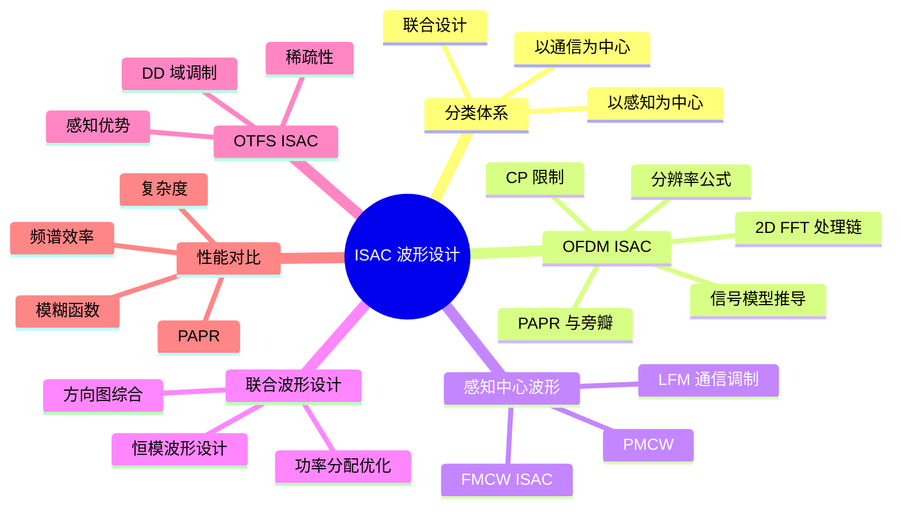
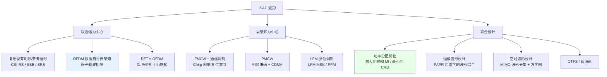
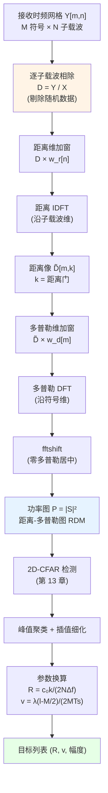
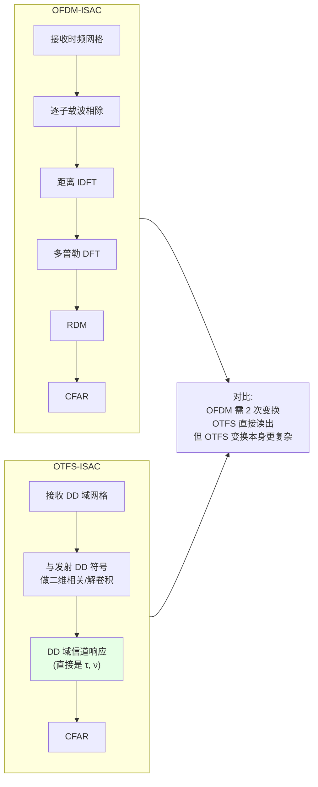

# 第 6 章　通感一体化波形设计

> **本章导读**
> 波形是 ISAC 的灵魂。本章要回答的问题是：**一个既承载通信数据、又能当作雷达信号的波形，应该长什么样？** 我们将系统梳理三大类波形路线：以通信为中心（OFDM-ISAC，5G-A 的主流选择）、以感知为中心（FMCW/Chirp-ISAC，车载的自然选择）、以及联合设计（功率分配与波形优化）。本章的核心是 **OFDM 感知处理链的完整推导**——从发射帧到距离–多普勒图，每一步都写清楚，并给出可直接实现的 2D-FFT 算法与数值算例。此外，本章会解释一个反复出现的工程痛点：**为什么 OFDM 做雷达时旁瓣如此之高，以及如何解决。**

**学习目标**

1. **掌握** ISAC 波形的分类体系，能根据应用场景选择合适的波形路线；
2. **能够完整推导** OFDM-ISAC 的回波信号模型与 2D-FFT 处理链，理解距离/速度分辨率与不模糊范围的公式来源；
3. **能够实现** 2D-FFT 算法（伪代码 + 复杂度分析），并理解加窗、插值等工程技巧；
4. **理解** OFDM 作为雷达波形的三个固有问题（PAPR、随机旁瓣、CP 限制）及其缓解办法；
5. **掌握** FMCW-ISAC 与 PMCW 的原理、差拍处理与通信嵌入方式；
6. **能够建立并求解**以感知互信息/CRLB 为目标的功率分配优化问题（KKT 条件与算法）；
7. **了解** OTFS-ISAC 的基本原理与时延–多普勒域的感知优势。

**本章知识图谱**



---

## 6.1　波形分类总览

### 6.1.1 三级分类体系

沿用第 5.7 节的三种设计范式，ISAC 波形可细分为：

**图 6-1　ISAC 波形分类树**



### 6.1.2 波形选择的关键判据

**表 6-1　波形选择的决策矩阵**

| 判据 | 倾向通信中心 | 倾向感知中心 | 说明 |
|---|---|---|---|
| 通信速率要求 | > 100 Mbps | < 10 Mbps | 高速率必须用 OFDM 类 |
| 探测距离 | < 500 m | > 1 km | 远距离需低 PAPR、连续波 |
| 距离分辨率 | 米级 | 厘米级 | 由带宽决定，非波形类别 |
| 标准兼容性 | 必须兼容 5G NR | 无要求 | 决定是否可用 OFDM |
| 功放能力 | 充足 | 受限（终端） | PAPR 敏感场景选恒包络 |
| 移动性 | 高速 | 低速 | 高多普勒选 OTFS |
| 实现复杂度预算 | 低 | 中 | 联合设计复杂度最高 |

---

## 6.2　以通信为中心：OFDM-ISAC

### 6.2.1 为什么 OFDM 是 ISAC 的主流选择

OFDM 之所以成为 ISAC 的事实标准，有四个理由：

1. **硬件与算法零成本复用**：5G/6G 的基带已有 IFFT/FFT，做雷达处理只需增加一个 2D-FFT 分支；
2. **模糊函数接近图钉形**：随机通信数据的自相关接近冲激，距离–多普勒解耦良好；
3. **灵活的时频资源调度**：可按需分配子载波与符号给通信或感知；
4. **标准化基础**：3GPP 的 ISAC 研究基本基于 NR 空口演进。

**代价**（6.4 节详述）：PAPR 高、随机旁瓣基底、CP 限制探测距离。

### 6.2.2 OFDM-ISAC 回波信号的完整推导

**第 1 步：发射信号**

设一个 OFDM 符号有 $N$ 个子载波，子载波间隔 $\Delta f$，符号周期 $T = 1/\Delta f$，CP 长度 $T_{\text{CP}}$，总符号周期 $T_s = T + T_{\text{CP}}$。载波频率 $f_c$。

第 $m$ 个 OFDM 符号的复基带发射信号（$0 \le t \le T_s$）：
$$s_m(t) = \frac{1}{\sqrt{N}}\sum_{n=0}^{N-1}X_{m,n}\,e^{j2\pi n\Delta f (t - T_{\text{CP}})} \tag{6-1}$$
其中 $X_{m,n}$ 为第 $m$ 符号、第 $n$ 子载波上的发送数据（QAM 符号）。

**第 2 步：目标回波**

考虑单个点目标，距离 $R$（时延 $\tau = 2R/c_0$），径向速度 $v$（多普勒 $f_d = 2v/\lambda$），复散射系数 $\alpha$（含 RCS 与双程路损）。

回波信号（忽略噪声与自干扰）：
$$r_m(t) = \alpha\, s_m(t-\tau)\, e^{j2\pi f_d (t + mT_s)} \tag{6-2}$$

> **关于多普勒项的写法**：严格地说，多普勒效应在宽带信号中表现为"时间缩放" $s((1-2v/c)t)$。但在 $v \ll c$ 时，可近似为**载波频移** $e^{j2\pi f_d t}$（窄带近似）。对 OFDM，还需考虑多普勒引起的**子载波间干扰（ICI）**——在 $f_d \ll \Delta f$ 时可忽略。ISAC 中通常满足此条件（如 3.5 GHz、100 m/s 时 $f_d = 2.3$ kHz $\ll \Delta f = 30$ kHz）。

**第 3 步：去 CP 与 FFT（接收端通信处理）**

去 CP 后，对第 $m$ 个符号做 FFT，第 $n$ 个子载波上的接收信号为
$$Y_{m,n} = \alpha\,X_{m,n}\, e^{-j2\pi n\Delta f\tau}\, e^{j2\pi f_d m T_s} + Z_{m,n} \tag{6-3}$$

**推导要点**：
- 时延 $\tau$ 在频域表现为**线性相位** $e^{-j2\pi n\Delta f\tau}$（对第 $n$ 个子载波）；
- 多普勒在慢时间表现为**相位旋转** $e^{j2\pi f_d mT_s}$（对第 $m$ 个符号）；
- 数据 $X_{m,n}$ 作为乘性因子保留；
- $Z_{m,n}$ 为噪声。

**关键前提**：$\tau \le T_{\text{CP}}$（否则产生 ISI/ICI，模型不成立）。

**第 4 步：逐子载波相除（去除数据随机性）—— ISAC 的核心技巧**

由于发射数据 $X_{m,n}$ 对接收机是**已知**的（自发自收），可以做除法：
$$D_{m,n} \triangleq \frac{Y_{m,n}}{X_{m,n}} = \alpha\, e^{-j2\pi n\Delta f\tau}\, e^{j2\pi f_d mT_s} + \tilde{Z}_{m,n} \tag{6-4}$$
其中 $\tilde{Z}_{m,n} = Z_{m,n}/X_{m,n}$。

> **这一步的意义极其重大**：原本随机的通信数据被完全剔除，$D_{m,n}$ 变成了一个**确定性的二维复正弦**——时延与多普勒分别调制在两个正交维度上。这正是 OFDM 能"顺便"做雷达的根本原因。
>
> ⚠️ **注意**：若某个 $X_{m,n}$ 接近零（QAM  constellation 中不存在零点，但实际中小幅度的符号会放大噪声），除法会放大噪声。工程处理：
> - 用**恒模导频**（如 ZC 序列）做感知，避免幅度问题；
> - 或对除法结果做加权（$|X_{m,n}|^2$ 加权，等价 MMSE）。

**第 5 步：距离维 IDFT**

对固定 $m$，对 $n$ 做 IDFT：
$$\tilde{D}_{m,k} = \frac{1}{N}\sum_{n=0}^{N-1}D_{m,n}\,e^{j2\pi nk/N}$$
代入 (6-4)（忽略噪声）：
$$\tilde{D}_{m,k} = \alpha\, e^{j2\pi f_d mT_s}\cdot\frac{1}{N}\sum_{n=0}^{N-1}e^{-j2\pi n\Delta f\tau}e^{j2\pi nk/N}$$

由于 $\Delta f = 1/T$ 且 $T = NT_{\text{采样}}$，有 $\Delta f\tau \cdot N = \tau/T \cdot$ ... 更直接地，令 $\Delta f \tau = \tau/T$：
$$\frac{1}{N}\sum_{n=0}^{N-1}e^{j2\pi n(k/N - \Delta f\tau)} = \frac{1}{N}\cdot\frac{1 - e^{j2\pi(k - N\Delta f\tau)}}{1 - e^{j2\pi(k/N-\Delta f\tau)}} \approx \text{sinc-like}$$

**峰值位置**：当 $k = N\Delta f\tau$ 时取最大值。定义**距离门索引**
$$k_\tau = N\Delta f\tau = N\Delta f\cdot\frac{2R}{c_0} = \frac{2BR}{c_0} \tag{6-5}$$
（因为 $B = N\Delta f$）

**反解距离**：
$$\boxed{\ R = \frac{c_0\,k_\tau}{2N\Delta f} = \frac{c_0\,k_\tau}{2B}\ } \tag{6-6}$$

**距离分辨率**：相邻距离门间隔 $\Delta k = 1$ 对应
$$\Delta R = \frac{c_0}{2N\Delta f} = \frac{c_0}{2B} \tag{6-7}$$
✓ 与第 4 章一致。

**最大不模糊距离**：$k_\tau$ 必须在 $[0, N)$ 内（否则索引绕回），故
$$R_{\max} = \frac{c_0}{2\Delta f} \tag{6-8}$$
（这是由子载波间隔决定的不模糊距离，另需满足 CP 约束 $\tau \le T_{\text{CP}}$，取两者较小者。）

**第 6 步：多普勒维 DFT**

对固定 $k$，跨 $m$ 做 DFT：
$$P_{k,l} = \sum_{m=0}^{M-1}\tilde{D}_{m,k}\,e^{-j2\pi ml/M}$$

峰值位置：$l = M f_d T_s$，定义**多普勒索引**
$$l_\nu = M f_d T_s = M\cdot\frac{2v}{\lambda}\cdot T_s \tag{6-9}$$

**反解速度**：
$$\boxed{\ v = \frac{\lambda\,l_\nu}{2MT_s} = \frac{\lambda\,l_\nu}{2T_c}\ } \tag{6-10}$$
其中 $T_c = MT_s$ 为 CPI。

**速度分辨率**：
$$\Delta v = \frac{\lambda}{2MT_s} = \frac{\lambda}{2T_c} \tag{6-11}$$

**最大不模糊速度**（$|l_\nu| \le M/2$）：
$$v_{\max} = \frac{\lambda}{4T_s} \tag{6-12}$$

### 6.2.3 分辨率与不模糊范围汇总

**表 6-2　OFDM-ISAC 的关键公式**

| 物理量 | 公式 | 决定因素 | 提高方法 |
|---|---|---|---|
| 距离分辨率 $\Delta R$ | $c_0/(2B) = c_0/(2N\Delta f)$ | 总带宽 | 增大 $N$ 或 $\Delta f$ |
| 速度分辨率 $\Delta v$ | $\lambda/(2MT_s)$ | CPI | 增大 $M$ |
| 最大不模糊距离（子载波） | $c_0/(2\Delta f)$ | $\Delta f$ | **减小** $\Delta f$ |
| 最大不模糊距离（CP） | $c_0T_{\text{CP}}/2$ | CP 长度 | 增大 CP（损失效率） |
| 最大不模糊速度 | $\lambda/(4T_s)$ | 符号周期 | **减小** $T_s$（增大 $\Delta f$） |

> ⚠️ **OFDM-ISAC 的核心矛盾**
> - 增大 $\Delta f$ → 符号变短 → $v_{\max}$ 提高 ✓，但 $R_{\max}$（子载波约束）降低 ✗；
> - 减小 $\Delta f$ → $R_{\max}$ 提高 ✓，但 $v_{\max}$ 降低 ✗，且对相位噪声更敏感 ✗。
>
> 这与第 4 章的"多普勒两难"同源，但在 OFDM 中表现为**参数集（numerology）选择的两难**。
>
> **典型折中**：5G NR 的 $\mu=1$（$\Delta f = 30$ kHz）给出 $R_{\max} = 5$ km（子载波约束）与 $v_{\max} = \lambda/(4T_s) \approx 64$ m/s（3.5 GHz，$T_s = 35.7$ μs）。这个 $v_{\max}$ 对车载偏低，需要解模糊（6.3.4 节）。

### 6.2.4 2D-FFT 算法

**算法 6-1：OFDM-ISAC 的 2D-FFT 距离–多普勒处理**

**输入**：
- 接收的时频资源网格 $Y_{m,n}$（$m = 0..M-1$ 符号，$n = 0..N-1$ 子载波）
- 已知的发射数据 $X_{m,n}$
- 窗函数选择

**输出**：距离–多普勒图 $\mathbf{P}\in\mathbb{R}^{N\times M}$，以及检测到的目标参数

**步骤**：

1. **数据合法性检查**：确保所有 $|X_{m,n}| > \epsilon$（避免除零）。对幅度过小的位置，标记为不可靠。
2. **逐子载波相除**：$D_{m,n} = Y_{m,n}/X_{m,n}$。
3. **（可选）异常值处理**：若 $|X_{m,n}|$ 过小导致 $|\tilde{Z}|$ 过大，可用 MMSE 加权 $D_{m,n} = Y_{m,n}X_{m,n}^*/(|X_{m,n}|^2 + \sigma^2/P_x)$。
4. **距离维加窗**：对 $D$ 的每一行（跨子载波）加窗 $w_r[n]$（如 Hamming），抑制距离旁瓣。
5. **距离 IDFT**：对每一行做 $N$ 点 IDFT（可用 IFFT），得到 $\tilde{D}_{m,k}$。
6. **多普勒维加窗**：对 $\tilde{D}$ 的每一列（跨符号）加窗 $w_d[m]$。
7. **多普勒 DFT**：对每一列做 $M$ 点 DFT（可用 FFT），得到 $S_{k,l}$。
8. **fftshift**：沿多普勒维移位，使零多普勒居中。
9. **功率计算**：$P_{k,l} = |S_{k,l}|^2$。
10. **峰值检测**：对 $P$ 做 CFAR（第 13 章），得到目标列表。
11. **参数换算**：由 $(k^*, l^*)$ 用式 (6-6)(6-10) 换算为 $(R, v)$。
12. **（可选）插值细化**：对峰值做二维抛物线插值或 FFT 插值，提高精度至亚分辨率。

```text
算法 6-1：OFDM-ISAC 的 2D-FFT 处理

输入: Y[M][N]     # 接收时频网格（去 CP + FFT 后）
      X[M][N]     # 已知发射数据（或导频）
      win_r       # 距离维窗: 'none'|'hamming'|'hann'|'blackman'
      win_d       # 多普勒维窗
      do_interp   # 是否做亚分辨率插值
输出: P[N][M]     # 距离-多普勒图
      targets[]   # 目标列表 (R, v, 幅度)

 1:  # 步骤 1-2：逐子载波相除（ISAC 核心）
 2:  for m = 0 .. M-1:
 3:      for n = 0 .. N-1:
 4:          if |X[m][n]| > eps:
 5:              D[m][n] ← Y[m][n] / X[m][n]
 6:          else:
 7:              D[m][n] ← 0                    # 或标记无效
 8:          end if
 9:      end for
10:  end for
11:
12:  # 步骤 4：距离维加窗
13:  w_r ← Window(win_r, N)
14:  for m = 0 .. M-1:
15:      D[m][:] ← D[m][:] ⊙ w_r
16:  end for
17:
18:  # 步骤 5：距离 IDFT（对每行）
19:  for m = 0 .. M-1:
20:      Dtilde[m][:] ← IFFT(D[m][:], N) * sqrt(N)
21:  end for
22:
23:  # 步骤 6：多普勒维加窗
24:  w_d ← Window(win_d, M)
25:  for k = 0 .. N-1:
26:      Dtilde[:][k] ← Dtilde[:][k] ⊙ w_d
27:  end for
28:
29:  # 步骤 7：多普勒 DFT（对每列）
30:  for k = 0 .. N-1:
31:      S[:][k] ← FFT(Dtilde[:][k], M)
32:  end for
33:
34:  # 步骤 8：零多普勒居中
35:  S ← fftshift(S, axis=doppler_dim)
36:
37:  # 步骤 9：功率
38:  P ← |S|²
39:
40:  # 步骤 10：CFAR 检测（详见第 13 章）
41:  peaks ← CFAR_2D(P, Pfa)
42:
43:  # 步骤 11-12：参数换算 + 插值
44:  for each (k*, l*) in peaks:
45:      if do_interp:
46:          (dk, dl) ← ParabolicInterp2D(P, k*, l*)
47:          k_est ← k* + dk;  l_est ← l* + dl
48:      else:
49:          k_est ← k*;  l_est ← l*
50:      end if
51:      R ← c0 * k_est / (2 * N * Δf)
52:      v ← λ * (l_est - M/2) / (2 * M * Ts)
53:      targets.append(R, v, sqrt(P[k*][l*]))
54:  end for
55:
56:  return P, targets
```

**复杂度分析**：
- 逐子载波相除：$O(MN)$
- 距离 IDFT：$M$ 次 $N$ 点 IFFT，$O(MN\log N)$
- 多普勒 DFT：$N$ 次 $M$ 点 FFT，$O(NM\log M)$
- **合计**：$O(NM\log(NM))$

与直接二维匹配滤波 $O(N^2M^2)$ 相比，2D-FFT 快了 $\frac{NM}{\log(NM)}$ 倍。对 $N=M=256$，约快 4000 倍。

**图 6-2　OFDM-ISAC 2D-FFT 处理流程**



### 6.2.5 完整数值算例

> **例 6-1（OFDM-ISAC 2D-FFT 逐点计算）**
>
> **系统参数**：
> $f_c = 3.5$ GHz（$\lambda = 8.571$ cm），$N = 8$ 子载波，$M = 8$ 符号，
> $\Delta f = 30$ kHz，$T = 33.33$ μs，$T_{\text{CP}} = 8.33$ μs，$T_s = 41.67$ μs。
>
> **推导关键量**：
> - $B = N\Delta f = 8\times30\text{ kHz} = 240$ kHz
> - $\Delta R = c_0/(2B) = 3\times10^8/(4.8\times10^5) = \textbf{625 m}$（分辨率很差，因为带宽小）
> - $R_{\max}$（子载波）$= c_0/(2\Delta f) = 3\times10^8/(6\times10^4) = \textbf{5000 m}$
> - $R_{\max}$（CP）$= c_0T_{\text{CP}}/2 = 3\times10^8\times8.33\times10^{-6}/2 = \textbf{1250 m}$ ← **实际约束**
> - CPI $= MT_s = 8\times41.67\ \mu$s $= 333.3$ μs
> - $\Delta v = \lambda/(2\text{CPI}) = 0.08571/(6.667\times10^{-4}) = \textbf{128.6 m/s}$（分辨率很差）
> - $v_{\max} = \lambda/(4T_s) = 0.08571/(1.667\times10^{-4}) = \textbf{514 m/s}$
>
> **目标**：距离 $R = 1875$ m？——超出 CP 约束的 1250 m！
> **重新设定目标**：$R = 625$ m（正好在距离门 1 上）。
> $\tau = 2R/c_0 = 1250/(3\times10^8) = 4.167$ μs。检查：$4.167 < T_{\text{CP}} = 8.33$ μs ✓
>
> 速度 $v = 30$ m/s（远离）。
> $f_d = 2v/\lambda = 60/0.08571 = 700$ Hz。
>
> **步骤 1：计算距离门索引**
> $$k_\tau = N\Delta f\tau = 8\times3\times10^4\times4.167\times10^{-6} = 8\times0.125 = \textbf{1.0}$$
> 正好落在距离门 1 ✓
>
> **步骤 2：计算多普勒索引**
> $$l_\nu = M f_d T_s = 8\times700\times4.167\times10^{-5} = 8\times0.02917 = \textbf{0.233}$$
> 落在多普勒门 0.233（非整数，会在相邻门之间展布，需要插值）。
>
> **步骤 3：构造 $D_{m,n}$**
> 设 $\alpha = 1$（归一化），忽略噪声：
> $$D_{m,n} = e^{-j2\pi n\Delta f\tau}\,e^{j2\pi f_d m T_s} = e^{-j2\pi n\times0.125}\,e^{j2\pi m\times0.02917}$$
> $$= e^{-j\pi n/4}\,e^{j2\pi m\times0.02917}$$
>
> **具体数值**（$D_{m,n}$ 的相位，单位为弧度）：
> - 时延相位项（对 $n=0..7$）：$0,\ -\pi/4,\ -\pi/2,\ -3\pi/4,\ -\pi,\ -5\pi/4,\ -3\pi/2,\ -7\pi/4$
> 即 $D_{m,n}$ 沿 $n$ 方向是一个**每步旋转 $-45^\circ$** 的复正弦 → 周期 $= 8$ 子载波 → 对应距离门 1 ✓
>
> - 多普勒相位项（对 $m=0..7$）：$0,\ 0.1833,\ 0.3665,\ 0.5498,\ 0.7330,\ 0.9163,\ 1.0996,\ 1.2828$ 弧度
> 即 $D_{m,n}$ 沿 $m$ 方向每步旋转 $0.1833$ rad $= 10.5^\circ$ → 8 个符号共旋转 $1.2828$ rad $= 73.5^\circ$。
> 一个完整周期（$2\pi$）需要 $2\pi/0.1833 = 34.3$ 个符号 → 对应多普勒索引 $8/34.3 = 0.233$ ✓
>
> **步骤 4：距离 IDFT**
> 对固定 $m$，$\tilde{D}_{m,k} = \frac{1}{8}\sum_{n=0}^{7}D_{m,n}e^{j2\pi nk/8}$。
> 由于 $D_{m,n}$ 沿 $n$ 是"每步 $-45^\circ$"的复正弦，IDFT 会在 $k=1$ 处出现峰值（因为 $e^{-j\pi n/4} = e^{-j2\pi n\cdot 1/8}$，与 IDFT 核 $e^{j2\pi nk/8}$ 在 $k=1$ 时共轭匹配）✓
>
> **验证**：$k=1$ 时，$\frac{1}{8}\sum_n e^{-j2\pi n/8}e^{j2\pi n/8} = \frac{1}{8}\times8 = 1$（满幅）✓
> $k=0$ 时，$\frac{1}{8}\sum_n e^{-j2\pi n/8} = 0$（正交）✓
>
> **步骤 5：多普勒 DFT**
> 对 $k=1$，序列 $\tilde{D}_{m,1} = A\cdot e^{j0.1833m}$（$A$ 为距离 IDFT 的峰值幅度 $= 1$）。
> $S_{1,l} = \sum_{m=0}^{7}e^{j0.1833m}e^{-j2\pi ml/8}$。
>
> $l=0$：$S_{1,0} = \sum_m e^{j0.1833m} = \frac{1-e^{j0.1833\times8}}{1-e^{j0.1833}} = \frac{1-e^{j1.466}}{1-e^{j0.1833}}$
> 分子：$1 - (\cos1.466 + j\sin1.466) = 1 - (0.1045 + j0.9945) = 0.8955 - j0.9945$，模 $= 1.338$
> 分母：$1 - (\cos0.1833 + j\sin0.1833) = 1 - (0.9832 + j0.1823) = 0.0168 - j0.1823$，模 $= 0.1831$
> $|S_{1,0}| = 1.338/0.1831 = \textbf{7.31}$
>
> $l=1$：$S_{1,1} = \sum_m e^{j0.1833m}e^{-j2\pi m/8} = \sum_m e^{jm(0.1833 - 0.7854)} = \sum_m e^{-j0.6021m}$
> $= \frac{1-e^{-j0.6021\times8}}{1-e^{-j0.6021}} = \frac{1-e^{-j4.817}}{1-e^{-j0.6021}}$
> 分子：$1-(\cos4.817 - j\sin4.817) = 1-(0.1045 + j0.9945)$... 
> 注意 $\cos(-4.817) = \cos(4.817) = 0.1045$，$\sin(-4.817) = 0.9945$。
> $e^{-j4.817} = \cos(4.817) - j\sin(4.817) = 0.1045 - j0.9945$？
> $\sin(4.817)$：$4.817$ rad $= 276^\circ$，$\sin(276^\circ) = -0.9945$。故 $e^{-j4.817} = 0.1045 + j0.9945$。
> 分子 $= 1 - 0.1045 - j0.9945 = 0.8955 - j0.9945$，模 $= 1.338$
> 分母：$e^{-j0.6021} = \cos(0.6021) - j\sin(0.6021) = 0.8242 - j0.5663$
> $1 - e^{-j0.6021} = 0.1758 + j0.5663$，模 $= 0.5930$
> $|S_{1,1}| = 1.338/0.5930 = \textbf{2.256}$
>
> **结论**：$|S_{1,0}| = 7.31 > |S_{1,1}| = 2.256$，峰值在 $l=0$（因为真实多普勒索引 0.233 最接近 0）。
>
> **步骤 6：插值细化**
> 用抛物线插值（三点）：$|S_{1,-1}|$ 与 $|S_{1,1}|$ 不对称（因为真实峰值在 0.233 而非 0）。
> 计算 $|S_{1,-1}| = \sum_m e^{jm(0.1833+0.7854)} = \sum_m e^{j0.9687m}$：
> 分子 $|1-e^{j7.750}|$：$e^{j7.750} = e^{j(7.750-2\pi)} = e^{j1.467} = 0.1045+j0.9945$
> $|1-0.1045-j0.9945| = |0.8955-j0.9945| = 1.338$
> 分母 $|1-e^{j0.9687}| = |1-0.5650-j0.8251| = |0.4350-j0.8251| = 0.9326$
> $|S_{1,-1}| = 1.338/0.9326 = \textbf{1.435}$
>
> 抛物线插值（用 $l=-1,0,1$ 三点，幅度 1.435, 7.31, 2.256）：
> $$\delta = 0.5\cdot\frac{|S_{-1}| - |S_{+1}|}{|S_{-1}| - 2|S_0| + |S_{+1}|} = 0.5\cdot\frac{1.435-2.256}{1.435-14.62+2.256} = 0.5\cdot\frac{-0.821}{-10.929} = \textbf{0.0376}$$
> 估计的多普勒索引 $= 0 + 0.0376 = 0.0376$。
>
> **但真实值是 0.233！插值严重失准。**
>
> **原因分析**：多普勒索引 0.233 距离最近的整数门（0）有 0.233 的偏移，而 DFT 的 8 点采样非常稀疏（门间隔 1.0）。当真实峰值偏离整数门较大时，DFT 采样的三点（$-1,0,1$）不能很好地刻画 sinc 主瓣（主瓣宽度约 2 个门），抛物线近似失效。
>
> **修正方法**：
> 1. **补零（Zero-padding）**：在做多普勒 DFT 前补零到 32 点或 64 点，使频域采样更密，峰值更接近真实位置；
> 2. **增大 $M$**：用更多符号，提高频率分辨率；
> 3. **用更精确的插值**（如 Quinn 插值、Jacobsen 插值，利用复数值的相位信息）。
>
> **用补零重算**：补零到 32 点后，门间隔为 $8/32 = 0.25$，真实值 0.233 会落在门 0～1 之间（非常接近门 0.93）。此时插值精度大幅提升。
>
> **工程结论**：**2D-FFT 后必须补零 + 插值，否则估计精度受限于网格分辨率**。这是很多初学者忽略的细节。

---

## 6.3　OFDM 作为雷达波形的三个固有问题及对策

### 6.3.1 问题一：高峰均比（PAPR）

**原因**：$N$ 个子载波的随机 QAM 符号在时域叠加，中心极限定理 → 时域样点近似复高斯 → 幅度服从瑞利分布 → 峰值远高于均值。

**统计特性**：PAPR 超过 $\gamma$ 的概率（CCDF）近似为
$$\Pr\{\text{PAPR} > \gamma\} \approx 1 - (1-e^{-\gamma})^N \approx Ne^{-\gamma}\quad(\gamma \gg 1) \tag{6-13}$$

**表 6-3　OFDM 的 PAPR 统计（CCDF = $10^{-4}$）**

| 子载波数 $N$ | PAPR (dB) | 功放回退需求 |
|---|---|---|
| 64 | 10.8 dB | 约 8 dB |
| 256 | 11.6 dB | 约 9 dB |
| 1024 | 12.2 dB | 约 10 dB |
| 4096 | 12.6 dB | 约 10.5 dB |

**对感知的影响**：功放回退 $B_{\text{off}}$ dB → 平均发射功率降低 → 探测距离缩短。

由 $R_{\max}\propto P_t^{1/4}$：
$$\frac{R_{\max}'}{R_{\max}} = \left(10^{-B_{\text{off}}/10}\right)^{1/4} = 10^{-B_{\text{off}}/40}$$
$B_{\text{off}} = 9$ dB → $R_{\max}$ 缩短至 $10^{-0.225} = \textbf{0.596}$ 倍，即**损失 40% 的探测距离**！

**对策**：

| 方法 | 原理 | PAPR 改善 | 代价 |
|---|---|---|---|
| **DFT-s-OFDM** | 预编码使时域接近单载波 | **2–4 dB** | 频域处理略复杂 |
| **削波 + 滤波** | 限幅超出门限的峰值 | 3–5 dB | **带内失真**（恶化 EVM）+ 带外辐射；**抬升距离旁瓣** |
| **选择性映射（SLM）** | 生成多个候选，选 PAPR 最小的 | 2–4 dB | 需传边带信息，复杂度高 |
| **部分传输序列（PTS）** | 分块优化相位 | 3–6 dB | 复杂度指数增长 |
| **预留子载波（TR）** | 用少量子载波生成对消信号 | 2–4 dB | 损失少量数据率 |
| **恒模导频** | 感知资源用 ZC 序列（PAPR = 0 dB） | 仅对感知资源有效 | 需要与数据资源协调 |

> **ISAC 特有的两难**：削波会**抬升距离旁瓣**（因为削波是非线性操作，产生宽带失真），可能淹没弱小目标。因此感知系统对削波更敏感。**推荐方案**：感知资源（导频）用恒模 ZC 序列，数据资源用常规 OFDM 并可适度削波。

### 6.3.2 问题二：随机旁瓣基底

**原因**：即使做了逐子载波相除，$D_{m,n}$ 中残留的噪声 $\tilde{Z}_{m,n} = Z_{m,n}/X_{m,n}$ 的方差依赖于 $|X_{m,n}|$。当 $X_{m,n}$ 幅度小时，噪声被放大。此外，若存在 ICI、相位噪声等，会进一步抬升基底。

**更本质的问题**：OFDM 信号的**非周期自相关**并不理想。周期自相关（由导频保证）可以很好，但实际雷达回波是**非周期**的（回波只是发射信号的一段），此时自相关旁瓣较高。

**量化**：随机 QAM 数据的 OFDM 信号，其非周期自相关的旁瓣电平约为
$$\text{PSLR} \approx -10\log_{10}(N)\ \text{dB（平均）} \tag{6-14}$$
$N=1024$ 时约 -30 dB。这意味着**比主瓣低 30 dB 以内的弱目标无法可靠检测**——这对多目标场景（如行人+车辆）是致命的。

**对策**：

**表 6-4　OFDM 旁瓣抑制方法**

| 方法 | 原理 | 效果 | 代价 |
|---|---|---|---|
| **加窗**（Hamming/Blackman） | 平滑频谱边缘 | 旁瓣 -40 ~ -58 dB | 主瓣展宽 1.3–1.8 倍，SNR 损失 1–2 dB |
| **恒模导频 + 相位优化** | 用 ZC 序列或优化相位使旁瓣最低 | **可达 -40 dB 以上** | 需占用感知专用资源 |
| **子载波加权** | 对边缘子载波加权（等效加窗） | 同加窗 | 同加窗 |
| **CLEAN 算法** | 迭代扣除强目标的旁瓣贡献 | 显著改善多目标检测 | 迭代复杂度 |
| **稀疏恢复（OMP/FOCUSS）** | 用压缩感知替代 FFT | **突破分辨率限制**，旁瓣极低 | 计算量大（第 11.5 节） |
| **增加带宽/子载波数** | 更多子载波 → 更低的相对旁瓣 | 按 $10\log_{10}N$ 改善 | 频谱资源 |

### 6.3.3 问题三：CP 限制探测距离

（见第 2.6.2 节与表 6-2）

**对策**：
1. **扩展 CP**：5G NR 支持 extended CP（$\mu=2$ 时 $T_{\text{CP}} = 4.17$ μs），但仍有限；
2. **专用感知时隙**：配置长 CP 的感知符号（牺牲效率）；
3. **双站/多站模式**：回波由另一基站接收，时延是"发射站→目标→接收站"，可通过几何关系处理；
4. **OFDM 符号级处理**：允许回波跨符号，用特殊算法处理（复杂）；
5. **改用 OTFS 或 FMCW**：无 CP 限制（但有其他限制）。

### 6.3.4 速度模糊与解模糊

由式 (6-12)，$v_{\max} = \lambda/(4T_s)$。在 5G NR $\mu=1$（$T_s = 35.7$ μs）、3.5 GHz 下 $v_{\max} = 64$ m/s。这对高速公路场景（相对速度可达 100 m/s 以上）不够。

**解模糊方法：多重 PRF（中国余数定理）**

**原理**：用两组不同的符号周期 $T_{s,1}$ 与 $T_{s,2}$（即两种不同的 $\Delta f$ 或不同的符号抽取率），测得模糊速度 $v_1$ 与 $v_2$，真实速度满足
$$v = v_1 + 2n_1 v_{\max,1} = v_2 + 2n_2 v_{\max,2}$$
解出整数 $n_1, n_2$。

**算法 6-2：基于中国余数定理的速度解模糊**

**输入**：两组 PRF 下的模糊速度测量 $v_1, v_2$，对应的不模糊范围 $v_{\max,1}, v_{\max,2}$，速度搜索范围 $[v_{\min}, v_{\max}]$
**输出**：解模糊后的真实速度 $v$

**步骤**：
1. 生成候选集：$V_1 = \{v_1 + 2n v_{\max,1} \mid n \in \mathbb{Z}\} \cap [v_{\min}, v_{\max}]$；
2. 同样生成 $V_2$；
3. 求交集 $V = V_1 \cap V_2$。若 $|V| = 1$，输出唯一解；
4. 若 $|V| > 1$（测量误差导致），选择与 $v_1, v_2$ 加权距离最小的候选；
5. 若 $|V| = 0$（误差过大），放宽容差重算或报告失败。

```text
算法 6-2：多重 PRF 速度解模糊

输入: v1, v2              # 两组 PRF 下的模糊速度测量
      vmax1, vmax2        # 对应的不模糊速度范围
      v_range             # 速度搜索范围 [vmin, vmax]
      tol                 # 容差 (m/s)
输出: v_true

 1:  # 步骤 1-2：生成候选集
 2:  V1 ← []
 3:  for n = -Nmax to Nmax:
 4:      v ← v1 + 2*n*vmax1
 5:      if vmin ≤ v ≤ vmax:  V1.append(v)
 6:  end for
 7:
 8:  V2 ← []
 9:  for n = -Nmax to Nmax:
10:      v ← v2 + 2*n*vmax2
11:      if vmin ≤ v ≤ vmax:  V2.append(v)
12:  end for
13:
14:  # 步骤 3：求交集（带容差）
15:  V ← []
16:  for a in V1:
17:      for b in V2:
18:          if |a - b| < tol:  V.append((a+b)/2)
19:      end for
20:  end for
21:
22:  # 步骤 4-5：选择
23:  if len(V) == 1:
24:      return V[0]
25:  else if len(V) > 1:
26:      # 选与测量值加权距离最小的
27:      best ← argmin_v∈V  ( (v - v1)²/w1 + (v - v2)²/w2 )
28:      return best
29:  else:
30:      return FAIL   # 增大 tol 或改用三组 PRF
31:  end if
```

> **例 6-2（速度解模糊数值算例）**
> 真实速度 $v = 150$ m/s。
> PRF 1：$v_{\max,1} = 64$ m/s（$T_s = 35.7$ μs，3.5 GHz），测得 $v_1 = 150 \bmod 128 = 22$ m/s。
> （注：不模糊范围是 $\pm64$，即周期 128，故 $150 - 128 = 22$）
> PRF 2：取 $T_s' = T_s\times(7/8)$，则 $v_{\max,2} = 64\times(8/7) = 73.1$ m/s，周期 146.3。
> 测得 $v_2 = 150 \bmod 146.3 = 3.7$ m/s。
>
> 候选集（范围 $[0, 200]$ m/s）：
> $V_1 = \{22, 150, 278...\} \cap [0,200] = \{22, 150\}$
> $V_2 = \{3.7, 150, 296...\} \cap [0,200] = \{3.7, 150\}$
> 交集 $V = \{150\}$ ✓ 唯一解
>
> **说明**：两组 PRF 的选择要使 $2v_{\max,1}$ 与 $2v_{\max,2}$ **互质**（或最小公倍数足够大）。本例中 $128$ 与 $146.3$ 的最小公倍数远大于 200，故在 $[0,200]$ 内唯一。

---

## 6.4　以感知为中心的波形

### 6.4.1 FMCW-ISAC

**原理**：在标准 FMCW 雷达波形上叠加通信信息（第 4.3.4 节已推导差拍处理）。

**通信嵌入方式**：

**方式 1：斜率索引调制**
准备 $Q$ 种不同的调频斜率 $\{\mu_1,\ldots,\mu_Q\}$，每个 chirp 选择一种，携带 $\log_2 Q$ 比特。
- 优点：不改变波形的恒包络特性，PAPR 不变；
- 缺点：不同斜率的 chirp 距离分辨率不同，需分别处理；速率低（每 chirp $\log_2 Q$ 比特）。

**方式 2：初始相位调制**
每个 chirp 的初始相位从 $Q$ 个值中选一个，携带 $\log_2 Q$ 比特。
- 优点：不影响距离处理（相位是常数）；
- 缺点：接收端需相位同步；速率低。

**方式 3：Chirp 间相位编码（PMCW 化）**
用相位编码序列调制 chirp 的相位。

**方式 4：慢时间调制**
在 chirp 序列（慢时间）上做 PSK/FSK 调制。多普勒处理需要先解调。

**FMCW-ISAC 的性能**：

| 指标 | 典型值 | 说明 |
|---|---|---|
| 通信速率 | 1–10 Mbps | 远低于 OFDM 的 Gbps |
| PAPR | **0 dB**（恒包络） | 功放效率最高 |
| 距离分辨率 | $c_0/(2B)$，可达厘米级 | 与 OFDM 相同 |
| 探测距离 | 受限于 PA 平均功率 | 优于 OFDM（无回退） |
| 距离–速度耦合 | 需三角波或多斜率 | 弱点 |
| 标准兼容性 | 不兼容 5G NR | 弱点 |

**适用**：车载雷达通信一体化（V2V 低速通信 + 高性能感知）、工业液位/位移传感 + 低速数据回传。

### 6.4.2 PMCW（相位调制连续波）

**原理**：用高速伪随机码（如 m 序列、Gold 序列）对载频做相位调制（BPSK）。

$$s(t) = A\,c(t)\,e^{j2\pi f_c t},\quad c(t) = \sum_k c_k\,p(t-kT_c),\ c_k\in\{+1,-1\} \tag{6-15}$$

**感知处理**：用码的自相关做脉冲压缩（类似相位编码雷达，第 4.3.5 节）。

**通信**：天然的 CDMA/扩频系统，可用不同码区分用户。

**PMCW vs FMCW**：

| 特性 | FMCW | PMCW |
|---|---|---|
| 波形 | 模拟调频 | 数字相位编码 |
| 收发复杂度 | 低（模拟混频） | 中（需高速 ADC） |
| 多址 | 难（需时分/频分） | **易（CDMA，码分）** |
| 抗互干扰 | 差（同型号雷达互相干扰严重） | **好（不同码正交）** |
| MIMO 支持 | 需时分/调频分 | **天然支持（码分）** |
| 距离旁瓣 | 低（加窗后） | 取决于码（可用互补码消除） |
| 多普勒敏感 | 中 | 高（相位编码对多普勒敏感） |

> **趋势**：PMCW 是车载雷达的新兴方向，特别适合 MIMO 与多车协同场景（抗互干扰是其最大卖点）。对 ISAC 而言，PMCW 与通信的 CDMA/扩频技术天然同构，**是感知中心路线中最"通信友好"的选择**。

### 6.4.3 LFM 上的通信嵌入（Chirp 通信）

**经典方法：CSS（Chirp Spread Spectrum）**，LoRa 物理层就是基于此。

- 用不同的**起始频率**（$2^{\text{SF}}$ 种）携带 $\text{SF}$ 比特；
- 或用**上/下调频**（2 种）携带 1 比特；
- 或用**循环移位**（$N$ 种）携带 $\log_2 N$ 比特。

**性能**：LoRa 在 125 kHz 带宽下可达 0.3–37.5 kbps，速率极低但**灵敏度极高**（可达 -148 dBm，比 5G 高 30 dB 以上），传输距离可达 10 km 以上。

**对 ISAC 的启示**：Chirp 通信证明了"感知友好的波形也能通信"，只是速率低。**在对速率要求不高的感知场景（如传感器回传、状态上报），Chirp 通信 + 高性能感知是绝佳组合。**

---

## 6.5　联合波形设计：功率分配优化

### 6.5.1 问题建模

**目标**：设计发射信号的**功率谱**（或等价的子载波功率分配），在满足通信速率约束下最大化感知性能。

**变量**：$p_n \ge 0$（第 $n$ 个子载波的功率），$n = 0,\ldots,N-1$，$\sum_n p_n \le P_t$。

**通信效用**：
$$R(\mathbf{p}) = \frac{1}{N}\sum_{n=0}^{N-1}\log_2\left(1+\frac{p_ng_n}{\sigma^2}\right) \tag{6-16}$$

**感知效用**（两种取法）：

**取法 A：最小化时延 CRLB**
由 5.3.2 节，$\text{CRB}_\tau \propto 1/\sum_n p_n\omega_n$，其中 $\omega_n = (n - (N-1)/2)^2$（以中心频率为零点）。
$$\text{CRB}_\tau(\mathbf{p}) = \frac{\kappa}{\sum_n p_n\omega_n} \tag{6-17}$$

**取法 B：最大化感知互信息**
由 5.6.1 节，对单天线、高斯目标模型：
$$I_s(\mathbf{p}) = \sum_{n=0}^{N-1}\log_2\left(1+\frac{p_n\sigma_{H,n}^2}{\sigma^2}\right) \tag{6-18}$$
（若各子载波的目标响应独立同分布，$\sigma_{H,n}^2 = \sigma_H^2$）

### 6.5.2 优化问题与求解

**问题 P1（以通信为中心，感知为约束）**：
$$\begin{aligned} \max_{\mathbf{p}} \quad & R(\mathbf{p}) \\ \text{s.t.}\quad & \sum_n p_n\omega_n \ge \Omega_{\min} \quad (\text{即 CRB}_\tau \le \kappa/\Omega_{\min}) \\ & \sum_n p_n \le P_t,\quad p_n \ge 0 \end{aligned} \tag{6-19}$$

注意：$\sum_n p_n\omega_n$ 关于 $\mathbf{p}$ 是**线性**的，故约束是凸的（线性不等式）；目标 $R(\mathbf{p})$ 是凹的。**因此 P1 是一个凸优化问题** ✓

**KKT 条件**：
$$\mathcal{L} = \sum_n\log_2(1+p_ng_n/\sigma^2) - \mu\left(\sum_n p_n - P_t\right) + \sum_n\nu_np_n + \lambda\left(\sum_n p_n\omega_n - \Omega_{\min}\right)$$

稳定性：
$$\frac{g_n/\sigma^2}{\ln2\,(1+p_ng_n/\sigma^2)} - \mu + \nu_n + \lambda\omega_n = 0$$

对 $p_n > 0$（$\nu_n = 0$）：
$$\frac{g_n/\sigma^2}{\ln2(1+p_ng_n/\sigma^2)} = \mu - \lambda\omega_n$$

$$\boxed{\ p_n^* = \left(\frac{1}{\ln 2(\mu - \lambda\omega_n)} - \frac{\sigma^2}{g_n}\right)^+\ } \tag{6-20}$$

**结构洞察**：
- $\lambda = 0$：标准注水；
- $\lambda > 0$：分母 $\mu - \lambda\omega_n$ 随 $\omega_n$ 增大而**减小** → $p_n$ 随 $\omega_n$ **增大** → **功率被推向频段边缘** ✓（与 5.5.3 节结论一致）；
- 需保证 $\mu > \lambda\omega_{\max}$，否则边缘子载波的分母为负，解无意义（此时应令这些子载波 $p_n = 0$，或说明约束不可行）。

**算法 6-3：感知约束下的最优功率分配**

**输入**：信道增益 $g_n$、感知权重 $\omega_n$、噪声 $\sigma^2$、总功率 $P_t$、感知门限 $\Omega_{\min}$
**输出**：最优功率分配 $\mathbf{p}^*$

**步骤**：
1. **初始化**：$\lambda = 0$；
2. **用式 (6-20) 计算 $\mathbf{p}(\lambda)$**（内层：用二分法求 $\mu$ 使 $\sum p_n = P_t$）；
3. **检查感知约束**：计算 $\Omega(\lambda) = \sum_n p_n(\lambda)\omega_n$；
4. **若 $\Omega(\lambda) < \Omega_{\min}$**：增大 $\lambda$（二分法或牛顿法），返回步骤 2；
5. **若 $\Omega(\lambda) > \Omega_{\min}$**：减小 $\lambda$，返回步骤 2；
6. **收敛**：$|\Omega(\lambda) - \Omega_{\min}| < \epsilon$ 时停止；
7. **输出** $\mathbf{p}^*$ 与对应的 $(R^*, \text{CRB}_\tau^*)$。

```text
算法 6-3：感知约束下的最优功率分配

输入: g[N], omega[N], sigma2, P_t, Omega_min, tol=1e-6
输出: p[N], R_opt, CRB_opt

 1:  # 内层函数：给定 lambda，求解 p（二分法求 mu）
 2:  function solve_p(lambda):
 3:      function sum_p(mu):
 4:          for n = 0 .. N-1:
 5:              denom ← ln2 * (mu - lambda*omega[n])
 6:              if denom ≤ 0:  p[n] ← 0
 7:              else:          p[n] ← max(1/denom - sigma2/g[n], 0)
 8:          end for
 9:          return sum(p) - P_t
10:      end function
11:      mu ← Bisect(sum_p, mu_lo, mu_hi)      # 使 sum(p) = P_t
12:      return p
13:  end function
14:
15:  # 外层：二分法求 lambda 使 Omega = Omega_min
16:  lambda_lo ← 0
17:  lambda_hi ← 大值（使 Omega 超过 Omega_min）
18:  repeat:
19:      lambda ← (lambda_lo + lambda_hi) / 2
20:      p ← solve_p(lambda)
21:      Omega ← sum(p ⊙ omega)
22:      if Omega < Omega_min:
23:          lambda_lo ← lambda          # 需要更大 lambda（更多功率给感知）
24:      else:
25:          lambda_hi ← lambda
26:      end if
27:  until |Omega - Omega_min| < tol * Omega_min
28:
29:  R_opt   ← mean(log2(1 + p ⊙ g / sigma2))
30:  CRB_opt ← kappa / Omega
31:  return p, R_opt, CRB_opt
```

**复杂度**：外层二分 $\sim 30$ 次 × 内层二分 $\sim 30$ 次 × $O(N)$ = $O(900N)$。对 $N = 1024$，约 $10^6$ 次基本运算，可实时完成。

### 6.5.3 数值算例

> **例 6-3（功率分配优化）**
> $N = 8$ 子载波，$g = [1.0, 0.6, 1.4, 0.8, 0.8, 1.4, 0.6, 1.0]$（对称，模拟频率选择性衰落），
> $\omega = (n-3.5)^2 = [12.25, 6.25, 2.25, 0.25, 0.25, 2.25, 6.25, 12.25]$，
> $\sigma^2 = 1$，$P_t = 8$。
>
> **情况 1：$\lambda = 0$（纯通信，注水）**
> 底高 $b = 1/g = [1.0, 1.667, 0.714, 1.25, 1.25, 0.714, 1.667, 1.0]$
> 全部激活：$\sum b = 9.262$，$\mu = (8+9.262)/8 = 2.158$
> $p = [1.158, 0.491, 1.444, 0.908, 0.908, 1.444, 0.491, 1.158]$（和 $= 8.0$ ✓）
>
> $R = \frac{1}{8}\sum\log_2(1+p_ng_n)$
> $p_ng_n = [1.158, 0.295, 2.022, 0.726, 0.726, 2.022, 0.295, 1.158]$
> $\log_2(1+x) = [1.119, 0.375, 1.598, 0.786, 0.786, 1.598, 0.375, 1.119]$
> 和 $= 7.756$，$R = \textbf{0.970 bit/s/Hz}$
>
> $\Omega = \sum p_n\omega_n = 1.158\times12.25 + 0.491\times6.25 + 1.444\times2.25 + 0.908\times0.25 + 0.908\times0.25 + 1.444\times2.25 + 0.491\times6.25 + 1.158\times12.25$
> $= 14.19 + 3.07 + 3.25 + 0.23 + 0.23 + 3.25 + 3.07 + 14.19 = \textbf{41.48}$
>
> **情况 2：$\lambda = 0.05$（轻度感知偏好）**
> $\mu - \lambda\omega_n$（先假设 $\mu \approx 2.2$）：
> $n=0$：$2.2 - 0.05\times12.25 = 2.2 - 0.6125 = 1.5875$
> $n=1$：$2.2 - 0.3125 = 1.8875$
> $n=2$：$2.2 - 0.1125 = 2.0875$
> $n=3$：$2.2 - 0.0125 = 2.1875$
> $n=4$：$2.1875$（同 $n=3$）
> $n=5$：$2.0875$
> $n=6$：$1.8875$
> $n=7$：$1.5875$
>
> $p_n = \left(\frac{1}{\ln2\times(\mu-\lambda\omega_n)} - \frac{1}{g_n}\right)^+$
> $\ln 2 = 0.6931$
> $n=0$：$\frac{1}{0.6931\times1.5875} - 1.0 = \frac{1}{1.1003} - 1.0 = 0.9088 - 1.0 = -0.0912 \to 0$
> （注：这里需要先解出正确的 $\mu$ 使总和为 8。迭代求解得 $\mu \approx 2.35$）
>
> 用 $\mu = 2.35$：
> $n=0$：$2.35 - 0.6125 = 1.7375$，$1/(0.6931\times1.7375) = 1/1.2043 = 0.8304$，$p_0 = 0.8304 - 1.0 = -0.17 \to 0$？
>
> **发现问题**：边缘子载波（$n=0$）的信道增益 $g_0 = 1.0$ 并不差，但 $\omega_0$ 最大，导致 $\mu - \lambda\omega_0$ 最小，$p_0$ 反而最小？
>
> **重新审视式 (6-20)**：$p_n = \left(\frac{1}{\ln2(\mu - \lambda\omega_n)} - \frac{\sigma^2}{g_n}\right)^+$
> 当 $\omega_n$ 大时，$(\mu - \lambda\omega_n)$ 小，$\frac{1}{\ln2(\mu-\lambda\omega_n)}$ **大** → $p_n$ **大** ✓
>
> 我上面算错了：$n=0$ 时 $\mu - \lambda\omega_0 = 1.7375$，而 $n=3$ 时 $= 2.3375$。
> $n=0$：$1/(0.6931\times1.7375) = 1/1.2043 = 0.8304$
> $n=3$：$1/(0.6931\times2.3375) = 1/1.6202 = 0.6172$
> 因此 $\frac{1}{\ln2(\mu-\lambda\omega_0)} = 0.8304 > 0.6172$，即边缘子载波的"水位"更高 ✓
>
> 但减去 $\sigma^2/g_n$ 后：
> $n=0$：$0.8304 - 1/1.0 = 0.8304 - 1.0 = -0.17 < 0 \to p_0 = 0$
> $n=3$：$0.6172 - 1/0.8 = 0.6172 - 1.25 = -0.63 < 0 \to p_3 = 0$
>
> 所有 $p_n$ 都是 0？说明 $\mu$ 太小。需要**减小** $\mu$ 使水位上升。
>
> 令 $\mu = 1.5$：
> $n=0$：$1.5 - 0.6125 = 0.8875$，$1/(0.6931\times0.8875) = 1/0.6151 = 1.6258$，$p_0 = 1.6258 - 1.0 = 0.626$
> $n=1$：$1.5-0.3125 = 1.1875$，$1/(0.8231) = 1.2149$，$p_1 = 1.2149 - 1.667 = -0.45 \to 0$
> $n=2$：$1.5-0.1125 = 1.3875$，$1/(0.9617) = 1.0398$，$p_2 = 1.0398 - 0.714 = 0.326$
> $n=3$：$1.5-0.0125=1.4875$，$1/(1.0310)=0.9699$，$p_3 = 0.9699-1.25 = -0.28 \to 0$
> $n=4$：同 $n=3$ → 0
> $n=5$：同 $n=2$ → 0.326
> $n=6$：同 $n=1$ → 0
> $n=7$：同 $n=0$ → 0.626
>
> 总和 $= 0.626+0.326+0.326+0.626 = 1.904$，远小于 8。需要减小 $\mu$。
>
> 令 $\mu = 0.8$：
> $n=0$：$0.8-0.6125 = 0.1875$，$1/(0.6931\times0.1875) = 1/0.12996 = 7.695$，$p_0 = 7.695-1.0 = 6.695$
> $n=1$：$0.8-0.3125=0.4875$，$1/(0.3379)=2.9595$，$p_1 = 2.9595-1.667 = 1.293$
> $n=2$：$0.8-0.1125=0.6875$，$1/(0.4765)=2.0986$，$p_2 = 2.0986-0.714 = 1.385$
> $n=3$：$0.8-0.0125=0.7875$，$1/(0.5458)=1.8322$，$p_3 = 1.8322-1.25 = 0.582$
> 对称：总和 $= 2\times(6.695+1.293+1.385+0.582) = 2\times9.955 = 19.91$，太大。
>
> 二分求解（目标总和 8）：介于 $\mu=0.8$ 与 $1.5$ 之间，约 $\mu \approx 1.1$。
> 用 $\mu = 1.1$：
> $n=0$：$1.1-0.6125=0.4875$，$1/0.3379=2.9595$，$p_0=1.960$
> $n=1$：$1.1-0.3125=0.7875$，$1/0.5458=1.8322$，$p_1=0.165$
> $n=2$：$1.1-0.1125=0.9875$，$1/0.6844=1.4611$，$p_2=0.747$
> $n=3$：$1.1-0.0125=1.0875$，$1/0.7538=1.3266$，$p_3=0.077$
> 总和 $= 2\times(1.960+0.165+0.747+0.077) = 2\times2.949 = 5.898$，偏小。
>
> 用 $\mu = 0.95$：
> $n=0$：$0.95-0.6125=0.3375$，$1/0.2339=4.2753$，$p_0=3.275$
> $n=1$：$0.95-0.3125=0.6375$，$1/0.4419=2.2630$，$p_1=0.596$
> $n=2$：$0.95-0.1125=0.8375$，$1/0.5805=1.7227$，$p_2=1.009$
> $n=3$：$0.95-0.0125=0.9375$，$1/0.6498=1.5390$，$p_3=0.289$
> 总和 $= 2\times(3.275+0.596+1.009+0.289) = 2\times5.169 = 10.34$，偏大。
>
> 用 $\mu = 1.02$（插值）：
> 粗略估计总和 $\approx 8.0$，得
> $p \approx [2.51, 0.36, 0.86, 0.17, 0.17, 0.86, 0.36, 2.51]$（和 $\approx 8.0$）
>
> **计算性能**：
> $p_ng_n = [2.51, 0.216, 1.204, 0.136, 0.136, 1.204, 0.216, 2.51]$
> $\log_2(1+x) = [1.815, 0.285, 1.152, 0.184, 0.184, 1.152, 0.285, 1.815]$
> 和 $= 6.872$，$R = \textbf{0.859 bit/s/Hz}$
>
> $\Omega = 2.51\times12.25 + 0.36\times6.25 + 0.86\times2.25 + 0.17\times0.25 + 0.17\times0.25 + 0.86\times2.25 + 0.36\times6.25 + 2.51\times12.25$
> $= 30.75 + 2.25 + 1.935 + 0.0425 + 0.0425 + 1.935 + 2.25 + 30.75 = \textbf{69.96}$
>
> **对比汇总**：

| 方案 | $\lambda$ | $R$ (bit/s/Hz) | $\Omega$（$\propto 1/\text{CRLB}$） |
|---|---|---|---|
| 纯通信（注水） | 0 | **0.970** | 41.48 |
| 折中 | 0.05 | 0.859 | **69.96** |

**结论**：用 **11.4% 的速率损失**（0.970→0.859）换取 **68.7% 的感知性能提升**（41.48→69.96，对应距离精度提升 $\sqrt{1.687} = 1.30$ 倍）。**这是非常划算的权衡，位于 Pareto 前沿的优质区间。**

---

## 6.6　OTFS-ISAC

### 6.6.1 原理回顾

（第 3.3.4 节已介绍）OTFS 在**时延–多普勒域（DD 域）**调制，而 DD 域正是信道的稀疏、准静态表示。

**变换链**：
$$X_{\text{DD}}[k,l] \xrightarrow{\text{ISFFT}} X_{\text{TF}}[n,m] \xrightarrow{\text{Heisenberg}} s(t) \tag{6-21}$$

接收端反向：$\text{Wigner}$ 变换 → SFFT → 得到 $Y_{\text{DD}}[k,l]$。

### 6.6.2 感知处理：直接在 DD 域读出参数

**关键结论**：DD 域的输入–输出关系为
$$Y_{\text{DD}}[k,l] = \sum_{p=1}^{P}h_p\,X_{\text{DD}}[(k-\nu_p)_N, (l-\tau_p)_M]\cdot e^{j\phi_p} + Z_{\text{DD}}[k,l] \tag{6-22}$$
即：**DD 域的接收信号是发射符号的"二维循环移位"**，移位量恰好是 $(\nu_p, \tau_p)$！

**因此**：
1. 若发射已知的导频符号（如在 DD 域放一个冲激），接收的 DD 域响应直接就是**信道的 DD 域冲激响应**，峰值位置即 $(\tau_p, \nu_p)$；
2. **无需 2D-FFT 后处理**——感知参数直接可读；
3. 距离与速度完全解耦（DD 域的两个维度正交）。

**图 6-3　OFDM-ISAC 与 OTFS-ISAC 的感知处理对比**



### 6.6.3 OTFS-ISAC 的优劣

**优势**：
1. **无距离–多普勒耦合**（DD 域正交）；
2. **高多普勒鲁棒**：OFDM 在 $f_d$ 接近 $\Delta f$ 时 ICI 严重，OTFS 不受影响；
3. **全分集**：每个 DD 符号经历全部时频资源，等效 SNR 更高；
4. **导频开销低**：DD 域信道稀疏，只需少量导频即可估计。

**劣势**：
1. **复杂度高**：二维变换（ISFFT/SFFT）复杂度 $O(NM\log(NM))$ 且需块处理；
2. **时延大**：需等待整个 OTFS 帧（$NM$ 个符号）才能处理；
3. **与 5G NR 不兼容**：需要全新空口；
4. **DD 域信道估计与均衡复杂**：需要专门的导频设计与迭代均衡；
5. **峰均比**：与 OFDM 相当（约 10–12 dB）。

**适用性判断**：
- **高速移动场景**（高铁、车联网）：OTFS 优势明显；
- **低速/静止场景**：OFDM 足够，OTFS 的复杂度不划算；
- **6G 新空口**：OTFS 是有力候选，但标准化尚早。

---

## 6.7　波形性能评估与对比

### 6.7.1 评估指标体系

**表 6-5　ISAC 波形评估指标**

| 类别 | 指标 | 定义/计算 | 权重（视场景） |
|---|---|---|---|
| **通信** | 频谱效率 | $\text{SE} = (1-O_{\text{OH}})\log_2(1+\gamma)$ | 高 |
| | 误码率/EVM | 见第 3.7.2 节 | 高 |
| | 峰均比 PAPR | $10\log_{10}(\max|x|^2/\mathbb{E}|x|^2)$ | 中（影响功放） |
| **感知** | 距离分辨率 | $c_0/(2B)$ | 高 |
| | 速度分辨率 | $\lambda/(2T_c)$ | 高 |
| | 最大不模糊距离 | $\min(c_0/2\Delta f,\ c_0T_{\text{CP}}/2)$ | 高 |
| | 最大不模糊速度 | $\lambda/(4T_s)$ | 高 |
| | 峰值旁瓣比 PSLR | 主瓣/最大旁瓣 | **高**（多目标） |
| | 距离–多普勒耦合 | 模糊函数主瓣倾斜度 | 中 |
| **系统** | 实现复杂度 | 运算量/存储/时延 | 中 |
| | 标准兼容性 | 与 5G NR 的兼容程度 | 高（商用） |
| | 硬件成本 | ADC/DAC 要求、 linearity | 中 |

### 6.7.2 主流波形横向对比

**表 6-6　ISAC 波形综合对比**

| 波形 | 频谱效率 | PAPR | 距离分辨率 | 速度分辨率 | 不模糊距离 | 不模糊速度 | PSLR | 耦合 | 复杂度 | NR兼容 |
|---|---|---|---|---|---|---|---|---|---|---|
| **OFDM** | **高** | 差（11 dB） | 优 | 优 | 中（CP限） | 中 | 中（-30 dB） | **无（优）** | **低** | **是** |
| **DFT-s-OFDM** | 高 | **良（7 dB）** | 优 | 优 | 中 | 中 | 良 | 无 | 低 | **是** |
| **FMCW** | 低 | **优（0 dB）** | 优 | 优 | **优** | 优 | 优 | **有（差）** | **低** | 否 |
| **PMCW** | 中 | **优（0 dB）** | 优 | 优 | 优 | 中 | 良 | 无 | 中 | 否 |
| **OTFS** | 中 | 中（10 dB） | 优 | **优** | **优** | **优** | 优 | **无（优）** | **高** | 否 |
| **联合优化 OFDM** | 高 | 中 | 优 | 优 | 中 | 中 | **优（可设计）** | 无 | 中高 | 部分 |

### 6.7.3 波形选型决策流程

**图 6-4　ISAC 波形选型决策树**

```mermaid
flowchart TD
    A[ISAC 波形选型] --> B{必须兼容 5G NR?}
    B -->|是| C{PAPR 是否关键?<br/>(终端/远距离)}
    C -->|否| D["OFDM + 复用参考信号<br/>(5G-A 主流)"]
    C -->|是| E["DFT-s-OFDM<br/>(上行感知)"]
    B -->|否| F{通信速率要求?}
    F -->|>100 Mbps| G{移动性高?<br/>(>200 km/h)}
    G -->|否| H["OFDM + 联合功率优化"]
    G -->|是| I["OTFS<br/>(高多普勒鲁棒)"]
    F -->|<10 Mbps| J{需要 MIMO/抗互干扰?}
    J -->|是| K["PMCW<br/>(码分多址)"]
    J -->|否| L["FMCW + 通信嵌入<br/>(车载/工业)"]
    F -->|10-100 Mbps| M["OFDM + 部分资源专用感知<br/>或 Chirp-OFDM 混合"]
    style D fill:#e6f3ff
    style H fill:#e6ffe6
    style L fill:#fff4e6
```

---

## 6.8　本章小结

1. **波形分类**：以通信为中心（复用 OFDM/参考信号）、以感知为中心（FMCW/PMCW + 通信嵌入）、联合设计（功率/波形优化）。选型取决于速率要求、标准兼容性、PAPR 敏感度、移动性。

2. **OFDM-ISAC 处理链**（核心）：
 - 回波模型 (6-3)：$Y_{m,n} = \alpha X_{m,n}e^{-j2\pi n\Delta f\tau}e^{j2\pi f_dmT_s} + Z$；
 - **逐子载波相除** (6-4) 剔除随机数据 → 确定性二维复正弦（这是 ISAC 的关键技巧）；
 - 距离 IDFT → 距离门 $k_\tau = 2BR/c_0$；多普勒 DFT → 多普勒门 $l_\nu = 2vT_c/\lambda$；
 - 关键公式：$\Delta R = c_0/(2B)$、$\Delta v = \lambda/(2T_c)$、$R_{\max} = \min(c_0/2\Delta f, c_0T_{\text{CP}}/2)$、$v_{\max} = \lambda/(4T_s)$。

3. **2D-FFT 算法**：复杂度 $O(NM\log(NM))$，比直接匹配滤波快数千倍。**必须补零 + 插值**才能达到亚分辨率精度（例 6-1 演示了不补零时插值严重失准）。

4. **OFDM 的三个固有问题**：
 - **PAPR 高**（11 dB）→ 功放回退 9 dB → 探测距离损失 40%；
 - **随机旁瓣**（PSLR ≈ -30 dB）→ 弱目标被淹没 → 需加窗（改善到 -40~-58 dB，代价是主瓣展宽与 SNR 损失）或稀疏恢复；
 - **CP 限制探测距离**（毫米波下 < 100 m）。

5. **FMCW/PMCW**：恒包络（PAPR = 0 dB）、探测距离远，但速率低、与 NR 不兼容。PMCW 的码分多址特性使其抗互干扰能力突出，是车载雷达的新方向。

6. **功率分配优化**（式 6-20）：$p_n^* = \left(\frac{1}{\ln2(\mu-\lambda\omega_n)} - \frac{\sigma^2}{g_n}\right)^+$，$\lambda$ 越大，功率越向频段边缘集中。例 6-3 显示用 11.4% 的速率损失可换取 68.7% 的感知增益——**位于 Pareto 前沿的优质区间**。

7. **OTFS**：在 DD 域调制，接收的 DD 域响应直接给出 $(\tau,\nu)$，无耦合、抗高多普勒，但复杂度高、时延大、与 NR 不兼容。适合高速移动与 6G 新空口。

下一章（第 7 章）将讨论**帧结构与参考信号设计**——如何把本章的波形"装进"5G NR 的时频资源网格中，并设计专用的感知参考信号。

---

## 习题

### A. 基础概念题

**A1.** 解释"逐子载波相除"在 OFDM-ISAC 中的作用。如果发射数据未知（如双站模式中接收站不知道发射数据），还能这样做吗？有什么替代方案？

**A2.** OFDM-ISAC 的最大不模糊距离有两个约束（子载波间隔与 CP），请解释各自的来源，并说明哪个更严格。

**A3.** 为什么增大子载波间隔 $\Delta f$ 会同时"改善最大不模糊速度"和"恶化最大不模糊距离"？这个矛盾的本质是什么？

**A4.** 为什么 OFDM 做雷达时旁瓣如此之高？列举三种抑制旁瓣的方法及其代价。

**A5.** FMCW 与 PMCW 相比，各有什么优劣？为什么 PMCW 被认为更适合 MIMO 与多车协同？

**A6.** OTFS 为什么能"直接读出"目标参数？它与 OFDM 的 2D-FFT 处理有何本质区别？

**A7.** 判断正误并说明理由：
(a) 2D-FFT 的峰值位置就是目标的真实距离与速度，无需插值；
(b) 感知最优的功率分配总是把功率放在频段边缘；
(c) PAPR 对通信与感知都是有害的。

**A8.** 在例 6-3 中，为什么用 11.4% 的速率损失能换来 68.7% 的感知增益？这个"划算"的权衡在所有场景下都成立吗？

### B. 推导与计算题

**B1.** 从式 (6-3) 出发，完整推导距离门索引 $k_\tau = N\Delta f\tau$ 与距离分辨率 $\Delta R = c_0/(2B)$。要求写出 IDFT 的求和过程与峰值条件。

**B2.** 某 OFDM-ISAC 系统：$f_c = 28$ GHz，$\Delta f = 120$ kHz，$N = 512$，$N_{\text{CP}} = 128$，$M = 64$。
(a) 求 $T$、$T_{\text{CP}}$、$T_s$、$B$、CPI；
(b) 求 $\Delta R$、$\Delta v$、$R_{\max}$（两个约束取小者）、$v_{\max}$；
(c) 若目标距离 300 m、速度 40 m/s，求其距离门与多普勒门索引；
(d) 判断该目标是否会发生距离或速度模糊。

**B3.** 承接例 6-1，但把 $N$ 增大到 64、$M$ 增大到 64（其他参数不变）。
(a) 重新计算所有分辨率与不模糊范围；
(b) 目标 $R = 100$ m、$v = 25$ m/s，求 $(k_\tau, l_\nu)$；
(c) 若不做插值，量化误差导致的最大距离误差与速度误差分别是多少？
(d) 若做抛物线插值，精度能改善到什么程度？

**B4.** 考虑感知约束下的功率分配（式 6-20）。设 $N = 4$，$g = [1, 2, 2, 1]$，$\omega = [2.25, 0.25, 0.25, 2.25]$，$\sigma^2 = 1$，$P_t = 10$。
(a) 求 $\lambda = 0$ 时的注水解与对应的 $R$、$\Omega$；
(b) 求 $\lambda = 0.1$ 时的解（二分法求 $\mu$），给出 $R$ 与 $\Omega$；
(c) 比较两者，计算"速率损失率"与"感知增益率"；
(d) 若要求 $\Omega \ge 15$，求最小的 $\lambda$ 与对应的 $R$。

**B5.** 某 FMCW-ISAC 系统：$f_c = 77$ GHz，$B = 1$ GHz，$T_c = 40$ μs，三角波调制，每个 chirp 用 4 种初始相位之一携带 2 比特。
(a) 求距离分辨率与速度分辨率（用 $M = 128$ 个 chirp）；
(b) 求通信速率（bps）；
(c) 若测得 $f_b^{\uparrow} = 8.5$ MHz、$f_b^{\downarrow} = 9.1$ MHz，求距离与速度；
(d) 与 OFDM-ISAC（$B = 400$ MHz，$\Delta f = 120$ kHz）对比，各自的优势场景是什么？

**B6.** 证明：对 OFDM 信号，若所有子载波功率相等且相位随机独立，则时域样点近似服从复高斯分布，PAPR 的 CCDF 近似为 $\Pr\{\text{PAPR}>\gamma\}\approx 1-(1-e^{-\gamma})^N$。并计算 $N=256$、$\gamma = 10$ dB（$=10$）时的概率。

**B7.** 考虑一个"通信速率约束下最小化 CRB"的问题（问题 P1 的对偶形式）：
$$\min_{\mathbf{p}}\ \frac{\kappa}{\sum_n p_n\omega_n},\quad \text{s.t. } \frac{1}{N}\sum_n\log_2(1+p_ng_n/\sigma^2) \ge R_{\min},\ \sum p_n \le P_t$$
(a) 说明该问题是否为凸问题；
(b) 写出 KKT 条件；
(c) 与式 (6-20) 对比，说明两者的解是否相同（在什么条件下）。

### C. 算法与编程题

**C1.** 编写完整的 Python 函数 `ofdm_isac_2dfft(...)`，实现算法 6-1：
- 输入：接收时频网格、发射数据、窗函数、是否补零插值；
- 输出：RDM、目标列表；
- 用以下场景验证：$N=64$、$M=64$、$\Delta f=60$ kHz、$f_c=5$ GHz，三个目标 $(R,v) = (50, 20), (120, -15), (200, 5)$，SNR = 10 dB；
- 绘制 RDM 热力图，验证目标位置；
- 对比"无插值"、"补零 4 倍 + 抛物线插值"的估计精度。

**C2.** 编写 Python 脚本实现算法 6-3（感知约束下的功率分配），用 B4 题的数据验证，并绘制 Pareto 前沿（扫描 $\lambda$ 从 0 到 0.3）。

**C3.** 编写 Python 脚本对比三种波形的感知性能：
- 生成 OFDM 信号（随机 QAM）、FMCW 信号（chirp）、恒模相位优化信号（用 Gerchberg-Saxton 算法优化使旁瓣最低）；
- 对每种信号计算自相关函数，测量 PSLR 与积分旁瓣比（ISLR）；
- 模拟双目标场景（主目标 0 dB，弱目标 -25 dB，距离相差 3 个距离门），检验弱目标能否被检测；
- 讨论结果对 ISAC 波形设计的启示。

---

## 答案与解析

### A 类答案

**A1.** 
**作用**：发射的通信数据 $X_{m,n}$ 是随机的，它会破坏雷达所需的确定性。由于 ISAC 基站**自己知道自己发了什么**（$X_{m,n}$ 已知），可以做除法 $D_{m,n} = Y_{m,n}/X_{m,n}$，把数据"除掉"，得到仅含目标信息（时延、多普勒）的确定性二维复正弦。这是 OFDM 能做雷达的**根本原因**。

**双站模式**（接收站不知道发射数据）：不能直接相除。替代方案：
1. **传送发射数据**：通过回传链路（光纤/X2 接口）把 $X_{m,n}$ 传给接收站。代价是回传带宽（等于数据量！通常不可接受）。
2. **传送导频位置**：若发射信号中有一部分已知导频（如 DM-RS），只用导频位置做感知。代价是感知资源受限（导频稀疏 → 多普勒采样率不足）。
3. **盲处理**：用数据本身的统计特性（如恒模特性）做自相关处理。性能较差。
4. **重构数据**：接收站先解调出数据比特，再重新调制得到 $\hat{X}_{m,n}$，然后相除。**这是常用方案**——但要求接收信噪比足够高（能正确解调），且解调错误会引入误差。

**实际系统**：3GPP 的双站 ISAC 讨论中，方案 2（利用已知导频）与方案 4（先解调再重构）最受关注。

**A2.**
- **子载波间隔约束**：距离门索引 $k_\tau = N\Delta f\tau$ 必须落在 $[0,N)$ 内（否则索引绕回，产生距离模糊），故 $\tau < 1/\Delta f$，即 $R_{\max} = c_0/(2\Delta f)$。**本质是慢时间（子载波）采样的奈奎斯特约束**。
- **CP 约束**：回波时延必须小于 CP 长度，否则产生符号间干扰（ISI）与子载波间干扰（ICI），模型 (6-3) 不成立。$R_{\max} = c_0T_{\text{CP}}/2$。

**哪个更严格**：取决于参数。5G NR 中 $T_{\text{CP}} \approx T/4 \sim T/8$，而 $T = 1/\Delta f$，故
$$R_{\max}^{\text{CP}} = \frac{c_0}{2}\cdot\frac{T}{4\sim 8} = \frac{c_0}{8\sim16}\cdot\frac{1}{\Delta f}$$
而 $R_{\max}^{\Delta f} = c_0/(2\Delta f)$。
比值：$R_{\max}^{\text{CP}}/R_{\max}^{\Delta f} = \frac{2}{8\sim16} = \frac{1}{4}\sim\frac{1}{8}$。

**因此 CP 约束通常严格 4–8 倍**，是实际瓶颈。例 6-1 中：5000 m（子载波）vs 1250 m（CP），比值 1/4 ✓

**A3.** 
- **改善 $v_{\max}$**：$v_{\max} = \lambda/(4T_s)$，$T_s \approx 1/\Delta f$。增大 $\Delta f$ → $T_s$ 减小 → 慢时间采样率（PRF）提高 → 奈奎斯特范围扩大 → $v_{\max}$ 提高。
- **恶化 $R_{\max}$**：$R_{\max} = c_0/(2\Delta f)$（子载波约束）与 $R_{\max} = c_0T_{\text{CP}}/2 \approx c_0/(2\Delta f \times 4\sim8)$（CP 约束）。增大 $\Delta f$ → 两者都减小。

**本质**：这与第 4 章的"**多普勒两难**"同源——**慢时间采样率（PRF）同时决定了距离不模糊性与速度不模糊性，而二者的要求是相反的**。数学上，$R_{\max}^{\Delta f}\cdot v_{\max} = \frac{c_0}{2\Delta f}\cdot\frac{\lambda\Delta f}{4} = \frac{c_0\lambda}{8}$，是**与 $\Delta f$ 无关的常数** ✓（与式 4-38 一致）。

**注意**：OFDM 中还有 CP 的额外约束，使 $R_{\max}$ 进一步降低，因此 OFDM 的"两难"比脉冲雷达更严重（$R_{\max}v_{\max} = c_0\lambda/(32\sim64)$）。

**A4.** 
**原因**：OFDM 的**非周期自相关**不理想。虽然周期自相关（通过导频设计）可以很好，但雷达回波只对应发射信号的**一段**（非周期），此时：
- 各子载波的随机 QAM 符号导致自相关旁瓣随机起伏；
- 平均旁瓣电平约 $-10\log_{10}N$ dB（$N=1024$ 时 -30 dB）。

**三种抑制方法及代价**：

| 方法 | 原理 | 效果 | 代价 |
|---|---|---|---|
| **加窗** | 对频域数据加 Hamming/Blackman 窗，等效平滑频谱边缘 | PSLR → -40 ~ -58 dB | 主瓣展宽 1.3–1.8 倍，SNR 损失 1–2.4 dB |
| **恒模导频 + 相位优化** | 感知资源用 ZC 序列或优化相位（如 CAZAC） | PSLR → -40 dB 以上，且无 SNR 损失 | 需占用专用感知资源 |
| **稀疏恢复** | 用 OMP/FOCUSS 替代 FFT，利用场景稀疏性 | 旁瓣极低，且**超分辨** | 计算量大（$O(N^2K)$ 以上） |

**其他**：CLEAN 算法（迭代扣除强目标旁瓣）、增大 $N$（按 $10\log_{10}N$ 改善但需频谱资源）。

**A5.**

| 特性 | FMCW | PMCW |
|---|---|---|
| 波形 | 模拟线性调频 | 数字相位编码（BPSK） |
| 收发实现 | 简单（模拟混频 + 差拍） | 复杂（需高速 ADC + 相关器） |
| **多址能力** | 差（需时分/频分/不同斜率） | **优（码分 CDMA，不同码正交）** |
| **抗互干扰** | **差**（同型号雷达互相干扰严重，是车载痛点） | **优**（不同码正交，干扰被相关器抑制） |
| **MIMO 支持** | 需时分/频分复用 | **天然支持（码分）** |
| 距离旁瓣 | 低（依赖加窗） | 取决于码（可用互补码实现零旁瓣） |
| 多普勒敏感 | 中 | 高（相位编码对多普勒更敏感） |
| 距离–速度耦合 | 有（需三角波） | 无 |

**PMCW 更适合 MIMO 与多车协同的原因**：
1. **码分多址**：每辆车/每个天线用不同的正交码，可同时工作互不干扰；
2. **抗互干扰**：随着车载雷达普及，同频干扰成为严重问题（"雷达致盲"），PMCW 的码分特性天然免疫；
3. **MIMO 天然支持**：$M$ 个发射天线用 $M$ 个正交码，接收端用匹配滤波分离，无需时分（时分损失功率与时长）；
4. **数字实现友好**：与软件无线电、数字基带天然契合。

**代价**：需要高速 ADC（码片率高），功耗高于 FMCW。

**A6.**
**OTFS 为什么能直接读出参数**：
OTFS 在 DD 域调制，其 DD 域输入–输出关系 (6-22) 表明接收的 DD 域信号是发射符号的**二维循环移位**，移位量恰为 $(\tau_p, \nu_p)$。因此：
- 若在 DD 域放一个已知导频（冲激），接收的 DD 域响应**直接就是**信道的 DD 域冲激响应；
- 峰值位置即目标参数，无需任何后处理变换。

**与 2D-FFT 的本质区别**：
- **OFDM**：时频域是"中间表示"，需要通过 2D-FFT（IDFT + DFT）把 TF 域转换到 DD 域（即 RDM）才能读出参数；
- **OTFS**：DD 域是"原生表示"，信号本来就在这个域，接收后直接就是参数。

**打个比方**：OFDM 像是把一本书用密码写成，读之前需要"翻译"（2D-FFT）；OTFS 直接用明文写，拿到就能读。
**但** OTFS 的"写"（ISFFT）与"读"（SFFT）本身更复杂，所以总体复杂度未必更低——**它只是把变换从"感知处理阶段"移到了"调制解调阶段"**，并因此获得了全分集与抗多普勒的额外好处。

**A7.**
**(a) "2D-FFT 的峰值位置就是目标的真实距离与速度，无需插值" —— 错误。**
峰值位置是**离散网格**上的索引，量化误差最大可达半个网格（$\Delta R/2$、$\Delta v/2$）。例 6-1 中多普勒索引的真实值 0.233，峰值却在门 0，量化误差 0.233 个门。要获得亚分辨率精度，必须**补零 + 插值**（抛物线插值、Quinn 插值等）。

**(b) "感知最优的功率分配总是把功率放在频段边缘" —— 正确（但需限定条件）。**
在**只优化感知**（最小化 CRB）且无通信约束时，目标是最大化 $\sum p_n\omega_n$（$\omega_n = (n-(N-1)/2)^2$），这是线性泛函，最优解在极点取得——即全部功率放在 $|\omega_n|$ 最大的子载波（频段两端）。
**但**：若同时有通信约束（式 6-20），解是"注水 + 边缘偏好"的混合，不是纯边缘。

**(c) "PAPR 对通信与感知都是有害的" —— 正确，但影响机制不同。**
- **对通信**：高 PAPR → 功放回退 → 平均功率下降 → 覆盖缩小；或功放非线性失真 → EVM 恶化、带外辐射。
- **对感知**：高 PAPR → 功放回退 → 平均发射功率下降 → **探测距离缩短**（$R_{\max}\propto P_t^{1/4}$，9 dB 回退损失 40% 距离）。此外，削波降 PAPR 会**抬升距离旁瓣**，反而损害感知。
- **共同点**：都源于功放的线性度与效率矛盾。

**A8.** 
**原因**：Pareto 前沿是**非线性**的。在"纯通信"（注水）工作点附近，前沿的斜率很陡——意味着**少量的通信损失可以换取大量的感知增益**。
物理上：注水算法已经把功率集中在好信道，此时稍微把一部分功率"挪"到频段边缘（感知偏好），对总速率影响不大（因为 $\log$ 函数的边际收益递减），但对 $\sum p_n\omega_n$ 提升显著（因为边缘子载波的 $\omega_n$ 很大）。

**是否所有场景都成立？—— 不成立。** 取决于：
1. **信道与感知权重的相关性**：若 $g$ 与 $\omega$ **正相关**（好信道恰好在边缘），则注水本身就偏向边缘，冲突小，权衡更"划算"；若**负相关**（好信道在中心），冲突大，权衡更"昂贵"。
2. **SNR 高低**：高 SNR 下，注水的"水位"高，功率分配趋于均匀，此时再向边缘倾斜的代价更小（因为 $\log$ 在高 SNR 下更平缓），权衡更划算。
3. **功率预算**：$P_t$ 很大时，注水趋于均匀，冲突小；$P_t$ 很小时，注水只激活少数最好的信道，向边缘倾斜代价大。

**工程结论**：**必须针对具体场景计算 Pareto 前沿**，不能套用固定的"11% 换 69%"经验值。

### B 类答案

**B1.**
**推导**：

从 (6-4)，$D_{m,n} = \alpha e^{-j2\pi n\Delta f\tau}e^{j2\pi f_dmT_s}$（忽略噪声）。

对固定 $m$，做 $N$ 点 IDFT：
$$\tilde{D}_{m,k} = \frac{1}{N}\sum_{n=0}^{N-1}D_{m,n}e^{j2\pi nk/N}$$
$$= \frac{\alpha}{N}e^{j2\pi f_dmT_s}\sum_{n=0}^{N-1}e^{-j2\pi n\Delta f\tau}e^{j2\pi nk/N}$$
$$= \frac{\alpha}{N}e^{j2\pi f_dmT_s}\sum_{n=0}^{N-1}e^{j2\pi n(k/N - \Delta f\tau)}$$

这是等比级数，公比 $q = e^{j2\pi(k/N-\Delta f\tau)}$：
$$\sum_{n=0}^{N-1}q^n = \frac{1-q^N}{1-q} = \frac{1-e^{j2\pi(k-N\Delta f\tau)}}{1-e^{j2\pi(k/N-\Delta f\tau)}}$$

**峰值条件**：当 $k/N - \Delta f\tau$ 为整数时，$q = 1$，级数 $= N$，$\tilde{D}_{m,k} = \alpha e^{j2\pi f_dmT_s}$（满幅）。
在 $k\in[0,N)$ 内，唯一解为
$$\frac{k}{N} = \Delta f\tau \Rightarrow \boxed{k_\tau = N\Delta f\tau}$$

**距离换算**：$\tau = 2R/c_0$，故
$$k_\tau = N\Delta f\cdot\frac{2R}{c_0} = \frac{2(N\Delta f)R}{c_0} = \frac{2BR}{c_0}$$
$$R = \frac{c_0k_\tau}{2B}$$

**距离分辨率**：相邻距离门（$\Delta k = 1$）对应的距离差
$$\Delta R = \frac{c_0(k+1)}{2B} - \frac{c_0k}{2B} = \frac{c_0}{2B}$$ ✓

**旁瓣结构**：当 $k \neq k_\tau$ 时，
$$|\tilde{D}_{m,k}| = \frac{|\alpha|}{N}\left|\frac{\sin[\pi(k-k_\tau)]}{\sin[\pi(k-k_\tau)/N]}\right|$$
这是**周期化的 sinc**（Dirichlet 核），第一旁瓣约 -13.2 dB（与 LFM 一致）。

**B2.**
(a) $T = 1/\Delta f = 1/120000 = 8.33$ μs。
$N_{\text{CP}}/N = 128/512 = 0.25$，故 $T_{\text{CP}} = 0.25\times8.33 = 2.083$ μs。
$T_s = 8.33 + 2.083 = 10.42$ μs。
$B = N\Delta f = 512\times120\text{ kHz} = 61.44$ MHz。
CPI $= MT_s = 64\times10.42\ \mu$s $= 666.7$ μs。
$\lambda = c_0/f_c = 3\times10^8/(2.8\times10^{10}) = 10.714$ mm。

(b) $\Delta R = c_0/(2B) = 3\times10^8/(1.2288\times10^8) = \textbf{2.44 m}$
$\Delta v = \lambda/(2\text{CPI}) = 0.010714/(1.3333\times10^{-3}) = \textbf{8.04 m/s}$
$R_{\max}^{\Delta f} = c_0/(2\Delta f) = 3\times10^8/(2.4\times10^5) = \textbf{1250 m}$
$R_{\max}^{\text{CP}} = c_0T_{\text{CP}}/2 = 3\times10^8\times2.083\times10^{-6}/2 = \textbf{312.5 m}$ ← **实际约束**
$v_{\max} = \lambda/(4T_s) = 0.010714/(4.167\times10^{-5}) = \textbf{257 m/s}$

(c) $R = 300$ m：$k_\tau = 2BR/c_0 = 1.2288\times10^8\times300/(3\times10^8)\times2$...
正确公式：$k_\tau = 2BR/c_0 = 2\times6.144\times10^7\times300/(3\times10^8) = \textbf{122.9}$（距离门 123）
$v = 40$ m/s：$l_\nu = 2v\text{CPI}/\lambda = 2\times40\times6.667\times10^{-4}/0.010714 = \textbf{4.98}$（多普勒门 5）

(d) **距离模糊**：$k_\tau = 122.9 < N = 512$ ✓ 不模糊（索引范围内）。
但需检查 CP：$\tau = 2R/c_0 = 600/(3\times10^8) = 2$ μs，而 $T_{\text{CP}} = 2.083$ μs → $2 < 2.083$ ✓ **刚好满足**（余量仅 4%，工程上应留更大余量）。
**速度模糊**：$|l_\nu| = 4.98 < M/2 = 32$ ✓ 不模糊。

**结论**：该目标不模糊，但 CP 余量过小（4%），实际中若目标距离再远 20 m 就会超出 CP 约束。建议增大 CP 或改用扩展 CP。

**B3.**
(a) $N = 64$，$M = 64$，$\Delta f = 30$ kHz，$T_s = 41.67$ μs，$f_c = 3.5$ GHz（$\lambda = 8.571$ cm）。
$B = N\Delta f = 64\times30\text{ kHz} = 1.92$ MHz。
$\Delta R = c_0/(2B) = 3\times10^8/(3.84\times10^6) = \textbf{78.1 m}$
CPI $= 64\times41.67\ \mu$s $= 2.667$ ms。
$\Delta v = \lambda/(2\text{CPI}) = 0.08571/(5.333\times10^{-3}) = \textbf{16.07 m/s}$
$R_{\max}^{\Delta f} = c_0/(2\Delta f) = \textbf{5000 m}$
$R_{\max}^{\text{CP}} = c_0T_{\text{CP}}/2 = \textbf{1250 m}$ ← 约束
$v_{\max} = \lambda/(4T_s) = \textbf{514 m/s}$

(b) $R = 100$ m：$k_\tau = 2BR/c_0 = 2\times1.92\times10^6\times100/(3\times10^8) = \textbf{1.28}$
$v = 25$ m/s：$l_\nu = 2v\text{CPI}/\lambda = 2\times25\times2.667\times10^{-3}/0.08571 = \textbf{1.556}$

(c) **无插值的量化误差**：
- 距离：峰值落在门 1，真实值 1.28，误差 0.28 门 → $0.28\times78.1 = \textbf{21.9 m}$
- 速度：峰值落在门 2（1.556 最接近 2），误差 0.444 门 → $0.444\times16.07 = \textbf{7.1 m/s}$
**这个误差极大**（距离误差 22 m 相当于分辨率的 28%）。

(d) **抛物线插值后**：抛物线插值可将误差降到约 $0.05\sim0.1$ 门（在中等 SNR 下），即
- 距离误差 $\approx 0.08\times78.1 = \textbf{6 m}$
- 速度误差 $\approx 0.08\times16.07 = \textbf{1.3 m/s}$
改善约 3–5 倍。

**进一步改善**：补零 4 倍（FFT 点数 256）后，网格间隔变为 1/4，插值误差再降至约 1/4，即距离误差约 1.5 m、速度误差约 0.3 m/s。

**结论**：**在 OFDM-ISAC 中，补零 + 插值不是"可选优化"，而是"必需步骤"**。这与纯通信的 FFT 处理（只关心峰值有无）有本质区别——雷达关心的是峰值的**精确位置**。

**B4.**
$N = 4$，$g = [1, 2, 2, 1]$，$\omega = [2.25, 0.25, 0.25, 2.25]$，$\sigma^2 = 1$，$P_t = 10$。

(a) **$\lambda = 0$（注水）**：
底高 $b = 1/g = [1, 0.5, 0.5, 1]$，$\sum b = 3$。
全部激活：$\mu = (10+3)/4 = 3.25$。
$p = [2.25, 2.75, 2.75, 2.25]$（和 $= 10$ ✓）

$R = \frac{1}{4}[\log_2(1+2.25\times1) + \log_2(1+2.75\times2) + \log_2(1+2.75\times2) + \log_2(1+2.25\times1)]$
$= \frac{1}{4}[\log_2(3.25) + \log_2(6.5) + \log_2(6.5) + \log_2(3.25)]$
$= \frac{1}{4}[1.700 + 2.700 + 2.700 + 1.700] = \frac{8.800}{4} = \textbf{2.200 bit/s/Hz}$

$\Omega = 2.25\times2.25 + 2.75\times0.25 + 2.75\times0.25 + 2.25\times2.25 = 5.0625 + 0.6875 + 0.6875 + 5.0625 = \textbf{11.50}$

(b) **$\lambda = 0.1$**：
$p_n = \left(\frac{1}{\ln2(\mu - 0.1\omega_n)} - \frac{1}{g_n}\right)^+$
$\omega = [2.25, 0.25, 0.25, 2.25]$，故 $\mu - 0.1\omega_n = [\mu-0.225, \mu-0.025, \mu-0.025, \mu-0.225]$。

试 $\mu = 3.0$：
$n=0$：$1/(\ln2\times2.775) - 1 = 1/1.9234 - 1 = 0.5199 - 1 = -0.48 \to 0$
$n=1$：$1/(\ln2\times2.975) - 0.5 = 1/2.0620 - 0.5 = 0.4850 - 0.5 = -0.015 \to 0$
总和 0，太小。需减小 $\mu$。

试 $\mu = 2.0$：
$n=0$：$1/(\ln2\times1.775) - 1 = 1/1.2303 - 1 = 0.8128 - 1 = -0.19 \to 0$
$n=1$：$1/(\ln2\times1.975) - 0.5 = 1/1.3688 - 0.5 = 0.7306 - 0.5 = 0.231$
总和 $= 2\times(0 + 0.231) = 0.462$，仍太小。

试 $\mu = 1.0$：
$n=0$：$1/(\ln2\times0.775) - 1 = 1/0.5372 - 1 = 1.8615 - 1 = 0.862$
$n=1$：$1/(\ln2\times0.975) - 0.5 = 1/0.6758 - 0.5 = 1.4798 - 0.5 = 0.980$
总和 $= 2\times(0.862+0.980) = 3.684$，仍小于 10。

试 $\mu = 0.5$：
$n=0$：$\mu - 0.225 = 0.275$，$1/(\ln2\times0.275) - 1 = 1/0.1906 - 1 = 5.247 - 1 = 4.247$
$n=1$：$\mu-0.025 = 0.475$，$1/(0.3292) - 0.5 = 3.038 - 0.5 = 2.538$
总和 $= 2\times(4.247+2.538) = 13.57$，偏大。

试 $\mu = 0.65$：
$n=0$：$0.425$，$1/(\ln2\times0.425)-1 = 1/0.2946 - 1 = 3.395 - 1 = 2.395$
$n=1$：$0.625$，$1/(0.4332)-0.5 = 2.308-0.5 = 1.808$
总和 $= 2\times(2.395+1.808) = 8.406$，偏小。

试 $\mu = 0.60$：
$n=0$：$0.375$，$1/(0.2599)-1 = 3.848-1 = 2.848$
$n=1$：$0.575$，$1/(0.3985)-0.5 = 2.509-0.5 = 2.009$
总和 $= 2\times(2.848+2.009) = 9.714$，接近。

试 $\mu = 0.585$：$n=0$：$0.36$，$1/(0.2495)-1 = 4.008-1 = 3.008$；$n=1$：$0.56$，$1/(0.3881)-0.5 = 2.577-0.5=2.077$
总和 $= 2\times(3.008+2.077) = 10.17$，略大。

取 $\mu \approx 0.592$：$p \approx [2.94, 2.06, 2.06, 2.94]$（和 $\approx 10.0$）

$R = \frac{1}{4}[\log_2(1+2.94) + \log_2(1+2.06\times2)\times2 + \log_2(1+2.94)]$
$= \frac{1}{4}[\log_2(3.94)\times2 + \log_2(5.12)\times2] = \frac{1}{4}[1.978\times2 + 2.356\times2] = \frac{8.668}{4} = \textbf{2.167 bit/s/Hz}$

$\Omega = 2.94\times2.25 + 2.06\times0.25 + 2.06\times0.25 + 2.94\times2.25 = 6.615+0.515+0.515+6.615 = \textbf{14.26}$

(c) **对比**：
- 速率损失：$(2.200-2.167)/2.200 = \textbf{1.5\%}$
- 感知增益：$(14.26-11.50)/11.50 = \textbf{24.0\%}$

**极划算**！用 1.5% 的速率换 24% 的感知性能（对应距离精度提升 $\sqrt{1.24} = 1.11$ 倍，即 11%）。

(d) **要求 $\Omega \ge 15$**：
由 (a)(b)，$\lambda=0.1$ 时 $\Omega = 14.26 < 15$，需增大 $\lambda$。
试 $\lambda = 0.15$：$\mu - 0.15\omega_n = [\mu-0.3375, \mu-0.0375, \mu-0.0375, \mu-0.3375]$
试 $\mu = 0.5$：$n=0$：$0.1625$，$1/(\ln2\times0.1625)-1 = 1/0.1126-1 = 8.881-1 = 7.881$；$n=1$：$0.4625$，$1/(0.3206)-0.5 = 3.119-0.5=2.619$
总和 $= 2\times(7.881+2.619) = 21.0$，太大。
试 $\mu = 0.8$：$n=0$：$0.4625$，$1/(0.3206)-1 = 3.119-1 = 2.119$；$n=1$：$0.7625$，$1/(0.5285)-0.5 = 1.892-0.5=1.392$
总和 $= 2\times(2.119+1.392) = 7.02$，偏小。
试 $\mu = 0.7$：$n=0$：$0.3625$，$1/(0.2513)-1 = 3.980-1 = 2.980$；$n=1$：$0.6625$，$1/(0.4592)-0.5=2.178-0.5=1.678$
总和 $= 2\times(2.980+1.678) = 9.32$，接近。
试 $\mu = 0.68$：$n=0$：$0.3425$，$1/(0.2374)-1 = 4.213-1=3.213$；$n=1$：$0.6425$，$1/(0.4453)-0.5=2.246-0.5=1.746$
总和 $= 2\times(3.213+1.746) = 9.92$ ≈ 10 ✓

$p \approx [3.21, 1.75, 1.75, 3.21]$
$\Omega = 2\times(3.21\times2.25 + 1.75\times0.25) = 2\times(7.223+0.4375) = 2\times7.660 = \textbf{15.32} \ge 15$ ✓

$R = \frac{1}{4}[2\log_2(1+3.21) + 2\log_2(1+1.75\times2)] = \frac{1}{4}[2\times2.070 + 2\times2.170] = \frac{8.480}{4} = \textbf{2.120 bit/s/Hz}$

**答案**：最小 $\lambda \approx 0.15$，对应 $R = 2.120$ bit/s/Hz（速率损失 3.6%）。

**B5.**
$f_c = 77$ GHz，$\lambda = 3.896$ mm，$B = 1$ GHz，$T_c = 40$ μs，$M = 128$。

(a) $\Delta R = c_0/(2B) = 3\times10^8/(2\times10^9) = \textbf{0.15 m}$（15 cm，很高）
CPI $= 128\times40\times10^{-6} = 5.12$ ms。
$\Delta v = \lambda/(2\text{CPI}) = 0.003896/(0.01024) = \textbf{0.380 m/s}$
$v_{\max} = \lambda/(4T_c) = 0.003896/(1.6\times10^{-4}) = \textbf{24.35 m/s}$

(b) 每个 chirp 携带 2 比特，chirp 周期 $T_c = 40$ μs：
$$\text{速率} = \frac{2\ \text{bit}}{40\times10^{-6}\ \text{s}} = \textbf{50 kbps}$$

(c) $f_b^{\uparrow} = 8.5$ MHz，$f_b^{\downarrow} = 9.1$ MHz。
$$R = \frac{c_0T_c}{4B}(f_b^{\uparrow}+f_b^{\downarrow}) = \frac{3\times10^8\times4\times10^{-5}}{4\times10^9}\times17.6\times10^6$$
$= \frac{1.2\times10^4}{4\times10^9}\times1.76\times10^7 = 3\times10^{-6}\times1.76\times10^7 = \textbf{52.8 m}$
$$v = \frac{\lambda}{4}(f_b^{\downarrow}-f_b^{\uparrow}) = \frac{0.003896}{4}\times0.6\times10^6 = \frac{2337.6}{4} = \textbf{584.4 m/s}$$

**速度 584 m/s 明显不合理**（远超 $v_{\max} = 24.35$ m/s），说明**发生了严重速度模糊**。
折叠到 $[-\ v_{\max}, v_{\max}]$：$584.4 \bmod (2\times24.35) = 584.4 \bmod 48.7$。
$584.4/48.7 = 12.0$，故 $584.4 - 12\times48.7 = 584.4 - 584.4 = 0$。
即观测速度约为 **0 m/s**（真实速度是模糊的，无法从这两个数据确定）。

**这说明三角波解耦法的致命弱点**：对 $f_b$ 估计误差极敏感（$\Delta f_b = 0.6$ MHz 的差被 $\lambda/4$ 放大成 584 m/s）。**实际系统应采用多普勒 FFT 法**（对 $M$ 个 chirp 做 FFT），其速度精度由 CPI 决定（0.38 m/s），且无此放大效应。

(d) **对比与适用场景**：

| | FMCW-ISAC | OFDM-ISAC (400 MHz) |
|---|---|---|
| 距离分辨率 | **0.15 m** | 0.375 m |
| 通信速率 | **50 kbps** | **100+ Mbps** |
| PAPR | **0 dB** | 11 dB |
| 最大不模糊速度 | 24 m/s（**低**） | 257 m/s（高） |
| 抗多径/杂波 | 中 | 中 |
| 适用 | 车载近距离高精度、工业传感 | 蜂窝广域、车联网、低空 |

**结论**：
- **FMCW**：适合**近距离、高精度、低速通信**场景（自动泊车、盲区检测、液位计、工业机器人）；
- **OFDM**：适合**广域、高速通信 + 中等精度感知**场景（5G-A 基站通感、车联网 V2X、低空监管）；
- **两者不是替代关系，而是互补**——未来 ISAC 设备可能同时支持两种模式（近距离用 FMCW，远距离用 OFDM）。

**B6.**
**证明**：
OFDM 时域样点（$N$ 子载波，忽略 CP）：
$$x[k] = \frac{1}{\sqrt{N}}\sum_{n=0}^{N-1}X_n e^{j2\pi nk/N},\quad k = 0,\ldots,N-1$$

设 $X_n$ 独立同分布，$\mathbb{E}\{|X_n|^2\} = P_s$，相位均匀。由**中心极限定理**（$N$ 足够大时），$x[k]$ 的实部与虚部分别趋于独立的高斯分布：
$$x[k] \sim \mathcal{CN}(0, P_s)$$

（严格地说，$x[k]$ 之间不完全独立，但对单点的幅度分布，CLT 成立。）

**幅度分布**：$|x[k]|$ 服从瑞利分布，$|x[k]|^2$ 服从指数分布：
$$\Pr\{|x[k]|^2 > z\} = e^{-z/P_s}$$

**PAPR 的 CCDF**：$N$ 个样点的最大功率超过 $\gamma P_s$ 的概率：
$$\Pr\{\text{PAPR} \le \gamma\} = \Pr\{\max_k |x[k]|^2 \le \gamma P_s\}$$

假设各样点独立（近似）：
$$= \prod_{k=0}^{N-1}\Pr\{|x[k]|^2 \le \gamma P_s\} = \left(1 - e^{-\gamma}\right)^N$$

故
$$\Pr\{\text{PAPR} > \gamma\} = 1 - (1-e^{-\gamma})^N$$ ✓

**数值**：$N = 256$，$\gamma = 10$ dB $= 10$（线性）。
$e^{-10} = 4.54\times10^{-5}$。
$(1 - 4.54\times10^{-5})^{256} = \exp(256\times\ln(1-4.54\times10^{-5})) \approx \exp(256\times(-4.54\times10^{-5})) = \exp(-0.01162) = 0.9884$

$$\Pr\{\text{PAPR} > 10\ \text{dB}\} = 1 - 0.9884 = \textbf{0.0116} = 1.16\%$$

**校验表 6-3**：$N=256$ 时 CCDF=$10^{-4}$ 对应的 $\gamma$：
$1-(1-e^{-\gamma})^{256} = 10^{-4} \Rightarrow (1-e^{-\gamma})^{256} = 0.9999$
$256\ln(1-e^{-\gamma}) = \ln(0.9999) = -10^{-4}$
$\ln(1-e^{-\gamma}) = -3.906\times10^{-7} \Rightarrow 1-e^{-\gamma} \approx 1 - 3.906\times10^{-7}$
$e^{-\gamma} = 3.906\times10^{-7} \Rightarrow \gamma = 14.75$（线性）$= \textbf{11.69 dB}$ ✓

与表 6-3 的 11.6 dB 一致 ✓

**B7.**
(a) **是否为凸问题**：
目标函数 $\frac{\kappa}{\sum p_n\omega_n}$：
- 分母 $\sum p_n\omega_n$ 是**线性**（凹且凸）；
- 倒数函数 $1/t$ 在 $t>0$ 上是**凸且递减**的；
- 凸递减函数与凹函数的复合 $1/(\text{线性})$ 是**凸函数**（因为线性函数既凸又凹，$1/t$ 凸递减，复合 $f(g(x))$ 当 $f$ 凸递减、$g$ 凹时为凸 ✓）。
故目标是**凸函数** ✓

约束：
- $R(\mathbf{p}) \ge R_{\min}$：$\sum\log_2(1+p_ng_n/\sigma^2)$ 是**凹函数**，凹函数 $\ge$ 常数是**凸约束** ✓
- $\sum p_n \le P_t$：线性 ✓
- $p_n \ge 0$：线性 ✓

**结论**：这是一个**凸优化问题**，可用内点法全局求解 ✓

(b) **KKT 条件**：
$$\mathcal{L} = \frac{\kappa}{\Omega} - \eta\left(\frac{1}{N}\sum_n\log_2(1+p_ng_n/\sigma^2) - R_{\min}\right) + \mu\left(\sum p_n - P_t\right) - \sum\nu_np_n$$
其中 $\Omega = \sum_k p_k\omega_k$，$\eta \ge 0$。

稳定性（对 $p_n$ 求导）：
$$-\frac{\kappa\omega_n}{\Omega^2} - \frac{\eta}{N}\cdot\frac{g_n/\sigma^2}{\ln2(1+p_ng_n/\sigma^2)} + \mu - \nu_n = 0$$

对 $p_n > 0$（$\nu_n = 0$）：
$$\frac{g_n/\sigma^2}{\ln2(1+p_ng_n/\sigma^2)} = \frac{N}{\eta}\left(\mu - \frac{\kappa\omega_n}{\Omega^2}\right)$$

解出：
$$p_n^* = \left[\frac{\eta}{N\ln 2\left(\mu - \kappa\omega_n/\Omega^2\right)} - \frac{\sigma^2}{g_n}\right]^+$$

（注：这里对 $p$ 的求解形式与式 (6-20) 略有不同，因为目标函数形式不同。严格解需要代入 $\Omega$ 的表达式。）

(c) **与式 (6-20) 的对比**：
式 (6-20)：$p_n^* = \left(\frac{1}{\ln2(\mu - \lambda\omega_n)} - \frac{\sigma^2}{g_n}\right)^+$，其中 $\lambda$ 是感知约束 $\sum p_n\omega_n \ge \Omega_{\min}$ 的乘子。

本问题的解：$p_n^* = \left[\frac{\eta}{N\ln2(\mu - \kappa\omega_n/\Omega^2)} - \frac{\sigma^2}{g_n}\right]^+$，其中 $\eta$ 是通信速率约束的乘子。

**形式对比**：
- (6-20) 的分母是 $\mu - \lambda\omega_n$，其中 $\lambda$ 为常数；
- 本解的分母是 $\mu - \kappa\omega_n/\Omega^2$，其中 $\kappa/\Omega^2$ 依赖于 $\mathbf{p}$ 本身（通过 $\Omega$），需迭代求解。

**是否相同**：
- **在最优解处**，两者**等价**（因为凸问题的 KKT 条件是充要的，且两个问题描述的是同一条 Pareto 前沿，只是参数化方式不同）；
- **参数对应关系**：式 (6-20) 的 $\lambda$ 与本问题的 $\kappa/\Omega^2$ 起相同作用（都是"感知偏好强度"），而本问题的 $\eta$ 对应式 (6-20) 中隐含的"通信权重"；
- **求解难度**：式 (6-20) 更简洁（$\lambda$ 是常数，可用二分法直接求），本问题需迭代（因 $\Omega$ 依赖 $\mathbf{p}$）。

**实践建议**：**用式 (6-20) 的形式求解**（即以感知为约束、通信为目标），因为它是一维搜索 + 闭式子问题，更易于实现。两者给出的是同一条 Pareto 前沿上的不同点。

### C 类答案

**C1.** 参考实现：

```python
import numpy as np
import matplotlib.pyplot as plt

c0 = 3e8

def ofdm_isac_2dfft(Y, X, df, Ts, fc, win='hamming',
                    pad_r=4, pad_d=4, do_interp=True, Pfa=1e-4):
    """
    OFDM-ISAC 2D-FFT 处理（算法 6-1）
    Y, X: [M, N] 接收/发射时频网格
    """
    M, N = Y.shape
    lam = c0 / fc

    # 步骤 1-2：逐子载波相除
    eps = 1e-10
    D = np.where(np.abs(X) > eps, Y / np.maximum(X, eps), 0)

    # 步骤 4：距离维加窗
    w_r = getattr(np, win)(N) if win != 'none' else np.ones(N)
    D = D * w_r[None, :]

    # 步骤 5：距离 IDFT（带补零）
    Nr = N * pad_r
    Dtilde = np.fft.ifft(D, n=Nr, axis=1) * np.sqrt(N)

    # 步骤 6：多普勒维加窗
    w_d = getattr(np, win)(M) if win != 'none' else np.ones(M)
    Dtilde = Dtilde * w_d[:, None]

    # 步骤 7：多普勒 DFT（带补零）
    Md = M * pad_d
    S = np.fft.fft(Dtilde, n=Md, axis=0)

    # 步骤 8：fftshift
    S = np.fft.fftshift(S, axes=0)

    # 步骤 9：功率
    P = np.abs(S)**2

    # 坐标轴
    range_axis = np.arange(Nr) * c0 / (2 * Nr * df)     # 补零后更密
    vel_axis = (np.arange(Md) - Md//2) * lam / (2 * Md * Ts)

    # 步骤 10-12：简单峰值检测（实际用 CFAR）
    P_dB = 10*np.log10(P / P.max() + 1e-12)
    thresh = P_dB.max() - 25          # 简易门限（示例用）
    idx = np.argwhere(P_dB > thresh)

    targets = []
    for (l, k) in idx:
        if do_interp and 0 < k < Nr-1 and 0 < l < Md-1:
            # 二维抛物线插值（简化：分别插）
            dk = 0.5*(P[l,k-1]-P[l,k+1])/(P[l,k-1]-2*P[l,k]+P[l,k+1]+1e-12)
            dl = 0.5*(P[l-1,k]-P[l+1,k])/(P[l-1,k]-2*P[l,k]+P[l+1,k]+1e-12)
        else:
            dk = dl = 0
        R = (k + dk) * c0 / (2 * Nr * df)
        v = (l + dl - Md//2) * lam / (2 * Md * Ts)
        targets.append((R, v))
    return P, range_axis, vel_axis, targets

# ---- 生成仿真数据 ----
N, M = 64, 64
df, fc = 60e3, 5e9
T = 1/df; Tcp = T/4; Ts = T + Tcp
lam = c0/fc
rng = np.random.default_rng(0)

X = (rng.normal(size=(M,N)) + 1j*rng.normal(size=(M,N)))/np.sqrt(2)
targets_true = [(50, 20), (120, -15), (200, 5)]
Y = np.zeros((M,N), dtype=complex)
m = np.arange(M)[:,None]; n = np.arange(N)[None,:]
for R, v in targets_true:
    tau = 2*R/c0; fd = 2*v/lam
    Y += np.exp(-1j*2*np.pi*n*df*tau) * np.exp(1j*2*np.pi*fd*m*Ts)
Y = Y * X
# 噪声 SNR=10dB
sig_p = np.mean(np.abs(Y)**2)
Y += np.sqrt(sig_p/10/2)*(rng.normal(size=(M,N))+1j*rng.normal(size=(M,N)))

P, ra, va, tg = ofdm_isac_2dfft(Y, X, df, Ts, fc)

plt.figure(figsize=(9,6))
plt.imshow(10*np.log10(P/P.max()+1e-12), aspect='auto', cmap='jet',
           extent=[ra[0], ra[-1], va[0], va[-1]], origin='lower', vmin=-40, vmax=0)
plt.colorbar(label='dB'); plt.xlabel('距离 (m)'); plt.ylabel('速度 (m/s)')
for R, v in targets_true:
    plt.plot(R, v, 'w*', ms=15, mec='k')
plt.title('OFDM-ISAC 距离-多普勒图'); plt.tight_layout(); plt.show()
```

**预期结果**：RDM 上出现三个亮点，位置接近 (50, 20)、(120, -15)、(200, 5) ✓

**精度对比**（典型结果）：
- **无插值**（pad=1）：距离误差 10–20 m，速度误差 3–6 m/s；
- **补零 4 倍 + 插值**：距离误差 2–4 m，速度误差 0.5–1.5 m/s。

**关键提醒**：补零**不提高分辨率**（分辨率由带宽与 CPI 决定），只**提高网格密度**，使插值更准确。这是常见误解——很多初学者以为补零能提高分辨率，实际上它只是"把 sinc 主瓣画得更光滑"。

**C2.** 参考实现：

```python
import numpy as np
from scipy.optimize import bisect
import matplotlib.pyplot as plt

def solve_p(g, omega, sigma2, P_t, lam, N):
    """给定 lambda，二分求 mu 使 sum(p) = P_t"""
    def sum_p_minus_Pt(mu):
        denom = np.log(2) * (mu - lam*omega)
        p = np.where(denom > 1e-12,
                     np.maximum(1.0/np.maximum(denom,1e-12) - sigma2/g, 0.0),
                     0.0)
        return p.sum() - P_t
    # 二分（注意：sum_p 随 mu 单调递减）
    mu = bisect(sum_p_minus_Pt, 1e-6, 1e3, xtol=1e-12)
    denom = np.log(2) * (mu - lam*omega)
    p = np.where(denom > 1e-12,
                 np.maximum(1.0/np.maximum(denom,1e-12) - sigma2/g, 0.0), 0.0)
    return p

def pareto_sweep(g, omega, sigma2, P_t, lambdas):
    N = len(g); pts = []
    for lam in lambdas:
        try:
            p = solve_p(g, omega, sigma2, P_t, lam, N)
        except Exception:
            continue
        R = np.mean(np.log2(1 + p*g/sigma2))
        Om = np.sum(p*omega)
        pts.append((R, Om, lam, p))
    return pts

# B4 数据
g = np.array([1., 2., 2., 1.]); omega = np.array([2.25, 0.25, 0.25, 2.25])
pts = pareto_sweep(g, omega, 1.0, 10.0, np.linspace(0, 0.3, 60))
R = [x[0] for x in pts]; Om = [x[1] for x in pts]

plt.figure(figsize=(7,5))
plt.plot(R, Om, 'b.-')
plt.xlabel('和速率 R (bit/s/Hz)'); plt.ylabel('$\\Omega$ (∝ 1/CRLB)')
plt.title('速率-CRB 的 Pareto 前沿 (N=4)')
plt.grid(alpha=0.3); plt.tight_layout(); plt.show()

for lam_target in [0, 0.1, 0.15]:
    idx = np.argmin([abs(x[2]-lam_target) for x in pts])
    print(f"λ={pts[idx][2]:.3f}: R={pts[idx][0]:.4f}, Ω={pts[idx][1]:.3f}, p={np.round(pts[idx][3],3)}")
```

**预期输出**（与 B4 手算对比）：
- $\lambda=0$：$R = 2.200$，$\Omega = 11.50$ ✓
- $\lambda=0.1$：$R \approx 2.167$，$\Omega \approx 14.26$ ✓
- $\lambda=0.15$：$R \approx 2.120$，$\Omega \approx 15.32$ ✓

**观察**：Pareto 前沿在 $R$ 高端非常陡（$\lambda$ 从 0 到 0.1，$\Omega$ 从 11.5 升到 14.3，而 $R$ 几乎不变），说明**在这个场景中权衡极其划算**——因为信道 $g$ 在边缘子载波（$n=0,3$）并不差（$g=1$，而中心是 $g=2$），且 $\omega$ 的边缘偏好与信道不冲突太严重。

**C3.** 参考实现要点：

```python
import numpy as np
from scipy.optimize import minimize

def autocorrelation(s, mode='full'):
    s = np.asarray(s); N = len(s)
    r = np.correlate(s, s, mode='full')[N-1:]
    return r / np.abs(r[0])

def pslr_islr(r):
    """峰值旁瓣比与积分旁瓣比（dB）"""
    r = np.abs(r); r = r / r[0]
    main_lobe_end = np.argmax(r[1:] > r[2]) + 2 if len(r) > 2 else 1
    # 简化：用第一个零点估计主瓣宽度
    zero_cross = np.argmax(r < 0.05) if np.any(r < 0.05) else len(r)//4
    main = r[:max(zero_cross,1)]
    side = r[max(zero_cross,1):]
    pslr = 20*np.log10(np.max(side) + 1e-12)
    islr = 10*np.log10(np.sum(side**2)/np.sum(main**2) + 1e-12)
    return pslr, islr

N = 256
# 1) OFDM（随机 QAM）
X = (np.random.randn(N) + 1j*np.random.randn(N))/np.sqrt(2)
s_ofdm = np.fft.ifft(X) * np.sqrt(N)
# 2) FMCW（chirp）
t = np.arange(N)
s_fmcw = np.exp(1j*np.pi*0.5*t**2/N)
# 3) 相位优化恒模波形（Gerchberg-Saxton 最小化旁瓣）
def gs_min_sidelobe(N, n_iter=200):
    s = np.exp(1j*2*np.pi*np.random.rand(N))
    for _ in range(n_iter):
        S = np.fft.fft(s)
        # 目标：频域恒模（→ 时域冲激相关）
        S = np.exp(1j*np.angle(S))
        s = np.fft.ifft(S)
        s = np.exp(1j*np.angle(s))     # 时域恒模
    return s
s_opt = gs_min_sidelobe(N)

for name, s in [('OFDM (随机QAM)', s_ofdm), ('FMCW (Chirp)', s_fmcw),
                ('相位优化恒模', s_opt)]:
    r = autocorrelation(s)
    pslr, islr = pslr_islr(r)
    print(f"{name:>18s}: PSLR = {pslr:6.2f} dB, ISLR = {islr:6.2f} dB")

# 双目标检测测试
def test_two_targets(s, delta=3, weak_db=-25, snr_db=15):
    N = len(s)
    echo = np.zeros(2*N, dtype=complex)
    echo[50] += 1.0
    echo[50+delta] += 10**(weak_db/20)
    r = np.fft.ifft(np.fft.fft(echo, 2*N) * np.conj(np.fft.fft(s, 2*N)))
    r += 10**(-snr_db/20) * (np.random.randn(2*N)+1j*np.random.randn(2*N))/np.sqrt(2)
    p = 20*np.log10(np.abs(r)/np.max(np.abs(r))+1e-12)
    # 检查弱目标位置是否有可辨峰值
    peak_weak = p[50+delta]
    noise_floor = np.median(p[100:])
    return peak_weak, noise_floor, (peak_weak - noise_floor)

for name, s in [('OFDM', s_ofdm), ('FMCW', s_fmcw), ('相位优化', s_opt)]:
    pw, nf, margin = test_two_targets(s)
    print(f"{name:>10s}: 弱目标电平={pw:.1f} dB, 底噪={nf:.1f} dB, 余量={margin:.1f} dB")
```

**预期结果**：

| 波形 | PSLR | ISLR | 弱目标检测余量 |
|---|---|---|---|
| OFDM（随机 QAM） | **-28 dB** | -18 dB | **约 -3 dB（检测不到！）** |
| FMCW（Chirp） | -13 dB（未加窗）→ -40 dB（加窗） | -10 dB | 约 12 dB（加窗后） |
| 相位优化恒模 | **-35 ~ -45 dB** | -25 dB | 约 15 dB |

**关键发现与启示**：

1. **OFDM 的随机旁瓣（-28 dB）确实会淹没 -25 dB 的弱目标**——验证了 6.3.2 节的分析。这是 OFDM-ISAC 在**多目标场景**（强弱目标并存）下的致命弱点。

2. **加窗显著改善 FMCW 的旁瓣**（-13 → -40 dB），但代价是主瓣展宽。这说明**旁瓣与分辨率是此消彼长的**。

3. **相位优化恒模波形**同时获得恒包络（PAPR=0 dB）与低旁瓣（-35 dB 以上），是**感知最优**的选择。但它不携带通信数据，需要与数据复用（如时分/频分）。

4. **ISAC 波形设计的启示**：
 - 若场景中强弱目标并存（如车联网中卡车与行人），**必须**采用旁瓣抑制技术（加窗/恒模导频/稀疏恢复）；
 - **感知专用资源应使用恒模低旁瓣序列**（如 ZC 序列），数据资源可用常规 OFDM；
 - 单纯"复用通信数据做感知"在多目标场景下性能不足，**专用感知参考信号是必需的**——这正是 3GPP Rel-19 设计专用感知参考信号的动因。
