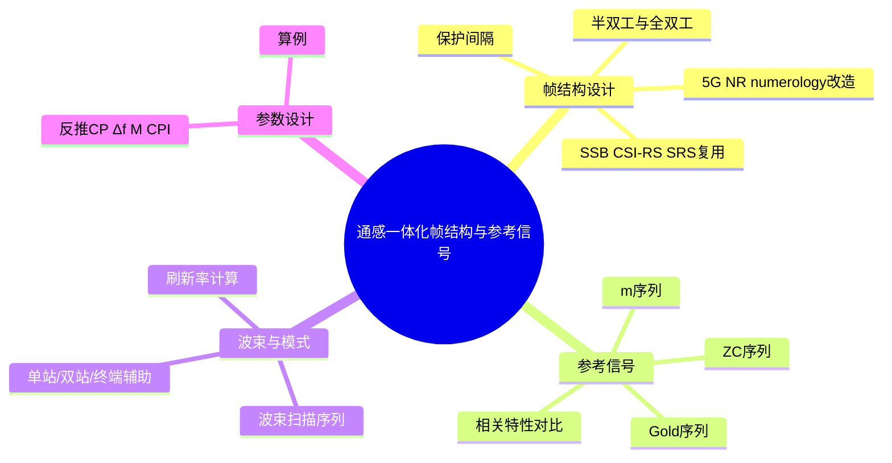
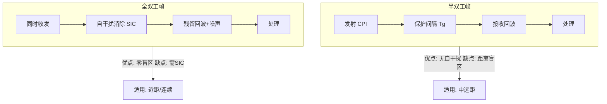

# 第 7 章　通感一体化帧结构与参考信号设计

> **本章导读**：第 6 章解决了"发射什么波形"，本章解决"波形如何组织成帧、何时发何时收、用哪些参考信号承载感知"。对 ISAC 而言，帧结构（frame structure）同时决定通信的时延预算与感知的相参处理间隔（CPI），二者存在折中；参考信号（Reference Signal, RS）则是感知的"标尺"——其自相关/互相关特性直接决定测距精度与多站干扰。本章先讲 5G NR 空口的改造原则，再系统推导 ZC、m、Gold 三类感知序列的相关特性并给出对比，随后讨论半/全双工帧、波束扫描刷新率与上下行感知模式，最后以一个完整的反推式参数设计算例收尾。

**学习目标**

- 能够**解释** 5G NR 参数集（numerology）对 ISAC 的影响，并设计将 SSB/CSI-RS/SRS 复用于感知的帧结构。
- 能够**推导** ZC、m 序列、Gold 序列的自相关与互相关公式，并据此选型。
- 能够**对比**半双工与全双工 ISAC 帧结构的保护间隔与自干扰差异。
- 能够**计算**波束扫描序列的刷新率，并**完整设计**给定指标下的 ISAC 帧参数（CP、子载波间隔、符号数、CPI、帧长、扫描周期）。

**本章知识图谱**



---

## 7.1　双功能帧结构设计原则

**直观引入**：通信帧追求"随时可传、低时延、灵活调度"；雷达帧追求"相参积累时间足够长、收发严格隔离、波束覆盖完整"。把两者塞进同一帧，必然冲突：CPI 越长感知越精细，但占用的通信资源越多、刷新越慢；收发同时（全双工）能消除距离盲区，但引入自干扰。设计原则就是在这几对矛盾间取折中。

**数学建模**：设一帧时长 $T_f$，其中感知相参积累占 $T_{\rm CPI}=M T_o$（$M$ 个符号、$T_o$ 符号周期），通信/控制开销占 $T_{\rm oh}$，保护间隔占 $T_g$。基本约束：

$$T_f \ge T_{\rm CPI}+T_{\rm oh}+T_g \tag{7-1}$$

感知维度需满足：① $T_{\rm CPI}$ 足够长以达速度分辨率 $\Delta v=\lambda/(2T_{\rm CPI})$；② 每帧 CP 覆盖最大往返时延 $2R_{\max}/c_0$；③ 波束覆盖 $N_b$ 个方向时，扫描周期 $T_{\rm scan}=N_bT_{\rm CPI}$ 满足刷新率需求。通信维度需满足：时隙及时可达、控制开销不过大。下面逐节落实。

---

## 7.2　基于 5G NR 的 ISAC 帧结构改造

**直观引入**：5G NR 已是成熟空口，ISAC 若直接在 NR 上"贴"感知，标准化成本最低。关键思路是：把原本用于信道估计/波束管理的参考信号，同时当作感知的"探测波"，把原本空着的符号/时隙当作感知 CPI。

**数学建模**：NR 用参数集 $\mu$ 定义子载波间隔 $\Delta f=15\cdot2^\mu\ \text{kHz}$。一个 10 ms 无线帧含 10 个子帧，每子帧含 $2^\mu$ 个时隙，每时隙 14 个 OFDM 符号。

**表 7-1　5G NR 参数集（numerology）与 ISAC 含义**

| $\mu$ | 子载波间隔 (kHz) | 每子帧时隙数 | 每帧符号数 | 有效符号 $T_u=1/\Delta f$ | 典型用途 | ISAC 含义 |
|---|---|---|---|---|---|---|
| 0 | 15 | 1 | 140 | 66.7 µs | 宏覆盖 | 大 $T_u$，CP 长，Rmax 大但分辨率低 |
| 1 | 30 | 2 | 280 | 33.3 µs | 室外 | 均衡 |
| 2 | 60 | 4 | 560 | 16.7 µs | 室内/车规 | 中等 |
| 3 | 120 | 8 | 1120 | 8.33 µs | 毫米波 | 高分辨率，Rmax 受限 |
| 4 | 240 | 16 | 2240 | 4.17 µs | 毫米波增强 | 高分辨率 |
| 5 | 480 | 32 | 4480 | 2.08 µs | 极高频 | 最高分辨率，Rmax 最小 |

**复用设计**：
- **SSB（SS/PBCH Block）**：周期性的波束扫描同步块，本用于初始接入波束管理，可直接作为宽覆盖感知" illuminating" 信号；其波束扫描序列天然提供角度扫描（见 7.5 节）。
- **CSI-RS（Channel State Information RS）**：基站发送、终端测量上报，NR 中已有非周期/半持续/周期三种触发。将其配置为周期性、宽覆盖，即可作为感知参考信号，复用其 ZC 或 Gold 序列（见 7.3 节）。
- **SRS（Sounding RS）**：终端发射、基站接收，天然是"上行感知"的探测波（终端辅助感知见 7.6 节），其宽带梳状结构利于测距。
- **DMRS（Demodulation RS）**：随数据发送，也可用于数据符号的感知处理（第 6 章信道除法需已知符号，DMRS 提供相位参考）。

**例 7-1（numerology 数值）**：取 $\mu=3$（120 kHz，毫米波）。则 $\Delta f=120$ kHz，$T_u=1/120\text{k}=8.33\ \mu\text{s}$，每子帧 8 时隙、每帧 $14\times8\times10=1120$ 符号。若取符号周期（含正常 CP）$T_o\approx8.92\ \mu\text{s}$，则一帧 10 ms 恰容纳约 1121 符号。该配置下最大不模糊距离 $R_{\max}^{\rm amb}=c_0/(2\Delta f)=3\times10^8/(2.4\times10^5)=1250\ \text{m}$，距离分辨率 $\Delta R=c_0/(2B)$，若占用 $B=100$ MHz 则 $\Delta R=1.5$ m。说明毫米波 NR 天然具备中距感知能力。

---

## 7.3　感知参考信号设计：ZC / m / Gold 序列

**直观引入**：感知要"测距准、多站不互相干扰"，全靠参考信号的相关峰。理想序列应自相关像尖钉（无距离旁瓣）、互相关尽量低（多站互不干扰）、幅度恒定（功放高效）。下面推导三类主流序列。

### 7.3.1　ZC 序列（Zadoff–Chu）

**数学建模**：长度为素数 $N_{\rm ZC}$ 的 ZC 序列，根指数 $q$ 与 $N_{\rm ZC}$ 互素：

$$x_q[n]=\exp\!\left(j\pi q\,\frac{n^2}{N_{\rm ZC}}\right),\qquad n=0,\dots,N_{\rm ZC}-1 \tag{7-2}$$

**自相关推导**（周期/循环相关）：

$$R_{x,x}[k]=\sum_{n=0}^{N_{\rm ZC}-1}x_q[n]\,x_q^*[(n+k)\bmod N_{\rm ZC}] \tag{7-3}$$

代入 (7-2)：

$$R_{x,x}[k]=\sum_{n=0}^{N_{\rm ZC}-1}\exp\!\left(j\pi q\frac{n^2-(n+k)^2}{N_{\rm ZC}}\right)=e^{-j\pi qk^2/N_{\rm ZC}}\sum_{n=0}^{N_{\rm ZC}-1}e^{-j2\pi qnk/N_{\rm ZC}} \tag{7-4}$$

当 $k\not\equiv0\pmod{N_{\rm ZC}}$ 且 $\gcd(q,N_{\rm ZC})=1$ 时，$e^{-j2\pi qk/N_{\rm ZC}}\neq1$，几何级数和为零，故

$$R_{x,x}[k]=\begin{cases}N_{\rm ZC},&k\equiv0\\0,&k\not\equiv0\end{cases} \tag{7-5}$$

即 ZC 具有**理想周期自相关**（零旁瓣）。**互相关**：两根不同根 $q_1\neq q_2$ 的互相关幅度有界

$$|R_{x_{q_1},x_{q_2}}[k]|\le\sqrt{N_{\rm ZC}} \tag{7-6}$$

且 ZC 幅度恒定 $|x_q[n]|=1$，故 PAPR=1（恒定包络），非常适合功放。

### 7.3.2　m 序列（最大长度序列 / PN 序列）

**数学建模**：由 $r$ 级线性反馈移位寄存器（LFSR）本原多项式生成，周期 $N=2^r-1$，元素取 $\{+1,-1\}$。

$$a[n]=\bigoplus_{i\in\mathcal T} a[n-i]\quad(\text{模 2，再映射 }0\mapsto+1,\,1\mapsto-1) \tag{7-7}$$

其中 $\mathcal T$ 为反馈抽头集。**自相关**（周期）：

$$R_m[k]=\sum_{n=0}^{N-1}a[n]\,a[(n+k)\bmod N]=\begin{cases}N,&k\equiv0\\ -1,&k\not\equiv0\end{cases} \tag{7-8}$$

推导要点：m 序列一个周期含 $2^{r-1}$ 个 $+1$、$2^{r-1}-1$ 个 $-1$；任意非零循环移位与原序列比较，恰有 $2^{r-1}-1$ 位相同、$2^{r-1}$ 位相反（或反之），故乘积和 $= (2^{r-1}-1)-(2^{r-1})=-1$。**互相关**：不同本原多项式生成的 m 序列互相关无统一小界，可能较大，数量也少（仅约 $N/r$ 条），不利多站。

### 7.3.3　Gold 序列

**数学建模**：取一对"优选"m 序列 $a[n],b[n]$（同周期 $N=2^r-1$），Gold 序列族为

$$g_\tau[n]=a[n]\oplus b[(n+\tau)\bmod N],\qquad \tau=0,\dots,N-1 \tag{7-9}$$

再并入 $a,b$ 本身，共 $N+2$（即 $2^r+1$）条序列，构成大族。**自相关**（周期，三值）：

$$R_g[k]=\begin{cases}N,&k\equiv0\\-1,&-1\pm2^{\lceil r/2\rceil},\quad k\not\equiv0\end{cases} \tag{7-10}$$

**互相关**有界：族内任意两条互相关最大值满足 Gold 界

$$|R_{g_i,g_j}[k]|\le 2^{\lceil r/2\rceil}+1 \tag{7-11}$$

便于多基站/多用户同时感知而互不干扰。

**表 7-2　感知参考信号序列特性对比**

| 序列 | 周期 | 自相关 | 互相关 | 恒包络 | 族规模 | 典型用途 |
|---|---|---|---|---|---|---|
| ZC | 素数 $N$ | 理想（零旁瓣） | $\le\sqrt N$ | 是（PAPR=1） | $N-1$ 根 | NR CSI-RS/SRS、感知 RS |
| m 序列 | $2^r-1$ | 二值（$-1$） | 较大、无统一小界 | 否（±1） | $\approx N/r$ | 测距同步、雷达 |
| Gold | $2^r-1$ | 三值 | 有界 $\le2^{\lceil r/2\rceil}+1$ | 否（±1） | $N+2$ | 多站/多用户感知 |

**例 7-2（ZC 自相关数值）**：取 $N_{\rm ZC}=5$（素数），$q=1$。$x[n]=e^{j\pi n^2/5}$：$n^2\bmod5=[0,1,4,4,1]$，得 $x=[1,\,e^{j36^\circ},\,e^{j144^\circ},\,e^{j144^\circ},\,e^{j36^\circ}]$。计算 $k=1$ 周期自相关（按 (7-4) 合并相位 $e^{-j\pi(2n+1)/5}$）：
- $n=0$: $e^{-j36^\circ}$，$n=1$: $e^{-j108^\circ}$，$n=2$: $e^{-j180^\circ}=-1$，$n=3$: $e^{-j252^\circ}=e^{j108^\circ}$，$n=4$: $e^{-j324^\circ}=e^{j36^\circ}$。
- 实部：$0.8090-0.3090-1-0.3090+0.8090=0$，虚部抵消为 0 → $R[1]=0$。同理可证 $R[2]=R[3]=R[4]=0$，$R[0]=5$。验证 ZC 理想自相关。

**例 7-3（m 序列自相关数值）**：取 $r=3$，$N=7$，本原多项式 $1+x+x^3$，一周期序列 $a=[+1,+1,+1,-1,+1,-1,-1]$（其中 $+1$ 表 0、$-1$ 表 1）。计算 $k=1$ 循环移位相关：
- 原序列：1 1 1 -1 1 -1 -1
- 移 1 位： -1 1 1 1 -1 1 -1
- 逐位乘： -1 1 1 -1 -1 -1 1，求和 $=-1-1$? 计算：-1+1+1+(-1)+(-1)+(-1)+1 = -1。
故 $R_m[1]=-1$；同理所有 $k\not\equiv0$ 得 $-1$，$R_m[0]=7$。验证 (7-8)。

---

## 7.4　全双工与半双工帧结构

**直观引入**：半双工（half-duplex）分时收发，结构简单、无自干扰，但存在"距离盲区"（近处回波未发完已到达）且占空比低；全双工（full-duplex）同时收发，零盲区、连续探测，但需强力自干扰消除（Self-Interference Cancellation, SIC，详见第 9 章）。

**数学建模**：设收发切换保护间隔 $T_g$。半双工帧中，发射时隙 $T_{\rm tx}$ 与接收时隙 $T_{\rm rx}$ 间插入 $T_g$ 防泄漏：

$$T_f^{\rm HD}=T_{\rm tx}+T_g+T_{\rm rx} \tag{7-12}$$

全双工无需分时，但接收机须从强自干扰中恢复弱回波，需满足残留自干扰功率低于噪声基底。其距离盲区由 SIC 残余决定，理论上趋近于零。

**图 7-1　半双工 vs 全双工 ISAC 帧时序**



> ⚠️ **注意**：半双工的最大无模糊近距由 $T_g$ 决定——盲区半径 $R_{\rm blind}=c_0T_g/2$。若 $T_g=1\ \mu\text{s}$，盲区达 150 m，对近处无人机监测不可接受，此时应优先全双工。

---

## 7.5　多波束扫描与感知时隙

**直观引入**：基站波束窄（尤其毫米波），一次只能"照亮"一个方向。要感知整个扇区，必须按波束码本依次扫描，形成波束扫描序列。扫描多快（刷新率）直接决定能否跟踪高速目标。

**数学建模**：设码本含 $N_b$ 个波束，每个波束驻留一个 CPI（$T_{\rm CPI}=M T_o$），则扫描周期与刷新率：

$$T_{\rm scan}=N_b\,T_{\rm CPI}=N_b M T_o,\qquad f_{\rm refresh}=\frac{1}{T_{\rm scan}} \tag{7-13}$$

对每个波束，感知 RS（如 CSI-RS 或 ZC）在该波束方向发射并接收，形成该角度的距离–多普勒图。

**算法步骤**（波束扫描序列生成）：

1. **输入**：码本 $\mathcal W=\{\mathbf w_1,\dots,\mathbf w_{N_b}\}$、每波束 CPI 符号数 $M$、符号周期 $T_o$。
2. 对每个波束 $i=1..N_b$：配置 RS 在该波束发射 $M$ 符号，记录回波。
3. 拼接各波束 RDM，得到角度–距离–速度三维立方体。
4. 计算 $T_{\rm scan}=N_b M T_o$、$f_{\rm refresh}=1/T_{\rm scan}$。
5. **输出**：扫描序列时序与刷新率。

**算法 7-1：波束扫描序列与刷新率计算**

```text
算法 7-1：ISAC 波束扫描序列生成
输入： 码本 W[Nb], CPI符号数 M, 符号周期 To, 角度列表 theta[Nb]
输出： 扫描时序 sched, 刷新率 f_refresh
sched = []
for i in 1..Nb:
    beam_i = W[i]                       # 取第 i 个波束赋形向量
    sched.append( (theta[i], beam_i, 驻留=M*To) )   # 该波束发 M 符号
    # 实际发射: 在该 M 符号内发送感知 RS，并接收回波做 2D-FFT(见第6章)
T_scan = Nb * M * To                    # 扫完一轮总时长
f_refresh = 1.0 / T_scan                # 刷新率(Hz)
return sched, f_refresh
```

**图 7-2　波束扫描序列流程**


**例 7-4（刷新率数值）**：码本 $N_b=8$ 个波束，每波束 CPI $M=1024$ 符号、符号周期 $T_o=6.67\ \mu\text{s}$（见 7.7 节）。则 $T_{\rm scan}=8\times1024\times6.67\times10^{-6}=54.6\ \text{ms}$，刷新率 $f_{\rm refresh}=1/0.0546=18.3\ \text{Hz}$。若目标以 $v=100\ \text{m/s}$ 运动，单帧内位移约 $100\times0.0546=5.5\ \text{m}$，在 1 m 距离分辨率下仍可连续跟踪。

---

## 7.6　上下行感知模式

**直观引入**：谁来发、谁来收，决定几何与隐私。ISAC 有三类基本模式。

**（一）单站自发自收（monostatic，基站为中心）**：基站同时发射并接收自身回波。几何简单、自干扰可控（半/全双工），是最主流模式，但存在基站侧盲区与单站几何误差。

**（二）双站（bistatic，基站 A 发、基站 B 收）**：发射站与接收站分离，利用到达时差/角差定位，扩展覆盖、消除单站盲区，但需站间同步（见第 17 章）。波形须两站已知（如共享 Gold/ZC 序列）。

**（三）终端辅助（UE-assisted）**：利用终端上行 SRS 作为探测波，基站接收；或终端本地感知后上报特征。节省基站资源、保护隐私（原始感知数据不出终端），适合室内/可穿戴。

---

## 7.7　帧结构参数设计算例（完整反推）

**问题**：设计毫米波 ISAC 帧，给定最大探测距离 $R_{\max}=300\ \text{m}$、最大速度 $v_{\max}=100\ \text{m/s}$、距离分辨率 $\Delta R=1\ \text{m}$、载频 $f_c=28\ \text{GHz}$。反推 CP 长度、子载波间隔、符号数、CPI、帧长、扫描周期。

**逐步计算**：

**第 1 步　波长与带宽**。$\lambda=c_0/f_c=3\times10^8/(28\times10^9)=1.071\times10^{-2}\ \text{m}=1.071\ \text{cm}$。由距离分辨率反推所需带宽：

$$B=\frac{c_0}{2\Delta R}=\frac{3\times10^8}{2\times1}=1.5\times10^8=150\ \text{MHz} \tag{7-14}$$

**第 2 步　子载波间隔 $\Delta f$**。最大不模糊距离约束 $R_{\max}^{\rm amb}=c_0/(2\Delta f)\ge R_{\max}$：

$$\Delta f\le\frac{c_0}{2R_{\max}}=\frac{3\times10^8}{600}=5\times10^5=500\ \text{kHz} \tag{7-15}$$

取 NR 参数集 $\mu=4$（$\Delta f=240\ \text{kHz}$，见表 7-1），则子载波数

$$N=\frac{B}{\Delta f}=\frac{150\times10^6}{240\times10^3}=625 \tag{7-16}$$

校验：实际带宽 $B=N\Delta f=625\times240\text{k}=150\ \text{MHz}$，距离分辨率 $\Delta R=c_0/(2B)=1.0\ \text{m}$ ✓；最大不模糊距离 $R_{\max}^{\rm amb}=c_0/(2\Delta f)=3\times10^8/(4.8\times10^5)=625\ \text{m}\ge300\ \text{m}$ ✓。

**第 3 步　CP 长度**。最大往返时延 $\tau_{\max}=2R_{\max}/c_0=2\times300/3\times10^8=2.0\ \mu\text{s}$。CP 须 $\ge\tau_{\max}$ 且 $<T_u=1/\Delta f=4.167\ \mu\text{s}$。取 $T_{\rm cp}=2.5\ \mu\text{s}$（留 25% 余量）。采样周期 $T_s=1/(N\Delta f)=1/150\times10^6=6.667\ \text{ns}$。则
- CP 样点数 $=2.5\ \mu\text{s}/6.667\ \text{ns}=375$；
- 有效符号样点数 $=N=625$；
- 每符号总样点 $=375+625=1000$；
- 符号周期 $T_o=1000\times6.667\ \text{ns}=6.667\ \mu\text{s}$。

**第 4 步　最大不模糊速度校验**。$v_{\max}^{\rm amb}=\lambda/(4T_o)=0.01071/(4\times6.667\times10^{-6})=0.01071/2.667\times10^{-5}=401.8\ \text{m/s}\ge100\ \text{m/s}$ ✓，余量充足。

**第 5 步　符号数 $M$ 与 CPI**。选定速度分辨率目标 $\Delta v\approx0.8\ \text{m/s}$（满足车载跟踪），由 $\Delta v=\lambda/(2MT_o)$：

$$M=\frac{\lambda}{2\Delta v\,T_o}=\frac{0.01071}{2\times0.8\times6.667\times10^{-6}}=1002\approx1024\ (\text{取 2 的幂便于 FFT}) \tag{7-17}$$

取 $M=1024$，则实际 $\Delta v=0.01071/(2\times1024\times6.667\times10^{-6})=0.01071/0.01365=0.785\ \text{m/s}$。相参处理间隔

$$T_{\rm CPI}=M T_o=1024\times6.667\ \mu\text{s}=6.827\ \text{ms} \tag{7-18}$$

**第 6 步　帧长**。定义一帧 = 一个 CPI 突发 + 控制/保护开销。取 16 符号开销：

$$T_f=(M+16)T_o=1040\times6.667\ \mu\text{s}=6.933\ \text{ms}\approx6.93\ \text{ms} \tag{7-19}$$

（若不计入开销，纯感知帧长即 $T_{\rm CPI}=6.83\ \text{ms}$。）

**第 7 步　扫描周期**。采用 8 波束码本（见 7.5 节），扫描周期

$$T_{\rm scan}=N_b T_{\rm CPI}=8\times6.827\ \text{ms}=54.6\ \text{ms},\quad f_{\rm refresh}=1/T_{\rm scan}=18.3\ \text{Hz} \tag{7-20}$$

**汇总表 7-3**：

**表 7-3　ISAC 帧参数设计结果汇总**

| 参数 | 符号 | 取值 | 依据 |
|---|---|---|---|
| 载波频率 | $f_c$ | 28 GHz | 给定 |
| 波长 | $\lambda$ | 1.071 cm | $c_0/f_c$ |
| 带宽 | $B$ | 150 MHz | $c_0/(2\Delta R)$ |
| 子载波间隔 | $\Delta f$ | 240 kHz ($\mu=4$) | $\le c_0/(2R_{\max})$ |
| 子载波数 | $N$ | 625 | $B/\Delta f$ |
| CP 长度 | $T_{\rm cp}$ | 2.5 µs（375 样点） | $\ge2R_{\max}/c_0$ |
| 符号周期 | $T_o$ | 6.667 µs | $(N+375)T_s$ |
| 符号数/CPI | $M$ | 1024 | 速度分辨率目标 |
| CPI | $T_{\rm CPI}$ | 6.83 ms | $M T_o$ |
| 帧长 | $T_f$ | 6.93 ms | $(M+16)T_o$ |
| 距离分辨率 | $\Delta R$ | 1.0 m | 给定/校验 |
| 速度分辨率 | $\Delta v$ | 0.785 m/s | $\lambda/(2MT_o)$ |
| 最大不模糊距离 | $R_{\max}^{\rm amb}$ | 625 m | $c_0/(2\Delta f)$ |
| 最大不模糊速度 | $v_{\max}^{\rm amb}$ | 401.8 m/s | $\lambda/(4T_o)$ |
| 波束数 | $N_b$ | 8 | 设计选择 |
| 扫描周期 | $T_{\rm scan}$ | 54.6 ms | $N_b T_{\rm CPI}$ |
| 刷新率 | $f_{\rm refresh}$ | 18.3 Hz | $1/T_{\rm scan}$ |

> **结论**：该设计在 150 MHz 带宽下同时满足 1 m 距离分辨率、300 m 探测距离与 100 m/s 速度需求，且最大不模糊速度/距离均留有余量；8 波束扫描可维持约 18 Hz 刷新率，适合车联网与低空监管。

---

## 本章小结

本章给出 ISAC 帧结构与参考信号的完整设计方法。首先基于 5G NR 参数集（$\mu$ 与子载波间隔）说明了如何把 SSB/CSI-RS/SRS/DMRS 复用于感知；随后严格推导了 ZC（理想自相关、互相关 $\le\sqrt N$、恒包络）、m 序列（二值自相关 $-1$）、Gold 序列（三值自相关、互相关有界）的相关特性并列表对比；对比了半双工（有距离盲区、无自干扰）与全双工（零盲区、需 SIC）帧，给出保护间隔设计；建立了波束扫描序列与刷新率公式 $f_{\rm refresh}=1/(N_b M T_o)$；最后以一个"反推式"完整算例，从 $R_{\max}=300$ m、$v_{\max}=100$ m/s、$\Delta R=1$ m、$f_c=28$ GHz 逐步求出 CP、子载波间隔、符号数、CPI、帧长与扫描周期，验证了设计闭环。

## 习题

### A. 基础概念题

**A1**. 5G NR 中 $\mu$ 与子载波间隔的关系是什么？举两个对 ISAC 友好的 $\mu$ 值。
**A2**. CSI-RS 与 SRS 在 ISAC 中分别充当什么角色？
**A3**. ZC 序列为何具有恒包络（PAPR=1）？其自相关有何理想性质？
**A4**. 半双工 ISAC 的"距离盲区"由什么决定？写出盲区半径公式。
**A5**. 双站与单站 ISAC 的主要区别与代价是什么？
**A6**. 波束扫描刷新率与哪些参数成正比/反比？

### B. 推导与计算题

**B1**. 由 (7-4) 完整推导 ZC 序列周期自相关在 $k\not\equiv0$ 时为零，并说明为何要求 $\gcd(q,N_{\rm ZC})=1$。
**B2**. 设 $r=4$，$N=15$ 的 Gold 序列，写出其自相关三值与互相关上界（数值）。
**B3**. 给定 $R_{\max}=200$ m、$v_{\max}=80$ m/s、$\Delta R=0.5$ m、$f_c=24$ GHz。反推 $\Delta f$、$N$、$T_{\rm cp}$、$M$（取目标 $\Delta v=0.5$ m/s）、$T_{\rm CPI}$。
**B4**. 半双工帧保护间隔 $T_g=0.5\ \mu\text{s}$，求距离盲区半径；若要求盲区 $<30$ m，$T_g$ 上限多少？
**B5**. 例 7-4 中若波束数改为 16、CPI 不变，$T_{\rm scan}$ 与刷新率变为多少？
**B6**. 证明全双工 ISAC 的最大不模糊近距主要由 SIC 残余决定，而半双工由 $T_g$ 决定。

### C. 算法与编程题

**C1**. 编写 Python 函数 `gen_zc(N, q)` 生成 ZC 序列并验证其周期自相关（输出 $R[0]$ 与 off-peak 最大值）。
**C2**. 编写函数 `design_frame(Rmax, vmax, dR, fc, Nb, dV_target)` 按 7.7 节步骤反推帧参数并返回汇总字典，用本章算例验证。

## 答案与解析

**A1**. $\Delta f=15\cdot2^\mu$ kHz。对 ISAC 友好：$\mu=3$（120 kHz，中距）与 $\mu=4$（240 kHz，高分辨率毫米波）。
**A2**. CSI-RS 由基站发、作下行感知探测波；SRS 由终端发、作上行/终端辅助感知探测波。
**A3**. ZC 定义为 $x_q[n]=e^{j\pi q n^2/N}$，模恒为 1，故 PAPR=1；其周期自相关在非零点严格为零（理想）。
**A4**. 半双工盲区由收发切换保护间隔决定：$R_{\rm blind}=c_0T_g/2$。
**A5**. 双站由 A 发 B 收，扩展覆盖、消单站盲区，但需站间同步且波形两站共享；单站几何简单、无同步需求但有盲区。
**A6**. 刷新率 $f_{\rm refresh}=1/(N_b M T_o)$，与波束数 $N_b$、CPI 符号数 $M$、符号周期 $T_o$ 均成反比。

---

**B1**. 由 (7-4)：$R[k]=e^{-j\pi qk^2/N}\sum_{n=0}^{N-1}e^{-j2\pi qnk/N}$。当 $k\not\equiv0$ 且 $\gcd(q,N)=1$ 时，$qk$ 与 $N$ 互素，故 $e^{-j2\pi qk/N}$ 是 $N$ 次单位根且 $\neq1$。几何级数 $\sum_{n=0}^{N-1}r^n=(1-r^N)/(1-r)$，而 $r^N=e^{-j2\pi qk}=1$，分子为 0、分母非 0，和为 0，故 $R[k]=0$。若 $\gcd(q,N)\neq1$，则 $qk$ 可能与 $N$ 有公因子，使 $r$ 的阶 $<N$，级数和非零，自相关出现旁瓣，故要求互素。

**B2**. $r=4$，$N=15$。Gold 自相关三值：$R[0]=15$，off-peak $\in\{-1,\,-1\pm2^{\lceil4/2\rceil}\}=\{-1,\,-1\pm4\}=\{-1,-5,3\}$。互相关上界 $=2^{\lceil r/2\rceil}+1=2^2+1=5$。

**B3**. $\lambda=3\times10^8/(24\times10^9)=0.0125$ m。$B=c_0/(2\Delta R)=3\times10^8/(2\times0.5)=3\times10^8=300$ MHz。$\Delta f\le c_0/(2R_{\max})=3\times10^8/400=750$ kHz，取 $\Delta f=480$ kHz（$\mu=5$）：$N=B/\Delta f=300\text{M}/480\text{k}=625$。$T_u=1/480\text{k}=2.083\ \mu\text{s}$，$\tau_{\max}=2\times200/3\times10^8=1.333\ \mu\text{s}$，取 $T_{\rm cp}=1.6\ \mu\text{s}$（$<T_u$ 且留余量）。$T_s=1/(N\Delta f)=1/300\text{M}=3.333$ ns，$T_o=(625+ T_{\rm cp}/T_s)\times T_s$；CP样点=1.6µs/3.333ns=480，故 $T_o=(625+480)\times3.333\text{ns}=1105\times3.333\text{ns}=3.683\ \mu\text{s}$。$M=\lambda/(2\Delta v T_o)=0.0125/(2\times0.5\times3.683\times10^{-6})=0.0125/3.683\times10^{-6}=3394\approx3408$（取 2 的幂附近 4096? 按题取目标 0.5：$M=3394$，取整 3400）。取 $M=3400$：$T_{\rm CPI}=3400\times3.683\ \mu\text{s}=12.52\ \text{ms}$。校验 $v_{\max}^{\rm amb}=\lambda/(4T_o)=0.0125/(4\times3.683\times10^{-6})=848.5\ \text{m/s}\ge80$ ✓。

**B4**. $R_{\rm blind}=c_0T_g/2=3\times10^8\times0.5\times10^{-6}/2=75\ \text{m}$。要求 $<30$ m：$T_g<2\times30/3\times10^8=0.2\ \mu\text{s}$，即 $T_g^{\max}=0.2\ \mu\text{s}$。

**B5**. $N_b=16$，$T_{\rm scan}=16\times6.827\ \text{ms}=109.2\ \text{ms}$，刷新率 $=1/0.1092=9.16\ \text{Hz}$（较 8 波束降一半）。

**B6**. 半双工发射期间无法接收，近处回波在 $T_g$ 内到达会被发射泄漏淹没，故盲区 $R_{\rm blind}=c_0T_g/2$ 由 $T_g$ 决定。全双工同时收发，无分时盲区；但近端强自干扰若不彻底消除会掩盖近距弱回波，故实际盲区由 SIC 残余自干扰电平决定（残余越低，盲区越小，理想趋零）。

---

**C1**. 参考实现：

```python
import numpy as np
def gen_zc(N, q):
    n = np.arange(N)
    x = np.exp(1j*np.pi*q*n*n/N)          # (7-2)
    R = np.array([np.sum(x*np.roll(x.conj(), k)) for k in range(N)])
    return x, R
x, R = gen_zc(5, 1)
print(abs(R))   # 应为 [5, 0, 0, 0, 0]，验证理想自相关
```

**C2**. 参考实现（按 7.7 节）：

```python
import numpy as np
def design_frame(Rmax, vmax, dR, fc, Nb=8, dV_target=0.8):
    c0 = 3e8; lam = c0/fc
    B = c0/(2*dR)
    df = c0/(2*Rmax)            # 上限，向下取整到 NR 值
    df = min(df, 240e3)         # 取 mu=4
    N = int(round(B/df))
    Tu = 1/df
    t_cp = 2*Rmax/c0 * 1.25     # 留25%余量
    Ts = 1/(N*df)
    M = int(np.ceil(lam/(2*dV_target*(Tu+t_cp))))  # 取2的幂
    M = 1<<int(np.ceil(np.log2(M)))
    To = (N + t_cp/Ts)*Ts
    T_cpi = M*To
    T_scan = Nb*T_cpi
    return dict(fc=fc, lam=lam, B=B, df=df, N=N, t_cp=t_cp, To=To, M=M,
                T_cpi=T_cpi, dR=c0/(2*B), dV=lam/(2*M*To),
                Rmax_amb=c0/(2*df), vmax_amb=lam/(4*To),
                T_scan=T_scan, f_refresh=1/T_scan)
r = design_frame(300,100,1.0,28e9,Nb=8,dV_target=0.8)
# 应与表7-3一致: df=240k, N=625, To≈6.67µs, M=1024, T_cpi≈6.83ms, f_refresh≈18.3Hz
```
