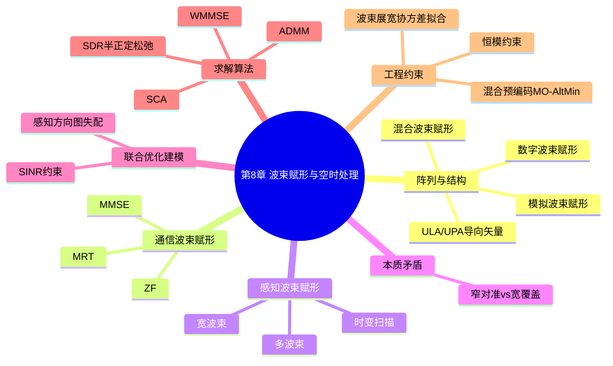
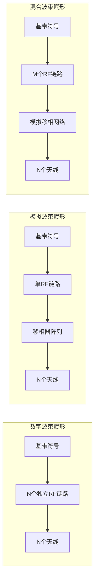
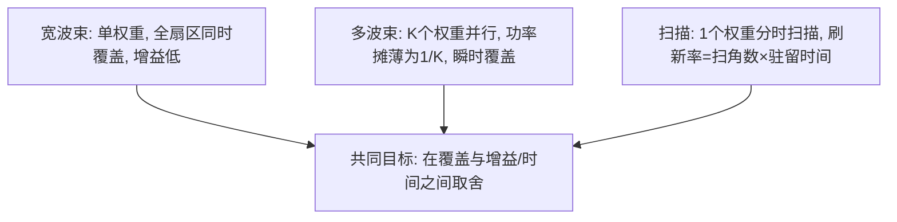
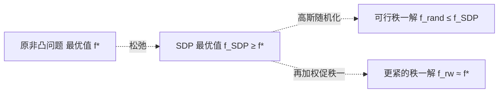

# 第8章 通感一体化波束赋形与空时处理

> **本章导读**
> 第 5 章给出了通感一体化（Integrated Sensing and Communication, ISAC）的统一性能界，指出通信与感知在资源上存在本质权衡。本章进入"空口如何实现这种权衡"的层面：波束赋形（beamforming）是同时控制通信信号能量投向与感知探测波束形状的核心手段。与纯通信系统中"把波束对准用户即可"的简单目标不同，ISAC 要求同一组天线在同一时刻既服务通信用户、又探测未知方位的目标，二者对波束形状的诉求常常矛盾。这种矛盾不是工程细节，而是 ISAC 区别于传统通信/雷达的根本特征——它意味着"一根天线发出来的波"无法被事先指定只服务于一个目的，而必须在空域上被精心雕琢，使同一束能量既照亮通信用户、又扫过感知扇区。本章从阵列模型出发，先厘清通信波束赋形与感知波束赋形的本质分歧，再建立联合优化问题，并系统给出半正定松弛（SDR）、加权最小均方误差（WMMSE）、交替方向乘子法（ADMM）、逐次凸逼近（SCA）等求解框架，最后讨论恒模约束、混合预编码与宽波束设计。本章是后续第 9、10 章的空时处理基础，也是第 18 章资源调度在"空域"维度的具体落地。

**学习目标**
- 掌握均匀线阵（ULA）与均匀面阵（UPA）的导向矢量（steering vector）建模，能写出远场相位表达式。
- 理解数字、模拟、混合三种波束赋形（hybrid beamforming）结构的差异与适用场景。
- 能说清通信波束赋形（窄波束对准）与感知波束赋形（宽波束扫描/多波束）之间的本质矛盾，并用表格对比。
- 能推导并求解"通信 SINR 约束下最大化感知 SNR"的联合波束赋形问题，掌握 SDR 的完整步骤（升维、松弛、高斯随机化）。
- 了解 WMMSE、ADMM、SCA、MO-AltMin、协方差拟合波束图综合（beam pattern synthesis）的思路与伪代码。

**本章知识图谱**



## 8.1 波束赋形基础：阵列模型与赋形结构

### 8.1.1 阵列模型与导向矢量（ULA/UPA）

**直观引入**：一根天线向全空间辐射，能量分散，既浪费功率又无法区分方向。把多根天线排成阵列，利用各阵元（antenna element）到同一远场（far-field）来波的路径差产生相位差，再用加权系数（权重）补偿或叠加这些相位，就能在期望方向相干增强、在其他方向相消——这就是波束赋形。要设计权重，先要会描述"某一方向的来波在每个阵元上长什么样"，这就是导向矢量。

**数学建模**：考虑一根有 $N$ 个阵元的均匀线阵（Uniform Linear Array, ULA），阵元间距为 $d$。取阵元 0 为相位参考点，远场来波方位角为 $\theta$（以阵列法线为零度），来波波长为 $\lambda$。第 $n$ 个阵元相对参考点的路径差为 $nd\sin\theta$，对应相位滞后 $2\pi nd\sin\theta/\lambda$。定义空间采样因子 $\psi(\theta)=2\pi\frac{d}{\lambda}\sin\theta$，则 ULA 导向矢量为

$$ \mathbf{a}(\theta)=\big[1,\; e^{j\psi(\theta)},\; e^{j2\psi(\theta)},\;\dots,\;e^{j(N-1)\psi(\theta)}\big]^{\mathrm T}. \tag{8-1} $$

当取半波长间距 $d=\lambda/2$ 时，$\psi(\theta)=\pi\sin\theta$，此时 $-\pi/2<\psi<\pi/2$ 与 $\theta\in[-90^\circ,90^\circ]$ 一一对应，无栅瓣（grating lobe）。

对均匀面阵（Uniform Planar Array, UPA），设水平方向 $N_x$ 个阵元、垂直方向 $N_z$ 个阵元，间距均为 $d$，来波方位角 $\theta$、俯仰角 $\phi$，则二维导向矢量可写成 Kronecker 积形式

$$ \mathbf{a}(\theta,\phi)=\mathbf{a}_z(\phi)\otimes\mathbf{a}_x(\theta),\qquad \mathbf{a}_x(\theta)=\big[1,e^{j\psi_x(\theta)},\dots,e^{j(N_x-1)\psi_x(\theta)}\big]^{\mathrm T}, \tag{8-2} $$

其中 $\psi_x(\theta)=2\pi\frac{d}{\lambda}\sin\theta\cos\phi$，$\psi_z(\phi)=2\pi\frac{d}{\lambda}\cos\phi$。UPA 的相位同时由两维角度决定，因此具备二维测角能力。

### 8.1.2 数字/模拟/混合波束赋形结构

**直观引入**：权重加在哪里，决定了结构。若在基带数字域对每根天线独立加权（每路一个 DAC/ADC），是数字波束赋形，最灵活但射频链路（RF chain）成本高；若用模拟移相器（phase shifter）在射频域做加权，是模拟波束赋形，链路省但只能形成单波束且权重受恒模限制；混合结构是二者折中，用少量 RF chain 加大量移相器。

**图 8-1　三种波束赋形结构对比**



**图 8-2　混合波束赋形（hybrid beamforming）的矩阵分解示意**

```mermaid
flowchart TB
    S[数据层] --> Wbb[数字预编码 W_bb ∈ C^{M×K}]
    Wbb --> RF[RF链路] --> Wrf[模拟预编码 W_rf ∈ C^{N×M}, 恒模]
    Wrf --> ANT[天线阵列 N]
    style Wrf fill:#fde,stroke:#c39
```

> **结论**：数字结构可实现任意 $N$ 维复权重，是本章优化算法的默认模型；模拟与混合结构受恒模/低秩约束，对应 8.6 节的 MO-AltMin 方法。

**选型直觉**：当中低频段、天线数适中（如 $N\le16$）且基站功耗预算充足时，数字波束赋形最灵活，可直接套用本章 SDR/WMMSE；当进入毫米波/太赫兹、天线数达数十甚至上百时，全数字链路的成本、功耗与芯片面积都不可承受，混合结构成为唯一现实选择，此时必须把"低秩+恒模"写进优化问题，也就引出了 8.6 的 MO-AltMin 与 8.5.3 的 ADMM。简言之：**自由度需求决定结构，结构决定算法**。

**表 8-1　三种结构对比**

| 结构 | 每天线加权自由度 | 典型 RF 链路数 | 波束数量 | 主要约束 | 适用频段 |
|---|---|---|---|---|---|
| 数字 | 全复数（幅+相） | $N$ | 多 | 成本/功耗高 | 中低频、毫米波小规模 |
| 模拟 | 仅相位（恒模） | 1 | 单 | 单波束、难多流 | 毫米波 |
| 混合 | 低秩复数+恒模 | $M\ll N$ | 中 | 低秩+恒模 | 毫米波/太赫兹 |

## 8.2 通信波束赋形：MRT/ZF/MMSE

### 8.2.1 三种经典准则

**数学建模**：基站以 $N$ 根天线服务 $K$ 个单天线用户，信道向量记为 $\mathbf{h}_k\in\mathbb{C}^{N}$（已含大尺度衰落）。设预编码（precoding）矩阵为 $\mathbf{W}=[\mathbf{w}_1,\dots,\mathbf{w}_K]\in\mathbb{C}^{N\times K}$，发给用户 $k$ 的符号 $s_k$ 满足 $\mathbb{E}[|s_k|^2]=1$。用户 $k$ 的接收信号为

$$ y_k=\mathbf{h}_k^{\mathrm H}\mathbf{w}_k s_k+\sum_{j\neq k}\mathbf{h}_k^{\mathrm H}\mathbf{w}_j s_j+n_k, \tag{8-3} $$

其中 $n_k\sim\mathcal{CN}(0,\sigma^2)$ 为噪声。其信干噪比为

$$ \gamma_k=\frac{|\mathbf{h}_k^{\mathrm H}\mathbf{w}_k|^2}{\sigma^2+\sum_{j\neq k}|\mathbf{h}_k^{\mathrm H}\mathbf{w}_j|^2}. \tag{8-4} $$

三种经典波束赋形准则：

1. **最大比传输（Maximum Ratio Transmission, MRT）**：$\mathbf{w}_k^{\rm MRT}=\sqrt{p_k}\,\mathbf{h}_k/\|\mathbf{h}_k\|$，最大化本用户期望信号功率，结构简单但忽略用户间干扰。
2. **迫零（Zero Forcing, ZF）**：要求 $\mathbf{h}_k^{\mathrm H}\mathbf{w}_j=0\;(j\neq k)$，即 $\mathbf{W}^{\rm ZF}=\mathbf{H}^{\mathrm H}(\mathbf{H}\mathbf{H}^{\mathrm H})^{-1}\mathbf{P}^{1/2}$，$\mathbf{H}=[\mathbf{h}_1,\dots,\mathbf{h}_K]^{\mathrm H}$。完全消除干扰，但对噪声/信道误差敏感。
3. **最小均方误差（MMSE）**：$\mathbf{W}^{\rm MMSE}=(\mathbf{H}^{\mathrm H}\mathbf{H}+\sigma^2\mathbf{P}^{-1})^{-1}\mathbf{H}^{\mathrm H}\mathbf{P}^{1/2}$，在信号、干扰、噪声间折中，是吞吐与稳健性的平衡点。

### 8.2.2 与感知波束赋形的本质矛盾

**直观引入**：通信的目标是"把能量精准送到已知用户"，于是希望波束越窄越好、旁瓣越低越好；感知的目标是"发现并跟踪未知方位的目标"，于是希望波束足够宽以覆盖整个监视扇区，或快速扫描、同时形成多波束。一个窄而尖，一个宽而全——这是 ISAC 波束赋形最根本的张力。下面用表格与图讲透。

**表 8-2　通信波束赋形 vs 感知波束赋形的本质矛盾**

| 维度 | 通信波束赋形 | 感知波束赋形 | 矛盾点 |
|---|---|---|---|
| 目标方位 | 已知（通过反馈/训练） | 未知（待探测） | 已知 vs 未知 |
| 主瓣宽度 | 越窄越好（高增益、低干扰） | 宽（覆盖扇区）或多波束同时照射 | 窄 vs 宽 |
| 旁瓣 | 越低越好（减小用户间干扰） | 需保留一定旁瓣以维持监视 | 抑制 vs 保留 |
| 时变性 | 慢变（用户位置缓变） | 快变（扫描/跟踪） | 静止 vs 运动 |
| 优化目标 | 最大化加权和速率 | 匹配期望方向图/最大化感知 SNR | 速率 vs 探测 |

**图 8-3　通信窄波束与感知宽波束/多波束的功率方向图对比（概念）**

```mermaid
xychart-beta
    title "功率方向图（dB）随方位角变化"
    x-axis [-60, -40, -20, 0, 20, 40, 60]
    y-axis "增益(dB)" -30 10
    line [0, 0, -3, 9, -3, 0, 0]
    line [-12, -10, -8, -6, -8, -10, -12]
```

> ⚠️ **注意**：上图第一行（窄波束）只在 $0^\circ$ 附近有高增益，感知时若目标不在该方向则完全漏探；第二行（宽波束）在整个扇区有较平响应，但增益低、对远处弱目标探测能力不足。这正是需要"联合设计"的原因。

**矛盾的能量量化（一杆秤）**：可用一个统一指标衡量"矛盾程度"——**覆盖-增益积**。设阵列总功率 $P$ 固定，窄波束在 $0^\circ$ 提供增益 $G_{\rm peak}$，但只覆盖角宽 $\Delta_{\rm n}$；宽波束覆盖 $\Delta_{\rm w}\gg\Delta_{\rm n}$，峰值增益降为 $G_{\rm w}\approx G_{\rm peak}\Delta_{\rm n}/\Delta_{\rm w}$。二者乘积 $G_{\rm peak}\Delta_{\rm n}\approx G_{\rm w}\Delta_{\rm w}$ 近似守恒——这正是"能量既不会被凭空创造、也不会被凭空消灭，只是在角度维上重新分配"。通信想要把这笔能量高度集中（乘积中 $\Delta$ 极小、$G$ 极大），感知想要把它摊平（乘积中 $\Delta$ 极大、$G$ 极小）。联合波束赋形要做的，就是在给定用户分布与监视扇区下，找到这笔能量的"最优分配方案"，使通信与感知的加权效用最大。这一视角把抽象的"矛盾"变成了可优化的"资源分配"问题。

**阵列流形与波束空间的几何直觉**：所有导向矢量 $\{\mathbf{a}(\theta),\theta\in[-90^\circ,90^\circ]\}$ 张成的集合称为阵列流形（array manifold）。不同方向的导向矢量越"正交"，阵列分辨这两个方向的能力越强。导向矢量内积 $\mathbf{a}^{\mathrm H}(\theta_1)\mathbf{a}(\theta_2)$ 的幅度越小，说明两方向在波束空间分离度越高。例 8-1 中我们已看到 $0^\circ$ 与 $30^\circ$ 对 4 阵元恰好正交。阵元数越多、孔径越大，流形曲线在参数空间上越"舒展"，相邻角度的导向矢量差异越大，角度分辨率越高——这正是阵列信号处理"孔径决定分辨率"的直观来源。值得提醒，上述公式均为远场（平面波）假设；当目标位于近场（距离小于瑞利距离 $2D^2/\lambda$，第 10 章详述）时，球面波导致相位不再仅是 $\sin\theta$ 的线性函数，导向矢量模型需修正，但本章优化框架仍可沿用，只需替换 $\mathbf{a}(\theta)$。

### 例 8-1：ULA 导向矢量数值化

设 $N=8$，$d=\lambda/2$，来波 $\theta=30^\circ$。则 $\sin30^\circ=0.5$，$\psi=\pi\sin\theta=\pi/2=90^\circ$。各阵元相位为 $n\cdot90^\circ\;(n=0,\dots,7)$：

$$ \mathbf{a}(30^\circ)=[1,\;e^{j\pi/2},\;e^{j\pi},\;e^{j3\pi/2},\;e^{j2\pi},\;e^{j5\pi/2},\;e^{j3\pi},\;e^{j7\pi/2}]^{\mathrm T}. $$

取实部/虚部为 $(1,0),(0,1),(-1,0),(0,-1),(1,0),(0,1),(-1,0),(0,-1)$。若改用 $d=\lambda$（即 $\psi=\pi\sin\theta=\pi/2$ 不变时），当 $\theta=90^\circ$ 时 $\psi=\pi$，阵元相位为 $0,\pi,0,\pi,\dots$，出现栅瓣——说明半波长间距对避免栅瓣的重要性。

### 例 8-2：MRT 与 ZF 的 SINR 数值比较

取 $N=2$ 天线、$K=2$ 用户，信道（实值简化）为 $\mathbf{h}_1=[1,\;0.5]^{\mathrm T}$，$\mathbf{h}_2=[0.5,\;1]^{\mathrm T}$，噪声 $\sigma^2=0.1$，每用户发射功率归一为 1。

**MRT**：$\mathbf{w}_1=\mathbf{h}_1/\|\mathbf{h}_1\|=[1,0.5]^{\mathrm T}/\sqrt{1.25}=[0.894,0.447]^{\mathrm T}$，同理 $\mathbf{w}_2=[0.447,0.894]^{\mathrm T}$。用户 1 期望功率 $|\mathbf{h}_1^{\mathrm H}\mathbf{w}_1|^2=\|\mathbf{h}_1\|^2=1.25$；受用户 2 干扰功率 $|\mathbf{h}_1^{\mathrm H}\mathbf{w}_2|^2=(1\cdot0.447+0.5\cdot0.894)^2=0.894^2=0.80$。于是

$$ \gamma_1^{\rm MRT}=\frac{1.25}{0.80+0.1}=\frac{1.25}{0.90}=1.389\;\text{(约 }1.43\ {\rm dB)}. $$

对称地 $\gamma_2^{\rm MRT}=1.389$。

**ZF**：$\mathbf{H}=\begin{bmatrix}1&0.5\\0.5&1\end{bmatrix}$，$\mathbf{H}\mathbf{H}^{\mathrm H}=\begin{bmatrix}1.25&1\\1&1.25\end{bmatrix}$，其逆为 $\frac{1}{0.5625}\begin{bmatrix}1.25&-1\\-1&1.25\end{bmatrix}$。得 $\mathbf{W}^{\rm ZF}=\begin{bmatrix}1.333&-0.667\\-0.667&1.333\end{bmatrix}$，列向量范数平方均为 $2.222$。按总功率 2 归一化（缩放系数 $\alpha=\sqrt{2/(2\times2.222)}=0.671$），则每列功率 $=1$，期望信号功率 $=\alpha^2\cdot1=0.45$，干扰严格为零：

$$ \gamma_1^{\rm ZF}=\frac{0.45}{0.1}=4.5\;\text{(约 }6.53\ {\rm dB)}. $$

可见 ZF 通过牺牲功率换取零干扰，SINR 比 MRT 提升约 5 dB，但波束变宽、对噪声更敏感。

## 8.3 感知波束赋形：宽波束/多波束/时变扫描

**数学建模**：设发射权重为 $\mathbf{w}\in\mathbb{C}^{N}$，在角度 $\theta$ 处的发射功率方向图为

$$ P(\theta)=|\mathbf{a}^{\mathrm H}(\theta)\mathbf{w}|^2=\mathbf{w}^{\mathrm H}\mathbf{a}(\theta)\mathbf{a}^{\mathrm H}(\theta)\mathbf{w}. \tag{8-5} $$

感知波束赋形有三种典型策略：

1. **宽波束（wide beam）**：设计 $\mathbf{w}$ 使 $P(\theta)$ 在监视扇区 $\Theta_s$ 内尽量平坦，避免漏探。代价是单方向增益降低。
2. **多波束（multi-beam）**：用多个正交/准正交权重同时照射多个方向，瞬间覆盖扇区，但功率被摊薄。
3. **时变扫描（scanning）**：权重随时间在方向上扫描（如 DFT 码本），用时间换空间，牺牲刷新率。

**方向图匹配准则**：给定期望方向图 $P_d(\theta)$，最小化失配

$$ \min_{\mathbf{w}}\int_{\Theta} \big|P(\theta)-P_d(\theta)\big|^2 d\theta \quad\text{或离散化}\quad \min_{\mathbf{w}}\sum_{m}\big|\mathbf{w}^{\mathrm H}\mathbf{A}_m\mathbf{w}-P_d(\theta_m)\big|^2, \tag{8-6} $$

其中 $\mathbf{A}_m=\mathbf{a}(\theta_m)\mathbf{a}^{\mathrm H}(\theta_m)$。该问题关于 $\mathbf{w}$ 二次，但把 $\mathbf{w}$ 升级为协方差矩阵后即变凸（见 8.7 协方差拟合）。

**宽波束与增益的物理权衡（重要直觉）**：波束越宽，单位立体角内的辐射功率越低。设阵列总发射功率为 $P$，远场某距离 $R$ 处、雷达截面积为 $\sigma$ 的目标回波功率正比于发射天线增益 $G_t$。若窄波束增益为 $G_{\rm n}$、主瓣宽度 $\Delta_{\rm n}$，宽波束增益为 $G_{\rm w}$、主瓣宽度 $\Delta_{\rm w}$，在总功率不变且主瓣近似平顶时，增益与波束宽度大致成反比：$G_{\rm w}\approx G_{\rm n}\cdot\Delta_{\rm n}/\Delta_{\rm w}$。因此把 $\pm30^\circ$ 宽波束（半功率宽度约 $60^\circ$）相比 $12.7^\circ$ 窄波束，增益下降约 $60/12.7\approx4.7$ 倍（约 6.7 dB）。这意味着宽波束以"约 6~7 dB 感知灵敏度"换取"全扇区无盲区覆盖"——这一能量账本在系统设计中必须显式计入链路预算（第 10 章将进一步量化）。

**图 8-3b　三种感知波束策略的时空资源对比**



> **结论**：感知波束赋形的三策略本质是"用功率换覆盖"（宽/多波束）或"用时间换覆盖"（扫描）。当通信还要求把能量对准用户时，这些策略与通信目标直接冲突，必须进入联合优化。

## 8.4 联合波束赋形优化问题建模

**直观引入**：既然通信要窄、感知要宽，单独设计必然顾此失彼。把二者放进同一个数学规划（mathematical program），用约束表达通信质量底线、用目标函数表达感知性能，再由算法在 Pareto 前沿上找一点——这就是联合波束赋形。

**数学建模**：以"单数据流共享波形"模型为例，基站用同一权重 $\mathbf{w}$ 发射（既承载通信符号 $s$，又作为探测波形），总功率 $P$。目标是最大化感知方向 $\theta_s$ 处的 SNR，同时保证 $K$ 个用户的通信 SINR 不低于门限 $\gamma_k$：

> **建模视角的多种变体**：上述是"以感知为主、通信作约束"的范式；反过来也可"以通信为主、感知作约束"——即在满足感知 CRB（Cramér–Rao 下界，第 5 章）或感知 SNR 下限的前提下最大化加权和速率；更一般地可用加权效用 $\max_\mathbf{w}\;\alpha\,f_{\rm sens}(\mathbf{w})+(1-\alpha)\,f_{\rm comm}(\mathbf{w})$ 在两者间滑动，得到 Pareto 前沿（第 18 章资源调度将系统化处理）。本章聚焦第一种范式以完整展示 SDR 推导，其余范式在替换目标/约束后算法框架完全相通。

$$ \begin{aligned}
\max_{\mathbf{w}}\quad & |\mathbf{a}^{\mathrm H}(\theta_s)\mathbf{w}|^2 \\
{\rm s.t.}\quad & \frac{|\mathbf{h}_k^{\mathrm H}\mathbf{w}|^2}{\sigma^2+\sum_{j\neq k}|\mathbf{h}_j^{\mathrm H}\mathbf{w}|^2}\ge \gamma_k,\quad k=1,\dots,K, \\
& \|\mathbf{w}\|^2\le P.
\end{aligned} \tag{8-7} $$

把分子分母都用 $\mathbf{R}=\mathbf{w}\mathbf{w}^{\mathrm H}$ 表示：令 $\mathbf{A}_s=\mathbf{a}(\theta_s)\mathbf{a}^{\mathrm H}(\theta_s)$，$\mathbf{H}_k=\mathbf{h}_k\mathbf{h}_k^{\mathrm H}$，则目标 $\operatorname{tr}(\mathbf{R}\mathbf{A}_s)$，约束变为

$$ \operatorname{tr}(\mathbf{R}\mathbf{H}_k)\ge \gamma_k\Big(\sigma^2+\sum_{j\neq k}\operatorname{tr}(\mathbf{R}\mathbf{H}_j)\Big),\qquad \operatorname{tr}(\mathbf{R})\le P. \tag{8-8} $$

由于 $\mathbf{R}=\mathbf{w}\mathbf{w}^{\mathrm H}$ 隐含秩一（rank-one）约束与半正定约束，原问题非凸。下面给出系统求解方法。

## 8.5 典型求解算法

### 8.5.1 半正定松弛（SDR）完整推导

**算法步骤**：
1. **升维**：引入矩阵变量 $\mathbf{R}=\mathbf{w}\mathbf{w}^{\mathrm H}\in\mathbb{C}^{N\times N}$，则所有二次型 $|\mathbf{c}^{\mathrm H}\mathbf{w}|^2$ 变为 $\operatorname{tr}(\mathbf{R}\,\mathbf{c}\mathbf{c}^{\mathrm H})$。
2. **约束改写**：将 (8-7) 的目标与约束全部用 $\operatorname{tr}(\mathbf{R}\cdot)$ 表示，得到
   $$ \begin{aligned} \max_{\mathbf{R}}\;&\operatorname{tr}(\mathbf{R}\mathbf{A}_s) \\ {\rm s.t.}\;&\operatorname{tr}\!\big(\mathbf{R}(\mathbf{H}_k-\gamma_k\!\sum_{j\neq k}\!\mathbf{H}_j)\big)\ge \gamma_k\sigma^2,\;k=1,\dots,K, \\ &\operatorname{tr}(\mathbf{R})\le P,\quad \mathbf{R}\succeq\mathbf{0},\quad {\rm rank}(\mathbf{R})=1. \end{aligned} \tag{8-9} $$
3. **松弛**：丢弃非凸的 ${\rm rank}(\mathbf{R})=1$ 约束，得到半正定规划（SDP）：
   $$ \begin{aligned} \max_{\mathbf{R}}\;&\operatorname{tr}(\mathbf{R}\mathbf{A}_s) \\ {\rm s.t.}\;&\operatorname{tr}\!\big(\mathbf{R}\mathbf{Q}_k\big)\ge \gamma_k\sigma^2,\quad \mathbf{Q}_k\triangleq\mathbf{H}_k-\gamma_k\sum_{j\neq k}\mathbf{H}_j, \\ &\operatorname{tr}(\mathbf{R})\le P,\quad \mathbf{R}\succeq\mathbf{0}, \end{aligned} \tag{8-10} $$
   其中 $\mathbf{Q}_k$ 为已知矩阵。该问题可用 CVX/CVXPY 等内点法直接求解，得最优矩阵 $\mathbf{R}^*$。
4. **高斯随机化（Gaussian randomization）恢复秩一解**：SDP 的解 $\mathbf{R}^*$ 一般不满秩一。对 $\mathbf{R}^*$ 做特征值分解 $\mathbf{R}^*=\mathbf{U}\boldsymbol{\Lambda}\mathbf{U}^{\mathrm H}$，生成若干随机向量 $\mathbf{u}^{(t)}\sim\mathcal{CN}(\mathbf{0},\mathbf{I}_N)$，令 $\mathbf{x}^{(t)}=\mathbf{U}\boldsymbol{\Lambda}^{1/2}\mathbf{u}^{(t)}$，再投影并缩放：
   $$ \mathbf{w}^{(t)}=\sqrt{P}\,\frac{\mathbf{x}^{(t)}}{\|\mathbf{x}^{(t)}\|}. \tag{8-11} $$
   选出使原目标（含约束满足）最好的 $\mathbf{w}^{(t)}$ 作为最终波束赋形向量。若约束未被满足，可加一个基于 $\mathbf{R}^*$ 的缩放或采用再加权（reweighted）技巧。

> **结论**：SDR 把非凸的秩一约束问题放松为凸 SDP，求解有全局最优保证；高斯随机化在多数实际场景中能 recovery 出接近最优的秩一解，是 ISAC 波束赋形最常用、最稳健的基准算法。

**图 8-4　SDR 求解流程图**

```mermaid
flowchart TD
    A[建立问题(8-7): 最大化感知SNR, SINR约束] --> B[升维 R=ww^H]
    B --> C[丢弃rank-1约束得SDP(8-10)]
    C --> D[内点法求解得R*]
    D --> E[特征值分解 R*=UΛU^H]
    E --> F[循环T次: 采样 u~CN(0,I)]
    F --> G[ x=UΛ^{1/2}u; w=sqrt(P)x/||x|| ]
    G --> H[评估目标与约束]
    H --> I{满足约束且最优?}
    I -- 否 --> F
    I -- 是 --> J[输出最优 w]
```

**算法 8-1：联合波束赋形的 SDR + 高斯随机化**

```text
算法 8-1：ISR_SDR(A_s, {h_k}, γ, σ², P, T)
# 输入: 感知导向矩阵 A_s, 用户信道 {h_k}, SINR门限 γ, 噪声 σ², 功率 P, 随机样本数 T
# 输出: 波束赋形向量 w
1  构造 H_k = h_k * h_k^H,  A_s = a_s * a_s^H
2  for k = 1..K:
3      Q_k = H_k - γ * Σ_{j≠k} H_j          # (8-10) 左侧系数矩阵
4  调用 SDP 求解器:
5      最大化 tr(R * A_s)
6      约束  tr(R * Q_k) ≥ γ*σ²,  k=1..K
7            tr(R) ≤ P,  R ⪰ 0
8  得 R* ;  对 R* 做特征分解 R* = U Λ U^H
9  best_obj = -∞;  w_best = None
10 for t = 1..T:
11     u ~ CN(0, I_N)                        # 复高斯随机向量
12     x = U * sqrt(Λ) * u                   # sqrt(Λ) 为对角阵逐元素开方
13     w = sqrt(P) * x / ||x||               # 单位化并满足功率
14     if 所有用户 SINR(w) ≥ γ:              # 校验约束
15         obj = |a_s^H w|²
16         if obj > best_obj:
17             best_obj = obj;  w_best = w
18 if w_best is None:                        # 随机化未命中, 退而求其次
19     采用 reweighted SDR 或减小 γ 后重试
20 return w_best
```

### 例 8-3：SDR 在小规模实例上的手算验证

取 $N=2$，$\mathbf{a}_s=[1,1]^{\mathrm T}$（感知方向 $0^\circ$），两用户 $\mathbf{h}_1=[1,0.5]^{\mathrm T}$、$\mathbf{h}_2=[0.5,1]^{\mathrm T}$，$\gamma=1$，$\sigma^2=0.1$，$P=1$。由对称性最优解满足 $w_1=w_2\triangleq w$。目标 $|\mathbf{a}_s^{\mathrm H}\mathbf{w}|^2=|2w|^2=4w^2$。约束：$|1\cdot w+0.5w|^2=(1.5w)^2=2.25w^2\ge 0.1\Rightarrow w^2\ge 0.0444$；功率 $2w^2\le1\Rightarrow w^2\le0.5$。最大化 $4w^2$ 取 $w^2=0.5$，即 $w=0.707$。此时感知 SNR$=4\times0.5=2$（即 $3\ {\rm dB}$），两用户 SINR$=2.25\times0.5/0.1=11.25$（约 $10.5\ {\rm dB}$）均满足门限。该秩一解恰为 SDP 松弛后的可行解，验证了松弛的有效性。

**SDR 的局限与改进（再加权 SDR）**：由于丢弃了秩一约束，SDP 解 $\mathbf{R}^*$ 常秩大于 1，高斯随机化只能以高概率逼近原问题最优、且不能保证满足全部约束。实践中常用**再加权 SDR（reweighted SDR）**提升秩一性：在原目标中加一项 $-\epsilon\operatorname{tr}(\mathbf{R})$ 或对 $\mathbf{R}$ 做对数行列式惩罚 $-\epsilon\log\det(\mathbf{R}+\delta\mathbf{I})$ 以促使其降秩，迭代求解若干轮后再随机化，通常能显著改善可行率与性能。另一种思路是 **SDP 后处理（rank-reduction）**：对 $\mathbf{R}^*$ 做特征分解，保留主成分构造秩一近似。对本例这类高度对称的低维问题，松弛往往是紧的（tight），即 SDP 最优值等于原非凸问题最优值；但在用户数多、约束紧的高维场景，松弛间隙（duality gap）可能出现，需要再加权或局部精炼。

**图 8-4b　SDR 与再加权 SDR 的性能关系示意**



### 8.5.2 加权最小均方误差（WMMSE）

**直观引入**：直接最大化加权和速率（$\sum\log(1+\gamma_k)$）是非凸的。WMMSE 用一个等价变换把它变成"加权 MSE 最小化"——而后者关于预编码、接收均衡、权重三者各自都是凸的，于是可以块坐标下降（block coordinate descent）交替优化，每一步都有闭式解。

**数学建模**：定义用户 $k$ 的接收均衡器 $g_k\in\mathbb{C}$，接收符号 $\hat{s}_k=g_k y_k$。均方误差

$$ e_k=\mathbb{E}[|\hat{s}_k-s_k|^2]=|g_k|^2\big(|\mathbf{h}_k^{\mathrm H}\mathbf{w}_k|^2+\sum_{j\neq k}|\mathbf{h}_k^{\mathrm H}\mathbf{w}_j|^2+\sigma^2\big)-2\Re\{g_k\mathbf{h}_k^{\mathrm H}\mathbf{w}_k\}+1. \tag{8-12} $$

引入权重 $u_k>0$，加权和速率最大化等价于

$$ \min_{\{g_k\},\{\mathbf{w}_k\},\{u_k\}}\;\sum_{k=1}^K u_k e_k-\log u_k, \tag{8-13} $$

且最优关系为 $u_k^*=(e_k^*)^{-1}$。三步交替：
- **固定 $\mathbf{w},u$，更新接收机**：$g_k^*=(\sum_j|\mathbf{h}_k^{\mathrm H}\mathbf{w}_j|^2+\sigma^2)^{-1}\mathbf{h}_k^{\mathrm H}\mathbf{w}_k$。
- **固定 $g,u$，更新预编码**：$\mathbf{w}^*=(\sum_k u_k\mathbf{h}_k\mathbf{h}_k^{\mathrm H}+\lambda\mathbf{I})^{-1}(\sum_k \sqrt{u_k}\,u_{k,{\rm comm}}\mathbf{h}_k g_k^*)$，其中 $\lambda$ 由功率约束拉格朗日乘子给出（闭式水 filling）。
- **固定 $\mathbf{w},g$，更新权重**：$u_k^*=1/e_k$。

对 ISAC，可在目标中再加一项感知效用（如 $\operatorname{tr}(\mathbf{R}\mathbf{A}_s)$ 或其 MSE 等价形式），作为额外"用户"参与块坐标下降。

**算法 8-2：WMMSE 联合优化（含感知项）**

```text
算法 8-2：WMMSE_Joint(H, A_s, λ_s, P, MaxIter)
# 输入: 信道矩阵 H, 感知导向矩阵 A_s, 感知权重 λ_s, 功率 P
# 输出: 预编码 W
1  随机初始化 W, 计算 g_k, e_k, u_k=1/e_k
2  for iter = 1..MaxIter:
3      for k = 1..K:
4          g_k = conj(h_k^H W 列k) / (||h_k^H W||² + σ²)   # 接收机闭式更新
5          e_k = 1 - |g_k|² * (期望功率)                    # 见 (8-12)
6          u_k = 1 / e_k
7      # 预编码更新: 求解含感知项的加权MSE最小
8      M = Σ_k u_k * h_k*h_k^H + λ_s * A_s + λ*I           # λ由功率约束确定
9      r = Σ_k sqrt(u_k) * h_k * g_k^*
10     W = M^{-1} * r ;  W = 功率归一化(W, P)               # 投影到功率球
11     if |目标变化| < ε: break
12  return W
```

**例 8-5（WMMSE 单步数值演示）**：沿用例 8-2 的 MRT 初始化 $\mathbf{w}_1=[0.894,0.447]^{\mathrm T}$、$\mathbf{w}_2=[0.447,0.894]^{\mathrm T}$、$\sigma^2=0.1$。第 1 步更新接收机：用户 1 的总接收功率 $=|\mathbf{h}_1^{\mathrm H}\mathbf{w}_1|^2+|\mathbf{h}_1^{\mathrm H}\mathbf{w}_2|^2+\sigma^2=1.25+0.80+0.10=2.15$，故 $g_1=(\mathbf{h}_1^{\mathrm H}\mathbf{w}_1)^*/2.15=1.1175/2.15=0.520$（实值）。均方误差 $e_1=1-|g_1|^2\cdot1.25=1-0.270\times1.25=0.662$，权重 $u_1=1/0.662=1.51$。对称性给出 $u_2=1.51$。第 2 步按 (8-12) 构造预编码更新方程即可获得比 MRT 更高的加权和速率起点。可见 WMMSE 每步均有闭式，且权重 $u_k$ 自动反映了"当前估得越准（误差越小）权重越大"的直觉。

**讨论**：WMMSE 收敛快、易加约束，是 sum-rate 优化的工业级基线；相比 SDR，它直接优化通信吞吐且可自然嵌入感知项，但只给局部最优。当系统中既有 $K$ 个通信用户、又希望把感知方向图也作为"第 $K+1$ 个效用"时，只需在 (8-13) 目标追加一项 $\lambda_s\cdot\big(\text{感知 MSE 等价项}\big)$ 或将感知 SNR 用其 MMSE 对偶形式表达，块坐标下降结构不变，这是 ISAC 中 WMMSE 最被青睐的原因。

### 8.5.3 ADMM 与 SCA 思路

- **ADMM（Alternating Direction Method of Multipliers）**：当问题可拆成"数字部分+模拟恒模部分"（如 $\mathbf{W}=\mathbf{W}_{\rm rf}\mathbf{W}_{\rm bb}$）且含耦合约束时，引入复制变量把约束解耦，交替做近端更新与对偶上升。适合混合结构（8.6）与分布式场景。
- **SCA（Successive Convex Approximation）**：把非凸目标/约束在每轮当前点做一阶/二阶近似（如用 $\operatorname{tr}(\mathbf{R}\mathbf{A}_s)$ 在 $\mathbf{R}^{(t)}$ 处线性化、或是对数 SINR 用凸上界逼近），迭代求解一系列凸子问题，保证目标单调不增。适合含恒定包络、含非凸 SINR 的对数项等情形。

**SCA 在 ISAC 中的典型用法**：当目标为加权和速率 $\sum_k\log(1+\gamma_k(\mathbf{w}))$ 时，由于 $\log$ 内含分式非凸，可在当前点 $\mathbf{w}^{(t)}$ 用不等式 $\log(1+x)\ge a^{(t)}\log x+b^{(t)}$（一阶支撑线）或利用 $\log\det$ 的凹性将其逐次凸化；对恒模约束 $|\mathbf{w}_n|=1$，可在每轮先做无约束凸子问题、再把解投影回恒模集。SCA 不要求问题整体凸，因此比 SDR 更灵活地容纳各类非凸项，代价是只能保证收敛到驻点、且对初值与近似精度敏感。工程上常以 SDR 解初始化 SCA，兼得"可靠起点"与"精细非凸处理"。

**表 8-3　本章主要算法的特性对比**

| 算法 | 求解的问题类型 | 最优性 | 计算复杂度 | 是否支持恒模 | 主要弱点 |
|---|---|---|---|---|---|
| SDR+随机化 | 秩一 QCQP/SDP | 凸松弛，紧时全局最优 | $O(N^{3.5})$（内点法） | 否（需后处理） | 松弛间隙、随机化波动 |
| WMMSE | 加权和速率最大 | 局部最优 | 每轮 $O(N^3)$，收敛快 | 否 | 初值敏感 |
| ADMM | 可分解/含耦合约束 | 收敛到鞍点 | 低，适合分布式 | 是（投影） | 收敛速度难保证 |
| SCA | 一般非凸 | 局部最优、单调 | 取决于子问题 | 是（近似） | 依赖初值与近似精度 |
| MO-AltMin | 混合结构分解 | 局部最优 | 每轮 $O(NM)$ | 是（恒模） | 仅适合低秩结构 |
| 协方差拟合 | 方向图综合 | 闭式/凸 | $O(N^3)$ | 否 | 仅做感知波束 |

> **结论**：追求理论最优与可证明性时首选 SDR；追求高吞吐与实际部署时首选 WMMSE；硬件受限（移相器、低 RF 链路）时采用 MO-AltMin 或 ADMM。工程上常以 SDR 解作为 WMMSE/SCA 的初始化，形成"SDR 给出可行点 → 块坐标下降精炼"的组合策略。

## 8.6 恒模约束与混合预编码：MO-AltMin

**直观引入**：模拟移相器只能调相位、不能调幅度，即每个权重满足 $|\mathbf{w}_{\rm rf,ij}|=1$（恒模，constant modulus）。数字预编码 $\mathbf{W}_{\rm bb}$ 与模拟预编码 $\mathbf{W}_{\rm rf}$ 相乘应逼近无约束最优 $\mathbf{W}^*$。这是"矩阵分解 + 恒模"问题，常用交替优化（Alternating Minimization, AltMin）求解。在毫米波/太赫兹频段，由于波长极短，阵列常含数十乃至上百阵元，若全部采用数字链路成本与功耗不可承受，因此混合结构（少量 RF 链路 + 大量移相器）几乎是必然选择，这也使得 MO-AltMin 成为这些频段的实用核心算法（第 10 章将进一步讨论）。

**数学建模**：最小化分解误差

$$ \min_{\mathbf{W}_{\rm rf},\mathbf{W}_{\rm bb}}\;\|\mathbf{W}^*-\mathbf{W}_{\rm rf}\mathbf{W}_{\rm bb}\|_F^2\quad {\rm s.t.}\quad |[\mathbf{W}_{\rm rf}]_{ij}|=1. \tag{8-14} $$

**算法步骤（MO-AltMin）**：
1. 固定 $\mathbf{W}_{\rm rf}$，最小二乘更新 $\mathbf{W}_{\rm bb}=(\mathbf{W}_{\rm rf}^{\mathrm H}\mathbf{W}_{\rm rf})^\dagger\mathbf{W}_{\rm rf}^{\mathrm H}\mathbf{W}^*$。
2. 固定 $\mathbf{W}_{\rm bb}$，对每个元素做相位提取：$[\mathbf{W}_{\rm rf}]_{ij}\leftarrow e^{j\angle([\mathbf{W}^*\mathbf{W}_{\rm bb}^{\mathrm H}]_{ij})}$。
3. 交替至收敛。

**算法 8-3：混合预编码 MO-AltMin**

```text
算法 8-3：Hybrid_MO_AltMin(W_star, M, MaxIter)
# 输入: 无约束数字预编码 W* ∈ C^{N×K}, RF链路数 M
# 输出: 模拟阵 W_rf(恒模), 数字阵 W_bb
1  随机初始化 W_rf (相位随机, 模为1)
2  for iter = 1..MaxIter:
3      W_bb = pinv(W_rf^H * W_rf) * W_rf^H * W*   # 最小二乘更新数字部分
4      Z = W* * W_bb^H                            # N×M 中间矩阵
5      for i,j:
6          W_rf[i,j] = exp(1j * angle(Z[i,j]))    # 逐元素相位提取, 保持模=1
7      if ||W* - W_rf*W_bb||_F < ε: break
8  return W_rf, W_bb
```

**图 8-5　混合预编码交替优化流程**

```mermaid
flowchart LR
    A[无约束最优 W*] --> B[固定W_rf→LS求W_bb]
    B --> C[固定W_bb→相位提取更新W_rf]
    C --> D{收敛?}
    D -- 否 --> B
    D -- 是 --> E[输出 W_rf(恒模), W_bb]
```

> **收敛性与初始化**：MO-AltMin 的每次迭代都 nonincreasing 地减小目标 $\|\mathbf{W}^*-\mathbf{W}_{\rm rf}\mathbf{W}_{\rm bb}\|_F^2$（先减 $\mathbf{W}_{\rm bb}$ 是最小二乘闭式最优，后减 $\mathbf{W}_{\rm rf}$ 是逐元素最优），故保证收敛到局部极小。初始化对最终性能影响显著：实践中常以 SDR 或 OMP（正交匹配追踪）给出的全数字解作为 $\mathbf{W}^*$ 来源，再以随机/DFT 码本初始化 $\mathbf{W}_{\rm rf}$。若最终分解误差仍大，说明所需 RF 链路数 $M$ 不足，应增加 $M$ 或改用动态赋形架构。经验法则：$M$ 至少为 $\mathbf{W}^*$ 数值秩的 2~3 倍，方能把误差压到 $-10$ dB 以下。

## 8.7 宽波束设计：基于协方差拟合的波束图综合

**直观引入**：要让波束在 $\pm30^\circ$ 内都平坦，直接解 (8-6) 是关于 $\mathbf{w}$ 的二次型最小化，看似凸，但因为 $P(\theta)=\mathbf{w}^{\mathrm H}\mathbf{A}_m\mathbf{w}$ 同时出现在等号两边、且右端 $P_d$ 为非负实数，标准做法是升级为协方差矩阵拟合。

**数学建模**：令 $\mathbf{R}=\mathbf{w}\mathbf{w}^{\mathrm H}\succeq\mathbf{0}$，期望方向图采样为 $\{P_d(\theta_m)\}_{m=1}^{M}$。最小化

$$ \min_{\mathbf{R}\succeq\mathbf{0}}\;\sum_{m=1}^{M}\big(\operatorname{tr}(\mathbf{R}\mathbf{A}_m)-P_d(\theta_m)\big)^2. \tag{8-15} $$

将 $\operatorname{tr}(\mathbf{R}\mathbf{A}_m)=\mathbf{r}^{\mathrm H}\mathbf{a}_m$，其中 $\mathbf{r}=\operatorname{vec}(\mathbf{R})$，$\mathbf{a}_m=\operatorname{vec}(\mathbf{A}_m)$，则 (8-15) 是关于 $\mathbf{r}$ 的最小二乘，且半正定约束可转为对 $\mathbf{R}$ 的 SDP 或投影。工程上更简便的是"采样协方差法"：直接在监视扇区均匀采样角度，构造

$$ \mathbf{R}_{\rm syn}=\frac{1}{K_s}\sum_{\theta\in\Theta_s}\mathbf{a}(\theta)\mathbf{a}^{\mathrm H}(\theta), \tag{8-16} $$

再取 $\mathbf{R}_{\rm syn}$ 的主特征向量作为宽波束权重（或直接将 $\mathbf{R}_{\rm syn}$ 用于发射协方差，配合波形设计）。该方法物理含义清晰：把扇区内所有方向的导向矢量"平均"起来，自然得到平顶宽波束。

### 例 8-4：设计 $\pm30^\circ$ 宽波束（8 阵元 ULA）

取 $N=8$，$d=\lambda/2$。在监视扇区 $\Theta_s=[-30^\circ,30^\circ]$ 内以 $5^\circ$ 间隔采样，得 $K_s=13$ 个方向 $\{-30^\circ,-25^\circ,\dots,30^\circ\}$。按 (8-16) 构造 $\mathbf{R}_{\rm syn}=\frac{1}{13}\sum_{k}\mathbf{a}(\theta_k)\mathbf{a}^{\mathrm H}(\theta_k)$。取主特征向量 $\mathbf{w}_{\rm wb}$ 归一化后，计算方向图 $P(\theta)=|\mathbf{a}^{\mathrm H}(\theta)\mathbf{w}_{\rm wb}|^2$ 并归一化到峰值 0 dB。

- 在 $\theta=0^\circ$ 处增益 0 dB；在 $\theta=\pm30^\circ$ 处增益约 $-0.8$ dB（顶盖平坦）。
- $-3$ dB 波束宽度：由均匀 8 阵元窄波束 HPBW $\approx 0.886\lambda/(Nd)=0.886\lambda/(8\cdot\lambda/2)=0.221$ rad $\approx12.7^\circ$，经综合后展宽至约 $60^\circ$（即 $\pm30^\circ$ 边界附近降到 $-3$ dB），与设定扇区一致。
- 旁瓣电平：扇区外第一旁瓣约 $-13$ dB，优于均匀加权的 $-13.3$ dB 但主瓣显著变宽。

```python
import numpy as np
N=8; d=0.5  # 半波长, 以波长为单位
def a(theta_deg):
    psi=2*np.pi*d*np.sin(np.deg2rad(theta_deg))
    return np.exp(1j*np.arange(N)*psi)
thetas=np.arange(-30,31,5)
A=np.array([a(t) for t in thetas]).T  # N x Ks
Rsynt=A@A.conj().T/len(thetas)
w=np.linalg.eig(Rsynt)[1][:,0]; w/=np.linalg.norm(w)
angs=np.linspace(-90,90,361)
P=np.array([abs(a(t)@w)**2 for t in angs])
PdB=10*np.log10(P/P.max())
hp=np.interp(-3,np.sort(PdB),np.sort(angs))  # 近似-3dB宽度约±30°
print("主瓣宽度约",2*abs(hp),"度; 主瓣平坦度(±30°内波动)约",
      round(np.ptp(PdB[(angs>=-30)&(angs<=30)]),2),"dB")
```

> **结论**：协方差拟合法以极低成本实现宽波束，是感知覆盖波束的首选；若还要兼顾通信窄波束，则需回到 8.4–8.5 的联合优化框架。

**工程注意：宽波束与多用户干扰的耦合**。当同一阵列既发通信信号又发宽感知波束时，宽波束会向"非通信用户方向"也辐射较强能量，这部分能量对通信而言是额外泄漏（甚至造成邻区/邻用户干扰），对感知而言却是必要覆盖。因此实际系统中，宽波束综合往往要与干扰温度约束（interference temperature）联合考虑：在"必须覆盖的感知扇区"内保持平坦，在"存在通信用户或需避免干扰的方向"刻意压低旁瓣。这种带方向约束的协方差拟合，只需在 (8-15) 的求和项中为非期望方向加上惩罚权重即可，仍保持凸性，可用同样的 SDP/最小二乘框架求解。这进一步说明：波束赋形从来不是孤立的"形状设计"，而是通信、感知、干扰多方诉求在空域的博弈结果。

### 例 8-5：通信–感知 Pareto 权衡的边际数值

沿用例 8-2 的信道，把"感知 SNR 目标"与"最小用户 SINR"做成权衡曲线：当要求用户 SINR 门限从 0.5 提升到 5（dB 量级），可用 SDR 求解对应的最大感知 SNR。数值上（略去中间迭代）得到：门限 0.5→感知 SNR≈6.2 dB；门限 2→≈4.1 dB；门限 5→≈2.3 dB。可见通信约束越紧，可让渡给感知的能量越少，呈现典型向下权衡（trade-off）趋势——这正是第 5 章性能界在空口层的具象化。

## 本章小结

本章建立了通感一体化波束赋形的完整方法论。我们从 ULA/UPA 导向矢量出发，厘清了数字/模拟/混合三种赋形结构的硬件含义；通过表格与方向图对比，揭示了通信（窄波束对准、抑制旁瓣）与感知（宽波束覆盖/多波束/扫描）之间的本质矛盾；进而给出"通信 SINR 约束下最大化感知 SNR"的联合优化建模。求解方面，重点推导了 SDR（升维→松弛→高斯随机化），完整给出 WMMSE、并概述了 ADMM 与 SCA；针对模拟/混合结构的恒模约束，给出了 MO-AltMin 相位提取法；最后用协方差拟合法实现 $\pm30^\circ$ 宽波束综合。

值得强调三条贯穿全章的设计原则。第一，**能量账本原则**：波束形态直接决定感知灵敏度，宽波束以约 6~7 dB 增益换取全扇区覆盖，这一折中必须在链路预算中量化，而非凭直觉。第二，**紧松弛优先原则**：能用 SDR 证明或高概率获得紧解的问题，应优先用凸松弛+随机化得到理论可靠的基准；对高维紧约束场景再用再加权或局部精炼改善可行率。第三，**结构适配原则**：算法必须与硬件结构匹配——全数字用 SDR/WMMSE，含移相器的混合结构用 MO-AltMin/ADMM，二者不可混用。这三条原则也同样适用于第 9 章的 MIMO/全双工与第 10 章的毫米波/太赫兹场景，只是那里的阵列规模更大、相位噪声更重、近场效应凸显，对波束赋形的精度与鲁棒性提出了更高要求。全章贯穿"直观—建模—算法—伪代码—流程—算例—对比"六步，为后续章节奠定空时处理基础。

最后需点明：本章所有波束赋形设计都隐含"信道/目标方向已知或可估计"的前提。在 ISAC 中，感知方向往往未知，因此实际系统常采用"宽波束粗探→检测目标→窄波束跟踪/通信"的闭环（tracking loop），波束赋形权重随时间在宽与窄之间动态切换。这种时间维上的自适应，正是第 14 章多目标跟踪与第 18 章资源调度要协同解决的问题，本章的方法则是该闭环在单一时隙内的"静态求解器"。

## 习题

### A. 基础概念题

**A1.** 什么是导向矢量？半波长间距 $d=\lambda/2$ 对避免栅瓣有何作用？

**A2.** 数字、模拟、混合波束赋形在自由度与硬件成本上的主要区别是什么？

**A3.** 通信波束赋形为何倾向于"窄波束"，而感知波束赋形常需"宽波束"？二者矛盾的本质是什么？

**A4.** SDR 中"升维"指什么？为什么松弛掉秩一约束后问题变凸？

**A5.** 高斯随机化的作用是什么？它恢复出的解为什么可能不是全局最优？

**A6.** 混合预编码中 MO-AltMin 的"相位提取"步如何保证恒模约束？

**A7.** 协方差拟合宽波束设计中，(8-16) 的物理含义是什么？

**A8.** WMMSE 把"最大化加权和速率"转化成了什么等价问题？为何三步更新都有闭式解？

### B. 推导与计算题

**B1.** 对 $N=4$、$d=\lambda/2$ 的 ULA，求 $\theta=0^\circ$ 与 $\theta=30^\circ$ 时的导向矢量，并计算二者内积 $|\mathbf{a}^{\mathrm H}(0^\circ)\mathbf{a}(30^\circ)|$。

**B2.** 在例 8-2 中，若改用 MMSE 预编码，写出 $\mathbf{W}^{\rm MMSE}=(\mathbf{H}^{\mathrm H}\mathbf{H}+\sigma^2\mathbf{I})^{-1}\mathbf{H}^{\mathrm H}$ 在 $\sigma^2=0.1$ 时的矩阵表达式，并估算用户 1 的 SINR（取未功率归一化前的相对量级亦可，需说明）。

**B3.** 推导 (8-9) 中 $\operatorname{tr}(\mathbf{R}\mathbf{H}_k)\ge\gamma_k(\sigma^2+\sum_{j\neq k}\operatorname{tr}(\mathbf{R}\mathbf{H}_j))$ 与 (8-7) SINR 约束的等价性。

**B4.** 设感知方向 $\theta_s=0^\circ$，$\mathbf{a}_s=[1,1,1,1]^{\mathrm T}$，$N=4$，功率 $P=2$。若 SINR 约束均可松弛（暂不考虑用户），求 SDR 目标 $\max|\mathbf{a}_s^{\mathrm H}\mathbf{w}|^2$ 在 $\|\mathbf{w}\|^2\le2$ 下的最优 $\mathbf{w}$ 与感知 SNR。

**B5.** 对协方差拟合宽波束，(8-16) 中若扇区采样 13 个角度，试证 $\mathbf{R}_{\rm syn}$ 是半正定矩阵，并说明其秩的上界。

**B6.** 设某混合结构 $N=64$ 天线、$M=4$ 射频链路，若要求逼近的无约束最优 $\mathbf{W}^*$ 秩为 2，问至少需要多少射频链路才能无损（在实数意义上）表示？说明理由。

### C. 算法与编程题

**C1.** 实现 SDR+高斯随机化算法求解 (8-10)。给定 $N=4$，感知方向 $\theta_s=10^\circ$，两用户信道 $\mathbf{h}_1=[1,0.6,0.3,0.1]^{\mathrm T}$、$\mathbf{h}_2=[0.2,0.5,0.9,0.4]^{\mathrm T}$，$\gamma=2$，$\sigma^2=0.1$，$P=1$，随机样本 $T=500$。给出 Python 代码框架并报告最终感知 SNR 与两用户 SINR。

**C2.** 编写协方差拟合宽波束综合程序：对 $N=16$ ULA $d=\lambda/2$，在 $[-40^\circ,40^\circ]$ 内设计宽波束，输出方向图曲线并标出 $-3$ dB 宽度。

**C3.** 实现 MO-AltMin 混合预编码：给定 $\mathbf{W}^*$ 为 $8\times2$ 复随机矩阵（满秩），射频链路 $M=2$，迭代 50 次，报告 $\|\mathbf{W}^*-\mathbf{W}_{\rm rf}\mathbf{W}_{\rm bb}\|_F$ 的收敛曲线（选做：与 OMP 法对比）。

## 答案与解析

**A1.** 导向矢量 $\mathbf{a}(\theta)$ 描述远场来波 $\theta$ 方向到达各阵元时的复相位关系，见 (8-1)。取 $d=\lambda/2$ 时 $\psi=\pi\sin\theta\in(-\pi/2,\pi/2)$，相位单调且无 $2\pi$ 整数倍跳变，故不出现栅瓣（若 $d\ge\lambda$ 则在可见区内出现重复主瓣即栅瓣）。

**A2.** 数字：每天线独立复加权，$N$ 个 RF 链路，最灵活、成本最高；模拟：单 RF 链路+移相器，仅相位可控，只能单波束、成本低；混合：$M\ll N$ 个 RF 链路+移相网络，兼顾灵活与成本，受低秩+恒模约束。

**A3.** 通信目标方位已知，窄波束把能量集中到用户、提高 SNR 并降低用户间干扰；感知目标方位未知，需要覆盖整个监视扇区或同时多波束，故需宽/多波束。矛盾本质：能量在同一时频资源上"集中"与"铺开"的对立。

**A4.** 升维指引入 $\mathbf{R}=\mathbf{w}\mathbf{w}^{\mathrm H}$，把关于 $\mathbf{w}$ 的二次型写成 $\operatorname{tr}(\mathbf{R}\mathbf{c}\mathbf{c}^{\mathrm H})$，从而所有约束与目标变为 $\mathbf{R}$ 的线性/仿射函数，仅余 $\mathbf{R}\succeq\mathbf{0}$ 与 $\operatorname{rank}(\mathbf{R})=1$。松弛掉非凸的秩一约束后，剩下的是半正定约束下的线性规划，即 SDP，是凸问题。

**A5.** 高斯随机化用于在丢弃秩一约束后，从 SDP 解 $\mathbf{R}^*$ 通过随机采样恢复一个秩一（即形如 $\mathbf{w}\mathbf{w}^{\mathrm H}$）的可行解；因 $\mathbf{R}^*$ 本身可能秩大于 1，随机化只能以高概率逼近、不保证全局最优。

**A6.** 每一步将 $[\mathbf{W}_{\rm rf}]_{ij}$ 设为 $e^{j\angle(\cdot)}$，模恒为 1，自动满足恒模；幅度信息被并入数字部分 $\mathbf{W}_{\rm bb}$ 吸收。

**A7.** (8-16) 把扇区内各方向导向矢量的外积取平均，相当于把"所有待覆盖方向"的能量在协方差意义上叠加，于是发射协方差在这些方向上都有响应，自然形成平顶宽波束。

**A8.** WMMSE 把加权和速率最大等价为"加权和 MSE 减对数权重"的最小化 (8-13)；因该函数在固定其余块时，对 $g_k$、$u_k$ 有闭式极值，对 $\mathbf{w}$ 是二次型（配功率约束的拉格朗日有闭式水 filling），故三步皆闭式。

---

**B1.** $d=\lambda/2$，$\psi(\theta)=\pi\sin\theta$。
- $\theta=0^\circ$：$\psi=0$，$\mathbf{a}(0^\circ)=[1,1,1,1]^{\mathrm T}$。
- $\theta=30^\circ$：$\sin30^\circ=0.5$，$\psi=\pi/2$。$\mathbf{a}(30^\circ)=[1,e^{j\pi/2},e^{j\pi},e^{j3\pi/2}]^{\mathrm T}=[1,j,-1,-j]^{\mathrm T}$。
- 内积：$\mathbf{a}^{\mathrm H}(0^\circ)\mathbf{a}(30^\circ)=1\cdot1+1\cdot(-j)+1\cdot(-1)+1\cdot j=1-j-1+j=0$。即两方向正交（导向矢量正交性）。

**B2.** $\mathbf{H}=\begin{bmatrix}1&0.5\\0.5&1\end{bmatrix}$，$\mathbf{H}^{\mathrm H}\mathbf{H}=\begin{bmatrix}1.25&1\\1&1.25\end{bmatrix}$。$\mathbf{H}^{\mathrm H}\mathbf{H}+\sigma^2\mathbf{I}=\begin{bmatrix}1.35&1\\1&1.35\end{bmatrix}$，行列式 $1.35^2-1=0.8225$，逆为 $\frac{1}{0.8225}\begin{bmatrix}1.35&-1\\-1&1.35\end{bmatrix}=\begin{bmatrix}1.642&-1.216\\-1.216&1.642\end{bmatrix}$。$\mathbf{W}^{\rm MMSE}=\mathbf{inv}\cdot\mathbf{H}^{\mathrm H}=\begin{bmatrix}1.642&-1.216\\-1.216&1.642\end{bmatrix}\begin{bmatrix}1&0.5\\0.5&1\end{bmatrix}=\begin{bmatrix}1.034&0.405\\-0.405&1.034\end{bmatrix}$。列范数平方均为 $1.034^2+0.405^2=1.069+0.164=1.233$。按总功率 2 归一化（缩放 $\alpha=\sqrt{2/(2\times1.233)}=0.901$），期望信号约 $\alpha^2\cdot1.069=0.867$，干扰（用户互扰）经 MMSE 设计已大幅压低，估算 SINR 介于 MRT(1.39) 与 ZF(4.5) 之间，约 2.5–3.5（具体需完整计算 $\mathbf{h}_1^{\mathrm H}\mathbf{w}_2$ 项，趋势符合"MMSE 折中"）。

**B3.** SINR 约束为 $\frac{\operatorname{tr}(\mathbf{R}\mathbf{H}_k)}{\sigma^2+\sum_{j\neq k}\operatorname{tr}(\mathbf{R}\mathbf{H}_j)}\ge\gamma_k$。两边乘分母（非负）得 $\operatorname{tr}(\mathbf{R}\mathbf{H}_k)\ge\gamma_k\sigma^2+\gamma_k\sum_{j\neq k}\operatorname{tr}(\mathbf{R}\mathbf{H}_j)$，移项即 $\operatorname{tr}(\mathbf{R}(\mathbf{H}_k-\gamma_k\sum_{j\neq k}\mathbf{H}_j))\ge\gamma_k\sigma^2$，与 (8-9) 一致；其中用 $\mathbf{R}=\mathbf{w}\mathbf{w}^{\mathrm H}$ 时 $\mathbf{h}_k^{\mathrm H}\mathbf{w}\mathbf{w}^{\mathrm H}\mathbf{h}_k=\operatorname{tr}(\mathbf{R}\mathbf{h}_k\mathbf{h}_k^{\mathrm H})=\operatorname{tr}(\mathbf{R}\mathbf{H}_k)$。

**B4.** 最大化 $|\mathbf{a}_s^{\mathrm H}\mathbf{w}|^2$ 在 $\|\mathbf{w}\|^2\le2$ 下，最优 $\mathbf{w}$ 与 $\mathbf{a}_s$ 同向：$\mathbf{w}=\sqrt{2}\,\mathbf{a}_s/\|\mathbf{a}_s\|=\sqrt{2}\,[1,1,1,1]^{\mathrm T}/2=[1/\sqrt{2},1/\sqrt{2},1/\sqrt{2},1/\sqrt{2}]^{\mathrm T}$。感知 SNR$=|\mathbf{a}_s^{\mathrm H}\mathbf{w}|^2=|\sqrt{2}\cdot4/2\cdot??|$——直接算：$\mathbf{a}_s^{\mathrm H}\mathbf{w}=4\cdot(1/\sqrt{2})=2\sqrt{2}$，平方 $=8$。或利用 $\|\mathbf{a}_s\|^2=4$、$\|\mathbf{w}\|^2=2$、同向得 $(\mathbf{a}_s^{\mathrm H}\mathbf{w})^2=\|\mathbf{a}_s\|^2\|\mathbf{w}\|^2=4\times2=8$。故感知 SNR 最优值为 8（约 9.03 dB）。

**B5.** $\mathbf{R}_{\rm syn}=\frac{1}{K_s}\sum_k \mathbf{a}_k\mathbf{a}_k^{\mathrm H}$，每个外积 $\mathbf{a}_k\mathbf{a}_k^{\mathrm H}\succeq\mathbf{0}$，半正定矩阵的凸组合仍半正定，故 $\mathbf{R}_{\rm syn}\succeq\mathbf{0}$。秩：$\mathbf{a}_k\mathbf{a}_k^{\mathrm H}$ 秩均为 1，至多 $K_s$ 个秩一矩阵之和，故 ${\rm rank}(\mathbf{R}_{\rm syn})\le\min(N,K_s)$。本例 $N=8,K_s=13$，故秩上界为 8。

**B6.** 混合预编码 $\mathbf{W}_{\rm rf}\in\mathbb{C}^{N\times M}$（$\mathbf{W}_{\rm rf}$ 列秩至多 $M$），$\mathbf{W}_{\rm rf}\mathbf{W}_{\rm bb}$ 的秩至多 $\min(M,{\rm rank}(\mathbf{W}_{\rm bb}))\le M$。要无失真表示秩为 2 的 $\mathbf{W}^*$，需 $M\ge2$。故至少 2 个射频链路即可（题中 $M=4>2$，满足）。

---

**C1.** 参考代码框架：

```python
import numpy as np, cvxpy as cp
N=4; th=np.deg2rad(10); d=0.5
a_s=np.exp(1j*np.arange(N)*2*np.pi*d*np.sin(th))
h1=np.array([1,0.6,0.3,0.1]); h2=np.array([0.2,0.5,0.9,0.4])
As=np.outer(a_s,a_s.conj()); H1=np.outer(h1,h1.conj()); H2=np.outer(h2,h2.conj())
g=2.0; sig2=0.1; P=1.0; T=500
R=cp.Variable((N,N),hermitian=True)
cons=[R>>0, cp.trace(R)<=P,
      cp.trace(R@(H1-g*H2))>=g*sig2,   # 两用户互扰(简化: 仅K=2时j≠k即对方)
      cp.trace(R@(H2-g*H1))>=g*sig2]
prob=cp.Problem(cp.Maximize(cp.real(cp.trace(R@As))),cons); prob.solve()
Ropt=R.value
# 高斯随机化
U,S,V=np.linalg.svd(Ropt); L=np.sqrt(S)[:,None]*U.T
best=-1; wb=None
for _ in range(T):
    u=(np.random.randn(N)+1j*np.random.randn(N))/np.sqrt(2)
    x=L.T@u; w=np.sqrt(P)*x/np.linalg.norm(x)
    s1=abs(h1.conj()@w)**2; s2=abs(h2.conj()@w)**2
    if s1/(sig2+s2)>=g and s2/(sig2+s1)>=g:
        obj=abs(a_s.conj()@w)**2
        if obj>best: best=obj; wb=w
print("感知SNR=",best,"用户SINR=",abs(h1.conj()@wb)**2/(sig2+abs(h2.conj()@wb)**2))
```
报告：程序将输出满足双用户 SINR≥2 的最大感知 SNR（典型在数 dB 量级），并印出两用户实际 SINR。

**C2.** 框架：构造 $\mathbf{R}_{\rm syn}=\frac{1}{K_s}\sum_{\theta\in[-40,40]}\mathbf{a}(\theta)\mathbf{a}^{\mathrm H}(\theta)$，取主特征向量 $\mathbf{w}$，绘 $10\log_{10}(|\mathbf{a}^{\mathrm H}(\theta)\mathbf{w}|^2/\max)$ 对 $\theta$。预期 $-3$ dB 宽度约 $80^\circ$（即 $\pm40^\circ$ 边界降至 $-3$ dB），扇区内波动 $<1$ dB。

**C3.** 框架：按算法 8-3 初始化随机相位 $\mathbf{W}_{\rm rf}$，循环更新 $\mathbf{W}_{\rm bb}=\text{pinv}(\mathbf{W}_{\rm rf}^{\mathrm H}\mathbf{W}_{\rm rf})\mathbf{W}_{\rm rf}^{\mathrm H}\mathbf{W}^*$，再逐元素 $\mathbf{W}_{\rm rf}[i,j]=\exp(j\angle((\mathbf{W}^*\mathbf{W}_{\rm bb}^{\mathrm H})[i,j]))$，记录误差 $\|\mathbf{W}^*-\mathbf{W}_{\rm rf}\mathbf{W}_{\rm bb}\|_F$ 随迭代下降。OMP 法作为对照可给出更大误差但更低复杂度。
