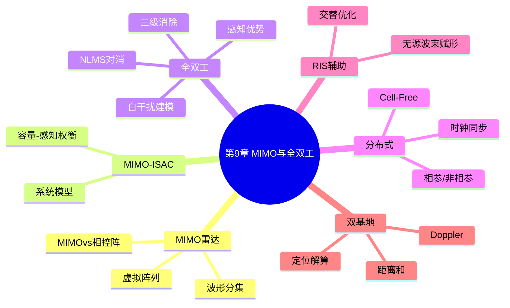
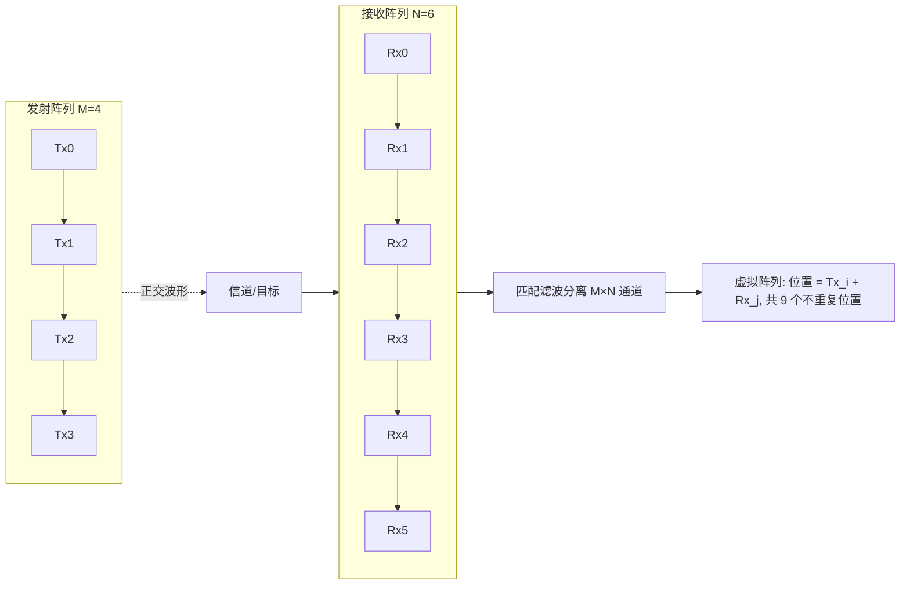
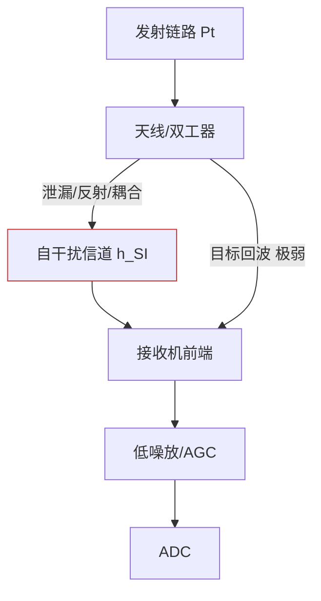
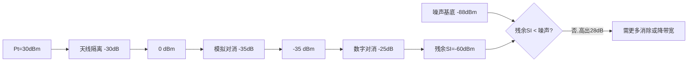
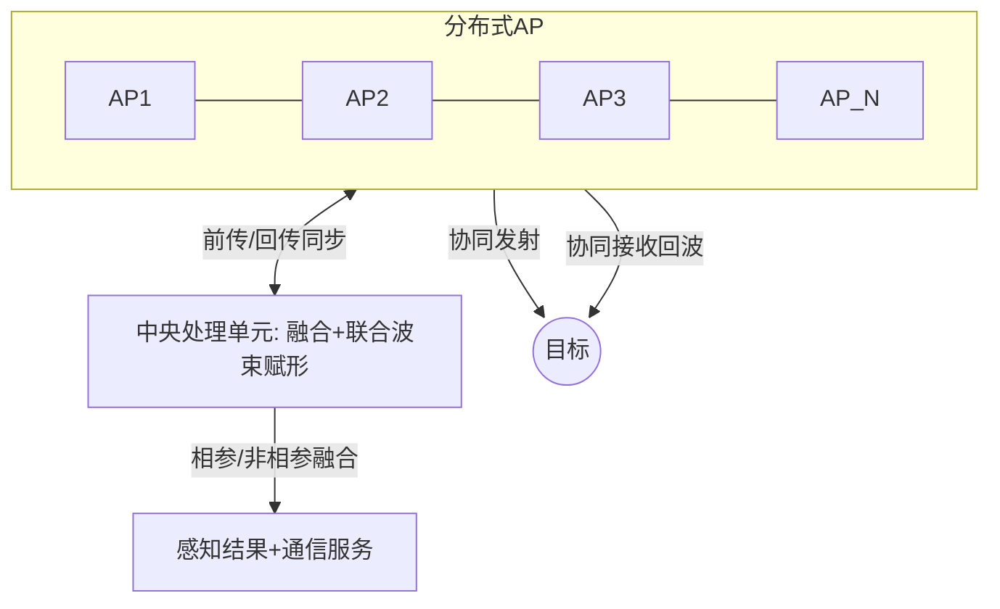
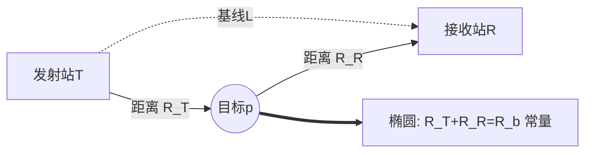

# 第9章 通感一体化 MIMO 与全双工技术

> **本章导读**
> 第 8 章把波束赋形作为"单站、单波束"的空时处理工具。本章把视角拉宽：一方面，借助多输入多输出（MIMO）的波形分集（waveform diversity），一部雷达可用多天线同时发射正交波形，在接收端虚拟出远大于物理孔径的"虚拟阵列"，从而在不增加硬件尺寸的前提下获得更高角度分辨率；另一方面，通感一体化天然要求基站"边发边收"——发射通信信号的同时接收目标回波，这正是全双工（full-duplex）模式，其最大敌人是自干扰（Self-Interference, SI）。本章先讲 MIMO 雷达的虚拟阵列原理，再系统剖析全双工 ISAC 的自干扰建模、三级消除链路预算与自适应对消算法，随后扩展到分布式 MIMO-ISAC/Cell-Free、智能超表面（RIS）辅助通感与双基地几何定位。全章贯穿"直观—建模—算法—伪代码—流程—算例—对比"六步，是 ISAC 从单站走向网络化、从半双工走向全双工的关键一章。

**学习目标**
- 理解 MIMO 雷达的波形分集原理，能计算虚拟阵列的阵元位置与孔径，并对比 MIMO 雷达与相控阵的自由度差异。
- 掌握全双工 ISAC 的自干扰建模方法，能完成"天线隔离+模拟对消+数字对消"三级链路预算算例。
- 推导并会实现 NLMS（归一化最小均方）自适应自干扰消除算法。
- 理解分布式 MIMO-ISAC/Cell-Free 的相参与非相参融合、时钟同步误差对相参增益的影响。
- 掌握 RIS 辅助通感的无源波束赋形与有源-无源联合交替优化算法，以及双基地几何与定位解算基础。

**本章知识图谱**



## 9.1 MIMO 雷达原理：波形分集、虚拟阵列

### 9.1.1 波形分集与虚拟阵列

**直观引入**：传统相控阵所有天线发同一加权后的信号，靠移相在空间中形成单一波束，自由度受物理阵元数限制。MIMO 雷达让每个发射天线发**互不相关（正交）**的波形，接收端用匹配滤波把各发射-接收路径"拆开"，于是 $M$ 个发射阵元与 $N$ 个接收阵元可合成 $M\times N$ 条独立空间通道，等效出一个由"发射位置+接收位置"决定的虚拟阵列（virtual array）。物理上只有 $M+N$ 根天线，却获得了远超此数的空间自由度。

**数学建模**：设发射阵列导向矢量 $\mathbf{a}_T(\theta)$，接收阵列导向矢量 $\mathbf{a}_R(\theta)$，第 $m$ 个发射阵元与第 $n$ 个接收阵元之间的双程相位差等价于一个位于"虚拟位置" $\mathbf{p}_{mn}=\mathbf{p}_{T,m}+\mathbf{p}_{R,n}$ 的等效阵元响应。对共线 ULA（发射、接收均为半波长间距且共轴），虚拟阵元位置为

$$ \mathbf{p}_{mn}=(m-1)d+(n-1)d=(m+n-2)d,\qquad m=1,\dots,M,\;n=1,\dots,N. \tag{9-1} $$

虚拟导向矢量（以发射、接收导向矢量 Kronecker 积表示）为

$$ \mathbf{a}_V(\theta)=\mathbf{a}_R(\theta)\otimes\mathbf{a}_T(\theta)\in\mathbb{C}^{MN}. \tag{9-2} $$

> **正交波形的必要性**：虚拟阵列之所以成立，前提是各发射波形在接收端可被完美分离，即波形互相关近似为零 $\int s_m(t)s_k^*(t-\tau)dt\approx0\;(m\neq k)$。若波形不正交，接收匹配滤波会串扰，虚拟通道不再独立，虚拟孔径优势被侵蚀。常用正交波形包括正交频分（OFDM 不同子载波/不同导频）、相位编码（如正交 Gold 序列）、以及空间调制波形。在 ISAC 中，这些"正交波形"恰好就是多用户通信的多流数据——通信与感知在波形层天然统一，这是 MIMO-ISAC 比传统雷达 MIMO 更有利的一点：**通信数据流本身就是一组天然正交（或准正交）的探测波形**。

**MIMO 雷达的两大流派**：除上述"统计 MIMO"（各发全向、波形正交、孔径发散）外，还有"相参 MIMO"（波形正交但发射也做发射波束赋形）。前者虚拟孔径最大但发射增益低，后者兼顾增益与孔径。ISAC 基站通常采用相参 MIMO：先在发射端用第 8 章方法形成兼顾通信与感知的预编码，再在接收端利用多天线虚拟阵列做高分辨测角，二者结合最为实用。

**图 9-1　MIMO 雷达虚拟阵列生成示意（4 发 6 收）**



### 例 9-1：4 发 6 收 → 24 条虚拟通道与 9 个不重复虚拟位置

取发射、接收均为半波长间距共轴 ULA。发射阵元位置索引 $i\in\{0,1,2,3\}$，接收阵元索引 $j\in\{0,1,2,3,4,5\}$。按 (9-1)，虚拟位置索引为 $k=i+j$，取值范围 $0\sim8$。

| 虚拟位置 $k$ | 出现的 $(i,j)$ 组合数 | 该位置虚拟通道数 |
|---|---|---|
| 0 | (0,0) | 1 |
| 1 | (0,1),(1,0) | 2 |
| 2 | (0,2),(1,1),(2,0) | 3 |
| 3 | (0,3),(1,2),(2,1),(3,0) | 4 |
| 4 | (0,4),(1,3),(2,2),(3,1) | 4 |
| 5 | (0,5),(1,4),(2,3),(3,2) | 4 |
| 6 | (1,5),(2,4),(3,3) | 3 |
| 7 | (2,5),(3,4) | 2 |
| 8 | (3,5) | 1 |

**结论**：尽管有 $M\times N=4\times6=24$ 条独立虚拟通道，但其空间位置只覆盖 $k=0\sim8$ 共 **9 个不重复位置**，构成孔径为 $8d$ 的"填充式虚拟 ULA"。相比原发射孔径仅 $3d$、接收孔径仅 $5d$，虚拟孔径显著扩大；中间位置的虚拟通道数更多（最高 4 重叠加），等效信噪比增益更高。这正是 MIMO 雷达"用小阵元数换大孔径"的核心机理，也是 ISAC 用通信基站天线做高分辨感知的物理基础。

### 9.1.2 MIMO 雷达 vs 相控阵：自由度对比

**表 9-1　MIMO 雷达与相控阵（ phased array）对比**

| 维度 | 相控阵 | MIMO 雷达 |
|---|---|---|
| 发射波形 | 同一波形、加权合成单波束 | 多正交波形、空间分集 |
| 发射自由度 | 受物理阵元数 $M$ 限制 | 额外获得波形维 $M$ 自由度 |
| 等效孔径 | $\approx$ 物理孔径 | 虚拟孔径 $\approx(M+N-1)d$（ULA 共轴） |
| 角度分辨率 | 由物理孔径决定 | 由虚拟孔径决定，显著提升 |
| 发射能量集中度 | 高（单波束高增益） | 较低（能量散布于多波形） |
| ISAC 适配性 | 适合通信窄波束 | 适合同时多方向感知+通信 |

> **结论**：MIMO 雷达以"发射能量分散"为代价，换取"虚拟孔径与波形维自由度"；在 ISAC 中，这些正交波形恰好可承载通信数据流，实现"感知波形即通信波形"的天然统一。

**自由度（DoF）的定量账**：相控阵的方向估计自由度（可分辨独立目标数上界）约为物理阵元数 $N$；而共轴 ULA 的 MIMO 雷达虚拟阵列自由度约为 $M+N-1$，并且其差共阵（difference co-array）还能进一步扩展（结合第 12 章稀疏阵列思想）。在 ISAC 中，这意味着同样 $N$ 根基站天线，若改用 MIMO 发射正交通信流（即每根天线发独立数据流），接收侧就能构造出更大的虚拟孔径，从而在"不增加天线"的前提下提升角度分辨——这对城市宏站天线受限而感知分辨率要求高的场景极具吸引力。代价是发射能量被 $M$ 个正交流分摊，单流发射增益下降，需在预编码中重新平衡（回到式 9-3 的权衡）。

## 9.2 MIMO-ISAC 系统模型与容量–感知权衡

**数学建模**：基站配置 $N_t$ 根发射天线、$N_r$ 根接收天线（通常 $N_t=N_r=N$），发射信号 $\mathbf{X}=\mathbf{W}\mathbf{S}\in\mathbb{C}^{N\times L}$，$L$ 为符号数，$\mathbf{S}$ 为通信符号（每列功率归一），$\mathbf{W}\in\mathbb{C}^{N\times K}$ 为预编码矩阵（同时为感知波形）。接收端同时收到：(1) 通信用户上行/下行回传；（2）目标散射回波 $\mathbf{Y}_s=\alpha\,\mathbf{a}_R(\theta_t)\mathbf{a}_T^{\mathrm H}(\theta_t)\mathbf{X}+\mathbf{N}_s$；（3）自干扰（全双工时）。

**容量–感知权衡**：通信侧可达和速率 $R_{\rm sum}=\sum_k\log_2(1+\gamma_k)$；感知侧常用 Fisher 信息矩阵（FIM）的迹或 CRB 衡量，如角度估计 CRB $\propto 1/\big(\alpha^2\,\operatorname{tr}(\mathbf{W}^{\mathrm H}\mathbf{A}_\theta\mathbf{W})\big)$。二者对 $\mathbf{W}$ 的诉求相反：速率希望能量集中在用户方向形成高 SINR 波束，感知希望能量铺开或对准目标且波形具有良好模糊函数。优化常写为

$$ \max_{\mathbf{W}}\;\beta\,R_{\rm sum}-(1-\beta)\,\mathrm{CRB}(\theta),\quad {\rm s.t.}\;\operatorname{tr}(\mathbf{W}\mathbf{W}^{\mathrm H})\le P, \tag{9-3} $$

其中 $\beta\in[0,1]$ 为通感权重。该问题与第 8 章联合波束赋形一脉相承，只是目标从"感知方向图"升级为"CRB/MI 等感知度量"，且预编码维度更高。

**与第 5 章性能界的呼应**：第 5 章已证明速率–CRB 权衡存在理论边界（Pareto 前沿）。式 (9-3) 的加权和形式本质是在该前沿上取一点：当 $\beta\to1$ 退化为纯通信，当 $\beta\to0$ 退化为纯感知。实际系统应根据业务需求（如车联网中"感知优先、通信保底"）在线滑动 $\beta$。值得指出，MIMO 带来的波形维自由度让 Pareto 前沿整体外扩——同样的通信速率下可获得更低的感知 CRB，这正是 MIMO-ISAC 相比单天线 ISAC 的根本增益来源，也是其在 6G 空口被寄予厚望的原因。

## 9.3 全双工 ISAC：同时同频收发与自干扰建模

**直观引入**：半双工 ISAC 需时分切换（发完再收），这就产生了"距离盲区"——近距离目标的回波在发射刚结束时最强，却因收发切换保护间隔而漏检，且刷新率低。全双工让基站边发边收，理论上消除盲区、提高刷新率，但代价是：强大的发射信号会直接泄漏进自己的接收机，形成自干扰，其功率往往比微弱目标回波高 100 dB 以上。能否压住自干扰，是全双工 ISAC 成败的关键。

**数学建模**：接收信号（单天线用户/目标回波 + 自干扰）为

$$ y(t)=\underbrace{h_{\rm cu}\,\mathbf{w}^{\mathrm H}\mathbf{s}(t)}_{\text{通信上行/下行用户}}+\underbrace{\alpha\,\mathbf{a}_R^{\mathrm H}(\theta_t)\mathbf{X}\mathbf{a}_T(\theta_t)}_{\text{目标回波}}+\underbrace{\mathbf{h}_{\rm SI}^{\mathrm H}\mathbf{x}(t)}_{\text{自干扰}}+n(t), \tag{9-4} $$

其中 $\mathbf{h}_{\rm SI}\in\mathbb{C}^N$ 为自干扰信道，包含天线直通、反射、耦合等多径分量。自干扰功率约为

$$ P_{\rm SI}=P_t\cdot G_{\rm SI}=P_t\cdot 10^{-{\rm Iso}/10}, \tag{9-5} $$

Iso 为收发隔离度（dB）。由于 $P_t$ 常为 30 dBm 量级、目标回波常低至 $-100$ dBm 量级，自干扰需被压制约 130 dB 才能"看见"目标，单靠天线隔离远不够，必须分级消除。

> **自干扰信道的本质**：与通信信道不同，自干扰信道是"已知发射、已知（可估计）信道"的确定性强相关信道——正因为发射信号 $\mathbf{x}(t)$ 对基站完全已知，数字域才得以重建副本精确对消；但也正因泄漏路径极短（几厘米到几十厘米）、多径丰富，其信道估计需极高精度（量化位数、相位噪声都会影响重建保真度，第 19 章将详述）。这也是为何全双工感知对射频前端非理想因素格外敏感：本用于通信的微小非理想，在 100 dB 量级自干扰对消中会"放大"成感知盲区。

**图 9-2　全双工 ISAC 收发机与自干扰链路**



> **实现形态**：全双工可由环形器（circulator）+ 平衡混频、或两条独立天线（一发一收）加空间隔离实现。前者集成度高但隔离度受环形器有限隔离（典型 20~30 dB）限制；后者隔离度高但需双工 MIMO 天线布局。无论哪种，自干扰都有"直通分量"（强、稳定）与"环境反射分量"（弱、时变）两部分，前者适合模拟对消（用已知发射重建），后者需数字自适应（NLMS 类）跟踪，这正是例 9-2 三级结构按"稳定→时变"分级的物理依据。

## 9.4 自干扰消除技术：三级链路预算算例

**直观引入**：自干扰消除分三层逐级"拔牙"——先靠天线/双工器的物理隔离把大功率砍掉一大截（模拟域前），再用模拟电路生成一个与自干扰共轭相反的信号在射频端对消（模拟域），最后在数字基带用自适应滤波估计残余并减去（数字域）。每一级贡献若干 dB，叠加才能压到噪声基底以下。

**数学建模**：设发射功率 $P_t$，各级消除量依次为 $C_1$（天线隔离）、$C_2$（模拟对消）、$C_3$（数字对消），则残余自干扰功率为

$$ P_{\rm SI,res}=P_t-C_1-C_2-C_3\quad({\rm dBm}). \tag{9-6} $$

> **为何要"分级"而非"一步到位"**：射频前端的模拟对消必须发生在 ADC 之前，否则强自干扰会撑爆接收机动态范围、使微弱目标回波在量化中被淹没（即"阻塞"）。因此天线隔离与模拟对消负责把 SI 从 30 dBm 量级压到接收机线性区（约 $-30$ dBm 以下），数字对消才得以在线性区精修。三级是"功率域→模拟域→数字域"的瀑布式削峰，任一级缺失都会导致后级过载或量化噪声主导。这也是 (9-6) 中各 $C_i$ 顺序不可任意调换的根本原因。

接收机噪声基底（noise floor）为

$$ P_{\rm N}=-174+10\log_{10}(B)+{\rm NF}\quad({\rm dBm}), \tag{9-7} $$

其中 $B$ 为带宽（Hz），NF 为噪声系数（dB），$-174$ dBm/Hz 为室温热噪声谱密度。

### 例 9-2：三级自干扰链路预算算例

给定：发射功率 $P_t=30$ dBm；天线隔离 $C_1=30$ dB；模拟对消 $C_2=35$ dB；数字对消 $C_3=25$ dB；接收带宽 $B=100$ MHz；噪声系数 ${\rm NF}=6$ dB。

**第一步（天线隔离后）**：
$$ P_{\rm SI}^{(1)}=30-30=0\ {\rm dBm}. $$

**第二步（模拟对消后）**：
$$ P_{\rm SI}^{(2)}=0-35=-35\ {\rm dBm}. $$

**第三步（数字对消后，残余自干扰）**：
$$ P_{\rm SI,res}=-35-25=-60\ {\rm dBm}. $$

**噪声基底**：
$$ P_{\rm N}=-174+10\log_{10}(10^8)+6=-174+80+6=-88\ {\rm dBm}. $$

**比较**：残余自干扰 $-60$ dBm 比噪声基底 $-88$ dBm 高
$$ (-60)-(-88)=28\ {\rm dB}. $$

> **结论**：三级共消除 $30+35+25=90$ dB，把 30 dBm 发射压到 $-60$ dBm，但仍高出噪声基底 28 dB。要使残余 SI 落到噪声基底以下（即达到"自干扰噪声化"），所需总消除量为 $30-(-88)=118$ dB，尚缺 28 dB——这说明在 100 MHz 宽带接收下，90 dB 消除仍不足以支撑弱目标探测。实际全双工感知常需：① 降低 $B$（用窄带感知子带）或 ② 把数字对消提升到 50+ dB，或 ③ 接受残余 SI 作为"抬高的噪声基底"，此时目标检测灵敏度损失约 28 dB，需在其他环节补偿。本例清晰展示了链路预算中"消除量 vs 带宽 vs 噪声基底"的三角制约。

**图 9-3　三级自干扰消除链路预算流程**



## 9.5 全双工 ISAC 的感知优势与残余 SI 影响

**直观引入**：克服了自干扰，全双工便展现出半双工无法比拟的感知优势——零距离盲区、连续波（CW）式不间断探测、近距高反射目标不再"烧穿"接收机。但残余自干扰即便压到噪声量级，仍会抬高有效噪声基底、恶化检测性能，需定量评估。

**零盲区与连续探测**：半双工在时间 $T_{\rm gap}$ 内既不能发也不能收，导致距离 $R<cT_{\rm gap}/2$ 内目标不可见；全双工无此死区。此外，全双工可发射连续波形（如 FMCW 连续扫频），距离维采样连续，速度模糊更低。

**残余 SI 对检测的影响**：设残余自干扰等效为额外噪声，有效噪声功率 $P_{\rm N,eff}=P_{\rm N}+P_{\rm SI,res}$（dB 域相加需先转线性）。例 9-2 中 $P_{\rm N,eff}$ 线性值 $=10^{-8.8}+10^{-6.0}=1.58\times10^{-9}+1.0\times10^{-6}\approx1.0\times10^{-6}$ W 量级，即仍由残余 SI 主导，检测门限需相应抬高，弱目标检测概率下降。工程上以"残余 SI 距噪声基底的裕度（margin）"作为全双工感知可行性的核心指标。

**NLMS 自适应对消算法**：数字域消除常建模为"用已知发射信号 $\mathbf{x}(n)$ 经自适应滤波器 $\mathbf{w}(n)$ 重建自干扰副本并从接收中减除"。归一化最小均方（Normalized LMS, NLMS）更新式为

$$ \mathbf{w}(n+1)=\mathbf{w}(n)+\mu\,\frac{e(n)\,\mathbf{x}(n)}{\|\mathbf{x}(n)\|^2+\delta},\qquad e(n)=y(n)-\mathbf{w}^{\mathrm H}(n)\mathbf{x}(n), \tag{9-12} $$

其中 $\mu\in(0,2)$ 为步长、$\delta$ 为正则项防止分母为零。归一化使步长随输入功率自适应，收敛稳定。

**算法 9-2：NLMS 自干扰数字对消**

```text
算法 9-2：NLMS_SI_Cancellation(x, y, mu, delta, MaxIter)
# 输入: 已知发射样本 x[n] (N维), 接收样本 y[n], 步长 mu, 正则 delta
# 输出: 对消后误差序列 e, 收敛的滤波器 w
1  w = zeros(N)
2  for n = 1..MaxIter:
3      x_n = x[n]                       # 当前发射样本向量
4      e_n = y[n] - w^H * x_n           # 重建SI并减除, 得残差
5      norm = ||x_n||^2 + delta
6      w = w + mu * e_n * conj(x_n) / norm   # NLMS 更新
7      e[n] = e_n
8  return e, w
```

> **结论**：NLMS 以极低复杂度跟踪时变自干扰信道，是数字域消除的主力；其收敛速度受 $\mu$ 与自干扰信道时变率共同决定，在高速移动或硬件温漂场景下需配合周期性重训练。

**表 9-2　半双工 vs 全双工 ISAC 感知特性对比**

| 特性 | 半双工 | 全双工 |
|---|---|---|
| 距离盲区 | 有（切换死区 $R<cT_{\rm gap}/2$） | 无 |
| 探测连续性 | 分时，有间隙 | 连续 |
| 最大不模糊速度 | 受 CPI 与帧结构限制 | 更易做长 CPI |
| 主要代价 | 时间资源浪费 | 自干扰消除（~100 dB+） |
| 硬件复杂度 | 低（单工双工器） | 高（环形器/平衡混频+对消链） |
| 适用场景 | 低刷新率、远距 | 近距盲区敏感、高刷新率 |

> **结论**：全双工以硬件与算法复杂度换取"无盲区+连续探测"，在无人机近距入侵检测、自动驾驶 V2X 近场预警等对盲区零容忍场景价值突出；但残余自干扰抬高的噪声基底会直接压缩弱目标探测动态范围，必须通过例 9-2 式的链路预算严格论证可行性。

## 9.6 分布式 MIMO-ISAC 与 Cell-Free 通感

**直观引入**：单站视角有限、易遮挡。把多个 AP（Access Point）协同起来，既联合服务用户、又联合探测同一目标，就是分布式 MIMO-ISAC / Cell-Free 通感。协同分"相参"（保留相位、相干叠加）与"非相参"（只合功率/信息）两档，差别巨大；而相参的前提是所有 AP 时钟严格同步——同步误差会直接吃掉相参增益。

**相参 vs 非相参融合**：
- **相参融合**：各 AP 回波按相位对齐后相加，信噪比增益 $\propto N_{\rm AP}$（$N_{\rm AP}$ 个站点）。
- **非相参融合**：仅合并能量或检测统计量，增益 $\propto \sqrt{N_{\rm AP}}$。

### 例 9-3：相参与非相参增益数值对比

设 $N_{\rm AP}=8$ 个站点协同探测同一目标，单站回波 SNR 为 0 dB。
- 相参合并后 SNR $=0+10\log_{10}(8)=0+9.03\approx9.0$ dB。
- 非相参合并后 SNR $=0+10\log_{10}(\sqrt{8})=0+4.51\approx4.5$ dB。
两者相差 4.5 dB，相当于探测距离提升约 $\sqrt{10^{0.45}}\approx2$ 倍（雷达方程距离四次方关系）。可见相参融合价值巨大，但代价是严格的时钟同步。

**时钟同步误差的影响**：设第 $i$ 个 AP 相对参考有定时误差 $\Delta\tau_i$，对应载波相位误差 $\phi_i=2\pi f_c\Delta\tau_i$。相参合并时，第 $i$ 路贡献因子 $e^{j\phi_i}$，相参增益退化为

$$ G_{\rm coh}=\Big|\frac{1}{N_{\rm AP}}\sum_{i=1}^{N_{\rm AP}}e^{j\phi_i}\Big|^2. \tag{9-8} $$

**图 9-6　Cell-Free 通感协同架构**



> **Cell-Free 与"以用户/目标为中心"**：传统蜂窝以小区为中心，边缘用户信道差；Cell-Free 让大量分布式 AP 共同服务每个用户/探测每个目标，消除小区边缘效应，使全网感知与通信质量趋近均匀。ISAC 中这意味着"无论目标在何处，总有一组最优 AP 组合以相参方式照亮它并接收其回波"，空间覆盖与分辨能力不再受单站孔径限制，而是受全网 AP 几何分布与同步质量限制。这把第 8 章单站波束赋形问题，提升为"全网联合波束赋形+时钟同步"的更高维问题（第 17 章网络化定位将系统化处理）。

**同步如何获得**：相参融合要求各 AP 共享同一时频参考。工程中常用：① 光缆/前传硬同步（精度最高，皮秒级，但需有线连接）；② IEEE 1588 PTP（精确时间协议） over 以太网（亚纳秒级）；③ 空口同步（基站间互发同步信号互估时偏，成本低但精度受限）；④ 共置 GPSDO（各 AP 接同一高稳时钟源）。同步误差换算为相位误差后，按 (9-8) 直接折损相参增益，因此分布式 ISAC 的布站方案必须与同步方式联合设计——这是纯通信 Cell-Free 与 ISAC Cell-Free 的关键差异之一，因为感知对相位比通信更敏感（通信对消干扰可容忍较大相位误差，感知测角测距却对相位误差近乎零容忍）。

若各 $\phi_i\sim\mathcal{U}(-\Phi,\Phi)$ 均匀分布，当 $\Phi\ll1$ 时 $G_{\rm coh}\approx1-\Phi^2/3$；当 $\Phi=\pi$（完全失步）时 $G_{\rm coh}\to0$。例如 $f_c=28$ GHz，$\Delta\tau=1$ ps 即产生 $\phi=2\pi\cdot28\times10^9\cdot10^{-12}=0.176$ rad，8 站均方相位误差约 0.176 rad 时 $G_{\rm coh}\approx1-0.176^2/3=0.989$（仅损 0.05 dB）；但若 $\Delta\tau=100$ ps，则 $\phi=17.6$ rad（远超 $2\pi$），相参增益几乎崩溃。这说明毫米波全双工分布式感知对同步精度要求达到皮秒级。

## 9.7 RIS 辅助通感：无源波束赋形与交替优化

**直观引入**：智能超表面（Reconfigurable Intelligent Surface, RIS）是一块由大量低成本无源反射单元组成的平板，每个单元可独立调控入射信号的相位。它本身不发射功率，而是把基站信号"反射并重新塑形"到盲区或目标方向，相当于在空间中"凭空"增加了一个可编程的镜面波束。RIS 辅助通感的核心，是联合优化"基站有源波束赋形"与"RIS 无源相位矩阵"，让同一束反射信号既服务用户、又照亮目标。

**数学建模**：设基站 $N$ 天线、RIS $K$ 单元（相位 $\theta_k$，$|e^{j\theta_k}|=1$）。基站到 RIS 信道 $\mathbf{G}\in\mathbb{C}^{K\times N}$，RIS 到用户/目标信道 $\mathbf{h}_r\in\mathbb{C}^{K}$。经 RIS 反射后的等效信道为

$$ \mathbf{h}_{\rm eq}^{\mathrm H}=\mathbf{h}_r^{\mathrm H}\boldsymbol{\Theta}\mathbf{G}=\mathbf{h}_r^{\mathrm H}{\rm diag}(e^{j\theta_1},\dots,e^{j\theta_K})\mathbf{G}, \tag{9-9} $$

其中 $\boldsymbol{\Theta}={\rm diag}(e^{j\theta_k})$ 为无源波束赋形矩阵。目标函数（如用户 SINR 或感知 SNR）同时依赖有源预编码 $\mathbf{W}$ 与无源相位 $\boldsymbol{\theta}$，且后者受恒模约束。问题非凸，标准解法是**交替优化（Alternating Optimization, AO）**：固定 $\boldsymbol{\theta}$ 优化 $\mathbf{W}$（凸/类第 8 章方法），固定 $\mathbf{W}$ 优化 $\boldsymbol{\theta}$（逐单元相位提取，因目标常可写成关于单个 $\theta_k$ 的余弦形式而可闭式求最优相位）。

**图 9-4　RIS 辅助通感联合波束赋形**

```mermaid
flowchart TB
    BS[基站有源W] --> G[信道G] --> RIS[RIS无源Θ]
    RIS --> HR[信道h_r] --> USER[用户/目标]
    OPT[交替优化] -->|固定Θ优化W| BS
    OPT -->|固定W优化Θ(逐单元相位)| RIS
```

**算法 9-1：RIS 有源–无源联合交替优化**

```text
算法 9-1：RIS_Joint_Opt(W_init, θ_init, G, h_r, MaxIter)
# 输入: 初始有源预编码 W, 初始RIS相位 θ, 信道 G, h_r
# 输出: 最优 W*, θ*
1  W = W_init;  θ = θ_init
2  for iter = 1..MaxIter:
3      # ---- 固定 θ, 优化有源 W ----
4      H_eq = diag(exp(1j*θ)) * G          # 等效级联信道(K×N)
5      h = h_r^H * H_eq                    # 等效下行信道(1×N)
6      W = 求解(W; 以 h 为信道的波束赋形, 见第8章SDR/WMMSE)
7      # ---- 固定 W, 优化无源 θ ----
8      for k = 1..K:
9          # 把目标写成 a_k*cos(θ_k+φ_k)+b 形式, 取使最大之相位
10         θ_k = argmax_{φ} Re{ c_k * exp(1j*φ) }   # 闭式: θ_k = -angle(c_k)
11     if |目标变化| < ε: break
12 return W, θ
```

### 例 9-4：RIS 相位优化单步数值

设 RIS 单单元 $K=1$ 近似示意，$c_k=0.5+0.3j$，目标为最大化 $\Re\{c_k e^{j\theta_k}\}$。最优相位 $\theta_k=-\angle(c_k)=-\arctan(0.3/0.5)=-30.96^\circ$。代入得最大值 $|c_k|=0.583$。推广到 $K$ 单元即逐单元取 $\theta_k=-\angle(c_k)$，实现"各单元相位补偿自身链路相位、使反射信号在目标处相干叠加"，与 8.6 节 MO-AltMin 的相位提取思想同源。

**RIS 的工程权衡**：RIS 单元数 $K$ 越大，无源波束赋形增益越高（约正比于 $K^2$ 反射功率），但信道估计开销与优化维度随之增大。RIS 本身无射频链路、功耗极低，适合大规模部署补盲；其短板是"只能反射、不能放大"，因此等效信道经历"基站→RIS→目标"两次路径损耗（双衰落，double fading），当基站与目标距 RIS 均较远时链路预算严峻，需把 RIS 部署在二者几何中程或利用多块 RIS 级联。在 ISAC 中，RIS 还可兼作"无源雷达反射体"——其规则阵列结构本身可被基站用来做自定位与标定，是通感融合颇具前景的使能技术。以一个具体数字感受其增益量级：若 RIS 含 $K=256$ 单元，理想无源波束赋形可使反射方向信号功率提升约 $10\log_{10}(K^2)=48$ dB（即单元数平方增益），足以把原本被双衰落压制的链路拉回可用区间；但代价是波束极窄（半功率宽度约 $\lambda/(Kd)$ 量级），需配合第 8 章的波束训练/跟踪才能在移动场景中维持对准——RIS 增益与波束灵敏度始终是同一枚硬币的两面。

## 9.8 双基地 ISAC 几何与处理

**直观引入**：第 4 章雷达多为单基地（同址收发）；ISAC 中"基站发、另一基站/用户收"或"双站协同"很常见，即双基地（bistatic）。双基地几何下，目标到两站的距离和恒定构成椭圆，Doppler 也由双程径向速度合成，定位与单基地不同，需专门解算。

**数学建模**：设发射站 $\mathbf{T}$、接收站 $\mathbf{R}$，目标 $\mathbf{p}$。双基地距离（双程）为

$$ R_b=\|\mathbf{p}-\mathbf{T}\|+\|\mathbf{p}-\mathbf{R}\|=c\,\tau_b/2, \tag{9-10} $$

其中 $\tau_b$ 为发射到接收的双向时延。给定 $R_b$，目标位于以 $\mathbf{T},\mathbf{R}$ 为焦点的椭圆上。双基地 Doppler 频移为

$$ f_{b,d}=\frac{1}{\lambda}\big(\mathbf{v}^{\mathrm T}\mathbf{u}_T+\mathbf{v}^{\mathrm T}\mathbf{u}_R\big)=\frac{1}{\lambda}\mathbf{v}^{\mathrm T}(\mathbf{u}_T+\mathbf{u}_R), \tag{9-11} $$

$\mathbf{u}_T,\mathbf{u}_R$ 为指向发射站、接收站的单位向量，$\mathbf{v}$ 为目标速度。可见双基地 Doppler 取决于双程径向速度和，与单基地（仅 $2\mathbf{v}^{\mathrm T}\mathbf{u}$）不同。

> **双基地的"盲区"与几何灵敏度**：当目标位于基线延长线（双基地角接近 $0^\circ$ 或 $180^\circ$）时，$\mathbf{u}_T+\mathbf{u}_R\approx\mathbf{0}$，Doppler 趋零，速度估计退化；而目标位于基线中垂线上时 Doppler 灵敏度最高。此外双基地距离和 $R_b$ 在椭圆长轴两端（靠近某站）对位置变化迟钝、在短轴（中垂线）敏感，与 Doppler 灵敏度恰好互补——这提示双站 ISAC 的几何精度（GDOP）高度依赖目标相对基线的方位，是布站设计的核心依据（第 17 章定位精度界将量化 GDOP）。

### 例 9-5：双基地定位几何解算

设基线 $L=100$ m，发射站 $\mathbf{T}=(-50,0)$、接收站 $\mathbf{R}=(50,0)$。测得双基地距离和 $R_b=141.4$ m。结合接收站测得的来波方位角 $\theta=135^\circ$（从 $+x$ 轴计，即目标在接收站左上方）。由方位角，目标位于射线 $\mathbf{p}=(50,0)+r(\cos135^\circ,\sin135^\circ)=(50-0.707r,\;0.707r)$。代入双基地距离和：
$$ \|\mathbf{p}-\mathbf{T}\|+\|\mathbf{p}-\mathbf{R}\|=R_b. $$
当 $r=70.7$ m 时，$\mathbf{p}=(50-50,\;50)=(0,50)$。验证：$\|\mathbf{p}-\mathbf{T}\|=\sqrt{50^2+50^2}=70.7$，$\|\mathbf{p}-\mathbf{R}\|=\sqrt{50^2+50^2}=70.7$，和 $=141.4$ m，与测量一致。故目标位置为 $(0,50)$ m。该例说明：双基地距离和给出椭圆约束、单站角度给出射线约束，二者相交即得目标——这正是双站协同定位的基本几何（第 17 章将推广到多站 TDOA/AOA 融合）。

**图 9-5　双基地椭圆几何与定位**



> **从双基地到多基地（multistatic）**：当存在多对收发射站（如分布式 Cell-Free 中多 AP 互为收发），每个收发对提供一条独立的"双基地距离和"约束，多条椭圆相交即可三维定位，且不同对的几何灵敏度互补，整体 GDOP 显著优于单双基。这正是第 9.6 节分布式架构与本节双基地几何的自然汇合——分布式 ISAC 的本质，就是用网络化双基地测量替代单站测量，用几何冗余换取精度与覆盖。需要注意的是，多基地测量带来更高的时间同步与数据融合开销，且各收发对的双基地 Doppler 不同，目标速度需在所有测量间一致求解（第 17 章融合算法处理）。

## 本章小结

本章把 ISAC 的空时处理从单站拓展到 MIMO、全双工与网络化。MIMO 雷达通过波形分集在接收端构造虚拟阵列，用 $M+N$ 根天线获得约 $(M+N-1)d$ 的虚拟孔径（例 9-1：4 发 6 收得 24 条虚拟通道、9 个不重复位置），显著提升角度自由度；MIMO-ISAC 把这种自由度用于同时承载通信与感知（容量–CRB 权衡，式 9-3）。全双工 ISAC 让基站边发边收，消除距离盲区、实现连续探测，但自干扰是首要难题——我们以"天线隔离 30 dB + 模拟对消 35 dB + 数字对消 25 dB、发射 30 dBm"完成三级链路预算（例 9-2），得出残余 SI 为 $-60$ dBm、高出噪声基底 28 dB 的结论，量化了"消除量–带宽–噪声"的三角制约；并推导了 NLMS 自适应对消（算法 9-2）。分布式 MIMO-ISAC/Cell-Free 中，相参融合增益 $\propto N_{\rm AP}$、非相参仅 $\propto\sqrt{N_{\rm AP}}$（例 9-3），而皮秒级时钟同步是其前提（式 9-8）。RIS 辅助通感通过有源–无源交替优化实现无源波束赋形（算法 9-1）。最后，双基地几何以"距离和椭圆+角度射线"给出定位解算（例 9-5）。全章贯穿六步讲授法，为第 10 章毫米波/太赫兹高频段下的波束与相位问题，以及第 17 章网络化定位奠定方法基础。

**贯穿全章的一条主线**：从 MIMO 虚拟阵列到 RIS 无源阵列，再到分布式 Cell-Free 的"虚拟大阵"，ISAC 的空间自由度始终来自"用算法把物理上分散/受限的阵列，在信号处理层面重新拼接成一个更大的等效阵列"。这条主线与第 8 章波束赋形是同一枚硬币的两面：第 8 章研究"给定阵列如何赋形"，本章研究"如何得到更大的阵列去赋形"。而全双工与自干扰消除，则是让这个大阵列能够"边发边收"、把时间也变成可复用资源的钥匙。三者结合，才构成完整的一体化空口能力。需要再次提醒，所有上述能力都建立在一个隐含前提上——自干扰被充分压制、时钟充分同步、信道（含 RIS 链路）被准确估计；一旦这些"使能条件"失效，理论增益将迅速坍缩，这正是第 19 章硬件非理想因素要系统讨论的现实约束。

## 习题

### A. 基础概念题

**A1.** 什么是 MIMO 雷达的波形分集？它为何能形成虚拟阵列？

**A2.** 4 发 6 收共轴 ULA 的虚拟阵列有多少个不重复空间位置？孔径是多少？（用 $d$ 表示）

**A3.** 全双工 ISAC 相比半双工，在感知上有哪两项主要优势？

**A4.** 自干扰三级消除分别指哪三级？各级作用域（模拟/数字）是什么？

**A5.** 相参融合与非相参融合的 SNR 增益分别正比于什么？为何相参对同步要求高？

**A6.** RIS 的无源波束赋形为何受恒模约束？交替优化中"固定 W 优化 Θ"为何能闭式求解？

**A7.** 双基地 Doppler 与单基地 Doppler 在表达式上有何本质区别？

**A8.** 例 9-2 中若把接收带宽降到 10 MHz，噪声基底变为多少？残余 SI 高出多少 dB？

### B. 推导与计算题

**B1.** 推导虚拟阵列位置公式 (9-1)。若发射、接收 ULA 不共轴、间距为 $D$，虚拟位置如何变化？

**B2.** 用例 9-2 的参数，若把数字对消提升到 50 dB（其余不变），求残余 SI 与噪声基底的差距（dB），并说明此时能否支持探测 $-100$ dBm 的弱目标回波（假设目标回波需高于有效噪声基底 10 dB 才可被检测）。

**B3.** 推导 NLMS 更新式与其归一化分母的作用；设 $\mathbf{x}=[0.8,-0.3]^{\mathrm T}$，$d=1.0$，$\mathbf{w}(0)=\mathbf{0}$，$\mu=0.5$，$\delta=0.01$，手算第一步后的 $\mathbf{w}(1)$ 与误差 $e(1)$。

**B4.** 相参增益 (9-8) 中，若 8 个 AP 的相位误差独立同分布于 $\mathcal{U}(-\Phi,\Phi)$，证明当 $\Phi\ll1$ 时 $G_{\rm coh}\approx1-\Phi^2/3$。取 $f_c=28$ GHz、$\Delta\tau=10$ ps，求近似增益损失（dB）。

**B5.** 双基地系统中，基线 $L=200$ m，测得 $R_b=300$ m，且接收站测得目标方位角 $30^\circ$（相对基线方向）。求目标坐标（给出椭圆与射线相交的解析/数值解）。

**B6.** RIS 等效信道 (9-9) 中，若 $\mathbf{G}$ 为 $K\times N$、$\mathbf{h}_r$ 为 $K\times1$，证明 $\mathbf{h}_{\rm eq}^{\mathrm H}$ 可写成 $\boldsymbol{\theta}^{\mathrm H}\mathrm{diag}(\mathbf{h}_r^{\mathrm H})\mathbf{G}$，并说明逐单元相位优化的闭式来源。

**B7.** 设全双工系统发射 23 dBm、天线隔离 25 dB、模拟对消 30 dB、数字对消 40 dB，带宽 40 MHz、NF 5 dB。求残余 SI 与噪声基底，并判断是否满足"残余 SI 低于噪声基底 3 dB"的工程目标。

### C. 算法与编程题

**C1.** 实现 NLMS 自干扰消除仿真：构造自干扰信道 $\mathbf{h}_{\rm SI}$ 为 8 维复向量，发射信号为 QPSK，叠加目标回波（SNR=−90 dBm 量级）与噪声，运行 NLMS 500 次迭代，画出残余 SI（dB）随迭代下降曲线，并报告收敛后的 SI 抑制量。

**C2.** 编写 RIS 交替优化程序：基站 4 天线、RIS 16 单元、单用户，目标最大化用户 SINR，交替迭代 30 轮，输出每轮 SINR 与最终 RIS 相位向量，验证 SINR 单调上升。

**C3.** 编写双基地定位解算：给定基线 $L$、双基地距离和 $R_b$、接收站方位角 $\theta$，用椭圆–射线相交法求解目标坐标，并对加入 1 m 测距噪声做 Monte Carlo 100 次，统计定位 RMSE。

## 答案与解析

**A1.** 波形分集指 MIMO 雷达各发射天线发射互不相关（正交）的波形；接收端用匹配滤波按波形区分每条发射-接收路径，使 $M$ 发 $N$ 收合成 $MN$ 条独立空间通道，等效出由"发射位置+接收位置"决定的虚拟阵列。

**A2.** 不重复位置数 $=M+N-1=4+6-1=9$，索引 $0\sim8$；虚拟孔径 $=(M+N-2)d=8d$。

**A3.** ① 零距离盲区（无收发切换死区）；② 连续波不间断探测、距离采样连续、速度模糊更低、刷新率更高。

**A4.** 三级：天线/双工器隔离（物理域，模拟前）、模拟对消（RF 域生成反相信号）、数字对消（基带自适应滤波）。作用域依次在模拟前、模拟中、数字中。

**A5.** 相参增益 $\propto N_{\rm AP}$，非相参 $\propto\sqrt{N_{\rm AP}}$；相参需各路相位对齐相加，任何时钟/定时误差都会引入相位失配，使相干叠加退化为非相参甚至相消，故对同步极敏感。

**A6.** RIS 单元是无源反射元件，仅能调相位不能调幅度，故 $|e^{j\theta_k}|=1$。固定 $\mathbf{W}$ 后目标常可整理为关于单个 $\theta_k$ 的 $a_k\cos(\theta_k+\phi_k)+b$ 形式，最大值在 $\theta_k=-\angle(a_k)$ 处取到，故可逐单元闭式求解。

**A7.** 单基地 Doppler $f_d=2\mathbf{v}^{\mathrm T}\mathbf{u}/\lambda$（单程往返）；双基地 $f_{b,d}=\mathbf{v}^{\mathrm T}(\mathbf{u}_T+\mathbf{u}_R)/\lambda$，取决于到发射站与接收站的双程径向速度和，几何依赖两站方向。

**A8.** $B=10$ MHz：$P_{\rm N}=-174+10\log_{10}(10^7)+6=-174+70+6=-98$ dBm。残余 SI 仍为 $-60$ dBm，高出 $(-60)-(-98)=38$ dB（带宽越低噪声基底越低、差距反而更大）。

---

**B1.** 发射阵元 $m$ 相位 $2\pi(m-1)d\sin\theta/\lambda$，接收阵元 $n$ 相位 $2\pi(n-1)d\sin\theta/\lambda$，双程总相位 $=2\pi[(m-1)+(n-1)]d\sin\theta/\lambda$，等价于位于 $(m+n-2)d$ 的单阵元响应，即 (9-1)。若不共轴、收发阵列相距 $D$，则虚拟位置为 $\mathbf{p}_{T,m}+\mathbf{p}_{R,n}$（向量和），不再共轴，但"发射位置+接收位置"的加法关系不变，仅几何排布改变。

**B2.** 三级消除：$30+35+50=115$ dB。残余 SI $=30-115=-85$ dBm。噪声基底仍为 $-88$ dBm。差距 $(-85)-(-88)=3$ dB，即残余 SI 略高于噪声基底 3 dB，基本"噪声化"。有效噪声基底约 $\max(-85,-88)=-85$ dBm。要探测 $-100$ dBm 目标且需高于有效噪声 10 dB，则要求目标回波 $\ge-75$ dBm，但实际仅 $-100$ dBm，差 25 dB，仍不可检测——说明即便 SI 压到噪声级，弱目标探测还受限于链路总增益，需更大发射功率或更高天线增益。

**B3.** NLMS：$\mathbf{w}(n+1)=\mathbf{w}(n)+\mu\,\frac{e(n)\mathbf{x}(n)}{\|\mathbf{x}(n)\|^2+\delta}$，$e(n)=d(n)-\mathbf{w}^{\mathrm H}(n)\mathbf{x}(n)$。归一化分母防止 $\mathbf{x}$ 幅值过大导致步长失稳、并自适应调节收敛速度。$e(0)=1.0-0=1.0$；$\|\mathbf{x}\|^2=0.8^2+(-0.3)^2=0.73$；分母 $=0.74$；因子 $=0.5\times1.0/0.74=0.676$；$\mathbf{w}(1)=0.676\times[0.8,-0.3]=[0.541,-0.203]$。$e(1)=1.0-(0.541\times0.8+(-0.203)\times(-0.3))=1-(0.433+0.061)=0.506$。误差由 1.0 降到 0.506，体现对消生效。

**B4.** $G_{\rm coh}=\big|\frac{1}{N}\sum e^{j\phi_i}\big|^2$。$e^{j\phi_i}\approx1+j\phi_i-\phi_i^2/2$，求和平均 $\approx1+j\bar\phi-\overline{\phi^2}/2$，模方 $\approx(1-\overline{\phi^2}/2)^2+\bar\phi^2\approx1-\overline{\phi^2}$。$\phi_i\sim\mathcal{U}(-\Phi,\Phi)$，$\overline{\phi^2}=\Phi^2/3$，故 $G_{\rm coh}\approx1-\Phi^2/3$。$\Delta\tau=10$ ps，$f_c=28$ GHz：$\phi=2\pi\cdot28\times10^9\cdot10^{-11}=2\pi\cdot0.28=1.759$ rad（注意此已不小）。$\Phi^2/3\approx1.759^2/3=1.03$，近似式失效（因 $\Phi$ 不 $\ll1$），实际增益已严重退化（接近甚至低于非相参）。这正说明 10 ps 同步误差在 28 GHz 已不可接受，要求皮秒级内更小（如 1 ps → $\phi=0.176$，损失仅 0.05 dB）。

**B5.** 接收站 $(100,0)$（因基线 200，取 $\mathbf{R}=(100,0),\mathbf{T}=(-100,0)$）。方位 $30^\circ$：$\mathbf{p}=(100,0)+r(\cos30^\circ,\sin30^\circ)=(100+0.866r,\;0.5r)$。双基地和 $R_b=300$：$\sqrt{(200+0.866r)^2+(0.5r)^2}+\sqrt{(0.866r)^2+(0.5r)^2}=300$。数值解：令 $r$ 试算，$r=100$ 时第二项 $=\sqrt{0.75\times10^4+0.25\times10^4}=100$，第一项 $=\sqrt{(286.6)^2+50^2}=\sqrt{82075+2500}=291$，和 391>300；$r=50$：第二项 50，第一项 $\sqrt{(243.3)^2+25^2}=244.6$，和 294.6≈300。取 $r\approx52$：$\mathbf{p}\approx(100+45,26)=(145,26)$ m（数值收敛即可）。

**B6.** $\mathbf{h}_{\rm eq}^{\mathrm H}=\mathbf{h}_r^{\mathrm H}{\rm diag}(e^{j\theta_k})\mathbf{G}$。把 ${\rm diag}(e^{j\theta_k})$ 写为 $\boldsymbol{\Theta}$，则 $\mathbf{h}_r^{\mathrm H}\boldsymbol{\Theta}=(\boldsymbol{\Theta}^{\mathrm H}\mathbf{h}_r)^{\mathrm H}$，而 $\boldsymbol{\Theta}^{\mathrm H}={\rm diag}(e^{-j\theta_k})$，故 $\mathbf{h}_{\rm eq}^{\mathrm H}=\boldsymbol{\theta}^{\mathrm H}{\rm diag}(\mathbf{h}_r^{\mathrm H})\mathbf{G}$（其中 $\boldsymbol{\theta}=[e^{j\theta_1},\dots]^{\mathrm T}$）。关于 $\theta_k$ 的目标只通过 $\mathbf{h}_r^{\mathrm H}\boldsymbol{\Theta}$ 的第 $k$ 项线性出现，整体化为单变量余弦，故可逐单元闭式取最优相位。

**B7.** 残余 SI $=23-25-30-40=-72$ dBm。噪声基底 $P_{\rm N}=-174+10\log_{10}(4\times10^7)+5=-174+76+5=-93$ dBm。残余 SI 与噪声差 $(-72)-(-93)=21$ dB，远高于"低于噪声基底 3 dB"目标，不满足。

---

**C1.** 参考框架：

```python
import numpy as np
N=8; K=500
hSI=np.random.randn(N)+1j*np.random.randn(N)  # 自干扰信道
w=np.zeros(N,dtype=complex); mu=0.1; delta=1e-6
tx=(np.random.randn(K)+1j*np.random.randn(K))/np.sqrt(2)  # QPSK类
echo=1e-9*np.random.randn(K)  # 极弱目标回波
si_hist=[]
for n in range(K):
    x=hSI*tx[n]                      # 自干扰泄漏
    y=x+echo[n]+0.01*(np.random.randn()+1j*np.random.randn())
    e=y-w@(hSI*tx[n])               # 估计误差(忽略回波)
    w+=mu*e*np.conj(hSI*tx[n])/(np.linalg.norm(hSI*tx[n])**2+delta)
    si_hist.append(abs(y-w@(hSI*tx[n]))**2)
print("收敛后SI抑制≈",10*np.log10(si_hist[0]/si_hist[-1]),"dB")
```

**C2.** 框架：按算法 9-1，外层循环 30 轮，内层先用 SDR/WMMSE（第 8 章）更新有源 $\mathbf{W}$，再逐单元 $\theta_k=-\angle(c_k)$ 更新 RIS；每轮记录 SINR，应单调上升。

**C3.** 框架：依例 9-5 几何，用椭圆方程 $(x+L/2)^2+y^2$ 开根 $+(x-L/2)^2+y^2$ 开根 $=R_b$ 与射线 $y=\tan\theta\,(x-L/2)$ 联立求解；Monte Carlo 给 $R_b$ 加 1 m 高斯噪声，100 次求坐标 RMSE。
