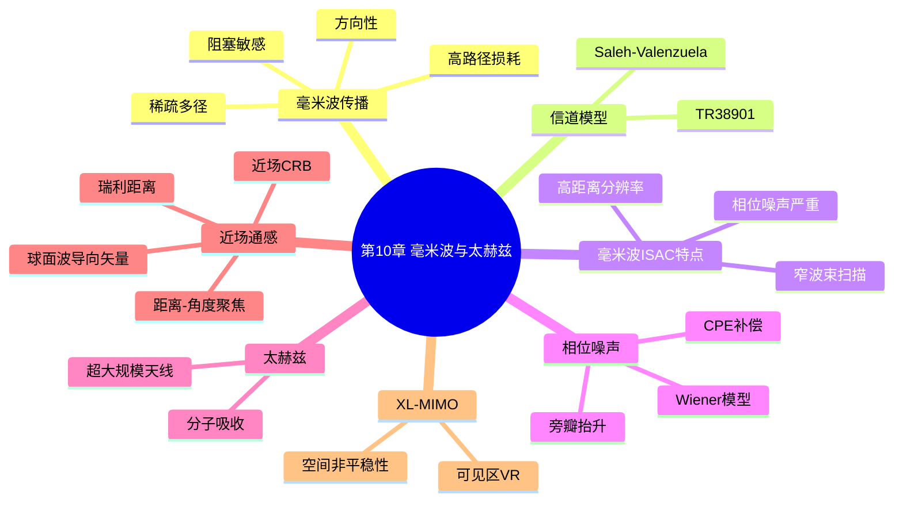
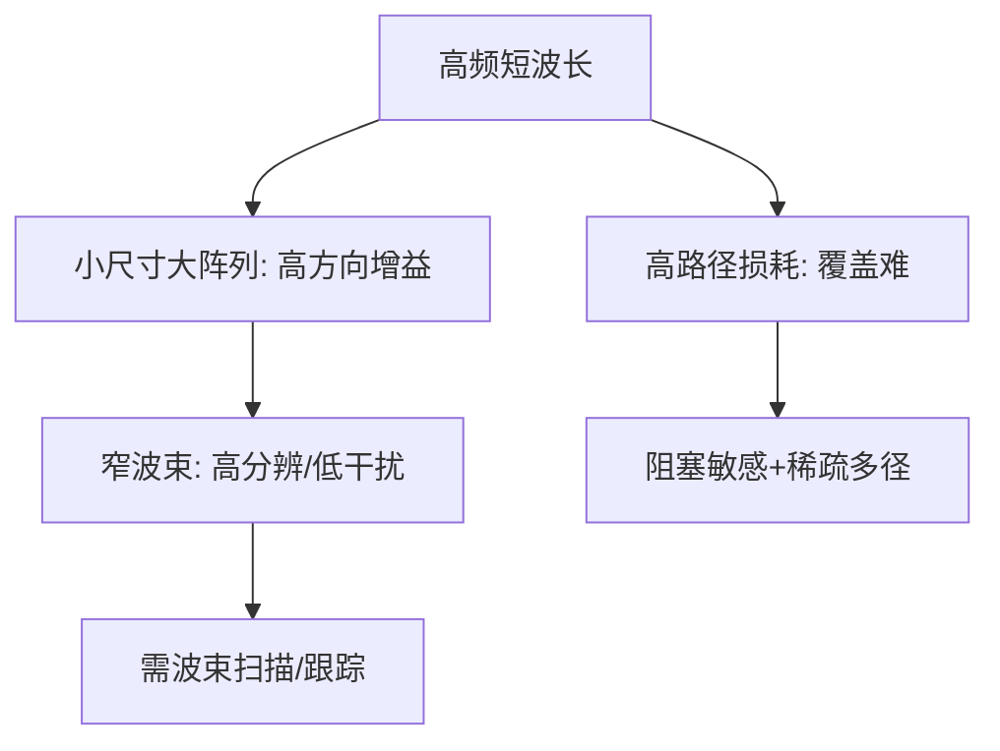
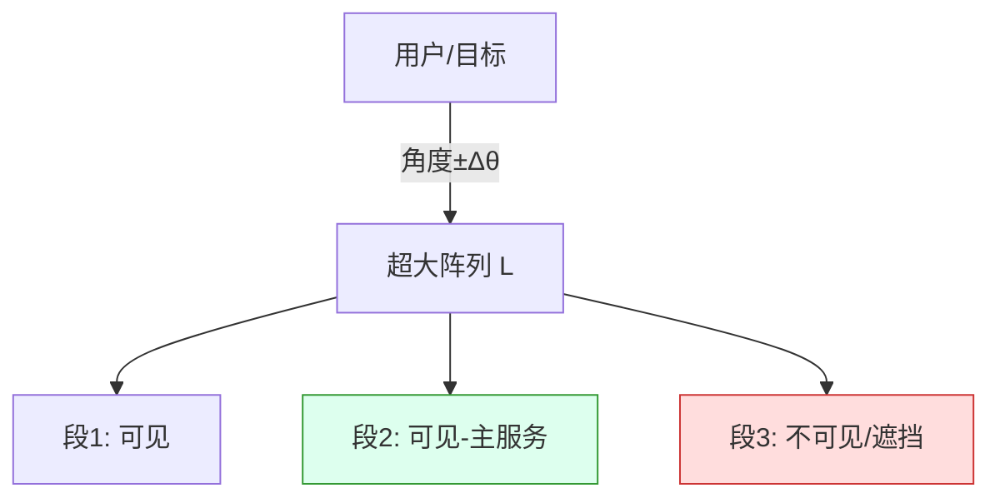

# 第10章 毫米波与太赫兹通感一体化

> **本章导读**
> 第 8、9 章的波束赋形、MIMO 与全双工，大多默认在"中低频、远场、理想相位"假设下讨论。本章进入毫米波（mmWave, 24–100 GHz）与太赫兹（THz, 0.1–10 THz）频段——这是 6G 通感一体化最有前景、也最"难伺候"的空口。频段升高带来三个连锁反应：① 波长短、阵列可集成数十到数百阵元，波束极窄、增益极高，但路径损耗巨大、易被遮挡；② 大带宽带来厘米级甚至亚厘米级距离分辨率，却使相位噪声（phase noise）被严重放大，距离像旁瓣抬升、弱目标被淹没；③ 阵列孔径相对波长不再"远小于"作用距离，近场（near-field）球面波效应凸显，波束不再只控制角度、还能聚焦距离，导向矢量与远场模型根本不同。本章从毫米波传播与 3GPP TR 38.901 信道模型入手，剖析相位噪声对感知的破坏与补偿，再系统讲解太赫兹分子吸收、近场通感一体化（球面波导向矢量、瑞利距离、距离–角度二维聚焦、近场 CRB）以及 XL-MIMO 的空间非平稳性。全章贯穿"直观—建模—算法—伪代码—流程—算例—对比"六步。

**学习目标**
- 理解毫米波传播的高路径损耗、方向性、稀疏多径与阻塞敏感性，能使用 3GPP TR 38.901 模型做链路预算。
- 掌握相位噪声的 Wiener/3GPP 建模，能推导其对距离像旁瓣抬升（Δφ）与 SNR 损失的影响，并实现 CPE 补偿算法。
- 理解太赫兹信道的分子吸收损耗特性及其对作用距离的限制。
- 推导近场球面波导向矢量的二阶泰勒展开，能计算瑞利距离 $2D^2/\lambda$，并理解距离–角度二维聚焦与近场 CRB。
- 理解 XL-MIMO 的空间非平稳性与可见区（Visible Region, VR）概念。

**本章知识图谱**



## 10.1 毫米波传播特性

**直观引入**：把频率从 3.5 GHz 提到 28 GHz，波长从 8.6 cm 缩到 1.07 cm。波长变短有两个直接后果：自由空间路径损耗按频率平方增大（约高 18 dB），但同样物理尺寸的天线阵列能塞进更多阵元、波束更窄更尖锐。毫米波因此"又聋又尖"——传不远，但一旦对准就极灵敏。这种特性对通信是挑战（覆盖难），对感知却是礼物（高分辨、低干扰）。

**数学建模**：自由空间路径损耗（Free Space Path Loss, FSPL）为

$$ {\rm FSPL(dB)}=20\log_{10}(d)+20\log_{10}(f_c)+92.45, \tag{10-1} $$

其中 $d$ 单位为 km、$f_c$ 单位为 MHz。频率每翻一倍，FSPL 增加 6 dB。毫米波还呈现**稀疏多径**（多径分量少、以直射径为主）与**强阻塞敏感性**（人体、树叶、雨衰都能造成 10–30 dB 额外衰减），因此通信高度依赖波束对准与反射路径。

**图 10-1　毫米波传播四大特性**



## 10.2 毫米波信道模型：3GPP TR 38.901 与扩展

**直观引入**：要评估 ISAC 在毫米波下的性能，必须有一个可信的信道模型。3GPP TR 38.901 是 5G NR 毫米波信道的标准化模型，采用簇（cluster）结构描述多径；其数学本质是 Saleh–Valenzuela（SV）模型的几何化扩展。对 ISAC 而言，标准模型还需补上"目标散射"这一项（第 3、5 章已铺垫）。

**数学建模**：毫米波多径信道可写为簇-射线（cluster-ray）叠加：

$$ \mathbf{H}(t)=\sum_{c=1}^{C}\sum_{\ell=1}^{L_c}g_{c,\ell}\,\mathbf{a}_R(\theta_{c,\ell})\mathbf{a}_T^{\mathrm H}(\phi_{c,\ell})\,e^{j2\pi f_{c,\ell} t}, \tag{10-2} $$

其中 $C$ 为簇数、$L_c$ 为簇内射线数、$g_{c,\ell}$ 复增益、$\theta_{c,\ell}/\phi_{c,\ell}$ 为到达/离开角、$f_{c,\ell}$ 多普勒。3GPP TR 38.901 给出各场景（UMi/UMa/RMa/Indoor）下的路径损耗、阴影、K 因子与角度扩展参数表。典型视距（LOS）路径损耗模型：

$$ {\rm PL_{UMi\text{-}LOS}(dB)}=32.4+21\log_{10}(d_{3\rm D})+20\log_{10}(f_c/1{\rm GHz}). \tag{10-3} $$

**对 ISAC 的扩展**：在标准通信信道上叠加确定性目标分量（第 5 章模型）：

$$ \mathbf{H}_{\rm ISAC}(t)=\mathbf{H}_{\rm comm}(t)+\alpha\,\mathbf{a}_R(\theta_t)\mathbf{a}_T^{\mathrm H}(\theta_t)\,e^{j2\pi f_{d,t}t}, \tag{10-4} $$

该式把"通信多径 + 感知目标回波"统一在同一矩阵中，是毫米波 ISAC 仿真与标准评估的基础。

## 10.3 毫米波 ISAC 的特点

**直观引入**：毫米波给 ISAC 同时带来"三高"与"三难"。三高：高距离分辨率（大带宽）、高角度分辨率（大孔径）、高感知增益（窄波束）。三难：路径损耗高（覆盖）、波束窄需扫描（刷新率）、相位噪声高（相干性破坏）。下面用链路预算把"三高"量化。

### 例 10-1：毫米波链路预算算例

参数：$f_c=28$ GHz，距离 $d=100$ m，发射功率 $P_t=30$ dBm，发射/接收天线增益各 $G_t=G_r=20$ dBi，带宽 $B=100$ MHz，噪声系数 NF=6 dB。

**FSPL**（用 (10-1)，$d=0.1$ km，$f_c=28000$ MHz）：
$$ {\rm FSPL}=20\log_{10}(0.1)+20\log_{10}(28000)+92.45=-20+88.94+92.45=161.39\ {\rm dB}. $$

**接收功率**：$P_r=P_t+G_t+G_r-{\rm FSPL}=30+20+20-161.39=-91.39$ dBm。

**噪声基底**：$P_N=-174+10\log_{10}(10^8)+6=-174+80+6=-88$ dBm。

**SNR（含天线增益）**：$=-91.39-(-88)=-3.39$ dB（为负！）。

> **结论**：即便用了 20 dBi 的高增益天线，28 GHz、100 m 处的 SNR 仍为负——说明毫米波 ISAC 仅靠天线增益不够，必须依靠**数字/混合波束赋形再提供约 10 dB 以上相干增益**（即联合波束对准目标与用户），才能使 SNR 转正。这正是第 8 章混合波束赋形在毫米波下从"可选项"变为"必选项"的根本原因；同时大带宽 100 MHz 把噪声基底抬高到 $-88$ dBm，也凸显了感知需在"分辨率（大 B）"与"灵敏度（低 B）"间权衡。

## 10.4 相位噪声建模与补偿

### 10.4.1 相位噪声模型（Wiener / 3GPP）

**直观引入**：射频本振（LO）不是理想单频，其相位会随机游走、抖动，这就是相位噪声。中低频下它影响微弱，但在毫米波 + 大带宽下，一个微小的相位抖动会被"距离像处理"放大成严重的旁瓣，把弱目标淹没。建模它，才能补偿它。

**Wiener 过程模型**：相位噪声过程 $\phi(t)$ 满足

$$ \phi[n]=\phi[n-1]+w[n],\qquad w[n]\sim\mathcal{N}(0,\sigma_w^2), \tag{10-5} $$

即随机游走（积分后的相位）。3GPP 38.901 以功率谱密度（PSD）$L(f)$（单位 dBc/Hz，相对载波功率）分段描述：典型 28 GHz 振荡器在 1 MHz 频偏处 $L(1{\rm MHz})\approx -90$ dBc/Hz，越靠近载波相位噪声越强（"粉红噪声"型）。对 OFDM 系统，相位噪声在每个 OFDM 符号内近似为常数分量（**公共相位误差 CPE**）加逐子载波快变化分量（**残余相位噪声 ICI**）。

### 10.4.2 相位噪声对感知的影响（Δφ 与 SNR 损失）

**数学建模**：设理想距离像为 $Y_k=|X_k|e^{j0}$（目标峰在 bin $k$），受相位噪声污染后 $Y_k=|X_k|e^{j\Delta\phi_k}$。当 $\Delta\phi_k$ 不为零且逐距离单元相关度低时，本该为零的空距离单元出现残余相位旋转，其能量泄漏形成**距离旁瓣抬升**。对小角度 $\Delta\phi$，旁瓣底抬升至约

$$ {\rm SidelobeLift}\approx 20\log_{10}(\sigma_\phi)\ {\rm dB}\quad(\sigma_\phi\ll1), \tag{10-6} $$

即相位噪声标准差 $\sigma_\phi$ 直接决定旁瓣抬升量。同时，目标主峰因 CPE 被整体旋转、因 ICI 被部分散射到其他 bin，导致**峰值 SNR 损失**约为

$$ \Delta{\rm SNR}\approx 10\log_{10}\!\big(e^{-\sigma_{\rm ICI}^2}\big)\approx -4.34\,\sigma_{\rm ICI}^2\ {\rm dB}. \tag{10-7} $$

> **结论**：相位噪声对感知的危害主要是"**旁瓣抬高→弱目标检测概率骤降**"，而非主峰 SNR 的显著损失——这与通信（主要关心 EVM/峰值）的受损机制不同，是 ISAC 在毫米波下必须正视的独特问题。

### 例 10-2：相位噪声导致的距离旁瓣抬升数值

设某低成本 28 GHz 振荡器，单 OFDM 符号内 CPE 标准差 $\sigma_{\rm cpe}=8^\circ=0.14$ rad，残余 ICI 标准差 $\sigma_{\rm ICI}=2^\circ=0.035$ rad。

**未补偿时**：旁瓣抬升按 (10-6) 约 $20\log_{10}(0.14)=-17$ dB（理想无相位噪声时旁瓣常达 $-40$ dB，现被抬到约 $-17$ dB）；峰值 SNR 损失按 (10-7) 约 $-4.34\times0.035^2=-0.005$ dB（可忽略）。可见弱目标（回波低于 $-25$ dB 的相对电平）将被 $-17$ dB 旁瓣完全掩盖。

**CPE 补偿后**：CPE 被估计并扣除，残余仅剩 $\sigma_{\rm ICI}=0.035$ rad，旁瓣抬升改善至 $20\log_{10}(0.035)=-29$ dB，相比未补偿改善 12 dB；此时 $-25$ dB 的弱目标重新可辨。这直观说明 **CPE 补偿是毫米波 ISAC 的性价比最高的第一步相位校正**。

**图 10-2　相位噪声对距离像的影响与 CPE 补偿**

```mermaid
flowchart LR
    A[理想距离像: 主峰+低旁瓣] --> B[加相位噪声: 旁瓣抬升/主峰旋转]
    B --> C[CPE估计: 用导频/峰值估相位]
    C --> D[补偿: 乘 exp(-j*CPE)]
    D --> E[残余旁瓣降至 ICI 水平]
```

### 10.4.3 CPE 补偿算法与伪代码

**算法步骤**：对每一 OFDM 符号，(1) 在已知导频/数据子载波上估计接收符号与理想（信道均衡后）之比的相位；(2) 对多子载波相位取平均得到 CPE 估计 $\hat\phi$；（3) 全符号乘 $e^{-j\hat\phi}$ 补偿。

**算法 10-1：OFDM ISAC 的 CPE 补偿**

```text
算法 10-1：CPE_Compensation(Y, H_est, X_pilot, pilot_idx)
# 输入: 频域接收 Y(K×1), 信道估计 H_est(K×1), 已知导频 X_pilot, 导频索引 pilot_idx
# 输出: CPE补偿后的 Y_cmp
1  for 每个OFDM符号:
2      Yp = Y[pilot_idx]                    # 取导频处接收
3      Xp = X_pilot                         # 已知导频符号
4      Hp = H_est[pilot_idx]                # 导频处信道估计
5      Zp = Yp / (Hp * Xp)                  # 均衡后应有 Zp≈exp(j*CPE)
6      phi_hat = angle( mean( Zp ) )        # 对导频平均得CPE估计
7      Y_cmp = Y * exp(-1j * phi_hat)       # 全符号补偿
8  return Y_cmp
```

> ⚠️ **注意**：CPE 补偿只能纠正"整个符号共同的相位旋转"，无法消除 ICI（子载波间相位噪声的差分分量）。要进一步压制残余旁瓣，需在波形层用低相位噪声 LO、或算法层用基于深度学习的相位恢复（第 16 章）、或对距离像做旁瓣抑制（第 13 章 CFAR 前的加窗/迭代消瓣）。

## 10.5 太赫兹 ISAC：分子吸收与超大规模天线

**直观引入**：频率继续升到 0.1–10 THz，波长进入毫米以下。太赫兹兼具"更高带宽（数十 GHz）、更窄波束、更强方向性"的感知优势，却撞上两道墙：① 大气分子（主要是水蒸气 H₂O、氧气 O₂）在特定频点有强烈**共振吸收**，把能量变成热；② 衍射受限极严重，几乎只能视距传播。这使得 THz ISAC 更适合短距、高精场景（如室内定位、材料成像、近场安检），而非广域覆盖。

**分子吸收损耗**：在频率 $f$ 处，大气衰减系数 $\alpha_{\rm abs}(f)$（dB/m）由分子吸收线叠加而成，典型在 0.3–1 THz 对干燥空气约 0.01–0.1 dB/m，在吸收峰（如 325 GHz 附近水 vapor、557 GHz 附近 O₂）可骤升至数 dB/m 甚至更高。

### 例 10-3：太赫兹分子吸收的距离限制

取 $f=300$ GHz（λ=1 mm），干燥空气吸收系数 $\alpha_{\rm abs}=0.05$ dB/m（保守估计，避开强吸收峰）。传输距离 $d=10$ m 时吸收损耗 $=0.05\times10=0.5$ dB（轻微）；但若处于湿度较高或靠近吸收峰（如 $\alpha_{\rm abs}=2$ dB/m），$10$ m 即损失 20 dB，作用距离被压缩到数米。再以 FSPL 计（(10-1)，$f_c=3\times10^5$ MHz，$d=0.01$ km）：
$$ {\rm FSPL}=20\log_{10}(0.01)+20\log_{10}(3\times10^5)+92.45=-40+109.5+92.45=161.95\ {\rm dB}. $$
可见 300 GHz 在 10 m 处的自由空间损耗已与 28 GHz 在 100 m 处相当——**THz 用"极短距离"换取"极大带宽与分辨率"**，其 ISAC 范式天然是近场、高精、短距的。

## 10.6 近场通感一体化

### 10.6.1 近场球面波导向矢量与二阶泰勒展开

**直观引入**：远场假设"目标在无穷远，来波是平面波"——所有阵元收到的只是相位随位置线性变化。但当天线孔径 $D$ 与作用距离 $R$ 可比（$R$ 小于瑞利距离）时，波前是球面，相位随阵元位置呈**二次**关系，且同时依赖于"角度"和"距离"。这意味着近场波束能在一个具体的距离上也聚焦能量——这是远场波束做不到的，也是近场感知/通信的独特能力。

**数学建模**：设 ULA 沿 $x$ 轴，参考阵元在原点，第 $n$ 个阵元坐标 $x_n=nd$，源点距参考阵元距离 $r$、方位角 $\theta$。该阵元到源点的真实距离为

$$ r_n=\sqrt{r^2+x_n^2-2rx_n\sin\theta}. \tag{10-8} $$

球面波导向矢量第 $n$ 个分量为 $e^{-j\frac{2\pi}{\lambda}r_n}$。对 $x_n/r\ll1$ 作二阶泰勒展开：

$$ r_n\approx r-x_n\sin\theta+\frac{x_n^2\cos^2\theta}{2r}. \tag{10-9} $$

代入相位得近场导向矢量

$$ \mathbf{a}_{\rm NF}(r,\theta)=\big[e^{-j\frac{2\pi}{\lambda}(r-x_n\sin\theta+\frac{x_n^2\cos^2\theta}{2r})}\big]_{n=0}^{N-1}. \tag{10-10} $$

相比远场 $\mathbf{a}(\theta)=[e^{j\frac{2\pi}{\lambda}nd\sin\theta}]$，近场多出**与 $x_n^2/(2r)$ 成正比的距离相关项**——它正是波束能"聚焦到特定距离"的来源。

### 例 10-4：近场与远场导向矢量差异量化

取 $f_c=28$ GHz（$\lambda=0.0107$ m）、$N=64$、$d=\lambda/2=0.00536$ m，孔径 $D=(N-1)d=0.338$ m。考察边缘阵元 $x_{63}=0.338/2=0.169$ m，源点正前方 $\theta=0^\circ$、距离 $r=10$ m（属近场，见例 10-5）。

- **远场模型**相位（仅线性项）：$\phi_{\rm FF}=-\frac{2\pi}{\lambda}x_{63}\sin0^\circ=0$。
- **近场模型**相位（用 (10-9) 取二次顶）：$\Delta r=\frac{x_{63}^2}{2r}=\frac{0.169^2}{20}=0.00143$ m，相位 $\phi_{\rm NF}=-\frac{2\pi}{\lambda}\Delta r=-\frac{2\pi}{0.0107}\times0.00143=-0.838$ rad（约 $-48^\circ$）。

**结论**：在 10 m、边缘阵元处，远场模型会"漏算"约 0.84 rad（48°）的相位——若用远场波束赋形去对准该近场目标，波束会严重失配、增益骤降。这定量说明了近场效应在数十米处已不可忽略，必须用 (10-10) 的球面波模型。

### 10.6.2 瑞利距离与近场范围

**数学建模**：远场/近场分界由**瑞利距离**（瑞利判据）给出：

$$ z_R=\frac{2D^2}{\lambda}, \tag{10-11} $$

其中 $D$ 为阵列孔径。当作用距离 $R<z_R$ 时为近场，需用球面波模型。

### 例 10-5：瑞利距离数值

沿用 $D=0.338$ m、$\lambda=0.0107$ m：
$$ z_R=\frac{2\times0.338^2}{0.0107}=\frac{2\times0.1142}{0.0107}=\frac{0.2284}{0.0107}\approx21.3\ {\rm m}. $$
即该 64 阵元 28 GHz 阵列的近场延伸到约 21 m！换句话说，在典型室内/园区 ISAC 场景（数米到二十米）中，目标几乎总落在近场——**近场模型不是理论点缀，而是毫米波 ISAC 的常态**。若改用更低频 3.5 GHz（$\lambda=0.086$ m），则 $z_R=2\times0.1142/0.086=2.66$ m，近场仅在贴脸距离，远场近似成立；这再次印证高频是大孔径近场效应的放大器。

### 10.6.3 距离–角度二维聚焦与近场 CRB

**直观引入**：远场波束赋形只能选"角度"，近场则能同时选"角度 + 距离"，即在三维空间里把一个能量焦点钉在 $(r,\theta)$ 上。这对感知意味着：可以同时区分"同一角度、不同距离"的两个目标（远场做不到），极大提升角度模糊下的分辨力。

**距离–角度二维聚焦**：令发射与接收均用近场导向矢量，则双程（MIMO）近场响应为 $\mathbf{a}_{\rm NF}^R(r,\theta)\mathbf{a}_{\rm NF}^{T}(r,\theta)^{\mathrm H}$，优化权重使该响应在目标 $(r_0,\theta_0)$ 最大、其余 $(r,\theta)$ 抑制，即得二维聚焦波束。

**近场 CRB**：对距离–角度联合估计，Fisher 信息矩阵包含 $\partial\mathbf{a}_{\rm NF}/\partial r$ 与 $\partial\mathbf{a}_{\rm NF}/\partial\theta$ 两项。由于近场导向矢量对 $r$ 的依赖（二次相位项），其关于距离的敏感度在 $R<z_R$ 时显著增强，因而**近场距离估计的 CRB 远优于远场**——这是近场感知分辨率增益的数学根源。定性结论：近场使系统获得"距离维"的自由度，CRB 随 $1/(r^2\cos^4\theta)$ 量级改善（依赖阵列几何），为高精定位（第 17 章）提供物理基础。

**图 10-3　远场（仅角度）vs 近场（距离–角度二维）波束**


## 10.7 XL-MIMO 与全息 MIMO：空间非平稳性与可见区

**直观引入**：当阵元数从数十飙到数百乃至上千（超大规模 MIMO, Extra-Large MIMO, XL-MIMO；以及连续口径的全息 MIMO, Holographic MIMO），阵列物理尺寸远大于散射环境的相关距离，于是"阵列上不同位置看到的信道统计特性不同"——这就是**空间非平稳性（spatial non-stationarity）**。与之相伴的是**可见区（Visible Region, VR）**：对某个用户/目标，只有阵列上正对它的那一段"看得见"它，其余部分被遮挡或角度超出。这颠覆了传统 MIMO"整阵共享同一信道"的假设。

**数学建模**：将 XL-MIMO 阵列分为 $S$ 段，第 $s$ 段仅在用户角度落入其可见扇区时才参与服务，即

$$ \mathbf{a}^{(s)}(\theta)\ \text{有效} \iff \theta\in{\rm VR}_s, \qquad {\rm VR}_s=[\theta_{s}^{\min},\theta_{s}^{\max}]. \tag{10-12} $$

有效信道是各段导向矢量在可见区上的拼接，而非全阵列统一模型。

### 例 10-6：XL-MIMO 可见区数值

设 XL-MIMO 阵列长 $L=256\times d=256\times0.00536=1.37$ m（28 GHz，64 倍于例 10-5 孔径）。用户位于距离 $R=5$ m、正前方，到达角扩展为 $\pm\Delta\theta$（取 $\Delta\theta=3^\circ$）。可见区在阵列上的空间跨度约为

$$ W_{\rm vis}\approx 2R\tan(\Delta\theta)=2\times5\times\tan3^\circ=10\times0.0524=0.524\ {\rm m}. $$

由于 $W_{\rm vis}=0.524\ {\rm m}<L=1.37\ {\rm m}$，**只有阵列中间约 0.524/1.37≈38% 的阵元真正"看见"该用户**，其余阵元要么角度超出、要么被遮挡。若用户退到 $R=30$ m：$W_{\rm vis}=2\times30\times0.0524=3.14\ {\rm m}>L$，此时整阵可见。这说明：近距用户触发强空间非平稳性，波束赋形与信道估计必须"按可见区分段处理"，传统全阵列 ZF/MMSE 会浪费甚至被无效阵元拖累。

**图 10-4　XL-MIMO 空间非平稳性与可见区**



> **结论**：XL-MIMO/全息 MIMO 把"阵列分段、按可见区服务"变成常态，这与第 8 章全阵列联合波束赋形形成对照——高频大阵列下，波束赋形对象从"整个天线矩阵"退化为"用户在可见区内的有效子阵"。这为近场+非平稳联合建模（如基于可见区的近场波束聚焦）打开了新空间，也是 6G 通感空口从"阵列信号处理"走向"连续电磁口径智能表面"的必经之路。

## 本章小结

本章把 ISAC 推入毫米波与太赫兹高频段，揭示了三个层级的新物理。第一层是**传播与链路**：毫米波高路径损耗、稀疏多径、阻塞敏感，28 GHz/100 m 链路预算显示即便用 20 dBi 天线 SNR 仍为负，必须依赖混合波束赋形（第 8 章）补增益；3GPP TR 38.901 的簇-射线模型（式 10-2、10-3）是标准化评估基础，ISAC 只需在其上叠加目标散射项（式 10-4）。第二层是**相位噪声**：用 Wiener/3GPP 模型描述，其通过公共相位误差 CPE 与残余 ICI 抬升距离旁瓣（式 10-6、10-7），主峰 SNR 损失小但弱目标被淹没；CPE 补偿（算法 10-1）以最低代价恢复约 12 dB 旁瓣余量（例 10-2）。第三层是**近场与超大阵列**：瑞利距离 $z_R=2D^2/\lambda$（例 10-5 显示 28 GHz/64 阵元近场达 21 m，是 ISAC 常态）；近场球面波导向矢量（二阶泰勒展开式 10-9、10-10）使波束能距离–角度二维聚焦、近场 CRB 显著优于远场；XL-MIMO 的空间非平稳性与可见区（例 10-6）则要求按可见子阵分段处理。太赫兹的分子吸收（例 10-3）把作用距离压缩到数米，确立其"近场高精短距"的 ISAC 范式。全章贯穿六步讲授法，为第 11–16 章的感知算法与第 19 章硬件非理想因素提供了高频段物理背景。

## 习题

### A. 基础概念题

**A1.** 为什么毫米波 FSPL 随频率平方增大？这对 ISAC 覆盖意味着什么？

**A2.** 3GPP TR 38.901 信道模型与 Saleh–Valenzuela 模型的关系是什么？ISAC 如何扩展它？

**A3.** 相位噪声的 CPE 与 ICI 分别指什么？为何 CPE 补偿对感知收益最大？

**A4.** 式 (10-6) 中旁瓣抬升为何正比于相位噪声标准差？相位噪声主要损害主峰还是弱目标？

**A5.** 太赫兹分子吸收的来源是什么？它如何限制 THz ISAC 的作用距离？

**A6.** 瑞利距离 $2D^2/\lambda$ 的物理含义是什么？为何高频大阵列近场是"常态"？

**A7.** 近场导向矢量相比远场多出什么项？它使波束多了哪一维自由度？

**A8.** 什么是 XL-MIMO 的空间非平稳性与可见区（VR）？为何传统全阵 ZF 会失效？

### B. 推导与计算题

**B1.** 由 Friis/FSPL 推导 (10-1)。若 $f_c$ 从 3.5 GHz 升到 28 GHz（同距离），FSPL 增加多少 dB？

**B2.** 用 (10-3) 计算 28 GHz、距离 50 m 的 UMi LOS 路径损耗，并与 (10-1) 自由空间结果比较（说明差异来源）。

**B3.** 设相位噪声使旁瓣抬升至 $-17$ dB（对应 $\sigma_\phi=0.14$），若要求弱目标检测需旁瓣低于 $-30$ dB，求所需残余 $\sigma_\phi$ 上限与相对改善倍数。

**B4.** 推导近场距离二阶展开 (10-9)：从 $r_n=\sqrt{r^2+x_n^2-2rx_n\sin\theta}$ 出发，令 $\epsilon=x_n/r$ 做泰勒展开至二阶。

**B5.** 计算 $N=128$、$d=\lambda/2$、$f_c=60$ GHz 阵列的孔径 $D$、瑞利距离 $z_R$，并判断 $R=15$ m 处是远场还是近场。

**B6.** XL-MIMO 阵列 $L=2$ m（28 GHz），用户 $R=8$ m、到达角扩展 $\pm4^\circ$，求可见区空间跨度 $W_{\rm vis}$ 并指出其与 $L$ 的关系及工程含义。

**B7.** 对近场 CRB，定性说明为何 $\partial\mathbf{a}_{\rm NF}/\partial r$ 在近场更强；若阵列孔径加倍（$D\to2D$），$z_R$ 与近场聚焦增益如何变化？

### C. 算法与编程题

**C1.** 实现 CPE 补偿仿真：构造 64 子载波 OFDM 距离像，叠加 CPE（$\sigma=8^\circ$）与 ICI（$\sigma=2^\circ$）相位噪声，画出补偿前后的距离像旁瓣，并量化 SNR 改善。

**C2.** 编写近场导向矢量生成与二维聚焦波束设计：对 $N=32$、$f=28$ GHz，在 $(r,\theta)=(8{\rm m},10^\circ)$ 处聚焦，画出距离–角度二维波束幅度图，对比远场波束（仅角度）。

**C3.** 编写 XL-MIMO 可见区分段波束赋形：阵列 $L=1.37$ m、用户 $R=5$ m、$\Delta\theta=3^\circ$，按可见区识别有效子阵，对有效子阵做 MRT，比较其与全阵列 MRT 的输出 SNR（假设不可见段为纯噪声）。

## 答案与解析

**A1.** FSPL 公式 (10-1) 中 $20\log_{10}(f_c)$ 项表明损耗随频率线性（dB 域）增长、即随频率平方（线性域）增长，因波长 $\lambda=c/f_c$ 变短、孔径相对波长变小、有效各向同性增益降低。对 ISAC 意味着覆盖急剧收缩，必须靠大阵列高增益与波束赋形弥补，且感知需更密集的波束扫描/跟踪。

**A2.** TR 38.901 是 SV 模型的几何标准化版本：SV 用簇-射线叠加描述多径，38.901 进一步规定了各场景（UMi/UMa 等）的簇数、角度扩展、时延、K 因子等参数分布。ISAC 扩展是在通信多径矩阵 (10-2) 上叠加确定性目标散射项 (10-4)，使同一信道模型同时承载通信与感知。

**A3.** CPE（Common Phase Error）是一个 OFDM 符号内所有子载波共有的相位旋转（来自相位噪声低频分量）；ICI（Inter-Carrier Interference）是子载波间由相位噪声高频分量引起的串扰。CPE 把整个距离像整体旋转、并均抬旁瓣，补偿它（算法 10-1）即可回收全部 CPE 对应的旁瓣余量，收益最大；ICI 需更复杂处理。

**A4.** 小角度下，随机相位 $e^{j\Delta\phi}$ 的虚部/残余能量正比于 $\Delta\phi$ 本身，故泄漏到空 bin 的能量 $\propto\sigma_\phi^2$，换算 dB 即 $20\log_{10}\sigma_\phi$。相位噪声主要损害弱目标（被抬升的旁瓣掩盖），对主峰 SNR 影响很小（式 10-7 中 $\sigma_{\rm ICI}$ 很小）。

**A5.** 来源是大气分子（H₂O、O₂ 等）在特定频率的共振吸收，把电磁波能量转化为分子热运动。吸收系数在吸收峰可达数 dB/m，使 THz 信号在数米内即大幅衰减，作用距离被严格限制在短距，故 THz ISAC 定位为近场高精短距范式。

**A6.** 瑞利距离 $z_R=2D^2/\lambda$ 是远场/近场分界：小于它时球面波曲率不可忽略。高频（λ 小）且大孔径（D 大）使 $2D^2/\lambda$ 很大——如例 10-5 达 21 m，远超典型室内/园区距离，故近场成为常态。

**A7.** 近场多出与 $x_n^2/(2r)$ 成正比的距离相关二次相位项（式 10-9）。这使波束除"角度"外还能控制"距离"，即获得距离维自由度，可实现距离–角度二维聚焦。

**A8.** 空间非平稳性指 XL-MIMO 上不同位置看到的信道统计不同；可见区指某用户只对阵列中正对其的一段可见、其余被遮挡/超角。传统全阵 ZF 假设整阵共享同一信道、对所有阵元同等有效，但在非平稳下无效阵元引入噪声/干扰，反而降低性能，必须按 VR 分段。

---

**B1.** 由 Friis：$P_r=P_tG_tG_r(\lambda/4\pi d)^2$，自由空间损耗 $L=1/G_tG_r\cdot(4\pi d/\lambda)^2$，取 dB：$10\log_{10}((4\pi)^2)+20\log_{10}(d)-20\log_{10}(\lambda)$。用 $\lambda=c/f$、$c=3\times10^8$ 代入得 $20\log_{10}(d_{\rm m})+20\log_{10}(f_{\rm Hz})-147.55$；换算 $d$ 用 km、$f$ 用 MHz 即 (10-1)。$f$ 从 3.5→28 GHz（8 倍）：$20\log_{10}(8)=18.06$ dB，FSPL 增加约 18 dB。

**B2.** (10-3)：$32.4+21\log_{10}(50)+20\log_{10}(28)=32.4+21\times1.699+20\times1.447=32.4+35.68+28.94=97.0$ dB。(10-1)：$20\log_{10}(0.05)+20\log_{10}(28000)+92.45=-26+88.94+92.45=155.4$ dB。差异约 58 dB——因 (10-1) 是"各向同性天线对点"自由空间，而 (10-3) UMi-LOS 已隐含发射/接收增益与场景几何（通常链路预算中另加天线增益），二者比较须在同一天线假设下；这里的差距主要来自 38.901 模型不重复计入全向基准、且含场景经验修正。

**B3.** 需旁瓣 $<-30$ dB 即 $20\log_{10}\sigma_\phi<-30\Rightarrow\sigma_\phi<10^{-1.5}=0.0316$ rad。当前 $\sigma=0.14$，需降至 0.0316，改善倍数 $0.14/0.0316\approx4.4$ 倍（即 CPE 补偿后残余需再降约 4.4 倍，对应例 10-2 中 CPE 补偿把 0.14 降到 ICI 0.035 已基本满足）。

**B4.** 令 $\epsilon=x_n/r$，$r_n=r\sqrt{1+\epsilon^2-2\epsilon\sin\theta}$。对 $\epsilon\ll1$：$\sqrt{1+u}\approx1+u/2-u^2/8$，$u=\epsilon^2-2\epsilon\sin\theta$。则 $r_n\approx r[1+(\epsilon^2-2\epsilon\sin\theta)/2-(\epsilon^2-2\epsilon\sin\theta)^2/8]$。取至 $\epsilon^1,\epsilon^2$：$1-\epsilon\sin\theta+\epsilon^2/2$（忽略 $\epsilon^2\sin^2\theta$ 高阶与交叉项主部）+ ... 实际 $\epsilon^2$ 项：$r\cdot[\epsilon^2/2-\epsilon^2\sin^2\theta/2+\dots]=r\epsilon^2(1-\sin^2\theta)/2=r\epsilon^2\cos^2\theta/2=x_n^2\cos^2\theta/(2r)$。故 $r_n\approx r-x_n\sin\theta+x_n^2\cos^2\theta/(2r)$，即 (10-9)。

**B5.** $d=\lambda/2$，$f=60$ GHz：$\lambda=3e8/60e9=0.005$ m，$d=0.0025$ m。$D=(128-1)\times0.0025=0.3175$ m。$\lambda=0.005$ m，$z_R=2\times0.3175^2/0.005=2\times0.1008/0.005=40.3$ m。$R=15<40.3$，故 $R=15$ m 处为**近场**。

**B6.** $W_{\rm vis}=2R\tan\Delta\theta=2\times8\times\tan4^\circ=16\times0.0699=1.12$ m。与 $L=2$ m 比较：$W_{\rm vis/L=0.56$，即约 56% 阵元可见。工程含义：该近距用户触发明显空间非平稳，有效服务子阵仅为中段约 1.12 m 一段，波束赋形与信道估计应限定在该 VR 内，全阵处理会引入约 44% 的无效/噪声阵元。

**B7.** 近场 $\mathbf{a}_{\rm NF}$ 含 $e^{-j\frac{2\pi}{\lambda}x_n^2\cos^2\theta/(2r)}$ 项，对 $r$ 求导得 $\partial/\partial r\propto x_n^2/r^2$，在 $r<z_R$ 时该项不可忽略且与角度耦合，使 FIM 关于 $r$ 的对角元增大，CRB 降低（分辨率提升）。孔径加倍 $D\to2D$：$z_R\to4z_R$（近场范围扩大 4 倍），且聚焦增益（与孔径平方相关）约增 4 倍（6 dB 量级），距离–角度分辨同步改善。

---

**C1.** 参考框架：

```python
import numpy as np
K=64; rng=np.random.default_rng(0)
ideal=np.zeros(K); ideal[10]=1.0                          # 目标在主峰bin10
cpe=np.deg2rad(8)*rng.standard_normal()                  # 符号级CPE
ici=np.deg2rad(2)*rng.standard_normal(K)                 # 子载波级ICI
rx=ideal*np.exp(1j*(cpe+ici))
# 补偿: 用主峰估计CPE
phi_hat=np.angle(rx[10])
rx_cmp=rx*np.exp(-1j*phi_hat)
print("补偿前旁瓣峰值(dB):",20*np.log10(np.max(np.abs(rx[[i for i in range(K) if i!=10]]))))
print("补偿后旁瓣峰值(dB):",20*np.log10(np.max(np.abs(rx_cmp[[i for i in range(K) if i!=10]]))))
```

**C2.** 框架：按 (10-10) 生成 $\mathbf{a}_{\rm NF}(r,\theta)$ 与远场 $\mathbf{a}(\theta)$，取 $\mathbf{w}=\mathbf{a}_{\rm NF}^*(r_0,\theta_0)$ 做聚焦权重，在 $(r,\theta)$ 网格上计算 $|\mathbf{a}_{\rm NF}^H(r,\theta)\mathbf{w}|^2$ 得二维图；远场仅用 $\mathbf{w}=\mathbf{a}^*(\theta_0)$ 在 $\theta$ 维扫描，对比可见近场在距离维也形成尖峰。

**C3.** 框架：依例 10-6 计算 $W_{\rm vis}=0.524$ m，识别阵列上落在用户 VR 的子阵索引；对有效子阵做 MRT $\mathbf{w}=\mathbf{h}_{\rm eff}/\|\mathbf{h}_{\rm eff}\|$（$\mathbf{h}_{\rm eff}$ 仅取可见段、不可见段置零），计算 SNR $=|\mathbf{h}^{\rm H}\mathbf{w}|^2/\sigma^2$ 与全阵列 MRT 对比，报告有效子阵因避免无效阵元噪声带来的 SNR 改善。
