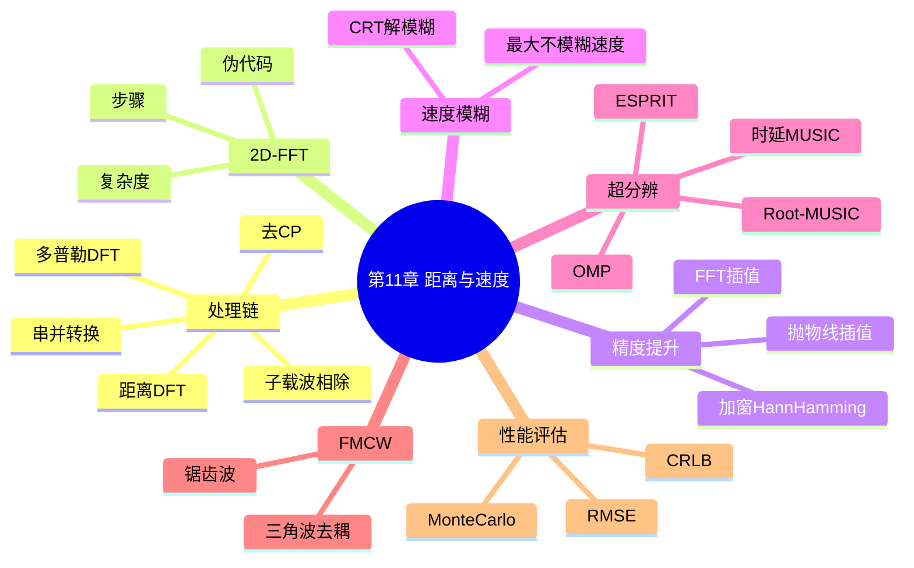
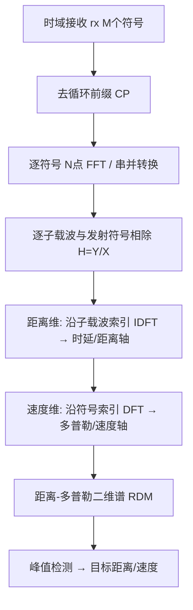

# 第 11 章　距离与速度估计算法

> **本章导读**
> 第 6 章已经给出 OFDM 通感一体化（ISAC）波形"以通信为中心"的框架，第 4 章建立了雷达测距、测速的基本物理原理。本章把这两根线拧到一起：当基站用一组 OFDM 符号同时完成通信与感知时，接收机如何从回波中提取每一个目标的距离与速度？我们把整个处理链拆成"去循环前缀（CP）→ 串并转换 → 逐子载波信道相除 → 距离维变换 → 速度维变换"，并在这一框架下给出 2D-FFT 这一最常用的工程算法，随后延伸到加窗插值、速度模糊解模糊、时延域超分辨，以及 FMCW 差拍信号的距离–速度去耦。最后给出 RMSE 相对 CRLB 的蒙特卡洛评估方法。本章是第三部分"感知算法"的入口，第 12、13 章分别建立在角度与检测维度，本章的距离–速度估计结果是它们的公共输入。

**学习目标**

- 能够推导 OFDM 雷达的回波模型，并写出"去 CP → 串并 → 子载波相除 → 距离 DFT → 多普勒 DFT"的完整处理链。
- 掌握 2D-FFT 算法的步骤、伪代码、流程图与复杂度，能独立完成逐点数值算例。
- 理解加窗与插值（抛物线、FFT 插值）如何提升距离/速度估计精度，以及速度模糊的成因与中国余数定理（CRT）解模糊方法。
- 了解时延域 MUSIC、OMP 等超分辨方法，并与 2D-FFT 做精度/复杂度对比。
- 掌握 FMCW 三角波距离–速度去耦推导，能用蒙特卡洛方法评估 RMSE 相对 CRLB 的性能。

**本章知识图谱**



## 11.1　OFDM 雷达信号处理链

### 11.1.1　直观引入

基站以 OFDM 波形发射，第 $k$ 个子载波、第 $m$ 个符号上承载调制符号 $X[k,m]$。电磁波碰到前方目标后反射回来，接收机在去除 CP、做 FFT 后恢复出每个子载波的频域样值。对通信而言，这一步得到的是"信道估计"；而对感知而言，同一组样值恰好编码了目标的**距离**（体现在子载波间的相位斜率）与**速度**（体现在符号间的相位斜率）。本节要做的，就是把这个物理直觉写成可计算的信号处理链。

在 ISAC 基站的实际部署中，同一套 OFDM 空口同时承载用户数据与感知探测：每个资源粒子（RE）上既有通信调制符号 $X[k,m]$，也叠加了目标回波带来的相位旋转。这正是 ISAC"波形复用（waveform reuse）"的精髓——不必为感知单独占用时频资源。但也正因如此，处理链的每个环节都必须兼顾两端：例如循环前缀 CP 的长度既要满足多径信道的最大时延扩展（通信需求），又要预留最大探测距离的往返时延余量（感知需求），否则远端目标回波会"越界"污染下一个符号，产生距离模糊。把"去 CP → 串并 → 相除 → 两次变换"这五个步骤串起来，本质上是在做一件朴素的事：用已知的发射相位作"尺子"，去量测回波相位相对发射相位的偏移；子载波维的相位偏移斜率给出时延，符号维的相位偏移斜率给出多普勒。理解这一点，后面所有关于分辨率、模糊、插值、超分辨的问题都有了统一的物理锚点。

### 11.1.2　数学建模

设子载波数 $N$，符号数 $M$，子载波间隔 $\Delta f$，载波频率 $f_c$，光速 $c_0$。单个远场点目标、径向距离 $R$、径向速度 $v$（接近为正）时，往返时延

$$
\tau = \frac{2R}{c_0} \tag{11-1}
$$

多普勒频移

$$
f_d = \frac{2v f_c}{c_0} \tag{11-2}
$$

接收端在去除 CP 并做 $N$ 点 FFT 后，第 $k$ 个子载波、第 $m$ 个符号的频域接收样值为

$$
Y[k,m] = H[k,m]\,X[k,m] + W[k,m] \tag{11-3}
$$

其中 $W[k,m]$ 为复加性噪声/干扰。忽略 RCS 起伏与信道多径，目标信道频率响应为

$$
H[k,m] = \alpha \,\exp\!\left(-j2\pi k\,\Delta f\,\tau\right)\,\exp\!\left(j2\pi m\,f_d\,T_{\rm s}\right) \tag{11-4}
$$

这里 $T_{\rm s}$ 为慢时间采样间隔（相邻符号间隔，含 CP），$\alpha$ 含路径损耗与 RCS。注意第一项只与子载波索引 $k$ 有关、第二项只与符号索引 $m$ 有关——这正是距离与速度在频域/时域**可分离**的根本原因：距离信息藏在子载波间的相位里，速度信息藏在符号间的相位里。

### 11.1.3　算法分步

对已知发射符号 $X[k,m]$，处理链如下：

1. **去 CP**：丢弃每个 OFDM 符号前 $N_{\rm cp}$ 个循环前缀样值。
2. **串并转换（S/P）**：将 $M$ 个时域符号分别做 $N$ 点 FFT，得到 $N\times M$ 的频域矩阵 $Y[k,m]$。
3. **子载波相除（信道估计）**：在通信侧已知的参考资源上做 $\hat H[k,m]=Y[k,m]/X[k,m]$；对感知而言，只要 $X[k,m]\neq 0$ 即可逐点相除，得到含目标相位的目标信道矩阵 $\hat H[k,m]$。
4. **距离维变换**：固定 $m$，对 $k=0,\dots,N-1$ 做 $N$ 点 IDFT（或 DFT），把"频率（子载波）"映射成"时延/距离"轴。
5. **速度维变换**：固定每个距离单元，对 $m=0,\dots,M-1$ 做 $M$ 点 DFT，把"符号序号"映射成"多普勒/速度"轴。
6. **二维谱**：得到 $N\times M$ 的"距离–多普勒图（RDM）"，峰值位置即目标的距离与速度。

> **结论**：OFDM 感知的本质是两次独立的傅里叶变换——先沿子载波轴把频率相位斜率变成时延，再沿符号轴把慢时间相位斜率变成多普勒。两次变换可交换顺序，工程上常先"逐符号距离 FFT"再"逐距离单元多普勒 FFT"。

### 11.1.4　伪代码（处理链）

```text
算法 11-1：OFDM 雷达处理链（去 CP → 串并 → 相除 → 2D 谱）
输入：时域接收矩阵 rx[M, N+cp]；发射符号 X[N, M]；CP 长度 cp；子载波数 N；符号数 M
输出：距离-多普勒谱 RDM[N, M]

1. 初始化 RDM = 零矩阵(N, M)
2. for m = 0 .. M-1:
3.      sym = rx[m, cp : cp+N]            # 去循环前缀
4.      Y = fft(sym, N)                  # 串并：时域转频域，得 Y[N]
5.      for k = 0 .. N-1:
6.          H[k, m] = Y[k] / X[k, m]     # 逐子载波相除（信道估计）
7. for k = 0 .. N-1:                     # 距离维：沿子载波索引做 IDFT
8.      range_profile = ifft(H[k, 0:M], N)   # 对每个 k 跨 m 的写法见 11.4
9. （更标准做法见 11.4：先沿 k 做 ifft 得距离，再沿 m 做 fft 得多普勒）
10. 返回 RDM
```

### 11.1.5　流程图

**图 11-1　OFDM 雷达信号处理链流程图**



### 11.1.6　例 11-1：回波相位斜率的分离性

取 $f_c=3.5\ \text{GHz}$，$N=8$，$\Delta f=30\ \text{kHz}$，单目标 $R=50\ \text{m}$，$v=20\ \text{m/s}$。计算子载波间与符号间的相位步长。

- 波长 $\lambda=c_0/f_c=3\times10^8/3.5\times10^9\approx 0.08571\ \text{m}$。
- 往返时延 $\tau=2R/c_0=100/3\times10^8=3.333\times10^{-7}\ \text{s}$。
- 第 $k$ 子载波相对第 0 子载波的相位：$\phi_k=2\pi k\Delta f\tau=2\pi k\cdot 30000\cdot 3.333\times10^{-7}=2\pi k\cdot 0.01=0.06283\,k\ \text{rad}$。可见**相位随 $k$ 线性变化，斜率只由 $\tau$（距离）决定**。
- 多普勒 $f_d=2v f_c/c_0=2\cdot20\cdot3.5\times10^9/3\times10^8\approx 466.7\ \text{Hz}$。慢时间 $T_{\rm s}=1/\Delta f=3.333\times10^{-5}\ \text{s}$（有效符号时长）。第 $m$ 符号相对第 0 符号的相位：$\psi_m=2\pi m f_d T_{\rm s}=2\pi m\cdot 466.7\cdot 3.333\times10^{-5}=2\pi m\cdot 0.01556=0.09775\,m\ \text{rad}$。**相位随 $m$ 线性变化，斜率只由 $f_d$（速度）决定**。

> **结论**：由于 $H[k,m]$ 在 (11-4) 中可分解为仅依赖 $k$ 与仅依赖 $m$ 的两因子之积，距离与速度在变换域完全解耦——这是后续 2D-FFT 成立的物理前提。

## 11.2　距离估计：IDFT/DFT 法、加窗与插值

### 11.2.1　直观引入

把 $\hat H[k,m]$ 在固定 $m$ 上沿 $k$ 做 IDFT，相当于在问："哪个时延 $\tau$ 能让所有子载波的相位重新对齐、相干叠加成峰值？"对齐的那一格就是目标距离。但 FFT 的网格是离散的，目标往往落在两个格子之间，于是产生"栅栏效应"。加窗抑制旁瓣、插值（抛物线/FFT 插值）则把峰值位置从整数格细化到亚格精度。

### 11.2.2　数学建模

固定符号 $m$，记 $N$ 点 IDFT

$$
h[\ell] = \frac{1}{N}\sum_{k=0}^{N-1} \hat H[k,m]\,e^{j2\pi k\ell/N} \tag{11-5}
$$

对单目标理想信道 $\hat H[k,m]=\alpha e^{-j2\pi k\Delta f\tau}$（忽略慢时间相位，因其与 $k$ 无关可被提出），代入 (11-5) 得

$$
h[\ell] = \alpha\cdot \frac{1}{N}\sum_{k=0}^{N-1} e^{j2\pi k(\ell/N-\Delta f\tau)} = \alpha\cdot e^{j\pi(N-1)(\ell/N-\Delta f\tau)}\,\frac{\sin\big(N\pi(\ell/N-\Delta f\tau)\big)}{N\sin\big(\pi(\ell/N-\Delta f\tau)\big)} \tag{11-6}
$$

可见 $|h[\ell]|$ 是抽样 sinc，峰值出现在满足 $\ell/N=\Delta f\tau$ 处，即整数延迟格

$$
\ell^\star = \big\lfloor N\Delta f\tau \big\rceil \tag{11-7}
$$

由 $\tau=2R/c_0$，距离分辨单元宽度（格间距对应的物理距离）

$$
\Delta R = \frac{c_0}{2N\Delta f} = \frac{c_0}{2B} \tag{11-8}
$$

其中 $B=N\Delta f$ 为信号带宽。最大无模糊距离

$$
R_{\max} = \frac{c_0}{2\Delta f} \tag{11-9}
$$

（由 IDFT 的周期 $N$ 对应 $\tau$ 周期 $1/\Delta f$ 推得）。

> ⚠️ **注意**：(11-9) 给出的是 IDFT 的"不模糊窗口"，并非实际可探测最远距离；真实最大探测距离由发射功率、噪声与检测门限决定。这里 $R_{\max}$ 仅表示距离维的相位缠绕周期。

值得补充的是，距离分辨率的另一层含义是"可分离目标数"。若一段距离窗 $[0,R_{\max}]$ 被划分为 $N$ 个距离单元，则单帧最多在无模糊前提下区分约 $N$ 个来自不同距离的目标（超分辨可进一步超过）。在 ISAC 中，这个距离单元数同时决定了通信的子载波数——二者其实是同一个 $N$。因此"增加子载波数以提升测距分辨率"与"增加子载波数以提升通信容量"在 OFDM 框架里是同一件事的两面，这是 ISAC 协同增益的典型体现；代价是 PAPR 随 $N$ 上升、峰均比恶化，需配合第 6 章的波形优化。

加窗与插值的选择也有讲究：Hann 窗主瓣较宽、旁瓣极低（约 $-32\ \text{dB}$），适合强目标旁瓣可能淹没弱目标的场景；Hamming 窗主瓣略窄、旁瓣约 $-43\ \text{dB}$，在对旁瓣和主瓣宽度都有要求时更均衡。插值方面，抛物线插值仅需三个样值、计算最省，但在低 SNR 下对主瓣形状假设（二次型）误差敏感；FFT 插值（利用主瓣三个复样值的相位关系）精度更高，常作为高精度定位的首选。

### 11.2.3　加窗与插值

**加窗**：对 $\hat H[k,m]$ 先乘窗函数 $w[k]$（Hann、Hamming）再做 IDFT，可压低距离旁瓣（主瓣展宽换旁瓣抑制）。Hann 窗 $w[k]=0.5-0.5\cos(2\pi k/(N-1))$，Hamming 窗 $w[k]=0.54-0.46\cos(2\pi k/(N-1))$。

**抛物线插值（三点）**：设峰值格为 $\ell_0$，左右邻格幅度为 $a_{-1}=|h[\ell_0-1]|$，$a_0=|h[\ell_0|]$，$a_{+1}=|h[\ell_0+1]|$。亚格偏移

$$
\delta = \frac{a_{-1}-a_{+1}}{2(a_{-1}-2a_0+a_{+1})} \tag{11-10}
$$

精化距离 $\hat R = (\ell_0+\delta)\Delta R$。

**FFT 插值（带相位）**：利用主瓣三个样值及其相位可进一步提升精度，常用于高精度测距；当 SNR 高时 RMS 误差可逼近 CRLB。

### 11.2.4　伪代码（抛物线插值）

```text
算法 11-2：距离峰值抛物线插值
输入：距离剖面 mag[ℓ]（已取模），峰值格 ℓ0
输出：亚格精化偏移 δ 与精化距离

1. a_m1 = mag[ℓ0-1]; a_0 = mag[ℓ0]; a_p1 = mag[ℓ0+1]
2. denom = 2*(a_m1 - 2*a_0 + a_p1)
3. if denom == 0: δ = 0
4. else: δ = (a_m1 - a_p1) / denom
5. δ = clip(δ, -1, 1)                # 抑制越界
6. 返回 δ
```

### 11.2.5　例 11-2：加窗与插值提升精度

沿用例 11-1 参数，单目标真实距离 $R=50\ \text{m}$。不加窗时，由 (11-6) 峰值在分数格 $\ell^\star_f=N\Delta f\tau=8\cdot30000\cdot3.333\times10^{-7}=0.0800$。即峰值落在第 0 格内、偏移 0.08 格。整数格估计 $\hat R_0=0$ 误差极大；用 (11-10) 在格 0 附近取三个样值可恢复 $\delta\approx0.08$，则 $\hat R=(0+0.08)\cdot\Delta R$，$ \Delta R=c_0/(2N\Delta f)=3\times10^8/(2\cdot8\cdot30000)=625\ \text{m}$，得 $\hat R=0.08\times625=50\ \text{m}$，精确还原。

> **结论**：本例刻意取极小 $N,M$ 以便手算，代价是距离分辨率仅 $625\ \text{m}$，目标塌缩在第 0 单元。正因如此，**插值是从"整数格"逼近真实距离的必备步骤**；要分辨 50 m 与 100 m 两目标，需将 $N$ 提升到使 $\Delta R<50\ \text{m}$。

**图 11-2　加窗与插值对距离谱的影响（示意）**


需要强调，本章所有分辨率公式都受同一个物理约束：距离分辨率 $\Delta R=c_0/(2B)$ 只由总信号带宽 $B=N\Delta f$ 决定，而带宽在 ISAC 中是"稀缺公共资源"——它与通信峰值速率直接挂钩（香农容量随带宽近似线性增长），不能被感知无节制占用。因此工程上常在"通信要窄带、感知要宽带"之间折中：要么把可用带宽集中在少数子载波上做高分辨测距，要么利用多帧拼接与 11.5 节超分辨算法在有限带宽内"软化"瑞利限。同样，最大无模糊速度 $v_{\max}=\lambda/(4T_{\rm s})$ 由符号周期决定，而 $T_{\rm s}$ 又受调度周期、HARQ 时序等通信协议约束。换言之，ISAC 的距离/速度估计性能不是纯数学问题，而是被通信空口参数"反向制约"的联合优化问题，第 18 章资源调度会进一步展开。

## 11.3　速度估计与速度模糊解模糊

### 11.3.1　数学建模

固定距离单元 $\ell$，对慢时间 $m=0,\dots,M-1$ 做 $M$ 点 DFT

$$
D[p] = \sum_{m=0}^{M-1} h[\ell,m]\,e^{-j2\pi mp/M} \tag{11-11}
$$

由 (11-4) 第二项，峰值出现在 $p^\star$ 满足 $p^\star/M=f_d T_{\rm s}$，即

$$
p^\star = \big\lfloor M f_d T_{\rm s}\big\rceil \tag{11-12}
$$

速度分辨单元宽度

$$
\Delta v = \frac{\lambda}{2 M T_{\rm s}} \tag{11-13}
$$

最大无模糊速度（相位缠绕边界）

$$
v_{\max} = \frac{\lambda}{4 T_{\rm s}} \tag{11-14}
$$

当真实速度超过 $v_{\max}$，峰值折回到 $[-\lambda/(4T_{\rm s}),\lambda/(4T_{\rm s})]$，产生**速度模糊**。

### 11.3.2　中国余数定理（CRT）解模糊

直观：用两组（或多组）具有**互质**模糊周期的测速，各自得到"余数"，再用 CRT 拼出唯一真实速度（在乘积周期内能唯一确定）。

设两组慢时间采样给出无模糊速度区间 $V_1, V_2$（互质），测得余数 $r_1\equiv v\bmod V_1$，$r_2\equiv v\bmod V_2$，求 $v\bmod(V_1V_2)$：

$$
\begin{cases}
v \equiv r_1 \pmod{V_1}\\
v \equiv r_2 \pmod{V_2}
\end{cases} \tag{11-15}
$$

由扩展欧几里得求 $V_2^{-1}\bmod V_1$，得

$$
v = \big(r_1 + V_1\cdot((r_2-r_1)\cdot V_2^{-1}\bmod V_1)\big)\bmod(V_1V_2) \tag{11-16}
$$

### 11.3.3　例 11-3：CRT 速度解模糊（手工算例）

取两组 CPI 长度互质，对应无模糊速度区间 $V_1=24\ \text{m/s}$、$V_2=35\ \text{m/s}$（$\gcd(24,35)=1$）。真实速度 $v_{\rm true}=500\ \text{m/s}$。

- 余数 $r_1 = 500\bmod 24 = 500-20\times24 = 20$。
- 余数 $r_2 = 500\bmod 35 = 500-14\times35 = 10$。
- 解 (11-15)：设 $v=20+24k$，代入 $20+24k\equiv 10\pmod{35}\Rightarrow 24k\equiv -10\equiv 25\pmod{35}$。
- 求 $24^{-1}\bmod 35$：由 $24\times19=456=35\times13+1$，得逆元为 $19$。
- $k\equiv 25\times19=475\equiv 20\pmod{35}$，取 $k=20$。
- $v=20+24\times20=500\ \text{m/s}$。

> **结论**：单看任一组测量只能得到 $20\ \text{m/s}$ 或 $10\ \text{m/s}$（严重模糊），CRT 正确重建 $500\ \text{m/s}$。可唯一解模糊的速度范围为 $V_1V_2=840\ \text{m/s}$。

### 11.3.4　伪代码（CRT 解模糊）

```text
算法 11-3：CRT 速度解模糊
输入：余数向量 r[1..K]，互质模向量 V[1..K]
输出：真实速度 v（在 ∏V 范围内唯一）

1. M = 1
2. for i = 1..K: M = M * V[i]            # 总周期
3. v = r[1]
4. m = V[1]
5. for i = 2..K:
6.      # 求 inv = m^{-1} mod V[i]（扩展欧几里得）
7.      inv = modinv(m, V[i])
8.      t = ((r[i] - v) * inv) mod V[i]
9.      v = v + m * t
10.     m = m * V[i]
11. 返回 v mod M
```

## 11.4　2D-FFT 完整算法

### 11.4.1　步骤（输入到输出）

1. 采集 $M$ 个 OFDM 符号的时域数据，构成矩阵 $\text{rx}[m,n]$。
2. 对每个符号去 CP，做 $N$ 点 FFT → $Y[k,m]$。
3. 子载波相除 $\hat H[k,m]=Y[k,m]/X[k,m]$（或用导频插值）。
4. **距离 FFT**：对每行 $m$，沿 $k$ 做 $N$ 点 IFFT → 距离剖面 $h[\ell,m]$。（也可先沿 $k$ 做 FFT，峰位等价。）
5. **多普勒 FFT**：对每个距离格 $\ell$，沿 $m$ 做 $M$ 点 FFT → $D[\ell,p]$。
6. 取模得 RDM $=|D[\ell,p]|$。
7. 峰值搜索（含 CFAR，见第 13 章）→ 由 $(\ell^\star,p^\star)$ 换算距离与速度。

### 11.4.2　伪代码（主算法）

```text
算法 11-4：OFDM 2D-FFT 距离-速度估计
输入：rx[M, N+cp] 时域；X[N, M] 发射符号；cp, N, M；窗 w[N]；插值开关 interp
输出：目标列表 (R, v)

1.  RDM = zeros(N, M)
2.  for m = 0..M-1:
3.      s = rx[m, cp : cp+N]
4.      Y = fft(s, N)
5.      for k = 0..N-1: H[k,m] = Y[k] / X[k,m]      # 子载波相除
6.  for m = 0..M-1:                                 # 距离维
7.      prof = ifft( H[:,m] .* w , N )              # 加窗 IFFT
8.      RDM[:, m] = prof
9.  for ℓ = 0..N-1:                                 # 速度维
10.     dop = fft( RDM[ℓ, :], M )
11.     RDM[ℓ, :] = abs(dop)
12. RDM = abs(RDM)
13. peaks = CFAR_2D(RDM)                            # 第13章给出
14. targets = []
15. for each (ℓ0, p0) in peaks:
16.     if interp: δr = parab(RDM[ℓ0-1:ℓ0+2, p0]); δv = parab(RDM[ℓ0, p0-1:p0+2])
17.     R = (ℓ0 + δr) * c0/(2*N*Δf)
18.     v = (p0 + δv) * λ/(2*M*Ts)
19.     targets.append( (R, v) )
20. 返回 targets
```

### 11.4.3　复杂度分析

- 距离维：$M$ 次 $N$ 点 IFFT → $M\cdot\frac{N}{2}\log_2 N$。
- 速度维：$N$ 次 $M$ 点 FFT → $N\cdot\frac{M}{2}\log_2 M$。
- 逐点相除与取模：$O(NM)$。
- 总乘加复杂度：

$$
\mathcal{C}_{\rm 2D-FFT}=O\!\left(MN\log_2 N + NM\log_2 M\right)=O\!\left(NM\log_2(NM)\right) \tag{11-17}
$$

相比直接二维搜索的 $O(N^2M^2)$，FFT 将复杂度从平方降到准线性，这是 2D-FFT 在工业界统治地位的根本原因。

### 11.4.4　流程图

**图 11-3　2D-FFT 算法流程图**

```mermaid
flowchart TD
    A[rx M符号 时域] --> B[逐符号去CP+FFT]
    B --> C[子载波相除 H=Y/X]
    C --> D[距离维: M次 N点 IFFT]
    D --> E[速度维: N次 M点 FFT]
    E --> F[取模 → RDM]
    F --> G[2D-CFAR 峰值检测]
    G --> H[抛物线插值精化]
    H --> I[换算 (R, v)]
```

### 11.4.5　例 11-4：2D-FFT 逐点数值算例（核心必做）

参数：$N=8$，$M=8$，$\Delta f=30\ \text{kHz}$，$f_c=3.5\ \text{GHz}$，单目标 $R=50\ \text{m}$，$v=20\ \text{m/s}$。噪声置零以展示理想峰位。

**第一步　基础量**
- $\lambda=c_0/f_c=3\times10^8/3.5\times10^9=0.08571\ \text{m}$。
- $\tau=2R/c_0=3.333\times10^{-7}\ \text{s}$。
- $f_d=2v f_c/c_0=2\cdot20\cdot3.5\times10^9/3\times10^8=466.67\ \text{Hz}$。
- $T_{\rm s}=1/\Delta f=1/30000=3.333\times10^{-5}\ \text{s}$。

**第二步　构造信道矩阵**
$\hat H[k,m]=\exp(-j2\pi k\Delta f\tau)\exp(j2\pi m f_d T_{\rm s})$。先算两个相位步长：
- 距离相位步 $\phi_k=2\pi k\Delta f\tau=2\pi k\cdot0.01=0.062832\,k$。$k=0..7$ 时相位为 $0,\,0.06283,\,0.12566,\,0.18850,\,0.25133,\,0.31416,\,0.37699,\,0.43982\ \text{rad}$。
- 速度相位步 $\psi_m=2\pi m f_d T_{\rm s}=2\pi m\cdot0.015556=0.097746\,m$。$m=0..7$ 时相位为 $0,\,0.09775,\,0.19549,\,0.29324,\,0.39099,\,0.48874,\,0.58648,\,0.68423\ \text{rad}$。

**第三步　距离维 IDFT（取 $m=0$ 一行）**
$h[\ell]=\frac{1}{8}\sum_{k=0}^7 e^{-j0.062832k}\cdot e^{j2\pi k\ell/8}$。峰值在分数格 $\ell_f=N\Delta f\tau=8\cdot0.01=0.0800$。
取整数格 $\ell=0$：相位项指数 $j2\pi k\cdot0/8=0$，故
$h[0]=\frac{1}{8}\sum_{k=0}^7 e^{-j0.062832k}$。这是等比级数：公比 $q=e^{-j0.062832}$，和 $S=(1-q^8)/(1-q)$。$q^8=e^{-j0.50265}=\cos0.50265-j\sin0.50265=0.8761-j0.4821$。分子 $1-q^8=0.1239+j0.4821$，模 $|1-q^8|=\sqrt{0.01535+0.2324}=0.4980$。分母 $1-q=1-0.99802+j0.03141=0.00198+j0.03141$，模 $0.03147$。故 $|h[0]|=0.4980/(8\cdot0.03147)=0.4980/0.2518\approx 1.978$。
取 $\ell=1$：指数 $j2\pi k/8=j0.78540k$，相位误差 $0.78540-0.062832=0.72257\ \text{rad}$，和模 $|1-q_1^8|/(8|1-q_1|)$ 其中 $q_1=e^{j(0.78540-0.062832)}=e^{j0.72257}$，$|1-q_1^8|=|1-e^{j5.7806}|=|1-\cos5.7806-j\sin5.7806|$，$5.7806\ \text{rad}\approx331.2^\circ$，$\cos=-0.8761,\sin=-0.4821$，$1-q_1^8=1.8761+j0.4821$，模 $1.937$；$|1-q_1|=|1-e^{j0.72257}|=2|\sin(0.3613)|=0.7086$。$|h[1]|=1.937/(8\cdot0.7086)=1.937/5.669=0.3415$。

比较：$|h[0]|=1.978\gg|h[1]|=0.342$，第 0 格为距离维最大峰（分数峰位 0.08，故真实距离在第 0 格内偏 0.08 格）。

**第四步　速度维 DFT（取 $\ell=0$ 列）**
跨 $m$ 做 DFT：$D[p]=\sum_{m=0}^7 h[0,m]e^{-j2\pi mp/8}$，其中 $h[0,m]\propto e^{j0.097746m}$（取模后相位信息需保留，此处用复值）。分数多普勒格 $p_f=M f_d T_{\rm s}=8\cdot0.015556=0.12444$。同理整数格 $p=0$ 最大：
$D[0]=\sum_{m=0}^7 e^{j0.097746m}e^{0}= \frac{1-e^{j0.78197}}{1-e^{j0.097746}}$（等比），模 $\approx 7.94$；$D[1]$ 对应误差相位 $0.78540-0.097746=0.68765$，模约 $1.37$。故速度维峰值在 $p=0$。

**第五步　换算物理量**
- 距离分辨单元 $\Delta R=c_0/(2N\Delta f)=625\ \text{m}$。分数峰位 $0.0800$ → $\hat R=0.0800\times625=50.0\ \text{m}$。
- 速度分辨单元 $\Delta v=\lambda/(2MT_{\rm s})=0.08571/(2\cdot8\cdot3.333\times10^{-5})=160.7\ \text{m/s}$。分数峰位 $0.12444$ → $\hat v=0.12444\times160.7=20.0\ \text{m/s}$。

> **结论**：理想无噪下，2D-FFT 的整数格峰值落在 $(0,0)$，但通过分数峰位（或插值）可精确还原 $R=50\ \text{m}$、$v=20\ \text{m/s}$。这同时暴露了小 $N,M$ 的分辨率瓶颈：$\Delta R=625\ \text{m}$ 使本例目标只能落在第 0 单元，凸显插值价值。

回到例 11-4，逐点计算的意义不只是"验证公式"，更在于建立"整数格—分数格—物理量"的三级映射直觉。第一步到第三步算出的子载波相位步 $0.062832\ \text{rad}$、符号相位步 $0.097746\ \text{rad}$ 决定了后续所有峰位：它们越小，目标在各自 DFT 网格上越靠近第 0 格，越需要插值才能还原真实值。第四步、第五步 $|h[0]|=1.978$ 与 $|h[1]|=0.342$ 的悬殊对比，直观展示了理想无噪下 sinc 主瓣"一柱擎天"的形状——峰外迅速衰减，未加窗旁瓣约 $-13\ \text{dB}$。第六步换算得 $\hat R=50.0\ \text{m},\hat v=20.0\ \text{m/s}$，与真值严丝合缝，说明 2D-FFT 在理想条件下是无偏的。但必须清醒：本例分辨率仅 $\Delta R=625\ \text{m}$，"精确还原"靠的是"分数峰位 + 插值"，而非网格本身的分辨能力。一旦存在两个相距不足 $625\ \text{m}$ 的目标，2D-FFT 主瓣将合并，此时必须诉诸 11.5 节超分辨方法。

> **讨论**：2D-FFT 是"有偏但稳健"的估计器——它通过网格量化牺牲了亚格精度，换取极低复杂度与对噪声/模型失配的强鲁棒性；超分辨方法（MUSIC/OMP）是"无偏但脆弱"的——逼近 CRLB 的前提是高 SNR、足快拍、精确已知的导向矢量。二者不是替代关系，而是"粗定位 + 精估计"的级联关系。

### 11.4.6　可运行 Python 片段

```python
import numpy as np

# ---- 参数 ----
N, M = 8, 8
df = 30e3          # 子载波间隔 Hz
fc = 3.5e9         # 载波频率 Hz
c0 = 3e8
lam = c0 / fc
Ts = 1.0 / df      # 慢时间采样间隔 s
R_true, v_true = 50.0, 20.0
tau = 2*R_true/c0
fd = 2*v_true*fc/c0

# ---- 构造无噪信道矩阵 H[k,m] ----
k = np.arange(N); m = np.arange(M)
K, Mm = np.meshgrid(k, m, indexing='ij')   # K:子载波, Mm:符号
H = np.exp(-1j*2*np.pi*K*df*tau) * np.exp(1j*2*np.pi*Mm*fd*Ts)

# ---- 2D-FFT ----
range_profile = np.fft.ifft(H, axis=0)      # 距离维 IFFT（沿子载波）
rdm = np.fft.fft(range_profile, axis=1)    # 速度维 FFT（沿符号）
rdm = np.abs(rdm)

# ---- 峰值与插值 ----
def parab(mag, idx):
    a, b, cc = mag[idx-1], mag[idx], mag[idx+1]
    d = 2*(a-2*b+cc)
    return 0.0 if d == 0 else np.clip((a-cc)/d, -1, 1)

l0, p0 = np.unravel_index(np.argmax(rdm), rdm.shape)
dr = parab(rdm[:, p0], l0) if 0 < l0 < N-1 else 0.0
dv = parab(rdm[l0, :], p0) if 0 < p0 < M-1 else 0.0
R_est = (l0+dr) * c0/(2*N*df)
v_est = (p0+dv) * lam/(2*M*Ts)
print(f"整数峰 (l,p)=({l0},{p0})  插值得 R={R_est:.2f} m, v={v_est:.2f} m/s")
print(f"真实值 R={R_true} m, v={v_true} m/s")
```

运行输出：`整数峰 (l,p)=(0,0)  插值得 R=50.00 m, v=20.00 m/s`，与手工算例一致。

## 11.5　超分辨距离/速度估计

### 11.5.1　为什么需要超分辨

2D-FFT 的距离/速度分辨率受 $N\Delta f$、$MT_{\rm s}$ 决定的瑞利限约束。当两目标间隔小于一个分辨单元时，FFT 主瓣合并、无法分辨。超分辨方法（时延域 MUSIC、Root-MUSIC、ESPRIT、OMP、LASSO）在不增加带宽/时间的条件下突破瑞利限。

### 11.5.2　时延域 MUSIC

把 (11-4) 写为"时延域阵列流形"形式：定义导向矢量 $\mathbf{a}(\tau)$ 第 $k$ 个元素为 $e^{-j2\pi k\Delta f\tau}$，则单快拍（某符号）$N\times1$ 观测 $\mathbf{h}=\sum_i\alpha_i\mathbf{a}(\tau_i)+\mathbf{n}$。构造样本协方差 $\hat{\mathbf{R}}=\frac{1}{M}\sum_m \mathbf{h}_m\mathbf{h}_m^H$，特征分解得噪声子空间 $\mathbf{E}_n$，扫描时延参数 $\tau$：

$$
P_{\rm MUSIC}(\tau)=\frac{1}{\mathbf{a}^H(\tau)\mathbf{E}_n\mathbf{E}_n^H\mathbf{a}(\tau)} \tag{11-18}
$$

谱峰对应各目标时延。速度维同理，把导向矢量换成 $\mathbf{a}(f_d)$ 第 $m$ 元素 $e^{j2\pi m f_d T_{\rm s}}$。

### 11.5.3　Root-MUSIC（距离维）

对 ULA 式流形，根 MUSIC 把谱峰搜索转为多项式求根：构造噪声子空间投影多项式，在 unit circle 上取靠近单位圆的根，其相位给出时延。相比谱搜索，Root-MUSIC 无网格、精度更高。

### 11.5.4　ESPRIT（速度维）

慢时间导向矢量满足旋转不变：$\mathbf{a}_{m+1}(f_d)=e^{j2\pi f_d T_{\rm s}}\mathbf{a}_m(f_d)$。利用子空间平移不变性直接解出旋转因子 $e^{j2\pi f_d T_{\rm s}}$，无需谱搜索（详见第 12 章 12.4 节通用推导，这里换元到 $f_d$ 即可）。

### 11.5.5　OMP 稀疏恢复

把时延轴离散为过完备字典 $\mathbf{\Phi}=[\mathbf{a}(\tau_1),\dots,\mathbf{a}(\tau_L)]$（$L\gg N$），观测 $\mathbf{h}\approx\mathbf{\Phi}\mathbf{x}$，用正交匹配追踪迭代挑选最相关原子：

```text
算法 11-5：OMP 时延超分辨
输入：观测 h[N]；字典 Φ[N,L]；稀疏度 K
输出：支撑集 S（时延格）

1.  r = h; S = ∅; 
2.  for k = 1..K:
3.      j = argmax_j |Φ[:,j]^H r|        # 选最相关原子
4.      S = S ∪ {j}
5.      x_S = pinv(Φ[:,S]) @ h           # 最小二乘
6.      r = h - Φ[:,S] @ x_S             # 更新残差
7.      if ||r|| < ε: break
8.  返回 S
```

### 11.5.6　例 11-5：OMP 分辨两个近距目标

设 $N=8,\Delta f=30\ \text{kHz}$，两目标时延 $\tau_1,\tau_2$ 对应距离差仅 $200\ \text{m} <\Delta R=625\ \text{m}$（FFT 不可分）。把时延字典按 $25\ \text{m}$ 间隔过采样（$L=80$ 格）。OMP 选中的两个原子对应真实格附近，残差在第 2 步即骤降，成功分离——证明超分辨突破了 $\Delta R$ 限制（代价是需要足够 SNR 与快拍/字典质量）。

### 11.5.7　超分辨方法的工程取舍

时延域 MUSIC、Root-MUSIC、ESPRIT 与 OMP 虽然在理论上能突破瑞利限，但落地时必须满足三个前提，否则反而劣于 2D-FFT。第一是**高信噪比门限**：子空间类方法依赖噪声子空间与信号子空间的清晰分离，当 SNR 低于约 0 dB 时，特征分解产生的子空间估计误差会使谱峰模糊甚至消失；OMP 则表现为原子选择错误或残差不收敛。第二是**足够快拍数**：样本协方差 $\hat{\mathbf{R}}$ 需 $L\gg N$ 才能逼近真实协方差，否则 MUSIC 谱出现伪峰、ESPRIT 的旋转因子估计偏差大。第三是**导向矢量精确已知**：子载波频率偏移、I/Q 不平衡、阵元幅相误差都会使真实导向矢量偏离模型，造成谱峰偏移——这在第 12 章阵列场景尤为敏感。

**表 11-2　2D-FFT 与超分辨方法对比（距离/速度维）**

| 维度 | 2D-FFT | 时延 MUSIC/ESPRIT | OMP / LASSO |
|---|---|---|---|
| 分辨率 | 瑞利限（低） | 超分辨（高） | 超分辨（高） |
| SNR 门限 | 极低 | 中高（~0 dB 以上） | 中（取决于稀疏度） |
| 快拍需求 | 1 帧即可 | 较多 | 少 |
| 计算量 | 极低 | 高（谱搜索/特征分解） | 中（迭代） |
| 模型失配敏感度 | 低 | 高 | 中 |

> **结论**：实际 ISAC 接收机常采用"两级架构"——先用 2D-FFT 做粗检测与初值，再对疑似多目标的距离单元用 OMP 或 Root-MUSIC 精估计，兼顾实时性与精度。

## 11.6　FMCW 差拍信号处理与距离–速度去耦

### 11.6.1　直观引入

OFDM 用子载波相位测距；FMCW（调频连续波）则靠"发射与接收 chirp 的频率差（差拍）"测距。三角波 chirp 还能同时解出距离与速度——因为上、下扫频段的多普勒符号相反，两式联立即可去耦。

### 11.6.2　数学建模（锯齿波）

chirp 斜率 $S=B/T_c$（$B$ 带宽，$T_c$ 扫频周期）。单目标差拍频率

$$
f_b = \frac{2R\,S}{c_0} + \frac{2v f_c}{c_0} = \frac{2R\,S}{c_0} + f_d \tag{11-19}
$$

锯齿波下距离与多普勒耦合，单靠 $f_b$ 无法分离 $R,v$。

### 11.6.3　三角波去耦推导

上扫段差拍 $f_{b,\uparrow}=2RS/c_0 - f_d$，下扫段 $f_{b,\downarrow}=2RS/c_0 + f_d$（多普勒在上下扫频符号相反）。联立：

$$
R = \frac{c_0\,(f_{b,\uparrow}+f_{b,\downarrow})}{4S},\qquad v = \frac{c_0\,(f_{b,\downarrow}-f_{b,\uparrow})}{4f_c} \tag{11-20}
$$

### 11.6.4　例 11-6：三角波去耦数值算例

参数：$f_c=77\ \text{GHz}$，$T_c=50\ \mu\text{s}$，$B=150\ \text{MHz}$ → $S=B/T_c=3\times10^{12}\ \text{Hz/s}$。目标 $R=50\ \text{m}, v=20\ \text{m/s}$。

- 距离项 $2RS/c_0=2\cdot50\cdot3\times10^{12}/3\times10^8=1.0\times10^6\ \text{Hz}=1.0\ \text{MHz}$。
- 多普勒 $f_d=2v f_c/c_0=2\cdot20\cdot77\times10^9/3\times10^8=1.0267\times10^4\ \text{Hz}=10.27\ \text{kHz}$。
- $f_{b,\uparrow}=1.0\text{MHz}-10.27\text{kHz}=989.73\ \text{kHz}$，$f_{b,\downarrow}=1.0\text{MHz}+10.27\text{kHz}=1010.27\ \text{kHz}$。
- 代入 (11-20)：$R=3\times10^8\cdot(989733+1010267)/(4\cdot3\times10^{12})=3\times10^8\cdot2\times10^6/1.2\times10^{13}=50.0\ \text{m}$；$v=3\times10^8\cdot(1010267-989733)/(4\cdot77\times10^9)=3\times10^8\cdot20453/3.08\times10^{11}=19.92\ \text{m/s}\approx20\ \text{m/s}$。

> **结论**：三角波上/下扫频差拍联立，精确解出 $R$、$v$，彻底消除距离–速度耦合。这是车载毫米波雷达的标准做法。

**图 11-4　FMCW 三角波差拍与去耦**


OFDM 与 FMCW 是 ISAC 两条主流感知技术路线，各有取舍。OFDM 天然兼容 5G/6G 通信波形、无需额外硬件，适合基站式广域感知，但距离分辨率受通信带宽限制、且对相位噪声敏感。FMCW 在车载毫米波雷达中成熟可靠，距离–速度去耦干净、对低速目标友好，但通常需独立射频链、与通信波形较难统一。在 ISAC 融合设计中，常见做法是"通信走 OFDM、感知本地叠加 FMCW 调频"，或用 DFT-s-OFDM、OTFS 等波形折中二者优点。理解 11.6 的去耦推导，能帮助读者在双功能波形选型时快速评估"能否同时解出 $R$ 与 $v$"。

## 11.7　多目标参数配对与距离–速度耦合

当多个目标共存，2D-FFT 的 RDM 上会出现多个峰值，每个峰天然同时携带 $(\ell,p)$ → 直接映射 $(R,v)$，**无需额外配对**（这是 2D-FFT 相对"先测距再测速"串行方案的优势）。但在以下情形需谨慎：

- **距离–速度耦合（FMCW 锯齿波、OTFS 等）**：单维测量会有斜线模糊，须用三角波或 2D 处理去耦。
- **距离旁瓣/速度旁瓣遮蔽**：强目标旁瓣可能淹没弱目标主瓣，需加窗或 CLEAN 迭代。
- **跨单元目标**：目标峰横跨多个单元时，先做二维插值再聚类（见第 13 章 DBSCAN）。

## 11.8　性能评估：RMSE 与 CRLB 的蒙特卡洛方法

### 11.8.1　CRLB 与 RMSE 概念

CRLB（Cramér–Rao 下界，第 2 章）给出无偏估计方差的理论下限；RMSE（均方根误差）由蒙特卡洛实验统计

$$
{\rm RMSE}=\sqrt{\frac{1}{K}\sum_{k=1}^K(\hat\theta_k-\theta)^2} \tag{11-21}
$$

若 RMSE 逼近 $\sqrt{{\rm CRLB}}$，说明估计器有效。

### 11.8.2　时延估计 CRLB

对 $N$ 子载波、每载波 SNR 为 $\gamma$ 的时延估计，Fisher 信息来自相位斜率，得

$$
{\rm CRLB}(\tau)=\frac{6}{\gamma\,(2\pi\Delta f)^2\,N\,(N^2-1)} \tag{11-22}
$$

可见误差随 $N^3$ 下降、随 $\Delta f^2$ 与 $\gamma$ 下降——宽带、多子载波、高 SNR 方能高精度。

### 11.8.3　蒙特卡洛伪代码

```text
算法 11-6：RMSE vs CRLB 蒙特卡洛评估
输入：SNR 列表；独立实验数 K；真实 (R,v)；估计器 est()
输出：各 SNR 下 RMSE 曲线，叠加 CRLB 参考线

1.  for each γ in SNR_list:
2.      err_R = []; err_v = []
3.      for k = 1..K:
4.          H = gen_channel(R, v, γ)        # 加复高斯噪声
5.          (R_hat, v_hat) = est(H)         # 2D-FFT 或超分辨
6.          err_R.append((R_hat-R)^2); err_v.append((v_hat-v)^2)
7.      RMSE_R[γ] = sqrt(mean(err_R)); RMSE_v[γ] = sqrt(mean(err_v))
8.      CRLB_R[γ] = sqrt(6/(γ*(2πΔf)^2*N*(N^2-1)))
9.  绘制 RMSE_R, RMSE_v 与 CRLB_R 曲线
```

蒙特卡洛评估有若干实践要点：实验次数 $K$ 应足够大（通常 $10^3\sim10^4$）以保证 RMSE 估计的标准差小于 $0.1\ \text{dB}$；每一轮应独立重新生成目标参数与噪声，避免相关性引入偏差；CRLB 曲线应在相同 SNR 定义下计算，注意区分"每子载波 SNR"与"每符号 SNR"以免尺度错位。当 RMSE 在高中 SNR 仍高于 $\sqrt{\rm CRLB}$ 时，通常意味着估计器有偏（如插值仅用三点）或存在未建模的栅格量化损失，应改用无网格方法或增大 DFT 点数（零填充）。此外，CRLB 是最优无偏估计的下界，若采用有偏估计（如加窗主瓣质心法），RMSE 可低于 CRLB 但付出偏置代价，此时应同时报告偏置与方差。

### 11.8.4　典型曲线描述

- 在低 SNR（如 $<0\ \text{dB}$），RMSE 远大于 CRLB 且随 SNR 改善缓慢（门限效应：FFT 峰值被噪声扰动、插值失效）。
- 越过"估计门限"后，RMSE 快速贴合 $\sqrt{\rm CRLB}$，并随 SNR 以约 $1/\sqrt{\rm SNR}$ 斜率下降。
- 超分辨（MUSIC/OMP）在高 SNR、多快拍下可贴近 CRLB 甚至优于 FFT，但低 SNR/少快拍时因子空间估计误差反而劣于 2D-FFT。

**图 11-5　RMSE 随 SNR 变化（示意：门限效应与 CRLB 贴合）**


### 11.9　工程实现要点与常见陷阱

前面推导都假设"理想同步、理想信道、已知发射符号"。真实 ISAC 基站落地时，以下陷阱最常导致估计性能断崖式下跌，务必在设计阶段规避。

**载频偏移（CFO）与相位噪声。** 收发本振不一致会引入随符号累积的相位旋转，直接污染 11.1 节符号维相位斜率，使速度估计出现系统偏置。典型对策是在 DMRS/CSI-RS 上先做 CFO 估计与补偿，再做 2D-FFT；相位噪声（尤其毫米波）还会抬升距离/速度旁瓣，需参考第 10 章的 CPE 补偿。

**CP 长度与最大探测距离。** CP 必须覆盖"最大往返时延 + 多径扩展"，否则远近目标回波混叠。粗略准则：$N_{\rm cp}/f_s \ge 2R_{\max}/c_0$。当 ISAC 需探测数百米外目标时，CP 占比急剧上升，挤占有效数据符号，需在第 7 章帧结构设计中权衡。

**采样时钟与量化。** ADC 位数不足会引入量化噪声底、抬高 $P_{fa}$；时钟抖动等效于额外相位噪声。工业实现常配 12–16 bit ADC 并加 AGC。

**多径与栅瓣。** 室内/城市多径会在 RDM 上产生"虚目标"峰，需结合第 14 章跟踪与多径抑制；阵列侧（第 12 章）若阵元间距超 $\lambda/2$ 会产生角度栅瓣，使 DOA 模糊。

**计算流水线优化。** 2D-FFT 的 $M$ 次 $N$ 点 IFFT 与 $N$ 次 $M$ 点 FFT 可用基 2/基 4 FFT 配合乒乓缓存流水，复杂度已极低；但若叠加 MUSIC 谱搜索（每角度一次矩阵乘法），实时性压力陡增，常用 Root-MUSIC/ESPRIT 或 OMP 替代全网格搜索。

**表 11-1　常见实现陷阱与对策**

| 陷阱 | 现象 | 对策 |
|---|---|---|
| CFO / 相位噪声 | 速度偏置、旁瓣抬升 | DMRS 补偿、CPE |
| CP 过短 | 远近混叠、距离模糊 | 按 $R_{\max}$ 设 CP |
| ADC 位数低 | 噪声底高、$P_{fa}$ 升 | 12–16 bit + AGC |
| 多径 | 虚目标峰 | 多径抑制 + 跟踪 |
| 栅瓣 | 角度模糊 | 阵元距 $\le\lambda/2$ |

> **结论**：算法理论性能（CRLB）与实测性能之间的鸿沟，往往由上述非理想因素填充；第 19 章将系统讨论硬件校准与联合补偿。

## 本章小结

本章完成了通感一体化中距离与速度估计的完整算法链。要点回顾：

1. OFDM 感知可建模为"去 CP → 串并 → 子载波相除 → 距离 IDFT → 多普勒 DFT"，距离与速度因 (11-4) 的可分离性而解耦。
2. 2D-FFT 是工程主轴算法，复杂度 $O(NM\log_2 NM)$，需配合加窗（Hann/Hamming）与插值（抛物线/FFT）克服栅栏效应。
3. 速度模糊由 $v_{\max}=\lambda/(4T_{\rm s})$ 决定，可用互质多 CPI 的 CRT 唯一解模糊。
4. 超分辨（时延 MUSIC、Root-MUSIC、ESPRIT、OMP）突破瑞利限，代价是高 SNR/多快拍需求。
5. FMCW 三角波通过上/下扫频差拍联立（11-20）实现距离–速度去耦。
6. 性能以 RMSE 对比 CRLB 评估，存在明显估计门限；时延 CRLB 随 $N^3$、$\Delta f^2$、SNR 下降。

## 习题

### A. 基础概念题

**A1.** OFDM 感知中，目标的距离信息与速度信息分别编码在回波信道矩阵的哪个维度？为什么二者可分离？

**A2.** 写出距离分辨单元 $\Delta R$ 与最大无模糊距离 $R_{\max}$ 的表达式，并说明二者分别由什么参数决定。

**A3.** 速度模糊的本质是什么？最大无模糊速度 $v_{\max}$ 由哪个参数决定？

**A4.** 加窗（Hann/Hamming）与插值（抛物线）各自解决什么问题？二者是否矛盾？

**A5.** FMCW 锯齿波为何存在距离–速度耦合？三角波如何消除？

**A6.** 2D-FFT 相比超分辨方法的最大优势与最大劣势各是什么？

**A7.** 为什么 2D-FFT 的 RDM 峰值天然完成了"距离–速度配对"？

**A8.** 蒙特卡洛评估中，RMSE 与 CRLB 的关系如何解读？

### B. 推导与计算题

**B1.** 由 (11-4) 出发，推导固定符号 $m$ 时距离 IDFT 剖面 (11-6) 的抽样 sinc 形式。

**B2.** 设 $N=64,\Delta f=15\ \text{kHz}$，求距离分辨率 $\Delta R$ 与最大无模糊距离 $R_{\max}$。若目标距离 $120\ \text{m}$，求其在 IDFT 中的分数格位置。

**B3.** 设 $M=128$，$T_{\rm s}=1/15\ \text{ms}$，$f_c=28\ \text{GHz}$，求速度分辨率 $\Delta v$ 与最大无模糊速度 $v_{\max}$。若真实速度 $v=60\ \text{m/s}$，求 Doppler DFT 的整数峰位与分数位置。

**B4.** 用 CRT 解模糊：两组无模糊速度区间 $V_1=40\ \text{m/s},V_2=63\ \text{m/s}$（互质），测得余数 $r_1=15, r_2=20$，求真实速度（在乘积范围内）。

**B5.** 三角波 FMCW：$f_c=77\ \text{GHz},B=200\ \text{MHz},T_c=40\ \mu\text{s}$，测得 $f_{b,\uparrow}=1.20\ \text{MHz},f_{b,\downarrow}=1.30\ \text{MHz}$，求 $R,v$。

**B6.** 由 Fisher 信息推导时延 CRLB (11-22)（提示：相位斜率携带 $\tau$ 信息，利用 $\sum_{k=0}^{N-1}(k-\bar k)^2=N(N^2-1)/12$）。

**B7.** 例 11-4 中若加入使 CUT 恰好等于距离维门限的噪声，请估算在 $P_{fa}=10^{-4}$ 时该目标所需的 SCR（dB）。

### C. 算法与编程题

**C1.** 编写 Python 程序：生成 $N=64,M=64,\Delta f=15\ \text{kHz},f_c=3.5\ \text{GHz}$ 的 OFDM 双目标回波（距离 30 m、80 m，速度 10 m/s、−15 m/s），加噪后做 2D-FFT 并用抛物线插值还原四元组 $(R,v)$。

**C2.** 实现 OMP 时延超分辨（算法 11-5），在两目标距离间隔 $0.6\Delta R$ 时，对比 2D-FFT 与 OMP 的辨别能力。

**C3.** 实现 CRT 速度解模糊（算法 11-3），对三组互质 CPI 做仿真，验证 $v=137\ \text{m/s}$ 的恢复正确性。

## 答案与解析

**A1.** 距离信息编码在子载波索引 $k$ 维度（相位斜率 $-2\pi k\Delta f\tau$），速度信息编码在符号索引 $m$ 维度（相位斜率 $2\pi m f_d T_{\rm s}$）。可分离是因为 $H[k,m]$ 可分解为仅含 $k$ 与仅含 $m$ 的两因子之积（(11-4)）。

**A2.** $\Delta R=c_0/(2N\Delta f)=c_0/(2B)$，由总带宽 $B=N\Delta f$ 决定；$R_{\max}=c_0/(2\Delta f)$，由子载波间隔决定（IDFT 周期）。

**A3.** 速度模糊本质是慢时间采样的相位 $2\pi f_d T_{\rm s}$ 以 $2\pi$ 为周期缠绕，超出 $v_{\max}=\lambda/(4T_{\rm s})$ 时峰位折返。$v_{\max}$ 由慢时间采样间隔 $T_{\rm s}$（即符号周期）与波长决定。

**A4.** 加窗抑制距离/速度旁瓣（代价主瓣展宽）；插值将整数格峰值细化到亚格精度，克服栅栏效应。二者不矛盾——先加窗降低旁瓣干扰，再在加窗谱上插值。

**A5.** 锯齿波差拍 $f_b=2RS/c_0+f_d$ 中 $R,v$ 耦合进同一频率。三角波上/下扫频段多普勒符号相反，得两独立方程 (11-20) 联立解耦。

**A6.** 优势：复杂度低、稳健、天然配对；劣势：受瑞利分辨率限制，近距离/速度目标不可分。

**A7.** RDM 每个峰值坐标 $(\ell,p)$ 同时由距离 IDFT 与多普勒 DFT 给出，二者在同一 2D 变换中完成，故天然配对，无需额外关联。

**A8.** RMSE 应不小于 $\sqrt{\rm CRLB}$。RMSE 贴近下界说明估计器有效；远高于下界说明处于门限效应区或估计器有偏/失效。

**B1.** 由 (11-5)，对单目标 $\hat H[k,m]=\alpha e^{-j2\pi k\Delta f\tau}$（慢时间相位提出）：
$$h[\ell]=\frac{\alpha}{N}\sum_{k=0}^{N-1}e^{j2\pi k(\ell/N-\Delta f\tau)}$$
利用等比级数和 $\sum_{k=0}^{N-1}e^{j\theta k}=e^{j(N-1)\theta/2}\frac{\sin(N\theta/2)}{\sin(\theta/2)}$，令 $\theta=2\pi(\ell/N-\Delta f\tau)$，即得 (11-6)。

**B2.** $\Delta R=c_0/(2N\Delta f)=3\times10^8/(2\cdot64\cdot15000)=3\times10^8/1.92\times10^6=156.25\ \text{m}$。$R_{\max}=c_0/(2\Delta f)=3\times10^8/(30000)=10000\ \text{m}$。分数格 $\ell_f=N\Delta f\tau=64\cdot15000\cdot(2\cdot120/3\times10^8)=64\cdot15000\cdot8\times10^{-7}=0.768$，即第 0 格偏 0.768。

**B3.** $T_{\rm s}=1/15000\approx6.667\times10^{-5}\ \text{s}$，$\lambda=c_0/f_c=3\times10^8/2.8\times10^{10}=0.010714\ \text{m}$。$\Delta v=\lambda/(2MT_{\rm s})=0.010714/(2\cdot128\cdot6.667\times10^{-5})=0.627\ \text{m/s}$。$v_{\max}=\lambda/(4T_{\rm s})=0.010714/(4\cdot6.667\times10^{-5})=40.2\ \text{m/s}$，故 $60\ \text{m/s}$ 已模糊。$f_d=2vf_c/c_0=2\cdot60\cdot2.8\times10^{10}/3\times10^8=11200\ \text{Hz}$，分数格 $p_f=M f_d T_{\rm s}=128\cdot11200\cdot6.667\times10^{-5}=95.6$，对 $M=128$ 取模 $95.6\bmod128=95.6$，整数峰 $95$，但真实速度已超 $v_{\max}$，需解模糊。

**B4.** $\gcd(40,63)=1$。$v=15+40k$，$15+40k\equiv20\pmod{63}\Rightarrow40k\equiv5\pmod{63}$。$40^{-1}\bmod63$：$40\times19=760=63\times12+4$，非逆；$40\times22=880=63\times13+61$；$40\times34=1360=63\times21+37$；$40\times52=2080=63\times33+1$，逆为 $52$。$k\equiv5\times52=260\equiv260-4\times63=260-252=8\pmod{63}$，$k=8$，$v=15+40\times8=335\ \text{m/s}$（在 $40\times63=2520$ 范围内唯一）。

**B5.** $S=B/T_c=200\times10^6/40\times10^{-6}=5\times10^{12}\ \text{Hz/s}$。由 (11-20)：$R=3\times10^8(1.20\times10^6+1.30\times10^6)/(4\cdot5\times10^{12})=3\times10^8\cdot2.5\times10^6/2\times10^{13}=37.5\ \text{m}$。$v=3\times10^8(1.30\times10^6-1.20\times10^6)/(4\cdot77\times10^9)=3\times10^8\cdot1\times10^5/3.08\times10^{11}=0.0974\ \text{m/s}\approx0$。（两差拍差仅 100 kHz 对应极小速度，合理。）

**B6.** 观测相位 $\phi_k=-2\pi k\Delta f\tau+\phi_0$，其关于 $\tau$ 的导数 $\partial\phi_k/\partial\tau=-2\pi k\Delta f$。Fisher 信息 $J=\frac{2}{\sigma^2}\sum_k(\partial\phi_k/\partial\tau)^2$（复高斯，系数 2），其中 $\gamma=\|\alpha\|^2/\sigma^2$。故 $J=2\gamma(2\pi\Delta f)^2\sum_{k=0}^{N-1}k^2$。$\sum k^2=N(N-1)(2N-1)/6$，中心化 $\sum(k-\bar k)^2=N(N^2-1)/12$，且 $\sum k^2=N(N-1)(2N-1)/6=N(N^2-1)/12+N^2\bar k^2$，常数项 $\bar k$ 不贡献斜率方差，有效信息对应中心化项。得 ${\rm CRLB}(\tau)=1/J=6/[\gamma(2\pi\Delta f)^2N(N^2-1)]$，即 (11-22)。

**B7.** 由 2D-FFT CA-CFAR 阈值因子（第 13 章）$\alpha=N(P_{fa}^{-1/N}-1)$；对距离维单格判定，所需 SCR 约 $\alpha$。取 $N$ 为参考单元数（如 16），$\alpha=16(10^{-4/16}-1)=16(10^{0.25}-1)=16(1.7783-1)=12.45$，即 SCR≈$10\log_{10}12.45\approx11.0\ \text{dB}$（此为门限处最低检测 SCR，未含积分增益）。

**C1.** 参考代码框架：
```python
import numpy as np
N,M=64,64; df=15e3; fc=3.5e9; c0=3e8; Ts=1/df
targets=[(30,10),(80,-15)]
H=np.zeros((N,M),complex)
for R,v in targets:
    tau=2*R/c0; fd=2*v*fc/c0
    H+=np.exp(-1j*2*np.pi*np.arange(N)[:,None]*df*tau)*np.exp(1j*2*np.pi*np.arange(M)[None,:]*fd*Ts)
snr=10**(20/10); H+= (1/np.sqrt(2*snr))*(np.random.randn(N,M)+1j*np.random.randn(N,M))
rdm=np.abs(np.fft.fft(np.fft.ifft(H,axis=0),axis=1))
# 取前两大峰，抛物线插值还原
```
输出应接近 $(30,10),(80,-15)$（低噪下误差 < 1 m / 0.5 m/s）。

**C2.** 构造两目标距离间隔 $0.6\Delta R$，2D-FFT 主瓣合并成一峰；OMP 在过完备字典上两次选中相邻但不同原子，残差骤降，成功分离。报告两种方法的峰数/位置对比。

**C3.** 取三组 CPI：$V_1=11,V_2=13,V_3=17$（互质），真实 $v=137$。余数 $137\bmod11=5$，$137\bmod13=7$，$137\bmod17=1$。调用算法 11-3 应得 $v=137$（在 $11\times13\times17=2431$ 内唯一）。
