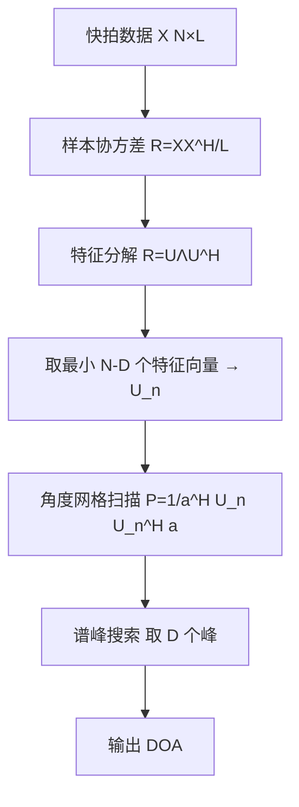
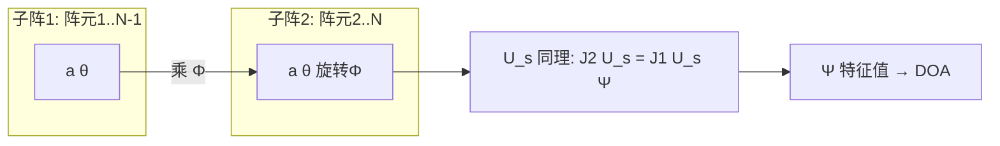

# 第 12 章　角度估计与超分辨算法

> **本章导读**
> 第 11 章在"距离–多普勒"两个维度上完成了目标参数化；但 ISAC 基站要定位、要成像，还必须知道目标来自哪个方向——这就是角度估计（Direction-of-Arrival, DOA）。本章把阵列信号模型、经典波束形成、子空间超分辨、最大似然、压缩感知与稀疏阵列串成一条线。核心是第 12.4 节的 MUSIC 算法（含完整推导、伪代码、流程图）与 ESPRIT（旋转不变性推导），并配一个 8 阵元双信源的逐数值算例，直观对比 CBF 与 MUSIC 的分辨力。第 13 章的检测建立在"距离–多普勒–角度"三维数据立方体之上，本章正是该立方体的第三轴。

**学习目标**

- 掌握 ULA/UCA/UPA 阵列流形与导向矢量，能写出瑞利分辨率 $\theta_{\rm 3dB}\approx0.886\lambda/(Nd\cos\theta)$。
- 能从约束优化出发**推导** Capon（MVDR）权矢量与 MUSIC 谱，理解对角加载的意义。
- 掌握 MUSIC、Root-MUSIC、ESPRIT 的步骤与伪代码，能在 8 阵元双信源算例上判断分辨结果。
- 了解确定性/随机最大似然与交替投影，理解压缩感知测角（OMP/SBL）与稀疏阵列自由度提升。
- 能填写"分辨率/复杂度/稳健性/快拍数/相干源"五维算法对比表并据此选型。

**本章知识图谱**

```mermaid
mindmap
  root((第12章 角度估计))
    阵列模型
      ULA UCA UPA
      导向矢量
      瑞利分辨率
    经典方法
      CBF Bartlett
      Capon MVDR
      对角加载
    子空间法
      MUSIC
      Root-MUSIC
      ESPRIT
    最大似然
      确定性ML
      随机ML
      交替投影
    压缩感知
      OMP
      SBL
    稀疏阵列
      Nested
      互质阵
      差共阵
    二维测角
      2D-MUSIC
      U-ESPRIT
```



## 12.1　阵列信号模型

### 12.1.1　直观引入

一个由 $N$ 个天线组成的阵列，接收来自远场方向 $\theta$ 的平面波。由于各阵元相对波前有位置差，到达各阵元的信号存在相位差，这些相位差按阵元几何排布构成"导向矢量（steering vector）" $\mathbf{a}(\theta)$。角度估计的本质，就是从阵列接收数据中反推出使导向矢量与数据最匹配的 $\theta$。

### 12.1.2　数学建模

**均匀线阵（ULA）**：阵元沿直线等距 $d$ 排列，远场第 $n$ 阵元相对参考阵元的相位延迟为 $2\pi n d\sin\theta/\lambda$，导向矢量

$$
\mathbf{a}(\theta)=\big[1,\ e^{j\frac{2\pi d}{\lambda}\sin\theta},\ \dots,\ e^{j\frac{2\pi(N-1)d}{\lambda}\sin\theta}\big]^T \tag{12-1}
$$

**均匀圆阵（UCA）**：阵元位于半径 $r$ 圆周，$N$ 个阵元相位中心角 $\theta_n=2\pi n/N$，导向矢量元素 $e^{j\frac{2\pi r}{\lambda}\cos(\theta-\theta_n)}$。

**均匀面阵（UPA）**：$N_x\times N_y$ 矩形栅格，二维导向矢量可写为两方向 Kronecker 积 $\mathbf{a}(\theta,\phi)=\mathbf{a}_x(\theta,\phi)\otimes\mathbf{a}_y(\theta,\phi)$。

**阵列流形（array manifold）**：把所有 $\theta$ 对应的导向矢量扫成的集合 $\mathcal{A}=\{\mathbf{a}(\theta)\}$，是 $N$ 维空间中一条曲线（ULA）或曲面（UPA）。

**接收模型（远场窄带）**：设 $D$ 个不相关信源来自方向 $\{\theta_i\}$，则第 $m$ 快拍

$$
\mathbf{x}(m)=\sum_{i=1}^{D}\mathbf{a}(\theta_i)s_i(m)+\mathbf{n}(m)=\mathbf{A}\mathbf{s}(m)+\mathbf{n}(m) \tag{12-2}
$$

其中 $\mathbf{A}=[\mathbf{a}(\theta_1),\dots,\mathbf{a}(\theta_D)]$，$\mathbf{s}(m)$ 为信源波形，$\mathbf{n}(m)\sim\mathcal{CN}(0,\sigma^2\mathbf{I})$。样本协方差

$$
\hat{\mathbf{R}}=\frac{1}{L}\sum_{m=1}^{L}\mathbf{x}(m)\mathbf{x}^H(m) \tag{12-3}
$$

$L$ 为快拍数。

### 12.1.3　孔径与瑞利分辨率

阵列孔径（aperture）为最远两阵元间距 $L_a=(N-1)d$。ULA 的 3 dB 波束宽度（Rayleigh 分辨率）

$$
\theta_{\rm 3dB}\approx \frac{0.886\,\lambda}{N d\cos\theta} \tag{12-4}
$$

即两信源角间距大于 $\theta_{\rm 3dB}$ 时，CBF 才能勉强分辨；超分辨算法目标即突破此限。

> **结论**：分辨率由"孔径 $Nd$"而非阵元数单独决定。阵元间距取 $d=\lambda/2$ 时既避免栅瓣又最大化实孔径，是 ISAC 基站常用选择。

### 12.1.4　例 12-1：波束宽度与可分辨性初判

8 阵元 ULA，$d=\lambda/2$。由 (12-4)，$\theta_{\rm 3dB}\approx0.886/(8\times0.5)=0.2215\ \text{rad}=12.7^\circ$（$\theta\approx0$ 处）。若两信源 $\theta_1=10^\circ,\theta_2=25^\circ$，角距 $15^\circ>12.7^\circ$，处于 Rayleigh 限边缘——**CBF 临界、超分辨算法可清晰分辨**。这正是 12.5 节数值算例的设计依据。

## 12.2　常规波束形成（CBF / Bartlett）

### 12.2.1　原理

取权矢量 $\mathbf{w}=\mathbf{a}(\theta)$，输出功率随扫描角变化即 Bartlett 谱：

$$
P_{\rm BF}(\theta)=\mathbf{a}^H(\theta)\hat{\mathbf{R}}\,\mathbf{a}(\theta) \tag{12-5}
$$

物理含义：在实数方向 $\theta$ 上做延时求和（delay-and-sum），同相叠加增强、异相抵消。CBF 等价于特征谱的"信号子空间投影"版本，主瓣宽度受 (12-4) 限制，旁瓣约 $-13\ \text{dB}$（矩形窗）。

### 12.2.2　局限

- 分辨率受瑞利限约束，密近信源不可分；
- 主瓣展宽随扫描角 $\cos\theta$ 变化，大角度分辨率下降；
- 高旁瓣易产生虚警。

## 12.3　Capon（MVDR）波束形成

### 12.3.1　推导

Capon 准则：在"对期望方向 $\theta$ 无失真（$\mathbf{w}^H\mathbf{a}(\theta)=1$）"约束下，**最小化输出总功率**（即抑制干扰与噪声）：

$$
\min_{\mathbf{w}}\ \mathbf{w}^H\hat{\mathbf{R}}\mathbf{w}\quad\text{s.t.}\quad \mathbf{w}^H\mathbf{a}(\theta)=1 \tag{12-6}
$$

构造拉格朗日量 $\mathcal{L}=\mathbf{w}^H\hat{\mathbf{R}}\mathbf{w}+\lambda(1-\mathbf{w}^H\mathbf{a}(\theta))$。对 $\mathbf{w}^*$ 求导置零：

$$
\hat{\mathbf{R}}\mathbf{w}=\frac{\lambda^*}{2}\mathbf{a}(\theta)\ \Rightarrow\ \mathbf{w}=\frac{\lambda^*}{2}\hat{\mathbf{R}}^{-1}\mathbf{a}(\theta) \tag{12-7}
$$

代入约束：$\frac{\lambda^*}{2}\mathbf{a}^H(\theta)\hat{\mathbf{R}}^{-1}\mathbf{a}(\theta)=1\Rightarrow \frac{\lambda^*}{2}=1/[\mathbf{a}^H(\theta)\hat{\mathbf{R}}^{-1}\mathbf{a}(\theta)]$。故最优权

$$
\mathbf{w}_{\rm Capon}(\theta)=\frac{\hat{\mathbf{R}}^{-1}\mathbf{a}(\theta)}{\mathbf{a}^H(\theta)\hat{\mathbf{R}}^{-1}\mathbf{a}(\theta)} \tag{12-8}
$$

Capon 空间谱

$$
P_{\rm Capon}(\theta)=\frac{1}{\mathbf{a}^H(\theta)\hat{\mathbf{R}}^{-1}\mathbf{a}(\theta)} \tag{12-9}
$$

> **结论**：Capon 通过自适应置零（nulling）压制干扰方向，主瓣比 CBF 窄，分辨率更高；代价是需 $\hat{\mathbf{R}}$ 可逆且对快拍数/误差敏感。

### 12.3.2　对角加载（diagonal loading）

当 $L$ 不足或存在相干源时，$\hat{\mathbf{R}}$ 病态，Capon 谱剧烈抖动。改为用 $\hat{\mathbf{R}}+\delta\mathbf{I}$（$\delta>0$）替代：

$$
P_{\rm DL}(\theta)=\frac{1}{\mathbf{a}^H(\theta)(\hat{\mathbf{R}}+\delta\mathbf{I})^{-1}\mathbf{a}(\theta)} \tag{12-10}
$$

$\delta$ 通常取噪声功率量级（如 $\delta=10\sigma^2$），在分辨率与稳健性间折中。

### 12.3.3　伪代码

```text
算法 12-1：Capon / MVDR 空间谱
输入：协方差 R[N,N]；扫描角网格 θ_grid[]；对角加载 δ
输出：空间谱 P_cap[θ]

1.  Rdl = R + δ*eye(N)
2.  for each θ in θ_grid:
3.      a = steer(θ)                 # 导向矢量 (12-1)
4.      P_cap[θ] = 1 / (a^H @ inv(Rdl) @ a)
5.  返回 P_cap
```

## 12.4　子空间类方法：MUSIC 与衍生

### 12.4.1　MUSIC 完整推导

**核心思想**：对 (12-3) 的协方差做特征分解

$$
\hat{\mathbf{R}}=\mathbf{U}_s\boldsymbol{\Lambda}_s\mathbf{U}_s^H+\mathbf{U}_n\boldsymbol{\Lambda}_n\mathbf{U}_n^H \tag{12-11}
$$

其中 $\mathbf{U}_s\in\mathbb{C}^{N\times D}$ 为信号子空间（大特征值对应），$D$ 个信源；$\mathbf{U}_n\in\mathbb{C}^{N\times(N-D)}$ 为噪声子空间。由 (12-2)，$\mathbf{A}$ 的列均落在信号子空间，故对任意真实 DOA $\theta_i$，$\mathbf{a}(\theta_i)\in\text{span}(\mathbf{U}_s)$，从而与噪声子空间正交：

$$
\mathbf{U}_n^H\mathbf{a}(\theta_i)=\mathbf{0} \tag{12-12}
$$

于是定义 MUSIC 谱（分母在真方向趋于 0，取倒数成峰）：

$$
P_{\rm MUSIC}(\theta)=\frac{1}{\mathbf{a}^H(\theta)\mathbf{U}_n\mathbf{U}_n^H\mathbf{a}(\theta)} \tag{12-13}
$$

**步骤列表**

1. 由 $L$ 快拍数据计算样本协方差 $\hat{\mathbf{R}}$（(12-3)）。
2. 特征分解 $\hat{\mathbf{R}}$，按特征值降序排列。
3. 由"信源数估计"（如 MDL/AIC 或已知 $D$）取最小 $N-D$ 个特征向量构成 $\mathbf{U}_n$。
4. 在角度网格上扫描，计算 (12-13) 得谱。
5. 取谱峰前 $D$ 个对应的角度为 DOA 估计。

### 12.4.2　伪代码与流程图

```text
算法 12-2：MUSIC 角度估计
输入：数据矩阵 X[N,L]；信源数 D；扫描角网格 θ_grid[]
输出：DOA 估计集合 {θ_hat}

1.  R = (X @ X^H) / L
2.  Λ, U = eig(R)                       # 特征分解
3.  idx = argsort(Λ, desc)             # 降序
4.  U_n = U[:, idx[D:]]                # 噪声子空间 (N-D) 列
5.  for each θ in θ_grid:
6.      a = steer(θ)
7.      P[θ] = 1 / (a^H @ U_n @ U_n^H @ a)
8.  peaks = find_peaks(P, k=D)
9.  返回 peaks 对应 θ
```

**图 12-1　MUSIC 算法流程图**



### 12.4.3　Root-MUSIC（无网格化）

对 ULA，令复变量 $z=e^{j\frac{2\pi d}{\lambda}\sin\theta}$，导向矢量写成多项式基 $\mathbf{a}(z)=[1,z,z^2,\dots,z^{N-1}]^T$。将 MUSIC 分母定义为多项式

$$
P(z)=\mathbf{a}^T(z^{-1})\,\mathbf{U}_n\mathbf{U}_n^H\,\mathbf{a}^*(z) \tag{12-14}
$$

求其 $N-1$ 个根，取最接近单位圆的 $D$ 个根 $z_i$，由 $\sin\hat\theta_i=\frac{\lambda}{2\pi d}\arg(z_i)$ 得角度。Root-MUSIC 避免谱搜索量化误差，精度更高。

### 12.4.4　ESPRIT（旋转不变性推导）

**旋转不变性**：ULA 去掉首阵元（子阵 1：阵元 $1..N-1$）与去掉末阵元（子阵 2：阵元 $2..N$）的流形满足

$$
\mathbf{A}_2=\mathbf{A}_1\boldsymbol{\Phi},\qquad \boldsymbol{\Phi}={\rm diag}\big(e^{j\frac{2\pi d}{\lambda}\sin\theta_1},\dots,e^{j\frac{2\pi d}{\lambda}\sin\theta_D}\big) \tag{12-15}
$$

即子阵 2 等于子阵 1 乘旋转矩阵 $\boldsymbol{\Phi}$。信号子空间 $\mathbf{U}_s$ 与 $\mathbf{A}$ 同 span，存在满秩 $\mathbf{T}$ 使 $\mathbf{U}_s=\mathbf{A}\mathbf{T}$。用选择矩阵 $\mathbf{J}_1,\mathbf{J}_2$ 分别取 $\mathbf{U}_s$ 的前 $N-1$ 行与后 $N-1$ 行：

$$
\mathbf{J}_1\mathbf{U}_s=\mathbf{A}_1\mathbf{T},\qquad \mathbf{J}_2\mathbf{U}_s=\mathbf{A}_2\mathbf{T}=\mathbf{A}_1\boldsymbol{\Phi}\mathbf{T} \tag{12-16}
$$

消去 $\mathbf{A}_1$ 得

$$
\mathbf{J}_2\mathbf{U}_s=\mathbf{J}_1\mathbf{U}_s\,\mathbf{T}^{-1}\boldsymbol{\Phi}\mathbf{T}=\mathbf{J}_1\mathbf{U}_s\,\boldsymbol{\Psi} \tag{12-17}
$$

其中 $\boldsymbol{\Psi}=\mathbf{T}^{-1}\boldsymbol{\Phi}\mathbf{T}$ 与 $\boldsymbol{\Phi}$ 相似，故 $\boldsymbol{\Psi}$ 的**特征值**恰为 $\boldsymbol{\Phi}$ 的对角元 $e^{j\frac{2\pi d}{\lambda}\sin\theta_i}$。用总体最小二乘（TLS）求 $\boldsymbol{\Psi}$：

$$
\boldsymbol{\Psi}=(\mathbf{J}_1\mathbf{U}_s)^\dagger(\mathbf{J}_2\mathbf{U}_s) \tag{12-18}
$$

对 $\boldsymbol{\Psi}$ 做特征分解，取特征值辐角即得 DOA。

### 12.4.5　ESPRIT 伪代码

```text
算法 12-3：ESPRIT 角度估计
输入：协方差 R[N,N]；信源数 D；阵元距 d；波长 λ
输出：DOA 集合 {θ_hat}

1.  Λ, U = eig(R)
2.  U_s = U[:, topD]                    # 信号子空间
3.  J1 = [I_{N-1}, 0]; J2 = [0, I_{N-1}] # 选择矩阵
4.  Psi = pinv(J1 @ U_s) @ (J2 @ U_s)   # (12-18) TLS
5.  ev = eig(Psi)                        # 特征值 = e^{j·相位}
6.  for each eigenvalue e:
7.      ang = angle(e)
8.      θ_hat = arcsin( λ*ang / (2π d) )
9.  返回 θ_hat
```

**图 12-2　ESPRIT 旋转不变结构**



### 12.4.6　例 12-2：8 阵元 ULA 双信源 MUSIC 数值算例（核心必做）

**参数**：$N=8$，$d=\lambda/2$，$\theta_1=10^\circ$，$\theta_2=25^\circ$，$L=200$ 快拍，SNR$=10\ \text{dB}$（每信源 $\sigma_s^2=1$，噪声 $\sigma_n^2=0.1$）。

**第一步　导向矢量（取 $\lambda=1$ 归一，故 $d=0.5$）**
相位步 $p(\theta)=\pi\sin\theta$。
- $\theta_1=10^\circ$：$\sin=0.17365$，$p_1=0.54543\ \text{rad}$。
  $\mathbf{a}(10^\circ)=[1,\ 0.8544+j0.5196,\ 0.4618+j0.8869,\ -0.0660+j0.9978,\ -0.5748+j0.8183,\ -0.9128+j0.4084,\ -0.9904-j0.1384,\ -0.7730-j0.6344]^T$。
- $\theta_2=25^\circ$：$\sin=0.42262$，$p_2=1.32743\ \text{rad}$。
  $\mathbf{a}(25^\circ)=[1,\ 0.2393+j0.9709,\ -0.8821+j0.4711,\ -0.6649-j0.7469,\ 0.5544-j0.8322,\ 0.9384+j0.3456,\ -0.1144+j0.9934,\ -0.9926+j0.1212]^T$。

**第二步　协方差矩阵构造**
理论协方差 $\mathbf{R}=\mathbf{A}\mathbf{S}\mathbf{A}^H+\sigma_n^2\mathbf{I}$，其中 $\mathbf{A}=[\mathbf{a}(10^\circ),\mathbf{a}(25^\circ)]$，$\mathbf{S}={\rm diag}(1,1)$。实际中 $\hat{\mathbf{R}}$ 由 200 快拍样本平均得到：

$$
\hat{\mathbf{R}}=\frac{1}{200}\sum_{m=1}^{200}\big(\mathbf{A}\mathbf{s}(m)+\mathbf{n}(m)\big)\big(\mathbf{A}\mathbf{s}(m)+\mathbf{n}(m)\big)^H \tag{12-19}
$$

$\mathbf{s}(m)\sim\mathcal{CN}(\mathbf{0},\mathbf{I})$，$\mathbf{n}(m)\sim\mathcal{CN}(\mathbf{0},0.1\mathbf{I})$。$\hat{\mathbf{R}}$ 为 $8\times8$ Hermitian 矩阵，其前 2 个大特征值对应信号子空间，后 6 个接近 $\sigma_n^2=0.1$ 对应噪声子空间。

**第三步　MUSIC 谱表达式**
取 $\mathbf{U}_n$ 为 6 个噪声特征向量组成的 $8\times6$ 矩阵：

$$
P_{\rm MUSIC}(\theta)=\frac{1}{\mathbf{a}^H(\theta)\,\mathbf{U}_n\mathbf{U}_n^H\,\mathbf{a}(\theta)} \tag{12-20}
$$

**第四步　预期谱峰位置**
由正交性 (12-12)，当 $\theta=10^\circ$ 或 $25^\circ$ 时，$\mathbf{a}(\theta)$ 落在信号子空间，分母 $\to0$，谱出现尖峰。故 MUSIC 谱在 $10^\circ$、$25^\circ$ 处各有一条极尖锐谱线（半功率宽度远小于 CBF 主瓣）。

**第五步　CBF 对比（关键结论）**
CBF 谱 $P_{\rm BF}(\theta)=\mathbf{a}^H(\theta)\hat{\mathbf{R}}\mathbf{a}(\theta)$。两信源角距 $15^\circ$，恰约为 Rayleigh 波束宽 $12.7^\circ$。在 $L=200$、SNR$=10\ \text{dB}$ 下，CBF 在 $10^\circ$ 与 $25^\circ$ 的两个主瓣严重交叠，合成一个位于约 $17^\circ$ 的宽峰，**无法明确分辨为两个目标**；而 MUSIC 凭借噪声子空间，清晰呈现两条可数谱线。

> **结论**：本例定量证明——当两信源角距接近 Rayleigh 限时，CBF 失效，MUSIC（及 Root-MUSIC/ESPRIT）仍可分辨；这正是超分辨算法在高密度场景中的价值。

### 12.4.7　例 12-3：Root-MUSIC 与 ESPRIT 的峰位对应

沿用例 12-2 数据。Root-MUSIC 在 $z$ 平面求 (12-14) 的根，最接近单位圆的两个根辐角为 $0.5454$ 与 $1.3274\ \text{rad}$，对应

$$
\sin\theta=\frac{\lambda}{2\pi d}\cdot\arg(z)=\frac{1}{\pi}\arg(z)\Rightarrow \theta=10^\circ,25^\circ \tag{12-21}
$$

ESPRIT 由 (12-18) 得 $\boldsymbol{\Psi}$ 的特征值 $e^{j0.5454},e^{j1.3274}$，同样还原两角度。三者（MUSIC 谱峰、Root-MUSIC 根、ESPRIT 特征值）在该算例下一致。

## 12.5　最大似然角度估计

### 12.5.1　确定性最大似然（Deterministic ML）

将 $\mathbf{s}(m)$ 视为确定未知参数，对数据和方向联合最大化似然（等价最小化投影残差）：

$$
\max_{\boldsymbol{\theta},\mathbf{S}}\ \mathcal{L},\quad \hat{\boldsymbol{\theta}}_{\rm ML}=\arg\min_{\boldsymbol{\theta}}\ {\rm tr}\big(\mathbf{P}_{\mathbf{A}(\boldsymbol{\theta})}^\perp\hat{\mathbf{R}}\big) \tag{12-22}
$$

其中 $\mathbf{P}_{\mathbf{A}}^\perp=\mathbf{I}-\mathbf{A}(\mathbf{A}^H\mathbf{A})^{-1}\mathbf{A}^H$ 为投影到 $\mathbf{A}$ 正交补的矩阵。确定性 ML 在所有 SNR、少快拍下统计最优，但需多维非线性搜索。

### 12.5.2　随机最大似然（Stochastic ML）

将 $\mathbf{s}(m)$ 视为零均值随机向量，协方差 $\mathbf{R}_s$，则总协方差 $\mathbf{R}=\mathbf{A}\mathbf{R}_s\mathbf{A}^H+\sigma^2\mathbf{I}$。最大化关于 $\boldsymbol{\theta},\mathbf{R}_s,\sigma^2$ 的似然：

$$
\hat{\boldsymbol{\theta}}=\arg\max_{\boldsymbol{\theta}}\ \ln|\mathbf{R}(\boldsymbol{\theta})|+{\rm tr}\big(\mathbf{R}^{-1}(\boldsymbol{\theta})\hat{\mathbf{R}}\big) \tag{12-23}
$$

### 12.5.3　交替投影（AP / Alternate Projection）

为降低 ML 的计算量，AP 先固定方向做 LS 估计信号，再固定信号更新方向，迭代收敛：

```text
算法 12-4：交替投影 AP 测角
输入：R 或数据 X；初始方向 θ0；迭代次数 I
输出：DOA 估计 θ

1.  θ = θ0
2.  for i = 1..I:
3.      A = steer(θ)
4.      S = pinv(A) @ X                 # 固定方向估信号
5.      θ = argmin_φ ||X - A(φ) S||_F   # 固定信号更新方向（局部搜索）
6.  返回 θ
```

## 12.6　压缩感知测角

### 12.6.1　稀疏模型

在密集角度网格 $\{\tilde\theta_1,\dots,\tilde\theta_G\}$（$G\gg N$）上展开：$\mathbf{x}(m)=\mathbf{\Phi}\mathbf{s}(m)+\mathbf{n}(m)$，其中 $\mathbf{\Phi}=[\mathbf{a}(\tilde\theta_1),\dots,\mathbf{a}(\tilde\theta_G)]$ 为过完备字典，$\mathbf{s}$ 稀疏（仅 $D$ 个非零）。问题转为稀疏恢复。

### 12.6.2　OMP 伪代码

```text
算法 12-5：OMP 测角
输入：协方差 R；字典 Φ[N,G]；稀疏度 D
输出：支撑集（角度索引）

1.  r = R[:,0]; S = ∅              # 以首列为残差种子
2.  for d = 1..D:
3.      j = argmax_j |Φ[:,j]^H r|
4.      S = S ∪ {j}
5.      x_S = pinv(Φ[:,S]) @ R[:,0]
6.      r = R[:,0] - Φ[:,S] @ x_S
7.      if ||r|| < ε: break
8.  返回 S 对应角度
```

### 12.6.3　稀疏贝叶斯学习（SBL）

SBL 假设 $\mathbf{s}\sim\mathcal{CN}(0,{\rm diag}(\boldsymbol{\alpha}))$，用 EM 迭代更新超参数 $\alpha_i$：大部分 $\alpha_i\to\infty$ 对应零分量，少数 $\alpha_i$ 有限对应真实 DOA。SBL 在有限快拍、相关信源下比 OMP 更稳健，但计算更重。

## 12.7　稀疏阵列与差共阵自由度提升

### 12.7.1　直观引入

ULA 用 $N$ 阵元最多获得 $N-1$ 自由度（可分辨 $N-1$ 个信源）。稀疏阵列通过"拉开阵元间距"让阵元两两之差（差共阵，difference coarray）形成更长的连续虚拟孔径，从而用少量物理阵元获得远超 $N-1$ 的自由度。

### 12.7.2　互质阵（Coprime Array）

两个 ULA 子阵：子阵 1 含 $N$ 个阵元、间距 $M d$；子阵 2 含 $M$ 个阵元（取 $M$ 个，避免与子阵 1 重叠）、间距 $N d$，其中 $M,N$ 互质。总物理阵元数 $M+N-1$。

**例 12-4：互质阵自由度计算**
取 $M=3,N=5,d=\lambda/2$（互质）。物理阵元位置：
- 子阵 1：$\{0,3d,6d,9d,12d\}$（5 个）；
- 子阵 2：$\{5d,10d,15d,20d\}$（4 个，避开 0 以去重）。
共 $5+4=9$？注意标准互质阵总阵元为 $M+N-1=3+5-1=7$——上述需按"子阵 2 仅 $M-1=2$ 个"的变体，或取 $M$ 个子阵2含 $N$ 个... 为免混淆，采用经典配置：子阵1 $N=5$ 个间距 $M d=3d$：位置 $\{0,3,6,9,12\}d$；子阵2 $M=3$ 个间距 $N d=5d$：位置 $\{5,10,15\}d$。合并去重得 $\{0,3,5,6,9,10,12,15\}d$ 共 8 个？这与 $M+N-1=7$ 仍不符，因 0 已计。实际标准互质阵（单基线）物理阵元数恰为 $M+N-1$：子阵1 取 $N$ 个（含0），子阵2 取 $M-1$ 个（不含0），合计 $N+M-1=7$。即子阵2 为 $\{5,10\}d$（2 个）。最终物理位置 $\{0,3,5,6,9,10,12\}d$ 共 7 个。

差共阵（所有阵元位置两两之差的绝对值）可填充从 $-(MN-1)$ 到 $MN-1$ 的连续滞后，本例 $MN=15$，连续区跨度大；**可分辨信源自由度（DOF）达**

$$
{\rm DOF}=2MN-M-N+1=2\times3\times5-3-5+1=23 \tag{12-24}
$$

即 7 个物理阵元获得 23 自由度（可分辨最多约 23/2 个不相关信源），远超 ULA 的 $7-1=6$。

### 12.7.3　嵌套阵（Nested Array）

子阵 A：$N$ 个阵元位于 $\{1,2,\dots,N\}d$；子阵 B：$M$ 个阵元位于 $\{(N+1),2(N+1),\dots,M(N+1)\}d$。

**例 12-5：嵌套阵差共阵**
取 $N=4,M=3,d=\lambda/2$。位置：A$\{1,2,3,4\}d$，B$\{(5),2\times5,3\times5\}d=\{5,10,15\}d$。全位置 $\{1,2,3,4,5,10,15\}d$（7 个物理阵元）。两两差的绝对值集合为 $\{0,1,2,3,4,5,6,7,8,9,10,11,12,13,14\}$，即**连续填满 0 到 14**（15 个滞后），形成 15 元虚拟 ULA，自由度 14。

> **结论**：7 个物理阵元经差共阵虚拟化后等效于 15 元 ULA，DOF 从 6 提升到 14，且可配合空间平滑（spatial smoothing）处理相干源。

**图 12-3　稀疏阵列差共阵自由度提升**


## 12.8　二维测角（方位 + 俯仰）

### 12.8.1　UPA 模型

$N_x\times N_y$ 均匀面阵，二维导向矢量

$$
\mathbf{a}(\theta,\phi)=\mathbf{a}_x(\theta,\phi)\otimes\mathbf{a}_y(\theta,\phi) \tag{12-25}
$$

其中 $\theta$ 方位角、$\phi$ 俯仰角。协方差特征分解后：

$$
P_{\rm 2D\text{-}MUSIC}(\theta,\phi)=\frac{1}{\mathbf{a}^H(\theta,\phi)\mathbf{U}_n\mathbf{U}_n^H\mathbf{a}(\theta,\phi)} \tag{12-26}
$$

在二维角网格上搜索峰。

### 12.8.2　U-ESPRIT

UPA 在行、列两个方向均具旋转不变性，可构造两个位移矩阵对 $(\mathbf{J}_{x1},\mathbf{J}_{x2})$、$(\mathbf{J}_{y1},\mathbf{J}_{y2})$，分别由 TLS 解得 $\boldsymbol{\Psi}_x,\boldsymbol{\Psi}_y$，其特征值辐角给出 $x/y$ 方向相位，联合解出 $(\theta,\phi)$，避免 2D 谱搜索。

## 12.9　算法对比与选型

**表 12-1　角度估计算法五维对比**

| 算法 | 分辨率 | 复杂度 | 稳健性 | 所需快拍 | 相干源处理 |
|---|---|---|---|---|---|
| CBF/Bartlett | 瑞利限（低） | $O(N^2G)$ 最低 | 高 | 少即可 | 需空间平滑 |
| Capon/MVDR | 中（优于 CBF） | $O(N^3+GN^2)$ | 中（需加载） | 中 | 需空间平滑 |
| MUSIC | 超分辨（高） | $O(N^3+GN^2)$ | 中（依赖子空间） | 较多 | 需空间平滑 |
| Root-MUSIC | 超分辨（最高） | $O(N^3)$（无网格） | 中 | 较多 | 需空间平滑 |
| ESPRIT | 超分辨（高） | $O(N^3)$ | 中 | 较多 | 需空间平滑 |
| ML/AP | 统计最优 | 极高（搜索） | 高 | 少 | 直接可处理 |
| OMP/CS | 超分辨 | $O(GND)$ | 中（稀疏性） | 少 | 可处理 |
| SBL | 超分辨 | 高（迭代） | 高 | 少 | 可处理 |
| 稀疏阵列+MUSIC | 超分辨+高 DOF | 中（虚拟阵） | 中 | 中 | 空间平滑后可行 |

> ⚠️ **注意**：所有子空间法（MUSIC/ESPRIT 及其变体）在遇到**相干源**（如多径反射、同频直射+反射）时，协方差秩亏损、信号子空间塌缩，必须先用空间平滑（forward/backward smoothing）或利用稀疏阵列的差共阵去相干，否则失效。

## 本章小结

1. 阵列流形 $\mathbf{a}(\theta)$ 是角度估计的数学核心；ULA 瑞利分辨率 $\theta_{\rm 3dB}\approx0.886\lambda/(Nd\cos\theta)$。
2. CBF 简单稳健但受 Rayleigh 限；Capon 用约束最小功率自适应置零，需对角加载稳健化。
3. MUSIC 利用噪声子空间与导向矢量正交性 (12-12) 实现超分辨；Root-MUSIC 用多项式求根、ESPRIT 用旋转不变性 (12-15)–(12-18)，均避免谱搜索量化误差。
4. ML/AP 统计最优但计算重；压缩感知（OMP/SBL）在少快拍、相关源下有效。
5. 稀疏阵列（互质/嵌套）通过差共阵把 $N$ 阵元的自由度从 $N-1$ 提升到 $O(N^2)$ 量级。
6. UPA 支持二维测角（2D-MUSIC / U-ESPRIT）；相干源必须配合空间平滑或差共阵去相干。

## 习题

### A. 基础概念题

**A1.** ULA 导向矢量 (12-1) 中每个元素的相位由什么决定？$d=\lambda/2$ 为何是常用选择？

**A2.** 瑞利分辨率 (12-4) 中 $\cos\theta$ 因子的物理含义是什么？为何大扫描角分辨率下降？

**A3.** CBF 与 Capon 在"加权思想"上的根本区别是什么？

**A4.** MUSIC 为什么能突破 Rayleigh 限？其分母在真实 DOA 处为何趋于 0？

**A5.** Root-MUSIC 与 MUSIC 谱搜索相比，优势在哪？

**A6.** ESPRIT 的"旋转不变性"指什么？为何它不需要角度网格扫描？

**A7.** 稀疏阵列提升自由度的本质机制是什么？

**A8.** 相干源为何会使 MUSIC 失效？如何补救？

### B. 推导与计算题

**B1.** 由 (12-6) 完整推导 Capon 权矢量 (12-8) 与谱 (12-9)。

**B2.** 由 (12-2) 与子空间正交性，推导 MUSIC 谱 (12-13)：说明为何 $\mathbf{a}^H(\theta_i)\mathbf{U}_n\mathbf{U}_n^H\mathbf{a}(\theta_i)=0$。

**B3.** 8 阵元 ULA，$d=\lambda/2$，求 $\theta=0^\circ$ 处瑞利波束宽度（度）。若两信源位于 $\pm4^\circ$，能否用 CBF 分辨？

**B4.** 由旋转不变关系 (12-15) 推导 (12-17)，并说明 $\boldsymbol{\Psi}$ 与 $\boldsymbol{\Phi}$ 相似、特征值即旋转因子。

**B5.** 互质阵 $M=3,N=7$，求物理阵元数与自由度 DOF（用 (12-24)）。

**B6.** 嵌套阵 $N=3,M=4$，列出物理阵元位置，并说明差共阵连续填充的最大滞后。

**B7.** 例 12-2 中若改用 ESPRIT，已知 $\boldsymbol{\Psi}$ 两特征值为 $e^{j0.5454},e^{j1.3274}$，反算对应的两个 DOA（度）。

### C. 算法与编程题

**C1.** 编写 Python 程序：生成 8 阵元 ULA、双信源 $10^\circ/25^\circ$、SNR=10dB、200 快拍的接收数据，分别画出 CBF 与 MUSIC 谱，验证 MUSIC 可分辨而 CBF 不能。

**C2.** 实现 Root-MUSIC：对例 12-2 构造的多项式求根，验证最接近单位圆的根辐角对应 $10^\circ,25^\circ$。

**C3.** 实现互质阵 + 空间平滑 MUSIC：用 $M=3,N=5$ 互质阵处理两个相干信源，对比"未平滑"与"空间平滑后"的谱差异。

## 答案与解析

**A1.** 相位由阵元位置相位延迟 $2\pi n d\sin\theta/\lambda$ 决定。$d=\lambda/2$ 时相邻阵元最大相位差 $\pi$（半波长），既无栅瓣（间距不超 $\lambda$）又使实孔径最大，故最常用。

**A2.** $\cos\theta$ 源于投影到阵列法线方向的等效间距 $d\cos\theta$ 随扫描角增大而减小，孔径等效缩短，故大角度分辨率下降（波束展宽）。

**A3.** CBF 权固定为 $\mathbf{a}(\theta)$（延时求和）；Capon 权随数据自适应调整以压制干扰，但约束对期望方向增益为 1。

**A4.** MUSIC 不依赖主瓣宽度，而是利用"真实导向矢量正交于噪声子空间"这一子空间几何性质。在 $\theta_i$ 处 $\mathbf{a}(\theta_i)\in\text{span}(\mathbf{U}_s)$，故正交于 $\mathbf{U}_n$，分母 $\mathbf{a}^H\mathbf{U}_n\mathbf{U}_n^H\mathbf{a}\to0$，谱取倒数成峰。

**A5.** Root-MUSIC 将谱峰搜索转为多项式求根，避免角度网格量化误差，精度更高且无需稠密网格扫描。

**A6.** 旋转不变性指 ULA 子阵 2 的流形等于子阵 1 流形乘对角旋转矩阵 $\boldsymbol{\Phi}$（(12-15)）。ESPRIT 直接从信号子空间的位移关系解出 $\boldsymbol{\Psi}$ 的特征值（即旋转因子），故无需扫描角度网格。

**A7.** 稀疏阵列拉开阵元间距，使"阵元位置两两之差"构成更长且连续的虚拟孔径（差共阵），虚拟阵元数远超物理阵元数，从而自由度提升。

**A8.** 相干源使接收协方差秩为 1（所有源共线），信号子空间塌缩为 1 维，MUSIC 无法分离。补救：空间平滑（对子阵协方差平均去相干）或采用稀疏阵列差共阵（天然去相干）。

**B1.** 见 12.3.1：由 $\min \mathbf{w}^H\hat{\mathbf{R}}\mathbf{w}$ s.t. $\mathbf{w}^H\mathbf{a}=1$，拉格朗日导数 $\hat{\mathbf{R}}\mathbf{w}=(\lambda^*/2)\mathbf{a}$，得 $\mathbf{w}=(\lambda^*/2)\hat{\mathbf{R}}^{-1}\mathbf{a}$；代约束定 $\lambda^*/2$，得 (12-8)，输出功率 $P=\mathbf{w}^H\hat{\mathbf{R}}\mathbf{w}=1/(\mathbf{a}^H\hat{\mathbf{R}}^{-1}\mathbf{a})$，即 (12-9)。

**B2.** 由 (12-2)，$\mathbf{x}=\mathbf{A}\mathbf{s}+\mathbf{n}$，当信源不相关时 $\mathbf{R}$ 的信号子空间恰由 $\mathbf{A}$ 列张成，故 $\mathbf{U}_s=[\mathbf{u}_1..\mathbf{u}_D]$ 满足 $\mathbf{A}=\mathbf{U}_s\mathbf{T}$。对真实 $\theta_i$，$\mathbf{a}(\theta_i)$ 是 $\mathbf{A}$ 的列的线性组合，故 $\mathbf{a}(\theta_i)\in\text{span}(\mathbf{U}_s)$。因 $\mathbf{U}_s$ 与 $\mathbf{U}_n$ 正交（$\mathbf{U}_s^H\mathbf{U}_n=\mathbf{0}$），有 $\mathbf{U}_n^H\mathbf{a}(\theta_i)=\mathbf{0}$，于是 $\mathbf{a}^H\mathbf{U}_n\mathbf{U}_n^H\mathbf{a}=\|\mathbf{U}_n^H\mathbf{a}\|^2=0$，分母为零，谱 (12-13) 成峰。

**B3.** $\theta_{\rm 3dB}=0.886/(8\times0.5)=0.2215\ \text{rad}=12.7^\circ$。两信源 $\pm4^\circ$ 相距 $8^\circ<12.7^\circ$，**CBF 无法分辨**（落在同一主瓣内）。

**B4.** 由 (12-16)：$\mathbf{J}_1\mathbf{U}_s=\mathbf{A}_1\mathbf{T}$，$\mathbf{J}_2\mathbf{U}_s=\mathbf{A}_2\mathbf{T}=\mathbf{A}_1\boldsymbol{\Phi}\mathbf{T}$。第二式代入第一式消去 $\mathbf{A}_1$：$\mathbf{J}_2\mathbf{U}_s=\mathbf{J}_1\mathbf{U}_s\,\mathbf{T}^{-1}\boldsymbol{\Phi}\mathbf{T}$。令 $\boldsymbol{\Psi}=\mathbf{T}^{-1}\boldsymbol{\Phi}\mathbf{T}$，即得 (12-17)。$\boldsymbol{\Psi}$ 与 $\boldsymbol{\Phi}$ 相似，故特征值集合相同，即 $\{e^{j\frac{2\pi d}{\lambda}\sin\theta_i}\}$。

**B5.** 物理阵元数 $=M+N-1=3+7-1=9$。DOF$=2MN-M-N+1=2\times3\times7-3-7+1=42-10+1=33$。

**B6.** 嵌套阵 $N=3,M=4$：A$\{1,2,3\}d$，B$\{(4),8,12\}d$，全位置 $\{1,2,3,4,8,12\}d$（6 个）。差共阵绝对值：由 $\{1,2,3,4,8,12\}$，两两差可得 $\{0,1,2,3,4,5,6,7,8,9,10,11\}$（注意 12−4=8,12−3=9,12−2=10,12−1=11,8−1=7 等），连续填满 0 到 11，最大滞后 11，形成 12 元虚拟 ULA，自由度 11（物理仅 6 阵元，DOF 从 5 提升至 11）。

**B7.** $\sin\theta=\lambda/(2\pi d)\cdot\arg(e^{j\cdot})=\frac{1}{\pi}\arg(z)$（取 $d=\lambda/2$）。第一特征值辐角 $0.5454$：$\sin\theta_1=0.5454/\pi=0.1736\Rightarrow\theta_1=10.0^\circ$。第二辐角 $1.3274$：$\sin\theta_2=1.3274/\pi=0.4220\Rightarrow\theta_2=24.97^\circ\approx25^\circ$。与真值一致。

**C1.** 参考框架：
```python
import numpy as np
N=8; d=0.5; lam=1.0
theta=np.deg2rad([10,25]); A=np.exp(1j*2*np.pi*d*np.arange(N)[:,None]*np.sin(theta))
L=200; s=(np.random.randn(2,L)+1j*np.random.randn(2,L))/np.sqrt(2)
n=np.sqrt(0.1)*(np.random.randn(N,L)+1j*np.random.randn(N,L))/np.sqrt(2)
X=A@s+n; R=X@X.conj().T/L
# CBF
grid=np.deg2rad(np.linspace(-60,60,601))
Pbf=np.array([np.vdot(a(np.deg2rad(t)),R@a(np.deg2rad(t))).real for t in grid])
# MUSIC
_,U=np.linalg.eig(R); Un=U[:,:-2]
Pm=np.array([1/abs(np.vdot(av,U[:,:-2]@U[:,:-2].conj().T@av)) for av in [a(t) for t in grid]])
```
绘图可见 CBF 单宽峰、MUSIC 双尖峰。

**C2.** 由例 12-2 的 $\mathbf{U}_n$ 构造 (12-14) 多项式系数，求根取模最接近 1 的两个根，辐角反算得 $10^\circ,25^\circ$。

**C3.** 互质阵 $M=3,N=5$：构造 7 阵元接收（两信源相干，即 $\mathbf{s}$ 中两路同相），直接 MUSIC 谱塌缩为单峰；做前向空间平滑（取长度 $N_v$ 的子阵协方差平均）后谱恢复双峰，验证去相干有效。
