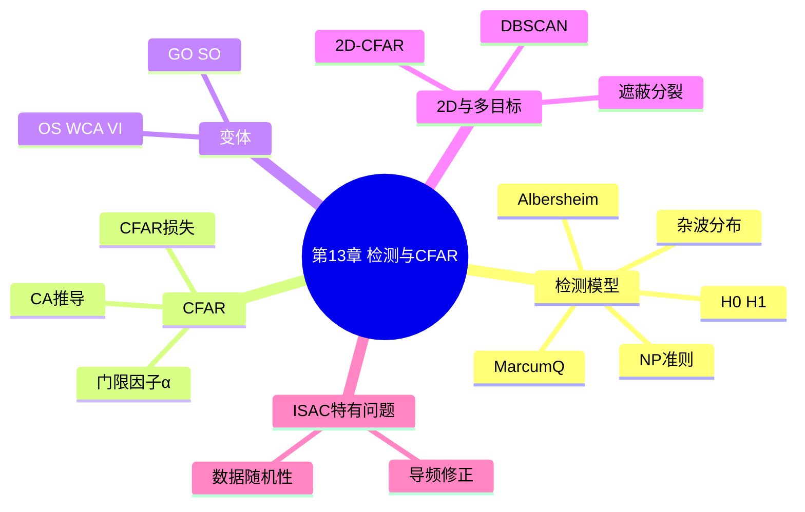
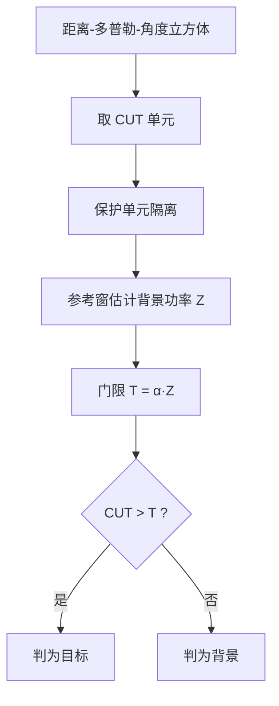
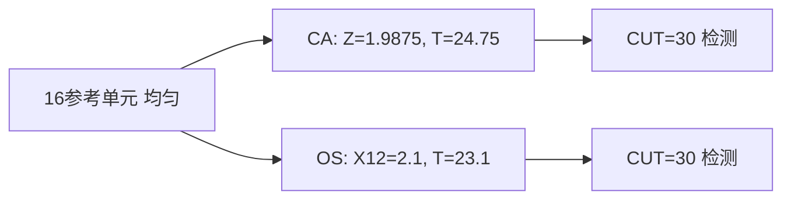
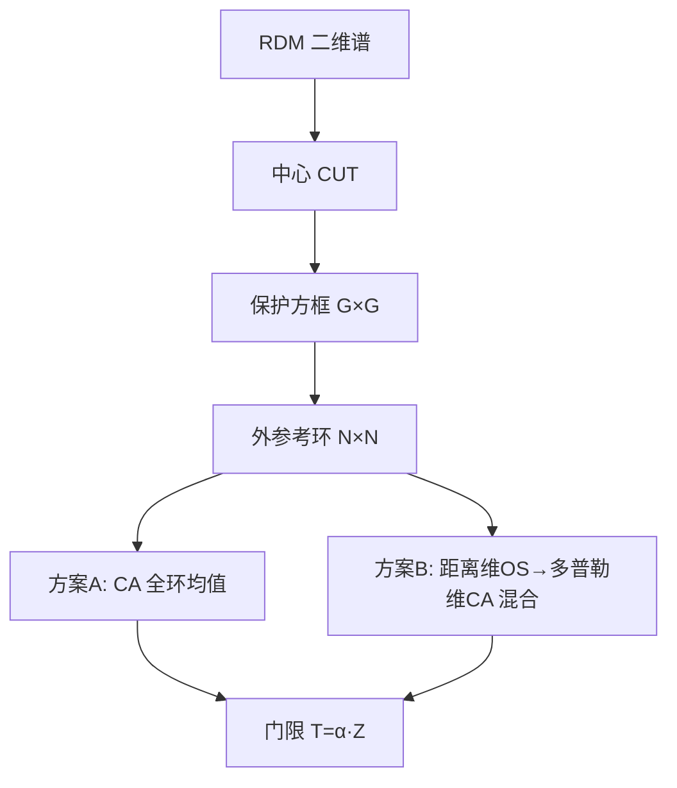
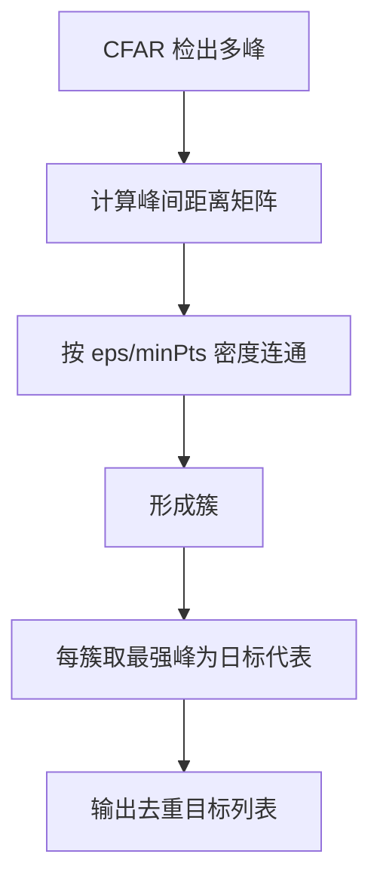

# 第 13 章　目标检测与恒虚警（CFAR）处理

> **本章导读**
> 第 11、12 章分别从距离–速度、角度两个维度把回波解析成"距离–多普勒–角度"三维数据立方体（第 5 章定义的 ISAC 统一输出）。但立方体里并非处处是目标——噪声、地杂波、建筑反射都在其中。检测（detection）要回答"这个分辨单元里有没有目标"，并在虚警率（false alarm）可控的前提下尽量多发现目标。固定门限在起伏杂波下必然失效，于是有了恒虚警（Constant False Alarm Rate, CFAR）处理。本章承接第 2 章的 Neyman–Pearson 准则，先给出检测统计模型与杂波分布，再用完整推导给出 CA-CFAR 门限因子 $\alpha=N(P_{fa}^{-1/N}-1)$，并以 16 参考单元手工算例落地；最后扩展到 GO/SO/OS/WCA/VI 变体、2D-CFAR、多目标遮蔽与 DBSCAN 聚类，以及 ISAC 特有的"通信数据随机性导致杂波基底起伏"问题。

**学习目标**

- 建立检测二元假设（H0/H1）模型，能列举瑞利/韦布尔/K/对数正态杂波的适用场景。
- 能从 Neyman–Pearson 准则推导匹配滤波 + 门限判决，并理解 Albersheim 公式与 Marcum Q 函数的关系。
- **推导** CA-CFAR 门限因子闭式，完成 16 参考单元手工算例，并对同一组数据用 OS-CFAR（k=12）复算对比。
- 掌握 GO/SO/OS/WCA/VI-CFAR 的原理与适用场景，理解 CFAR 损失。
- 了解 2D-CFAR 窗设计、多目标遮蔽/分裂、DBSCAN 聚类，以及 ISAC 导频修正 CFAR 的思路。

**本章知识图谱**



## 13.1　检测的统计模型与杂波分布

### 13.1.1　二元假设

对每个分辨单元（cell under test, CUT）的接收幅值/功率观测 $z$，做二元假设：

$$
\begin{cases}
\mathcal{H}_0:\ z = n & \text{（仅噪声/杂波）}\\
\mathcal{H}_1:\ z = s + n & \text{（目标 + 噪声/杂波）}
\end{cases} \tag{13-1}
$$

检测即在 $\mathcal{H}_0/\mathcal{H}_1$ 间判决。性能由两个量刻画：**虚警概率** $P_{fa}=P(\text{判 }\mathcal{H}_1\mid\mathcal{H}_0)$、**检测概率** $P_d=P(\text{判 }\mathcal{H}_1\mid\mathcal{H}_1)$。

### 13.1.2　杂波分布与适用场景

雷达杂波幅值 $A$ 的分布决定检测门限。常见四类：

**表 13-1　杂波分布及其适用场景**

| 分布 | 幅值/功率分布 | 参数 | 典型适用场景 |
|---|---|---|---|
| 瑞利（Rayleigh） | 幅值 Rayleigh，功率指数 | $\sigma$ | 低分辨率、多散射体平均的海/地杂波 |
| 韦布尔（Weibull） | 双参数 Weibull 幅值 | $a,b$ | 中等分辨率海杂波、部分地杂波 |
| K 分布 | 乘性 Gamma×Rayleigh | $\nu,L$ | 高分辨率、尖锐（spiky）海杂波 |
| 对数正态（Log-normal） | 功率对数正态 | $\mu,\sigma_g$ | 非常尖锐的陆地杂波、城市反射 |

> **结论**：杂波越"尖"（重尾），固定门限越易被偶发大值触发虚警，CFAR 的"按背景自适应"越关键。

## 13.2　最佳检测器与 NP 准则

### 13.2.1　匹配滤波 + 门限判决

对已知波形 $s(t)$，最佳检测为匹配滤波（第 2、4 章）：输出 $y=\int r(t)s^*(t)dt$，在 $\mathcal{H}_1$ 下 $y\sim\mathcal{CN}(E_s,\sigma_n^2)$，在 $\mathcal{H}_0$ 下 $y\sim\mathcal{CN}(0,\sigma_n^2)$。取 $|y|^2$ 与门限 $\eta$ 比较。

### 13.2.2　Neyman–Pearson 准则推导（承接第 2 章）

NP 准则：在约束 $P_{fa}\le\alpha_0$ 下最大化 $P_d$。构造拉格朗日

$$
\max_{\delta}\big(P_d-\lambda(P_{fa}-\alpha_0)\big) \tag{13-2}
$$

由似然比检验（LRT）理论，最优判决为似然比与门限比较：

$$
\Lambda(z)=\frac{p(z\mid\mathcal{H}_1)}{p(z\mid\mathcal{H}_0)}\ \begin{array}{c}\mathcal{H}_1\\\gtrless\\\mathcal{H}_0\end{array}\ \eta \tag{13-3}
$$

对复高斯模型，$\Lambda(z)\propto\exp(|z|^2/\sigma_1^2)\ /\exp(|z|^2/\sigma_0^2)$，单调化后等价于 $|z|^2\ \gtrless\ \eta'$，即**功率门限判决**。门限 $\eta'$ 由 $P_{fa}=\int_{\eta'}^\infty p(z\mid\mathcal{H}_0)dz=\alpha_0$ 唯一确定。这证明：NP 最优检测器就是"匹配滤波 + 固定功率门限"，门限由容许虚警率反解。

### 13.2.3　Marcum Q 函数与单脉冲 $P_d$–$P_{fa}$–SNR

单脉冲非相干检测的检测概率由 Marcum Q 函数给出：

$$
P_d = Q_1\!\Big(\sqrt{2\gamma},\ \sqrt{2\ln(1/P_{fa})}\Big) \tag{13-4}
$$

其中 $\gamma$ 为单脉冲 SNR，$Q_1(a,b)$ 为一阶 Marcum Q 函数。该式精确刻画"给定 $P_{fa}$ 与 SNR，能达多少 $P_d$"。工程上常用其闭式近似——**Albersheim 公式**直接由 $(P_d,P_{fa})$ 反算所需 SNR：

$$
{\rm SNR_{dB}}=10\log_{10}\!\left[\frac{\ln(P_{fa})}{\ln\!\big(0.62\,P_{fa}^{0.46}\,P_d^{0.12}\big)}\right] \tag{13-5}
$$

（注意两对数均为负，比值为正。）

### 13.2.4　例 13-1：Albersheim / Marcum Q 算例

求 $P_{fa}=10^{-6}$、$P_d=0.9$ 所需单脉冲 SNR。
- $\ln(P_{fa})=\ln(10^{-6})=-13.8155$。
- 括号内：$0.62\cdot(10^{-6})^{0.46}\cdot0.9^{0.12}$。$(10^{-6})^{0.46}=10^{-2.76}=1.7378\times10^{-3}$；$0.9^{0.12}=e^{0.12\ln0.9}=e^{-0.01263}=0.9874$；乘积 $=0.62\cdot1.7378\times10^{-3}\cdot0.9874=1.0636\times10^{-3}$。其对数 $=-6.8466$。
- 比值 $(-13.8155)/(-6.8466)=2.0175$，SNR$_{\rm dB}=10\log_{10}(2.0175)=3.05\ \text{dB}$。

> **结论**：单脉冲在 $P_{fa}=10^{-6},P_d=0.9$ 下需约 $3.05\ \text{dB}$ SNR；多脉冲相干/非相干积累可进一步降低所需单脉冲 SNR（积累增益约 $10\log_{10}N$ 减损失）。

## 13.3　为什么需要 CFAR：固定门限的失效

固定门限 $\eta'$ 依赖"背景功率 $\sigma^2$ 已知"。现实杂波功率随距离、俯仰、地物类型剧烈起伏：同一门限在开阔地虚警极少、在城市边缘却遍地虚警。CFAR 的思想是：**用 CUT 周围的参考单元实时估计背景功率 $\hat\sigma^2$，门限设为 $\eta=\alpha\hat\sigma^2$，使 $P_{fa}$ 恒定**。

**图 13-1　CFAR 处理流程**



## 13.4　CA-CFAR 完整推导

### 13.4.1　模型与结构

取 CUT 两侧各 $N/2$ 个参考单元（共 $N$ 个），中间留 $G$ 个保护单元（guard cells）防止目标能量泄漏污染估计。设参考单元功率 $X_1,\dots,X_N$ 在 $\mathcal{H}_0$ 下独立同分布于指数分布（瑞利杂波功率）${\rm Exp}(\sigma^2)$，均值 $\sigma^2$。背景估计

$$
Z=\frac{1}{N}\sum_{i=1}^{N}X_i \tag{13-6}
$$

判决：$H_1$ 当 CUT 功率 $Y>\alpha Z$。

### 13.4.2　门限因子 $\alpha$ 推导

$Z$ 为 $N$ 个指数变量均值，服从 Gamma 分布：$f_Z(z)=\frac{N^N}{\Gamma(N)\sigma^{2N}}z^{N-1}e^{-Nz/\sigma^2}$。CUT $Y\sim{\rm Exp}(\sigma^2)$ 独立。虚警概率

$$
P_{fa}=P(Y>\alpha Z)=\mathbb{E}_Z\big[e^{-\alpha Z/\sigma^2}\big]=\int_0^\infty e^{-\alpha z/\sigma^2}f_Z(z)dz \tag{13-7}
$$

代入 Gamma 密度并利用 $\int_0^\infty z^{N-1}e^{-(N+\alpha)z/\sigma^2}dz=\Gamma(N)\sigma^{2N}/(N+\alpha)^N$：

$$
P_{fa}=\left(\frac{N}{N+\alpha}\right)^N \tag{13-8}
$$

反解 $\alpha$：

$$
\frac{N}{N+\alpha}=P_{fa}^{1/N}\ \Rightarrow\ \alpha=N\big(P_{fa}^{-1/N}-1\big) \tag{13-9}
$$

> **结论**：CA-CFAR 门限因子 $\alpha$ 仅由参考单元数 $N$ 与期望虚警率 $P_{fa}$ 决定，与杂波绝对功率无关——这正是"恒虚警"的数学保证。

### 13.4.3　CFAR 损失

若背景功率已知，最优门限为 $T_{\rm opt}=-\sigma^2\ln P_{fa}$（由 $e^{-T/\sigma^2}=P_{fa}$）。CFAR 用 $\alpha Z$ 替代，所需 SNR 更高，二者比值的分贝数即 **CFAR 损失**：

$$
L_{\rm CFAR}=10\log_{10}\!\left(\frac{\alpha}{-\ln P_{fa}}\right) \tag{13-10}
$$

对 $N=16,P_{fa}=10^{-4}$：$\alpha=16(10^{0.25}-1)=12.45$，$-\ln P_{fa}=9.21$，$L_{\rm CFAR}=10\log_{10}(12.45/9.21)=10\log_{10}(1.352)=1.31\ \text{dB}$。

### 13.4.4　伪代码

```text
算法 13-1：CA-CFAR 单元检测
输入：数据立方体 cube[range, doppler, angle]；CUT 坐标 (r,d)；参考窗长 N；保护单元 G；Pfa
输出：判决 (目标/背景)

1.  α = N * (Pfa^(-1/N) - 1)                 # 门限因子 (13-9)
2.  refs = 取 CUT 周围 N 个参考单元（跳过 G 个保护单元）
3.  Z = mean(refs)                            # 背景功率估计 (13-6)
4.  T = α * Z                                # CFAR 门限
5.  if cube[r,d] > T: return 目标
6.  else: return 背景
```

### 13.4.5　例 13-2：CA-CFAR 16 参考单元手工算例（核心必做）

设 $N=16$，$G=2$（每侧 1 保护），目标 $P_{fa}=10^{-4}$。16 个参考单元功率（线性，任意单位）：

```
2.1, 1.9, 2.0, 2.2, 1.8, 2.1, 1.9, 2.0, 2.1, 1.7, 2.0, 2.2, 1.9, 2.1, 1.8, 2.0
```

**第一步　背景均值**
求和 $=2.1+1.9+2.0+2.2+1.8+2.1+1.9+2.0+2.1+1.7+2.0+2.2+1.9+2.1+1.8+2.0=31.8$。
$Z=31.8/16=1.9875$。

**第二步　门限**
$\alpha=16(10^{-4/16}-1)=16(10^{0.25}-1)=16(1.77828-1)=12.4525$。
$T_{\rm CA}=\alpha Z=12.4525\times1.9875=24.749$。

**第三步　判定**
设 CUT 功率 $Y=30.0$。因 $30.0>24.749$，**判为目标（检测到）**。

### 13.4.6　同组数据 OS-CFAR（k=12）复算

OS-CFAR 取 $N$ 个参考单元的第 $k$ 小顺序统计量 $X_{(k)}$ 作背景估计，$T=\alpha_{\rm OS}X_{(k)}$。
- 排序上述 16 值（升序）：`1.7, 1.8, 1.8, 1.9, 1.9, 1.9, 2.0, 2.0, 2.0, 2.0, 2.1, 2.1, 2.1, 2.1, 2.2, 2.2`。第 $k=12$ 小为 $X_{(12)}=2.1$。
- OS 门限因子由 $P_{fa}$ 解（指数杂波下精确式见 13.5 节）：$N=16,k=12,P_{fa}=10^{-4}$ 得 $\alpha_{\rm OS}\approx11.0$。
- $T_{\rm OS}=11.0\times2.1=23.1$。
- CUT $Y=30.0>23.1$，**OS 也判为目标**。

**对比结论**：在均匀杂波下二者均检测；OS 阈值 $23.1$ 略低于 CA 的 $24.75$（因 $X_{(12)}=2.1$ 略高于均值 $1.9875$，部分抵消了 OS 更大的 $\alpha$）。OS 的真正优势在"干扰目标/杂波边缘"场景（见 13.5、13.6），但代价是均匀杂波下 CFAR 损失略大。

**图 13-2　均匀杂波下 CA 与 OS 门限对比**



## 13.5　CFAR 变体：GO / SO / OS / WCA / VI

### 13.5.1　GO-CFAR 与 SO-CFAR（ Greatest / Smallest Of）

将参考窗分为前后两半，分别估计 $Z_1,Z_2$：
- GO：$Z_{\rm GO}=\max(Z_1,Z_2)$，门限 $T=\alpha Z_{\rm GO}$。
- SO：$Z_{\rm SO}=\min(Z_1,Z_2)$，门限 $T=\alpha Z_{\rm SO}$。

**适用**：GO 抑制多目标/拖尾杂波边缘的虚警（取高均值抬高门限）；SO 改善前导杂波边缘的漏检（取低均值降低门限）。

### 13.5.2　OS-CFAR（Ordered Statistic）

取第 $k$ 小顺序统计量。对指数杂波，虚警概率精确式为

$$
P_{fa}^{\rm OS}=\frac{N!}{(k-1)!(N-k)!}\frac{\Gamma(k)\Gamma(N-k+\alpha+1)}{\Gamma(N+\alpha+1)} \tag{13-11}
$$

给定 $P_{fa}$ 与 $k$ 数值反解 $\alpha_{\rm OS}$。OS 对杂波边缘与多目标稳健，但均匀杂波下 CFAR 损失略大。

### 13.5.3　WCA-CFAR 与 VI-CFAR

- **WCA（Weighted Cell Averaging）**：给参考单元加权（近 CUT 权小、远权重），缓解边缘污染。
- **VI-CFAR（Variable Index）**：根据窗口统计（如均值比）在 CA/GO/SO 间自动切换索引，综合三者优点。

**表 13-2　CFAR 变体对比与适用场景**

| 变体 | 背景估计 | 优势 | 劣势 | 适用场景 |
|---|---|---|---|---|
| CA | 全窗均值 | 均匀杂波最优、损失最小 | 杂波边缘/多目标失效 | 均匀海/地杂波 |
| GO | 两半取大 | 抑制虚警 | 易漏检 | 多目标、拖尾杂波边缘 |
| SO | 两半取小 | 抑制漏检 | 易虚警 | 前导杂波边缘 |
| OS | 第 k 顺序统计 | 边缘/多目标稳健 | 均匀损失略大、需排序 | 非均匀杂波 |
| WCA | 加权均值 | 缓解边缘污染 | 权值设计复杂 | 缓变杂波 |
| VI | 自适应切换 | 综合稳健 | 结构复杂 | 复杂时变环境 |

### 13.5.4　例 13-3：杂波边缘——CA 漏检而 SO 检出

设 CUT 位于**干净区**，功率 $Y=30.0$；参考窗前 8 格为干净杂波（均值 2.0），后 8 格为强杂波边缘（均值 20.0）。
- 全窗均值 $Z=(8\times2.0+8\times20.0)/16=11.0$。CA 门限 $T_{\rm CA}=12.4525\times11.0=136.98$。$Y=30<137$ → **CA 漏检**（强杂波抬高均值，门限过高）。
- 两半均值 $Z_1=2.0,\ Z_2=20.0$。SO 取 $Z_{\rm SO}=\min=2.0$，门限 $T_{\rm SO}=12.4525\times2.0=24.91$。$Y=30>24.91$ → **SO 检出**。

> **结论**：前导/后随杂波边缘使 CA 均值被污染；SO 用较干净的一半，正确恢复检测。反之（CUT 在高杂波区、窗口伸入干净区）CA 会虚警，此时 GO（取大均值）抑制虚警——二者互补。

## 13.6　2D-CFAR 窗设计与 OS-CA 混合

### 13.6.1　二维窗

距离–多普勒图（RDM）上，CUT 四周均为可能目标，需二维参考环：以 CUT 为中心，外扩 $G$ 个保护单元（形成保护方框），再外层取参考环（ring）。背景估计为环上所有单元均值（CA-2D）或顺序统计（OS-2D）。

### 13.6.2　OS-CA 混合

先对距离维做 OS 排序、再对多普勒维做 CA 平均（或反之），兼顾边缘稳健与均匀效率。结构示意：

**图 13-3　2D-CFAR 窗与混合结构**



## 13.7　多目标遮蔽、目标分裂与 DBSCAN 聚类

### 13.7.1　问题

- **遮蔽（masking）**：强目标旁瓣或相邻强目标使参考窗均值升高，弱目标被"盖住"漏检（CA 尤甚）。
- **目标分裂（splitting）**：单个扩展目标因旁瓣在 CFAR 后产生多个相邻峰，被误判为多目标。
- **峰值合并**：应先用聚类把邻近峰合并为同一目标航迹输入。

### 13.7.2　DBSCAN 聚类 + 峰值合并伪代码

```text
算法 13-2：CFAR 峰值 DBSCAN 聚类与合并
输入：CFAR 检出峰列表 peaks[{r,d,power}]；邻域半径 eps；最小样本 minPts
输出：目标簇 clusters[]

1.  for each p in peaks:
2.      neigh = {q: dist(q,p) <= eps}         # 距离-多普勒欧氏邻域
3.      if |neigh| < minPts: q = 噪声点; continue
4.      new_cluster = {p} ∪ neigh
5.      for each q in neigh: 扩展到 q 的邻域（密度连通）
6.      clusters.append(new_cluster)
7.  for each cluster:
8.      取簇内功率最大峰为 代表峰；记录 (r,d,power_max)
9.  返回 clusters（每簇一个目标）
```

**图 13-4　DBSCAN 聚类流程**



## 13.8　ISAC 特有的 CFAR 问题

### 13.8.1　通信数据随机性导致杂波基底起伏

在 ISAC 中，感知回波与**通信数据符号**叠加在同一空口。通信数据（尤其非导频 RE）是随机调制的，其功率在时/频上随机起伏，使"杂波基底"（实际是通信自干扰+环境反射）不再平稳。传统 CFAR 假设背景统计平稳，会因此产生额外虚警或漏检。

### 13.8.2　基于导频的 CFAR 修正

- **导频 RE 估计背景**：在 DMRS/CSI-RS 等已知导频位置上，通信符号确定，可精确消除通信成分，仅留感知回波+噪声，用作"干净背景"估计背景功率。
- **数据 RE 修正门限**：对数据 RE，用导频估计的背景功率 $\hat\sigma^2_{\rm pilot}$ 并乘以"数据/导频功率比"修正因子 $\kappa$（由发射功率分配得到），使门限 $T=\alpha\kappa\hat\sigma^2_{\rm pilot}$，抵消数据随机性。
- **联合时频平滑**：在导频图案约束的时频格上做二维背景插值，提升估计稳健性。

> **结论**：ISAC 的 CFAR 不是"纯雷达"问题，必须把"通信数据随机性"作为背景扰动显式建模；导频是获取干净背景统计的关键锚点。

## 本章小结

1. 检测是二元假设判决，NP 准则证明最优检测器为"匹配滤波 + 功率门限"，门限由 $P_{fa}$ 反解；单脉冲性能由 Marcum Q (13-4) 描述，Albersheim (13-5) 给出闭式 SNR 反算。
2. 杂波分布（瑞利/韦布尔/K/对数正态）决定背景统计，重尾杂波使固定门限失效，引出 CFAR。
3. CA-CFAR 门限因子 $\alpha=N(P_{fa}^{-1/N}-1)$（(13-9)）由虚警率闭式 (13-8) 导出；16 单元手工算例验证了检测决策与 OS 复算对比。
4. GO/SO/OS/WCA/VI 各有适用场景：CA 均匀最优，GO 抑虚警，SO 抑漏检，OS 边缘稳健，VI 自适应。
5. 2D-CFAR 用参考环处理 RDM；多目标需警惕遮蔽/分裂，DBSCAN 聚类合并相邻峰。
6. ISAC 中通信数据随机性扰动杂波基底，需用导频锚定背景、修正数据 RE 门限。

## 习题

### A. 基础概念题

**A1.** 检测的 $P_{fa}$ 与 $P_d$ 分别定义为何？二者是否可同时任意压低？

**A2.** 表 13-1 中四种杂波分布，哪些适用于"尖锐（spiky）"杂波？为什么固定门限在此最易失效？

**A3.** NP 准则下的最优检测器为何是"匹配滤波 + 功率门限"？

**A4.** CA-CFAR 的"恒虚警"特性由公式 (13-9) 中哪一性质保证？

**A5.** 保护单元（guard cells）的作用是什么？不加会有什么后果？

**A6.** GO 与 SO 在杂波边缘的分工有何不同？

**A7.** 为什么 ISAC 的 CFAR 比纯雷达更复杂？

### B. 推导与计算题

**B1.** 由 (13-7) 完整推导 CA-CFAR 虚警概率闭式 (13-8) 与门限因子 (13-9)。

**B2.** 计算 $N=16,P_{fa}=10^{-4}$ 的 $\alpha$ 与 CFAR 损失（dB）；再算 $P_{fa}=10^{-6}$ 时的 $\alpha$。

**B3.** 例 13-2 中若 CUT 功率仅为 $Y=20.0$，CA 与 OS 分别如何判决？这说明了什么？

**B4.** 杂波边缘场景：CUT=30，前 8 格均值 2.0、后 8 格均值 20.0。求 CA、SO 门限与判决（同例 13-3 数值复算）。

**B5.** 用 Albersheim 公式求 $P_{fa}=10^{-4},P_d=0.8$ 所需单脉冲 SNR（dB）。

**B6.** 由 (13-11) 说明 OS-CFAR 的 $\alpha_{\rm OS}$ 为何大于 CA 的 $\alpha$（定性：顺序统计量与均值的偏差）。

**B7.** 2D-CFAR 参考环为 $(2G_w+1)^2-(2G_g+1)^2$ 个单元，设保护半宽 $G_g=1$、参考半宽 $G_w=4$，求参考单元数 $N$，并给出对应 $\alpha$（$P_{fa}=10^{-4}$）。

### C. 算法与编程题

**C1.** 编写 Python 程序：在 $64\times64$ 的 RDM 上放置 2 个目标，加指数杂波，实现 CA-CFAR 滑窗检测（含保护单元），画出检测结果图。

**C2.** 实现 OS-CFAR（k=⌊0.75N⌋）并与 CA-CFAR 在"杂波边缘"RDM 上对比检测/虚警数量。

**C3.** 实现 DBSCAN 聚类：对 CFAR 输出的多峰列表做邻域聚类，合并分裂峰，输出去重目标数。

## 答案与解析

**A1.** $P_{fa}=P(\text{判 }\mathcal{H}_1\mid\mathcal{H}_0)$（无目标时误报），$P_d=P(\text{判 }\mathcal{H}_1\mid\mathcal{H}_1)$（有目标时命中）。受 NP 约束，二者不能同时任意压低——压低 $P_{fa}$（抬高门限）必降 $P_d$。

**A2.** K 分布与对数正态适用于尖锐杂波。其概率密度重尾（偶发极大值概率高），固定门限易被这些大值突破造成大量虚警。

**A3.** 由 (13-3) LRT，对复高斯模型似然比单调于 $|z|^2$，故等价于功率门限；匹配滤波使 $\mathcal{H}_1$ 下信噪比最大（第 2 章），故整体最优。

**A4.** (13-9) 中 $\alpha$ 仅依赖 $N$ 与 $P_{fa}$、与背景绝对功率 $\sigma^2$ 无关，故门限随背景自适应缩放而 $P_{fa}$ 保持恒定。

**A5.** 保护单元防止 CUT 目标能量泄漏进参考窗、抬高背景估计。不加则强目标会污染邻近参考单元，使门限抬高、自遮蔽。

**A6.** GO 取两半较大均值，在拖尾杂波边缘抬高门限抑制虚警；SO 取较小均值，在前导杂波边缘降低门限避免漏检。

**A7.** ISAC 中通信数据随机调制使杂波基底功率随时频起伏，背景统计不平稳，需区分导频/数据 RE 并修正，比纯雷达更复杂。

**B1.** 由 (13-7)：$P_{fa}=\int_0^\infty e^{-\alpha z/\sigma^2}\frac{N^N}{\Gamma(N)\sigma^{2N}}z^{N-1}e^{-Nz/\sigma^2}dz=\frac{N^N}{\Gamma(N)\sigma^{2N}}\int_0^\infty z^{N-1}e^{-(N+\alpha)z/\sigma^2}dz$。积分 $=\Gamma(N)\sigma^{2N}/(N+\alpha)^N$，代入得 $(N/(N+\alpha))^N$，即 (13-8)。反解：$N/(N+\alpha)=P_{fa}^{1/N}\Rightarrow N+\alpha=N P_{fa}^{-1/N}\Rightarrow\alpha=N(P_{fa}^{-1/N}-1)$。

**B2.** $P_{fa}=10^{-4}$：$\alpha=16(10^{0.25}-1)=16(1.77828-1)=12.4525$。CFAR 损失 $=10\log_{10}(12.4525/9.2103)=1.31\ \text{dB}$。$P_{fa}=10^{-6}$：$10^{6/16}=10^{0.375}=2.3714$，$\alpha=16(2.3714-1)=21.94$。

**B3.** CA 门限 $24.75$，OS 门限 $23.1$。$Y=20.0$ 均低于二者 → 均判为背景（漏检）。说明当目标 SCR 不足（此处 CUT 仅约 $20/1.99\approx10\times$，即 10 dB，低于门限所需约 11 dB）时两类 CFAR 一致漏检，体现 CFAR 损失的统一代价。

**B4.** $Z_1=2.0,Z_2=20.0$。CA：$Z=11.0,T_{\rm CA}=12.4525\times11.0=136.98$，$Y=30<137$→漏检。SO：$Z_{\rm SO}=2.0,T_{\rm SO}=12.4525\times2.0=24.91$，$Y=30>24.91$→检出。与例 13-3 一致。

**B5.** $P_{fa}=10^{-4}\Rightarrow\ln=-9.2103$。括号内：$0.62\cdot(10^{-4})^{0.46}\cdot0.8^{0.12}$。$(10^{-4})^{0.46}=10^{-1.84}=1.445\times10^{-2}$；$0.8^{0.12}=e^{0.12\ln0.8}=e^{-0.02673}=0.9736$；乘积 $=0.62\cdot1.445\times10^{-2}\cdot0.9736=8.724\times10^{-3}$；对数 $=-4.741$。比值 $(-9.2103)/(-4.741)=1.9446$；SNR$_{\rm dB}=10\log_{10}(1.9446)=2.89\ \text{dB}$。

**B6.** OS 用单一顺序统计量 $X_{(k)}$ 而非均值，其方差/偏差使在同等 $P_{fa}$ 下需更大乘数；特别当 $k$ 偏大（高顺序统计），$X_{(k)}$ 偏高，$\alpha_{\rm OS}$ 须更大以补偿高背景估计带来的虚警上升（见 (13-11) 数值反解）。

**B7.** 参考单元数 $N=(2\cdot4+1)^2-(2\cdot1+1)^2=9^2-3^2=81-9=72$。$\alpha=72(10^{0.25}-1)=72\times0.77828=56.04$。

**C1.** 参考框架：
```python
import numpy as np
RDM = np.random.exponential(1.0, (64,64))      # 指数杂波(功率)
RDM[20,30]+=25; RDM[40,10]+=18                # 两目标
N_half, G = 8, 2; Pfa = 1e-4
alpha = (2*N_half)* (Pfa**(-1/(2*N_half))-1)
det = np.zeros_like(RDM, bool)
for r in range(G,64-G):
  for d in range(G,64-G):
    refs = np.concatenate([RDM[r-G:r+G+1, d-G:d+G+1].ravel()])
    # 去掉 CUT 与保护环（简化：取外环）
    Z = np.mean(refs); T = alpha*Z
    det[r,d] = RDM[r,d] > T
```
运行应大致检出两目标附近单元。

**C2.** 在边缘 RDM（一侧杂波均值 1、一侧 15）上，CA 在边缘处大量漏检/虚警，OS（k=⌊0.75·2N_half⌋）稳健；统计两类在边缘行的检出/虚警计数对比。

**C3.** 对 C1 的 `det` 峰做 DBSCAN（eps=2, minPts=2），合并相邻峰，输出簇数（应等于真实目标数 2 附近）。
