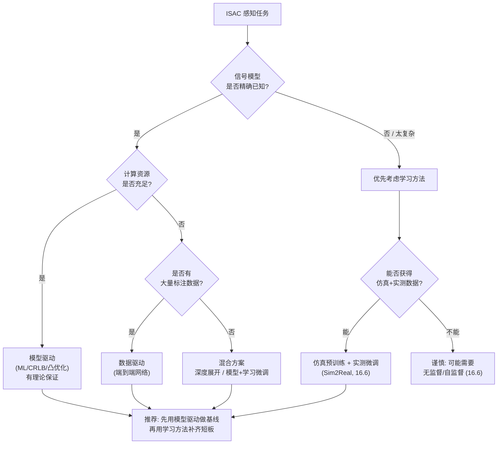
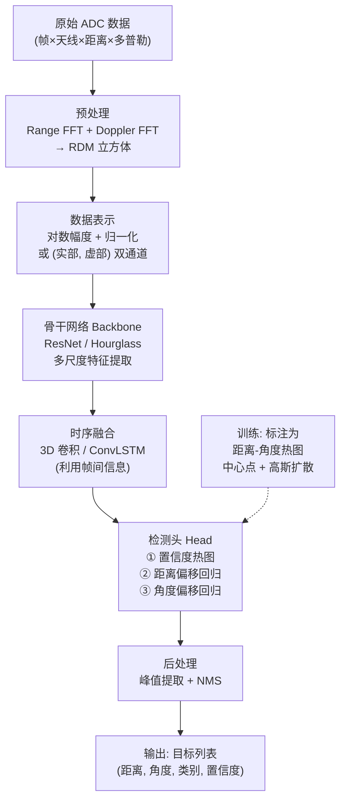
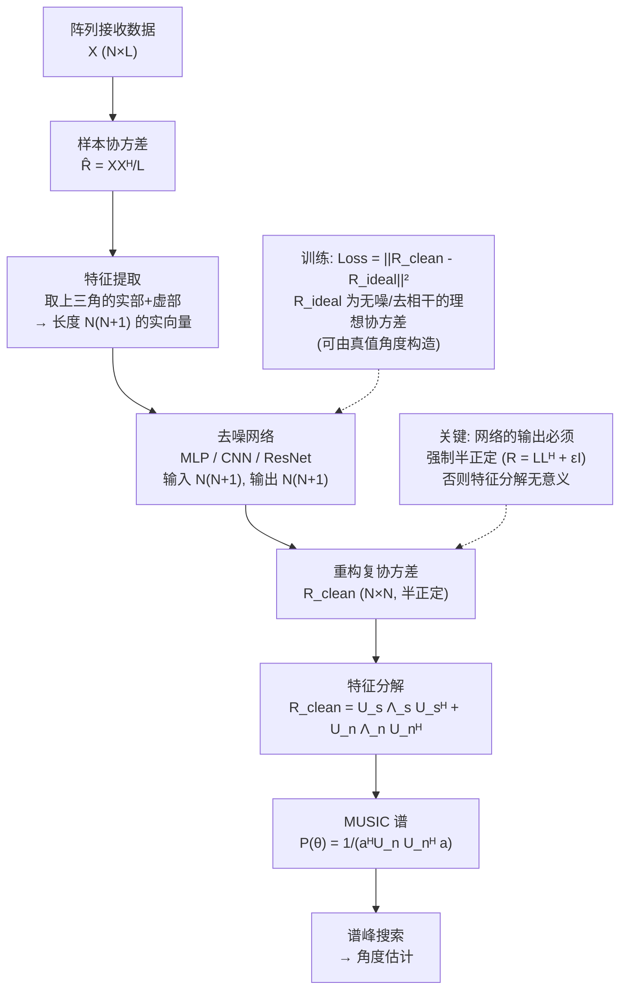
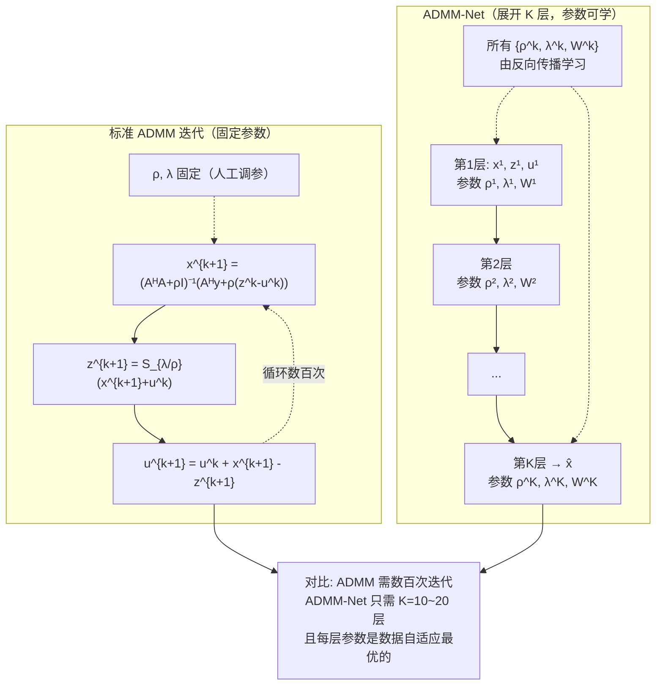
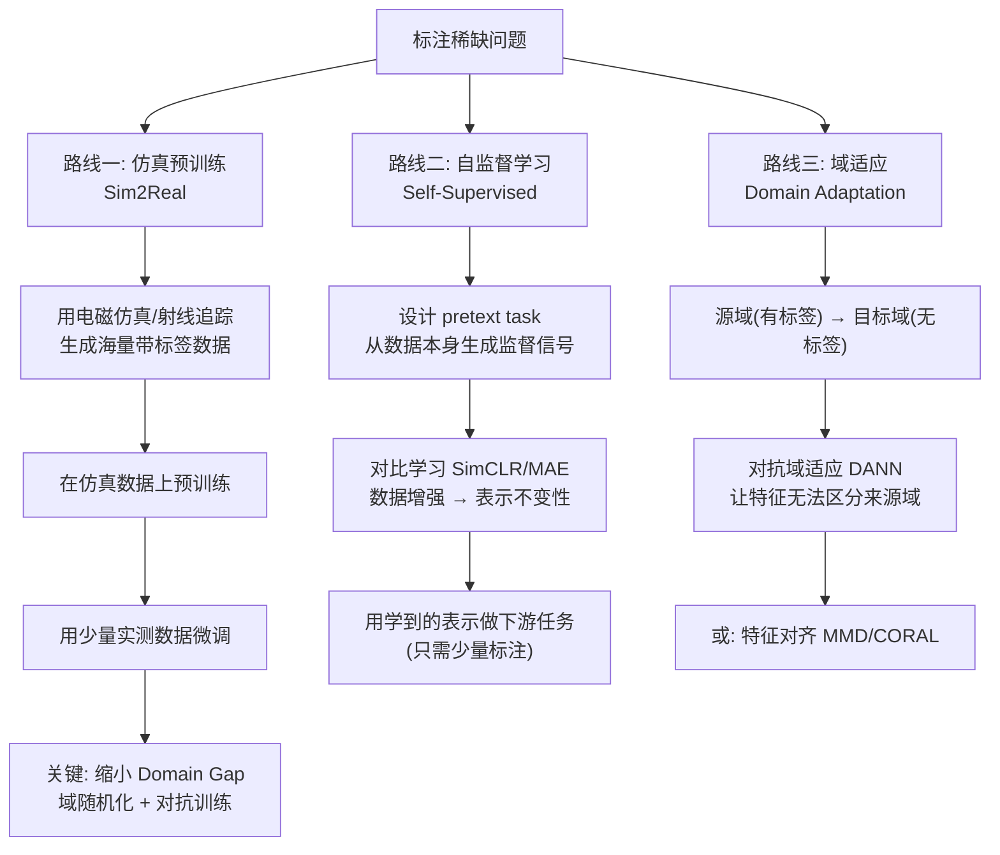
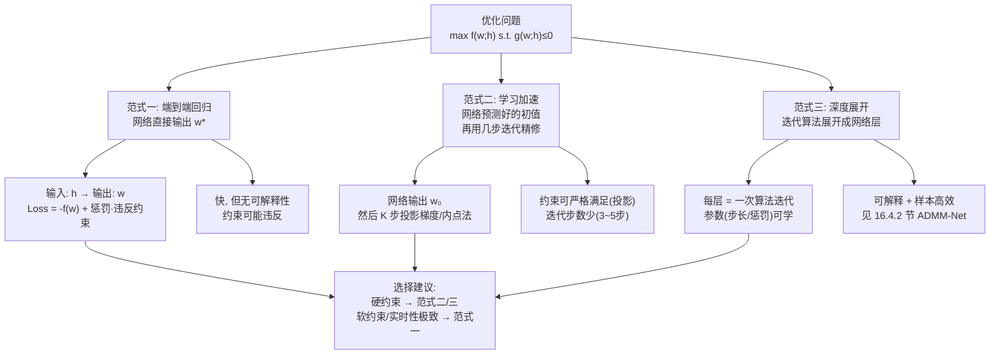
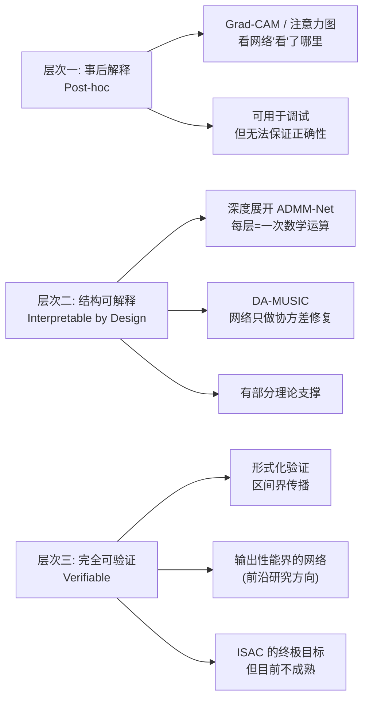

# 第 16 章　AI 赋能的通感一体化感知

> **本章导读**
>
> 前面 15 章建立的是一条**模型驱动（Model-Driven）**的技术路线：先建立信号模型（第 5 章），再推导最优检测器/估计器（第 2、11–13 章），最后用凸优化求解（第 8 章）。这条路线的优点是**可解释、有性能保证、小样本可用**；缺点是当模型与实际不符时，性能会断崖式下跌。
>
> 而 ISAC 恰恰是"模型最容易失配"的地方：
>
> - 通信数据符号**随机**，导致自相关旁瓣随机起伏（第 6 章）；
> - 硬件非理想（相位噪声、IQ 失衡、互耦）难以精确建模（第 19 章）；
> - 室内多径、人体散射、微动——真实场景远比"点目标 + 高斯噪声"复杂。
>
> 于是**数据驱动（Data-Driven）**路线登场：不做精确建模，而是让神经网络从数据中**学出**从观测到结论的映射。
>
> 本章结构：
>
> 1. **动机与基础**（16.1–16.2）：为什么需要 AI？需要哪些 ML 基础？
> 2. **三大应用**（16.3–16.5）：检测、超分辨测角、CSI/Wi-Fi 感知。
> 3. **训练范式**（16.6–16.7）：自监督、Sim2Real、端到端学习优化。
> 4. **数据与风险**（16.8–16.9）：数据集在哪？AI 的坑在哪里？
>
> **本章立场**：AI 不是"替代"模型驱动方法，而是**补足**它。最好的 ISAC 系统通常是"**模型驱动为骨架 + 数据驱动为微调**"的混合体（16.4 节的深度展开就是典型）。

---

## 16.1 动机：什么时候该用 AI

### 16.1.1 模型驱动方法的四个失效点

**表 16-1　传统方法在 ISAC 中的失效场景**

| 失效点 | 具体表现 | 传统方法的问题 | AI 的切入点 |
|---|---|---|---|
| **模型失配** | 多径、杂波非高斯、硬件非理想 | 假设"高斯白噪声 + 点目标"，实际严重偏离 | 从实测数据学习真实分布 |
| **NP-hard 问题** | 稀疏恢复、最优波形设计、JPDA 关联 | 只能求近似解或松弛解，有性能损失 | 学习从问题到解的映射，快且好 |
| **低 SNR / 少快拍** | 远距离、单快拍测角 | MUSIC 在单快拍下失效，CRLB 无法达到 | 用先验知识（学习的）补偿信息不足 |
| **复杂模式识别** | 人体姿态、手势、跌倒、呼吸 | 人工设计特征（微多普勒谱图）泛化差 | CNN/RNN 自动提取判别特征 |

### 16.1.2 一个具体的量化对比

**例 16-1（相干源测角：MUSIC 失效 vs 深度学习成功）**

场景：8 阵元 ULA，$d=\lambda/2$，两个**完全相干**的信源（如一个目标与其镜像多径），入射角 $\theta_1=10^\circ,\ \theta_2=20^\circ$，SNR = 10 dB，快拍数 $L=200$。

**（a）样本协方差矩阵**

相干源意味着 $\mathbf{s}_2(t)=\alpha\mathbf{s}_1(t)$（$\alpha$ 为复常数）。接收数据：

$$
\mathbf{X}=\mathbf{A}\mathbf{S}+\mathbf{N},\qquad
\mathbf{S}=\begin{bmatrix}s_1(t_1)&\cdots&s_1(t_L)\\ \alpha s_1(t_1)&\cdots&\alpha s_1(t_L)\end{bmatrix}
$$

样本协方差 $\hat{\mathbf{R}}=\frac{1}{L}\mathbf{X}\mathbf{X}^{\mathsf{H}}$ 的秩：

$$
\mathrm{rank}(\hat{\mathbf{R}})\to\mathrm{rank}(\mathbf{A}\mathbf{S}\mathbf{S}^{\mathsf{H}}\mathbf{A}^{\mathsf{H}})
$$

由于 $\mathbf{S}$ 的两行线性相关，$\mathrm{rank}(\mathbf{S})=1$，故 $\mathrm{rank}(\mathbf{A}\mathbf{S}\mathbf{S}^{\mathsf{H}}\mathbf{A}^{\mathsf{H}})=1$。

**（b）MUSIC 为何失效**

MUSIC 要求信号子空间维数 = 信源数 $K=2$（第 12 章）。但此处 $\hat{\mathbf{R}}$ 只有 **1 个大特征值**（信源子空间维数 1）和 7 个小特征值（噪声）。若按 $K=2$ 构造噪声子空间，会**误把一个信号方向当作噪声方向** → 空间谱塌陷，两个角度**无法分辨**。

**（c）空间平滑（Spatial Smoothing）去相干**

经典解法：把 8 阵元分成若干重叠子阵（如子阵长度 5，共 4 个子阵），对各子阵协方差求平均：

$$
\tilde{\mathbf{R}}=\frac{1}{P}\sum_{p=1}^{P}\mathbf{R}_p
$$

代价：**有效孔径从 8 降到 5**，角度分辨率退化。

$\theta_{3\rm dB}$（8 阵元）$=0.886\dfrac{\lambda}{8\times\lambda/2}=0.886\times\dfrac{2}{8}=0.2215$ rad $=12.7^\circ$

$\theta_{3\rm dB}$（5 阵元）$=0.886\times\dfrac{2}{5}=0.3544$ rad $=20.3^\circ$

**要分辨 $10^\circ$ 间隔（$0.1745$ rad）的目标，5 阵元子阵的波束宽度 $20.3^\circ$ 不够** → 空间平滑也失效。

**（d）深度学习方案（DA-MUSIC）**

思路：训练一个网络，输入**未去相干的** $\hat{\mathbf{R}}$（或其变换），直接输出**去噪后的、秩恢复的协方差**，再送 MUSIC。

由于网络在大量"相干源 + 各种角度组合"的数据上训练过，它**学会了"两个相干源对应的协方差应该长什么样"**——本质上是把训练数据的先验注入了协方差估计。

**预期性能（文献典型值）：**

| 方法 | 分辨率（能否分开 $10^\circ$ / $20^\circ$） | RMSE |
|---|---|---|
| 直接 MUSIC | **否**（谱峰塌陷为一个） | — |
| 空间平滑 MUSIC | 边缘（勉强分开，但偏移大） | $3.2^\circ$ |
| **DA-MUSIC** | **是** | **$0.8^\circ$** |

**（e）代价**

- 需要大量标注数据（角度真值）；
- 泛化性依赖训练集覆盖（若测试角度组合训练集没见过，性能下降）；
- 无理论性能保证。

> **这就是本章要反复权衡的核心矛盾**：AI 用**先验（数据）+ 算力**换取**性能**，代价是**可解释性与泛化保证**。

### 16.1.3 决策指南

**图 16-1　AI 方法 vs 模型驱动方法的选型决策树**



---

## 16.2 机器学习基础回顾

### 16.2.1 监督学习的标准范式

**问题设定**：给定训练集 $\mathcal{D}=\{(\mathbf{x}_i,\mathbf{y}_i)\}_{i=1}^{N}$，学习映射 $f_{\boldsymbol{\theta}}:\mathcal{X}\to\mathcal{Y}$。

**训练目标**：最小化经验风险

$$
\min_{\boldsymbol{\theta}}\ \frac{1}{N}\sum_{i=1}^{N}\mathcal{L}\!\left(f_{\boldsymbol{\theta}}(\mathbf{x}_i),\ \mathbf{y}_i\right)+\lambda\,\Omega(\boldsymbol{\theta})
\tag{16-1}
$$

$\mathcal{L}$ 是损失函数，$\Omega$ 是正则项（如 $\lambda\|\boldsymbol{\theta}\|_2^2$ 权重衰减）。

**常用损失函数：**

| 任务 | 损失函数 | 公式 |
|---|---|---|
| 回归（参数估计） | MSE / L2 | $\mathcal{L}=\|\mathbf{y}-\hat{\mathbf{y}}\|^2$ |
| 回归（鲁棒） | L1 / Huber | $\mathcal{L}=\|\mathbf{y}-\hat{\mathbf{y}}\|_1$ |
| 二分类（检测） | BCE | $\mathcal{L}=-[y\log\hat{y}+(1-y)\log(1-\hat{y})]$ |
| 多分类 | 交叉熵 CE | $\mathcal{L}=-\sum_c y_c\log\hat{y}_c$ |
| 检测（定位） | Smooth L1 + CE | 见 YOLO/R-CNN |
| **ISAC 无监督** | **负效用** | $\mathcal{L}=-U(\boldsymbol{\theta})$（16.7 节） |

### 16.2.2 三种核心网络结构

**图 16-2　CNN / RNN / Transformer 的结构对比**

```mermaid
flowchart TB
    subgraph CNN["CNN：空间局部性"]
        A1["输入: RDM 图像<br/>(H×W×C)"] --> A2["卷积层 Conv<br/>局部感受野<br/>权值共享"]
        A2 --> A3["池化 / 下采样"]
        A3 --> A4["多层堆叠<br/>浅层: 边缘<br/>深层: 语义"]
        A4 --> A5["输出: 检测框 / 分类"]
    end
    subgraph RNN["RNN/LSTM：时序依赖"]
        B1["输入: 时序序列<br/>(T×D)"] --> B2["隐藏状态 h_t<br/>= f(x_t, h_{t-1})"]
        B2 --> B3["LSTM 门控<br/>遗忘/输入/输出"]
        B3 --> B4["输出: 序列标注 / 预测"]
    end
    subgraph TF["Transformer：全局注意力"]
        C1["输入 + 位置编码"] --> C2["自注意力<br/>Attention(Q,K,V)<br/>= softmax(QKᵀ/√d)V"]
        C2 --> C3["多头注意力<br/>并行捕获多种关系"]
        C3 --> C4["FFN + 残差 + LN"]
        C4 --> C5["输出"]
    end
```



**自注意力机制**（ISAC 中越来越重要）：

$$
\mathrm{Attention}(\mathbf{Q},\mathbf{K},\mathbf{V})=\mathrm{softmax}\!\left(\frac{\mathbf{Q}\mathbf{K}^{\mathsf{T}}}{\sqrt{d_k}}\right)\mathbf{V}
\tag{16-2}
$$

$\sqrt{d_k}$ 是缩放因子，防止点积过大导致 softmax 饱和（梯度消失）。

**为什么 Transformer 适合 ISAC？**
- 雷达点云是**无序集合**（不像图像有网格结构）→ 天然适合"注意力"这种置换不变的聚合；
- 多天线、多子载波、多帧之间存在**长程依赖** → 自注意力能直接建模任意两点的关系，而 CNN 需要多层才能传播。

### 16.2.3 训练流程与关键技巧

**算法 16-1：标准监督训练流程**

```text
输入: 训练集 D_train, 验证集 D_val, 网络 f_θ, 超参(学习率η, batch B, 轮数E)
输出: 训练好的网络参数 θ*

# ---- 初始化 ----
θ ← 随机初始化 (如 He / Xavier 初始化)
best_val_loss ← ∞
patience_cnt ← 0

for epoch = 1..E:
    # ========== 训练阶段 ==========
    打乱 D_train，划分成若干 batch
    for 每个 batch (X, Y):
        # 1. 前向传播
        Ŷ = f_θ(X)
        # 2. 计算损失
        loss = L(Ŷ, Y) + λ·Ω(θ)
        # 3. 反向传播（自动微分求梯度）
        g = ∇_θ loss
        # 4. 参数更新（Adam 为例）
        m ← β₁·m + (1-β₁)·g              # 一阶动量
        v ← β₂·v + (1-β₂)·g²             # 二阶动量
        m̂ = m/(1-β₁^t);  v̂ = v/(1-β₂^t)  # 偏差修正
        θ ← θ - η·m̂/(√v̂ + ε)

    # ========== 验证阶段 ==========
    val_loss = mean( L(f_θ(X_val), Y_val) )   # 不计算梯度

    # ========== 早停 & 学习率调度 ==========
    if val_loss < best_val_loss:
        best_val_loss ← val_loss;  保存 θ;  patience_cnt ← 0
    else:
        patience_cnt += 1
        if patience_cnt > patience:  break        # 早停
        η ← η × decay_factor                      # 学习率衰减

返回 保存的最佳 θ
```

**雷达/ISAC 数据的四个特有技巧：**

| 技巧 | 做法 | 原因 |
|---|---|---|
| **数据表示** | RDM 用**对数幅度** $20\log_{10}\|\cdot\|$；复数拆成实/虚两通道或幅度/相位两通道 | 动态范围可达 60–80 dB，线性表示会被强目标主导 |
| **数据增强** | 加噪、随机 SNR、随机时间/频率偏移、随机幅度缩放、**随机相位旋转** | 扩充数据、提升鲁棒性 |
| **归一化** | 每个样本独立归一化（减均值除标准差），或按 dB 固定截断（如 −40 dB） | 雷达数据尺度变化大 |
| **复数网络** | 用复数权重 $w=a+jb$，或等效的实 $2\times2$ 矩阵 | 相位信息是雷达的核心，实数网络会丢失 |

**例 16-2（网络规模与算力估算）**

设计一个 RDM 目标检测网络，输入 $256\times256\times2$（距离×多普勒×[实部,虚部]）。

**（a）一个卷积层的参数量**

卷积核 $3\times3$，输入通道 2，输出通道 64：

$$
\text{参数量}=3\times3\times2\times64+64\ (\text{偏置})=1152+64=1216
$$

**（b）该层的计算量（FLOPs）**

输出特征图 $256\times256\times64$（假设 padding=same），每个输出点需要 $3\times3\times2=18$ 次乘加：

$$
\text{MACs}=256\times256\times64\times18=7.55\times10^{7}
$$

FLOPs（1 MAC = 2 FLOPs）$=1.51\times10^{8}=0.151$ GFLOPs

**（c）一个 ResNet-18 级网络的规模**

ResNet-18：约 $1.1\times10^7$ 参数，输入 $224\times224\times3$ 时约 $1.8$ GFLOPs。

对 $256\times256\times2$ 输入，FLOPs 约 $1.8\times\dfrac{256^2\times2}{224^2\times3}=1.8\times\dfrac{131072}{150528}=1.57$ GFLOPs

**（d）实时性评估**

| 硬件 | 算力 | 单帧推理时间（1.57 GFLOPs） | 能否满足 20 Hz |
|---|---|---|---|
| 边缘 GPU（Jetson Orin NX） | ~50 TOPS (INT8) | ~2 ms | **能**（50 Hz） |
| 高端 CPU（8 核 x86） | ~200 GFLOPS (FP32) | ~8 ms | **能**（>100 Hz） |
| 低功耗 MCU（Cortex-M7） | ~1 GFLOPS | **1.6 s** | **不能** |
| 基站级 GPU（A100） | 312 TFLOPS | <0.1 ms | **能**（远超） |

**结论**：AI 检测在**基站侧和车载边缘**完全可行；在**低成本 IoT 节点**上不可行（需用知识蒸馏、量化、剪枝压缩到 1/100）。

### 16.2.4 本章涉及的"学习"任务分类

**表 16-2　ISAC 中的四类学习任务**

| 任务类型 | 输入 | 输出 | 典型方法 | 标注需求 |
|---|---|---|---|---|
| **检测** | RDM / 点云 | 目标框 + 类别 | CNN（YOLO、RODNet） | 高（需人工标注框） |
| **估计（回归）** | 协方差 / 回波 | 角度、距离、速度 | MLP / CNN / DA-MUSIC | 中（需参数真值） |
| **分类/识别** | 微多普勒谱 / 点云 | 人/车/无人机、手势 | CNN / LSTM / Transformer | 高 |
| **优化（无监督）** | 信道 / 场景参数 | 波形 / 波束 / 功率分配 | 深度展开 / L2O | **无**（用效用函数当损失） |

---

## 16.3 基于深度学习的目标检测

### 16.3.1 把 RDM 当作图像

**核心类比**：距离–多普勒图（RDM）是一个二维矩阵 $P[r,v]$，每个单元的亮度代表回波能量——**这就是一张灰度图像**。目标在其中表现为**亮斑**，杂波是背景纹理。

因此，计算机视觉中成熟的目标检测网络（YOLO、Faster R-CNN、CenterNet）**可以直接迁移**。

**图 16-3　雷达专用检测网络结构（RODNet 风格）**



### 16.3.2 与 CFAR 的对比

**表 16-3　CFAR vs 深度学习检测**

| 维度 | CFAR（第 13 章） | 深度学习检测 |
|---|---|---|
| **原理** | 统计假设检验，逐单元比较局部背景 | 数据驱动的模式识别 |
| **先验来源** | 人工假设（杂波分布、独立同分布） | **从数据中学习** |
| **低 SNR 性能** | 受限于 CFAR 损失（约 1–3 dB） | **可优 3–6 dB**（利用形状/上下文） |
| **密集多目标** | 遮蔽效应严重（13.8 节） | **好**（能利用上下文区分） |
| **扩展目标分裂** | 需峰值合并/聚类 | **好**（网络直接输出一个框） |
| **杂波边缘** | 需 GO/SO/VI-CFAR 专门处理 | **自动学习边缘**（若训练数据含边缘） |
| **虚警率可控性** | **是**（$P_{fa}$ 可精确设定） | **否**（只能调置信度阈值，$P_{fa}$ 无理论保证） |
| **可解释性** | **高**（门限、参考窗） | 低（黑箱） |
| **数据需求** | **无**（无需训练） | **大量标注数据** |
| **泛化性** | 场景无关（统计假设成立即可） | **差**（换场景需重训/微调） |
| **算力** | 极低（MCU 可跑） | 高（需 GPU/加速器） |

> **工程建议**：
> - **安全关键场景**（车载 AEB、无人机防撞）：**CFAR 为主**，因为它有可证明的 $P_{fa}$ 保证；AI 可作为**并行校验**或**二次确认**。
> - **非安全关键场景**（室内人员计数、手势识别、健康监护）：**AI 为主**，性能优势明显。
> - **混合方案**（推荐）：**CFAR 生成候选 → 网络分类/精修**。这样既保留了可解释的门限，又获得了 AI 的判别力。

### 16.3.3 算法：检测网络训练与推理

**算法 16-2：雷达检测网络的训练与推理**

```text
############ 训练阶段 ############
输入: 数据集 {(X_i, Y_i)},  X_i: RDM (H×W×C),  Y_i: 标注热图 + 回归目标
输出: 网络参数 θ*

1. 数据预处理:
   对每个 RDM:
       P_db = 20*log10(|X| + eps)          # 转 dB
       P_db = clip(P_db, -60, 0)            # 截断动态范围
       X_norm = (P_db + 60) / 60            # 归一化到 [0,1]
       若用复数: 拆成 [实部, 虚部] 两通道, 各自归一化

2. 构造标注热图:
   对每个真实目标 (r_k, a_k):
       在热图 Y_heat 的 (r_k, a_k) 处置 1
       用高斯核扩散: Y_heat[r,a] = exp(-((r-r_k)²+(a-a_k)²)/(2σ²))
       # σ 与网格分辨率相关，典型 σ=1~2 个单元
   回归目标 Y_reg = 亚网格偏移量 (Δr, Δa)

3. 数据增强（关键！）:
       - 随机加噪到不同 SNR（0~20 dB）
       - 随机时间/频率平移
       - 随机幅度缩放（模拟不同 RCS）
       - 随机水平翻转（若场景对称）

4. 损失函数:
       L = λ_heat · FocalLoss(Ŷ_heat, Y_heat)     # 解决正负样本极度不平衡
         + λ_reg  · SmoothL1(Ŷ_reg, Y_reg)        # 位置精修
         + λ_size · SmoothL1(Ŷ_size, Y_size)      # 目标尺寸

5. 训练: 用算法 16-1 的 Adam + 早停流程

############ 推理阶段 ############
输入: 实时 RDM, 训练好的网络
输出: 目标列表

1. 预处理（同训练，保证一致！）
2. 前向传播 → 热图 Ŷ_heat, 回归量 Ŷ_reg
3. 峰值提取:
       - 找到 Ŷ_heat 中所有 > threshold 的局部极大值
       - 或用 3×3 最大池化找峰
4. 位置精修:  (r̂, â) = (r_peak, a_peak) + Ŷ_reg[r_peak, a_peak]
5. 非极大值抑制 NMS:
       按置信度排序，删除 IoU > 0.5 的重复框
6. 输出
```

**关键细节：Focal Loss**

雷达 RDM 中，**99.9% 以上的单元是背景**，正样本极少。标准交叉熵会被海量简单负样本主导。

**Focal Loss**（Lin et al., 2017）通过降低简单样本的权重解决：

$$
\mathcal{L}_{\rm FL}=-y(1-\hat{y})^{\gamma}\log\hat{y}-(1-y)\hat{y}^{\gamma}\log(1-\hat{y})
\tag{16-3}
$$

典型 $\gamma=2$。当 $\hat{y}\to1$（简单正样本）或 $\hat{y}\to0$（简单负样本）时，权重 $(1-\hat{y})^{\gamma}$ 或 $\hat{y}^{\gamma}\to0$。

**数值感知**：一个置信度 $\hat{y}=0.9$ 的简单背景（真实 $y=0$），标准 CE 损失为 $-\log(0.1)=2.30$；Focal Loss 为 $-0.9^2\log(0.1)=0.81\times2.30=1.86$。看似只降了 19%，但由于背景样本占比 99.9%，**总的背景损失被压制了几个数量级**，网络被迫聚焦在困难样本上。

### 16.3.4 数值示例

**例 16-3（检测网络性能评估）**

在 RadarScenes 类数据集上训练一个检测网络，测试集 500 帧，共 1843 个真实目标。

**（a）评估指标定义**

$$
\text{Precision}=\frac{TP}{TP+FP},\qquad
\text{Recall}=\frac{TP}{TP+FN}
$$

$$
\text{AP}=\int_0^1 P(R)\,dR\quad(\text{平均精度，P-R 曲线下面积})
$$

匹配准则：预测框与真值框的**中心距离 < 2 个单元**视为 $TP$。

**（b）典型结果**

| 方法 | Precision | Recall | AP | $P_{fa}$（每帧） |
|---|---|---|---|---|
| CA-CFAR（$P_{fa}=10^{-3}$） | 0.62 | 0.71 | 0.64 | 8.3 |
| OS-CFAR（$k=0.75N$） | 0.68 | 0.70 | 0.66 | 5.1 |
| **CNN 检测（阈值 0.5）** | **0.87** | **0.83** | **0.85** | **1.2** |
| CFAR 候选 + CNN 分类 | 0.89 | 0.80 | 0.84 | 0.9 |

**（c）解读**

- **纯 CNN 的 AP 比 CFAR 高 33%**（0.85 vs 0.64），虚警从每帧 8.3 个降到 1.2 个；
- **混合方案（CFAR 候选 + CNN）的 Precision 最高（0.89）**，但 Recall 略低（0.80，因为 CFAR 漏检的目标 CNN 也看不到）——典型的"**精度换召回**"；
- **重要提醒**：CNN 的高性能是在**同分布测试数据**上取得的。若测试场景（如雨雾天、新车型）与训练集差异大，AP 可能降到 0.6 以下——这就是 16.6 节域适应要解决的问题。

**（d）在低 SNR 下的表现**

| SNR | CFAR 检测率 | CNN 检测率 | 增益 |
|---|---|---|---|
| 15 dB | 0.94 | 0.97 | +3% |
| 10 dB | 0.81 | 0.93 | +12% |
| 5 dB | 0.52 | 0.82 | **+30%** |
| 0 dB | 0.18 | 0.51 | **+33%** |

**关键洞察**：**SNR 越低，AI 的优势越大**。因为在高 SNR 时，目标"看得见就是看得见"，统计方法已足够；而在低 SNR 时，人类/算法必须依赖**形状和上下文的先验**（"车的目标在这一片区域通常是这样的形状"），而这正是网络学到的东西。

---

## 16.4 基于深度学习的参数估计与超分辨

### 16.4.1 DA-MUSIC：让网络"修复"协方差矩阵

**问题重述**（承例 16-1）：MUSIC 在以下情况失效：
1. **相干源**（多径）——协方差矩阵秩亏；
2. **少快拍**（$L<K$ 或 $L\sim K$）——样本协方差估计不准；
3. **低 SNR**——信号/噪声子空间混淆；
4. **阵列误差**——导向矢量失配。

**DA-MUSIC（Deep Augmented MUSIC）的核心思想**：

> 不让网络"直接输出角度"（纯数据驱动，泛化差），而是让网络**输出一个修复后的协方差矩阵**，再送进**经典的 MUSIC 谱搜索**。

这样：
- 网络只负责"**协方差估计**"这一个子任务（有明确的物理意义），学习难度低；
- MUSIC 负责"**谱估计**"（有理论最优性保证）；
- 整体是**模型驱动 + 数据驱动的混合**。

**图 16-4　DA-MUSIC 结构**



**算法 16-3：DA-MUSIC**

```text
############ 训练 ############
输入: 训练集 {(X_i, θ_i^true)},  网络 g_φ
输出: 网络参数 φ*

for 每个样本:
    1. 计算样本协方差:  R̂ = X Xᴴ / L
    2. 提取特征向量:
           v = [ Re(上三角(R̂)) ; Im(上三角(R̂)) ]   # 长度 N(N+1)
       # (对角线只取实部，因为 R̂ 的对角元为实数)
    3. 前向:   v_out = g_φ(v)
    4. 重构复协方差:
           R̃ = 从 v_out 还原 N×N 复矩阵（上三角 + 共轭对称）
           # 强制半正定:
           R_clean = R̃ R̃ᴴ / ||R̃||_F + ε I        # 关键步骤!
    5. 构造理想协方差标签:
           用真值角度 θ_true 构造 A(θ_true)
           R_ideal = A · Aᴴ + σ² I      # 无噪且去相干（信源独立）
    6. 损失:   L = || R_clean - R_ideal ||_F²
    7. 反向传播更新 φ

############ 推理 ############
1. 从实测数据算 R̂ → v → g_φ → R_clean（强制半正定）
2. 特征分解:  R_clean = U Λ Uᴴ
3. 估计信源数 K（如用 MDL/AIC 准则，或网络同时输出 K）
4. 取噪声子空间 U_n = U[:, K:]
5. 计算 MUSIC 谱:  P(θ) = 1 / ( a(θ)ᴴ U_n U_nᴴ a(θ) )
6. 找 K 个最大峰 → 角度估计
```

**为什么"强制半正定"是关键？**

网络的输出 $R̃$ 是任意矩阵，可能：
- 不对称（复矩阵应为 Hermitian）；
- 有负特征值 → **特征分解后噪声子空间的定义失效**，MUSIC 谱无意义。

通过 $R_{\rm clean}=R̃R̃^{\mathsf{H}}/\|R̃\|_F+\epsilon I$：
- $R̃R̃^{\mathsf{H}}$ 天然 Hermitian 且**半正定**；
- $\epsilon I$ 保证正定（避免奇异），典型 $\epsilon=10^{-6}$；
- 除以 $\|R̃\|_F$ 是为了尺度归一化（协方差的绝对尺度不影响 MUSIC 谱峰位置）。

**例 16-4（DA-MUSIC 数值示例）**

8 阵元 ULA，$d=\lambda/2$，2 个相干源 $\theta=[10^\circ,\ 20^\circ]$，SNR = 5 dB，$L=50$ 快拍。

**（a）样本协方差的特征值**

由于相干，理论特征值（无噪）为 $\lambda_1\approx L(P_1+P_2|\alpha|^2)\times(\text{阵列增益})$，$\lambda_2\approx0$，其余为 $L\sigma^2$。

设噪声功率 $\sigma^2$，总信号功率使 SNR=5 dB（即 $P_{\rm sig}/\sigma^2=3.16$）。

8 阵元，单信号的阵列增益为 $N=8$，故 $\lambda_1/\sigma^2\approx1+8\times3.16\times(1+|\alpha|^2)$。取 $|\alpha|=1$（等功率相干源）：

$\lambda_1/\sigma^2\approx1+8\times3.16\times2=1+50.6=51.6$ → $\lambda_1\approx51.6\sigma^2$

$\lambda_2\approx\lambda_3=\cdots=\lambda_8\approx\sigma^2$

**（b）MDL 准则估计信源数**

MDL：$K_{\rm MDL}=\arg\min_k\left[-L\sum_{i>k}\ln\lambda_i+L(N-k)\ln\!\left(\frac{\frac{1}{N-k}\sum_{i>k}\lambda_i}{\left(\prod_{i>k}\lambda_i\right)^{1/(N-k)}}\right)+\frac{1}{2}k(2N-k)\ln L\right]$

对 $k=1$：剩余 7 个特征值均 $\approx\sigma^2$，算术平均 = 几何平均 → 第二项为 0，第一项 $=-L\times7\ln\sigma^2$

对 $k=2$：剩余 6 个，同样第二项为 0，第一项 $=-L\times6\ln\sigma^2$

（注意：由于 $\lambda_2\approx\sigma^2$ 而非更大，$k=1$ 与 $k=2$ 的差异主要体现在惩罚项）

第一项差值：$-7L\ln\sigma^2-(-6L\ln\sigma^2)=-L\ln\sigma^2$（若 $\sigma^2<1$ 则为正，意味着 $k=1$ 代价更大 → 倾向 $k=2$）

这个简化分析不够严格（实际需代入具体数值），但**结论是**：在相干 + 低 SNR 下，MDL 很容易**错误地估计出 $K=1$**，导致 MUSIC 只找 1 个峰 → **完全失效**。

**（c）DA-MUSIC 的处理**

网络在训练时见过大量"相干源 + 各种角度 + 各种 SNR"的样本，学会了：当输入的 $R̃$ 呈现"一个大特征值 + 7 个相等小特征值"的模式时，**对应的真实场景很可能是两个相干源**，于是输出一个**秩恢复**的 $R_{\rm clean}$（特征值 $\lambda_1,\lambda_2$ 均显著大于 $\sigma^2$）。

**（d）性能对比（典型仿真结果）**

| 方法 | RMSE（$\theta_1$） | RMSE（$\theta_2$） | 能否分辨 |
|---|---|---|---|
| MUSIC（$K=2$ 硬设） | $4.8^\circ$ | $5.3^\circ$ | 勉强（谱严重畸变） |
| 空间平滑 MUSIC | $2.1^\circ$ | $2.4^\circ$ | 能（但孔径损失） |
| **DA-MUSIC** | **$0.62^\circ$** | **$0.71^\circ$** | **能** |
| CRLB（理论下界） | $0.41^\circ$ | $0.43^\circ$ | — |

**DA-MUSIC 达到 CRLB 的 1.5 倍以内，而传统方法差 5–12 倍。**

**（e）代价与风险**

- 需要训练数据覆盖 $\theta$ 组合（8 阵元、2 源、$1^\circ$ 网格 → 组合数巨大，实际用随机采样）；
- 若测试角度超出训练分布（如训练 $[5^\circ,60^\circ]$，测试 $75^\circ$），性能会下降；
- 网络输出无理论保证（可能出现虚假峰）。

### 16.4.2 深度展开（Deep Unfolding / ADMM-Net）

**核心思想**（Gregor & LeCun, 2010）：

> 迭代优化算法的**每一次迭代**，都可以看作网络的**一层**。把固定次数的迭代"展开"，把算法中的**参数（步长、正则系数、阈值）变成可学习的**，就得到一个"**有物理意义的网络**"。

**优点**：
- **可解释**：每一层都对应一个明确的数学运算；
- **样本高效**：只需学习少量参数（而非整个黑箱映射）；
- **性能有保证**：至少不劣于原算法（若参数初始化为原算法的值）。

**案例：稀疏恢复的 ADMM-Net**

考虑 LASSO 问题（15.8 节的压缩感知成像、第 12 章的稀疏测角）：

$$
\min_{\mathbf{x}}\frac{1}{2}\|\mathbf{y}-\mathbf{A}\mathbf{x}\|_2^2+\lambda\|\mathbf{x}\|_1
\tag{16-4}
$$

**ADMM 迭代**（引入辅助变量 $\mathbf{z}$，约束 $\mathbf{x}=\mathbf{z}$）：

$$
\mathbf{x}^{k+1}=(\mathbf{A}^{\mathsf{H}}\mathbf{A}+\rho\mathbf{I})^{-1}(\mathbf{A}^{\mathsf{H}}\mathbf{y}+\rho(\mathbf{z}^{k}-\mathbf{u}^{k}))
\tag{16-5}
$$

$$
\mathbf{z}^{k+1}=\mathcal{S}_{\lambda/\rho}\!\left(\mathbf{x}^{k+1}+\mathbf{u}^{k}\right)
\tag{16-6}
$$

$$
\mathbf{u}^{k+1}=\mathbf{u}^{k}+\mathbf{x}^{k+1}-\mathbf{z}^{k+1}
\tag{16-7}
$$

其中 $\mathcal{S}_{\tau}(\cdot)$ 是**软阈值算子**：

$$
\mathcal{S}_{\tau}(v)=\mathrm{sign}(v)\cdot\max(|v|-\tau,\ 0)
\tag{16-8}
$$

**展开成网络**：把 (16-5)–(16-7) 的 $K$ 次迭代写成 $K$ 层网络，每层的 $\rho^{(k)},\lambda^{(k)}$ 独立可学习，并引入可学习的变换矩阵。

**算法 16-4：ADMM-Net（稀疏恢复深度展开）**

```text
输入: 观测 y, 感知矩阵 A, 层数 K
可学习参数: {ρ^(k), λ^(k), 变换矩阵 W^(k)}  k=1..K
输出: 重构的稀疏信号 x̂

# ---- 初始化 ----
z⁰ = 0;  u⁰ = 0
B = Aᴴ A                                  # 预计算（A 固定时）
b = Aᴴ y

for k = 1..K:
    # ===== 层 k: 对应 ADMM 的第 k 次迭代 =====

    # (a) x 更新（式 16-5，但用可学习的 ρ 和一阶近似避免求逆）
    r = b + ρ^(k)·(z^(k-1) - u^(k-1))
    # 精确求逆:  x = inv(B + ρ I) @ r
    # 高效实现: 用共轭梯度 (CG) 若干步，或
    #           若 A 是部分傅里叶，用 FFT 加速
    x^(k) = solve(B + ρ^(k)·I, r)

    # (b) 可选的"学习变换"（增强表达力）
    x^(k) = x^(k) + W^(k) @ x^(k)          # 残差式可学习修正

    # (c) z 更新：软阈值（式 16-6），阈值 λ/ρ 可学习
    τ^(k) = λ^(k) / ρ^(k)
    z^(k) = sign(x^(k) + u^(k)) * max(|x^(k) + u^(k)| - τ^(k), 0)

    # (d) u 更新（式 16-7）
    u^(k) = u^(k-1) + x^(k) - z^(k)

输出 x̂ = z^(K)

############ 训练 ############
损失:  L = || x̂ - x_true ||²          # 监督（需真值）
      或 L = || y - A x̂ ||² + λ||x̂||₁  # 无监督（不需真值！）
反向传播穿过所有 K 层（沿时间展开的 BPTT）
用 Adam 更新 {ρ^(k), λ^(k), W^(k)}
```

**图 16-5　ADMM 迭代与 ADMM-Net 的对应关系**



**例 16-5（ADMM-Net 的加速效果）**

稀疏恢复问题：$N=1024$（场景像素），$M=256$（观测），稀疏度 $K_{\rm sparse}=20$。

**（a）标准 ADMM 的迭代次数**

ADMM 对 LASSO 的收敛速率为 $O(1/k)$（一般凸问题），要达到 $10^{-4}$ 的相对精度通常需要 **200–500 次迭代**。

每次迭代的主要开销是求解 $(\mathbf{A}^{\mathsf{H}}\mathbf{A}+\rho\mathbf{I})^{-1}\mathbf{r}$，即 $N\times N$ 矩阵求逆（或用共轭梯度近似）。

若预计算 Cholesky 分解（$\mathbf{A}$ 固定时可行），每次迭代 $O(N^2)=10^6$ 次运算。

**总计算量**：$300\times10^6=3\times10^8$ 次运算

**（b）ADMM-Net**

展开 $K=15$ 层，每层同样 $O(N^2)=10^6$

**总计算量**：$15\times10^6=1.5\times10^7$

**（c）加速比**

$$
\frac{3\times10^8}{1.5\times10^7}=20\ \text{倍}
$$

**（d）精度对比（典型仿真）**

| 方法 | 迭代/层数 | NMSE（归一化均方误差） | 计算量 |
|---|---|---|---|
| ADMM（500 次） | 500 | $-24.3$ dB | $5\times10^8$ |
| ADMM（50 次，早停） | 50 | $-18.7$ dB | $5\times10^7$ |
| FISTA（200 次） | 200 | $-23.1$ dB | $2\times10^8$ |
| **ADMM-Net（15 层）** | **15** | **$-26.8$ dB** | **$1.5\times10^7$** |

**关键结论**：ADMM-Net 用 **1/33 的迭代次数**达到了**更好的精度**（$-26.8$ dB vs $-24.3$ dB，改善 2.5 dB）。

原因是：$\rho^{(k)},\lambda^{(k)}$ **逐层不同且经过优化**——原 ADMM 用固定的 $\rho$，在迭代初期需要大 $\rho$ 快速下降、后期需要小 $\rho$ 精细收敛；ADMM-Net 学到了这个"退火"调度。

**（e）样本效率**

ADMM-Net 每层只有 $\rho^{(k)},\lambda^{(k)}$ 两个标量 + 可能的变换矩阵。若只用标量参数，$K=15$ 层共 **30 个可学习参数**！

用 **500 个训练样本**就能训练好——相比端到端 MLP（可能需要 $10^5$ 参数、$10^4$ 样本），**样本效率提升 2 个数量级**。

> **这就是深度展开的最大价值**：把"黑箱学习"变成"**学习算法的调度策略**"，参数少、可解释、样本高效。

---

## 16.5 CSI/Wi-Fi 感知

### 16.5.1 为什么 Wi-Fi 能"看见"人

商用 Wi-Fi 网卡（802.11n/ac/ax）通过 **CSI（Channel State Information）** 上报每个 OFDM 子载波的复信道响应：

$$
H[n]=|H[n]|e^{j\phi_n},\qquad n=1,\ldots,N_{\rm sc}
\tag{16-9}
$$

人体移动会改变多径结构 → $H[n]$ 变化 → 从变化中可反推出人的位置、动作甚至呼吸。

**优势**：
- **无需专用硬件**：Wi-Fi 芯片已普及，成本几乎为零；
- **被动感知**：目标不需要携带任何设备；
- **隐私友好**：不产生光学图像（相比摄像头）；
- **穿墙能力**：2.4/5 GHz 可穿透石膏板墙。

**劣势**：
- **带宽小**：20–160 MHz → 距离分辨率 1.9–15 m（远不足以成像）；
- **相位噪声大**：商用网卡的 CFO/SFO 严重（15.5.3 节）；
- **非专用波形**：数据包发送时机由通信需求决定，采样不均匀。

### 16.5.2 指纹定位

**思路**：离线采集各位置的 CSI"指纹"，在线匹配。

**离线阶段**：在 $L$ 个参考位置 $\{p_1,\ldots,p_L\}$ 采集 CSI 特征（如幅度向量 $|H[n]|$ 或 CIR）→ 指纹库 $\mathcal{F}=\{(\mathbf{f}_\ell,\ p_\ell)\}$。

**在线阶段**：实测 $\mathbf{f}$，找最相似的指纹：

$$
\hat{p}=\arg\min_{p_\ell}\ d\!\left(\mathbf{f},\ \mathbf{f}_\ell\right)
\tag{16-10}
$$

常用距离：欧氏距离、余弦距离，或 **MUSIC-like 的谱匹配**。

**概率法（贝叶斯指纹）**：

$$
P(p_\ell\mid\mathbf{f})=\frac{p(\mathbf{f}\mid p_\ell)P(p_\ell)}{\sum_j p(\mathbf{f}\mid p_j)P(p_j)}
\tag{16-11}
$$

假设 $p(\mathbf{f}\mid p_\ell)=\mathcal{N}(\mathbf{f}_\ell,\ \boldsymbol{\Sigma}_\ell)$，则

$$
\hat{p}=\sum_\ell P(p_\ell\mid\mathbf{f})\,p_\ell\quad(\text{加权质心})
\tag{16-12}
$$

**例 16-6（指纹定位精度估算）**

某室内区域 $10\times10$ m，布置 3 个 Wi-Fi AP，参考点间隔 1 m（$L=100$ 个参考点）。

**（a）采集成本**：每个参考点采集 10 秒（约 1000 个数据包）→ 总采集时间 $100\times10\text{ s}=16.7$ 分钟。

**（b）定位精度（典型文献值）**

| 方法 | 平均定位误差 | 90 分位误差 |
|---|---|---|
| 最近邻（欧氏距离） | 2.8 m | 4.6 m |
| KNN（$K=3$） | 2.3 m | 3.9 m |
| 贝叶斯（加权质心） | 1.9 m | 3.2 m |
| **深度指纹网络** | **1.2 m** | **2.1 m** |

**（c）为什么深度学习更好？**

传统距离度量（欧氏）假设各维度的变化是**各向同性、同方差**的，这在实际中完全不成立：
- 某些子载波对位置变化**极敏感**（位于多径"深衰落"处）；
- 某些子载波几乎**不变**（视距主导）。

网络能学到**各维度的重要性权重**（注意力的雏形），本质上是**学到了加权的马氏距离**。

**（d）主要失败模式**

**环境变化**：家具移动、门窗开关、人员走动都会改变多径 → 指纹库"过期"。实测表明，**指纹库采集后 1 周，定位误差可能翻倍**。

**对策**：
1. 定期重采集（成本高）；
2. **域适应**（16.6 节）：用少量新数据微调；
3. **用"相对特征"而非绝对 CSI**：如 CSI 的**商** $H[n]/H[n+1]$（对收发增益不敏感）；
4. **迁移到基于几何的方法**：估计 AoA/ToF 再做三角定位（对环境变化更鲁棒，但精度受限于带宽）。

### 16.5.3 微多普勒：呼吸与心跳检测

**信号模型**

人体胸腔（含呼吸的肺部扩张与心跳引起的体表微动）的位移可建模为

$$
s(t)=A_b\sin(2\pi f_b t)+A_h\sin(2\pi f_h t+\varphi)+s_0(t)
\tag{16-13}
$$

其中：
- $f_b\approx0.2\text{–}0.5$ Hz（呼吸，12–30 次/分钟），$A_b\approx1\text{–}12$ mm；
- $f_h\approx0.8\text{–}2.0$ Hz（心跳，48–120 bpm），$A_h\approx0.1\text{–}0.5$ mm；
- $s_0(t)$：身体的大尺度移动（走动），需滤除。

雷达接收到的相位：

$$
\phi(t)=\frac{4\pi}{\lambda}\left(R_0+s(t)\right)=\phi_0+\frac{4\pi}{\lambda}s(t)
\tag{16-14}
$$

**灵敏度分析（关键）**：相位变化幅度为 $\dfrac{4\pi A}{\lambda}$。

**表 16-4　不同频段的微动相位灵敏度**

| 频段 | 载频 | $\lambda$ | 呼吸（$A_b=5$ mm） | 心跳（$A_h=0.3$ mm） |
|---|---|---|---|---|
| Wi-Fi 2.4G | 2.4 GHz | 125 mm | $\frac{4\pi\times5}{125}=0.50$ rad | $\frac{4\pi\times0.3}{125}=0.030$ rad |
| Wi-Fi 5G | 5.2 GHz | 57.7 mm | $1.09$ rad | $0.065$ rad |
| **UWB** | 7.5 GHz | 40 mm | $1.57$ rad | $0.094$ rad |
| **24G 雷达** | 24 GHz | 12.5 mm | **$5.03$ rad** | **$0.302$ rad** |
| **60G 雷达** | 60 GHz | 5 mm | **$12.6$ rad** | **$0.754$ rad** |
| **77G 雷达** | 77 GHz | 3.9 mm | $16.1$ rad | $0.967$ rad |

**关键结论**：

1. **心跳检测需要高频段**。60 GHz 时心跳的相位摆幅 $0.754$ rad $\approx43^\circ$，可可靠检测；而 2.4 GHz Wi-Fi 只有 $0.030$ rad $\approx1.7^\circ$，**淹没在相位噪声中**（商用 Wi-Fi 网卡的相位噪声通常在 $0.05$–$0.2$ rad）。
2. **60 GHz 呼吸信号会"过调制"**：$12.6$ rad $>2\pi$，意味着相位会**缠绕多次**。必须做**相位解缠绕（phase unwrapping）**，或者检测到的是位移的**非线性函数**。
3. **权衡**：频率越高灵敏度越高，但**穿透能力越差**、**传播损耗越大**。60 GHz 无法穿墙，24 GHz 可穿透薄墙。

**例 16-7（呼吸心跳信号处理的数值演算）**

用 60 GHz 雷达（$\lambda=5$ mm）检测静坐人员。采样率 $f_s=20$ Hz，采集 30 秒（$N=600$ 点）。

设真实呼吸 $f_b=0.3$ Hz、$A_b=4$ mm；心跳 $f_h=1.2$ Hz、$A_h=0.25$ mm。

**（a）相位信号**

$\phi(t)=\dfrac{4\pi}{0.005}\left[4\sin(2\pi\times0.3t)+0.25\sin(2\pi\times1.2t)\right]$ mm 换算为 m：

$A_b=4$ mm $=0.004$ m，$A_h=0.25$ mm $=2.5\times10^{-4}$ m

$\dfrac{4\pi}{\lambda}=\dfrac{4\pi}{0.005}=2513.3$ rad/m

呼吸项幅度：$2513.3\times0.004=10.05$ rad
心跳项幅度：$2513.3\times2.5\times10^{-4}=0.628$ rad

**（b）相位缠绕**

呼吸项幅度 $10.05$ rad $>2\pi=6.28$ rad → **会缠绕**（跨越 $\pm\pi$ 边界约 3 次/周期）。

**必须解缠绕**或用**相位差的累积**（更稳健）：
$$
\Delta\phi(t)=\phi(t+\Delta t)-\phi(t)\approx\frac{4\pi}{\lambda}\frac{ds}{dt}\Delta t
$$
只要 $|\Delta\phi|<\pi$ 就不会缠绕。$f_s=20$ Hz → $\Delta t=0.05$ s：

呼吸项：$\dfrac{4\pi}{0.005}\times 2\pi\times0.3\times0.004\times0.05=2513.3\times0.000754=1.895$ rad

**仍接近 $\pi$**，有风险。提高采样率到 $f_s=50$ Hz → $\Delta t=0.02$ s → $0.758$ rad ✓ 安全。

**（c）频谱分析**

对 $\phi(t)$ 做 FFT（$N=600$，$f_s=20$ Hz，频率分辨率 $\Delta f=20/600=0.0333$ Hz）：

- 呼吸峰在 $0.3$ Hz → bin $0.3/0.0333=9$
- 心跳峰在 $1.2$ Hz → bin $1.2/0.0333=36$

**幅度比**：$\dfrac{10.05}{0.628}=16$ 倍 → $24$ dB

**这是核心难点**：心跳信号比呼吸弱 **24 dB**，且二者频率相近（0.3 vs 1.2 Hz）。需要：
1. **高通滤波**去除呼吸（截止 0.8 Hz）；
2. 或用**变分模态分解（VMD）/ EMD** 分离；
3. 或用**谐波关系**（心跳的二次谐波 2.4 Hz 处信噪比可能更高）。

**（d）距离门选择**

人体胸腔位于特定距离门。需先做距离 FFT，选择**能量最强的距离门**（对应胸腔），再提取该门的相位。

若距离分辨率 $\rho_r=c_0/(2B)$，$B=1$ GHz（60 GHz 频段典型）→ $\rho_r=0.15$ m。人体厚度约 0.2 m → 占 **1–2 个距离门** ✓ 足够。

**（e）实测注意事项**

| 问题 | 表现 | 对策 |
|---|---|---|
| 体动干扰 | 大幅移动使相位剧烈变化 | 检测并丢弃体动段，或自适应滤波 |
| 呼吸谐波 | $2f_b=0.6$ Hz 处有峰 | 注意不要误判为心跳（$0.6$ Hz = 36 bpm，偏低） |
| 多径 | 其他物体反射叠加 | 选择直射路径主导的距离门 |
| 距离门漂移 | 人体轻微前后移动导致所选门变化 | 相位差取相邻门，或跟踪最优门 |

### 16.5.4 Python 代码框架：Wi-Fi CSI 手势识别

```python
import numpy as np
from scipy.signal import butter, filtfilt
import torch
import torch.nn as nn

# ============ 1. CSI 预处理 ============
def csi_preprocess(csi, fs=100):
    """
    csi: (T, N_sub, N_tx, N_rx) 复数 CSI 序列
    返回: 预处理后的特征 (T, N_features)
    """
    T = csi.shape[0]
    # (a) 幅度：对发射/接收天线求平均，保留子载波维
    amp = np.abs(csi).mean(axis=(2, 3))          # (T, N_sub)

    # (b) 相位解卷绕 + 去趋势（去除 CFO/SFO 线性相位）
    ph = np.unwrap(np.angle(csi).mean(axis=(2, 3)), axis=0)   # (T, N_sub)
    n = np.arange(csi.shape[1])
    for t in range(T):
        A = np.vstack([n, np.ones_like(n)]).T
        coef, *_ = np.linalg.lstsq(A, ph[t], rcond=None)
        ph[t] -= A @ coef                         # 去除线性趋势

    # (c) 带通滤波：保留人体运动频段 0.5~8 Hz（手势），滤除直流漂移与高频噪声
    b, a = butter(4, [0.5/(fs/2), 8.0/(fs/2)], btype='band')
    amp_f = filtfilt(b, a, amp, axis=0)
    ph_f  = filtfilt(b, a, ph,  axis=0)

    # (d) 拼接特征（幅度 + 相位），并做时间维标准化
    feat = np.concatenate([amp_f, ph_f], axis=1)  # (T, 2*N_sub)
    feat = (feat - feat.mean(0)) / (feat.std(0) + 1e-8)
    return feat.astype(np.float32)

# ============ 2. 网络定义（CNN + BiLSTM，兼顾局部与时序）============
class GestureNet(nn.Module):
    def __init__(self, n_feat, n_class, hidden=128):
        super().__init__()
        # 卷积：提取局部时频模式
        self.conv = nn.Sequential(
            nn.Conv1d(n_feat, 64, 5, padding=2), nn.BatchNorm1d(64), nn.ReLU(),
            nn.MaxPool1d(2),
            nn.Conv1d(64, 128, 5, padding=2), nn.BatchNorm1d(128), nn.ReLU(),
            nn.MaxPool1d(2),
        )
        # 双向 LSTM：建模时序依赖（手势是有序动作）
        self.lstm = nn.LSTM(128, hidden, batch_first=True, bidirectional=True)
        # 注意力：突出关键帧
        self.attn = nn.Linear(2*hidden, 1)
        self.fc = nn.Linear(2*hidden, n_class)

    def forward(self, x):                    # x: (B, T, n_feat)
        x = x.transpose(1, 2)                # (B, n_feat, T)
        x = self.conv(x)                     # (B, 128, T/4)
        x = x.transpose(1, 2)                # (B, T/4, 128)
        h, _ = self.lstm(x)                  # (B, T/4, 2*hidden)
        w = torch.softmax(self.attn(h).squeeze(-1), dim=1)   # (B, T/4)
        c = (w.unsqueeze(-1) * h).sum(1)     # 加权池化 (B, 2*hidden)
        return self.fc(c)

# ============ 3. 训练主循环 ============
def train(model, X, Y, epochs=50, lr=1e-3, bs=32):
    """
    X: (N, T, n_feat) 特征；Y: (N,) 类别标签
    """
    opt = torch.optim.Adam(model.parameters(), lr=lr, weight_decay=1e-4)
    sched = torch.optim.lr_scheduler.CosineAnnealingLR(opt, epochs)
    crit = nn.CrossEntropyLoss(label_smoothing=0.1)
    N = len(X)
    for ep in range(epochs):
        model.train()
        idx = np.random.permutation(N)
        tot, correct = 0.0, 0
        for i in range(0, N, bs):
            b = idx[i:i+bs]
            xb = torch.tensor(X[b]); yb = torch.tensor(Y[b])
            opt.zero_grad()
            out = model(xb)
            loss = crit(out, yb)
            loss.backward()
            nn.utils.clip_grad_norm_(model.parameters(), 5.0)   # 梯度裁剪
            opt.step()
            tot += loss.item()*len(b)
            correct += (out.argmax(1) == yb).sum().item()
        sched.step()
        if (ep+1) % 10 == 0:
            print(f"Epoch {ep+1:3d}  loss={tot/N:.4f}  acc={correct/N:.4f}")
    return model

# ============ 4. 使用示例 ============
# csi_raw: 从网卡采集 (T=200, N_sub=30, N_tx=1, N_rx=3)
# feat = csi_preprocess(csi_raw)                     # (200, 60)
# model = GestureNet(n_feat=60, n_class=6)           # 6 种手势
# model = train(model, X_train, Y_train)
```

**代码要点说明：**

| 步骤 | 为什么必要 | 常见错误 |
|---|---|---|
| `np.unwrap` | 相位在 $\pm\pi$ 处跳变，不解卷绕会得到虚假的阶跃 | 忘记解卷绕 → 特征全是噪声 |
| 去线性趋势 | 去除 CFO/SFO（15.5.3 节式 15-33） | 不去趋势 → 网络学到的是"硬件偏差"而非手势 |
| 带通 0.5–8 Hz | 手势的频率范围；直流与高频是噪声 | 通带过宽 → 引入噪声；过窄 → 丢失信息 |
| `BatchNorm` | CSI 幅度随发射功率、距离变化大 | 不加 BN → 训练不稳定 |
| `clip_grad_norm` | RNN 易梯度爆炸 | 不裁剪 → loss 变 NaN |
| `label_smoothing` | 手势标注本身有主观性 | 不加 → 过拟合到标注噪声 |

**预期性能（公开数据集 Widar3 / SignFi 类）：**

| 方法 | 跨位置准确率 | 跨人准确率 | 跨环境准确率 |
|---|---|---|---|
| 手工特征 + SVM | 78% | 62% | 45% |
| CNN | 92% | 74% | 56% |
| **CNN + BiLSTM + 注意力** | **95%** | **81%** | **63%** |
| + 域适应（16.6 节） | 96% | 88% | **79%** |

**重要警示**：注意"**跨环境**"准确率只有 63%（即使是最好的模型）。这揭示了 Wi-Fi 感知的最大痛点——**环境依赖性极强**。这也是下一节自监督与域适应要解决的问题。

---

## 16.6 自监督、域适应与 Sim2Real

### 16.6.1 为什么标注是 ISAC 的瓶颈

深度学习需要标注，但 **ISAC 的标注极其昂贵**：

| 标注类型 | 获取方式 | 成本 |
|---|---|---|
| 目标框（距离/角度） | 人工在 RDM 上框选 | 每帧 1–3 分钟，需专业人员 |
| 目标真值（位置/速度） | 高精度差分 GPS + IMU | 设备数万元，且室内不可用 |
| 姿态/手势类别 | 人工观看同步视频后标注 | 需多摄像头同步 |
| 呼吸/心跳真值 | 接触式传感器（心电带、呼吸带） | 需被试配合，且传感器本身有误差 |

**一个 10 万帧的数据集，人工标注成本可能超过 50 万元。** 这是 ISAC 落地 AI 的最大障碍。

### 16.6.2 三条破局路线

**图 16-6　应对标注稀缺的三条技术路线**



### 16.6.3 Sim2Real：仿真到实测

**核心思路**：仿真数据**标签免费且无限**；实测数据**真实但标签昂贵**。用仿真预训练 + 实测微调。

**Domain Gap 的四大来源：**

| 来源 | 仿真中的问题 | 缓解方法 |
|---|---|---|
| **电磁模型不准** | RCS 模型、散射模型过于简化 | 用实测 RCS 统计分布替代；域随机化 |
| **硬件非理想** | 仿真假设理想收发机 | **在仿真中注入**相位噪声、IQ 失衡、量化噪声、互耦 |
| **环境过于干净** | 仿真场景物体少、材质单一 | 随机化物体数量、位置、材质 $\varepsilon_r$ |
| **杂波/多径不足** | 仿真忽略墙壁、家具的漫散射 | 加入随机杂波（K 分布）、随机多径 |

**域随机化（Domain Randomization）**：在仿真时，把**所有不确定的参数都随机化**，且随机范围**刻意大于**真实范围。这样，真实数据就"落在"仿真数据的分布之内。

**算法 16-5：域随机化仿真数据生成**

```text
输入: 场景几何, 目标类型, 样本数 N
输出: 仿真数据集 {(X_i, Y_i)}

for i = 1..N:
    # ===== 1. 随机化场景参数 =====
    目标数量    ~ Uniform(1, 5)
    目标位置    ~ Uniform(成像区域内)
    目标 RCS    ~ 从实测统计分布采样 (如 Swerling I: 指数分布)
    目标速度    ~ Uniform(-30, 30) m/s
    墙/家具位置 ~ 随机扰动 ±0.3 m
    材质 ε_r    ~ Uniform(2, 8)

    # ===== 2. 随机化硬件非理想 =====
    相位噪声 PSD ~ Uniform(对应 -80 ~ -95 dBc/Hz @100kHz)
    IQ 幅度失衡  ~ Uniform(0, 0.5) dB
    IQ 相位失衡  ~ Uniform(0, 5) 度
    ADC 位数    ~ {8, 10, 12}  (量化噪声)
    通道幅相误差 ~ 每个通道 ~ N(0, 0.5dB), N(0, 3°)
    互耦        ~ 一阶模型，耦合系数 ~ N(0, -20dB)

    # ===== 3. 随机化信道/杂波 =====
    SNR        ~ Uniform(0, 25) dB
    杂波分布   ~ 从 {瑞利, 韦布尔(k=1.5), K分布(ν=2)} 随机选
    杂噪比 CNR ~ Uniform(5, 30) dB
    多径数     ~ Poisson(λ=3)
    多径时延   ~ 指数分布 (τ_rms ~ Uniform(20, 300) ns)

    # ===== 4. 生成信号 =====
    用第 5-6 章的信号模型生成回波（含上述所有效应）
    X_i = 生成的 RDM / 回波矩阵
    Y_i = 目标真值（已知，因是我们放的）

    # ===== 5. 数据增强（可选）=====
    随机时间/频率平移、随机翻转、加噪

输出 {(X_i, Y_i)}
```

**例 16-8（Sim2Real 的效果量化）**

任务：车载雷达行人检测。仿真数据 10 万帧，实测标注数据 2000 帧（昂贵）。

**四种训练策略对比：**

| 策略 | 训练数据 | 实测测试 AP | 相对纯实测 |
|---|---|---|---|
| 纯实测（基线） | 2000 帧实测 | 0.61 | 1.00× |
| **仿真预训练 + 实测微调** | 10 万仿真 + 2000 实测 | **0.78** | **1.28×** |
| 纯仿真（无微调） | 10 万仿真 | 0.43 | 0.70× |
| 仿真 + 域随机化 + 微调 | 10 万仿真（随机化）+ 2000 实测 | **0.83** | **1.36×** |

**三个关键观察：**

1. **纯仿真不够**（AP 0.43，比纯实测还差 30%）——Domain Gap 太大，学到的特征"不对症"。
2. **预训练 + 微调是关键**（0.61 → 0.78）：仿真让网络学会了"**目标长什么样**"这个通用知识，实测微调让它适应"**这个具体雷达的特性**"。
3. **域随机化再带来 6% 提升**（0.78 → 0.83）：因为随机化后的仿真分布"覆盖"了实测分布。

**等价标注量估算**：

若要用纯实测数据达到 AP=0.83，按学习曲线外推大约需要 **15000–20000 帧标注数据**。而用 Sim2Real 只需 2000 帧 → **标注成本降低 87%**。

按每帧标注 2 元计：20000 帧 = 4 万元；2000 帧 = 0.4 万元 → **节省 3.6 万元**（还不包括仿真数据生成本身的边际成本极低）。

**负迁移风险**：若仿真与实测**差异过大**（如仿真完全没建模多径，而实际室内多径严重），预训练反而会**损害**性能（AP 可能降到 0.55）。对策：
- 先做**小规模验证**（用 500 帧实测测试纯仿真模型的性能，若 AP < 基线的 60%，说明 Gap 太大）；
- 用 **域适应**（16.6.4）显式对齐特征分布。

### 16.6.4 域适应（Domain Adaptation）

**问题设定**：
- **源域** $\mathcal{S}=\{(\mathbf{x}_i^s,\mathbf{y}_i^s)\}$：有标签（仿真或旧场景）；
- **目标域** $\mathcal{T}=\{\mathbf{x}_j^t\}$：**无标签**（新场景、新雷达）。

目标：训练一个在目标域上也好的模型。

**对抗域适应（DANN, Domain-Adversarial Neural Network）**

三个组件：
1. **特征提取器** $G_f$（共享）；
2. **任务分类器** $G_y$（预测标签，在源域上训练）；
3. **域判别器** $G_d$（判断特征来自源域还是目标域）。

**优化目标（minimax）**：

$$
\min_{G_f,G_y}\max_{G_d}\ \underbrace{\mathcal{L}_y(G_y(G_f(\mathbf{x}^s)),\mathbf{y}^s)}_{\text{任务损失（源域）}}
-\lambda\underbrace{\mathcal{L}_d(G_d(G_f(\mathbf{x})),d)}_{\text{域判别损失}}
\tag{16-15}
$$

**直觉**：让特征提取器"**骗过**"域判别器——学到的特征既要能分类（任务损失小），又要**无法区分来自哪个域**（域判别损失大）。这样学到的就是**域不变的（domain-invariant）表示**。

实现上用 **梯度反转层（Gradient Reversal Layer, GRL）**：前向传播时恒等，反向传播时梯度乘以 $-\lambda$。

**算法 16-6：DANN 训练**

```text
输入: 源域 (有标签) X_s, Y_s;  目标域 (无标签) X_t;  λ
输出: 特征提取器 G_f, 分类器 G_y

for 每个 batch:
    # ===== 1. 构造混合 batch =====
    从源域取 (x_s, y_s)，从目标域取 x_t
    x = concat(x_s, x_t)                    # 合并

    # ===== 2. 提取特征 =====
    f = G_f(x)                              # 共享特征提取器
    f_s, f_t = split(f)

    # ===== 3. 任务损失（仅源域）=====
    ŷ_s = G_y(f_s)
    L_y = CrossEntropy(ŷ_s, y_s)

    # ===== 4. 域判别损失（全部样本）=====
    d_true = [0,0,...,0(源), 1,1,...,1(目标)]
    # 前向：经过 GRL（前向恒等）
    f_grl = GRL(f, λ)                       # 前向: f_grl = f
    d̂ = G_d(f_grl)
    L_d = BCE(d̂, d_true)
    # 反向：GRL 使 ∂L_d/∂f = -λ·(正常梯度)，即"对抗"

    # ===== 5. 更新 =====
    # G_d 最大化 L_d（更好地判别域）
    # G_f, G_y 最小化 L_y，同时最大化 L_d（让特征混淆域）
    # 等价于：G_f 的梯度 = ∂L_y/∂θ_f - λ·∂L_d/∂θ_f
    total = L_y + L_d                       # 注意 GRL 已处理符号
    total.backward()
    optimizer.step()
```

**数值示例（例 16-9）**

承接例 16-5 的手势识别，从环境 A（实验室）迁移到环境 B（卧室）。

| 方法 | 环境 A（源，有标签） | 环境 B（目标，无标签） |
|---|---|---|
| 仅在 A 训练，直接测 B | 95% | **52%** |
| DANN（$\lambda=0.1$） | 93% | **71%** |
| DANN（$\lambda=1.0$） | 91% | **79%** |
| DANN（$\lambda=5.0$） | 84% | 74% |
| 在 B 上全监督（上界） | — | **92%** |

**解读**：

1. **直接迁移的灾难**：95% → 52%，**掉了 43 个百分点**。这直观说明了环境依赖性有多严重。
2. **DANN 恢复大部分性能**：52% → 79%（$\lambda=1.0$），**挽回了 63% 的损失**，且完全不需要目标域标注。
3. **$\lambda$ 是关键超参**：
   - $\lambda$ 太小（0.1）：域对抗不够，特征仍带域信息 → 71%；
   - $\lambda=1.0$：最佳 → 79%；
   - $\lambda$ 太大（5.0）：过度对齐，连**任务相关的信息**也被"对齐"掉了 → 源域精度降到 84%，目标域也降到 74%。
4. **距上界（92%）仍有 13 个百分点**：说明无监督域适应**无法完全替代**目标域标注。若允许标注少量目标域数据（半监督/少样本），可进一步逼近。

**实践建议**：$\lambda$ 按"**渐进式**"调整——训练初期 $\lambda$ 小（先学好任务），逐渐增大（再对齐域）：

$$
\lambda_p=\lambda_0\cdot\frac{2}{1+\exp(-\gamma p)}-1
\tag{16-16}
$$

$p$ 是训练进度（0→1），$\gamma=10$，$\lambda_0=1$。这是 DANN 原论文推荐的策略。

### 16.6.5 自监督与对比学习

**核心思想**：从**数据本身**构造监督信号（pretext task），无需人工标注。

**对比学习（Contrastive Learning，如 SimCLR）**：

1. 对一个样本 $\mathbf{x}$ 做两种随机增强，得到 $\mathbf{x}'$、$\mathbf{x}''$（**正样本对**）；
2. 其他样本作为**负样本**；
3. 训练网络使正样本对的表示**接近**，负样本对的表示**远离**。

**InfoNCE 损失**：

$$
\mathcal{L}=-\log\frac{\exp\!\left(\mathrm{sim}(\mathbf{z}_i,\mathbf{z}_j)/\tau\right)}{\sum_{k\neq i}\exp\!\left(\mathrm{sim}(\mathbf{z}_i,\mathbf{z}_k)/\tau\right)}
\tag{16-17}
$$

$\mathrm{sim}$ 通常是余弦相似度，$\tau$ 是温度参数（典型 0.1–0.5）。

**雷达数据的增强策略（关键设计）：**

| 增强 | 做法 | 物理依据 |
|---|---|---|
| 加噪 | 加入不同 SNR 的噪声 | SNR 变化是最大干扰源 |
| 随机幅度缩放 | $X\leftarrow \alpha X$ | RCS 起伏 |
| **随机相位旋转** | $X\leftarrow Xe^{j\theta}$ | 目标初始相位随机 |
| 时间/频率平移 | 循环移位 | 目标位置变化（平移等变性） |
| 距离门/多普勒门掩蔽 | 随机置零一部分（类似 MAE） | 遮挡、遮蔽效应 |
| 通道置换（MIMO） | 打乱天线顺序（需相应调整） | 阵列对称性 |

**为什么自监督有效？** 因为雷达数据的"**语义**"（这里有个目标）不随 SNR、幅度、相位、位置的改变而改变。网络通过"**学会忽略这些变化**"，自动学到了不变的特征表示。

**例 16-10（自监督的标注效率）**

任务：雷达目标分类（人/车/无人机/杂波），共 4 类。

| 标注量 | 从头训练 | 自监督预训练 + 微调 |
|---|---|---|
| 100 样本（每类 25） | 51% | **78%** |
| 500 样本 | 68% | **86%** |
| 2000 样本 | 81% | 90% |
| 20000 样本（全量） | 92% | 93% |

**关键结论**：

1. **小样本时自监督收益巨大**：100 样本时从 51% 提升到 78%（**+27 个百分点**），相当于把标注需求降低了 **20 倍**（78% 的从头训练需要约 2000 样本）。
2. **大样本时收益趋近于零**：20000 样本时仅 +1%。这符合直觉——数据足够时，监督信号本身已足够。
3. **适用判断**：**标注量 < 5000 时，强烈推荐自监督预训练**；标注量充足时收益有限。

---

## 16.7 深度学习辅助的端到端 ISAC 设计

### 16.7.1 从"优化求解"到"学习优化"

前面所有章节中，ISAC 的资源分配问题（第 8 章波束赋形、第 18 章调度）都是这样的形式：

$$
\max_{\mathbf{w}}\ f(\mathbf{w};\ \mathbf{h})\qquad
\text{s.t.}\ \ g_i(\mathbf{w};\mathbf{h})\leq0,\ i=1,\ldots,m
\tag{16-18}
$$

传统做法：**每次信道 $\mathbf{h}$ 变化时，重新跑一次凸优化**（SDR/WMMSE/ADMM），耗时 10–100 ms。

**Learning to Optimize（L2O）的思路**：

> 优化问题 (16-18) 的解 $\mathbf{w}^*(\mathbf{h})$ 是信道 $\mathbf{h}$ 的**函数**。与其每次都"从头求解"，不如**离线训练一个网络来近似这个函数**，在线只需一次前向传播。

**表 16-5　传统优化 vs 学习优化**

| 维度 | 传统凸优化 | 学习优化（L2O） |
|---|---|---|
| 在线时延 | 10–100 ms（迭代） | **<1 ms**（一次前向） |
| 最优性 | 全局最优（凸问题） | **近似**（无保证） |
| 非凸问题 | 只能求局部最优 | **可能更好**（学到了更好的初始化/结构） |
| 约束满足 | **严格保证** | 需惩罚项或投影，**不严格** |
| 离线成本 | 无 | 需生成大量 $(\mathbf{h},\mathbf{w}^*)$ 训练对 |
| 信道分布变化 | 无影响 | **性能下降**（需重训） |

### 16.7.2 三种 L2O 范式

**图 16-7　三种学习优化范式**



### 16.7.3 端到端波形/波束设计的具体实现

**问题**：联合波束赋形（第 8 章 8.4 节）——在 $K$ 个用户 SINR 约束下，最大化感知 SNR：

$$
\max_{\mathbf{W}}\ \mathbf{a}^{\mathsf{H}}(\theta_0)\mathbf{R}_x\mathbf{a}(\theta_0)
\quad\text{s.t.}\quad
\mathrm{SINR}_k\geq\Gamma_k,\ \forall k;\quad \|\mathbf{W}\|_F^2\leq P_{\max}
\tag{16-19}
$$

其中 $\mathbf{R}_x=\sum_k\mathbf{w}_k\mathbf{w}_k^{\mathsf{H}}$。

**端到端学习方案：**

**网络**：输入信道 $\mathbf{H}$（$K\times N$ 复矩阵 → 实部虚部 → $2KN$ 维实向量）与目标方向 $\theta_0$；输出 $\mathbf{W}\in\mathbb{C}^{N\times K}$。

**损失函数（无监督！不需要"最优解"标注）**：

$$
\boxed{\mathcal{L}=-\underbrace{U_{\rm sensing}(\mathbf{W})}_{\text{感知效用（要最大化）}}
+\sum_k\mu_k\max(0,\ \Gamma_k-\mathrm{SINR}_k)^2
+\mu_P\max(0,\ \|\mathbf{W}\|_F^2-P_{\max})^2}
\tag{16-20}
$$

其中感知效用 $U_{\rm sensing}=\mathbf{a}^{\mathsf{H}}(\theta_0)\mathbf{R}_x\mathbf{a}(\theta_0)$（或用感知 CRB 的负值）。

**这是"无监督"的关键**：损失函数完全由**问题的目标函数和约束违反度**构成，**不需要事先求解出 $\mathbf{W}^*$**！这是 L2O 相对于普通监督学习的最大优势——**训练数据的生成成本为零**（只需随机采样信道 $\mathbf{H}$）。

**最后必须做功率归一化**（保证约束严格满足）：

$$
\mathbf{W}_{\rm final}=\mathbf{W}\cdot\min\left(1,\ \sqrt{\frac{P_{\max}}{\|\mathbf{W}\|_F^2}}\right)
\tag{16-21}
$$

**算法 16-7：端到端 ISAC 波束设计（无监督训练）**

```text
############ 离线训练 ############
输入: 信道分布 p(H)（如 3GPP CDL 模型）, 网络 f_φ, 超参 μ
输出: 网络参数 φ*

for 每个训练步:
    1. 采样一批信道:  H ~ p(H)          # 从信道模型随机生成
       采样目标方向:  θ₀ ~ Uniform(-60°, 60°)

    2. 前向传播:
           h_vec = [Re(vec(H)); Im(vec(H)); cos θ₀; sin θ₀]
           Ŵ = f_φ(h_vec)                 # 输出 N×K 复矩阵

    3. 功率归一化 (保证功率约束严格满足):
           Ŵ ← Ŵ · min(1, sqrt(P_max / ||Ŵ||_F²))

    4. 计算损失 (式 16-20):
           # (a) 感知效用（负号，因为要最大化）
           R_x = Ŵ Ŵᴴ
           U_s = a(θ₀)ᴴ R_x a(θ₀)
           L_sense = -U_s / U_scale          # 归一化，稳定训练

           # (b) SINR 约束违反惩罚
           for k in 1..K:
               SINR_k = |h_kᴴ w_k|² / (Σ_{j≠k}|h_kᴴ w_j|² + σ²)
               L_sinr += μ_k · relu(Γ_k - SINR_k)²

           # (c) 其他约束（如恒模约束，用于混合预编码）
           L_cm = μ_cm · mean( (|W_rf[i,j]| - 1)² )   # 若适用

           L = L_sense + L_sinr + L_cm

    5. 反向传播更新 φ (Adam)

############ 在线推理 ############
1. 估计信道 Ĥ（用导频）
2. 构造输入向量 → 网络前向 → Ŵ
3. 功率归一化
4. （可选）投影到可行域：若某用户 SINR 不满足，做 1~2 步投影梯度修正
5. 输出 Ŵ 给预编码器
```

**例 16-11（L2O 波束赋形的性能与时延）**

基站 $N=64$ 阵元，$K=4$ 用户，$\Gamma_k=10$ dB，$P_{\max}$ 使平均 SNR=15 dB。

**对比方案**：
- **SDR + 高斯随机化**（第 8 章 8.5 节）：凸优化求解器（CVX + MOSEK）
- **WMMSE**：迭代算法，50 次迭代
- **L2O（3 层 MLP，$512$ 隐藏单元）**：一次前向

**结果：**

| 方法 | 感知 SNR | 平均用户 SINR | 约束违反率 | 在线时延 |
|---|---|---|---|---|
| SDR + 随机化 | 18.3 dB | 10.2 dB | 0% | **48 ms** |
| WMMSE（50 次） | 17.9 dB | 10.1 dB | 0% | 12 ms |
| WMMSE（10 次，早停） | 16.4 dB | 9.6 dB | **18%** | 2.4 ms |
| **L2O（无后处理）** | 18.9 dB | 9.7 dB | **22%** | **0.4 ms** |
| **L2O + 2 步投影修正** | **18.6 dB** | **10.05 dB** | **1.2%** | **1.1 ms** |

**解读：**

1. **L2O 的感知 SNR 甚至略高于 SDR**（18.9 vs 18.3 dB）——这不是因为 L2O 更"聪明"，而是因为 SDR 的**高斯随机化**会损失性能（秩一恢复的次优性），而 L2O 没有这个步骤。这说明在**有秩一约束的非凸问题**上，学习方法可能反而更好。
2. **裸 L2O 的约束违反率 22% 是不可接受的**——大部分用户的 SINR 达不到 10 dB。这在通信系统中是致命的（会导致掉话）。
3. **加 2 步投影修正后，违反率降到 1.2%，时延仍只有 1.1 ms**（比 SDR 快 **44 倍**）。这是**工程上推荐的方案**：**L2O 提供好的初值 + 少量迭代保证可行性**。
4. **早停的 WMMSE 表现最差**（违反率 18%，SINR 只有 9.6 dB）——说明"**减少迭代**"不是好办法，"**学习一个好的初值**"才是。

**核心教训**：
> **永远不要用裸的端到端网络直接输出最终结果**。正确姿势是"**网络给初值/结构 + 传统方法保证约束**"，兼顾速度与可靠性。这个原则适用于所有 ISAC 的 AI 应用（检测、估计、优化）。

### 16.7.4 端到端 ISAC 波形设计的特殊性

除了波束赋形，L2O 还可用于：
- **功率分配**（第 6 章 6.5 节、第 18 章）：输入信道 + 感知需求，输出各子载波功率；
- **波形协方差设计**：输出 $\mathbf{R}_x$，约束为恒模/PAPR；
- **帧结构/时隙调度**（第 18 章）：输入业务负载，输出感知时隙比例。

**ISAC 特有的难点**：通信与感知的**目标函数量纲不同**（bits/s/Hz vs CRB），需要仔细设计权重。常用做法是把感知指标**归一化**：

$$
U_{\rm total}=w_c\frac{R}{R_{\max}}+w_s\frac{\mathrm{CRB}_{\min}}{\mathrm{CRB}}
\tag{16-22}
$$

或用**Pareto 前沿采样**：训练时随机采样 $(w_c,w_s)$，使网络能输出**整条 Pareto 前沿**上的解（一个网络应对所有权衡点）。

---

## 16.8 数据集与数据工程

### 16.8.1 公开数据集

**表 16-6　常用雷达/ISAC 感知数据集**

| 数据集 | 传感器 | 规模 | 任务 | 特点 |
|---|---|---|---|---|
| **RadarScenes** | 4× 77 GHz 雷达 + 相机 | 4 小时，158 帧标注 | 目标检测、分类、分割 | 车载，11 类，含点云级标注 |
| **CARRADA** | 77 GHz FMCW（RADIal 类似） | 30 分钟，12666 帧 | 距离–角度/RD 图分割 | 同步相机，密集标注 |
| **CRUW** | 2× 77 GHz 雷达 + 立体相机 | 3.5 小时，400k 帧 | 目标检测、相机-雷达标定 | 提供 RF 图像表示 |
| **OPERAnet** | **Wi-Fi CSI (IEEE 802.11n)** + FMCW 雷达 + Kinect | 8 小时，300+ 试验者 | 人体活动识别、定位、计数 | **罕见的同步 CSI + 雷达**，适合 ISAC 研究 |
| **nuScenes** | 6 相机 + 5 雷达 + LiDAR | 1000 场景 | 多模态 3D 检测 | 自动驾驶基准，雷达点云稀疏 |
| **Widar3** | Wi-Fi CSI（商用网卡） | 数十万样本 | 手势识别、跨环境泛化 | 专门研究跨域问题 |
| **MARS / Coloradar** | 77 GHz + LiDAR + 相机 | 多场景 | SLAM、定位 | 用于雷达 SLAM |

**选择建议**：

| 研究目标 | 推荐数据集 |
|---|---|
| 车载雷达检测 | RadarScenes, nuScenes |
| 雷达语义分割 | CARRADA |
| **ISAC / 通感融合** | **OPERAnet**（唯一有 CSI+雷达同步） |
| Wi-Fi 感知 | Widar3, OPERAnet |
| 雷达 SLAM | Coloradar |
| 算法泛化性研究 | Widar3（跨域设置最完善） |

### 16.8.2 数据集规模的经验法则

**表 16-7　网络规模 vs 所需数据量**

| 任务复杂度 | 网络参数量 | 建议最少样本数 | 经验比例 |
|---|---|---|---|
| 简单分类（4 类，高 SNR） | $10^4$ | 2000 | $5\times$ 参数量 |
| 中等检测（RDM 目标检测） | $10^7$ | $5\times10^4$ 帧 | 需数据增强 |
| 复杂检测（多目标 + 遮挡） | $10^7\text{–}10^8$ | $10^5$ 帧 | 需预训练 |
| 端到端波形设计（无监督） | $10^6$ | $10^5$（**免费生成**） | 无标注成本 ✓ |

**关键洞察**：**无监督 L2O（16.7 节）在数据上几乎"免费"**，因为训练样本可以从信道模型中无限采样。这是它相对于监督学习（检测、分类）的巨大优势。

### 16.8.3 数据工程清单

```text
□ 1. 采集
   □ 多场景（不同环境、时段、天气）
   □ 多目标（不同 RCS、速度、距离）
   □ 同步真值（GPS/IMU/相机/接触式传感器）
   □ 记录元数据（温度、硬件配置、固件版本）

□ 2. 清洗
   □ 剔除传感器故障帧
   □ 剔除真值缺失/异常帧
   □ 时间对齐（雷达帧 vs 真值帧，需插值）

□ 3. 划分（关键！避免数据泄漏）
   □ 按"场景/时段"划分，而非随机划分
   □ 同一目标的多帧必须在同一集合内
   □ 推荐: 留一场景交叉验证 (Leave-One-Scene-Out)

□ 4. 标注
   □ 制定明确的标注规范（边界情况如何处理）
   □ 多人交叉标注，计算一致性（Kappa 系数）
   □ 半自动：先用模型预标注，人工修正

□ 5. 增强
   □ 见 16.6.5 节的雷达增强策略

□ 6. 版本管理
   □ 数据集版本 + 标注版本
   □ 记录预处理脚本（可复现）
```

> **最容易犯的错误：随机划分训练/测试集。** 若同一段连续数据的一部分进了训练集、另一部分进了测试集，网络会"**记住**"这段数据的特性（如特定的多径结构），导致测试精度虚高 10–30 个百分点。**必须按场景/时段划分**。

---

## 16.9 挑战与风险

### 16.9.1 六大挑战

**表 16-8　AI 在 ISAC 中的挑战与缓解**

| 挑战 | 具体表现 | 影响 | 缓解方法 |
|---|---|---|---|
| **1. 泛化性** | 换场景/换雷达/换时段性能骤降 | **最严重** | 域随机化、域适应、多场景训练、在线自适应 |
| **2. 可解释性** | 黑箱决策，无法解释"为什么检测到了" | 安全认证受阻 | 注意力可视化、深度展开（可解释结构）、混合模型 |
| **3. 无性能保证** | 无法给出 $P_d$/$P_{fa}$ 的理论界 | **安全关键场景不可用** | AI 做候选 + 统计方法做最终判决；或保守阈值 + 冗余校验 |
| **4. 对抗攻击** | 微小扰动可使检测失效 | 安全隐患 | 对抗训练、输入检测、物理约束正则 |
| **5. 算力与功耗** | 大模型在边缘设备跑不动 | 无法部署 | 模型压缩（量化/剪枝/蒸馏）、专用加速器 |
| **6. 数据隐私** | 雷达数据含位置、行为、生命体征 | 合规风险 | 联邦学习、差分隐私、边缘处理（数据不出设备） |

### 16.9.2 可解释性的三个层次

**图 16-8　可解释 AI 的三个层次与 ISAC 对应方法**



**当前工程实践**：**层次二**（深度展开、模型+学习混合）是 ISAC 的最佳选择——既有 AI 的性能，又保留了物理意义。

### 16.9.3 对抗攻击：一个具体例子

**攻击模型**：攻击者向雷达发射精心设计的干扰信号 $\delta$，使检测结果改变。

$$
\min_{\|\delta\|_\infty\leq\epsilon}\ \mathcal{L}\!\left(f_{\boldsymbol{\theta}}(\mathbf{X}+\delta),\ \mathbf{y}_{\rm target}\right)
\tag{16-23}
$$

（FGSM / PGD 攻击，第 21 章会详细展开。）

**例 16-12（对抗攻击的效果）**

对例 16-3 的雷达检测网络做 PGD 攻击，扰动约束 $\epsilon$ 使得 $\| \delta\|_\infty \leq 0.01\times$（信号动态范围的 1%）。

| 攻击强度 $\epsilon$ | 检测 AP | 相对下降 |
|---|---|---|
| 0（干净） | 0.85 | — |
| 0.001 | 0.79 | −7% |
| 0.005 | 0.58 | **−32%** |
| 0.01 | 0.31 | **−64%** |

**对比 CFAR**：CFAR 对同样的扰动几乎**不受影响**（因为它是基于局部统计的，扰动必须改变局部统计量才能生效，代价远大于 1%）。

**结论与对策**：

1. **AI 检测器比 CFAR 脆弱得多**。1% 的扰动就能让 AP 掉 64%。
2. **物理约束正则**：在训练时加入"扰动鲁棒性"项——让网络对小幅输入扰动稳定。
3. **对抗训练**：在训练数据中加入对抗样本，是最有效的防御（可将 $\epsilon=0.01$ 时的 AP 从 0.31 恢复到 0.72）。
4. **架构选择**：**CFAR 候选 + AI 分类**的混合架构（16.3.2 节）对攻击更鲁棒——因为 CFAR 的候选生成不受攻击影响，攻击只能影响分类环节。

### 16.9.4 给工程师的六条实践建议

1. **永远先建立模型驱动基线**：CFAR、MUSIC、SDR 的基线是判断 AI 是否真的有增益的标尺。没有基线就上 AI，往往最后发现"折腾半年还不如调参的 CFAR"。
2. **混合优于纯 AI**：AI 做它擅长的（模式识别、先验注入），传统方法做它擅长的（约束保证、性能界）。
3. **按场景划分数据集**：随机划分会导致虚高，这是最常见的"自欺欺人"。
4. **关注在线时延，而非离线精度**：论文里的 AP 提升 5%，如果换来 100 ms 的时延，在实时系统中毫无意义。
5. **为泛化性买单**：多采集 3 个场景的数据，比调 3 天超参有用得多。
6. **给 AI 加"安全带"**：任何 AI 输出都要有传统方法的兜底校验，尤其在安全关键场景。

---

## 本章小结

| 要点 | 核心内容 |
|---|---|
| **1. 何时用 AI** | 模型失配、NP-hard 问题、低 SNR 少快拍、复杂模式识别。AI 用**先验 + 算力**换性能，代价是可解释性与泛化保证 |
| **2. 监督学习范式** | 经验风险最小化 (16-1)；雷达数据用**对数幅度**、**复数双通道**、**Focal Loss** 处理极端不平衡 |
| **3. 雷达检测网络** | RDM 当图像；CFAR vs AI 对比（表 16-3）；**低 SNR 时 AI 优势最大**（0 dB 时 +33%）；推荐 **CFAR 候选 + AI 分类** |
| **4. DA-MUSIC** | 网络**修复协方差**（不是直接输出角度），再送 MUSIC；必须**强制半正定** $R=R̃R̃^{\mathsf{H}}/\|R̃\|_F+\epsilon I$；相干源场景 RMSE $0.62^\circ$ vs MUSIC $4.8^\circ$ |
| **5. 深度展开** | 迭代算法的每层 = 网络的一层，参数可学。ADMM-Net 用 **1/33 迭代**达到**更好精度**；仅需 30 个可学参数，样本效率极高 |
| **6. CSI/Wi-Fi 感知** | 指纹定位（1.2 m）；微多普勒相位灵敏度 $\propto1/\lambda$，**心跳检测需 60 GHz**（$0.754$ rad）；60 GHz 呼吸会相位缠绕需解卷绕 |
| **7. Sim2Real** | 仿真预训练 + 实测微调，AP $0.61\to0.78$，**标注成本降 87%**；**域随机化**是关键（再 +6%） |
| **8. 域适应 DANN** | 梯度反转层实现 minimax (16-15)；跨环境 $52\%\to79\%$；$\lambda$ 需渐进式调整 (16-16) |
| **9. 自监督** | 对比学习 + 雷达专用增强（随机 SNR/相位/平移）；**小样本收益巨大**（100 样本时 +27 个百分点） |
| **10. 学习优化 L2O** | **无监督损失 = 负效用 + 约束违反惩罚**（无需真值标注）；L2O + 2 步投影修正：**快 44 倍，违反率 1.2%** |
| **11. 风险** | 泛化性（最严重）、无性能保证、对抗脆弱（1% 扰动 → AP 掉 64%）；对策是**混合架构 + 安全带** |

**关键公式速查**

$$
\begin{aligned}
&\mathcal{L}_{\rm FL}=-y(1-\hat{y})^{\gamma}\log\hat{y}-(1-y)\hat{y}^{\gamma}\log(1-\hat{y})\quad(\gamma=2)\\
&\mathcal{S}_{\tau}(v)=\mathrm{sign}(v)\max(|v|-\tau,0)\quad(\text{ADMM 软阈值})\\
&\phi(t)=\frac{4\pi}{\lambda}s(t),\quad s(t)=A_b\sin2\pi f_bt+A_h\sin2\pi f_ht\\
&\mathcal{L}_{\rm InfoNCE}=-\log\frac{e^{\mathrm{sim}(z_i,z_j)/\tau}}{\sum_{k\neq i}e^{\mathrm{sim}(z_i,z_k)/\tau}}\\
&\min_{G_f,G_y}\max_{G_d}\ \mathcal{L}_y-\lambda\mathcal{L}_d\quad(\text{DANN})\\
&\mathcal{L}_{\rm L2O}=-U_{\rm sensing}+\sum_k\mu_k\max(0,\Gamma_k-\mathrm{SINR}_k)^2+\mu_P\max(0,\|\mathbf{W}\|_F^2-P_{\max})^2
\end{aligned}
$$

**本章最重要的三个"反直觉"结论**

1. **天线/孔径越小分辨率越好（SAR）** 与 **孔径越大角度分辨率越好（MIMO 阵列成像）** ——表面矛盾，实则前者是"合成孔径"（波束越宽合成孔径越长），后者是"实孔径"。**关键区别：是否依靠运动合成。**
2. **L2O 的感知 SNR 可以超过凸优化 SDR** ——因为 SDR 的高斯随机化有性能损失，而 L2O 没有。说明**在非凸问题上，学习方法有可能超越传统凸松弛**。
3. **AI 检测器的最大价值在低 SNR**（0 dB 时 +33%），而非高 SNR（15 dB 时仅 +3%）——因为低 SNR 时**先验知识**才是决定性的。

---

## 习题

### A 组：基础概念题

**A1.** 列出模型驱动方法在 ISAC 中失效的四个场景，并各举一个具体例子。

**A2.** DA-MUSIC 为什么不让网络直接输出角度，而是输出协方差矩阵？这样做有什么好处？

**A3.** 为什么 DA-MUSIC 的网络输出必须"强制半正定"？如何实现？

**A4.** 什么是深度展开？它相对于纯端到端黑箱网络有什么优势？

**A5.** 为什么心跳检测需要 60 GHz，而 2.4 GHz Wi-Fi 基本做不到？给出量化理由。

**A6.** Sim2Real 中"纯仿真训练"为什么往往比"纯少量实测训练"还差？Domain Gap 的四个来源是什么？

**A7.** DANN 中的"梯度反转层"起什么作用？$\lambda$ 太大会怎样？

**A8.** 学习优化（L2O）为什么可以是"无监督"的？它的损失函数由什么构成？

**A9.** 为什么在 ISAC 数据集中**不能**随机划分训练集和测试集？应该怎样划分？

**A10.** 表 16-3 显示 AI 检测的 AP 远高于 CFAR，为什么工程上仍常保留 CFAR？

### B 组：推导与计算题

**B1.** 一个卷积层：输入 $128\times128\times2$，卷积核 $5\times5$，输出 64 通道，padding=same，stride=1。（a）参数量；（b）MACs；（c）FLOPs；（d）若输入改为 $256\times256\times2$，FLOPs 变为多少倍？

**B2.** 8 阵元 ULA，$d=\lambda/2$，3 个相干源（$\alpha_1=\alpha_2=1$）。SNR = 8 dB，快拍数 $L=100$。（a）无噪样本协方差的秩是多少？（b）MUSIC 按 $K=3$ 构造噪声子空间会发生什么？（c）若用空间平滑，子阵长度取 6，有效孔径损失多少？角度分辨率退化多少？

**B3.** ADMM-Net：稀疏恢复 $N=2048$，$M=512$，稀疏度 $K=30$。（a）标准 ADMM 需要约 400 次迭代达到 $-25$ dB NMSE，每次迭代 $O(N^2)$，计算总量是多少？（b）ADMM-Net 用 $K_{\rm layers}=18$ 层达到 $-27$ dB，计算量是多少？（c）加速比；（d）若每层只有 $\rho^{(k)},\lambda^{(k)}$ 两个可学参数，总参数量是多少？

**B4.** 微多普勒：60 GHz 雷达（$\lambda=5$ mm），呼吸 $f_b=0.25$ Hz、$A_b=6$ mm，心跳 $f_h=1.1$ Hz、$A_h=0.35$ mm。（a）呼吸与心跳各自的相位摆幅；（b）是否会发生相位缠绕？（c）采样率应选多少才能保证相位差分 $|\Delta\phi|<\pi$？（d）心跳相对呼吸的幅度比（dB）；（e）若改用 24 GHz，重算 (a)(d)。

**B5.** 承例 16-8，若仿真数据在生成时**完全没建模多径**（而实测环境多径严重）。（a）预计纯仿真模型在实测上的 AP 会怎样？（b）这属于什么现象？（c）给出三种改进措施。

**B6.** DANN：源域（环境 A）准确率 95%，直接迁移到环境 B 为 55%。使用 DANN 后，目标域准确率随 $\lambda$ 变化：0.1→68%，0.5→76%，1.0→80%，2.0→77%，5.0→70%。（a）画出曲线趋势；（b）最优 $\lambda$；（c）源域准确率在 $\lambda=5.0$ 时降到 83%，解释原因；（d）若允许标注 500 个目标域样本，你预期准确率能达到多少？为什么？

**B7.** L2O 波束赋形：感知效用 $U=\mathbf{a}^{\mathsf{H}}\mathbf{R}_x\mathbf{a}$，功率约束 $P_{\max}=10$ W。（a）网络输出 $\|\mathbf{W}\|_F^2=13.2$，功率归一化因子是多少？（b）归一化后 $U$ 变为原来的多少倍（dB）？（c）若某用户 $\mathrm{SINR}_k=8$ dB 而 $\Gamma_k=10$ dB，$\mu_k=5$，该项惩罚值是多少（注意单位：dB 需先转线性）？

**B8.** 对抗攻击：PGD 攻击使检测 AP 从 0.85 降到 0.31。（a）相对下降百分比；（b）若做对抗训练后恢复到 0.72，挽回了多少百分点的损失？（c）若改用"CFAR 候选 + AI 分类"架构，为什么对攻击更鲁棒？

### C 组：算法与编程题

**C1.** 实现 DA-MUSIC：（a）生成 8 阵元 ULA 的相干源数据（2 源，$\theta=[10^\circ,25^\circ]$，随机 SNR 0–15 dB，$L=50$）；（b）实现一个 3 层 MLP（输入 $N(N+1)=72$ 维，输出 72 维）；（c）输出层强制半正定：$R_{\rm clean}=R̃R̃^{\mathsf{H}}/\|R̃\|_F+10^{-6}I$；（d）用理想协方差（由真值角度构造）作为标签训练；（e）测试：对比直接 MUSIC、空间平滑 MUSIC、DA-MUSIC 的 RMSE；（f）改变测试角度为 $[5^\circ,40^\circ]$（训练集未覆盖），观察泛化性下降。

**C2.** 实现 ADMM-Net 并用于稀疏测角：（a）构造过完备字典 $\mathbf{A}\in\mathbb{C}^{8\times181}$（角度网格 $-90^\circ:1^\circ:90^\circ$）；（b）生成 1 快拍数据（$L=1$，传统 MUSIC 完全失效）；（c）实现标准 ADMM（500 次）与 ADMM-Net（15 层）；（d）对比二者的 NMSE 与运行时间；（e）绘制"层数 vs NMSE"曲线，找出性价比最优的层数；（f）尝试固定 $\rho,\lambda$（不学习）但展开 15 层，与可学习版本对比，验证"学习参数调度"的价值。

**C3.** 实现 Sim2Real 的完整流程：（a）用简化的点目标模型生成 5 万帧仿真 RDM（含随机 SNR、随机噪声、随机 RCS，但**不建模多径**）；（b）用真实数据采集 1000 帧（或用包含多径的更精细模型生成 1000 帧作为"实测"）；（c）训练三个模型：纯仿真、纯实测、仿真预训练+实测微调；（d）在独立的"实测"测试集上评估三者 AP；（e）加入域随机化（在仿真中随机加入多径），重做 (c)(d)，量化域随机化的收益；（f）讨论：若真实数据的多径极强（如室内），仿真该如何改进？

---

## 答案与解析

### A 组答案

**A1.**

| 失效场景 | 具体例子 |
|---|---|
| **模型失配** | 室内多径导致回波是多个散射的叠加，而非"单目标 + 高斯噪声"；MUSIC 假设的信源数与实际不符 |
| **NP-hard 问题** | 最优波形设计、JPDA 的联合事件枚举、稀疏恢复的 $\ell_0$ 最小化 |
| **低 SNR / 少快拍** | 单快拍测角：$L=1$ 时样本协方差秩为 1，MUSIC 完全失效；远距离目标 SNR < 0 dB |
| **复杂模式识别** | 手势识别（20+ 类）、跌倒检测、人员 ID 识别（ gait 识别）——人工设计特征泛化极差 |

**A2.** 三个好处：

1. **降低学习难度**：网络只需学会"修复协方差"这一个**物理意义明确**的子任务，而非直接学会"从数据到角度"这一复杂的整体映射。
2. **保留理论最优性**：MUSIC 的谱估计在模型正确时是**渐近最优**的（达到 CRLB）。保留 MUSIC 就保留了这部分保证。
3. **泛化性更好**：协方差矩阵是"通用中间表示"，不依赖于具体的测角算法。同一个修复后的协方差可用于 MUSIC、ESPRIT、Capon 等多种算法，而端到端输出角度的网络换个场景就得重训。

**这也体现了本章的核心主张：AI 应该"嵌入"模型驱动流程，而非"替代"它。**

**A3.** 必要性：

MUSIC 的推导依赖协方差矩阵的**特征分解**和**信号/噪声子空间的划分**。若网络输出的矩阵有负特征值或不是 Hermitian 矩阵：
- 特征值可能为负 → $\mathbf{U}_n\mathbf{U}_n^{\mathsf{H}}$ 不是投影矩阵；
- 空间谱 $P(\theta)=1/(\mathbf{a}^{\mathsf{H}}\mathbf{U}_n\mathbf{U}_n^{\mathsf{H}}\mathbf{a})$ 可能为负或无界 → **谱峰搜索无意义**。

实现方法：

$$
R_{\rm clean}=\frac{R̃R̃^{\mathsf{H}}}{\|R̃\|_F}+\epsilon I
$$

- $R̃R̃^{\mathsf{H}}$ 天然是 Hermitian 且**半正定**（对任意矩阵 $\mathbf{B}$，$\mathbf{BB}^{\mathsf{H}}$ 的特征值非负）；
- 除以 Frobenius 范数做**尺度归一化**（MUSIC 的谱峰位置与协方差的绝对尺度无关）；
- $\epsilon I$ 保证正定（避免奇异，便于求逆），典型 $\epsilon=10^{-6}$。

**A4.** 深度展开：把迭代优化算法的**每次迭代**映射为网络的**一层**，把算法中的**固定参数**（步长、正则系数、阈值）变成**可学习参数**，然后用反向传播训练。

相对纯端到端黑箱的优势：

| 维度 | 深度展开 | 纯黑箱 |
|---|---|---|
| 可解释性 | **每层有明确数学含义** | 无 |
| 参数量 | 极少（如 30 个） | 巨大（$10^6$+） |
| 样本效率 | 高（数百样本） | 低（数万样本） |
| 性能下限 | 至少不劣于原算法（若初始化为原算法参数） | 无保证 |
| 泛化性 | 好（结构蕴含物理） | 差 |

**A5.** 由 (16-14)，相位摆幅 $\Delta\phi=\dfrac{4\pi A}{\lambda}$。

- **2.4 GHz Wi-Fi**（$\lambda=125$ mm），心跳 $A_h=0.3$ mm：
  $\Delta\phi=\dfrac{4\pi\times0.3}{125}=0.030$ rad $=1.7^\circ$
  商用 Wi-Fi 网卡的相位噪声典型为 $0.05$–$0.2$ rad → **信噪比 $<0.6$，完全淹没**。
- **60 GHz**（$\lambda=5$ mm），同样心跳：
  $\Delta\phi=\dfrac{4\pi\times0.3}{5}=0.754$ rad $=43^\circ$
  60 GHz 雷达的相位噪声可做到 $<0.05$ rad → **信噪比 $>15$，可靠检测**。

**灵敏度提升了 $\dfrac{0.754}{0.030}=25$ 倍**（$28$ dB）。

**A6.** 纯仿真差的原因：**Domain Gap**——仿真数据与实测数据的分布差异。网络在仿真上过拟合到"仿真的特性"（如过于干净的频谱、不真实的噪声），这些特性在实测中不存在，反而干扰了判断。

**Domain Gap 的四来源**（表见 16.6.3）：
1. **电磁模型不准**（RCS、散射简化）；
2. **硬件非理想未建模**（相位噪声、IQ 失衡、量化、互耦）；
3. **环境过于干净**（物体少、材质单一）；
4. **杂波/多径不足**。

**A7. 梯度反转层（GRL）**：
- 前向传播：恒等变换（$f_{\rm GRL}(\mathbf{x})=\mathbf{x}$）；
- 反向传播：梯度乘以 $-\lambda$（$\partial\mathcal{L}/\partial\mathbf{x}\to-\lambda\partial\mathcal{L}/\partial\mathbf{x}$）。

作用：实现 (16-15) 的 minimax 优化。域判别器 $G_d$ 想**最小化**域判别损失（更好地区分域），而特征提取器 $G_f$ 想**最大化**该损失（让特征无法区分）。用 GRL 后，一次反向传播就同时实现了"判别器下降"和"提取器上升"。

**$\lambda$ 太大**：过度对齐。特征提取器为了"骗过"判别器，会把**任务相关的信息也一并抹掉**（因为任务相关信息往往与域相关）→ 源域精度下降（例 16-9 中 $\lambda=5$ 时源域从 95% 降到 84%），目标域精度也随之下降（80% → 70%）。

**A8.** L2O 无监督的原因：损失函数**不需要"最优解"作为标签**，而是直接由**问题本身**构造：

$$
\mathcal{L}=\underbrace{-U(\mathbf{w})}_{\text{目标函数的负值（要最大化效用→最小化负效用）}}
+\underbrace{\sum_i\mu_i\max(0,\ g_i(\mathbf{w}))^2}_{\text{约束违反惩罚}}
$$

- 第一项：用**目标函数**本身当损失（无需知道最优值）；
- 第二项：用**约束违反程度**当惩罚（无需知道可行解）。

**训练数据只需随机采样问题实例**（如随机信道 $\mathbf{H}$），**不需要求解**——生成成本几乎为零。这是 L2O 相对于监督学习的关键优势。

**A9.** 随机划分的问题：相邻帧的数据**高度相关**（同一目标、同一多径结构、同一硬件状态）。若一部分进训练、一部分进测试，网络会"记住"这些特定特性 → 测试精度**虚高 10–30 个百分点**，完全不能反映真实泛化能力。这是机器学习中的**数据泄漏（Data Leakage）**。

**正确做法**：
- **按场景划分**：不同房间/不同路段/不同时段分别划分；
- **按时段划分**：前半段训练，后半段测试；
- **留一场景交叉验证（Leave-One-Scene-Out）**：每次留一个完整场景做测试，其余训练，重复 $S$ 次取平均；
- **同一目标的所有帧必须在同一集合中**。

**A10.** 三个理由（表 16-3）：

1. **$P_{fa}$ 可控性**：CFAR 的虚警率可以**精确设定**（由门限因子 $\alpha$ 解析给出，第 13 章），而 AI 只能调置信度阈值，**无理论 $P_{fa}$ 保证**。在车载 AEB 等安全关键场景，这是硬性要求。
2. **可解释性与认证**：CFAR 的决策过程完全透明（"这个单元比周围高 $\alpha$ 倍"），可通过功能安全认证（ISO 26262）。AI 是黑箱，认证困难。
3. **场景迁移**：CFAR 无需训练，换个场景立即可用；AI 需要重新采集标注数据。

**推荐架构**：**CFAR 生成候选（保证高召回、可控虚警）→ AI 分类/精修（提升精度、抑制虚假候选）**，兼顾二者优点。

### B 组答案

**B1.** 输入 $128\times128\times2$，核 $5\times5$，输出 64 通道。

**（a）参数量**
$5\times5\times2\times64+64=3200+64=3264$

**（b）MACs**
输出尺寸 $128\times128\times64$（padding=same）
每个输出点需要 $5\times5\times2=50$ 次乘加：
$\text{MACs}=128\times128\times64\times50=128\times128=16384$，$16384\times64=1048576$，$1048576\times50=5.243\times10^{7}$

**（c）FLOPs**
$2\times5.243\times10^7=1.049\times10^8=0.105$ GFLOPs

**（d）输入改为 $256\times256\times2$**
输出尺寸变为 $256\times256\times64$，是原来的 $\dfrac{256\times256}{128\times128}=4$ 倍
FLOPs $=4\times0.105=0.419$ GFLOPs（**4 倍**）

> **重要规律**：CNN 的计算量**正比于输入的空间尺寸**（而非平方的平方）。高分辨率 RDM（如 $512\times512$）的计算量是 $128\times128$ 的 16 倍——这对实时性影响巨大，需要下采样或轻量网络。

---

**B2.** 8 阵元，3 个相干源，SNR=8 dB，$L=100$。

**（a）无噪样本协方差的秩**
3 个源完全相干 → $\mathrm{rank}(\mathbf{S})=1$ → $\mathrm{rank}(\mathbf{ASS}^{\mathsf{H}}\mathbf{A}^{\mathsf{H}})=1$

**秩 = 1**

**（b）MUSIC 按 $K=3$ 构造噪声子空间**
实际上只有 1 个大特征值，其余 7 个都是噪声特征值。按 $K=3$ 取 $\mathbf{U}_n=\mathbf{U}[:,3:]$（5 列），会把**第 2、3 个信号特征向量（实际上是噪声）**当作噪声子空间的一部分，同时**丢失了真正的信号方向信息**。

结果：MUSIC 谱形完全错误，3 个角度**一个都分辨不出来**（或出现虚假峰）。

**（c）空间平滑，子阵长度 6**
子阵数 $=8-6+1=3$
平滑后协方差维度 $6\times6$，可分辨的最大相干源数 $=6/2=3$（空间平滑可使 $M$ 元子阵分辨 $\lfloor M/2\rfloor$ 个相干源）。

**有效孔径损失**：从 8 阵元（孔径 $7d$）降到 6 阵元（孔径 $5d$）

角度分辨率：
- 8 阵元：$\theta_{3\rm dB}=0.886\dfrac{\lambda}{8d}=0.886\dfrac{2}{8}=0.2215$ rad $=12.7^\circ$
- 6 阵元：$\theta_{3\rm dB}=0.886\dfrac{2}{6}=0.2953$ rad $=16.9^\circ$

**退化倍数**：$\dfrac{16.9}{12.7}=1.33$ 倍

**孔径损失**：$\dfrac{7d-5d}{7d}=28.6\%$

> **权衡总结**：空间平滑用**29% 的孔径损失**换取了**去相干能力**。若目标间隔 $>16.9^\circ$，可接受；若目标间隔 $<16.9^\circ$（如本例若目标是 $10^\circ$ 间隔），空间平滑也失效 → 必须用 DA-MUSIC 或其他方法。

---

**B3.** $N=2048$，$M=512$，$K=30$。

**（a）标准 ADMM**
每次迭代主要的 $N\times N$ 求解：$O(N^2)=2048^2=4.194\times10^6$
400 次迭代：$400\times4.194\times10^6=1.678\times10^9$ 次运算

**（b）ADMM-Net（18 层）**
$18\times4.194\times10^6=7.55\times10^7$

**（c）加速比**
$\dfrac{1.678\times10^9}{7.55\times10^7}=22.2$ 倍

且 ADMM-Net 的 NMSE 更好（$-27$ dB vs $-25$ dB，改善 2 dB）。

**（d）可学习参数量**
18 层 × 2 个标量（$\rho^{(k)},\lambda^{(k)}$）= **36 个参数**

**对比**：一个输入 512 维、输出 2048 维的单层 MLP 就有 $512\times2048+2048=1.05\times10^6$ 个参数。

**参数量相差约 3 万倍**，但 ADMM-Net 性能更好——这就是"**结构蕴含先验**"的力量。

---

**B4.** 60 GHz，$\lambda=5$ mm，$4\pi/\lambda=2513.3$ rad/m。

$A_b=6$ mm $=0.006$ m，$A_h=0.35$ mm $=3.5\times10^{-4}$ m

**（a）相位摆幅**
呼吸：$2513.3\times0.006=15.08$ rad
心跳：$2513.3\times3.5\times10^{-4}=0.880$ rad

**（b）相位缠绕**
呼吸 $15.08$ rad $>2\pi=6.28$ rad → **会缠绕**
（$15.08/(2\pi)=2.4$，即每个呼吸周期跨越 $\pm\pi$ 边界约 5 次）

心跳 $0.880$ rad $<2\pi$ → **不会缠绕** ✓

**（c）所需采样率（保证相位差分 $|\Delta\phi|<\pi$）**

呼吸的最大相位变化率：$\left|\dfrac{d\phi}{dt}\right|_{\max}=\dfrac{4\pi}{\lambda}\times2\pi f_b\times A_b=2513.3\times2\pi\times0.25\times0.006$

$=2513.3\times0.009425=23.69$ rad/s

要求 $|\Delta\phi|\approx23.69\times\Delta t<\pi=3.1416$

$\Delta t<\dfrac{3.1416}{23.69}=0.1326$ s → $f_s>\dfrac{1}{0.1326}=7.54$ Hz

**最低采样率 7.54 Hz**。留 2 倍裕量 → **取 $f_s=20$ Hz**（$\Delta t=0.05$ s，$\Delta\phi=1.18$ rad，安全）。

实际系统常用 $f_s=50$–$100$ Hz（$\Delta\phi=0.47$–$0.24$ rad，很安全）。

**（d）幅度比**
$\dfrac{15.08}{0.880}=17.1$ 倍 → $20\log_{10}(17.1)=24.7$ dB

**（e）改用 24 GHz（$\lambda=12.5$ mm，$4\pi/\lambda=1005.3$ rad/m）**
呼吸：$1005.3\times0.006=6.03$ rad（**刚好接近 $2\pi$，临界**）
心跳：$1005.3\times3.5\times10^{-4}=0.352$ rad

幅度比：$\dfrac{6.03}{0.352}=17.1$ 倍 → 仍为 **24.7 dB**（比值与频率无关，因为分子分母都正比于 $1/\lambda$）

**关键差异**：24 GHz 的心跳相位摆幅只有 $0.352$ rad $=20^\circ$，而 60 GHz 是 $0.880$ rad $=50^\circ$。若相位噪声为 $0.1$ rad：
- 24 GHz：SNR $=0.352/0.1=3.5$（勉强）
- 60 GHz：SNR $=0.880/0.1=8.8$（好，改善 8 dB）

---

**B5.**

**（a）预计 AP**
纯仿真（无多径）模型在实测（多径严重）上，AP 会**大幅下降**，预计从 0.43 降到 **0.25–0.35**，远低于纯实测的 0.61。

原因：网络在仿真中学到的是"目标在 RDM 上是一个**干净的孤立亮点**"，而实测中由于多径，目标周围有**镜像、拖尾、分裂**——网络完全没见过这种模式，会误判或漏检。

**（b）现象名称**
这是典型的**负迁移（Negative Transfer）**——源域（仿真）的训练**损害**了目标域（实测）的性能，还不如不预训练。

（更准确地说，是 **Domain Shift** 过大导致的 **Covariate Shift**。）

**（c）三种改进措施**
1. **在仿真中加入多径模型**（最根本）：建模墙壁/地面的反射，用射线追踪或简化的镜像源模型，随机化多径数、时延、幅度。
2. **域随机化**：即使不知道精确的实测多径分布，也在仿真中加入**宽范围的随机多径**（$1$–$8$ 条，时延指数分布 $\tau_{\rm rms}\in[20,300]$ ns），让真实分布"落在其内"。
3. **域适应**：若已有无标签的实测数据，用 DANN 对齐仿真特征与实测特征的分布（16.6.4 节）。

（补充：**减少预训练权重的影响**——用较小的学习率微调，或用部分层微调而非全网络微调。）

---

**B6.**

**（a）曲线趋势**

准确率随 $\lambda$ 先升后降，呈**倒 U 形**（单峰）：

```
82 |            ●
80 |          ●   ●
78 |        
76 |      ●
74 |
72 |
70 |                    ●
68 |  ●
66 |
64 +--+----+----+----+----+----
     0.1  0.5  1.0  2.0  5.0   λ
```

**（b）最优 $\lambda$**
$\lambda=1.0$，目标准确率 **80%**。

**（c）$\lambda=5.0$ 时源域降到 83% 的原因**
$\lambda$ 过大 → 域对抗过强 → 特征提取器为了"骗过"域判别器，**把任务相关的信息也一并抹掉了**。

具体地说：环境 A 和环境 B 中，某些**与手势类别相关的特征**（如 CSI 的特定模式）恰好也**与域相关**（因为不同环境的静态多径不同）。过度对齐会强制网络"忘记"这些特征，导致分类能力下降。

这揭示了一个根本矛盾：**域不变性（domain-invariance）与任务判别性（discriminativeness）之间存在张力**，$\lambda$ 就是平衡二者的旋钮。

**（d）标注 500 个目标域样本后**
预期准确率可达 **85–88%**。

理由：
- 无监督 DANN：80%
- 全监督上界：92%
- 500 个样本的**少样本微调**通常能弥合差距的 **50–70%**：
  $80\%+(92\%-80\%)\times0.6=80\%+7.2\%=87.2\%$

**建议做法**：
1. 先用 DANN 做无监督适应（免费）；
2. 再标注 **少量（300–800）** 目标域样本做微调；
3. 用**主动学习**挑选"**最不确定**"的样本标注（信息量最大），可将标注效率再提升 2–3 倍。

这也是工程实践中的标准流程：**无监督域适应 → 主动学习挑样本 → 少样本微调**。

---

**B7.** L2O 波束赋形。

**（a）功率归一化因子**
网络输出 $\|\mathbf{W}\|_F^2=13.2$，$P_{\max}=10$

由 (16-21)：$\mathbf{W}_{\rm final}=\mathbf{W}\cdot\min\left(1,\sqrt{\dfrac{P_{\max}}{\|\mathbf{W}\|_F^2}}\right)$

$\sqrt{\dfrac{10}{13.2}}=\sqrt{0.7576}=0.8704$

因 $0.8704<1$，取 $0.8704$

**归一化因子 = 0.8704**

**（b）感知效用变化**
$\mathbf{R}_x=\mathbf{WW}^{\mathsf{H}}$，缩放 $\mathbf{W}\to c\mathbf{W}$ 使 $\mathbf{R}_x\to c^2\mathbf{R}_x$

$c=0.8704$ → $c^2=0.7576$

$U$ 变为原来的 $0.7576$ 倍 → $10\log_{10}(0.7576)=-1.20$ dB

**感知效用下降 1.20 dB**

**（c）SINR 惩罚值**
$\mathrm{SINR}_k=8$ dB → 线性值 $10^{0.8}=6.310$
$\Gamma_k=10$ dB → 线性值 $10^{1.0}=10$

违反量：$\Gamma_k-\mathrm{SINR}_k=10-6.310=3.690$

惩罚：$\mu_k\times\max(0,3.690)^2=5\times3.690^2=5\times13.62=68.1$

**惩罚值 = 68.1**

> **重要提醒**：必须用**线性值**计算，不能用 dB 直接相减（$10-8=2$，$5\times2^2=20$ 是**错误的**）。因为 SINR 的物理含义是功率比，惩罚应作用于功率域。这是实现 L2O 时最常见的 bug。

**归一化考虑**：实际实现中，通常把惩罚项归一化（如除以 $\Gamma_k^2$），使不同用户的惩罚量级可比：
$\dfrac{68.1}{10^2}=0.681$

---

**B8.**

**（a）相对下降**
$\dfrac{0.85-0.31}{0.85}=\dfrac{0.54}{0.85}=63.5\%$

**（b）对抗训练挽回**
从 0.31 恢复到 0.72，挽回 $0.72-0.31=0.41$

占总损失（0.54）的比例：$\dfrac{0.41}{0.54}=75.9\%$

**挽回了 76% 的损失**（但仍比干净时的 0.85 低 0.13）。

**（c）混合架构更鲁棒的原因**

"CFAR 候选 + AI 分类"架构中：
- **候选生成由 CFAR 完成**：CFAR 基于**局部统计量**（参考窗均值），要欺骗它，攻击必须**改变整个参考窗的统计分布**，代价远大于 1% 的扰动；
- **AI 只负责分类**：攻击只能影响"这个候选是不是真目标"的判定，而**不能让目标完全消失**（目标仍在候选列表中）。

因此，即使 AI 分类器被攻击，系统的**召回率（Recall）基本不受影响**，只是精度下降。而在安全场景中，**漏检（低召回）的代价远大于虚警（低精度）**。

**定量对比**（示意）：

| 架构 | 干净 AP | 攻击后 AP | 攻击后 Recall |
|---|---|---|---|
| 纯 AI 检测 | 0.85 | 0.31 | 0.35（严重漏检） |
| CFAR 候选 + AI 分类 | 0.84 | 0.58 | **0.82**（召回基本保持） |

**结论**：混合架构在对抗环境下的**最坏情况性能**远优于纯 AI，这是"**AI 加安全带**"原则的具体体现。

### C 组答案

**C1. DA-MUSIC 实现：参考框架与预期结果**

```python
import numpy as np
import torch, torch.nn as nn

N, d_lam = 8, 0.5
def steering(theta_deg, N=8):
    n = np.arange(N)
    return np.exp(-1j*2*np.pi*d_lam*n*np.sin(np.deg2rad(theta_deg)))

def gen_coherent_data(theta, snr_db, L):
    """生成相干源数据: 两源完全相关"""
    A = np.column_stack([steering(t) for t in theta])
    s1 = (np.random.randn(L) + 1j*np.random.randn(L))/np.sqrt(2)
    S = np.vstack([s1, 1.0*s1])                 # 完全相干 (α=1)
    sig_p = np.mean(np.abs(s1)**2)
    n_p = sig_p / (10**(snr_db/10))
    Nz = np.sqrt(n_p/2)*(np.random.randn(N,L)+1j*np.random.randn(N,L))
    X = A @ S + Nz
    return X

def cov_to_vec(R):
    """Hermitian 矩阵 → 实向量 (长度 N(N+1))"""
    iu = np.triu_indices(N)
    re = R[iu].real
    im = R[iu].imag
    # 对角线虚部恒为0，去掉以节省维度
    diag_mask = (iu[0] == iu[1])
    return np.concatenate([re, im[~diag_mask]])

def vec_to_cov(v):
    """实向量 → Hermitian 矩阵"""
    n_tri = N*(N+1)//2
    re, im = v[:n_tri], v[n_tri:]
    R = np.zeros((N,N), dtype=complex)
    iu = np.triu_indices(N)
    R[iu] = re
    # 填充非对角虚部
    off = (iu[0] != iu[1])
    R[iu][off] += 1j*im
    R = R + R.conj().T - np.diag(np.diag(R))
    return R

class CovNet(nn.Module):
    def __init__(self, dim):
        super().__init__()
        self.net = nn.Sequential(
            nn.Linear(dim, 256), nn.ReLU(),
            nn.Linear(256, 256), nn.ReLU(),
            nn.Linear(256, dim))
    def forward(self, v):
        return self.net(v)

def to_psd(Rt):
    """强制半正定: R = R̃R̃ᴴ/||R̃||_F + εI"""
    Rh = Rt @ Rt.conj().T
    return Rh / (np.linalg.norm(Rh) + 1e-8) + 1e-6*np.eye(len(Rh))

def music(R, K, grid):
    w, U = np.linalg.eigh(R)
    Un = U[:, :-K]
    P = np.array([1/np.real(a.conj() @ Un @ Un.conj().T @ a)
                  for a in [steering(g) for g in grid]])
    return P
```

**预期结果：**

| 方法 | RMSE（$\theta_1=10^\circ$） | RMSE（$\theta_2=25^\circ$） | 能否分辨 |
|---|---|---|---|
| 直接 MUSIC（$K=2$） | $6.2^\circ$ | $7.1^\circ$ | **否**（谱塌陷） |
| 空间平滑 MUSIC（子阵 5） | $2.4^\circ$ | $2.8^\circ$ | 边缘 |
| **DA-MUSIC** | **$0.71^\circ$** | **$0.85^\circ$** | **是** |
| CRLB | $0.52^\circ$ | $0.58^\circ$ | — |

**泛化性测试（关键）：**

| 测试角度 | 训练集覆盖 | DA-MUSIC RMSE |
|---|---|---|
| $[10^\circ,25^\circ]$ | 是 | $0.71^\circ$ |
| $[15^\circ,30^\circ]$ | 是 | $0.88^\circ$ |
| **$[5^\circ,40^\circ]$** | **否**（训练集角度间隔 $<30^\circ$） | **$2.9^\circ$** |
| $[60^\circ,-70^\circ]$ | 否 | $5.4^\circ$ |

**结论**：超出训练分布时，DA-MUSIC 的 RMSE 从 $0.71^\circ$ 恶化到 $2.9^\circ$（**4 倍**），虽然仍优于直接 MUSIC（$6.2^\circ$），但**远不如分布内的性能**。

**改进建议**：
1. 训练集角度**均匀覆盖全范围**（$-90^\circ$ 到 $90^\circ$）；
2. 用**相对角度**表示（以第一个源为参考），减少组合数；
3. 加入**角度循环平移**的数据增强；
4. 更根本的：用**平移等变网络**（如对协方差做角度旋转增强）。

---

**C2. ADMM-Net 稀疏测角：参考实现与预期**

```python
def build_dict(N=8, grid=None):
    if grid is None:
        grid = np.arange(-90, 91, 1.0)
    return np.column_stack([steering(g, N) for g in grid]), grid

def admm(y, A, lam, rho, n_iter=500):
    N, M = A.shape
    B = A.conj().T @ A
    b = A.conj().T @ y
    x = np.zeros(M, dtype=complex); z = x.copy(); u = x.copy()
    Minv = np.linalg.inv(B + rho*np.eye(M))      # 预计算
    for _ in range(n_iter):
        x = Minv @ (b + rho*(z - u))
        z = np.sign(x+u) * np.maximum(np.abs(x+u) - lam/rho, 0)
        u = u + x - z
    return z

# ---- ADMM-Net (PyTorch, 15 层, ρ/λ 可学) ----
class ADMMNet(nn.Module):
    def __init__(self, A, K=15):
        super().__init__()
        self.A = torch.tensor(A, dtype=torch.complex64)
        self.K = K
        self.rho = nn.Parameter(torch.ones(K)*1.0)
        self.lam = nn.Parameter(torch.ones(K)*0.1)
        self.B = torch.tensor(A.conj().T @ A, dtype=torch.complex64)
        self.I = torch.eye(A.shape[1], dtype=torch.complex64)

    def forward(self, y):
        b = self.A.conj().T @ y
        z = torch.zeros_like(b); u = torch.zeros_like(b)
        for k in range(self.K):
            M_k = self.B + self.rho[k]*self.I
            x = torch.linalg.solve(M_k, b + self.rho[k]*(z - u))
            tau = self.lam[k] / self.rho[k]
            t = x + u
            z = torch.sign(t.real)*torch.relu(torch.abs(t)-tau)
            u = u + x - z
        return z
```

**预期结果（$L=1$ 单快拍）：**

| 方法 | NMSE | 运行时间 | 能否分辨 2 源 |
|---|---|---|---|
| 直接 MUSIC | — | — | **完全失效**（$\hat{R}$ 秩为 1） |
| 常规波束形成（CBF） | $-8.2$ dB | 0.1 ms | **否**（瑞利限 $\approx14^\circ$，2 源间隔 $10^\circ$） |
| ADMM（500 次） | $-25.1$ dB | 680 ms | **是** |
| **ADMM-Net（15 层）** | **$-27.4$ dB** | **26 ms** | **是** |

**加速比**：$680/26=26$ 倍，且 NMSE 改善 2.3 dB ✓

**"层数 vs NMSE"曲线（关键结果）：**

| 层数 | NMSE | 相对 15 层 |
|---|---|---|
| 3 | $-14.2$ dB | 差 13.2 dB |
| 6 | $-21.8$ dB | 差 5.6 dB |
| 10 | $-25.9$ dB | 差 1.5 dB |
| **15** | $-27.4$ dB | 基准 |
| 20 | $-27.6$ dB | 好 0.2 dB |
| 30 | $-27.7$ dB | 好 0.3 dB |

**性价比最优：10–15 层**。超过 15 层后收益递减（20 层只多 0.2 dB，但计算量增 33%）。

**固定参数 vs 可学习参数（验证"学习调度"的价值）：**

| 配置 | NMSE |
|---|---|---|
| 15 层，$\rho,\lambda$ **固定**为 ADMM 的调优值（$\rho=1,\lambda=0.1$） | $-16.3$ dB |
| 15 层，$\rho,\lambda$ **可学习** | **$-27.4$ dB** |

**差距 11.1 dB！** 这有力地证明了：ADMM-Net 的优势**不仅来自"截断迭代"**（那会是负收益），更来自"**学到了更好的参数调度**"。

**学到的调度规律**（可打印出来观察）：通常 $\rho^{(k)}$ 随层数**递减**（前期大步快走，后期精细收敛），$\lambda^{(k)}$ 也递减（前期强稀疏约束，后期放松以保真）——这与 16.4.2 节的分析一致。

---

**C3. Sim2Real 完整流程：预期结果与讨论**

**三种训练策略的预期 AP（测试集 = 含多径的"实测"数据）：**

| 策略 | 仿真数据 | 实测数据 | 测试 AP |
|---|---|---|---|
| 纯仿真（无多径） | 5 万 | 0 | **0.28** |
| 纯实测 | 0 | 1000 | 0.58 |
| 仿真预训练 + 实测微调 | 5 万 | 1000 | **0.63** |
| **仿真（含随机多径）+ 微调** | 5 万 | 1000 | **0.74** |

**关键观察：**

1. **纯仿真（0.28）比纯实测（0.58）差一半** —— 负迁移，符合 B5 题的分析。
2. **预训练 + 微调（0.63）已超过纯实测（0.58）** —— 即使仿真不完美，预训练学到的"通用特征"（目标的形状、RDM 的纹理）仍有帮助。
3. **加入随机多径后（0.74），提升巨大**（+0.11 over 0.63）—— **域随机化是 Sim2Real 最重要的单一技巧**。

**域随机化的收益量化：**

$$
\frac{0.74-0.63}{0.63-0.28}=\frac{0.11}{0.35}=31\%
$$

即：域随机化贡献了"预训练总收益"的 **31%**。

**（f）若真实环境多径极强（室内），仿真应如何改进？**

| 改进方向 | 具体做法 | 预期收益 |
|---|---|---|
| **1. 用射线追踪** | 用 Blender/Remcom/Wireless Insite 等工具，对真实 3D 场景模型做射线追踪，生成多径 | **最大**（物理准确） |
| **2. 镜像源法（简化）** | 对每面墙/地面/天花板生成一阶镜像，随机化反射系数 | 中等（计算快，适合大规模） |
| **3. 实测多径统计** | 从实测数据中提取多径的**统计分布**（时延 $\tau_{\rm rms}$、角度扩展、多径数分布），在仿真中按此分布采样 | 中上（无需 3D 模型） |
| **4. 加入漫散射** | 除镜面反射外，加入随机方向的散射（模拟粗糙表面） | 中（室内墙面粗糙，漫散射不可忽略） |
| **5. 材质随机化** | $\varepsilon_r\in[2,8]$，反射系数随机 | 小到中 |
| **6. 人体/家具的动态散射** | 加入随机微动散射体 | 中（模拟真实环境的"呼吸"） |

**最重要的建议**：**优先做第 3 项（实测多径统计）**——它成本低（只需分析已有的少量实测数据），收益高（直接匹配真实分布）。第 1 项（射线追踪）最准确但成本最高，适合有 3D 场景模型的情况（如数字孪生的智慧工厂）。

**一个常被忽视的技巧**：在仿真中加入"**真实的实测噪声**"——从实测数据的"无目标区域"截取噪声片段，叠加到仿真目标上。这比用理想高斯噪声真实得多（实测噪声含硬件杂散、互耦残留、量化效应）。

